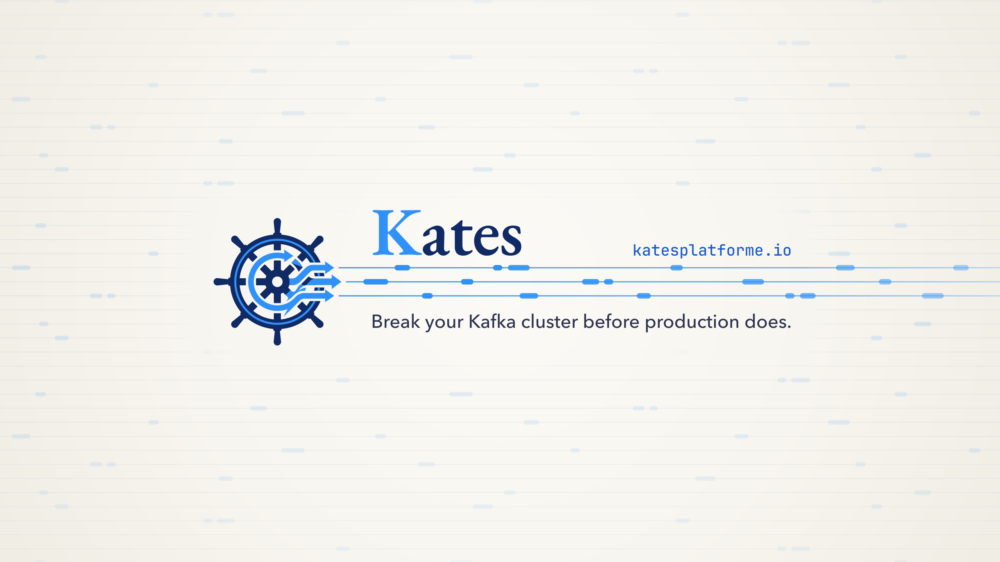
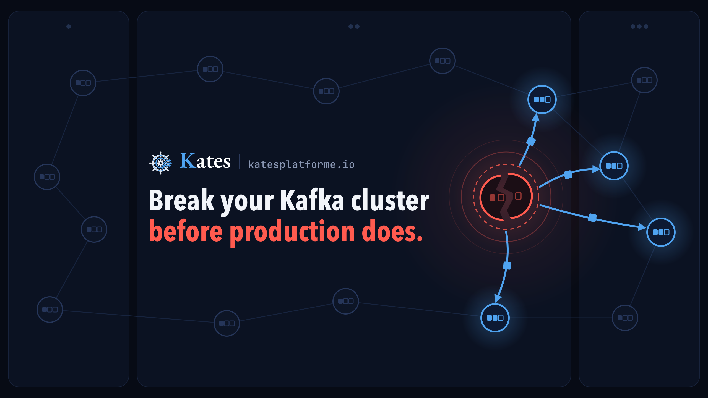
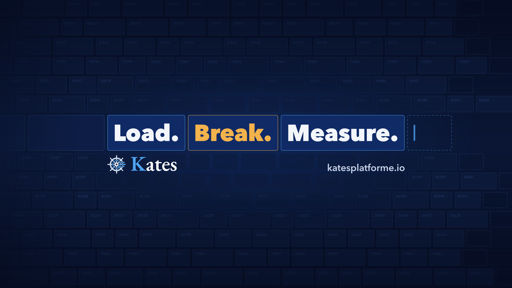
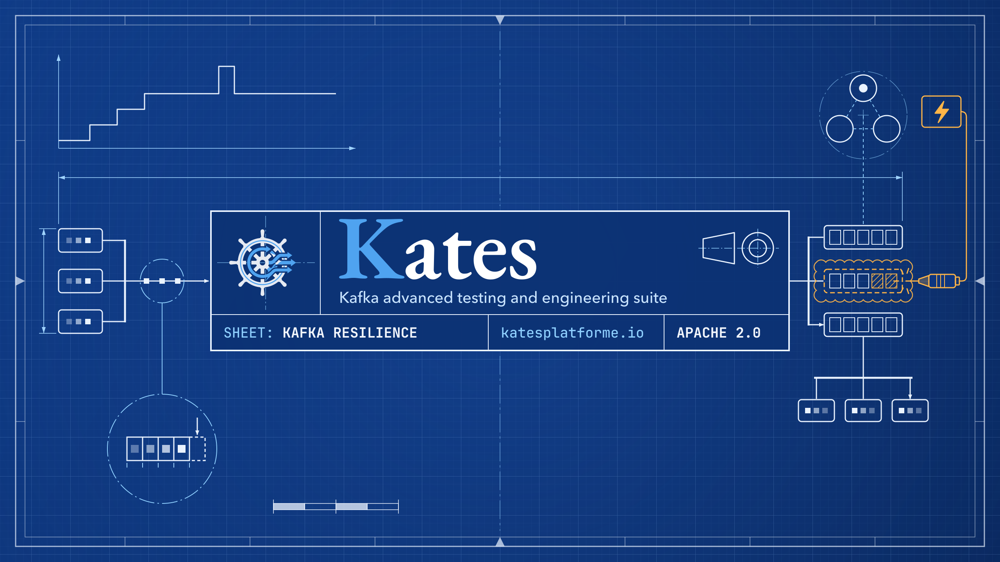
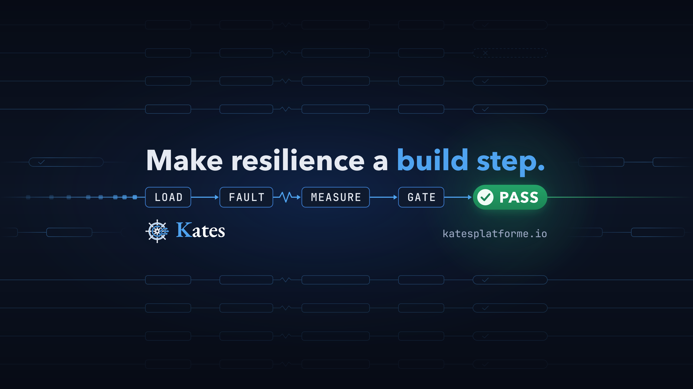
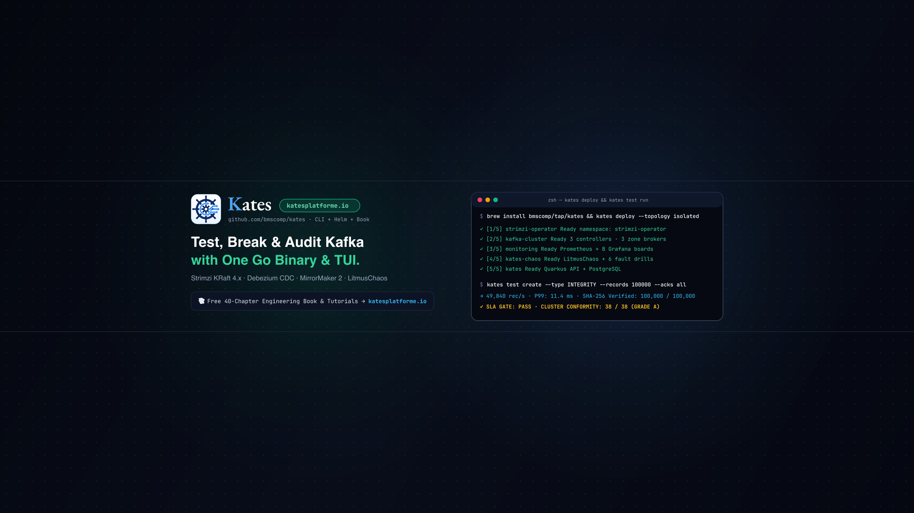
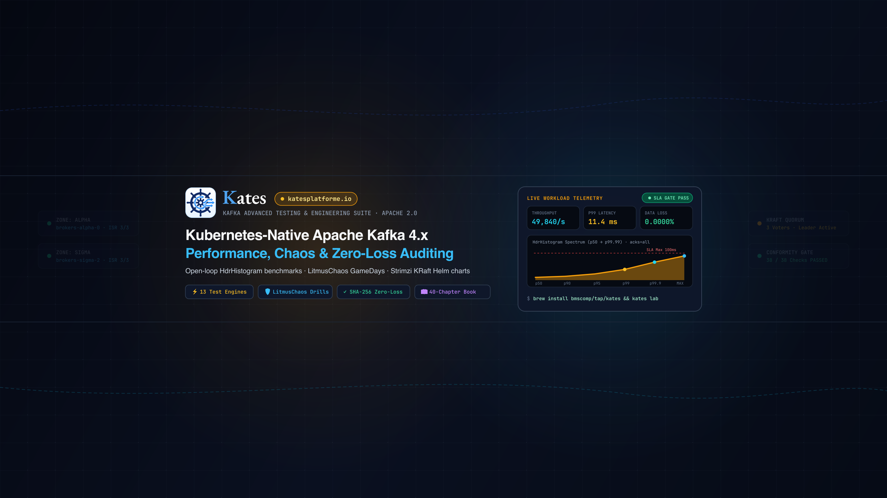

# YouTube banner proposals

Seven banners were drawn for the Kates YouTube channel. Each is a 2560 × 1440 SVG with its PNG export beside it, ready to upload. Every one writes "Kates" the way the book cover does: the cover's EB Garamond title ([`../../book/assets/cover.svg`](../../book/assets/cover.svg), `#title`) copied as outlines, with the K in blue and "ates" in white. The outlines mean the banner looks the same wherever it is rendered, without the font installed. Brand Streams is the one light banner, so its "ates" is the cover's navy, since white would vanish on cream.

The first five were scored by an independent review against YouTube's safe area, legibility at phone size, the facts they state, and the logo. The scores are out of 10. No review found anything that breaks the spec. The main risk named for each is what that review would fix next.

| Proposal | Score | What it does, and its main risk |
|:--|:--|:--|
| [Brand Streams](kates-youtube-banner-streams.svg) | 8 | The only light banner, on the website's cream. The three streams leaving the logo run on across the whole width as event streams. The domain is its weakest text: thin at phone size. |
| [Broker Down](kates-youtube-banner-broker-down.svg) | 8.5 | Brokers across three zones, one of them broken, with leadership moving to the survivors, under "Break your Kafka cluster before production does." A phone shows the broken broker but none of the survivors, so the recovery half of the idea comes through only on desktop and TV. |
| [Append-only Log](kates-youtube-banner-log.svg) | 8.5 | A partition log of offset cells fills the canvas; "Load. Break. Measure." sits in three highlighted cells as the newest records. Cells are cut off at both phone edges, and the domain is small. |
| [Engineering Blueprint](kates-youtube-banner-blueprint.svg) | 8 | A Kafka-on-Kubernetes schematic drawn as an engineering sheet, with "Kates" as the drawing's title in a title block. The most finished on desktop and TV, but its tagline and sheet row, set at 36 to 40 px, shrink to about 10 px on a phone. |
| [CI Gate](kates-youtube-banner-ci-gate.svg) | 8.5 | "Make resilience a build step." above a LOAD → FAULT → MEASURE → GATE → PASS pipeline whose rails run the full width. Its logo is small: about 22 px on a phone, where the helm blurs into a plain wheel. |
| [Terminal](kates-youtube-banner-terminal.svg) | – | A terminal session deploying Kates and running an integrity test, beside the logo and a book callout. Not reviewed. Its terminal prints throughput, P99 and conformity figures as if measured, and most of its text is too small to read on a phone. |
| [Telemetry](kates-youtube-banner-telemetry.svg) | – | A metrics card with a percentile chart beside the logo and four capability pills. Not reviewed. Its card prints throughput, latency and data-loss figures as if measured, and most of its text is too small to read on a phone. |

 
 
 


## What each device shows

YouTube crops the same 2560 × 1440 image differently on each screen, always around the centre:

| Device | Visible area |
|:--|:--|
| TV | the whole 2560 × 1440 |
| Desktop | a 2560 × 423 strip, y 508 to 931 |
| Tablet | 1855 × 423 |
| Phone, and the safe area for every device | 1546 × 423, x 507 to 2053, y 508 to 931 |

So every word and the logo sit inside the 1546 × 423 safe area, with about 30 px of margin, and the decoration runs past it so the desktop strip and the TV view are not empty. A phone shows the safe area about 390 px wide, a quarter of its size. That is why the five proposals set every word at 34 px or more and their headlines at 84 px or more. The log's offset numbers are smaller, but they are background texture, not text to read.

## Rendering and uploading

Export a PNG from an SVG with:

```bash
rsvg-convert -w 2560 -h 1440 kates-youtube-banner-log.svg -o kates-youtube-banner-log.png
```

To see what desktop and phone viewers get, crop around the centre with `sips -c 423 2560` and `sips -c 423 1546`.

Upload the PNG in YouTube Studio under Customization, then Branding, then Banner image. YouTube takes files up to 6 MB; these are under 600 KB each.
