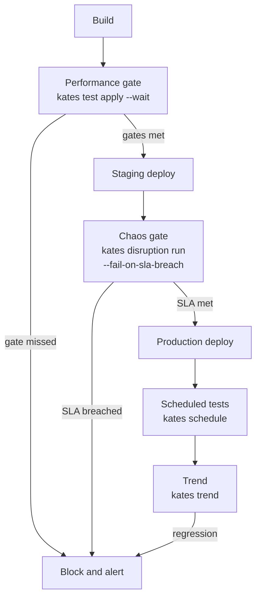

# Introduction

You find out how a Kafka cluster handles a [broker](appendix-a-glossary.md#gl-broker) failure on the day a broker fails, unless you've already tried it. Kates lets you try it first: it puts load on the cluster, injects the failure, and checks the numbers against targets you set. It's built for the people who run, test or are about to inherit an Apache Kafka cluster: platform engineers, SREs and developers.

After this chapter, you can:

- Say what Kates tests that a generic load tool can't, and which nearby jobs it leaves to other tools
- Connect the CLI to a running Kates API, start a [LOAD](appendix-a-glossary.md#gl-test-type) run and find its report
- Name the parts of that first report the payments targets are judged on

## What Is Kates?

Kates (Kafka Advanced Testing & Engineering Suite) is a tool for performance testing and chaos engineering on Apache Kafka clusters. It has two halves: the `kates` CLI on your machine, and the [Kates API](appendix-a-glossary.md#gl-kates-api), a service in the cluster that generates load, drives faults and keeps every run in [PostgreSQL](appendix-a-glossary.md#gl-postgresql). [Architecture & Design](02-architecture.md) shows the parts. Together they answer questions like these:

- *How many records per second can my cluster sustain before latency degrades?*
- *What happens to in-flight messages when a broker dies?*
- *Does my cluster recover from a [network partition](appendix-a-glossary.md#gl-network-partition) within the [SLA](appendix-a-glossary.md#gl-sla) I set?*
- *Is there any data loss under cascading failures?*

A generic load testing tool treats Kafka as an endpoint that accepts requests. Kates sets [producer acknowledgments](appendix-a-glossary.md#gl-acks), batching and consumer group settings for each test, and a fault can aim at a [partition](appendix-a-glossary.md#gl-partition)'s leader while Kates tracks the [ISR](appendix-a-glossary.md#gl-isr). `kafka-producer-perf-test` prints its numbers and exits; Kates stores every run, checks it against your targets and keeps the history for trends. A [safety guard](appendix-a-glossary.md#gl-safety-guard) checks each [disruption](appendix-a-glossary.md#gl-disruption) before it starts.

## The Problem Space

Before you trust a cluster with production traffic, you need answers in three areas, and each one is tested differently. The table names what you test in each area and the chapters that test it; its last two rows cover what you need around the tests:

| Area | What you test | Where the book tests it |
|----------------|--------------------------------------------------|----------------------------------------|
| Performance | Throughput under load, latency percentiles, capacity limits | [Performance Theory](04-performance-theory.md), [Test Types Deep Dive](05-test-types.md) |
| Resilience | Broker failure recovery, network partition tolerance, cascading failures | [Chaos Engineering in Practice](07-chaos-practice.md) |
| Data integrity | No acknowledged record lost, ordering, duplicates | [Data Integrity Verification](08-data-integrity.md) |
| Observability | Heatmaps, trends and exports of every run | [Observability & Monitoring](09-observability.md) |
| Operations | Deploying, upgrading and sharing the stack | [Deployment Guide](12-deployment.md) |

Most teams check these by hand: a perf-test script, a [Grafana](appendix-a-glossary.md#gl-grafana) dashboard watched while someone deletes a pod, and a judgment call. Kates turns the same checks into tests you can repeat, run in a pipeline and check against targets you set.

## Design Philosophy

Five principles shape Kates, and each later chapter leans on one of them.

### Kafka-Native

The native [benchmark backend](appendix-a-glossary.md#gl-benchmark-backend), which generates a test's load by default, runs real Kafka producers and consumers with the `acks`, batching, compression and [consumer group](appendix-a-glossary.md#gl-consumer-group) settings of the test's spec. A [disruption plan](appendix-a-glossary.md#gl-disruption-plan) can aim a fault at a partition's leader and track a [topic](appendix-a-glossary.md#gl-topic)'s ISR while the fault runs.

### Kubernetes-First

Kates runs inside Kubernetes and targets [Strimzi](appendix-a-glossary.md#gl-strimzi)-managed clusters. It injects faults through [LitmusChaos](appendix-a-glossary.md#gl-litmuschaos), which `make all` installs with the rest of the stack, or straight through the Kubernetes API if you choose; [Chaos Engineering in Practice](07-chaos-practice.md) says which faults each can run. Load tests work against any Kafka cluster the Kates API can reach.

### SLA-Driven

Every test can carry the targets it must meet. Kates calls them SLA thresholds, though they work like SLOs: targets you set, not agreements with anyone [@beyer2016site]. In a [scenario file](appendix-a-glossary.md#gl-scenario-file) they are [gates](appendix-a-glossary.md#gl-gate), which `kates test apply --wait` checks after each run, exiting 1 when one is missed. A disruption plan's thresholds earn it an [SLA grade](appendix-a-glossary.md#gl-sla-grade) from A to F instead. So a CI job can fail the build when [throughput](appendix-a-glossary.md#gl-throughput) drops or [P99](appendix-a-glossary.md#gl-percentile) rises past a gate.

### Observable

Every run is stored as a report, which `kates report show <id> -o json` prints as JSON. `kates report export` writes it as CSV, as JUnit XML for CI, as Markdown or HTML, or as [heatmap](appendix-a-glossary.md#gl-heatmap) data in JSON or CSV that shows how latency spread over time. While a test runs, `kates top` and the live dashboard show it as it happens.

### Safe by Default

Before a plan runs, Kates refuses it when its steps would hit more broker pods than its `maxAffectedBrokers` allows or leave no broker untouched, and before each fault it checks that every Kafka pod is Ready. By default, when a step fails, [rollback](appendix-a-glossary.md#gl-disruption-rollback) gives back a broker a scale-down removed and deletes the NetworkPolicies Kates created for a network partition. [Safety Guardrails](07-chaos-practice.md#safety-guardrails) in Chaos Engineering in Practice says exactly what it checks, and [Limits of the Guard](07-chaos-practice.md#limits-of-the-guard) what it doesn't.

## How Kates Fits into Your Workflow

The diagram places Kates in a delivery pipeline as two gates, each named by the command that implements it. Read it from the top: a build passes a performance gate before staging and a chaos gate before production, and after release, scheduled tests feed a trend that sends any regression to the same block-and-alert step.



Kates serves both as a check before a merge (a short LOAD run) and as the gate before production (the disruption plans with their SLA blocks).

## Quick Start

You run the payments platform, and before it moves onto [`krafter`](appendix-a-glossary.md#gl-krafter), the Kafka cluster under test, you have to say whether the cluster can carry it. The book turns that into targets a Kates run can check. `krafter` must take 2,000 records per second of 1 KiB with `acks=all`, and answer writes with a P99 of 100 ms or less from send to acknowledgment. It must also lose no acknowledged record when one broker or one zone fails.

The Quick Start takes the first step: a LOAD run against `krafter` and its report. It assumes a checkout of the repository, for the `make` targets, and a stack deployed with `make all` or `kates deploy` in the [isolated topology](appendix-a-glossary.md#gl-isolated-topology), which puts the Kates API in the `kates` namespace and `krafter` in `kafka`. In the book's lab that stack runs on [`panda`](appendix-a-glossary.md#gl-panda), the three-node Kind cluster.

```bash
# Install the CLI
make cli-install

# Forward the Kates API to localhost:30083, in the background
make ports

# Connect, with the API key the chart generated
KEY=$(kubectl get secret kates-api-key -n kates \
  -o jsonpath='{.data.api-key}' | base64 -d)
kates ctx set local --url http://localhost:30083 --api-key "$KEY"
kates ctx use local

# Check system health
kates health

# Run your first test
kates test create --type LOAD --records 100000 --wait

# <id> is the ID test create printed; test list shows it again
kates test list
kates report show <id>
```

Every `/api` endpoint except `/api/health` needs the [API key](appendix-a-glossary.md#gl-api-key) the `kates` chart generates into the `kates-api-key` [Secret](appendix-a-glossary.md#gl-secret), which is why `kates ctx set` takes `--api-key` and why `kates health` works before the key is set. Without a key in the [CLI context](appendix-a-glossary.md#gl-cli-context), `kates test create` fails with an error that starts `[401] Missing API key`.

`kates ports` does both steps at once: it forwards the API to `localhost:8080`, creates a CLI context named `ports` with the key from the Secret and makes it current. With the [single-namespace topology](appendix-a-glossary.md#gl-single-namespace-topology) (option 1 in `make all`), the Secret lives in `kates-stack`: use `-n kates-stack` above, and `KATES_NS=kates-stack make ports`. The [Deployment Guide](12-deployment.md) covers how `kates deploy` fills a context's key.

The report shows a throughput summary, a latency distribution from average through P99, an error rate, and an SLA section, which reads `All SLA thresholds met` unless the run missed a threshold it carried. The payments targets are judged on the `produce` row of `kates test get <id>`: its throughput, and its P99, which times each write from send to acknowledgment. This first run carries no targets yet: Part II writes them into a scenario file whose gates check them.

The REST and [gRPC](appendix-a-glossary.md#gl-grpc) examples in this book read the same key from the `KATES_API_KEY` variable; [Authentication](11-api-reference.md#authentication) in REST API Reference shows how to export it.

For a complete setup guide, see [Deployment Guide](12-deployment.md). [Tutorial 1: Getting Started with Kates](../tutorials/01-getting-started.md) goes over the same ground one step at a time, and the [Kates Tutorials](../tutorials/README.md) continue from there.

::: {.callout-tip title="Try it: What does acks=1 buy you in latency?"}
Run the Quick Start's test again with `--acks 1`, then put the two reports side by side:

```bash
kates test types
kates test create --type LOAD --records 100000 --acks 1 --wait
kates test list --type LOAD
# the Quick Start run used the acks=all default
kates report diff <quick-start-id> <id>
```

The diff shows what relaxing producer acknowledgments buys you in latency.
:::

## What Kates Is Not

Kates leaves several nearby jobs to other tools:

- It isn't a Confluent Platform replacement or a managed Kafka distribution. It tests clusters that Confluent, Strimzi or any other Kafka deployment runs.
- It isn't a general-purpose load tester. Its tests are built around Kafka behavior, such as ISR tracking, consumer [rebalancing](appendix-a-glossary.md#gl-rebalance) and partition leadership. For HTTP or gRPC load, use k6, Gatling or Locust.
- It isn't a Kafka management UI. To browse topics, consumer groups and cluster state in a browser, use [Kafka UI](appendix-a-glossary.md#gl-kafka-ui), which Kates deploys alongside the cluster.
- It isn't a production monitoring system. Kates runs in test and validation environments; monitor production with [Prometheus](appendix-a-glossary.md#gl-prometheus) and Grafana directly. Kates deploys both too, for its own observability.

## Summary

- Kates pairs performance testing with chaos engineering and speaks Kafka: producer acknowledgments, ISR state and partition leadership, not a black-box endpoint.
- Production readiness spans performance, resilience and data integrity, and Kates checks all three with repeatable tests against targets you set.
- You can connect the CLI to a running Kates API, start a LOAD run and find its report.
- Every run is stored and exportable as JSON, CSV, JUnit XML or heatmap data, so results feed CI gates and trends rather than scrollback.
- Kates is a testing and validation platform, not a Kafka distribution, a management UI or a production monitoring system.

Next, [Architecture & Design](02-architecture.md) follows a LOAD run through those two halves: which part generates the load, where the faults come from, and where the report you just read is kept.
