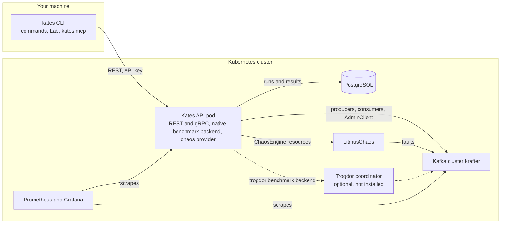
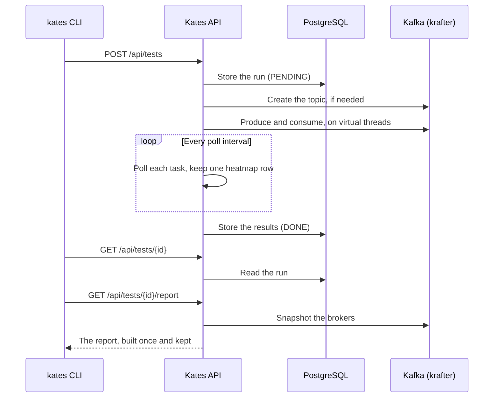
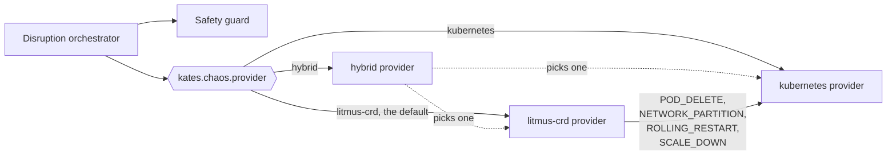
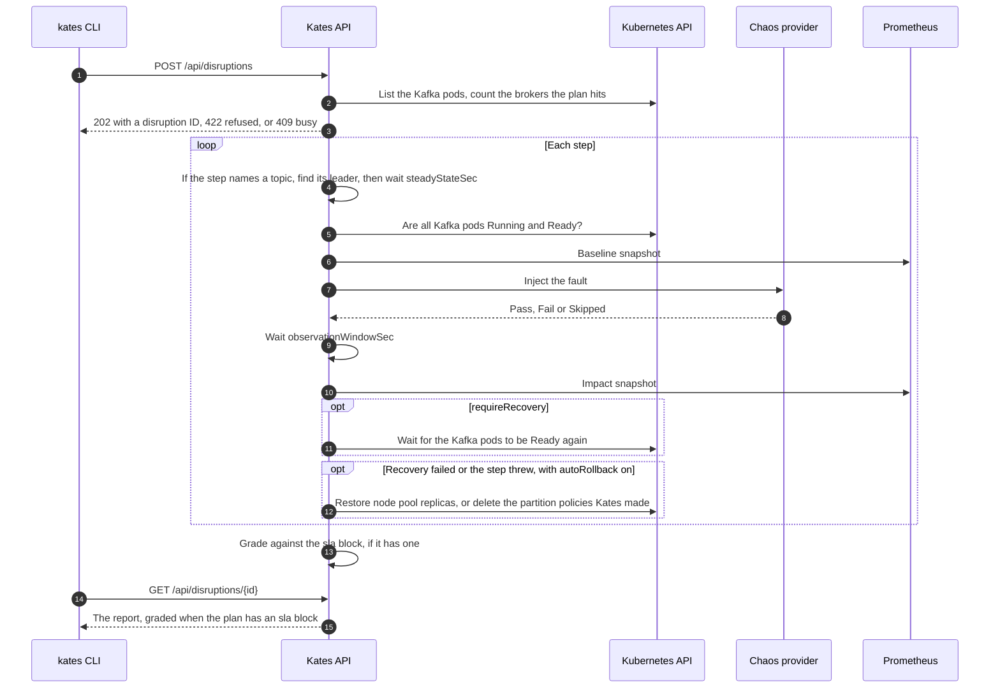

# Architecture & Design

The half of Kates that does the work isn't on your machine. The `kates` CLI runs where you type; everything that generates load, injects faults and keeps results runs in the cluster, one Deployment away from the Kafka cluster it tests. When a heatmap goes missing or a Grafana board goes quiet, this is the chapter with the answer. After this chapter, you can:

- Name Kates's parts and say where each one runs
- Trace a [LOAD](appendix-a-glossary.md#gl-test-type) run from `kates test create` to its report, and say where each step happens
- Say what the [safety guard](appendix-a-glossary.md#gl-safety-guard) checks before a [disruption plan](appendix-a-glossary.md#gl-disruption-plan) injects a fault, and what it rolls back when a step fails
- Say where a run's results live, and how long each piece of them lasts

## High-Level Architecture

Kates has two halves: the `kates` CLI on your machine, and the [Kates API](appendix-a-glossary.md#gl-kates-api) in the cluster, as one Deployment beside the Kafka cluster it tests. The Kates API generates the load, asks for the faults, grades disruption plans and keeps every run in [PostgreSQL](appendix-a-glossary.md#gl-postgresql). Around them, `kates deploy` installs Kafka, PostgreSQL, LitmusChaos, Prometheus and Grafana.

The diagram shows the main parts of a default `kates deploy` and who calls whom. Solid arrows are the default paths; the dashed ones are the [Trogdor](appendix-a-glossary.md#gl-trogdor) path, which `kates deploy` doesn't set up.



Read it from the left. The CLI calls the Kates API over REST, with the URL and API key of your [CLI context](appendix-a-glossary.md#gl-cli-context). For the commands that install and reach the stack, such as `kates deploy` and `kates ports`, it runs `kubectl` and `helm` against your current Kubernetes context instead. The [Commands](10-cli-reference.md#commands) table in CLI Reference says which command takes which path. In the cluster, the Kates API talks to [`krafter`](appendix-a-glossary.md#gl-krafter), the Kafka cluster under test, as an ordinary Kafka client, and keeps each run in PostgreSQL. On the default [chaos provider](appendix-a-glossary.md#gl-chaos-provider), it creates [LitmusChaos](appendix-a-glossary.md#gl-litmuschaos) resources for every fault except `POD_DELETE`, `NETWORK_PARTITION`, `ROLLING_RESTART` and `SCALE_DOWN`, which it injects itself through the Kubernetes API. [Prometheus](appendix-a-glossary.md#gl-prometheus) scrapes the [brokers](appendix-a-glossary.md#gl-broker) and the Kates API, and the Kates API reads Prometheus back for a disruption plan's broker metrics.

Each part in the table runs in one place. The namespaces are those of the default [isolated topology](appendix-a-glossary.md#gl-isolated-topology). With `--topology single`, every in-cluster part except Trogdor shares the `kates-stack` namespace; [Single-Namespace vs Multi-Namespace](12-deployment.md#single-namespace-vs-multi-namespace) compares the two layouts.

| Part | What it does | Where it runs |
|:--|:--|:--|
| `kates` CLI | Calls the Kates API, and runs `kubectl` and `helm` for the commands that install, reach and remove the stack | Your machine |
| Lab, `dashboard`, `top` and `kafka tui` | Terminal views on the Kates API; every run Lab starts, warm-ups and median runs included, is one [test run](appendix-a-glossary.md#gl-test-run) | Your machine, inside the CLI |
| `kates mcp` | Serves read-only tools to an AI agent, whose MCP client starts it | Your machine, inside the CLI |
| Kates API | Serves REST and [gRPC](appendix-a-glossary.md#gl-grpc) on port 8080, and runs tests, [disruptions](appendix-a-glossary.md#gl-disruption) and schedules | Deployment `kates`, namespace `kates` |
| Native [benchmark backend](appendix-a-glossary.md#gl-benchmark-backend) | Runs a test's producers and consumers on [virtual threads](appendix-a-glossary.md#gl-virtual-thread) inside the Kates API | The Kates API pod |
| Trogdor benchmark backend | Sends a test's workload to a Trogdor coordinator, which `kates deploy` doesn't install | The Kates API pod; the load comes from the Trogdor agents you run |
| Chaos provider | Turns each fault into LitmusChaos resources or direct Kubernetes API calls | The Kates API pod |
| LitmusChaos | Runs the experiments the chaos provider asks for | [Operator](appendix-a-glossary.md#gl-operator) in `litmus`; ChaosEngines in `kafka` |
| PostgreSQL | Keeps runs and their results, disruption reports, schedules, [baselines](appendix-a-glossary.md#gl-baseline) and audit events | StatefulSet `kates-postgresql`, namespace `kates` |
| `krafter` | The Kafka cluster under test | Namespace `kafka` |
| Prometheus and [Grafana](appendix-a-glossary.md#gl-grafana) | Scrape and chart the brokers and the Kates API | Namespace `monitoring` |

Port 8080 is a cluster port, so the CLI reaches it through a forward or an Ingress. `kates ports` forwards the Kates API to `localhost:8080` and points a CLI context named `ports` at it, with the key from the chart's API-key Secret. `kates deploy` writes that key into the CLI context that is current when it finishes. To use an Ingress or another forward, point a context at it with `kates ctx set`, as [Context Management](10-cli-reference.md#context-management) in CLI Reference shows.

The Kates API is one process, and that has a cost. A native run's producers and consumers share the pod's CPU and memory with everything else the Kates API does. When `kates deploy` runs a native image from your machine on [Kind](appendix-a-glossary.md#gl-kind), it limits the pod to one CPU and 512 MiB of memory. With the published image, on Kind or any other cluster, the limits are two CPUs and 1 GiB. A [throughput](appendix-a-glossary.md#gl-throughput) ceiling you measure can therefore be the pod's rather than `krafter`'s.

The Kates API comes as two images built from the same code: a JVM image and a [GraalVM native image](appendix-a-glossary.md#gl-graalvm-native-image). On a Kind cluster, `kates deploy` runs a native image that you built or pulled onto your machine, `kates:native-local` or else `kates:native`, when one is there; otherwise the cluster pulls the published native image. On any other cluster, admin-less installs included, it runs the published native image. The JVM image is for a plain `helm install`. The two collect garbage differently: the native image's Serial GC stops the Kates API for every collection, and those pauses land in the latencies it records. [Native Image Build](12-deployment.md#native-image-build) explains when to run which.

### Technology Stack

The table lists what Kates is built with and the tools it works beside; the [Version & Compatibility Matrix](appendix-d-versions.md) gives the version of each. A default `kates deploy` installs neither [Jaeger](appendix-a-glossary.md#gl-jaeger), [Velero](appendix-a-glossary.md#gl-velero) and its SeaweedFS object store, nor [Kyverno](appendix-a-glossary.md#gl-kyverno). It does install the Strimzi operator, cert-manager, Apicurio Registry and Kafka UI, beside the parts in [High-Level Architecture](#high-level-architecture).

| Component | Technology | Purpose |
|-----------|-----------|---------|
| Kates API | Quarkus | REST and gRPC framework, CDI, native compilation |
| Runtime | Java | Virtual threads |
| Build | Maven | Kates API build system |
| CLI | Go, with Cobra | Cross-platform binary, command parsing and help |
| Cluster | Kind | Local Kubernetes |
| Kafka | Apache Kafka | KRaft mode, [Share Groups](appendix-a-glossary.md#gl-share-group) |
| Operator | [Strimzi](appendix-a-glossary.md#gl-strimzi) | Kafka lifecycle management |
| Chaos | LitmusChaos | Runs the default chaos provider's experiments |
| Monitoring | Prometheus and Grafana | Metrics collection and visualization |
| Tracing | Jaeger ([OTLP](appendix-a-glossary.md#gl-otlp)) | Distributed trace collection |
| Registry | [Apicurio](appendix-a-glossary.md#gl-apicurio-registry) | Schema registry for Kafka |
| Database | PostgreSQL | Test results and schedule persistence |
| Backup | Velero and SeaweedFS | Cluster backup and restore |
| Policy Engine | Kyverno | Admission control, PSS enforcement, NetworkPolicy generation |

## The Kates API

The Kates API is a Quarkus application that serves a REST API and a gRPC API ([gRPC API Reference](16-grpc-api.md)) and runs each test from start to finish. Both APIs call the same service layer, so a test run behaves the same whichever API starts it. The gRPC API covers fewer operations, and some of its responses carry less than their REST counterparts, as its chapter lists.

The sequence shows one LOAD run, as the Quick Start starts it. Notice two things: the Kates API polls the run's tasks on an interval and keeps a heatmap row each time, and nothing builds a report until the CLI asks for one.



Nothing about the run is written to Kafka except its load: the run and its results go to PostgreSQL. The report is built from the stored run the first time something asks for it.

### The Orchestrator

When a test is created, the orchestrator (`TestOrchestrator`) merges the request with the defaults of its test type, and creates the [topic](appendix-a-glossary.md#gl-topic) with the requested [partition](appendix-a-glossary.md#gl-partition) count and [replication factor](appendix-a-glossary.md#gl-rf) if it doesn't exist. It then starts the producers and consumers through the benchmark backend and polls each task. On every poll of a running test, it keeps the latency buckets recorded so far as one [heatmap](appendix-a-glossary.md#gl-heatmap) row.

The report it builds on request carries summary metrics, broker correlation and whether the run met its [SLA](appendix-a-glossary.md#gl-sla) thresholds, which are targets you set, in the style of an SLO.

### The Native Benchmark Backend

The native benchmark backend (`NativeKafkaBackend`) runs each test's producers and consumers on virtual threads inside the Kates API [@jep444]. It is one of two benchmark backends; the other, `trogdor`, sends the workload to a Trogdor coordinator, and [Test Types Deep Dive](05-test-types.md) compares them. Its producers send records of the configured size with the test's [acknowledgment mode](appendix-a-glossary.md#gl-acks) and throttle to its throughput, and its consumers read in the test's [consumer group](appendix-a-glossary.md#gl-consumer-group). Each task records its latencies, and an INTEGRITY task also tracks sequence numbers, acknowledgment gaps and duplicates.

### How Latency Is Recorded

Each task records latencies in an HdrHistogram set to 1 µs through 60 s with three significant digits, so sub-millisecond values keep their resolution while tails up to 60 seconds still count. [P50](appendix-a-glossary.md#gl-percentile), P95 and P99 come from the cumulative histogram of everything the task recorded. Each poll copies that histogram into 25 heatmap buckets without resetting it. The buckets have fixed edges, in milliseconds: 0, 0.5, 1, 2, 3, 5, 7, 10, 15, 20, 30, 50, 75, 100, 150, 200, 300, 500, 750, 1000, 1500, 2000, 3000, 5000, 7500 and 10000.

::: {.callout-tip title="Try it: Where did the Quick Start's run go?"}
Take the ID the Quick Start printed, read the run, its report and its heatmap, then restart the Kates API and read them again:

```bash
kates test get <id>          # the run, from PostgreSQL
kates report show <id>       # the report, built on request
kates report heatmap <id>    # the heatmap rows, from memory
kubectl -n kates rollout restart deployment kates
kubectl -n kates rollout status deployment kates
```

Run the first three again: the run and its report answer, and the heatmap is gone.
:::

## Disruption Engine

A disruption plan injects faults step by step and watches the cluster from outside, while a [resilience run](appendix-a-glossary.md#gl-resilience-run), started with `kates resilience run`, injects one fault under a Kates test and measures what a client sees. Both get the fault from the Kates API's chaos provider, LitmusChaos by default, as [Chaos Engineering in Practice](07-chaos-practice.md) explains.

The diagram shows how a plan reaches its faults. Look at the provider setting: one value picks the chaos provider that every fault goes through.



While a step runs, Kates reads the [ISR](appendix-a-glossary.md#gl-isr), consumer lag and partition leaders from Kafka, as [Kafka Metrics](07-chaos-practice.md#kafka-intelligence) describes. It also takes a Prometheus snapshot of the brokers before and after the fault, and grades the plan against its `sla` block when it has one. The [disruption types](appendix-a-glossary.md#gl-disruption-type) run from killing a broker pod to draining a node; `kates disruption types` lists them, and [Disruption Types](07-chaos-practice.md#disruption-types) describes each one per provider.

The disruption path adds two things the test path lacks: a check that can refuse the plan, and a rollback when a step fails. This diagram traces a plan from `kates disruption run` to its report:



Before the plan touches the cluster, the safety guard counts the brokers its steps would hit and refuses the plan if that's every broker, or more than the plan's `maxAffectedBrokers`. Before each fault it checks that every Kafka pod is Running and Ready. When a step fails with `autoRollback` on, [rollback](appendix-a-glossary.md#gl-disruption-rollback) gives a scaled-down node pool its broker back, or deletes the [NetworkPolicies](appendix-a-glossary.md#gl-networkpolicy) Kates created for a network partition. [Safety Guardrails](07-chaos-practice.md#safety-guardrails) in Chaos Engineering in Practice says exactly what it checks, and [Limits of the Guard](07-chaos-practice.md#limits-of-the-guard) what it doesn't.

## The CLI

The CLI is a standalone Go binary built with Cobra. It calls the Kates API over REST for test, report and disruption operations. For cluster provisioning and lifecycle tasks such as `kates deploy`, `kates clean` and `kates ports`, it runs `kubectl`, `helm` and `kind` instead. It keeps your contexts, [profiles](appendix-a-glossary.md#gl-profile) and [snapshots](appendix-a-glossary.md#gl-snapshot) in files in your home directory; the [Commands](10-cli-reference.md#commands) table in CLI Reference says which command uses which.

Like `kubectl`, the CLI has named contexts, so one CLI can switch between Kates APIs. It prints tables, badges, metric bars and [sparklines](appendix-a-glossary.md#gl-sparkline) on a terminal, and JSON with `-o json` for scripts. `kates test scaffold export <name>` writes a ready-to-use YAML [scenario file](appendix-a-glossary.md#gl-scenario-file) to the current directory, and `kates test scaffold list` browses the library, filtered with `--type LOAD` if you like. `kates test watch` follows a run as it progresses.

## Where Results Live

A run's results live in PostgreSQL, not in Kafka, and the rest of what you see about a run lives somewhere with a shorter life. Knowing which is which explains why a Grafana board goes quiet after a run while `kates trend` can still reach every `DONE` run the Kates API has kept, and why a run's heatmap can be missing.

The table lists what Kates keeps about a run, where each piece lives and how long it lasts:

| What | Where it lives | How long it lasts |
|:--|:--|:--|
| The run: its spec, status, per-task results, an INTEGRITY task's integrity result among them, and SLA | PostgreSQL: the `kates` chart's own, beside the Kates API, or an external database | 90 days; once a day the Kates API deletes finished runs older than that, except a run a baseline names, and `kates test prune` deletes them sooner |
| Disruption reports, schedules, webhooks and audit events | PostgreSQL | No automatic expiry |
| A baseline: the run each test type is compared with | PostgreSQL | The baseline never expires; retention and `kates test prune` keep the run it names. `kates test delete` can still delete it, and the regression check then answers `404` until a new baseline is set |
| The report of a finished run, as `report show` prints it | Built from the stored run when first asked for, then kept in the Kates API's memory | The 200 most recently used, until the pod restarts; then built again |
| A resilience run's report | The response to `kates resilience run` | Not stored; the test run inside it is kept like any other |
| Heatmap rows, for native runs | The Kates API's memory | The 50 most recent runs, until the pod restarts |
| Per-run meters | The Kates API's `/q/metrics`, scraped into Prometheus | Until the run ends; Prometheus keeps the samples for its retention |
| Security audit grades behind `security trend` | The Kates API's memory | The last 100 audits, until the pod restarts |
| Contexts, profiles, snapshots and saved Lab sessions | Files in your home directory | Until you delete them |

::: {.callout-important title="A report is not a record"}
The Kates API builds a finished run's report the first time something asks for it and keeps it in memory. The broker figures that `report brokers` prints therefore describe the topic's [partition leaders](appendix-a-glossary.md#gl-partition-leader) at that moment, not during the run. A restart can change them.
:::

A Grafana board built on per-run meters stops getting data when the run ends, while `kates trend` and `report show` still answer, because the runs they read are in PostgreSQL.

No Kafka topic holds a run's results. The Kates API writes them only to PostgreSQL. When a run changes status, it also writes a lifecycle event to an outbox table in the same transaction, for a poller to publish to Kafka, the [transactional outbox](appendix-a-glossary.md#gl-transactional-outbox) pattern [@richardson2018microservices]. The event carries the run's ID, type, status and time, never its results. The topics that the `kafka-cluster` chart's [platform profile](appendix-a-glossary.md#gl-platform-profile) creates on `krafter`, such as `kates-results`, hold none of them either.

The events go to `kates-test-events`, a topic the Kates API creates for itself on the cluster it tests ([Topics](03-cluster.md#topics) gives its settings), and the Kates API reads them back from it. A `DONE` or `FAILED` event read there is what calls the registered [webhooks](10-cli-reference.md#webhook-notifications), so a webhook fires only once its event has made the round trip through Kafka. The poller deletes an event from the outbox when the broker acknowledges it. While Kafka is unreachable the events wait in the outbox and the poller retries them. After `kates.outbox.max-attempts` failed sends, 10 by default and at least 10 minutes when no broker answers, it moves an event to the `outbox_dead_letters` table, and that event's webhooks never fire.

Every replica of the Kates API reads `kates-test-events` in one consumer group, `kates-webhooks`, so one replica handles each event, and a replica that starts resumes from the group's [committed offset](appendix-a-glossary.md#gl-committed-offset). A group with no committed offset, as on its first start, reads from the oldest event the topic holds. The `processed_events` table remembers the events handled in the last 7 days (`kates.outbox.processed-events-retention-days`), so an event read twice fires its webhooks once, and the Kates API skips any event older than that.

What lives in the Kates API's memory goes with its pod. When the Kates API shuts down, it stops the runs in flight and stores them as `FAILED` with the error `Server shutdown`. When the pod dies without shutting down, those runs stay `RUNNING` until the Kates API starts again. It then marks them `FAILED` as it starts, each task that had not finished with the error `Recovered: test was orphaned after server restart`. In both cases, a run whose tasks were still being started stays `PENDING` until five minutes after the time it was set to last, when the Kates API fails it with an error that starts `Timeout: still pending`. Either way, each task keeps the figures it last recorded, and every heatmap and every built report is gone. `kates clean` goes further: it deletes the namespace that holds the bundled PostgreSQL, and every stored run with it.

### Data Model

PostgreSQL holds the runs and their per-task results, disruption reports, schedules, webhooks, baselines, snapshots and audit events. Flyway creates and upgrades the schema when the Kates API starts, from the migrations in `kates/src/main/resources/db/migration/`.

### Graceful Degradation

Distributed systems fail in partial ways [@waldo1997note], and each of Kates's dependencies fails in its own.

When Kafka is unreachable, running tests fail with a connection error, no new test can start, and `kates health` shows the Kafka cluster's `Status` as `DOWN`. Results already in PostgreSQL stay readable, and the Kates API reconnects on its own once Kafka is back.

When PostgreSQL is down, every command that creates or reads a run fails, because runs and their results live only there and no Kafka topic holds a copy. Bring PostgreSQL back.

When you cancel a run, the Kates API stops its tasks and stores it as `FAILED`, each unfinished task with the error `Cancelled by user`. The canceled run stays in history for comparison; run it again when you need a full one.

## Summary

- Kates has two halves: the Go CLI on your machine and the Kates API, one Quarkus service in the cluster that serves REST and gRPC.
- A LOAD run is one request to the Kates API, which creates the topic, runs producers and consumers and stores the result; reports are built on request.
- Latencies are recorded to the microsecond up to 60 s; the heatmap is a coarser copy kept in memory.
- A disruption plan is refused before anything runs if it would hit too many brokers; rollback runs only when a step fails.
- Results live in PostgreSQL; heatmaps, security grades and built reports live only in the Kates API's memory.

Every number the Kates API records is a number about `krafter`. [The Cluster Under Test](03-cluster.md) describes that cluster, from its brokers and controllers to its zones and replication settings, so that you can tell a Kafka limit from a Kates one.
