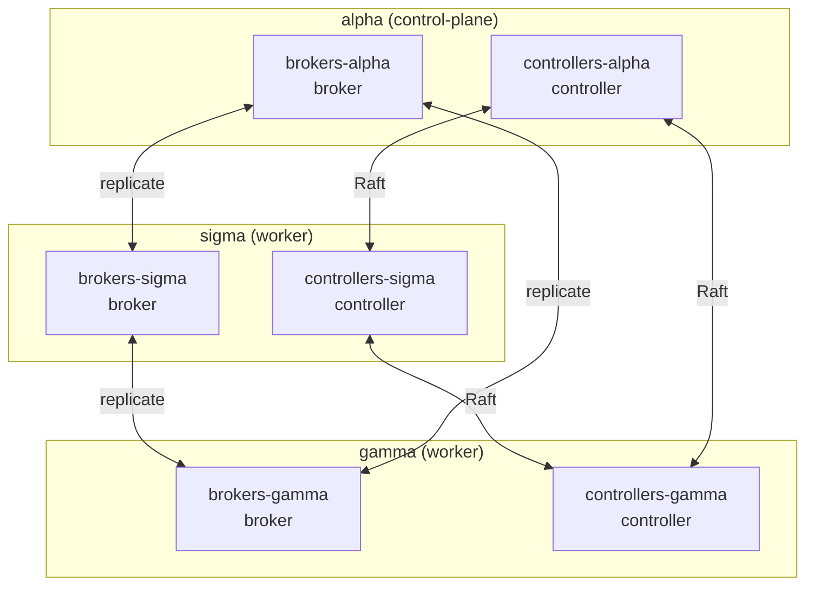
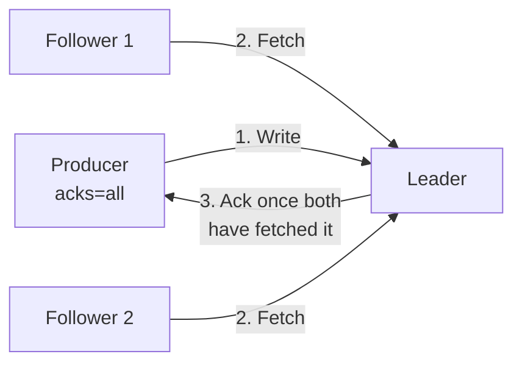

# The Cluster Under Test

Numbers from a cluster you don't understand lead to the wrong conclusions: you blame Kafka for a bottleneck that's [page cache](appendix-a-glossary.md#gl-page-cache) eviction, or celebrate a [throughput](appendix-a-glossary.md#gl-throughput) number that's only possible because replication was silently disabled.

The cluster is `krafter`: a [KRaft](appendix-a-glossary.md#gl-kraft) deployment with dedicated controller and broker pods, one of each per zone, on the three-node `panda` Kind cluster. Every number in Parts II to IV comes from it, from a quick [LOAD](appendix-a-glossary.md#gl-test-type) run to a multi-hour ENDURANCE run.

After this chapter, you can:

- Explain the Kafka ideas the book relies on, as `krafter` uses them
- Sketch the `krafter` node layout, with its dedicated KRaft [controllers](appendix-a-glossary.md#gl-controller) and zone-pinned [brokers](appendix-a-glossary.md#gl-broker), and explain why the roles are separated
- Predict from the failure tolerance matrix whether a given broker or controller loss stops writes, loses data, or neither
- Explain how the ~2Gi page cache budget and [`min.insync.replicas=2`](appendix-a-glossary.md#gl-min-insync-replicas) shape every latency number you measure here
- Inspect the live cluster with the `kates cluster` commands instead of memorizing its state

## Kafka You Need for This Book

The rest of this chapter, and of the book, describes `krafter` in Kafka's own terms. This section gives you the few ideas those descriptions rely on, as `krafter` uses them; if you run Kafka already, skim it and go on to [Physical Topology](#physical-topology).

### Topics, Partitions and Leaders

Kafka stores records in [topics](appendix-a-glossary.md#gl-topic): named streams that producers write to and consumers read from. Each topic is split into [partitions](appendix-a-glossary.md#gl-partition), which are ordered, append-only logs that different brokers can hold and different consumers can read at the same time [@kreps2011kafka]. Within its partition, each record has an [offset](appendix-a-glossary.md#gl-offset): its position, a number that only grows.

Each partition has replicas on different brokers, three on `krafter`. One replica is the partition's [leader](appendix-a-glossary.md#gl-partition-leader), and it takes every write to the partition; the others, its followers, fetch the leader's log and copy it. How many copies a write must reach before the leader acknowledges it is the subject of [Replication Configuration](#replication-configuration), and what happens when a leader's broker fails is the subject of [What Happens During a Broker Failure](#what-happens-during-a-broker-failure).

When a test names a topic that doesn't exist yet, Kates creates it with the spec's `partitions`, `replicationFactor` and `minInsyncReplicas`. A topic that already exists keeps its own settings, whatever the spec says.

### Consumer Groups, Offsets and Lag

A [consumer group](appendix-a-glossary.md#gl-consumer-group) is a set of consumers that share the reading of a topic. Kafka assigns each partition to one member of the group, so the members split the topic's partitions between them, and a group gains nothing from more members than partitions. Two groups that read the same topic each read all of it.

As a group reads, it commits offsets: for each partition, the offset of the next record it will read, which Kafka keeps in its internal `__consumer_offsets` topic. The committed offset is where a consumer resumes after a restart or a [rebalance](appendix-a-glossary.md#gl-rebalance). A group with no committed offset starts where its `auto.offset.reset` setting says. A LOAD, ENDURANCE or INTEGRITY consumer of the native [benchmark backend](appendix-a-glossary.md#gl-benchmark-backend) whose group has no committed offset for a partition starts at the first record written since its task was submitted, less a second. Records that earlier runs left on the topic are therefore not read. A test that names a `consumerGroup` resumes from the offsets that group committed in earlier runs, so give each test a group of its own.

[Consumer lag](appendix-a-glossary.md#gl-consumer-lag) is how far a group trails the log: for each partition, the partition's latest offset minus the group's committed offset, and a group's lag is the sum over its partitions. Lag that keeps growing means the consumers fall further behind the producers; lag that stays level means they keep pace, that many records behind. `kates cluster groups describe <group-id>` computes it this way and shows it per partition, in its Current, End and Lag columns, under the group's total.

::: {.callout-tip title="Try it: How far behind is a group right now?"}
Run `kates cluster groups` to list the groups on `krafter`, then `kates cluster groups describe <group-id>` on one of them. Lag is End minus Current on each row, and the Total Lag in the banner is their sum.
:::

### The KRaft Quorum

Kafka keeps the cluster's metadata (which brokers are live, which partitions exist, which replica leads each one) in KRaft, its built-in Raft consensus; there is no ZooKeeper [@ongaro2014search; @kip500; @kip595]. A few controllers hold that metadata as a replicated log, the [metadata log](appendix-a-glossary.md#gl-metadata-log). Brokers fetch the log from them and act on what it says, such as which partitions they lead, so a broker that falls behind on it works from an older picture of the cluster until it catches up.

One controller is active: it writes each change to the metadata log, and a change commits once a [quorum](appendix-a-glossary.md#gl-quorum), a majority of the controllers, has it. `krafter` runs three controllers: the `kafka-cluster` chart's default, and on the [`panda`](appendix-a-glossary.md#gl-panda) [Kind](appendix-a-glossary.md#gl-kind) cluster one per [zone](appendix-a-glossary.md#gl-zone) in the values `kates deploy` generates. Two must agree, so the quorum survives the loss of one controller. With two down, no metadata change can commit: no partition gets a new leader or a new ISR, and no topic is created.

Each broker sends the active controller regular heartbeats. When a broker's heartbeats stop for longer than the session timeout (`broker.session.timeout.ms`), the active controller [fences](appendix-a-glossary.md#gl-fencing) it [@kip631]. The controller stops counting the broker as live, moves the leadership of the broker's partitions to replicas that are in sync, and stops counting the broker's replicas as in sync. The controller unfences the broker once its heartbeats get through again and it has caught up with the metadata log; a broker that restarts registers again first.

## Physical Topology

The `panda` cluster has three nodes, `alpha`, `sigma` and `gamma`, and each one stands in for a zone. Every node runs one broker and one controller of the `krafter` Kafka cluster. Notice that they are separate pods: the brokers replicate data among themselves, while the controllers keep the cluster's metadata in their own Raft quorum, from which every broker fetches it.



The cards name the pools. Strimzi numbers the nodes when it creates the pools, so a pod's name, such as `krafter-brokers-alpha-0`, ends in an ID that `kates cluster topology` shows on your lab. Yours may differ, and a fault's `targetBrokerId` follows the ID, not the zone.

In a combined-role cluster, a heavy I/O workload on a broker could delay metadata operations like [leader elections](appendix-a-glossary.md#gl-leader-election), which are the operations you need to be fast during a failure. Dedicated roles take metadata work out of the brokers' JVMs, so a broker's garbage-collection pauses and heap pressure don't delay it. They don't isolate the hardware under the pods, though. On `panda` every controller shares its node with a broker, and Kubernetes sets aside the controller's CPU request and memory but not disk I/O or network bandwidth, so a broker that saturates either can still slow the quorum.

### Node Labeling and Zone Simulation

In production, Kafka brokers are spread across zones so that a single zone failure doesn't take down the entire cluster. In this book a zone, [Strimzi](appendix-a-glossary.md#gl-strimzi)'s rack and a cloud availability zone (AZ) are the same failure domain. `panda` simulates zones by labeling each node with one:

| Node | Zone Label | Role | Pools |
|------|-----------|------|------|
| alpha | `topology.kubernetes.io/zone: alpha` | Control-plane + Worker | `brokers-alpha`, `controllers-alpha` |
| sigma | `topology.kubernetes.io/zone: sigma` | Worker | `brokers-sigma`, `controllers-sigma` |
| gamma | `topology.kubernetes.io/zone: gamma` | Worker | `brokers-gamma`, `controllers-gamma` |

Strimzi's `rack` setting reads the label and spreads a partition's replicas across zones when it creates the partition (rack-aware assignment [@kip36]). Each per-zone [`KafkaNodePool`](appendix-a-glossary.md#gl-kafkanodepool) pins its pods to its zone through `nodeAffinity` and takes that zone's `StorageClass`, so a broker's data, on its [PVC](appendix-a-glossary.md#gl-pvc), stays on its node.

Rack-aware placement acts only when a partition is created, and on `panda`, with one broker per zone, every partition has one replica per zone whatever the labels say. To see an unaware layout you need more brokers than zones (see [Testing with More Brokers](#testing-with-more-brokers)) or a cluster whose pools set no `zone`. Never remove the node labels: the pools' `nodeAffinity` selects on them, and a restarted pod would stay Pending.

::: {.callout-tip title="Check the zone spread before you trust a fault"}
You can verify the zone distribution at any time with `kates cluster topology`. If all brokers end up in the same zone, rack-aware assignment doesn't protect you from a zone failure, and a [chaos experiment](appendix-a-glossary.md#gl-chaos-experiment) gives you false confidence.
:::

## Resource Budget

The table gives the memory, CPU, storage and heap of each pod in the `krafter` lab cluster. The figure to notice is the broker's: 4Gi of memory around a 2Gi heap, which the paragraphs below turn into a page-cache budget.

| Component | Memory (req=limit) | CPU (req / limit) | Storage | JVM Heap |
|-----------|:------------------:|:-----------------:|:-------:|:--------:|
| Controller | 1Gi | 500m / 1000m | 5Gi | 512m fixed |
| Broker | 4Gi | 1000m / 2000m | 50Gi | 2Gi fixed |
| Total | 15Gi | 4.5 / 9 cores | 165Gi | none |

These are the lab's figures. The chart's own `nodePools.roleDefaults` match the memory, CPU and heap but give a broker 100Gi and a controller 10Gi, and `kates detect --generate-values` sizes the per-zone pools from the cluster it finds. For your own cluster, read the values you deployed with.

The 4Gi broker memory with a 2048m fixed heap (`-Xms2048m -Xmx2048m`) leaves about 2Gi for the page cache. Kafka serves a consumer that keeps up from that cache; one that falls behind, or a run with large records, reads from disk, and latency climbs. The budget is small on purpose, so that effect shows within minutes of a LOAD run. Treat the numbers as `krafter`'s: compare runs on this cluster with each other, and measure again on the cluster the payments workload will run on.

At the payments rate of 2,000 records per second of 1 KiB, about 2 MiB a second, a 2Gi page cache holds at most the last 17 minutes or so of the topic. A consumer further behind than that reads from disk.

GC logging is enabled (`gcLoggingEnabled: true`) on all brokers, so you can correlate latency spikes with garbage collection pauses. [Performance Theory](04-performance-theory.md) explains why GC pauses dominate tail latency.

## Replication Configuration

Three settings decide what an acknowledged write means on `krafter`, and they're easy to blur together: a count, a set and a floor. A fourth, the producer's [`acks`](appendix-a-glossary.md#gl-acks), decides which copies a write waits for.

The [replication factor](appendix-a-glossary.md#gl-rf), 3 (the `kafka-cluster` chart's `default.replication.factor`), is how many copies of each partition exist. With three brokers, that's one copy on every broker.

The in-sync replica set, the [ISR](appendix-a-glossary.md#gl-isr), is which of those copies are caught up with the leader right now, the leader's own included [@wang2015building]. On a healthy cluster, all three are.

`min.insync.replicas`, which the chart sets to 2, is the smallest ISR the leader accepts an `acks=all` write with. It's a floor, not a target.

The producer's `acks` setting is a mode, not a property of the cluster. With `acks=1` the leader acknowledges a write once it has the record itself; with `acks=all` it waits for every replica in the ISR. Every Kates test type defaults to `acks=all` except SPIKE, which uses `acks=1`.

The diagram follows one `acks=all` write on a healthy `krafter`. Notice that the leader acknowledges it only after both followers have fetched the record, not after the first one.



A producer using `acks=all` waits for every replica currently in the ISR, however many that is; `min.insync.replicas` sets only the floor. On a healthy cluster the leader waits for both followers, so the slower follower's copy sits inside every acknowledgment, and inside the produce latency you measure. The payments workload this book follows writes with `acks=all`, so it pays that cost on every record. As brokers fall out of the ISR the write keeps flowing until the ISR is one, below the floor. Then the leader refuses the write, since accepting it would leave a single copy [@kleppmann2017designing]; [ISR Shrink and Expand](06-chaos-theory.md#isr-shrink-and-expand) follows that sequence. The [Failure Tolerance Matrix](#failure-tolerance-matrix) below applies this rule row by row.

`min.insync.replicas` applies only to `acks=all`. An `acks=1` write, SPIKE's default, is acknowledged as soon as the leader has it, so a leader that fails before its followers copy the record takes the record with it.

Kafka's internal topics follow the same pattern. Consumer offsets and transaction state are replicated three times (`offsets.topic.replication.factor`, `transaction.state.log.replication.factor`), and transactions need two in-sync copies (`transaction.state.log.min.isr`), so they keep working with one broker down.

Two more ideas explain why an acknowledged record survives a change of leader. A partition's [high watermark](appendix-a-glossary.md#gl-high-watermark) is the offset below which every replica in its ISR has the records, and consumers read only below it. When a new leader takes over, a replica holding records past the new leader's log deletes them to match: that's [log truncation](appendix-a-glossary.md#gl-log-truncation), and under `acks=all` it only ever removes records that no producer was told were written [@kip101; @kip279].

[Unclean leader election](appendix-a-glossary.md#gl-unclean-leader-election) is one way around that guarantee. It elects a leader from outside the ISR when no in-sync replica is left, which brings the partition back at the price of the records only the lost replicas had [@kingsbury2013jepsen]. `krafter` turns it off (`unclean.leader.election.enable: false`), so a partition with no in-sync replica stays offline instead, and the chart ships an alert, `KafkaUncleanLeaderElection`, for the day one happens. That's what makes the matrix's "no data loss" hold: with `acks=all`, an acknowledged record is on every in-sync replica, and Kafka elects a new leader only from the ISR.

A node that loses power or crashes is the other way around the guarantee. A replica holds a record once it has written it to its log, which means the page cache rather than the disk, so a broker whose node goes down can come back without records it had acknowledged. If that broker was the last one left in the ISR, it could lead again and make the others truncate those records. [Eligible leader replicas](appendix-a-glossary.md#gl-eligible-leader-replicas) (ELR), from KIP-966 [@kip966], close that gap. When a broker registers again after an unclean shutdown, the controller drops it from the ISR and from the ELR, so it can't lead. When the ISR falls below `min.insync.replicas`, the high watermark stops advancing, so the replicas that leave the ISR still hold every acknowledged record and stay eligible to lead.

Kafka turns ELR on for a cluster created at metadata version 4.1-IV0 or later, and Strimzi formats a new cluster's storage at its `metadataVersion`, so a `krafter` created from the `kafka-cluster` chart has it. A cluster first created on an older Kafka keeps it off, because Strimzi raises only `metadata.version`. There, turn it on with `kafka-features.sh upgrade --feature eligible.leader.replicas.version=1`.

### Failure Tolerance Matrix

This matrix is the most important table in this chapter. It tells you what happens to `acks=all` writes when things go wrong, and it is the basis of every chaos experiment in Part III.

| Failure Scenario | Write Available? | Data Loss? | Why |
|----------------------|:----------------:|:----------:|--------------------------------------------|
| 1 broker down | Yes | No | ISR still ≥ 2, `min.insync.replicas` satisfied |
| 2 brokers down | No | No | ISR = 1 < `min.insync.replicas`, writes rejected |
| 3 brokers down | No | No | No leader, cluster unavailable |
| 1 controller down | Yes | No | Quorum of 2 still holds, metadata operations continue |
| 2 controllers down | Until a leader or ISR must change | No | No quorum: current leaders keep taking writes, but nothing can elect a leader, change an ISR or create a topic |
| 1 broker + 1 controller | Yes | No | Quorum intact, ISR ≥ 2 |

For the payments question, read rows 1 and 6: losing one broker, or one zone and the controller with it, keeps `acks=all` writes flowing and loses nothing, which is the no-loss target of the running example. [Data Integrity Verification](08-data-integrity.md) checks it with `payments-integrity-broker.yaml` and `payments-integrity-zone.yaml`.

### What Happens During a Broker Failure

When a broker goes down, the order of events explains your test results. The table gives each phase, what Kafka does and what you see of it in a Kates run:

| Phase | What Kafka does | What a Kates run shows |
|----------------|--------------------------------------------------|----------------------------------------|
| Fencing | The controller fences the broker after `broker.session.timeout.ms`, Kafka's 9 s default unless the chart sets it | Nothing yet |
| Leader election | The controller moves the leadership of the broker's partitions to in-sync replicas and drops the broker from every ISR | Produces to those partitions fail with `NOT_LEADER_OR_FOLLOWER`; [under-replicated partitions](appendix-a-glossary.md#gl-under-replicated-partition) appear |
| Client retry | Producers refresh their metadata and resend to the new leader | A latency spike in the [heatmap](appendix-a-glossary.md#gl-heatmap) |
| Catch-up | The returning broker fetches what it missed and rejoins the ISR | The under-replicated count in `kates cluster check` falls back to zero |

The ISR shrink and its expansion bracket the failure: the [ISR shrink](appendix-a-glossary.md#gl-isr-shrink) comes with fencing, and the ISR grows back to three only in the catch-up phase.

## Listeners

Every `krafter` install has the two internal listeners, and the third, `external`, exists only where something declares it. The one to notice is `plain` on port 9092, the listener the performance tests use.

| Name | Port | Type | Auth | TLS | Use Case |
|------|------|------|------|-----|----------|
| `plain` | 9092 | internal | [SCRAM-SHA-512](appendix-a-glossary.md#gl-scram-sha-512) | No | Service-to-service traffic, performance tests |
| `tls` | 9093 | internal | [mTLS](appendix-a-glossary.md#gl-mtls) | Yes | Encrypted internal communication |
| `external` | 9094 | nodeport or loadbalancer | SCRAM-SHA-512 | Yes | Access from outside the cluster, where the values chain declares it |

The two internal listeners are the chart's base `kafka.listeners`. The external one is not: `kafka.externalAccess.type` defaults to `none`, so the chart's own values expose nothing outside the cluster until you set it to `nodeport`, `loadbalancer` or `ingress` (the Kind overlay pins it to `none`). The preset appends a listener named `external` on port 9094 with TLS and SCRAM-SHA-512. On a cluster other than kind, `kates deploy` declares the same listener itself, in the `kafka.listeners` of the `.build/values-detected.yaml` it layers under the [platform profile](appendix-a-glossary.md#gl-platform-profile): a NodePort, or a LoadBalancer on EKS, GKE and AKS. `kafka.externalAccess.allowedCidrs` narrows only the chart's rule for the port; Strimzi's policy still admits every source until the listener carries [`networkPolicyPeers`](appendix-a-glossary.md#gl-networkpolicypeers), which the preset can't set ([Security & Compliance](17-security.md)).

Every Kates run uses the listener the Kates API is deployed with, `plain` on port 9092 by default (`kafka.bootstrapServers` in the `kates` chart); no test field picks another. Measuring what TLS costs therefore means deploying the Kates API against `tls` and running the same LOAD test again. Because the CPU budget per broker is limited here, that overhead is larger than on production hardware, so measure it on the cluster the workload will run on.

## Topics

The `kafka-cluster` chart's platform profile creates these topics as [`KafkaTopic`](appendix-a-glossary.md#gl-kafkatopic) resources. Notice the last column: the [Kates API](appendix-a-glossary.md#gl-kates-api) writes only one of them on its own, and only during a resilience run.

| Topic | Partitions | Retention | Compression | What the Kates API Does With It |
|-------|:----------:|-----------|:-----------:|---------|
| `kates-events` | 6 | 48h | none | Nothing |
| `kates-results` | 12 | 7d | lz4 | Reads it only through a share-group consumer you start |
| `kates-metrics` | 6 | 24h | lz4 | Nothing |
| `kates-audit` | 3 | 30d | none | Nothing |
| `kates-dlq` | 3 | unlimited | none | Polls it every 30 seconds and logs what arrives |
| `kates-probe-topic` | 3 | 1h | none | Writes ten 100-byte records to it each time a resilience run's `producer-throughput` probe runs |

A test produces to whatever topic its spec names, so the others carry traffic only when a test or a script names them, as most of the example [scenario files](appendix-a-glossary.md#gl-scenario-file) in `cli/examples` do. Their partition counts, retention and compression are the profile's settings, not a measure of any traffic Kates generates.

The topic the Kates API writes on every run isn't in the table, because the profile doesn't create it. `kates-test-events` carries each run's lifecycle events to the Kates API's webhook consumer, and `krafter` doesn't create a topic on first use (`auto.create.topics.enable: false`). So the Kates API creates it through the Kafka Admin API, checking when it starts and every minute after. It gives the topic one partition, three replicas (fewer on a smaller cluster), `cleanup.policy: delete` and 7 days' retention, and leaves an existing `kates-test-events` as it is. [Where Results Live](02-architecture.md#where-results-live) follows an event through it.

## Operational Components

Beyond the brokers and controllers, the cluster can include four components that affect how it behaves under test. On `panda`, only the [Entity Operator](appendix-a-glossary.md#gl-entity-operator) of these four runs:

| Component | What it does | On `panda` | Elsewhere |
|-----------|---------|---------|---------------------------|
| Cruise Control | Moves partition replicas on a `KafkaRebalance` | Off | Where on, a rebalance can move partitions during a long run |
| [Kafka Exporter](appendix-a-glossary.md#gl-kafka-exporter) | Lag and offset metrics for [Prometheus](appendix-a-glossary.md#gl-prometheus) | Off: read lag with `kates cluster groups describe` | On by default |
| [Drain Cleaner](appendix-a-glossary.md#gl-drain-cleaner) | Rolls Kafka pods through the [operator](appendix-a-glossary.md#gl-operator) on a node drain, instead of evicting them | Off | Only the `strimzi-operator` chart's `values-prod.yaml` enables it, operator-wide |
| Entity Operator | Creates and [reconciles](appendix-a-glossary.md#gl-reconciliation) the `KafkaTopic` and [`KafkaUser`](appendix-a-glossary.md#gl-kafkauser) resources, which are [CRDs](appendix-a-glossary.md#gl-crd) | On | On |

[Kafka Deployment Engineering](15-kafka-deployment.md) covers each component's operation.

## Changing the Topology for Different Scenarios

The default node layout has three brokers and three controllers. Two changes to it are worth knowing before Part III, each with its own cost.

### Testing with More Brokers

To add a broker, for example to test partition rebalancing after a scale-up, upgrade the release from the values it runs with. Never use `--reuse-values`: it lays the release's values over the old chart's defaults and so ignores every default the chart has changed since the install.

```bash
# The Helm release: krafter from kates deploy, kafka-cluster from make kafka
RELEASE=krafter

# Every value the release was installed with — its files and its --set flags
helm get values "${RELEASE}" -n kafka -o yaml > krafter-current.yaml
```

The published chart carries its SeaweedFS subchart and the `kafka-common` [library chart](appendix-a-glossary.md#gl-library-chart), so nothing is built first. The same applies to every `helm` command against `connect-cluster` and `mirror-maker2`, which share that library.

`kates deploy` and `make kafka` (`scripts/deploy-kafka-generic.sh`) install the same `krafter` Kafka cluster under different [Helm releases](appendix-a-glossary.md#gl-helm-release), `krafter` and `kafka-cluster` respectively; `helm list -n kafka` shows which one you have. The `helm` commands here take the release from `RELEASE`.

A pool's own `replicas` wins over `nodePools.roleDefaults`, so where the broker count lives depends on how the release was installed. `kates deploy` and `make kafka` (with its default `ENV=kind`) generate the pools, each with a `replicas` of its own. On `panda`, `krafter-current.yaml` lists one broker pool per zone under `nodePools.pools` (`brokers-alpha`, `brokers-sigma` and `brokers-gamma`, at `replicas: 1` each) and the broker resources under `nodePools.roleDefaults.broker.resources`. A file still in the older shape, with `brokerPools` and `brokerDefaults`, works too, because the chart translates it; [Installing Kafka with the kafka-cluster Helm Chart](20-installation-guide.md) explains how the values layer.

The generated values also size each broker for one per zone: the broker resources give every broker close to half of a node's CPU and memory, up to 8000m and 16Gi, with requests equal to limits. A second broker in a zone shares that zone's node with the first one and the zone's controller, and unless the caps apply, the three ask for more than the node has. A fourth broker therefore takes two edits in `krafter-current.yaml`: raise one pool's `replicas` (`brokers-alpha` to `2` adds the broker in `alpha`), and halve the broker resources, requests and limits alike. Keep the memory at 3Gi or more, which leaves the JVM 1Gi beyond the broker's 2048m heap (`nodePools.roleDefaults.broker.jvmOptions`). With a file that holds 8000m and 16Gi, the edited entries read:

```yaml
nodePools:
  roleDefaults:
    broker:
      resources:
        limits:
          cpu: 4000m
          memory: 8Gi
        requests:
          cpu: 4000m
          memory: 8Gi
  pools:
    # the controllers-* pools, brokers-sigma and brokers-gamma unchanged
    - name: brokers-alpha
      roles:
        - broker
      zone: alpha
      replicas: 2
      # Only replicas changes: keep the size and class your file has, so the
      # upgrade neither resizes the existing volume nor gives the new broker
      # a different one
      storage:
        volumes:
          - id: 0
            size: 200Gi
            class: local-storage-alpha
```

Upgrade from the edited file, then check that the new broker runs:

```bash
helm upgrade "${RELEASE}" oci://ghcr.io/bmscomp/charts/kafka-cluster -n kafka \
  -f krafter-current.yaml

# Two pods, both Running once the roll finishes
kubectl get pods -n kafka -l strimzi.io/pool-name=brokers-alpha
```

The new resources apply to every broker pool, so Strimzi also rolls the three existing brokers, one at a time. A pod that stays `Pending` does not fit its node: `kubectl describe pod` on it names the resource that ran out (`Insufficient cpu` or `Insufficient memory`). Lower that one further; where that would take the memory under 3Gi, the node has no room for a second broker.

A broker pool that sets no `replicas` of its own, such as the chart's default `brokers` pool, takes the count from the role default instead:

```bash
helm upgrade "${RELEASE}" oci://ghcr.io/bmscomp/charts/kafka-cluster -n kafka \
  -f krafter-current.yaml \
  --set nodePools.roleDefaults.broker.replicas=4
```

Where [Cruise Control](appendix-a-glossary.md#gl-cruise-control) runs, its auto-rebalance moves partitions onto the new broker: the chart references its `krafter-add-brokers-template` [KafkaRebalance](appendix-a-glossary.md#gl-kafkarebalance) template from `cruiseControl.autoRebalance`. A full rebalance is opt-in (`rebalance.full.enabled`). The generated values that `kates deploy` and `make kafka` install from turn Cruise Control off, and so does the Kind [overlay](appendix-a-glossary.md#gl-values-overlay). On `panda` the new broker therefore takes replicas only of partitions created after it joins; the existing partitions stay where they are.

### Testing Single-Zone Failures

To simulate a full zone failure, drain the `panda` node:

```bash
# Cordon and drain sigma: takes down sigma's broker and controller pods
kubectl cordon sigma
kubectl drain sigma --ignore-daemonsets --delete-emptydir-data --force
```

The evicted pods can't move: their `nodeAffinity` and local volume tie them to `sigma`, so they stay Pending until `kubectl uncordon sigma` puts the node back. The cluster's [PodDisruptionBudget](appendix-a-glossary.md#gl-pdb) (`maxUnavailable: 1`) also lets the drain evict only one Kafka pod while another is unavailable. [Chaos Engineering in Practice](07-chaos-practice.md) runs the same loss as a disruption plan, with a safety guard and a rollback.

## Access Points

The table gives the address and credentials of each service you open from your machine in the lab:

| Service | URL | Credentials |
|---------|-----|-------------|
| [Grafana](appendix-a-glossary.md#gl-grafana) | http://localhost:30080 | admin / admin |
| [Kafka UI](appendix-a-glossary.md#gl-kafka-ui) | http://localhost:30081 | none |
| Kates API | http://localhost:30083 | [API key](appendix-a-glossary.md#gl-api-key) from the `kates-api-key` [Secret](appendix-a-glossary.md#gl-secret) |

The `localhost` addresses are the local ends of the port-forwards that `make ports` starts in the background; `panda` does not publish its NodePorts on the host, so nothing answers on them until it runs. The [Quick Start](01-introduction.md#quick-start) in Introduction sets up the port-forward and a [CLI context](appendix-a-glossary.md#gl-cli-context) carrying the API key.

::: {.callout-important title="make ports looks only in the kafka namespace"}
`make ports` looks for Grafana, and for Prometheus, which it forwards to `localhost:30090`, only in the `kafka` namespace, where `make monitoring` installs them. `kates deploy`, and so `make all`, installs the monitoring stack into the `monitoring` namespace, where `make ports` skips both with a "not deployed in namespace 'kafka'" line. On that install, run `MONITORING_NS=monitoring make ports` instead, or `kates ports`, which forwards Grafana to `localhost:3000` and Prometheus to `localhost:30090`.
:::

## Using the CLI to Inspect the Cluster

You don't need to memorize the node layout: the `kates cluster` commands give you a live view.

```bash
# Cluster overview — brokers, controllers, metadata
kates cluster info

# Full topology — node pools, PVCs, services, network policies
kates cluster topology

# Topic details with partition layout
kates cluster topics
kates cluster topics describe <topic-name>

# Consumer group status with lag
kates cluster groups
kates cluster groups describe <group-id>

# Broker configuration
kates cluster broker configs <broker-id>

# Full health check
kates health
```

These commands use the Kafka AdminClient API through the Kates API, so the CLI needs no direct access to the brokers. For the full CLI reference, see [CLI Reference](10-cli-reference.md). To follow the cluster during a test or a chaos experiment, `kates cluster watch` refreshes a view with [sparkline](appendix-a-glossary.md#gl-sparkline) trends every 5 seconds, as [Cluster Watch](09-observability.md#cluster-watch) in Observability & Monitoring describes.

::: {.callout-tip title="Try it: Does the live krafter match this chapter?"}
Confirm the node layout described in this chapter matches your live `krafter` cluster:

```bash
kates cluster info
kates cluster topics
kates cluster topics describe kates-results
kates cluster check
```

Expect `info` to list the brokers each in a different zone, `describe` to show `kates-results` with 12 partitions at RF=3, and `check` to report zero under-replicated and zero offline partitions.
:::

## Summary

- Each partition has a leader and two followers on `krafter`; a consumer group's lag is the log end minus its committed offset, per partition.
- Three controllers hold the metadata in a KRaft quorum; one can fail, two cannot.
- With RF 3, `min.insync.replicas` 2 and `acks=all`, one broker loss keeps writes flowing, and two refuse them without losing acknowledged records.
- A broker has about 2Gi of page cache, so a lagging consumer reaches disk fast; compare runs on this cluster with each other, not with production.
- The `kates cluster` commands show the live layout, so nothing here needs memorizing.

`krafter` can now tell you what it is; [Performance Theory](04-performance-theory.md) tells you which of the numbers it produces to believe, and when a difference between two runs is real.
