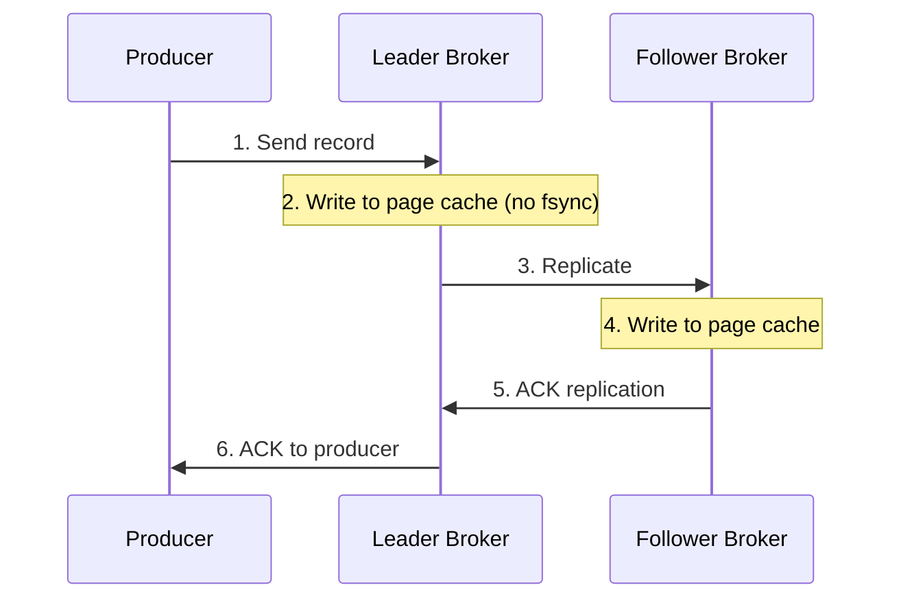
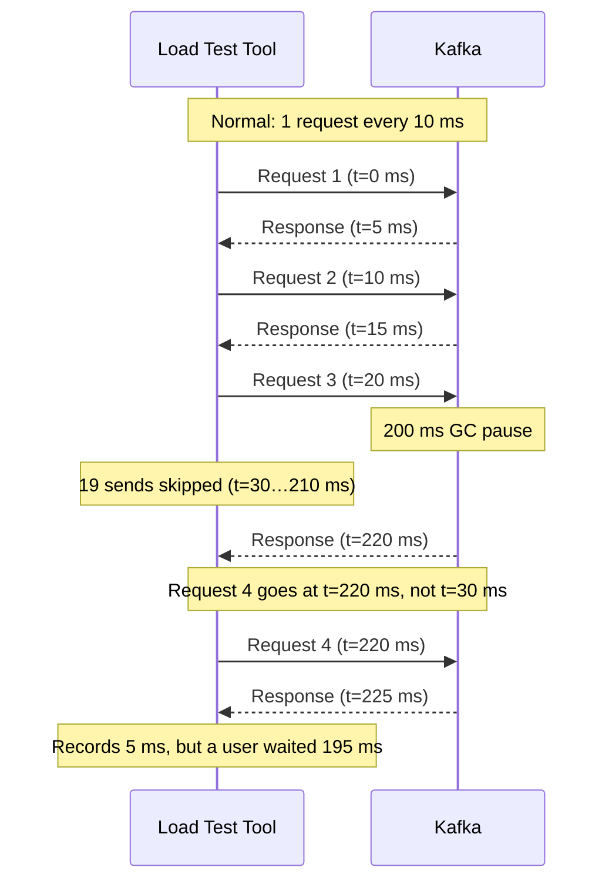

# Performance Theory

You run the payments platform, and before it moves onto [`krafter`](appendix-a-glossary.md#gl-krafter), the Kafka cluster under test, you have to say whether the cluster can carry it: 2,000 records per second of 1 KiB with `acks=all`, answered with a P99 of 100 ms or less from send to acknowledgment. A Kates run hands you a dozen numbers toward that answer. Which of them you can trust depends on how load, queues and [tail latency](appendix-a-glossary.md#gl-tail-latency) interact, and on how much two identical runs disagree.

After this chapter, you can:

- Explain the [throughput](appendix-a-glossary.md#gl-throughput)/latency trade-off and locate the [saturation point](appendix-a-glossary.md#gl-saturation-point) where latency inflects
- Read P50/P95/P99 [percentiles](appendix-a-glossary.md#gl-percentile) and say why the mean understates tail latency
- Spot [coordinated omission](appendix-a-glossary.md#gl-coordinated-omission) in a measurement and know where the Kates mitigation stops
- Judge whether two runs differ by more than the run-to-run [noise floor](appendix-a-glossary.md#gl-noise-floor) before calling a regression

## The Two Pillars: Throughput and Latency

Every measurement answers one of two questions: how much work the system does (throughput) and how long each unit takes (latency). The two have a non-linear relationship. While load is light, raising it raises throughput and leaves latency nearly flat; near the saturation point, throughput levels off while latency climbs steeply, and finding that bend is what performance testing is for [@jain1991art]. [Why Latency Bends: Queues](#why-latency-bends-queues) explains where the bend comes from.

### Throughput

Kafka throughput has two units, and which one saturates first depends on record size:

| Metric | Unit | What It Means |
|--------|------|---------------|
| Records per second | rec/s | How many records the system processes per second |
| Megabytes per second | MB/s | How much data the system moves per second |

Both matter. A system handling 100,000 records of 100 bytes per second behaves differently from one handling 10,000 records of 10 KiB per second, even though both move about 10 MB/s: the first pays per-record overhead, the second pays per-byte cost.

Kates reports two throughput numbers per run. Average throughput is the mean of the rates its started producer and consumer tasks each achieved, and peak throughput is the highest of those task rates. Neither is a peak over time, so a burst inside a run doesn't show in either; the latency [heatmap](appendix-a-glossary.md#gl-heatmap) is where a moment inside a run becomes visible. For the rate a LOAD run offered the cluster, quote the `produce` row of `kates test get <id>`, since the run's average mixes the produce and consume rows.

### Latency

Latency is the time between sending a record and receiving its acknowledgment. For a producer with [`acks=all`](appendix-a-glossary.md#gl-acks), the sequence below is the whole path; notice that the leader writes to the [page cache](appendix-a-glossary.md#gl-page-cache), not to disk, and answers only once the follower has the record:



The `produce` row of `kates test get <id>` times this path: from the send to the acknowledgment, in the producer's callback, which is the latency the payments target names. On [`panda`](appendix-a-glossary.md#gl-panda), the three-node [Kind](appendix-a-glossary.md#gl-kind) cluster the book's lab runs on, every hop between the [leader](appendix-a-glossary.md#gl-partition-leader) and its follower stays on one host and crosses no physical network. When the `produce` row's P99 grows under load there, the growth comes from waiting in queues, not from the wire.

## Why Latency Bends: Queues

Latency bends because every stage on the write path serves requests at some rate, and a request that arrives while the stage is busy waits. Queueing theory gives the shape of that wait in three relations [@harcholbalter2013performance; @jain1991art].

Little's law says that the number of requests inside a system, L, equals their arrival rate, λ, times the time each spends there, W: L = λW. It holds for any stable system, whatever the arrival pattern. A stage that serves μ requests per second at most runs at utilization ρ = λ/μ, the share of time it's busy. For the simplest queue, one server with random arrivals (M/M/1), the mean time in the system is W = 1/(μ − λ), the service time divided by (1 − ρ).

That last relation is the bend. At ρ = 0.5 a request spends twice its service time in the stage; at 0.9 ten times; at 0.99 a hundred times. Throughput can't pass μ, so as offered load nears it, throughput levels off while latency climbs without bound: the saturation point is where ρ approaches 1 at the busiest stage.

### Where an `acks=all` Write Queues

A Kafka write passes five stages, each with its own queue, and the first to saturate sets the knee. Each row names a stage, what waits there, and the setting that sizes the queue:

| Stage | What waits there | Setting that sizes it |
|-------|------------------|-----------------------|
| Producer accumulator | Records waiting to fill a batch or for the linger time | `batch.size`, `linger.ms`; `buffer.memory` caps the whole buffer |
| Producer in-flight requests | Batches sent but not yet acknowledged | `max.in.flight.requests.per.connection` |
| Broker request queue | Requests the network threads read and the I/O threads haven't handled | `num.network.threads`, `num.io.threads`, `queued.max.requests` |
| [Purgatory](appendix-a-glossary.md#gl-purgatory) | An `acks=all` request waiting for followers to fetch the record | Follower fetch speed, and how many followers are in the [ISR](appendix-a-glossary.md#gl-isr) |
| Page cache to disk | Dirty pages the operating system hasn't flushed | The host's memory and disk |

The producer-side rows are a run's `batchSize` and `lingerMs` keys; the broker rows belong to `krafter`'s configuration. A longer linger fills batches and lowers the per-request cost at the price of a wait the record pays before it leaves.

### Finding the Knee on `krafter`

One run sits at one point on the curve, so a knee takes a series of runs at rising rates. Run the same LOAD test at 1,000, 2,000, 4,000 and 8,000 records per second, each on the payments topic, and compare them with `kates report compare`. The knee is where the `produce` row's P99 starts rising faster than its achieved rate, or where the achieved rate stops following the offered one. [Test Types Deep Dive](05-test-types.md) covers STRESS and CAPACITY, which push past the knee on purpose.

The payments target is small in bytes: 2,000 records of 1 KiB is about 2 MiB/s of payload, and with three replicas about 6 MiB/s written across the brokers. LOAD's default lz4 compresses Kates's zero-padded records to far less than 1 KiB, so the brokers handle fewer bytes still. Little's law turns a latency into a queue length: if the `produce` row's mean latency at 2,000 records per second were 10 ms, about 20 records would be in flight at any moment.

### Limits

The model gives the shape of the curve, not its numbers:

- M/M/1 assumes random arrivals and one server. A paced producer sends evenly and batches records, and a broker has many threads, so the formula's waits are not a prediction.
- `panda` runs three brokers on one Kind host, sharing its disk and CPU. A knee found there belongs to `panda`, not to a production cluster.
- A run measures the client's view. Which broker stage saturated is a question for the brokers' metrics, which [Observability & Monitoring](09-observability.md) covers.

## Why Averages Lie

Average latency is the wrong primary metric, for one reason: it hides the tail. The two systems below each serve 100 requests, and the one with the better mean has the worse tail:

| System | Requests | Mean | Slowest request |
|--------|----------|------|-----------------|
| A | 99 at 5 ms, 1 at 500 ms | 9.95 ms | 500 ms |
| B | 100 at 10 ms | 10 ms | 10 ms |

System A has a better mean, but 1% of its users wait 50 times longer than the rest, and in production that 1% often carries the largest payloads. The tail also weighs more as a system grows: an operation that waits on several servers is as slow as the slowest of them [@dean2013tail].

### The Percentile Solution

A percentile is the latency that a given share of requests stays under, so a few of them together describe the shape of the distribution. Each row below says what the percentile means and whether a finished Kates run keeps it:

| Percentile | Meaning | Kates stores it |
|-----------|---------|-----------------|
| P50, the median | Half of requests are faster than this | Yes |
| P95 | 95% of requests are faster than this | Yes |
| P99 | 99% of requests are faster than this | Yes |
| P99.9 | 99.9% of requests are faster than this | Live gauge only |
| Max | Worst single observation | Yes |

Kates stores the mean, P50, P95, P99 and Max for every [test run](appendix-a-glossary.md#gl-test-run). P99.9 exists only as a live gauge, `kates.latency.p999`, while the run is in progress. `kates report show <id>` prints the stored figures as bars, and `kates test get <id>` prints them per task row, where the `produce` row is the one the payments target names.

A percentile is only as steady as the records behind it. P99 of N records rests on its slowest N/100 and Max on a single record: at 100,000 records P99 stands on 1,000 observations and P99.9 on 100. A 60-second run at 2,000 records per second sends 120,000 records, enough for a steady P99 and not for a steady Max, so gate on P99 and read Max as a hint.

::: {.callout-tip title="Try it: how many records does a steady P99 need?"}
Run the payments shape twice, once with 10,000 records and once with 100,000, then compare the two runs:

```bash
kates test create --type LOAD --topic payments-load --throughput 2000 \
  --record-size 1024 --acks all --records 10000 --wait
kates test create --type LOAD --topic payments-load --throughput 2000 \
  --record-size 1024 --acks all --records 100000 --wait
kates report diff <first-id> <second-id>
```

Read how far P99 and Max each move between the runs: the figure that rests on fewer records moves more.
:::

### The Long Tail Problem

A run's percentiles can sit far apart: P50 can be a few milliseconds while the slowest record takes seconds. Tail latency, the slowest fraction of requests, comes from events that are rare but long. Each cause below leaves a different mark on a run, which is how you tell them apart:

| Cause | What happens | Where it shows |
|-------|--------------|----------------|
| GC pause | The JVM stops its threads to collect garbage | Slow records across every partition at once |
| Page-cache eviction | Under memory pressure, reads go to disk | Consumer lag and fetch latency more than produce latency |
| [ISR shrink](appendix-a-glossary.md#gl-isr-shrink) or expand | `acks=all` waits on a changed set of followers | The `produce` row's P99 |
| Log roll | The [broker](appendix-a-glossary.md#gl-broker) opens a new log segment | Short produce latency spikes at regular intervals |
| [Controller](appendix-a-glossary.md#gl-controller) election | [KRaft](appendix-a-glossary.md#gl-kraft) metadata changes pause briefly | Brief produce errors or retries |

::: {.callout-important title="Which GC your Kates API runs"}
The chart's JVM image of the Kates API runs generational ZGC [@jep439], the default ZGC mode on newer JDKs [@jep474], which keeps pauses short whatever the heap size. `kates deploy` installs the [native image](appendix-a-glossary.md#gl-graalvm-native-image) instead, whose Serial GC pauses fall inside the tail latencies it measures. See [JVM Tuning](12-deployment.md#jvm-tuning) in the Deployment Guide.
:::

## Coordinated Omission

Coordinated omission is a measurement error in which the load-test tool slows down along with the system, so it never measures the worst latencies [@tene2013how].

### How It Happens

Follow a tool that sends one request every 10 ms but waits for each response before it sends the next. Watch what happens to the requests it should have sent while Kafka stalls for 200 ms.



During the stall, the tool should have sent 19 more requests, at t=30, 40, 50 and so on up to 210 ms. Each of them would have waited over 200 ms, but the tool measured only the one request it sent, and request 4's user, who expected an answer at 35 ms, got it at 225 ms.

### How Kates Handles It

Kates's native [benchmark backend](appendix-a-glossary.md#gl-benchmark-backend) mitigates the classic closed-loop form of coordinated omission by sending asynchronously [@schroeder2006open]. Closed-loop load sends each request only after the previous answer, the opposite of [open-loop load](appendix-a-glossary.md#gl-open-loop-load). The native producer loop never waits for an acknowledgment before dispatching the next record, and when a target rate is set it keeps pacing sends at that rate whatever the response times. A slow response therefore doesn't hold back the sends after it.

The mitigation has limits:

- Kates applies no coordinated-omission correction. Its latency histogram records only the observations that occurred, with no gap detection and no back-filling for send slots missed during a stall.
- The producer itself can block when its buffer fills while a broker pauses. The native backend leaves the Kafka client's `max.block.ms` at its 60 s default, so a stall shorter than that stops the pacer without an error, and the percentiles for that window understate what a steady stream of clients would have seen.
- The histogram tracks latencies up to 60 s. A longer one is recorded as 60 s and counted as clamped.

For a run where a stall is likely, cross-check the percentiles against the latency heatmap, which shows those windows.

::: {.callout-tip title="Try it: does a paced run hide a stall?"}
Run the payments shape once at its 2,000 records per second and once unthrottled, then open each run's heatmap:

```bash
kates test create --type LOAD --topic payments-load --throughput 2000 \
  --record-size 1024 --acks all --records 120000 --wait
kates test create --type LOAD --topic payments-load --throughput -1 \
  --record-size 1024 --acks all --records 120000 --wait
kates report heatmap <id>
```

Look in each heatmap for counts in the slow buckets, and for the row where they first appear.
:::

## Heatmaps {#heatmaps-seeing-the-full-picture}

Percentiles compress a run's latency into a few numbers and lose the time axis: a P99 can't say whether its slow records came in one burst or spread evenly across the run. A heatmap keeps the distribution over time [@gregg2010visualizing]. A heatmap row is taken each time the Kates API polls a running native-backend test, every 5 s by default, and counts the latencies recorded so far in 25 buckets. A stall shows as counts appearing in the slow buckets from the row in which it happened, and two populations of latency show as two bands. That tells you how long a spike lasted and when the regime changed, which the percentiles can't. [Latency Heatmaps](09-observability.md#latency-heatmaps) explains the buckets, the export formats and how to read one.

## What "Good" Looks Like

There is no universal good latency or throughput: good is the target your workload sets. For the payments platform, it's the two targets this chapter opened with, 2,000 records per second and a `produce` P99 of 100 ms or less, and they come from what the platform needs. Kates lets you set [SLA](appendix-a-glossary.md#gl-sla) thresholds per scenario: targets you choose, in the style of an SLO [@beyer2016site], with no contract behind them. [Scenario Files & SLA Gates](13-scenario-files.md) turns the payments targets into gates.

## Telling a Regression from Noise {#statistical-significance}

One run supports no conclusion, because repeated identical runs disagree [@georges2007statistically]. JIT compilation and class loading, operating-system scheduling, the container layers under Kind, garbage collection and disk I/O all move a run's numbers. So run the test three to five times with nothing changed, report the spread of those runs, and treat a difference that falls inside that spread as noise.

### Warm-Up Phase

The first seconds of a run measure a cold system, so keep them out of the numbers you compare. A scenario sent to [POST /api/tests](11-api-reference.md#post-apitests) can open with a WARMUP phase at a lower rate: its phases run one after another, each for its duration, so the warm-up is over before the steady-state phase starts. The run's report gives each phase its own metrics, so the warm-up's numbers stay out of the steady-state phase's, though the run's summary covers every phase.

### Multiple Runs

Three runs back to back, then one comparison; each `--wait` returns only when its run has finished, so the runs don't overlap:

```bash
kates test create --type LOAD --topic payments-load --throughput 2000 \
  --record-size 1024 --acks all --records 120000 --wait
# Repeat the same command twice more, then collect the three IDs
kates test list --type LOAD --size 3
kates report compare <id1>,<id2>,<id3>

# View the P99 trend of LOAD runs over a week
kates trend --type LOAD --metric p99LatencyMs --days 7
```

In a CI script, `-o json` makes `--wait` print the finished run as JSON, and `jq -r .id` picks out its ID.

Run comparisons one after another, never at once. Without `--wait`, `kates test create` returns as soon as the [Kates API](appendix-a-glossary.md#gl-kates-api), the service in the cluster that runs your tests, accepts the run, and runs started together measure each other's load. A [LOAD](appendix-a-glossary.md#gl-test-type) run without `--topic` also writes to the shared `load-test` [topic](appendix-a-glossary.md#gl-topic), and the Kates API runs at most three tests at once, refusing a fourth with `429 Too Many Requests`.

### Calling a Regression

The noise floor is the spread of a figure, such as the `produce` P99, across identical runs. A later run has regressed only when it differs from the reference by more than that spread, and in the same direction each time you repeat it. Kates keeps the reference for you as a [baseline](appendix-a-glossary.md#gl-baseline), one run per test type:

```bash
# After a payments run you accept, make it the LOAD baseline
kates test baseline set <run-id>
# Compare a later run with its type's baseline
kates report regression <later-run-id>
```

`kates trend --type LOAD --baseline 5` is the rolling form, which takes the five most recent runs as its baseline.

::: {.callout-tip title="Try it: how far do two identical runs drift?"}
Run the payments shape twice, one after another, and compare the runs:

```bash
kates test create --type LOAD --topic payments-load --throughput 2000 \
  --record-size 1024 --acks all --records 120000 --wait
kates test create --type LOAD --topic payments-load --throughput 2000 \
  --record-size 1024 --acks all --records 120000 --wait
kates test list --type LOAD --size 2
kates report diff <first-id> <second-id>
```

The difference between the two `produce` P99s, with nothing changed, is a first estimate of your noise floor; a "regression" smaller than it is indistinguishable from chance.
:::

## Summary

- Throughput and latency are coupled: past the saturation point, throughput plateaus while latency climbs, because requests queue in front of the busiest stage.
- Averages hide the tail, where GC pauses, ISR churn and log rolls live; read P99 and Max, and give P99 enough records.
- Kates paces sends so a stall doesn't slow the tool, but back-fills nothing: check stall-prone runs on the heatmap.
- Good is the target your workload sets, and a regression is a difference larger than the noise between identical runs.

You can now say which of a run's numbers to trust. The next question is which run to start: [Test Types Deep Dive](05-test-types.md) matches each test type to the question it answers, starting with the LOAD run the payments target needs.
