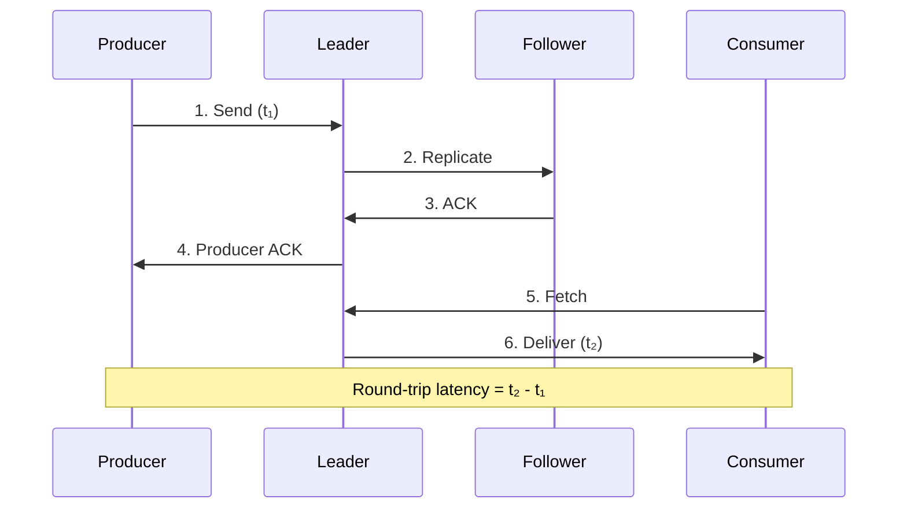
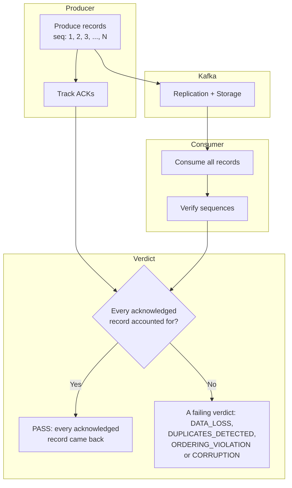

# Test Types Deep Dive

Before the payments platform moves onto [`krafter`](appendix-a-glossary.md#gl-krafter), the Kafka cluster under test, you need four different answers: what its latency is at 2,000 records per second, where it saturates, how it behaves when a burst hits, and whether an acknowledged record ever disappears. Each answer is a different run, and Kates names them: eight core test types, plus the `TUNE_*` types that [CLI Reference](10-cli-reference.md) covers and an `INTEGRATION_CDC` type that [REST API Reference](11-api-reference.md) lists.

Whether you're baselining a new cluster or gating a CI pipeline, after this chapter you can:

- Pick the test type that answers the question you're actually asking — steady-state latency, breaking point, burst behavior, or data safety
- Set each type's key parameters and know the load each one puts on the cluster, whichever [benchmark backend](appendix-a-glossary.md#gl-benchmark-backend) runs it
- Read the results — recognize [saturation](appendix-a-glossary.md#gl-saturation-point), slow leaks, and data loss in the rows each type reports
- Run any type from a built-in scenario template instead of hand-rolled flags

## Test Type Overview

A test type decides the tasks its run starts: how many producers and consumers, at what rate, with which defaults. Each task becomes one row of `kates test get <id>`, and which row carries latency depends on the type. Each row of the table below gives a type's question, the tasks it starts and the latency it reports:

| Type | Question it answers | Tasks it starts | Latency it reports |
|------|---------------------|-----------------|--------------------|
| LOAD | What is the latency at a steady rate? | One producer, one consumer | `produce` row: send to acknowledgment |
| STRESS | How does the cluster degrade near its ceiling? | `parallelProducers` producers at once | Each producer row: send to acknowledgment |
| SPIKE | What happens when a burst hits? | One unthrottled producer | Its row: send to acknowledgment |
| ENDURANCE | Does performance drift over hours? | One rate-limited producer, one consumer | Producer row: send to acknowledgment |
| VOLUME | How do large records behave? | One producer of large records | Its row: send to acknowledgment |
| CAPACITY | What is the ceiling? | `parallelProducers` unthrottled producers | Each producer row: send to acknowledgment |
| ROUND_TRIP | How long from send to receipt? | One task that produces and consumes | Its row: send to receipt |
| INTEGRITY | Does an acknowledged record ever disappear? | One task that produces, then verifies | Its row: send to acknowledgment |

The rule behind the last column: a producer's row times each record from its send to its acknowledgment, ROUND_TRIP's row times it from send to receipt, and a consumer's row measures no latency and shows 0. The run's summary takes its latency from the rows that measured it, so for LOAD and ENDURANCE it's the producer's.

### Defaults by Type

The [Kates API](appendix-a-glossary.md#gl-kates-api), the service in the cluster that runs your tests, merges a run's `spec` with its type's defaults, and every value below is a `spec` key you can set. The first table is the load each type offers; for STRESS and CAPACITY, `records` counts for each producer:

| Type | Producers | Records | Rate (rec/s) | Duration |
|------|----------:|--------:|-------------:|---------:|
| LOAD | 1 | 1,000,000 | unlimited | 600 s |
| STRESS | 3 | 5,000,000 each | unlimited | 900 s |
| SPIKE | 1 | 2,000,000 | unlimited, fixed | 300 s |
| ENDURANCE | 1 | 10,000,000 | 5,000 | 3,600 s |
| VOLUME | 1 | 2,000,000 | unlimited | 600 s |
| CAPACITY | 5 | 10,000,000 each | unlimited, fixed | 1,200 s |
| ROUND_TRIP | 1 | 500,000 | 10,000 | 600 s |
| INTEGRITY | 1 | 1,000,000 | unlimited | 600 s |

A run stops when its records are sent or its duration is up, whichever comes first. The second table is the producer and topic settings each type starts from:

| Type | Record size | `acks` | Partitions | Compression | Batch / linger |
|------|------------:|--------|-----------:|-------------|----------------|
| LOAD | 1,024 B | `all` | 3 | `lz4` | 64 KiB / 5 ms |
| STRESS | 1,024 B | `all` | 6 | `lz4` | 128 KiB / 10 ms |
| SPIKE | 1,024 B | `1` | 3 | `none` | 128 KiB / 0 ms |
| ENDURANCE | 1,024 B | `all` | 3 | `lz4` | 64 KiB / 5 ms |
| VOLUME | 10,240 B | `all` | 6 | `lz4` | 256 KiB / 50 ms |
| CAPACITY | 1,024 B | `all` | 12 | `lz4` | 128 KiB / 10 ms |
| ROUND_TRIP | 1,024 B | `all` | 3 | `none` | 16 KiB / 0 ms |
| INTEGRITY | 1,024 B | `all` | 3 | `lz4` | 64 KiB / 5 ms |

Every type creates its topic with a replication factor of 3 and `min.insync.replicas` of 2. A Kates record is a short header padded with zeros, which `lz4` compresses to far less than its size, so a type with compression on moves fewer bytes than its record size suggests.

## Two Ways to Generate Load

The benchmark backend, a test's `backend` field, generates its load, and both backends start the same tasks for a type. The default `native` backend runs them inside the Kates API. The [Trogdor](appendix-a-glossary.md#gl-trogdor) backend (`--backend trogdor`) submits each task to a Trogdor coordinator as a workload of its own, and injects no faults. Every load shape in this chapter holds on either backend, and the table says where the reports differ:

| What | `native` | `trogdor` |
|------|----------|-----------|
| INTEGRITY runs | Yes | No: the run fails as it starts, with `INTEGRITY/CDC tests require the native backend` |
| ROUND_TRIP latency | Yes | No: every latency field reads 0, meaning not measured |
| Max latency on a produce row | Yes | No: the field reads 0 on every produce row |
| Latency heatmap | Yes | No |

So run on the native backend whenever the latency tail or the integrity verdict matters, and use Trogdor when you want the load generated outside the Kates API.

## LOAD Test

A LOAD test answers one question: what is the cluster's steady-state latency at the [throughput](appendix-a-glossary.md#gl-throughput) you expect in production? It is the run that sets the [baseline](appendix-a-glossary.md#gl-baseline) every later run is compared with.

### How a LOAD Run Works

A LOAD run starts one producer and one consumer, whatever `parallelProducers` and `numConsumers` say. The producer sends its records at `targetThroughput` records per second, or as fast as the cluster accepts them when the rate is -1, its default. The consumer reads the same topic, so the run shows whether consumption keeps up with production.

A consumer whose group has no committed [offsets](appendix-a-glossary.md#gl-offset) starts at the records written since the run was submitted, so records that earlier runs left on a reused topic aren't counted. A named `consumerGroup` with committed offsets resumes from them instead, so give a LOAD run a group of its own. Run LOAD to set a baseline, after a configuration change, and as the [gate](appendix-a-glossary.md#gl-gate) a CI pipeline checks before a deploy.

### Running LOAD on the Payments Shape

The payments target is a LOAD run: 1 KiB records with `acks=all` on a topic of their own, offered at 2,000 records per second. The command spells out each setting, even where it matches a default:

```bash
kates test create --type LOAD --topic payments-load --throughput 2000 \
  --record-size 1024 --acks all --wait
```

The same run as a [scenario file](appendix-a-glossary.md#gl-scenario-file) carries the latency target as a gate:

```yaml
scenarios:
  - name: payments-load
    type: LOAD
    spec:
      topic: payments-load
      consumerGroup: payments-perf
      recordSizeBytes: 1024
      acks: all
      targetThroughput: 2000
    validate:
      maxP99LatencyMs: 100
```

[Scenario Files & SLA Gates](13-scenario-files.md) explains the gates, including why a throughput floor has to sit below the offered 2,000.

### Reading a LOAD Report

For the payments workload the target is a [P99](appendix-a-glossary.md#gl-percentile) of 100 ms or less on the `produce` row of `kates test get <id>`. A consume rate far below the produce rate means the consumer couldn't keep up, and a row with an error means that task failed or stopped short, with the message saying why. There's no universal healthy range for these numbers; [Performance Theory](04-performance-theory.md) explains why you calibrate against your own runs instead. To tune the producer settings behind a LOAD run, the [Lab](appendix-a-glossary.md#gl-lab), `kates lab`, runs one iteration after another in a terminal UI: see [Lab — Interactive Performance Tuning](10b-lab.md).

::: {.callout-tip title="Try it: what does krafter's produce row say at 2,000 records per second?"}
Run the payments LOAD shape and read its rows:

```bash
kates test create --type LOAD --topic payments-load --throughput 2000 \
  --record-size 1024 --acks all --wait
kates test get <id>
```

Compare the `produce` row's P99 with the 100 ms target, and its rate with the `consume` row's.
:::

## STRESS Test

A STRESS test answers how the cluster degrades as it approaches its ceiling: which resource saturates first, and what latency and errors do on the way.

### How a STRESS Run Works

A STRESS run starts `parallelProducers` producers at once, 3 by default, and no consumer. Each producer sends `records` records, as fast as the cluster accepts them unless `targetThroughput` sets a rate for it, until its records are sent or the duration is up. The profile has no steps: one run is one level of load.

### Reading a STRESS Series

One STRESS run gives one point on the degradation curve, so the curve takes a series. Repeat the run with more producers each time, or a higher `targetThroughput`, and compare the runs with `kates report compare`. Across the series, the metrics pass through three stages [@gunther2007guerrilla], and the table says what each looks like:

| Stage | Load | Throughput | Latency | Errors |
|-------|------|------------|---------|--------|
| Healthy | Low | Rises with the load | Stable | None |
| Saturation | Near the ceiling | Levels off | Rising | None yet |
| Overload | Past the ceiling | Falls | Spikes | Appear |

The run's throughput gate reads the producers' rates added up, and its P99 is the highest of the producer rows'.

::: {.callout-tip title="Try it: where does total throughput stop rising?"}
Run three STRESS runs with one, three and six producers on the payments topic, then compare them:

```bash
kates test create --type STRESS --producers 1 --records 200000 \
  --topic payments-load --wait
kates test create --type STRESS --producers 3 --records 200000 \
  --topic payments-load --wait
kates test create --type STRESS --producers 6 --records 200000 \
  --topic payments-load --wait
kates report compare <id1>,<id2>,<id3>
```

Find the step at which the total rate stops growing while P99 keeps climbing.
:::

## SPIKE Test

A SPIKE test answers what happens when a sudden burst hits the cluster: how far latency rises during it and whether errors follow.

### How a SPIKE Run Works

The run is the burst alone: one producer, unthrottled from its first record, with `acks=1` by default. The Kates API refuses any rate but -1 for SPIKE. With `acks=1`, the leader acknowledges a write before any follower has it, so a SPIKE run at its default doesn't measure the `acks=all` path the payments target names; set `acks: all` to burst on that path.

### Reading a SPIKE Run Around Its Burst

The baseline before the burst and the recovery after it come from outside the run. Each row is a moment around the burst and where its number comes from:

| Moment | What to note | Where it comes from |
|--------|--------------|---------------------|
| Before the burst | Your normal P99 | A LOAD run before it |
| During the burst | How far P99 rises, and whether errors appear | The SPIKE run's row |
| After the burst | How long until P99 returns to the baseline | Your monitoring, or a LOAD run after it |

## ENDURANCE Test

An ENDURANCE test answers whether performance drifts over hours of sustained load: slow leaks and gradual degradation that a short run ends before it can show.

### How an ENDURANCE Run Works

An ENDURANCE (soak) run starts one producer and one consumer at a moderate rate, 5,000 records per second by default, for an hour. It can run up to two hours on a default install, and longer once you raise the Kates API's run limit. A longer soak also needs more `records`, since the run stops when they're sent.

### What an ENDURANCE Run Exposes

Each row is a slow failure and the symptom it leaves over a long run:

| Problem | How it shows |
|---------|--------------|
| Memory leak | P99 rises slowly over hours |
| Log segment accumulation | Disk usage grows, then GC pauses lengthen |
| Connection exhaustion | Errors appear late in the run |
| JVM metaspace growth | Off-heap memory rises |
| Thread leak | Thread count climbs, eventually out of memory |

Most of these show on the brokers' dashboards rather than in the run's rows, so read an ENDURANCE run beside [Observability & Monitoring](09-observability.md).

::: {.callout-important title="No run lasts longer than two hours by default"}
The Kates API refuses, with `400`, a run planned to last longer than two hours. It fails a run still `RUNNING` five minutes after its planned end. [CLI Reference](10-cli-reference.md) gives the settings that change both.
:::

## VOLUME Test

A VOLUME test answers how the cluster handles large records: the storage and replication cost of data size rather than request rate.

### How a VOLUME Run Works

The run is one producer sending large records, 2,000,000 of 10 KiB each by default, as fast as the cluster accepts them unless `targetThroughput` sets a rate. Its defaults batch more than LOAD's: 6 partitions, 256 KiB batches and a 50 ms linger. Run it for storage planning (how fast does disk fill at your data rate?) and to see how replication latency grows with record size.

### VOLUME Limits

When a VOLUME run creates its topic, it sets `max.message.bytes` to 1,048,576 and `retention.ms` to 30 minutes. A record over about 1 MiB is then rejected, and the data is gone half an hour after it's written. A topic you create yourself before the run keeps its own settings, since the Kates API leaves an existing topic as it is.

### Running VOLUME

The same run as a scenario file, with records of 100 KiB:

```yaml
scenarios:
  - name: large-records
    type: VOLUME
    spec:
      records: 10000
      recordSizeBytes: 102400
      acks: all
```

Add gates once you have a baseline; [Scenario Files & SLA Gates](13-scenario-files.md) says how to pick them.

## CAPACITY Test

A CAPACITY test answers what the most throughput is that the cluster can sustain, and which resource is the bottleneck at that ceiling.

### How a CAPACITY Run Works

The run starts `parallelProducers` producers at once, 5 by default, and every one is unthrottled: the Kates API refuses any rate but -1 for CAPACITY. Its topic defaults to 12 partitions, so the producers spread their writes across every broker.

### Reading a CAPACITY Series

The ceiling comes from a series, not a single run. Run CAPACITY with a rising `--producers` count; total records per second stops rising at the ceiling and falls past it, and `kates report compare` puts the runs side by side. While the series runs, watch the brokers' CPU, disk and network on the dashboards: the one that's full when total throughput stops rising is the bottleneck.

## ROUND_TRIP Test

A ROUND_TRIP test answers how long a record takes from the producer's send to the consumer's receipt.

### How a ROUND_TRIP Run Works

That span includes the producer's batching, the replication the leader waits for before the record becomes readable, and the consumer's fetch. The sequence below marks where the clock starts and stops. Notice that the producer's acknowledgment comes midway, so a run that stopped there would miss the consumer's half of the trip:



On the native backend, the producer and the consumer both run inside the Kates API, so one clock times both ends of the trip. The consumer starts first and reads every partition of the topic from its current end, without a [consumer group](appendix-a-glossary.md#gl-consumer-group), so records that earlier runs left on the topic are never read ahead of this run's. Each record carries the moment it was sent, and the consumer subtracts that moment from the moment the record arrives. Both readings come from the same clock in the same process, so the difference needs no clock synchronization between hosts.

The defaults trade volume for clean samples: 500,000 records at 10,000 per second, with no compression and no linger. The consumer's settings are fixed, so the Kates API refuses `consumerGroup`, `fetchMinBytes` and `fetchMaxWaitMs` for ROUND_TRIP with a `400`.

### Reading a ROUND_TRIP Report

A ROUND_TRIP run has one task, and its row reports both sides of the trip. The table says what each field counts on that row:

| Field | On a ROUND_TRIP row |
|-------|---------------------|
| Records and throughput | Records that came back to the consumer; the API field is `recordsSent`, as on every row |
| Latency, P50 to max | Send to receipt, one sample per record received |
| Error | Sends the [broker](appendix-a-glossary.md#gl-broker) rejected, and acknowledged records that never came back |
| Status | FAILED when every send was rejected or no acknowledged record came back; otherwise DONE |

A shortfall on either side leaves the run DONE and names the count in the error, so a DONE row with an error is a partial result, not a clean one. Once the producer finishes, the consumer waits until every acknowledged record has arrived, or until 10 seconds pass with none of the rest arriving. With `enableTransactions: true`, the consumer reads with `read_committed`, so each record arrives only when its transaction commits, and its latency includes that wait.

### ROUND_TRIP Limits

ROUND_TRIP's latency comes only from the native backend, as [Two Ways to Generate Load](#two-ways-to-generate-load) shows. On Trogdor every latency field reads 0, so a gate such as `maxP99LatencyMs` fails as not measured. A record the producer retried can arrive twice, and each arrival is timed: ROUND_TRIP doesn't check for duplicates, and INTEGRITY does.

::: {.callout-tip title="Try it: how much does the consumer's half add?"}
Run ROUND_TRIP at the payments rate and compare its P99 with your LOAD run's `produce` row:

```bash
kates test create --type ROUND_TRIP --topic payments-load --throughput 2000 \
  --record-size 1024 --acks all --wait
kates test get <id>
```

The difference between the two P99s is roughly what replication to readability and the consumer's fetch add.
:::

## INTEGRITY Test

An INTEGRITY test answers whether the cluster loses, duplicates, reorders or corrupts records it acknowledged, which is the payments loss target.

### How an INTEGRITY Run Works

The run produces records with sequence numbers, tracks which ones were acknowledged, then reads the topic back and checks that every acknowledged record came back. The flow below shows where the acknowledgments and the read-back sequences meet:



The run checks four properties, and the table says how each is checked:

| Property | How |
|----------|-----|
| No data loss | Every acknowledged sequence number is consumed |
| No duplication | Each sequence number appears once (with [idempotence](appendix-a-glossary.md#gl-idempotent-producer)) |
| No reordering | Sequence numbers arrive in order per partition |
| No corruption | Each record's [CRC](appendix-a-glossary.md#gl-crc32) matches its payload |

An INTEGRITY run is planned to last twice its `durationSeconds`, since it reads its records back for up to as long again. The two-hour limit therefore means a `durationSeconds` of at most 3,600, and the run's deadline is twice its duration plus five minutes.

### INTEGRITY Options

The options below change what the run's producer does and what its consumer is called:

| Key | Default | What it does |
|-----|---------|--------------|
| `enableIdempotence` | not set | Sets the producer's `enable.idempotence`; left out, the Kafka producer is idempotent whenever `acks` is `all` |
| `enableTransactions` | `false` | Transactional producer, committing every 100 records or every 10 seconds; the consumer reads with `read_committed` |
| `enableCrc` | `true` | Per-record CRC check; `false` turns it off |
| `consumerGroup` | the run's own | Base of the consumer's group name: the consumer joins it with `-integrity` appended |

`enableIdempotence` and `enableTransactions` need `acks` to be `all`, which the Kafka producer requires for both. A transactional producer is always idempotent, so the Kates API refuses transactions with `enableIdempotence: false`, and either option with other `acks`, with a `400` that names the field. [Data Integrity Verification](08-data-integrity.md) covers what each integrity mode checks.

The same run as a scenario file, on the payments integrity topic:

```yaml
scenarios:
  - name: payments-integrity
    type: INTEGRITY
    spec:
      topic: payments-integrity
      consumerGroup: payments-verify   # read as payments-verify-integrity
      recordSizeBytes: 1024
      acks: all                        # also makes the producer idempotent
    validate:
      maxDataLossPercent: 0
      maxOutOfOrder: 0
      maxCrcFailures: 0
```

::: {.callout-tip title="Try it: does the integrity template pass on krafter?"}
Export the built-in INTEGRITY template, run it, and read the run:

```bash
kates test scaffold export integrity-tx
kates test apply -f integrity-tx.yaml --wait
kates test get <id>
```

Read `Lost`, `Duplicates` and `Verdict` on the run; the gates don't check duplicates, so the verdict is where a duplicate shows.
:::

### INTEGRITY Through a Fault

An INTEGRITY run injects no [fault](appendix-a-glossary.md#gl-fault) by itself, so on a healthy cluster it answers the durability question only half. `kates resilience run` pairs it with one fault injected while it produces, a [resilience run](appendix-a-glossary.md#gl-resilience-run), one of the two ways Kates runs a [chaos experiment](appendix-a-glossary.md#gl-chaos-experiment); the other is a [disruption plan](appendix-a-glossary.md#gl-disruption-plan). The rate limit keeps the run alive through the fault: an unthrottled run can finish before the fault lands, and its [verdict](appendix-a-glossary.md#gl-verdict) then says nothing about the failure. [Data Integrity Verification](08-data-integrity.md#integrity-under-chaos) gives the payments file, its sizing and how to read the verdict.

## Flags and Spec Keys

A run's settings have two spellings: the flags of `kates test create` and the `spec` keys of a scenario file. The table maps one to the other:

| CLI flag (`kates test create`) | Scenario YAML key (`spec:`) | Meaning |
|---|---|---|
| `--records` | `records` | Total records |
| `--producers` | `parallelProducers` | Producers, for STRESS and CAPACITY only; other types run one |
| `--consumers` | `numConsumers` | Read by no test type; each type runs at most one consumer |
| `--record-size` | `recordSizeBytes` | Record size in bytes |
| `--duration` | `durationSeconds` | Test duration in seconds |
| `--acks` | `acks` | Producer acknowledgment mode |
| `--topic` | `topic` | Topic name |
| `--throughput` | `targetThroughput` | Producer rate in rec/s, for each producer |
| `--consumer-group` | `consumerGroup` | Consumer group, for LOAD, ENDURANCE and INTEGRITY; use a group of the test's own |
| `--fetch-min-bytes`, `--fetch-max-wait-ms` | `fetchMinBytes`, `fetchMaxWaitMs` | Consumer fetch settings, for LOAD, ENDURANCE and INTEGRITY |
| — | `enableIdempotence`, `enableTransactions`, `enableCrc` | Integrity options, `true` or `false`, in scenario files only |

::: {.callout-important title="One rate, two names"}
`--throughput` and `targetThroughput` both send the API field `targetThroughput`, which replaces the type's default rate; the API also takes it as `throughput`, the name a `kates resilience run` file uses, and `throughput` wins when a request sets both. SPIKE and CAPACITY run unthrottled, so the Kates API refuses a rate other than -1 for them. It also refuses a consumer setting for a type that starts no consumer, with a `400` naming the field.
:::

## Summary

- Every test type answers one question — choose by the question you need answered, not by the settings you want to change.
- LOAD sets the baseline; STRESS shows how the cluster degrades toward the ceiling, and CAPACITY measures the ceiling itself.
- A producer row times send to acknowledgment, a consumer row measures no latency, and ROUND_TRIP times send to receipt.
- Both backends start the same tasks, but only the native backend measures the tail and runs INTEGRITY.
- INTEGRITY numbers every record and checks loss, duplication and order; paired with one fault it answers the payments loss question.

These runs produce numbers; a gate turns a number into a pass or a fail. [Scenario Files & SLA Gates](13-scenario-files.md) puts the payments targets into a file whose gates a pipeline can fail on.
