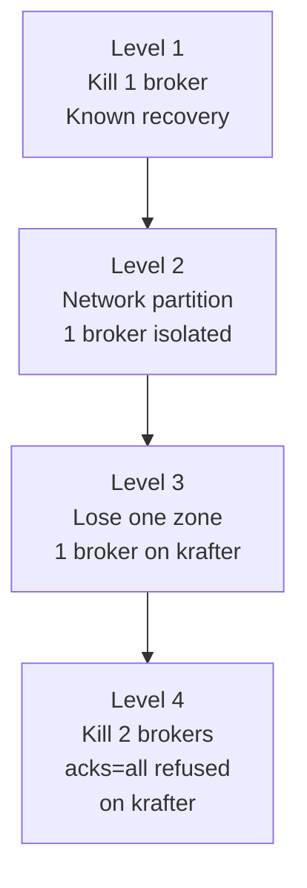
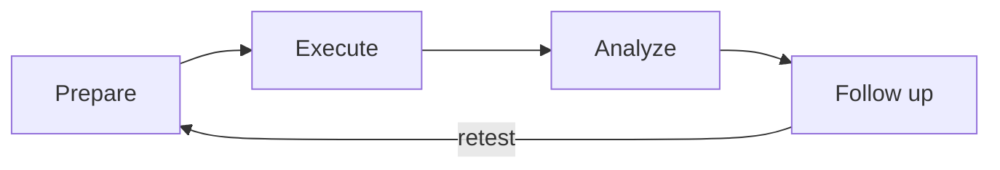
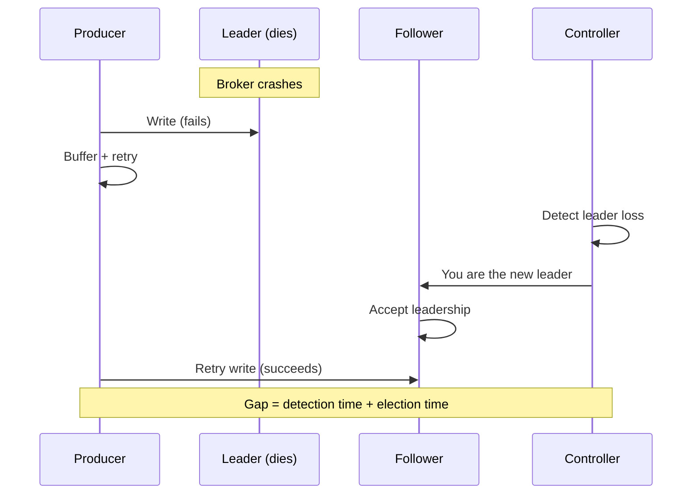
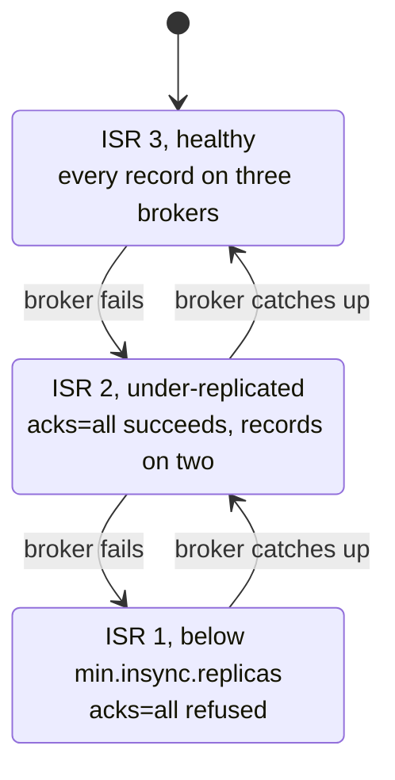
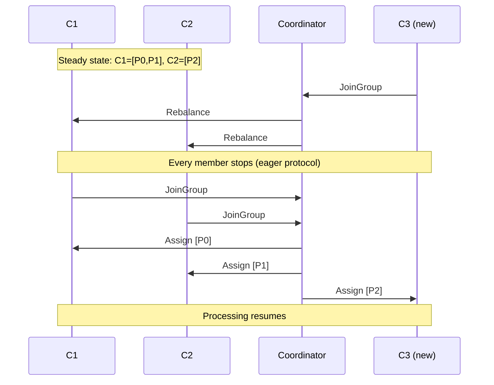

# Chaos Engineering Theory

Before the payments platform moves onto [`krafter`](appendix-a-glossary.md#gl-krafter), the Kafka cluster under test, you have to say what happens to an acknowledged payment when a broker dies, and "the cluster is resilient" isn't something you can test. Chaos engineering turns that sentence into a hypothesis with numbers in it, breaks something on purpose, and measures the gap [@principlesofchaos2019; @basiri2016chaos]. [Chaos Engineering in Practice](07-chaos-practice.md) shows how Kates runs those experiments.

You don't need prior chaos tooling experience — just a working knowledge of Kafka's replication model. After this chapter, you can:

- State a [steady-state hypothesis](appendix-a-glossary.md#gl-steady-state-hypothesis) with measurable pass and fail criteria
- Predict how Kafka behaves during leader election, [ISR shrink](appendix-a-glossary.md#gl-isr-shrink), and [consumer group](appendix-a-glossary.md#gl-consumer-group) rebalance
- Structure a [Game Day](appendix-a-glossary.md#gl-game-day) from hypothesis through follow-up
- Say where Kates's [faults](appendix-a-glossary.md#gl-fault) come from, and tell a disruption plan from a [resilience run](appendix-a-glossary.md#gl-resilience-run)

## Why Chaos Engineering?

Distributed systems fail in ways that are impossible to predict from reading code alone. A Kafka cluster might handle a single [broker](appendix-a-glossary.md#gl-broker) failure gracefully in theory, but in practice:

- The [leader election](appendix-a-glossary.md#gl-leader-election) might take 30 seconds instead of 3
- Consumer groups might [rebalance](appendix-a-glossary.md#gl-rebalance) in a thundering herd
- The surviving brokers might hit memory pressure from absorbing extra [partitions](appendix-a-glossary.md#gl-partition)
- Network timeouts might cascade into producer retries that amplify the problem

Chaos engineering replaces hope with evidence: you find out which of these happens on your cluster before a production outage tells you.

## Core Principles

The five principles below come from the Principles of Chaos Engineering, in the order it gives them [@principlesofchaos2019; @rosenthal2020chaos]. Each section restates one of them for a Kafka cluster.

### Build a Hypothesis Around Steady State {#1-build-a-hypothesis-around-steady-state}

Before injecting a fault, you must define what "normal" looks like. For Kafka, steady state includes:

- All partitions have [leaders](appendix-a-glossary.md#gl-partition-leader)
- [ISR](appendix-a-glossary.md#gl-isr) count equals [replication factor](appendix-a-glossary.md#gl-rf)
- Producer [throughput](appendix-a-glossary.md#gl-throughput) meets the target rate
- [Consumer lag](appendix-a-glossary.md#gl-consumer-lag) is bounded
- [P99](appendix-a-glossary.md#gl-percentile) latency is within its [SLA](appendix-a-glossary.md#gl-sla), Kates's word for SLO-style targets you set, not an agreement with anyone

::: {.callout-tip title="Try it: What does krafter's steady state look like before any fault?"}
Write a steady-state hypothesis for `krafter` — bounded latency, zero offline partitions, ISR equal to the replication factor — then check each claim against live data:

```bash
# Baseline probe: under-replicated and offline partition counts
kates cluster check

# Confirm the topology your hypothesis assumes (brokers per zone)
kates cluster topology

# List the disruption types (your chaos provider may not run them all)
kates disruption types
```

Any under-replicated or offline partition that `kates cluster check` reports is a finding before you've injected a single fault.
:::

### Vary Real-World Events

Inject faults that actually happen in production. The table maps the failures distributed systems meet to the [disruption types](appendix-a-glossary.md#gl-disruption-type) that reproduce them; read the right-hand column for the gaps:

| Domain | Real-world fault | Kates disruption type |
|--------|------------------|-----------------------|
| Infrastructure | Pod or VM crash | `POD_KILL`, `POD_DELETE` |
| Infrastructure | CPU, memory or disk pressure | `CPU_STRESS`, `MEMORY_STRESS`, `IO_STRESS`, `DISK_FILL` |
| Infrastructure | Node or broker loss | `NODE_DRAIN`, `SCALE_DOWN` |
| Infrastructure | Disk failure | None |
| Network | Partition | `NETWORK_PARTITION` |
| Network | Latency | `NETWORK_LATENCY` |
| Network | DNS failure | `DNS_ERROR` |
| Network | Packet loss | None |
| Application | Process kill | `POD_KILL` |
| Application | Configuration or log corruption, clock skew | None |
| Kafka | Leader loss | `LEADER_ELECTION` |
| Kafka | Rolling restart | `ROLLING_RESTART` |
| Kafka | Rebalance storm | None: it's a consumer-side fault |

Most of what Kates injects is an infrastructure or network fault; `kates disruption types` prints the full list, and your chaos provider may not run every type on it.

### Run Experiments in Production or Production-Like {#3-run-experiments-in-production-or-production-like}

[Chaos experiments](appendix-a-glossary.md#gl-chaos-experiment) in a toy environment prove nothing. [`panda`](appendix-a-glossary.md#gl-panda), the [Kind](appendix-a-glossary.md#gl-kind) cluster in this project, is configured with the properties a production cluster has, at Kind's scale:

| Production Property | Kind Equivalent |
|---|---|
| Multi-zone deployment | 3 nodes with [zone](appendix-a-glossary.md#gl-zone) labels |
| Zone-aware replication | [Strimzi](appendix-a-glossary.md#gl-strimzi) `rack` configuration |
| Resource constraints | Memory limits on brokers |
| Persistent storage | [PVCs](appendix-a-glossary.md#gl-pvc) with zone-specific StorageClasses |
| Monitoring | [Prometheus](appendix-a-glossary.md#gl-prometheus) and [Grafana](appendix-a-glossary.md#gl-grafana), as a production cluster has |

What `panda` can't give you is production traffic, which is why the principle has a second step.

The principle asks for production because only production has the traffic, clients and data your hypothesis is about. This book takes it in two steps. You run an experiment first on a production-like cluster, `panda` or a staging copy of production, where a refuted hypothesis breaks nothing anyone depends on. Once it holds there, you repeat it in production, starting on the lowest rung of [Minimize Blast Radius](#5-minimize-blast-radius) and climbing one rung at a time.

### Automate Experiments to Run Continuously

One-off chaos experiments are useful; scheduled, repeating ones show when a change makes the cluster worse [@basiri2019automating]. Kates schedules both halves of an experiment with cron expressions, which it reads in UTC. `kates disruption schedule create` repeats a [playbook](appendix-a-glossary.md#gl-playbook), a disruption plan built into Kates:

```bash
# Kill the leaders of two __consumer_offsets partitions every night at 02:00 UTC
kates disruption schedule create nightly-broker-loss \
  --playbook leader-cascade --cron "0 2 * * *"
```

A disruption schedule takes a playbook, not a plan file, so your own plans run from a pipeline instead, as [CI/CD Integration](07-chaos-practice.md#cicd-integration) shows. `kates schedule create` repeats a test, such as the nightly [INTEGRITY](appendix-a-glossary.md#gl-test-type) run that checks for loss alongside the fault. The file `integrity.json` holds the test request:

```json
{
  "type": "INTEGRITY",
  "spec": {"numRecords": 100000}
}
```

```bash
# Run an INTEGRITY test every night at 02:00 UTC
kates schedule create --name "Nightly Integrity" --cron "0 2 * * *" \
  --request integrity.json
```

### Minimize Blast Radius {#5-minimize-blast-radius}

A fault's [blast radius](appendix-a-glossary.md#gl-blast-radius) is how much of the cluster it can hurt, so start small and widen it. Read the rungs top to bottom: each adds a failure the one before it proved the cluster survives.



In a Kates [disruption plan](appendix-a-glossary.md#gl-disruption-plan), each rung is a `maxAffectedBrokers` value. `krafter` runs one broker per zone, so the first three rungs hit one broker each. The zone rung, a `NODE_DRAIN` of `alpha` or the `az-failure` playbook, differs in taking other pods in the zone with it, such as a KRaft controller running there. The `az-failure` playbook caps its count at `3`, for clusters with several brokers per zone. The last rung hits two brokers, and the [safety guard](appendix-a-glossary.md#gl-safety-guard) runs it with a warning, because only one broker is left. On a cluster with more than two brokers per zone, the zone becomes the top rung. The guard refuses a plan that would hit more brokers than its limit, or every broker: see [Safety Guardrails](07-chaos-practice.md#safety-guardrails) in Chaos Engineering in Practice.

## The Game Day Methodology

A Game Day is a planned session in which your team runs chaos experiments against a written hypothesis, with a rollback plan and a debrief [@robbins2012resilience; @allspaw2012fault]. It has four phases. Notice the edge back from the last phase to the first: one session's follow-up is the next one's preparation.



In Prepare, you write the hypothesis, as in [Example Hypothesis](#example-hypothesis), and set its thresholds in a plan's `sla` block. You preview the plan with `kates disruption run --dry-run`, agree how to roll back by hand, and tell the team that owns the cluster.

In Execute, you establish a [baseline](appendix-a-glossary.md#gl-baseline), inject the fault through a disruption plan or a resilience run, observe the impact, and let the cluster recover.

In Analyze, you compare the baseline with the impact. The plan's report and `kates disruption kafka-metrics` give the recovery times, the INTEGRITY run's verdict says whether a record was lost, and the plan's SLA grade says how it met its thresholds.

In Follow up, you write down the findings, file a ticket for each weakness, and schedule the retest, with `kates disruption schedule create` when a playbook covers it.

### Example Hypothesis

You run the payments platform, and a hypothesis has to carry its targets into numbers. Yours for `krafter` reads: when one broker that leads partitions of the `payments-integrity` [topic](appendix-a-glossary.md#gl-topic) is killed, `acks=all` writes to those partitions fail only until a new leader is elected and the producer retries. No partition goes offline, and the INTEGRITY run through the fault reports `Lost` 0 and the verdict `PASS`.

Each clause names where Kates reads it. `kates cluster check` counts offline partitions, and `kates test get <id>` gives the INTEGRITY run's `Lost` and `Verdict`. A plan that names `payments-integrity` in `isrTrackingTopic` adds the ISR's recovery, through `kates disruption kafka-metrics <id>`. That makes the hypothesis testable: every clause is a number with a place to read it.

### The Automated Game Day {#game-day-pipeline}

`make gameday` runs `scripts/gameday.sh`, an automated pass through Execute in seven script phases. It deletes a broker pod with `kubectl` instead of going through the Kates API, so no plan report or safety guard covers its fault. The table says what each script phase does, and which Game Day phase it belongs to:

| Script phase | What `make gameday` does | Game Day phase |
|--------------|--------------------------|----------------|
| `pre-flight` | Waits for `krafter` to be Ready, counts running Kafka pods, and checks that the Kates API and Prometheus answer | Prepare |
| `baseline` | Starts a 100,000-record LOAD run and records two broker message counters | Execute |
| `chaos-inject` | Deletes `krafter-brokers-alpha-0` with `kubectl`, then waits 60 seconds | Execute |
| `chaos-observe` | Reads offline and under-replicated partitions, consumer lag and the incoming message rate | Execute |
| `chaos-recover` | Waits up to 300 seconds for no under-replicated partition, then for every Kafka pod to be Ready | Execute |
| `post-flight` | Starts a 50,000-record LOAD run, checks that `krafter` is Ready, and counts firing alerts | Analyze |
| `report` | Prints the recorded values and the file that holds them | Analyze |

The script grades nothing and checks no data for loss. The hypothesis, the rollback plan, the loss check, the grade and the whole Follow-up phase stay with you.

## Kafka-Specific Failure Modes

Three Kafka behaviors decide what a fault costs, and a hypothesis has to bound each of them: leader election, ISR shrink and consumer-group rebalance.

### Leader Election

When a partition's leader broker fails, the [controller](appendix-a-glossary.md#gl-controller) elects a new leader from the ISR, and until producers learn of it their writes to that partition fail and the client retries them. [What Happens During a Broker Failure](03-cluster.md#what-happens-during-a-broker-failure) gives the phases and the settings that bound each one. Follow the producer's lifeline in the diagram: nothing it sends succeeds between the crash and the retry, and that gap is what your latency bound must absorb.



### ISR Shrink and Expand

As the ISR shrinks from three to two, each new acknowledged record has one copy fewer while writes carry on. At one, below `min.insync.replicas`, the leader refuses `acks=all` writes with `NOT_ENOUGH_REPLICAS`: durability erodes before availability does [@wang2015building]. When the broker comes back and catches up, the ISR grows again. Notice that writes keep succeeding in the middle state: that is where a record can be acknowledged with one copy fewer.



A Kates plan that names a topic in `isrTrackingTopic` records this for each step, and `kates disruption kafka-metrics <id>` prints it. `Min ISR Depth` is the state the step reached, `Under-Replicated Peak` how many partitions were there at once, and `Time to Full ISR` how long the way back took.

### Consumer Group Rebalance

A consumer-group rebalance reassigns a group's partitions when a member joins or leaves. It's one of three things this book calls a rebalance: a Kafka Connect rebalance reassigns tasks among workers, and a Cruise Control rebalance moves partition replicas between brokers. Notice in the diagram that consumers 1 and 2 stop before consumer 3 has received anything: the pause is the whole group's.



The diagram shows the classic eager protocol, where all consumers in the group stop processing during a rebalance — a "stop-the-world" pause that can last seconds to minutes depending on group size and partition count. Cooperative incremental rebalancing (KIP-429 [@kip429]) shrinks the pause to only the partitions that actually move, and the next-generation consumer group protocol (KIP-848 [@kip848], `group.protocol=consumer`) removes the global synchronization barrier entirely. Kates's test consumers run the classic protocol, the default of the Kafka client they run on, so a Kates test shows you the eager or cooperative pause, not the KIP-848 one.

## Key Metrics During Chaos

Watch these signals while a fault is active. For each one, the table says what a cluster that copes with the fault should show; for recovery time, it says what you measure.

| Metric | What to Watch |
|--------|---------------|
| [Under-replicated partitions](appendix-a-glossary.md#gl-under-replicated-partition) | Should spike briefly, then return to 0 |
| Offline partitions | Should be 0 (if RF > failed brokers) |
| Active controller changes | Should happen exactly once per controller failure |
| Consumer lag | Should spike during failure, then drain |
| Producer error rate | Should spike briefly, producers should retry successfully |
| Leader election rate | Should equal the number of partitions the failed broker led |
| Recovery time | Time from failure to all ISRs fully expanded |

A Kates [disruption](appendix-a-glossary.md#gl-disruption) reports several of them. `kates disruption kafka-metrics` shows each step's time to full ISR, minimum ISR depth and peak under-replicated partitions when the plan names a topic in `isrTrackingTopic`, and consumer lag when it names a group in `lagTrackingGroupId`. A plan's `sla` block can set targets for P99 latency, throughput and how long the Kafka pods take to be Ready again, and the plan's [SLA grade](appendix-a-glossary.md#gl-sla-grade) says how the run met them.

## Fault Injection Approaches

In Kates, where a fault comes from is a deployment setting, not a choice you make per experiment. Every fault goes through one [chaos provider](appendix-a-glossary.md#gl-chaos-provider), a setting of the [Kates API](appendix-a-glossary.md#gl-kates-api). `litmus-crd`, the default, injects through [LitmusChaos](appendix-a-glossary.md#gl-litmuschaos), and `kubernetes` through the Kubernetes API, which needs nothing installed but runs fewer disruption types. `hybrid` picks one of those two at startup, and `noop` injects nothing. What you do choose per experiment is how to run the fault. A disruption plan injects faults and watches the cluster from outside, while `kates resilience run` injects one fault under a Kates test and measures what a client sees. [Chaos Engineering in Practice](07-chaos-practice.md) compares the providers and the two ways to run a fault.

Two other tools sit near chaos but inject nothing through Kates. [Trogdor](appendix-a-glossary.md#gl-trogdor) is a [benchmark backend](appendix-a-glossary.md#gl-benchmark-backend) in Kates: it generates load, as [Test Types Deep Dive](05-test-types.md) explains, and never injects a fault. A pod you delete by hand with `kubectl` disrupts the cluster just the same, but Kates doesn't know it happened: no plan report lists it, and an INTEGRITY run it hits reports [RPO](appendix-a-glossary.md#gl-rpo) as not measured.

## Summary

- A useful hypothesis is testable: every clause is a number, such as a latency bound or zero lost records, with a place to read it.
- Kafka fails in specific ways: leader election costs seconds of unavailability, ISR shrink erodes durability before availability, and eager rebalances stop the whole group.
- Minimize blast radius: start with one broker and a known recovery, and climb one rung only after the last one held.
- A Game Day runs an experiment as a session: hypothesis and rollback plan first, fault and measurement second, findings and a retest last.
- Kates injects faults through one chaos provider, LitmusChaos by default; Trogdor generates load, and a manual `kubectl` fault leaves no Kates record.

[Chaos Engineering in Practice](07-chaos-practice.md) turns these principles into runnable disruption plans — playbooks, safety guardrails, and SLA grading included.
