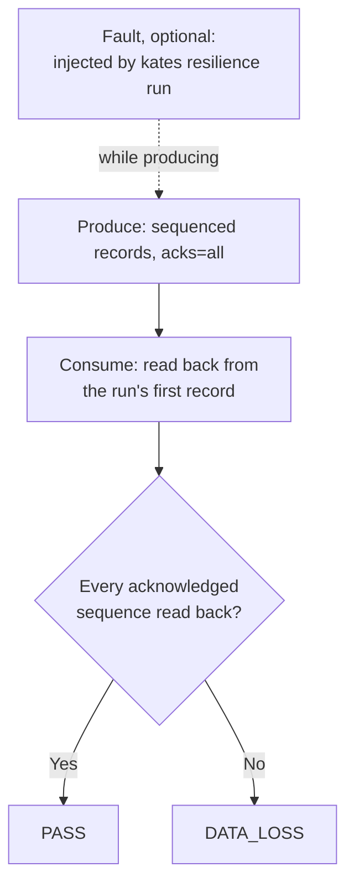
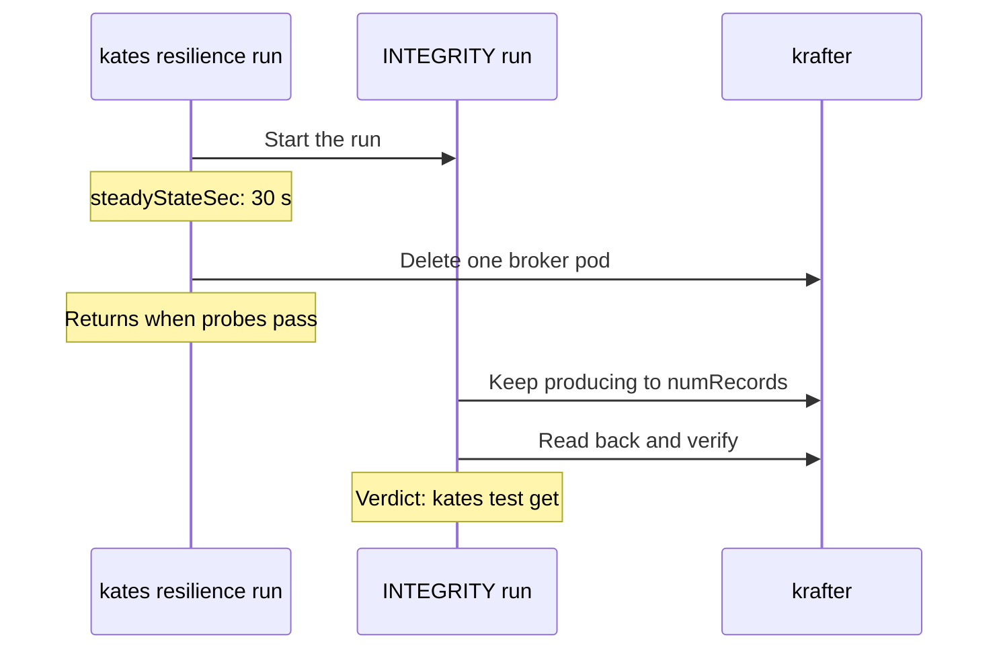

# Data Integrity Verification

The payments platform needs more from [`krafter`](appendix-a-glossary.md#gl-krafter), the Kafka cluster under test, than throughput and a P99: a payment the cluster has acknowledged must not disappear when a broker dies. A performance report can't say whether it did. An [INTEGRITY](appendix-a-glossary.md#gl-test-type) run can, because it remembers every record the [broker](appendix-a-glossary.md#gl-broker) acknowledged and reads them all back.

After this chapter, you can:

- Run an INTEGRITY test and know which producer guarantees it exercises: [`acks=all`](appendix-a-glossary.md#gl-acks) durability, [idempotence](appendix-a-glossary.md#gl-idempotent-producer), and, with `enableTransactions`, a transactional producer read with `read_committed`
- Read a Data Integrity report and distinguish real data loss from harmless unacknowledged sends
- Prove durability under failure by pairing an integrity run with live [fault](appendix-a-glossary.md#gl-fault) injection
- Trace a DATA_LOSS [verdict](appendix-a-glossary.md#gl-verdict) to its cause using the [Lost Ranges](appendix-a-glossary.md#gl-lost-record) table and the Integrity Timeline

## The Integrity Verification Pipeline

An INTEGRITY run produces sequenced records, reads them back and reconciles the two; a fault, when there is one, lands during the produce phase:



The verify step also checks each record's CRC, its order within its partition and whether it arrived twice; [Interpreting Integrity Results](#interpreting-integrity-results) gives the order in which those checks set the verdict.

## Sequence Number Tracking

Each record in an INTEGRITY test carries a 28-byte binary header (`SequencedPayload`), zero-padded to the configured record size:

```text
[8 bytes] sequence number   (long)
[8 bytes] timestamp nanos   (long)
[8 bytes] run ID hash       (long)
[4 bytes] CRC32             (int — checksum of the first 24 bytes)
[N bytes] zero padding      (to match target record size)
```

The four header fields, and what the verifier does with each:

| Field | Purpose |
|-------|---------|
| `sequence` | Monotonically increasing sequence number |
| `timestampNanos` | Monotonic send timestamp, used for [RTO](appendix-a-glossary.md#gl-rto) computation |
| `runIdHash` | Stable hash of the run ID, isolates records from other runs |
| `crc32` | [CRC32](appendix-a-glossary.md#gl-crc32) checksum of the header for corruption detection |

### Producer-Side Tracking

The producer counts sends, acknowledgments and failed sends. It also keeps each failure window, from a failed send to the next acknowledgment, and the longest window is the producer-side RTO.

### Consumer-Side Verification

The consumer marks each sequence it reads; a run of unmarked acknowledged sequences becomes one range:

```text
Acknowledged:  1 2 3 4 5 6 7 8
Read back:     1 2 3 . 5 6 . 8
Lost ranges:   [4-4], [7-7]
Lost:          2
```

Because every record has its own sequence number, `Lost` counts the acknowledged records the consumer never saw, not a difference of two totals.

## Integrity Modes

Three fields set how the producer writes and how the verifier reads, and a [scenario file](appendix-a-glossary.md#gl-scenario-file), a resilience file and an API call can each set them. The Kafka producer can be idempotent or transactional only with `acks=all`, and a transactional producer is always idempotent. The table gives what each field sets, what happens when you leave it out, and when the [Kates API](appendix-a-glossary.md#gl-kates-api) refuses it:

| Field | Sets | Left out | Refused when |
|---------------------|----------------------------------------------|-----------------------------------|-------------------------------------------|
| `enableIdempotence` | The producer's `enable.idempotence` | The Kafka producer decides: on with `acks=all` | `acks` is `0` or `1` |
| `enableTransactions` | A transactional producer; the consumer reads `read_committed` | Off | `acks` is `0` or `1`, or `enableIdempotence: false` |
| `enableCrc` | The per-record CRC32 check | On | Never, for INTEGRITY |

A refusal comes before the run starts. `POST /api/tests` answers `400` naming the field. `POST /api/resilience` does the same before any fault is injected, and [`kates resilience run`](appendix-a-glossary.md#gl-resilience-run) reports it as its error.

### Durable and Idempotent by Default

The default INTEGRITY run uses `acks=all` and checks that every acknowledged record can be read back:

```bash
kates test create --type INTEGRITY --records 100000 --acks all --wait
```

Expect `Lost 0`. With `acks=all` the [leader](appendix-a-glossary.md#gl-partition-leader) acknowledges a record only once every replica in the [ISR](appendix-a-glossary.md#gl-isr) has written it to its log. It refuses the write while the ISR is smaller than [`min.insync.replicas`](appendix-a-glossary.md#gl-min-insync-replicas). Written means the broker's [page cache](appendix-a-glossary.md#gl-page-cache), not its disk: Kafka doesn't wait for an fsync, so an acknowledged record survives because several brokers hold it, not because one of them flushed it.

Kafka's producer idempotency lets the broker discard a retried send it has already written, which gives [exactly-once](appendix-a-glossary.md#gl-exactly-once-semantics) delivery to the log [@kip98]. The Kafka producer enables it by default whenever `acks` is `all` [@kip679], the INTEGRITY default, and leaves it off when `acks` is `1` or `0`. So the run above is already idempotent, and `enableIdempotence: true` in a file only makes the default explicit; it also adds `Mode idempotent` to the report.

### Transactional

Kafka transactions add atomic, exactly-once writes on top of idempotence [@wang2021consistency]. The built-in `integrity-tx` template asks for transactions, idempotence and CRC verification, and the run has all three. Its producer commits a transaction every 100 records, or sooner when 10 seconds pass first, which keeps a slow rate inside the producer's 60-second transaction timeout. The verifying consumer reads with `read_committed`, so it counts only committed records. Export the template and run it:

```bash
# Export the built-in integrity-tx template, then run it
kates test scaffold export integrity-tx
kates test apply -f integrity-tx.yaml --wait
```

The exported `integrity-tx.yaml` is 200,000 records of 512 bytes, compressed with zstd, on a topic with three replicas and `min.insync.replicas` 2. Notice the `validate` block: it gates loss, order, CRC failures and the P99:

```yaml
# An INTEGRITY run starts one producer and one consumer.
scenarios:
  - name: "Transactional Integrity Verification"
    type: INTEGRITY
    spec:
      records: 200000
      recordSizeBytes: 512
      acks: "all"
      compressionType: "zstd"
      enableIdempotence: true
      enableTransactions: true
      enableCrc: true
      replicationFactor: 3
      minInsyncReplicas: 2
    validate:
      maxDataLossPercent: 0
      maxOutOfOrder: 0
      maxCrcFailures: 0
      maxP99LatencyMs: 150
```

::: {.callout-tip title="Try it: what does a transactional producer cost?"}
Run the two commands above, then `kates test get <id>` with the ID the summary prints. Read the `produce` row's P99 against the template's 150 ms gate, and check that the Data Integrity section shows `Mode idempotent transactional` and `Verdict ● PASS`.
:::

## Interpreting Integrity Results

Every INTEGRITY run ends its `kates test get <id>` report with the same Data Integrity section. Each field, what it means and when to worry:

| Field | What it means, and when to worry |
|----------------|-----------------------------------------------------------------------|
| `Sent` | Records handed to the producer; lower than `records` means producer errors or timeouts |
| `Acked` | Records the broker acknowledged; less than `Sent` means sends failed or timed out |
| `Consumed` | Records read back; it should equal `Acked` less `Lost`, but the display abbreviates, so read `Lost` |
| `Lost` | Acknowledged records never read back; any value above 0 is data loss |
| `Duplicates` | Records read more than once; non-zero only with `acks` 0 or 1, where the producer isn't idempotent |
| `Data Loss` | `Lost` as a percentage of `Sent`; any value above 0 is data loss |
| `Producer RTO` | Longest window from a failed send to the next acknowledgment; shown only after a send failed |
| `Consumer RTO` | Length of the first gap in the consumed sequence stream; shown only after one |
| `Max RTO` | The larger of the two RTOs, shown when either is |
| `RPO` | How long before the fault the oldest lost record was sent; `not measured` unless a fault was marked on the run |
| `CRC Failures` | Records whose CRC32 didn't match; non-zero means corruption in transit or at rest |
| `Out of Order` | Records with a lower sequence than an earlier one in the same partition; points to truncation or an unclean election |
| `Mode` | `idempotent`, `transactional` or both, shown only when the run asked for them |

The verdict is `DATA_LOSS` if an acknowledged record is missing, otherwise `CORRUPTION` on a CRC failure, `ORDERING_VIOLATION` on a record out of order within its [partition](appendix-a-glossary.md#gl-partition), `DUPLICATES_DETECTED` on a record consumed twice, and `PASS` when none of these occurred. The examples below show the section for a clean run, for a run that lost records, and for a clean run whose producer hit errors during a broker failure. They're illustrations, not captured runs.

### PASS — Zero Data Loss

Every count that could signal trouble reads zero, and `RPO` reads `not measured` because nothing marked a fault on this run:

```text
  ▸ Data Integrity
  Sent                     100.0K
  Acked                    100.0K
  Consumed                 100.0K
  Lost                     0
  Duplicates               0
  Data Loss                0.0000%
  RPO                      not measured
  CRC Failures             0
  Out of Order             0
  Verdict                  ● PASS
```

This is the expected result for a cluster with `acks=all` and `min.insync.replicas=2`. `RPO` gets a value only when a resilience run marks a fault on the run, as in [Integrity Under Chaos](#integrity-under-chaos).

### DATA_LOSS — Records Missing

Look at `Lost` and at the Lost Ranges table under it: two acknowledged records never came back, and the table gives their sequence numbers. This run also had one CRC failure, on a record it did read back, and the timeline lists both kinds of event:

```text
  ▸ Data Integrity
  Sent                     100.0K
  Acked                    100.0K
  Consumed                 100.0K
  Lost                     2
  Duplicates               0
  Data Loss                0.0020%
  RPO                      not measured
  CRC Failures             1
  Out of Order             0
  Verdict                  ○ DATA_LOSS

  ▸ Lost Ranges
  From Seq  To Seq  Count
  ────────  ──────  ─────
  45231     45231   1
  78442     78442   1

  ▸ Integrity Timeline
  Timestamp      Type         Detail
  ─────────────  ───────────  ─────────────────────────────────
  1767970801123  CRC_FAILURE  partition=2 seq=51200
  1767970803010  LOST_RANGE   from=45231 to=45231 count=1
  1767970803010  LOST_RANGE   from=78442 to=78442 count=1
  1767970803011  SUMMARY      verdict=DATA_LOSS lost=2 duplicates=0
```

The display abbreviates `Sent`, `Acked` and `Consumed`; `Lost`, `Data Loss` and the Lost Ranges table carry exact numbers. The verdict is `DATA_LOSS` rather than `CORRUPTION` because loss comes first in the order above.

Records carry no key, so the producer spreads them over the partitions a batch at a time. A partition that loses its data leaves a range for each batch it held, so the length of a range doesn't tell one cause from another. When the ranges listed hold fewer records than `Lost`, `kates test get` says so under the table.

The timeline records CRC failures, ordering violations and lost ranges, plus a final `SUMMARY` event, with timestamps in epoch milliseconds. `kates test get` prints its last 20 events, and a clean run's timeline holds only the `SUMMARY`.

The usual causes of a `DATA_LOSS` verdict, and what to check for each:

| Sign in the report | Likely cause | Check |
|------------------------|----------------------------------|----------------------------------------|
| `Lost` > 0, `acks` 1 | The leader was lost before its followers copied the record | The run's `acks` in `kates test get` |
| `Lost` > 0, `min.insync.replicas` 1 | One replica held the record | The topic's configuration |
| `Out of Order` > 0 | [Unclean leader election](appendix-a-glossary.md#gl-unclean-leader-election) or [log truncation](appendix-a-glossary.md#gl-log-truncation) | The broker logs, for `unclean` |
| `CRC Failures` > 0 | Corruption on disk or in transit | `dmesg` and `df -h` on the broker's node |

### PASS with Unacknowledged Sends

This run overlapped a broker failure. `Producer RTO` is there because some sends failed, and `RPO` has a value because a chaos start was marked on the run; the verdict is still PASS:

```text
  ▸ Data Integrity
  Sent                     100.0K
  Acked                    100.0K
  Consumed                 100.0K
  Lost                     0
  Duplicates               0
  Data Loss                0.0000%
  Producer RTO             2340 ms
  Max RTO                  2340 ms
  RPO                      0 ms
  CRC Failures             0
  Out of Order             0
  Verdict                  ● PASS
```

Some sends in this run were never acknowledged: the producer hit errors during the broker failure, which the non-zero `Producer RTO` shows. Only acknowledged records carry a durability promise, so unacknowledged sends are left out of the loss calculation and the verdict remains PASS. An unacknowledged record may or may not be in the log, which is expected when a broker crashes during a produce request.

## Integrity Under Chaos

An integrity run says something about a failure only when the fault lands while the producer is writing, and the producer keeps writing until the cluster has recovered. A run that finishes before the fault is injected passes, and its verdict says nothing about the failure. `kates resilience run` handles the timing: it starts the INTEGRITY run, waits `steadyStateSec`, triggers the fault, and marks on the run the moment the fault goes in, so the verifier can measure [RPO](appendix-a-glossary.md#gl-rpo) against it. A [disruption plan](appendix-a-glossary.md#gl-disruption-plan) can't do this, because it sends no records; [Chaos Engineering in Practice](07-chaos-practice.md#two-ways-to-run-a-fault) compares the two and covers the chaos fields.

### The Broker File

`payments-integrity-broker.yaml` checks the payments target that `krafter` loses no acknowledged record when one broker fails. It writes 1 KiB records with `acks=all` to the `payments-integrity` [topic](appendix-a-glossary.md#gl-topic) and kills one broker 30 s in. What is left to you is sizing the run so it outlasts the fault and the recovery:

```yaml
# payments-integrity-broker.yaml
testRequest:
  type: INTEGRITY
  spec:
    topic: payments-integrity
    consumerGroup: payments-verify
    numRecords: 180000     # 180,000 records at 500 rec/s: 360 s of producing
    throughput: 500        # records per second
    durationMs: 600000     # hard stop for the produce phase: 600 s
    recordSize: 1024
    acks: all
    replicationFactor: 3
    minInsyncReplicas: 2

chaosSpec:
  experimentName: payments-integrity-broker
  disruptionType: POD_KILL
  targetNamespace: kafka
  targetLabel: "strimzi.io/component-type=kafka,strimzi.io/broker-role=true"
  chaosDurationSec: 30

steadyStateSec: 30
```

The arithmetic, counted from the start of the run:

| Event | Setting | Time |
|-------|---------|-----:|
| Fault triggered | `steadyStateSec` | 30 s |
| Fault over | + `chaosDurationSec` | 60 s |
| Produce phase over | `numRecords` ÷ `throughput` = 180,000 ÷ 500 | 360 s |

For a `POD_KILL` on [LitmusChaos](appendix-a-glossary.md#gl-litmuschaos), the default [chaos provider](appendix-a-glossary.md#gl-chaos-provider), Kates runs Litmus `pod-delete` for `chaosDurationSec`. The experiment deletes the chosen broker's pod again at its own interval until then, so the same broker can go down more than once between 30 s and 60 s. On the direct Kubernetes provider the pod is deleted once, at 30 s. Litmus takes a few seconds to start its runner pod and to report its result, which moves the fault a little later than the table. The producer keeps writing for about five minutes after the fault is over, which gives the broker time to restart and rejoin the ISR, so records are written before, during, and after the failure.

The run's recovery wait does not change this sizing. After the fault, `kates resilience run` polls its probes every 5 s and returns as soon as they pass, or after `maxRecoveryWaitSec` ÷ 5 polls (24 with the default 120). The default `POD_KILL` probes pass once at most 50 [under-replicated partitions](appendix-a-glossary.md#gl-under-replicated-partition) remain and the `Kafka` resource is `Ready`. Every partition on the default cluster has a replica on each broker, so the deleted broker leaves all of them under-replicated. `__consumer_offsets` alone has 50 partitions, so the command returns once the restarted broker is back in the ISR of all but 50.

Either way it returns while the producer is still writing: the wait ends at the latest `maxRecoveryWaitSec` after the fault is over, about 180 s into the run, half-way through the produce phase. The produce phase stops at `numRecords` or at `durationMs`, whichever comes first. The rate limiter never makes up time lost in a stall — a stall lengthens the run instead — so keep `durationMs` well above `numRecords` ÷ `throughput`.

The [`spec`](appendix-a-glossary.md#gl-test-spec) of a resilience file goes to the API as written, so it takes the API's field names — `numRecords`, `throughput`, `durationMs`, `recordSize` — not a scenario file's. `throughput` is the rate the INTEGRITY producer honors. `kates test create --throughput` and a scenario file's `targetThroughput` send the same rate as `targetThroughput`, which sets `throughput` when the request leaves it out. The Kates API applies `replicationFactor` and `minInsyncReplicas` only when it creates the topic, so the first run that names `payments-integrity` sets them. The verifying consumer's group is `payments-verify-integrity`: Kates appends `-integrity` to the `consumerGroup` you set. The selector `strimzi.io/component-type=kafka` alone also matches the [KRaft](appendix-a-glossary.md#gl-kraft) [controllers](appendix-a-glossary.md#gl-controller); adding `strimzi.io/broker-role=true` makes the fault pick one broker at random.

The timing of one run looks like this:



Run it, checking the request first:

```bash
kates resilience run -f payments-integrity-broker.yaml --dry-run   # print, send nothing
kates resilience run -f payments-integrity-broker.yaml
```

`kates resilience run` prints the chaos outcome, the before/after impact analysis and the INTEGRITY run's ID, as `Test Run`, but not the integrity result. It can return while the INTEGRITY run is still producing. Its `Status` is `COMPLETED` only when the chaos outcome's verdict is `Pass`. Anything else — `CHAOS_FAILED`, or a `Skipped` verdict when no chaos provider is available — means the fault may not have landed, and the integrity verdict then proves nothing about the failure. Read the verdict from the INTEGRITY run itself, with that ID:

```bash
kates test watch <id>              # wait for produce, consume and verification
kates test get <id>
```

With three brokers, [`replicationFactor: 3`](appendix-a-glossary.md#gl-rf) and `minInsyncReplicas: 2`, expect `Lost 0`, `Duplicates 0`, `RPO 0 ms` and `Verdict ● PASS` in the Data Integrity section:

- `Lost 0` — every acknowledged record was consumed back.
- `Duplicates 0` — with `acks=all` the producer is idempotent, so its retries through the [leader election](appendix-a-glossary.md#gl-leader-election) write nothing twice.
- `RPO 0 ms` — a chaos start was marked on the run, and nothing written before it was lost. The mark is set just before the chaos provider injects the fault, once its `delayBeforeSec` is over. On Litmus that is just before Kates creates the ChaosEngine, so a Litmus experiment that then fails still gives `RPO 0 ms`: only `Status COMPLETED` from `kates resilience run` shows that the fault landed. `RPO not measured` means no chaos start reached the run, for one of two reasons. If the INTEGRITY run finished before the fault, resize it. If the chaos outcome's verdict is `Skipped`, the chaos provider is `noop` and injected nothing; resizing changes nothing, so set up a chaos provider first, as [Choosing a Chaos Provider](07-chaos-practice.md#choosing-a-chaos-provider) shows.
- `Producer RTO` appears only when a send failed outright. Retries the producer absorbs within its delivery timeout leave it out.

### The Zone File

`payments-integrity-zone.yaml` is the same run through a zone failure. It changes only the `chaosSpec`, which kills every Kafka pod in zone `alpha` with the selector the [az-failure](07-chaos-practice.md#az-failure) playbook uses:

```yaml
# payments-integrity-zone.yaml: the chaosSpec lines that differ
chaosSpec:
  experimentName: payments-integrity-zone
  targetLabel: "strimzi.io/component-type=kafka,zone=alpha"
  targetAll: true
```

Start it only after the broker file's INTEGRITY run is `DONE`, because both use the same topic and the same consumer group. Read its verdict the same way, with `kates test get <id>` on the run it names as `Test Run`.

### Which Faults Threaten an Acknowledged Record

Each [disruption type](appendix-a-glossary.md#gl-disruption-type) puts a leader at risk in its own way. The table gives what an `acks=all` run on `krafter` should show, and what the same fault risks with `acks=1`:

| Disruption | What the fault does to a leader | `acks=all` on `krafter` | `acks=1` risks |
|---------------------|------------------------------------------|----------------------------|-----------------------------------|
| `POD_KILL` | No controlled shutdown: leadership moves only after [fencing](appendix-a-glossary.md#gl-fencing) | `Lost 0` | Records its followers hadn't copied are lost |
| `NETWORK_PARTITION` | The controller fences the isolated broker and moves its leaderships | `Lost 0` | Writes it still acknowledges are lost when it rejoins |
| `CPU_STRESS` | Replication falls behind, and the [ISR shrinks](appendix-a-glossary.md#gl-isr-shrink) | `Lost 0` | Loss only if the leader also fails while its followers lag |
| `ROLLING_RESTART` | Controlled shutdown: leadership moves before the broker stops | `Lost 0` | Records a follower hadn't copied when leadership moved |

With `acks=all` on `krafter`, whose `min.insync.replicas` is 2, neither `POD_KILL` nor `NETWORK_PARTITION` should lose an acknowledged record. A killed broker's node keeps its page cache, so what the broker wrote survives the kill even if it never reached the disk. Only a node that loses power or crashes drops writes that weren't flushed, and no disruption type does that. An isolated leader can't acknowledge an `acks=all` write either: its followers can't fetch the record, and only the controller, which it can't reach, can shrink its ISR.

Run the broker file before and after a change to `acks`, `min.insync.replicas` or the replication factor, on a topic configured like the one the platform uses; the run before the change is your [baseline](appendix-a-glossary.md#gl-baseline).

::: {.callout-tip title="Try it: does krafter lose an acknowledged payment when a broker dies?"}
Run `kates resilience run -f payments-integrity-broker.yaml --dry-run`, then again without `--dry-run`, and `kates test watch <id>` and `kates test get <id>` on its `Test Run`. Expect `Status COMPLETED`, then `Lost 0`, `RPO 0 ms` and `Verdict ● PASS`. `RPO not measured`, or any other `Status`, means the run didn't overlap a fault that landed, and the PASS proves nothing about the failure.
:::

## Limits

These hold for every INTEGRITY run, whichever way you start it. An INTEGRITY run has one producer and one consumer, whatever `numProducers` and `numConsumers` say, so `throughput` is the whole rate. Without a `topic` field, the run writes to the default `integrity-test` topic, which every unnamed INTEGRITY run shares. `kates test create` has no flag for transactions; use a scenario file, a resilience file or the API.

`kates test apply` has no duplicate [gate](appendix-a-glossary.md#gl-gate) and drops a `maxDuplicatePercent` key without a word. A `DUPLICATES_DETECTED` run can still show `✓ SLA Pass`, so read `Duplicates` and `Verdict`. The report lists at most 1,000 lost ranges and 1,000 timeline events, while `Lost` counts every record. RPO is measured only when `kates resilience run` marks the fault on the run. The verifying consumer's group is the `consumerGroup` you set with `-integrity` appended.

## Summary

- Every record carries a sequence number, so the verifier counts each acknowledged record it never reads back, not a difference of totals.
- Only acknowledged records carry a promise: a PASS with a producer RTO means sends failed and were retried, not that data was lost.
- With full acknowledgment the producer is idempotent by default; a transactional run is the same test read with read_committed.
- A verdict proves something about a failure only when the fault landed while the producer was writing, which a resilience run arranges.
- A DATA_LOSS verdict names the lost sequences; the cause is almost always the acks setting, the minimum in-sync replicas or an unclean election.

The verdict says whether every acknowledged payment came back; it can't say what the brokers were doing while one of them was gone. [Observability & Monitoring](09-observability.md) puts the dashboards, heatmaps and report comparisons beside the run, so the next Part explains the numbers Parts II and III produced.
