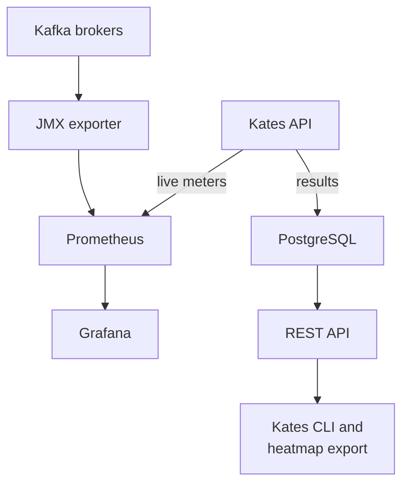

# Observability & Monitoring

Running a Kafka performance test without monitoring is like driving at night with no headlights. You might arrive safely, but you won't know how close you came to the edge. A test that reports its throughput and P99 tells you the result — but it doesn't tell you *why*. Was broker 2 doing twice the work? Was the [ISR](appendix-a-glossary.md#gl-isr) shrinking under load? Was GC pausing every 30 seconds? Without observability, you're guessing.

The answer is in four places: the [Grafana](appendix-a-glossary.md#gl-grafana) boards that watched the cluster, the meters the Kates API published while the run was in flight, the [heatmap](appendix-a-glossary.md#gl-heatmap) the run left behind, and the trend of the runs before it. You learn here which one to open for which question, and what the shapes in them mean.

After this chapter, you can:

- Walk the four-step diagnostic sequence — cluster health, performance, broker internals, replication — after any test run
- Pick the right Grafana dashboard or CLI tool for the question you're asking
- Export a latency heatmap and read the patterns that percentiles hide
- Track trends across runs and diff two reports to catch a regression before it ships

## Observability Architecture

Two paths carry what you read in this chapter. Live meters reach Grafana through [Prometheus](appendix-a-glossary.md#gl-prometheus) while a run is in flight; finished results live in [PostgreSQL](appendix-a-glossary.md#gl-postgresql) and reach the CLI through the REST API:



Each Kafka broker exposes its JMX MBeans as Prometheus metrics through the JMX Prometheus Exporter agent, configured by the kafka-cluster chart's metrics ConfigMap. Prometheus scrapes these endpoints, plus the Kates API's own `/q/metrics`, on its scrape interval — 30 seconds by default. Grafana queries Prometheus to render dashboards. Meanwhile, the Kates API writes test results to PostgreSQL and serves them through its REST API, which the CLI reads for terminal dashboards and trend charts. Heatmap exports come from the Kates API's memory instead, as [Exporting a Report](#exporting-a-report) explains. Traces take a third path, to Jaeger, which [Distributed Tracing](#distributed-tracing) covers.

## Reading the Dashboards: A Diagnostic Walkthrough

Your `payments-scenarios.yaml` LOAD run has finished on [`krafter`](appendix-a-glossary.md#gl-krafter), the Kafka cluster under test. `kates test get` shows the `produce` row's throughput and P99 against the 2,000 records per second and 100 ms gates — but not why they came out as they did. Here's how to read the dashboards, in what order, and what each pattern means.

### Step 1 — Check Cluster Health

Open **Kafka — KRaft Operations** and read its six-stat header. This is your starting point after *every* test, whether it passed or failed. You're answering one question: "Was the cluster healthy throughout the test, or did something break?"

**Active controllers** must be exactly 1 for the whole window. Zero means the quorum had no leader. A cluster with no [controller](appendix-a-glossary.md#gl-controller) looks healthy from a client while nothing new can happen — no topic created, no leader elected, no broker fenced or unfenced. **Fenced brokers** is the one that catches what Kubernetes cannot: a fenced broker is Running, passes both probes, publishes its metrics, and serves nothing. **Metadata lag (worst node)** is the KRaft-only failure with no ZooKeeper equivalent — a broker operating on a stale view of topics, ACLs and leadership while every other panel says it is fine.

Then drop to the **Cluster health** section for **Offline Partitions** and **Partitions below min.insync.replicas**. Both should be zero for the entire duration. Note the trap on offline partitions: only the active controller publishes that series, so when the quorum has no leader the panel goes empty rather than to zero, and an empty panel is not a zero.

For broker health as a *machine* — CPU, disk, volumes, per-listener connections — use the Strimzi operator's own `strimzi-kafka.json`, which the KRaft board links to from its header.

### Step 2 — Examine Performance Metrics

Now switch to **Kafka — Performance & Load Testing**. Look at **Messages in /s**: it should match the run's `targetThroughput: 2000`. If it's significantly lower, the producer couldn't sustain the target rate, which means you were testing the *producer's* limits, not the *cluster's*.

Check **Cluster throughput, in and out** to understand the data volume. If bytes out significantly exceeds bytes in, you have multiple consumer groups reading the same data — which is fine, but it means you're testing read amplification too.

Every panel in that row carries `topic=""`. Kafka registers the throughput meters twice, once per topic and once with no topic tag for the broker aggregate, and an absent label matches the empty string. So a query without that matcher counts every byte twice. [`dashboards/METRICS.md`](https://github.com/bmscomp/kates/blob/main/dashboards/METRICS.md) is where that and three other naming traps are written down.

### Step 3 — Investigate Latency Sources

If your P99 was higher than expected, open the **Broker Internals** section of the same board. **Request and response queue size** growing during the test means requests were arriving faster than the broker could process them; a healthy cluster keeps this near zero. **Request handler idle (windowed)** is the better saturation signal [@gregg2013thinking]. When this [request handler idle ratio](appendix-a-glossary.md#gl-request-handler-idle-ratio) falls below 0.3 the broker itself is the bottleneck, and that is exactly what `KafkaRequestHandlerSaturated` fires on.

Read it beside **Request handler idle (lifetime mean)**, which is deliberately on the same board. The lifetime form is a mean since the broker started, so a node up for a week and saturated for an hour still reads a comfortable number. When the two disagree, the windowed one is the one describing your test.

With `acks=all`, every produce request is parked in the broker's produce [purgatory](appendix-a-glossary.md#gl-purgatory) until all ISR members replicate it [@wang2015building]. There is no dedicated purgatory panel, but a clean request queue combined with high produce latency usually means replication — not request processing — is the bottleneck; verify that in the next step.

### Step 4 — Verify Replication

Finally, open the **Replication** section. During a normal test, **ISR shrinks and expands /s** should stay flat at zero and **Under-replicated partitions** should be zero for the entire duration. If the ISR shrank during the test — an [ISR shrink](appendix-a-glossary.md#gl-isr-shrink) leaves [under-replicated partitions](appendix-a-glossary.md#gl-under-replicated-partition) behind — followers were struggling to keep up, likely because of disk I/O pressure or network saturation.

**Replication traffic** is the panel most easily forgotten: follower fetch traffic is invisible in the client-facing throughput numbers and is frequently what actually saturates the network. And if you are running across availability zones, **Throughput by zone** and **Leaders by zone** tell you how much of the test's traffic crossed a zone boundary — a cost problem before it is a latency one.

::: {.callout-tip title="Read the boards in this order after every run"}
Follow this sequence — cluster health, performance, internals, replication — after every test. It takes 60 seconds and catches problems that aggregate metrics hide. If a test result surprises you, the dashboards almost always explain why.
:::

## The Dashboard Set

Twelve dashboards, and all of them live in one place: [`dashboards/`](https://github.com/bmscomp/kates/tree/main/dashboards). The table gives each board and the question it answers:

| Board | What it answers |
|------------------------------------|----------------------------------------------------------------------|
| Kafka — KRaft Operations | Is the quorum healthy and metadata committing, and what fails to replicate, serve or store the data? |
| Kafka — Performance & Load Testing | Throughput per broker and per zone, replication strain and saturation, per partition while a run is in flight |
| Kates — Application Health | Is the Kates API's Quarkus process healthy? |
| Kates — Benchmark (live) | What is this run doing right now? |
| Kates — Trend & Regression | Has performance moved across runs? |
| Kates — Chaos | What happened to the cluster and the workload when the experiment fired? |
| Kates — Chaos infrastructure | Is the LitmusChaos execution plane installed, running, and has it run anything? |
| Kates — Overview | What does one Kates release know about itself, with nothing else installed? |
| Kyverno Security Policies | What did the admission webhook let through, what did it refuse, and what is it costing the API server? |
| Kafka Connect | Are the workers up, which connectors and tasks are running, what is failing or being dead-lettered? |
| Kafka MirrorMaker 2 | Is the mirror up, is it lagging, is it erroring — and if it is lagging, which leg and which end? |
| Kafka MirrorMaker 2 — migration | Can I cut over yet, and if not, what is left? |

One chart delivers all twelve: `charts/monitoring` puts every board into one ConfigMap, which the Grafana sidecar picks up, and the boards' template variables select the release they show. `charts/kates`, `charts/kates-chaos`, `charts/connect-cluster` and `charts/mirror-maker2` ship no board of their own.

Each board is generated from `dashboards/<board>/board.py`; edit the source and regenerate, never the JSON, and the `README.md` beside it says what every panel reads.

### What the Strimzi Operator Already Covers

The strimzi-operator chart ships nine upstream dashboards and enables them by default, and their label selectors match what this repository's PodMonitors emit. Four of them are authoritative, and the boards here deliberately do not restate them:

| Upstream board | Covers |
|---|---|
| `strimzi-kafka.json` | Broker health as a machine: header stats, idle gauges, per-listener connections, disk I/O, log size, JVM, container and volumes |
| `strimzi-kraft.json` | Quorum *identity*: state, current leader, current vote, epoch, high watermark, log end offset, append and fetch rates, commit latency |
| `strimzi-cruise-control.json` | Cruise Control: anomaly detection, goal optimization, the load monitor |
| `strimzi-kafka-exporter.json` | [Consumer lag](appendix-a-glossary.md#gl-consumer-lag) per group |

So **Kafka — KRaft Operations** is explicitly not a rebuild of `strimzi-kafka.json`. It covers the other half: metadata lag, metadata errors, fenced brokers, the quorum-degradation signals, ISR dynamics, per-error-code request failures, tiered storage, and the authentication counters. No upstream board shows those. Its header links straight to the upstream set.

The division of labor is asymmetric, and worth knowing before you go looking upstream for a Connect board. `strimzi-kafka-connect.json` reads 21 `kafka_*` names and exactly one of them is producible by this repository's Connect exporter rules; `strimzi-kafka-mirror-maker-2.json` reads 22, and again exactly one. For Connect and MirrorMaker 2 the boards in `dashboards/` are the only ones that work here.

### What the Metrics Mean

[`dashboards/METRICS.md`](https://github.com/bmscomp/kates/blob/main/dashboards/METRICS.md) is the reference for every series any board reads — its type, its labels, its operational meaning, how to query it where that is not obvious, and which boards read it. It also says whether this repository publishes each one or whether something else has to be installed first. So an empty panel can be read as *nothing is wrong* rather than *nothing publishes this*.

Read its opening section before writing a PromQL query against a Kafka broker. Four naming traps account for most dead panels:

- `_max_total` is not a counter. The exporter appends `_total` to anything a COUNTER rule names and the KRaft rules type `.+-max` as COUNTER, so `kafka_server_raftmetrics_commit_latency_max_total` is a max gauge in milliseconds. Never `rate()` it.
- `_count_total` is a meter's `Count` attribute, and the unit is not always a count — `…requesthandleravgidlepercent_count_total` is cumulative nanoseconds of idle time.
- Percentiles are pre-computed gauges carrying a `quantile` label, with no `_sum` and no buckets. Select the quantile; `histogram_quantile()` has nothing to work with.
- `BrokerTopicMetrics` is registered twice (see Step 2), so a total needs `topic=""` and a per-topic panel needs `topic!=""`.

## Kates-Specific Dashboards

Six of the twelve boards are tailored to Kates itself — one live run, trends across runs, application health, chaos correlation, the chaos platform's own health, and a self-contained overview of the Kates API. They won't exist in a standard Kafka monitoring setup. The table gives each board's file, its UID and its template variables, apart from `$datasource`:

| Board | File | UID | Template variables |
|------------------------------|-------------------------|------------------------------|------------------------------|
| Kates — Benchmark (live) | `kates-benchmark.json` | `kates-benchmark-overview` | `$job`, `$run_id`, `$test_type` |
| Kates — Trend & Regression | `kates-trend.json` | `kates-trend-analysis` | `$job`, `$test_type` |
| Kates — Application Health | `kates-application.json` | `kates-application-health` | `$namespace`, `$job`, `$pod`, `$db_pod` |
| Kates — Overview | `kates-overview.json` | `kates-overview` | `$job` |
| Kates — Chaos | `kates-chaos.json` | `kafka-chaos-dashboard` | `$namespace`, `$pod`, `$kates_job` |
| Kates — Chaos infrastructure | `kates-chaos-infra.json` | `kates-chaos-overview` | `$namespace`, `$operator_deployment` |

Each board's `README.md` in `dashboards/` documents it panel by panel and says which metrics come from the application, which from kube-state-metrics, and which from an exporter you have to install yourself. Those READMEs are the reference; this chapter is the tour.

### Kates — Benchmark (live)

This is your real-time view during active benchmark runs. Open it *while a test is running* to watch throughput ramp up, latency settle, and phases transition. Pick the run with `$run_id`, or compare test types with `$test_type`. Its rows:

| Row | Panels |
|---|---|
| (header) | Active runs, records moved, errors, SLA constraints breaching |
| Throughput | rec/s and MB/s timeseries |
| Latency | Percentiles (P50/P95/P99/P99.9) and the worst observed latency |
| Phase detail | Record rate by phase, P99 by phase, records by phase |
| SLA and errors | Error rate and SLA constraints breaching, by constraint |

Expect this board to be **empty between runs**. Every series on it is tagged with `run_id`, and those meters are unregistered when the run ends so that an unbounded label cannot grow Prometheus without limit. The history is on the trend board below, which reads the samples these meters already wrote.

### Kates — Trend & Regression

Where the Benchmark dashboard shows one test, the Trend dashboard shows *all* tests over time. This is how you detect performance regressions: a P99 that creeps up run after run shows here as an upward trend line. It also aggregates platform-level stats like test completion rates and SLA pass rates. Its rows:

| Row | Panels |
|---|---|
| Throughput trend | Peak rec/s and MB/s per run |
| Latency trend | P99 and P99.9 per run |
| Volume | Records moved per run — read this before believing the two rows above |
| Platform totals | Tests completed (by outcome), test duration (P50/P95/P99), SLA pass/fail rate, records processed rate |
| Disruptions | The Kates API's own disruptions: completion rate and duration (P50/P95) |

Both variables come from `kates_tests_completed_total`, a platform counter that outlives any run. A variable built on a run-scoped series empties out the moment the cluster goes idle, which is precisely when this board is opened.

### Kates — Application Health

This dashboard monitors the Kates API itself — not Kafka, not the test results, but the Quarkus application running the tests. Use it when the Kates REST API feels slow, when tests are failing to start, or when you suspect the Kates API itself is the bottleneck. Its rows:

| Row | Panels |
|---|---|
| (header) | Pods ready, container restarts, uptime, database pods ready |
| HTTP | Request rate (by method), error rate (4xx/5xx), request latency (P50/P95/P99) |
| JVM | Heap (used/committed/max), GC pause, threads (live/daemon/peak) |
| Database | Agroal pool connections, acquisitions/sec, time waiting for a connection |
| Container resources | CPU cores and container memory, from cAdvisor |

The `$pod` list comes from the application's own `process_uptime_seconds` series. So it is the set of pods Prometheus is actually scraping, rather than the set whose names happen to match a regex.

If **time waiting for a connection** is climbing while the pool shows `active` pinned at its ceiling, the pool is too small and raising it helps. The same panel climbing with spare capacity means the database is slow, and a bigger pool does not help.

Two of those rows depend on settings the application ships and Quarkus does not default to. The Agroal pool publishes nothing unless `quarkus.datasource.metrics.enabled` is on; the Micrometer extension alone does not switch it on. The HTTP timer carries only `_count`, `_sum` and `_max` until a `MeterFilter` gives it buckets, and the application's filter sets eleven fixed boundaries from 5 ms to 10 s. That filter is what makes `histogram_quantile()` possible on the *request latency* panel, and it also sets its resolution. A percentile is interpolated inside the bucket it falls in, so a P99 of 7 ms means "between 5 and 10". The GC pause panel is empty on the native image: GraalVM exposes no GC notification beans, so Micrometer registers no pause meters, and the panel's description says so.

The `jvm_*` names on this board are **Micrometer's**, not the Prometheus JMX agent's. This is a Quarkus application, not a broker: Micrometer publishes `jvm_memory_used_bytes{area="heap"}` and `jvm_gc_pause_seconds`, while the JMX agent the Kafka boards read publishes `jvm_memory_bytes_used{area="heap"}` and `jvm_gc_collection_seconds` for the same quantities. Neither is a fallback for the other.

### Kates — Overview

The only board that reads **nothing but metrics the application publishes about itself** — no kube-state-metrics, no cAdvisor, no exporter. A Prometheus that scrapes the Kates API is all it needs. Its title in Grafana is `KATES — Overview`, and it shows uptime, active runs, API traffic and latency, the JVM, and the Agroal pool.

Use Application Health instead if you are running the full monitoring stack; it answers a bigger question with more sources. The run percentiles are per-run series, so they live on the benchmark boards and appear nowhere on this one. Every expression is scoped by the `$job` variable, so one copy serves every release a Grafana can see.

### Kates — Chaos

This dashboard correlates LitmusChaos experiment status with Kafka cluster health and Kates benchmark performance *on the same timeline*. Its header and Experiment history rows read LitmusChaos series only, so a fault from the direct Kubernetes provider, and every `POD_DELETE`, `ROLLING_RESTART` and `SCALE_DOWN`, leaves them empty. When you inject a fault, this dashboard answers the question: "What happened to my cluster and my test when the chaos experiment fired?" Its rows:

| Row | Panels |
|---|---|
| (header) | Chaos engines running, passed/failed experiments, probe success rate |
| Kafka under fault | Broker readiness, restarts, CPU, memory |
| Experiment history | Experiment duration over time |
| Kates during chaos | Benchmark throughput, P99 latency and errors under the fault |
| RTO / RPO / data integrity | Producer and consumer RTO, RPO, data loss, lost and duplicate records; collapsed, and fills only for verified runs |

::: {.callout-note title="The RTO / RPO row fills only for a run that verified integrity"}
The row's panels read the `kafka:chaos:*` recording rules, which record the `kates_integrity_result_*` gauges the Kates API registers when a run's integrity verifier reports. A plain LOAD run publishes none of them, so the row stays blank; blank during a resilience run means the verifier hasn't reported yet or the Kates API isn't scraped. The gauges go with the run's other meters when it ends, so read the row while the run is in flight, or widen the time range to cover it.
:::

One more caveat on the header. `Chaos engines running` reads `kube_customresource_chaosengine_status_engine_status`, which kube-state-metrics publishes only when **configured with custom-resource metrics for `ChaosEngine`** — not its default. `charts/monitoring` configures it (`kube-prometheus-stack.kube-state-metrics.customResourceState`, with the `list`/`watch` access on `chaosengines.litmuschaos.io` it needs); on another stack, copy that block. The series is one per engine and state — 1 for the state the engine is in, 0 for the other two — so a cluster that has never created an experiment has none.

The panel anchors its zero fallback to the same series unfiltered by status, the only thing that proves the collector is configured. So it reads **No data** rather than a reassuring zero. The board's `$namespace` picker resolves from the same series, comes up empty, and says why in its tooltip: no experiment yet, or a collector without the configuration. Of the four alerts in `prometheus-chaos-rules.yaml` that read the series, only `KafkaChaosExperimentActive` works. The three guarded by `and on() count(…) == 0` cannot fire whether the series exists or not, because `count()` over nothing is empty rather than zero — and it is empty exactly when no experiment is running. Do not rely on those three until the guard is rewritten.

### Kates — Chaos Infrastructure

**Kates — Chaos infrastructure** covers the layer underneath the one above: is the LitmusChaos execution plane installed, is its operator running, and has it actually run anything? Six panels, scoped to the namespace Litmus runs in — which is neither the Kafka namespace nor the namespace the experiments target.

Open it when **Kates — Chaos** is empty and you need to know whether that means *no fault was injected* or *nothing is installed*. The two kube-state-metrics panels, the operator's availability and the infra pods' status, fill whether or not Litmus is scraped, which makes them the ones to read first. Operator green with every Litmus panel blank means the chaos-exporter is off, not that the platform is down. It is off by default — `litmus-core.exporter.enabled`.

## Kates CLI Observability

Not everything requires a browser. The Kates CLI provides four terminal-based observability tools, each designed for a different workflow.

### The Terminal Dashboard

The `kates dashboard` command provides a full-screen terminal dashboard — the CLI equivalent of the Grafana Benchmark dashboard. Use it when you want a quick overview without leaving your terminal:

```bash
kates dashboard
# or
kates dash
```

It shows:

- System health status
- Active tests count
- Recent test results table
- Kafka cluster summary

### Running Tests with kates top

Like `kubectl top`, but for Kates tests. Use it when multiple tests are running concurrently and you want to see which ones are active and how they're performing:

```bash
kates top
```

It shows running tests with real-time throughput and latency updates.

### The One-Line Status

A one-line system health check — the fastest way to verify that Kates and Kafka are both reachable:

```bash
kates status
```

It returns one line: the CLI context, the Kates API's health status, whether Kafka is up, and run counts by status.

### Cluster Watch

A live-refreshing cluster health dashboard with historical [sparkline](appendix-a-glossary.md#gl-sparkline) trends. It refreshes every 5 seconds by default and tracks the last 30 polls. This is the CLI tool you leave running in a side terminal during extended test sessions:

```bash
# Default 5-second refresh
kates cluster watch

# Custom interval
kates cluster watch --interval 10
```

Under a banner with the cluster's status and ID, each refresh prints four blocks. Cluster Overview counts brokers, topics, partitions and consumer groups and names the controller. Partition Health counts under-replicated and offline partitions. Active Problems, shown only when there are any, lists each troubled partition with its topic and issue. Trend holds three sparklines — Under-Replicated, Offline and Partitions — over the last 30 polls.

Sparklines use Unicode block characters (▁▂▃▄▅▆▇█). A rising Under-Replicated line is the early warning: if it reads ▁▁▂▃▅▇, something is going wrong and you should investigate before it gets worse.

## Latency Heatmaps

Heatmaps preserve the **full latency distribution over time**, revealing patterns invisible in aggregate percentiles [@gregg2010visualizing]. Where a P99 tells you "99% of requests were under 15ms," a heatmap tells you "*when* the slow requests happened, *how many* there were, and *whether the pattern was sustained or momentary*."

For the theory behind why heatmaps matter and why percentiles alone are insufficient, see [Heatmaps](04-performance-theory.md#heatmaps-seeing-the-full-picture).

### How Heatmaps Work

On each status poll of a running test, the Kates API snapshots the run's latency histogram into 25 buckets and stores the counts as one heatmap row. Once the run finishes, `kates report export` turns those rows into JSON for Grafana or CSV for a spreadsheet.

### Bucket Boundaries

The 25 heatmap buckets use roughly logarithmic spacing, concentrating resolution in the low-latency range, where small differences are significant:

| Bucket | Range | Focus |
|:-:|---|---|
| 1 | 0 – 0.5ms | Sub-millisecond operations |
| 2 | 0.5 – 1ms | Fast local writes |
| 3–7 | 1 – 10ms | Typical Kafka latency |
| 8–13 | 10 – 100ms | Moderate latency |
| 14–19 | 100 – 1,000ms | High latency / timeouts |
| 20–25 | 1,000 – 10,000ms | Extreme tail / failures |

### Reading Heatmap Data

The JSON payload carries the run ID, test type, bucket labels and boundaries, and a list of rows. Each row is a snapshot of the latency distribution, captured while the Kates API polls the running test. One row looks like this:

```json
{
  "timestampMs": 1708012345000,
  "phase": "steady-state",
  "counts": [0, 0, 12, 145, 832, 456, 89, 23, 5, 1, ...]
}
```

The counts are cumulative: a row covers everything its task has recorded since the task started, not only the time since the row before. So the difference between two rows of one task is what happened in between. In this row, 832 records had fallen in the fifth bucket and 456 in the sixth by the time of the snapshot. The `phase` field tells you which test phase was active, so you can compare the distribution during `ramp-up` and `steady-state` to see the effect of JVM warm-up.

### What Heatmaps Reveal

Five shapes cover most heatmaps you will read; match the picture to the row:

| Pattern | What It Means |
|---------|---------------|
| Single dense band | Uniform latency — healthy |
| Two horizontal bands | Bimodal latency — cache hit vs. miss |
| Vertical stripe | Latency spike at a point in time — GC or election |
| Gradual upward drift | Latency degrading over time — saturation |
| Sudden regime change | Configuration or topology changed mid-test |

::: {.callout-tip title="Try it: was the payments run's P99 a spike or a drift?"}
Export your payments LOAD run with `kates report export <id> --format heatmap-csv` and chart the differences between consecutive rows: look for a vertical stripe (a spike) or an upward drift. Then `kates report diff <baseline-id> <id>` against the Part II baseline tells you whether the P99 moved at all. A single dense band and a diff under a few percent is the healthy answer.
:::

## Trend Analysis

Individual test results are snapshots. Trend analysis turns those snapshots into a movie, letting you see how performance evolves over days and weeks. This is how you catch regressions early — before they reach production.

A trend plots one point per `DONE` run of the type in the window. A `FAILED` run is left out, because its numbers stop wherever it failed, and so is a run still in flight. Without `--phase`, each point is the run's report summary, whose latency comes from its producers: a LOAD run's consumer measures none, so it is left out rather than averaged in. With `--phase`, each point is that phase's own summary. The table under [GET /api/tests/{id}/report](11-api-reference.md#get-apitestsidreport), in the REST API Reference, shows how each metric combines a run's tasks.

For the payments workload, follow the `produce` phase, whose P99 is the one the target sets:

```bash
# P99 of the produce phase across LOAD runs, last 30 days
kates trend --type LOAD --phase produce --metric p99LatencyMs --days 30

# Throughput trend
kates trend --type LOAD --metric avgThroughputRecPerSec --days 30
```

The output opens with the [baseline](appendix-a-glossary.md#gl-baseline), computed from the most recent runs (five by default, set by `--baseline`). A Trend Chart line follows: a sparkline, an arrow for the direction from the first point to the last, and the number of data points. Under it come the minimum, maximum and average, then a Data Points table with each run's ID, timestamp and value. A value more than 20% above the baseline is marked ▲ and one more than 20% below is marked ▼. A Regressions Detected table closes the output when the Kates API flags any.

A sudden upward step in the sparkline indicates a regression. Find the run behind it in the Data Points table and correlate its timestamp with your change history: a broker configuration, a Kafka version, or the topic's partition count.

## Report Comparison

Comparing two runs answers the question "did my change make things better or worse?" A before/after comparison removes the noise of absolute numbers and focuses on relative change. Both commands compare the runs' report summaries, so their latency comes from the runs' producers, as a trend's does.

```bash
# Compare two runs
kates report diff <id1> <id2>

# Summary comparison of multiple runs
kates report compare <id1>,<id2>,<id3>
```

### Diff Output

`kates report diff` prints one row per metric — average and peak throughput, average MB/s, average, P50, P95, P99 and maximum latency, and error rate. Each row gives the metric's value for the two runs, the change as a signed percentage, and a marker. The legend under the table reads:

```text
▲ = improved │ ▼ = regressed │ = ≈ no change
```

A change under 2% either way counts as no change. A P99 rising several times faster than throughput falls is the signature of a cluster near its saturation point, where small increases in load cause disproportionate latency increases [@harcholbalter2013performance]. See [The Two Pillars: Throughput and Latency](04-performance-theory.md#the-two-pillars-throughput-and-latency) for why this non-linear relationship exists.

## Exporting a Report

`kates report export` writes a run's report in one of six formats, each designed for a different downstream consumer:

| Format | Command | Use Case |
|--------|---------|----------|
| CSV | `kates report export <id> --format csv` | Spreadsheet analysis |
| JUnit XML | `kates report export <id> --format junit -f results.xml` | CI/CD pipelines |
| Markdown | `kates report export <id> --format md` | Docs, PRs, and chat |
| HTML | `kates report export <id> --format html` | Shareable standalone report |
| Heatmap JSON | `kates report export <id> --format heatmap` | Grafana visualization |
| Heatmap CSV | `kates report export <id> --format heatmap-csv` | Spreadsheet analysis |

With `-f <path>`, the export goes to that path. Without it, in a terminal each export is written to an auto-named file (`kates-report-<id>.csv`, `kates-heatmap-<id>.json`, …); piped or redirected, it goes to stdout. There is no `--format json`: for programmatic JSON, use `kates report show <id> -o json` or the REST API directly.

The Kates API keeps heatmap rows in memory, for native runs only and for its 50 most recent such runs, so a restart loses them; [Architecture & Design](02-architecture.md) says what else lasts how long.

### The Heatmap Endpoint

The CLI's heatmap export reads this endpoint, so a script can fetch the same data over HTTP:

| Format | Request |
|--------|---------|
| JSON (the default) | `GET /api/tests/{id}/report/heatmap?format=json` |
| CSV | `GET /api/tests/{id}/report/heatmap?format=csv` |

## Broker Metrics Correlation

`kates report brokers` splits a run across the cluster's brokers, which is how you spot a hot spot caused by leader imbalance. It measures no per-broker traffic: it shares the run's throughput out by each broker's share of the topic's partition leaders.

```bash
kates report brokers <id>
```

The command prints one row per broker in the cluster, including a broker that leads none of the topic's partitions. Read the columns this way:

| Column | What it shows |
|--------|---------------|
| Broker | The broker's ID |
| Host (Rack) | The broker's host, and its rack, or `-` when it has none |
| Leaders / Total | The topic's partitions this broker leads, out of all of them |
| Share | That count as a percentage |
| Throughput | The run's average throughput multiplied by the share |
| p99 Latency | The whole run's P99, the same on every row |
| Skew | How far the broker's throughput sits from the brokers' mean; beyond 20% it is flagged |
| URP | The topic's partitions with a replica on this broker and fewer in-sync replicas than replicas |

A Balance Score under the table rates how evenly the leaders are spread. The Kates API reads the leaders when it first builds the run's report and keeps that report in memory, so the rows describe the topic at that moment, not during the run, and a restart can change them. For the same reason, they can't show how load moved while a fault was in place.

## Distributed Tracing

Kates uses OpenTelemetry to propagate traces from REST API entry to database queries [@w3c2021tracecontext]. Tracing answers a different question than metrics: where metrics tell you *what* happened, traces tell you *where the time went* for a specific request.

### Tracing Properties

Tracing is configured in `application.properties`:

| Property | Value | Purpose |
|----------|-------|---------|
| `quarkus.otel.enabled` | `true` | Master switch for OpenTelemetry |
| `quarkus.otel.exporter.otlp.endpoint` | `http://jaeger-collector.monitoring.svc:4317` | Jaeger collector address (`http://localhost:4317` in dev) |
| `quarkus.otel.exporter.otlp.protocol` | `grpc` | Export spans via OTLP over gRPC |
| `quarkus.otel.traces.sampler` | `parentbased_traceidratio` | Sample based on parent trace |
| `quarkus.otel.traces.sampler.arg` | `0.1` (prod) / `1.0` (dev) | 10% sampling in prod, 100% in dev |

::: {.callout-note title="Why production samples one trace in ten"}
The `0.1` sampling rate in production means only 10% of requests generate traces. Tracing adds overhead, and at high throughput you don't need every request traced to spot patterns [@sigelman2010dapper]. In development, 100% sampling is used so you can trace any request.
:::

### What Gets Traced

Two layers produce spans, named as the table shows:

| Layer | Span Name Pattern | Details |
|-------|-------------------|---------|
| JAX-RS | `GET /api/tests/{id}` | HTTP method + path |
| JDBC | `SELECT test_runs` | SQL operation + table |

### Viewing Traces

Deploy [Jaeger](appendix-a-glossary.md#gl-jaeger) with `make jaeger`, which installs it in the `kafka` namespace. The Kind cluster doesn't publish NodePorts on the host, so forward the UI with `kubectl -n kafka port-forward deployment/jaeger 16686:16686` and open `http://localhost:16686`:

1. Select service **kates** in the dropdown
2. Click **Find Traces** to see recent requests
3. Click a trace to see the full span tree (REST → DB)

Each trace shows the complete request lifecycle as a waterfall diagram. Look for gaps between spans — these represent time spent in framework code, serialization, or network transit. A healthy trace shows spans tightly packed together; large gaps indicate inefficiency.

## Alerting

Kates ships [PrometheusRule](appendix-a-glossary.md#gl-prometheusrule) alerts alongside its charts. These alerts fire when cluster health degrades, giving you early warning before problems become outages. Three charts carry them:

| File | Groups | What They Cover |
|------|--------|-----------------|
| `charts/kafka-cluster/templates/prometheusrule.yaml` | `kafka-cluster.<cluster>.` followed by `availability`, `replication`, `kraft`, `performance`, `storage`, `consumers`, `cruise-control`, `records`, `slo` | Offline partitions and controllers, ISR, KRaft elections and metadata lag, latency and saturation, disk, consumer lag, Cruise Control, SLO burn |
| `charts/connect-cluster/templates/alerts.yaml` | `<release>.workers`, `<release>.connectors`, `<release>.records`, `<release>.slo` | Workers, rebalances, heap, failed connectors and tasks, record errors, dead letter queues, offset commits, sink lag, opt-in idle sources and SLO burn |
| `charts/monitoring/templates/prometheus-chaos-rules.yaml` | `kafka-chaos-expected`, `kafka-chaos-unexpected`, `kafka-chaos-results`, `kafka-gameday`, `kafka-chaos-rto-rpo` | Chaos experiment status, unexpected broker restarts during chaos, Game Day workflows, RTO/RPO SLA breaches and data loss |

In the kafka-cluster groups, `<cluster>` is the chart's `clusterName`, `krafter` in the lab, and `records` holds recording rules only. Every kafka-cluster alert links to its section of the Kafka cluster runbook through `runbook_url`, with the alert's name as the anchor.

::: {.callout-note title="When the RTO/RPO alerts can fire"}
`KafkaRTOExceedsSLA` (max RTO over 30 s), `KafkaRPOExceedsSLA` (RPO over 5 s) and `KafkaDataLossDetected` (data loss over 0.1%) read the recorded integrity series. So they evaluate only while a verified run's gauges exist. Enable them with `chaosAlerts.enabled`.
:::

### Alert Configuration

The alert rules are deployed as Kubernetes `PrometheusRule` resources, which the Prometheus operator discovers automatically. Each chart has its own toggle: `alerts.enabled` in `charts/kafka-cluster/values.yaml` and `charts/connect-cluster/values.yaml` (with extra labels via `alerts.labels`), and `chaosAlerts.enabled` in `charts/monitoring/values.yaml` (off by default).

The connect-cluster rules render only where the `monitoring.coreos.com/v1` API exists, are scoped to the release's own workers, and take their thresholds from `alerts.thresholds`, with opt-in rules under `alerts.sourceIdle` and `alerts.slo`. Each links to its section of [the Connect runbook](../connect-cluster-runbook.md) through `runbook_url`.

The kafka-cluster chart also takes its thresholds from `alerts.thresholds` and keeps the `for:` durations in the template; a different duration needs your own `PrometheusRule` beside it. The threshold keys and their defaults:

| Key | Default | Alert it sets |
|------------------------|----------:|-------------------------------------------|
| `consumerLagWarning` | 1000000 | `KafkaConsumerGroupLag` |
| `consumerLagCritical` | 10000000 | `KafkaConsumerGroupLagCritical` |
| `requestLatencyP99Ms` | 1000 | `KafkaRequestLatencyHigh` |
| `handlerIdleRatio` | 0.3 | `KafkaRequestHandlerSaturated` |
| `logFlushP99Ms` | 500 | `KafkaLogFlushLatencyHigh` |
| `diskFreeWarning`, `diskFreeCritical` | 0.2, 0.1 | `KafkaBrokerDiskUsageHigh`, `KafkaBrokerDiskUsageCritical` |
| `raftElectionsPer15m` | 3 | `KafkaRaftLeaderElections` |
| `requestQueueSize` | 100 | `KafkaRequestQueueSaturated` |
| `metadataLagMs` | 60000 | `KafkaBrokerMetadataLag` |

Five of the kafka-cluster alerts are the ones a load test most often trips. The table gives when each fires and its runbook anchor:

| Alert | Fires when | `for` | Severity | Runbook anchor |
|-------------------------------|--------------------------------------------------|------:|----------|-----------------------------------|
| `KafkaConsumerGroupLag` | A group's lag exceeds `consumerLagWarning` | 15m | warning | `#kafkaconsumergrouplag` |
| `KafkaConsumerGroupLagCritical` | A group's lag exceeds `consumerLagCritical` | 5m | critical | `#kafkaconsumergrouplagcritical` |
| `KafkaOfflinePartitions` | Any partition has no leader | 2m | critical | `#kafkaofflinepartitions` |
| `KafkaUnderReplicatedPartitions` | Any partition has followers out of sync | 5m | warning | `#kafkaunderreplicatedpartitions` |
| `KafkaRequestHandlerSaturated` | A broker's handler idle ratio falls below `handlerIdleRatio` | 10m | warning | `#kafkarequesthandlersaturated` |

Consumer lag during a load test is expected, while sustained lag in production means the consumers are undersized. When a lag alert fires, check that the consumer pods are running with `kubectl get pods`. If they're healthy, scale the consumer group or look for a consumer blocked on a downstream dependency.

Offline partitions mean records can't be produced or consumed for those partitions: the data is unavailable. When `KafkaOfflinePartitions` fires, check which brokers are down with `kates cluster watch`. Kafka elects new leaders for a crashed broker's partitions; if it doesn't within a couple of minutes, check the KRaft controller logs for election failures.

Transient under-replication is normal during broker restarts. Sustained under-replication puts durability at risk: if the remaining replicas also fail, you lose data. When `KafkaUnderReplicatedPartitions` fires, check broker disk I/O and network throughput, because slow disks or saturated networks keep followers from keeping up with the leader. Also check that `min.insync.replicas` is set as [The Cluster Under Test](03-cluster.md) describes.

## Monitoring Stack Deployment

`charts/monitoring` is a wrapper around kube-prometheus-stack; the [Version & Compatibility Matrix](appendix-d-versions.md) lists the chart, Prometheus and Grafana versions it pins. Two make targets install it:

```bash
# Detects the provider and picks the matching overlay —
# Kind gets values-kind.yaml (NodePort 30080)
make monitoring

# Generic Kubernetes (ClusterIP), no detection
make monitoring-generic
```

These commands:

1. Build chart dependencies (`helm dependency build charts/monitoring`)
2. Install the local wrapper chart as the release `monitoring` in the `kafka` namespace, alongside the Kafka cluster
3. Deploy all twelve boards as one ConfigMap, which the Grafana sidecar picks up

The two Kafka boards read only series the vendored exporter rules produce, which the [metric contract](appendix-a-glossary.md#gl-metric-contract) check proves on every build.

To render the same thing by hand — which is what you do when you need a values chain the targets do not offer:

```bash
helm pull oci://ghcr.io/bmscomp/charts/kates-monitoring --untar

helm upgrade --install monitoring ./kates-monitoring \
  --namespace kafka --create-namespace \
  -f kates-monitoring/values-kind.yaml \
  --timeout 10m --wait
```

The Kates API reads a disruption's Kafka metrics from this Prometheus, through the Service kube-prometheus-stack creates for the release, `monitoring-kube-prometheus-prometheus`. The kates chart's `prometheus.url` points at it in the `monitoring` namespace, where `kates deploy` installs it, and `kates deploy` sets it for the namespace it uses. After `make monitoring`, the Service is in `kafka`. `make kates` applies the raw manifests in `kates/k8s/`, whose ConfigMap points there already.

To install the kates chart against it, add `--set prometheus.url=http://monitoring-kube-prometheus-prometheus.kafka.svc:9090 --set networkPolicy.prometheus.namespace=kafka`. Without that, the Kates API cannot reach Prometheus: a disruption report has no Kafka metrics, and its SLA grade leaves the latency and throughput constraints unevaluated.

### Access

Both tools are reached through a port-forward; the address depends on which install you made:

| Service | URL |
|---|---|
| Grafana | `http://localhost:30080` with `make ports`; `http://localhost:3000` with `kates ports` |
| Prometheus | `http://localhost:30090` with `make ports`; `http://localhost:30090` with `kates ports` |

The Kind overlay makes Grafana a NodePort on 30080, but the Kind cluster does not publish NodePorts on the host. `kates ports` looks in the namespace that `--monitoring-ns` names (`monitoring` by default). When a service is not there, it forwards a service of the same name from any other namespace, so it finds either install without the flag. Pass `--monitoring-ns` only to choose when two namespaces both have one.

Default Grafana credentials: `admin` / `admin`.

## The Meters Kates Publishes

Kates exposes three groups of Prometheus metrics: **benchmark metrics** that track individual test runs in real time, **integrity gauges** for a run that verified integrity, and **platform metrics** that accumulate across all runs. Prometheus scrapes them all, and the Kates-specific Grafana dashboards described above read them.

### Per-Run Benchmark Meters

The Kates API registers these for each run (`BenchmarkMetrics`), tagged with `run_id` and `test_type`, apart from the active-runs gauge. The throughput gauges also carry `backend`, and the latency and record meters carry `phase`. They are created when a benchmark starts and updated throughout its execution:

| Prometheus Metric | Type | Description |
|---|---|---|
| `kates_benchmark_active_runs` | Gauge | Number of active benchmark runs |
| `kates_benchmark_throughput_rec_sec` | Gauge | Current throughput in rec/s |
| `kates_benchmark_throughput_mb_sec` | Gauge | Current throughput in MB/s |
| `kates_benchmark_latency_ms` | Gauge, per `quantile` | Latency percentiles (P50/P95/P99/P99.9), measured by the benchmark backend |
| `kates_benchmark_latency_ms_max` | Gauge | Worst latency observed in the phase |
| `kates_benchmark_records_total` | Counter | Records processed, per phase |
| `kates_benchmark_errors_total` | Counter | Tasks that reached a FAILED state |
| `kates_benchmark_sla_violations` | Gauge, per `metric` and `severity` | 1 while that SLA constraint is violated, 0 once it recovers |

`kates_benchmark_latency_ms` publishes under the names a Micrometer `DistributionSummary` would use, but it is **not** one. The Kates API never sees individual latencies, only the aggregates each poll of a benchmark backend returns. So the [percentiles](appendix-a-glossary.md#gl-percentile) are the benchmark backend's own, published as gauges carrying a `quantile` label. Select the quantile; never `histogram_quantile()` over these, and never average two of them together. `http_server_requests_seconds_*` on the application board *is* a real histogram, and is the exception.

Every meter in this table except `kates_benchmark_active_runs` is tagged with `run_id`, which is unbounded over time, so the Kates API unregisters them when the run finishes. They exist only while a run is in flight, which is why the live board is empty between runs and why the trend board's variable reads a platform counter.

### Integrity Gauges

The Kates API registers seven gauges for a run on the first poll after its integrity verifier reports, tagged with `run_id` and `test_type`, so a LOAD run publishes none. They go with the run's other meters when it ends:

| Prometheus Metric | Unit | Description |
|---|---|---|
| `kates_integrity_result_producer_rto_seconds` | seconds | Time the producer took to recover after the fault |
| `kates_integrity_result_consumer_rto_seconds` | seconds | Time the consumer took to recover after the fault |
| `kates_integrity_result_max_rto_seconds` | seconds | The worse of the two |
| `kates_integrity_result_rpo_seconds` | seconds | Width of the window whose writes did not survive |
| `kates_integrity_result_data_loss_percent` | percent | Acknowledged records that never arrived |
| `kates_integrity_result_lost_records` | count | Acknowledged records the consumer never saw |
| `kates_integrity_result_duplicate_records` | count | Records the consumer saw more than once |

### Platform Meters

The Kates API keeps these across runs (`KatesMetrics`). They tell you about the health and usage of the Kates platform over time — how many tests have been run, how long they take, and whether SLAs are passing:

| Prometheus Metric | Type | Description |
|---|---|---|
| `kates_tests_completed_total` | Counter | Total tests completed (by test_type, outcome) |
| `kates_tests_duration_seconds` | Timer | Test execution duration (P50/P95/P99) |
| `kates_tests_throughput_rec_sec` | Summary | Final throughput per completed test (rec/s) |
| `kates_tests_throughput_mb_sec` | Summary | Final throughput per completed test (MB/s) |
| `kates_sla_evaluations_total` | Counter | SLA evaluation outcomes (pass/fail) |
| `kates_disruptions_completed_total` | Counter | Disruption executions completed (by type, outcome) |
| `kates_disruptions_duration_seconds` | Timer | Disruption execution duration (P50/P95) |
| `kates_records_processed_total` | Counter | Cumulative records processed across all tests |

## Summary

- After any run, read cluster health, then performance, then broker internals, then replication; the pattern explains what one number cannot.
- Live meters exist only while a run is in flight, so the live board goes quiet between runs while trends and reports keep history.
- A heatmap keeps the whole latency distribution over time and shows whether a slow tail was a spike or a drift.
- Trends and report diffs compare runs against each other, which catches a regression that absolute numbers hide.

You can now read what a run did to the cluster. The next chapters turn from reading the platform to building and operating it, starting with [Deploying the Strimzi Operator](deploying-strimzi-operator.md), which installs the operator that turns a `Kafka` resource into a running cluster.
