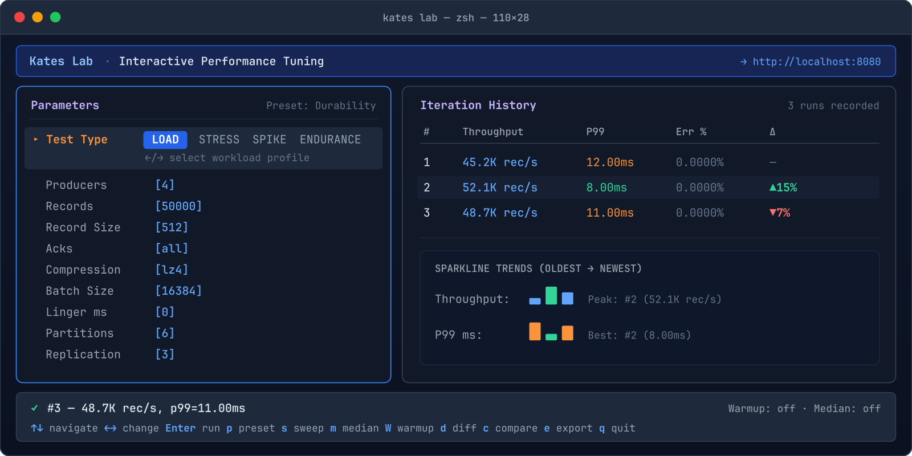
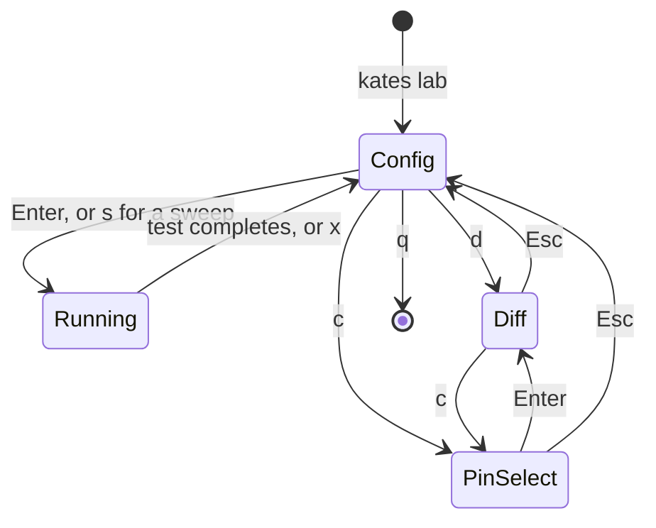

# Lab — Interactive Performance Tuning

[Scenario Files & SLA Gates](13-scenario-files.md) left you with a payments scenario and a gate on P99. Which batch size and linger get [`krafter`](appendix-a-glossary.md#gl-krafter), the Kafka cluster under test, the most headroom with `acks=all`? Finding out with `kates test create` means ten runs, ten report IDs and a spreadsheet. The [Lab](appendix-a-glossary.md#gl-lab), `kates lab`, keeps those runs in one terminal UI (TUI) and shows the difference between any two:

```bash
kates lab
```

After this chapter, you can:

- Drive a tuning session in the Lab — apply presets, adjust parameters, and run measured iterations without leaving the terminal
- Sweep one parameter across its values and see which value measured best, and by how much, with the diff and pin-and-compare views
- Steady noisy results with warm-up and median modes before trusting a number
- Export every iteration to CSV and save the session to compare against later

## When to Use the Lab {#when-to-use-lab-vs-cli}

Three commands cover the ways you run a test, and the table says which fits which job:

| Use Case | Tool |
|----------|------|
| Quick one-off test | `kates test create --type LOAD --wait` |
| CI/CD regression [gate](appendix-a-glossary.md#gl-gate) | `kates test apply -f scenario.yaml --wait` |
| Iterative parameter tuning | `kates lab` |
| Exploring [throughput](appendix-a-glossary.md#gl-throughput) against latency | `kates lab` |
| Sweeping a parameter across its values | `kates lab` |

A Lab run is unthrottled: it sends no rate, so LOAD, STRESS and SPIKE produce as fast as the cluster accepts, and ENDURANCE at its default 5,000 records per second. Its P99 is therefore the latency near saturation, not at your workload's rate. Use the Lab to rank settings against each other; to check a P99 at a fixed rate, put the winning settings into a scenario with `targetThroughput` and run `kates test apply --wait`.

## Layout

The Lab splits the terminal into two panes, with a status bar and a help line below them:

{fig-alt="Terminal UI of kates lab: a Parameters pane listing ten settings with Test Type selected, an Iteration History table of three runs with throughput, P99 and delta, two sparklines, and a status line above the key help."}

Read the screen from the top:

1. The header ends with the address of the [Kates API](appendix-a-glossary.md#gl-kates-api) that the Lab sends its runs to, the one your CLI is using. That part shows only on a terminal at least 100 columns wide.
2. The left pane holds the settings for the next run. A pointer, `▸`, marks the one that `↑` and `↓` select and `←` and `→` change; on the live screen, that row also opens out to list the values it can take.
3. Iteration History lists the recent iterations, one row each: its number, throughput, [P99](appendix-a-glossary.md#gl-percentile), and Δ, the change in throughput from the iteration before it (▲ up, ▼ down). When the right pane is wide enough, an `Err %` column appears as well.
4. The two [sparklines](appendix-a-glossary.md#gl-sparkline) trace throughput and P99 across every iteration, oldest first, each scaled from its own lowest value, the shortest bar (▁), to its highest, the full block (█). They appear once there are two iterations.
5. The status bar says what the Lab just did. While a test runs, it shows the iteration number and the elapsed seconds, updated every second, and once Kates reports progress, the live record count, throughput and P99.
6. The help line lists the keys that work right now. While a test runs it offers only `x` and `ctrl+c`, `c compare` joins it once there are two iterations, and `r retry` after a run fails.

The status bar of a running iteration looks like this:

```text
⏳ Running iteration #4…  (12s)
```

The Lab needs a terminal of at least 80 columns by 24 rows; below that it shows a "Terminal too small" message instead of the panes.

## Presets

A preset sets five or six parameters at once for a common goal. Press `p` to cycle through them; each row gives the goal and the settings it applies:

| Preset | Goal | Settings it applies |
|--------|------|---------------------|
| Low Latency | Lowest P99 | `type=SPIKE`, `acks=1`, `compression=none`, `batchSize=16384`, `lingerMs=0` |
| Max Throughput | Most rec/s | `type=STRESS`, `acks=all`, `compression=lz4`, `batchSize=262144`, `lingerMs=50`, `producers=8` |
| Durability | No data loss | `type=LOAD`, `acks=all`, `replication=3`, `compression=lz4`, `batchSize=65536`, `lingerMs=5` |

Each preset also switches the [test type](appendix-a-glossary.md#gl-test-type), so the top field changes when you cycle `p`. Low Latency's [`acks`](appendix-a-glossary.md#gl-acks) setting of `1` doesn't wait for followers, so it measures a path the payments target doesn't use: the target needs `acks=all`. Treat a preset as a starting point and adjust single parameters before you run.

### What the Parameters Reach

Not every parameter acts on every run. Each row says where one reaches:

| Parameter | Where it acts |
|-----------|---------------|
| Test Type | Every run: it picks the tasks the run starts and the topic it writes to |
| Producers | STRESS only; LOAD and ENDURANCE run one producer, SPIKE one burst |
| Records | Every run; under STRESS, each producer sends this many |
| Record Size, Acks, Compression, Batch Size, Linger ms | Every run's producers |
| Partitions, Replication | Only the run that creates the type's topic |

### Limits

Two of the parameters don't do what their place in the pane suggests:

- Under STRESS each producer sends Records records, so the total is Producers × Records. The duration budget counts Records once, so it can end the run before every producer has finished.
- Every Lab run of one test type writes to that type's default topic: `load-test`, `stress-test`, `spike-test` or `endurance-test`. The Kates API creates it with the Partitions and Replication you set the first time and leaves it alone after that, so a sweep of either measures the same topic each time. Delete the topic with `kates kafka delete-topic load-test` between values, or change the type.

## Iteration Workflow

The Lab moves between a few states as you work: you set parameters, a test runs, and you compare the results. Every key path leads back to Config, as the diagram shows:



Each completed test creates an iteration: a snapshot of its parameters and results in the right pane. Each iteration is a full [test run](appendix-a-glossary.md#gl-test-run), created through the Kates API like one from `kates test create`, with an ID of its own. A sweep runs one test per value, and each warm-up run and each of median mode's three runs is a test run too, so every one of them costs a test's time.

The ID makes an iteration a run you can open outside the Lab. `kates test get <id>` prints its per-task rows, and `kates report diff <id-a> <id-b>` compares two iterations with every metric the report holds; the Lab shows three of them. The CSV export carries each iteration's ID as `test_id`.

### How Long an Iteration Takes

The Lab gives a run one millisecond per record, never less than 60 seconds and never more than its poll limit minus one minute. The poll limit is 6 minutes for runs under 500,000 records, 10 under 1,000,000, 15 from 1,000,000, and 20 for ENDURANCE. The table works the rule through the Records values the pane offers:

| Records | Duration | Why |
|--------:|---------:|:----|
| 10,000 | 60 s | The floor |
| 50,000 | 60 s | The floor |
| 100,000 | 100 s | One millisecond per record |
| 500,000 | 500 s | One millisecond per record |
| 1,000,000 | 840 s | The poll limit, 15 minutes, less one |

An ENDURANCE run is capped at 1,140 s instead. The costs add up. A sweep runs one test per value and no warm-up runs, so a sweep of Linger ms's six values is six runs and at least six minutes. An `Enter` with a warm-up count of 2 is three runs, and median mode is three runs per press.

### Cancel, Retry and Quit

Three keys handle a run that doesn't finish cleanly. Press `x` during a run to cancel it: the Lab sends `POST /api/tests/{id}/cancel` to the Kates API and returns to the config view. If a test fails, for example with a connection refused or a timeout, the status bar offers a retry:

```text
✖ connection refused  ·  press r to retry
```

Press `r` to send the same request again, with the same parameters. `ctrl+c` during a run quits the Lab and cancels the run on the Kates API; the Lab then prints the ID it cancelled, or a note that the test may still be running, which `kates test cancel <id>` stops. A run that had already finished stays in the Kates API's history under the ID the CSV records.

## Comparing Iterations

Two views put iterations side by side: `d` compares the last two, or the pair you pinned, and `c` lets you pick any two.

### Quick Diff (`d`)

Press `d` to compare the last two iterations, or the pinned pair. The view, here with illustrative values, puts the metrics first and the parameters that changed below them:

```text
Diff: #2 vs #3

Metric            #2              #3              Change
──────────────────────────────────────────────────────────
Throughput        52.1K rec/s     48.7K rec/s     ▼7%
P99 Latency       8.00 ms        11.00 ms        ▲38%
Avg Latency       3.20 ms         4.10 ms        ▲28%

Parameter Changes
────────────────────────────────────────
compression       lz4             snappy
batchSize         262144          65536
```

The diff shows the parameters that changed beside the metrics that moved, so cause sits next to effect. A difference smaller than the spread between identical runs is noise, not a win, as [Telling a Regression from Noise](04-performance-theory.md#statistical-significance) explains; median mode is there to narrow that spread.

### Pin and Compare (`c`)

Press `c` to open the pin picker, where you choose any two iterations: `↑↓` for A and `←→` for B. The picker lists each iteration's throughput and P99, here with illustrative values:

```text
Select Iterations to Compare

  ↑↓ = iteration A    ←→ = iteration B

  A  #1   45.2K rec/s  p99=12.00ms
     #2   52.1K rec/s  p99=8.00ms
  B  #3   48.7K rec/s  p99=11.00ms
```

Press `Enter` to confirm and view the diff, or `Esc` to go back.

## Auto-Sweep Mode

Auto-sweep tests every value of one parameter while holding all the others constant:

1. Select the parameter you want to sweep, such as Linger ms.
2. Press `s`.
3. The Lab runs a test for each value: 0 → 5 → 10 → 20 → 50 → 100.

From the second step on, the status bar names the value each step tries as it starts:

```text
⟳ Sweep Linger ms = 10 (3/6)
```

After the sweep, the iteration history shows a row per value side by side; use `d` or `c` to compare any pair.

For the payments question, set the pane to the payments shape before you sweep: Test Type LOAD, Record Size 1024, Acks all and Replication 3. Then sweep Linger ms, and keep the values whose P99 stays lowest with the least throughput lost. Carry the winner into the payments scenario as the two lines it changes, `batchSize` and `lingerMs`, and check it there at 2,000 records per second.

::: {.callout-tip title="Try it: which linger gives krafter the most throughput at acks=all?"}
Start the Lab, set the payments shape, and sweep Linger ms:

```bash
kates lab
```

Set Test Type LOAD, Record Size 1024, Acks all, select Linger ms, press `s`, then `e` to export and `q` to quit. Read the answer in the P99 and throughput columns of the CSV, and in `d` between the best two values:

```bash
column -s, -t ~/kates-lab-*.csv
```
:::

## Warm-Up Mode (`W`) {#warmup-mode-w}

The brokers run on JVMs, and a JVM needs time to JIT-compile its hot code paths. `kates deploy` runs the Kates API as a [GraalVM native image](appendix-a-glossary.md#gl-graalvm-native-image), compiled ahead of time, so only the [brokers](appendix-a-glossary.md#gl-broker) warm up; a Kates API installed from the chart's defaults runs the JVM image, which warms up too. The first runs of a session warm those JVMs, so discard one or two before you compare. Warm-up mode does that for you: it discards a set number of runs before recording the measured one.

Press `W` to cycle the warm-up count (1 → 2 → 3 → 4 → 5 → off):

```text
🔥 Warmup: 2 iteration(s) before measuring
```

When you press `Enter`, the Lab runs two warm-up runs, whose results it discards, then the measured run, so the JVMs have had those runs to warm up before the Lab collects data.

## Median Mode (`m`)

Even after warm-up, single runs vary with GC pauses, I/O scheduling and operating-system jitter [@georges2007statistically]. Median mode runs the same configuration three times and records one of them, so one slow run can't decide a comparison.

Press `m` to start:

```text
📊 Median mode: running 2/3…
```

After the three runs, the Lab adds one iteration: the run whose throughput is the middle of the three, with that run's P99 and average latency. The median is taken on throughput only, so the P99 it records may be the highest or the lowest of the three. That gives a steadier number for comparing parameters, not a final one.

::: {.callout-note title="Median mode ignores the warm-up count"}
Pressing `m` always runs exactly three back-to-back tests, with no warm-up runs inserted. The warm-up count applies only to tests started with `Enter`.
:::

## Export and Sessions

Results leave the Lab in two ways: `e` writes every iteration to a CSV file, and `w` saves the session to a file that `L` loads again later.

### CSV Export (`e`)

Press `e` to write every iteration, with its full parameters, to a timestamped CSV file in your home directory:

```text
~/kates-lab-20260313-213045.csv
```

Each row is one iteration, and each column one of these fields, in this order:

| Column | Meaning |
|--------|---------|
| `iteration` | The iteration's number |
| `throughput_rec_s` | Throughput, in rec/s |
| `p99_ms`, `avg_latency_ms` | P99 and average latency, in milliseconds |
| `error_rate` | Errors, as a percentage |
| `delta` | The change in throughput from the iteration before |
| `test_id` | The run's ID, for `kates test get` |
| `type` to `replication` | One column per parameter: `type`, `producers`, `records`, `recordSize`, `acks`, `compression`, `batchSize`, `lingerMs`, `partitions`, `replication` |

### Save Session (`w`) and Load Session (`L`)

A session file keeps the iteration history and the current parameter positions in `~/.kates-lab-session.json`. Save one to pause tuning and resume later, to hand a session to a teammate, or to keep a session to compare against later. It is not the Kates API's [baseline](appendix-a-glossary.md#gl-baseline), which `kates test baseline set` keeps per test type.

## Keyboard Reference

Every key, with when it works. Between runs, a key works in the config view, the diff and the pin picker alike; in the pin picker the arrows and `Enter` pick iterations instead:

| Key | When | Action |
|-----|------|--------|
| `↑`/`↓` or `k`/`j` | Between runs | Select a parameter |
| `←`/`→` or `h`/`l` | Between runs | Change the selected parameter's value |
| `Enter` | Between runs | Run a test with the current parameters |
| `p` | Between runs | Cycle the presets |
| `s` | Between runs | Sweep the selected parameter |
| `m` | Between runs | Run three identical tests and keep the median |
| `W` | Between runs | Cycle the warm-up count |
| `d` | Between runs | Diff the last two iterations, or the pinned pair |
| `c` | Between runs | Open the pin picker |
| `e` | Between runs | Export every iteration to CSV |
| `w` | Between runs | Save the session |
| `L` | Between runs | Load the saved session |
| `r` | Between runs | Retry the last failed test |
| `T` | Between runs | Switch to the next look |
| `C` | Between runs | Switch to the next colors |
| `Esc` | Between runs | Return to the config view |
| `q` | Between runs | Quit the Lab |
| `x` | While a test runs | Cancel the running test |
| `ctrl+c` | Any time | Quit; during a run, cancel it on the Kates API first |

## Summary

- Every Lab iteration is a real test run with an ID you can open later, so sweeps, warm-ups and median runs each cost a run.
- A Lab run is unthrottled, so rank settings in the Lab and check a P99 at your rate in a scenario.
- Presets change the test type as well as the producer settings; treat them as starting points.
- A sweep changes one parameter at a time, and the diff ties a parameter change to its effect.
- Warm-up discards cold runs and median mode keeps the middle of three; the CSV keeps every run's full settings.

You can now say which producer settings `krafter` handles best under load. Whether it keeps handling them when a broker, a network path or a disk fails is the next question, and [Chaos Engineering Theory](06-chaos-theory.md) asks it.
