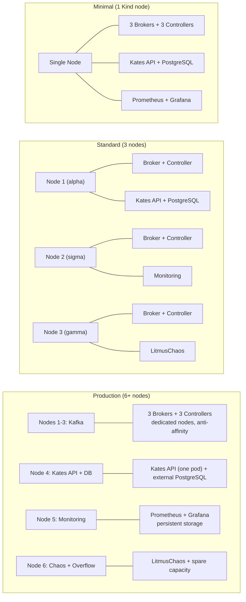
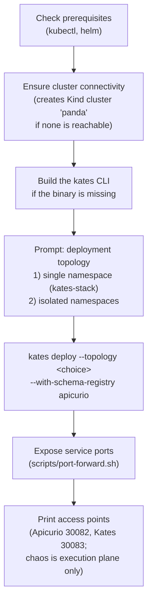
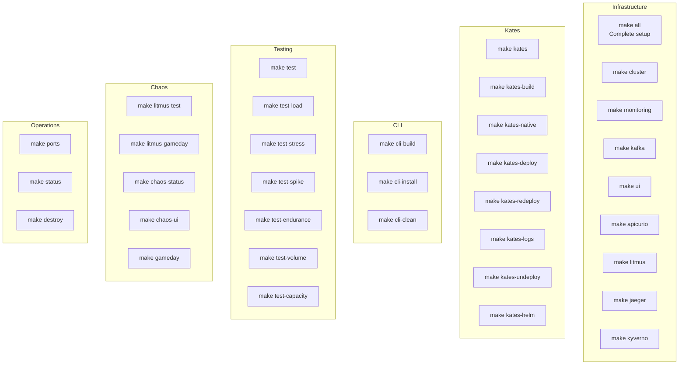

# Deployment Guide

> **Scope**: this chapter owns deploying the **Kates stack** — the Kates API, the CLI, monitoring and chaos tooling, and the topology choices between them. Provisioning the Kafka cluster itself is delegated to [Installing Kafka with the kafka-cluster Helm Chart](20-installation-guide.md) (the walkthrough) and [Kafka Deployment Engineering](15-kafka-deployment.md) (the rationale).

Deploying Kates is more than running `make all`. The choices you make *before* running that first command — how many namespaces, what service exposure strategy, how much memory to allocate — ripple through every test you'll run later. A deployment tuned for local experimentation will buckle under production load; a production topology is needless overhead on a laptop.

This chapter walks you through those decisions. You'll start with the architectural trade-offs that shape your deployment, then move through resource sizing and cloud-specific guidance, and finally reach the step-by-step deployment itself. By the end, you'll have a running stack that matches your environment — whether that's a single Kind cluster on your MacBook or a multi-node EKS deployment running continuous benchmarks.

After this chapter, you can:

- Choose a topology — namespace layout, service exposure, storage durability — that fits your environment
- Size CPU, memory, and disk per component so your tests measure Kafka, not resource contention
- Adapt the stack to EKS, GKE, or AKS with provider-specific values overlays
- Deploy everything with `make all` and verify it with `make status` and `kates health`

---

## Prerequisites

| Tool | Version | Purpose |
|------|---------|---------|
| Docker | 24+ | Container runtime |
| Kind | 0.33+ | Local Kubernetes cluster — older releases do not publish the node image `config/cluster.yaml` asks for |
| kubectl | 1.33+ | Kubernetes CLI — stay within one minor of the cluster, which runs Kubernetes 1.34 locally |
| Helm | 3.14+ | Kubernetes package manager |
| jq | 1.6+ | JSON processing (optional) |
| Go | 1.25+ | CLI compilation (if building from source) |
| Java | 21+ | Kates API compilation (if building from source) |
| Maven | 3.9+ | Kates API build (bundled as `mvnw`) |

---

## Deployment Architecture Decisions

Before deploying anything, there are three architectural decisions that will shape your topology. Getting these right up front avoids painful migrations later.

### Single-Namespace vs Multi-Namespace

The simplest deployment puts Kafka, the Kates API, Kafka UI, monitoring and LitmusChaos into one namespace, `kates-stack` by default; the Strimzi operator, cert-manager and Kyverno keep their own namespaces either way. This is fine for local development on Kind where you want `kubectl get pods` to show everything in one place. But for shared or production environments, multi-namespace isolation is strongly recommended.

Why? Each namespace can have independent:

- **RBAC policies** — the team running chaos experiments shouldn't need write access to the Kafka namespace
- **Resource quotas** — prevent the monitoring stack from starving Kafka of memory during a spike
- **Network policies** — rules on which pods may reach which ports. As the charts ship, they leave the Kafka client listeners open to every pod in the cluster ([Security & Compliance](17-security.md#how-the-policies-combine))

The isolated topology uses these namespaces by default:

| Namespace | Components | Why Separated |
|-----------|-----------|---------------|
| `strimzi-operator` | The Strimzi Cluster Operator, its CRD-upgrade hook and the Drain Cleaner | The operator is its own Helm release (`charts/strimzi-operator`) and owns cluster-scoped objects — the CRDs and its RBAC — which cannot belong to a per-cluster release |
| `kafka` | Brokers, controllers, Kafka UI, schema registry, and MirrorMaker 2 when you add it | The data plane the operator reconciles; a cluster-scoped operator watches it from outside |
| `kates` | The Kates API (Deployment `kates`) and its PostgreSQL (StatefulSet `kates-postgresql`) | Application-tier isolation; independent scaling and restart policies |
| `monitoring` | Prometheus, Grafana, alerting rules | Monitoring must survive application failures — separate namespace ensures it stays up during chaos experiments |
| `litmus` | The LitmusChaos operator (release `chaos`) | Chaos tools need elevated privileges; isolation limits the blast radius of those permissions |
| `cert-manager` | cert-manager, installed by default | Its own release, with cluster-wide CRDs; it keeps this namespace in both topologies |

Kyverno (`kyverno`), Kafka Connect (`connect`) and Connect's demo PostgreSQL (`database`) get namespaces of their own when you add them. The ChaosEngines that Kates creates for a fault go to the fault's target namespace, `kafka` by default, not to `litmus`.

::: {.callout-tip}
For local Kind deployments, the multi-namespace layout still works — `make all` prompts you to choose between a single-namespace topology (everything but the operators in `kates-stack`) and the isolated multi-namespace topology. The underlying `kates deploy` command defaults to `--topology isolated`. The only time single-namespace makes sense is throwaway CI environments where fast teardown (`kubectl delete namespace`) matters more than isolation.
:::

### NodePort vs Ingress vs LoadBalancer

How you expose services outside the cluster depends on where the cluster runs:

| Strategy | When to Use | Trade-offs |
|----------|------------|------------|
| **NodePort** | Local Kind clusters, CI runners | Simple — no external dependencies. Limited to ports 30000–32767. No TLS termination. |
| **Ingress** | Shared development clusters, staging | Path-based routing, TLS termination, single entry point. Requires an Ingress controller. |
| **LoadBalancer** | Production cloud deployments | Cloud-native L4 load balancing, static IPs, health checks. Usually public unless annotated internal. Costs money per service. |

The default deployment uses **NodePort** for all services (Grafana on 30080, Kafka UI on 30081, etc.). The Kind cluster does not publish those ports on the host, so `make ports` forwards each service it finds to the same port number on `localhost`. It looks for Grafana and Prometheus only in the `kafka` namespace, not in `monitoring`, where `kates deploy` installs them; [The Cluster Under Test](03-cluster.md#access-points) gives the command that reaches them. Cloud deployments should switch to internal LoadBalancers or Ingress — see the [Cloud Deployment](#cloud-deployment) section for provider-specific annotations.

### Where Kates Stores Test Data

The Kates API keeps every run in PostgreSQL. The `kates` chart runs its own PostgreSQL on a 1 GiB PersistentVolumeClaim on the cluster's default StorageClass, so runs survive pod restarts; there is no emptyDir mode. For production, point the chart at an external database instead, with `postgresql.enabled: false` and `externalDatabase`, as `values-prod.yaml` does. [Architecture & Design](02-architecture.md) describes what else the Kates API keeps.

Whichever database holds them, each replica of the Kates API sweeps out old runs when it starts and every 24 hours after. A sweep deletes the `DONE` and `FAILED` runs created more than `kates.cleanup.retention-days` days ago, 90 by default, so a lower setting deletes as soon as a replica starts with it. It deletes each run as `DELETE /api/tests/{id}` does, with its results, oldest first and 1,000 at a time. Each leaves a row in the audit log naming `system:scheduler`: action `DELETE`, type `test`, the run's ID, and the details `retention sweep: created before <cutoff> (kates.cleanup.retention-days=<n>)`. When two replicas find the same run at once, it is deleted, and audited, once. An error ends that sweep with an `ERROR` line in the Kates API's log, and the next sweep goes on from there.

A sweep leaves a run still `PENDING`, `RUNNING` or `STOPPING` alone, however old it is. The Kates API fails a run still `PENDING` after the submission timeout, and fails a run still `RUNNING` or `STOPPING` after its run timeout, as [Test Management](11-api-reference.md#test-management) describes. A later sweep deletes it once it is older than the retention. A sweep also leaves the run a test type's baseline names alone, however old it is, so the regression check has it to compare with.

To keep runs for less time, set `cleanup.enabled: true` in the `kates` chart's values. Its CronJob then deletes the finished runs older than `cleanup.retentionDays`, through [DELETE /api/tests](11-api-reference.md#delete-apitests), with the key from the Secret the `apiKey` values name. The table gives the values and their defaults:

| Value | Default | What it sets |
|-------|---------|--------------|
| `cleanup.enabled` | `false` | Whether the chart renders the CronJob |
| `cleanup.schedule` | `0 4 * * 0` | When the job runs: every Sunday at 04:00, in the time zone of the cluster's controller manager, usually UTC |
| `cleanup.retentionDays` | `30` | How many days a finished run is kept, counted from its creation |
| `cleanup.statuses` | `[DONE, FAILED]` | Which finished runs go; a cancelled run is stored as `FAILED` |
| `cleanup.image` | `curlimages/curl:8.7.1` | The image the job runs `curl` in |

Each time it runs, the job deletes the oldest first, up to 1,000 runs a call, until none older are left or it has made 100 calls, and the next job goes on from there. Its log ends with how many it deleted. A call the Kates API refuses fails the job, with the answer in its log. A `401` or `403` there means the key is missing or wrong, and a `405` that the Kates API is too old to have `DELETE /api/tests`. The Kates API's own daily sweep already deletes the `DONE` and `FAILED` runs older than 90 days by default, so a `retentionDays` of 90 or more adds nothing to it. To prune once, by hand, run `kates test prune`.

For Kafka broker storage, **always use persistent volumes** — even in development. Kafka's log retention depends on data being durable, and losing broker data mid-test invalidates results.

### Deployment Topologies

The following diagram shows three representative topologies. Most teams start with Minimal, grow into Standard for shared use, and arrive at Production for continuous benchmarking:



---

## Resource Sizing

Getting resource allocation right is critical. Under-provisioned Kafka brokers produce misleading benchmark results — you'll measure resource contention, not application performance. Over-provisioned local clusters waste developer time waiting for images to pull.

### Deployment Profiles

| Deployment Profile | Use Case | CPU | Memory | Disk | Nodes |
|---|---|---|---|---|---|
| **Minimal** | Local dev / CI | 6 cores | 16 GB | 50 GB | 1 (Kind) |
| **Standard** | Team testing | 12 cores | 32 GB | 200 GB | 3 |
| **Production** | Continuous benchmarking | 24+ cores | 64+ GB | 500+ GB | 6+ |

### Per-Component Breakdown

The following table shows resource requirements per component. Use this to right-size your nodes:

| Component | Instances | CPU (req / limit) | Memory (req / limit) | Disk | Notes |
|-----------|:---------:|:------------------:|:--------------------:|:----:|-------|
| Kafka Broker | 3 | 1000m / 2000m | 4Gi / 4Gi | 50Gi each | Heap 2Gi fixed; remainder is OS page cache |
| Kafka Controller | 3 | 500m / 1000m | 1Gi / 1Gi | 5Gi each | Lightweight — metadata only |
| Strimzi Operator | 1 | 200m / 500m | 384Mi / 384Mi | — | Watches CRs, low steady-state usage |
| Cruise Control | 1 | 500m / 1000m | 512Mi / 1Gi | — | Spikes during rebalance calculations |
| Kafka Exporter | 1 | 100m / 200m | 128Mi / 256Mi | — | Consumer lag metrics |
| Kates API (plain `helm install`) | 1 | 500m / 2000m | 2Gi / 4Gi | — | JVM: `-Xms512m -Xmx2560m` with ZGC, 62.5% of the limit; `kates deploy` runs it at 1 CPU / 1Gi, see [JVM Tuning](#jvm-tuning) |
| PostgreSQL | 1 | 100m / 250m | 128Mi / 256Mi | 1Gi | Test results and metadata |
| Prometheus | 1 | 500m / 1000m | 1Gi / 2Gi | 50Gi | 30d retention in the generic overlay |
| Grafana | 1 | 100m / 200m | 128Mi / 256Mi | — | The repository's dashboards, which [Observability & Monitoring](09-observability.md) lists |
| LitmusChaos | 1 | 200m / 500m | 256Mi / 512Mi | — | Operator + experiment runners |

::: {.callout-important}
The **Minimal** profile (16 GB) runs everything but leaves almost no headroom. If your laptop has 16 GB of RAM, close memory-heavy applications (browsers, IDEs with large projects) before running `make all`. Docker Desktop should be configured with at least 10 GB of memory allocation.
:::

---

## Cloud Deployment

The default deployment targets Kind. Moving to a cloud provider requires adjustments to storage classes, service exposure, and identity federation. This section provides the key overrides for each major provider.

Every overlay below keeps its load balancers **internal**: reachable only from inside the cluster's VPC or VNet. The Kafka load balancers, and Grafana's on EKS and AKS, also admit only the ranges in `loadBalancerSourceRanges`; on GKE the Kates API and Grafana sit behind an internal Ingress, which takes no source ranges (see [Google GKE](#google-gke)). A LoadBalancer Service with no provider annotations usually gets a public address instead. The external Kafka listener still demands TLS and SCRAM-SHA-512, but a broker endpoint on the internet is attack surface all the same: anyone who can reach the port can probe its TLS stack, try passwords against SCRAM, and load the brokers with connections that authentication has yet to refuse. `10.0.0.0/16` stands for your VPC or VNet range in every overlay; add the peered or on-premises ranges your clients run in.

For Kafka, the chart passes `kafka.externalAccess.configuration` to the Strimzi listener's `configuration` unchanged. Strimzi creates one load balancer for the bootstrap and one per broker, and each needs the provider's annotations: `bootstrap.annotations` covers the first, `perBrokerAnnotationsTemplate` every broker whatever its node ID, and `loadBalancerSourceRanges` applies to all of them. `perBrokerAnnotationsTemplate` needs Strimzi 1.1.0 or newer (the version the repository pins is in the [Version & Compatibility Matrix](appendix-d-versions.md)). Strimzi 1.0.x does not have the field: the API server rejects the Kafka resource or drops the field, and a dropped field leaves every broker's Service on the provider's default. On 1.0.x, annotate the brokers one by one instead, under `configuration.brokers`, with a `broker` node ID and its `annotations` per entry. Grafana sits behind an internal load balancer too (an internal Ingress on GKE); it serves plain HTTP, so put TLS in front of it before you open it to more clients.

::: {.callout-important}
Open a load balancer to the internet only on purpose: switch the scheme (`internet-facing` on EKS; drop the internal annotation on GKE and AKS) and set `loadBalancerSourceRanges` to the public ranges of the clients that need it. On a public load balancer, empty ranges mean `0.0.0.0/0`. `kafka.externalAccess.allowedCidrs` does not replace them: it narrows only the chart's rule for the port, and Strimzi's policy still admits every source until the listener carries `networkPolicyPeers`, which the preset can't set ([Security & Compliance](17-security.md#how-the-policies-combine)). Behind a load balancer the address a NetworkPolicy sees is also often a node or the load balancer rather than the client. So the overlays leave `allowedCidrs` empty and filter at the load balancer.
:::

### Amazon EKS

**Storage:** Use the `gp3` StorageClass instead of the default `gp2`. GP3 provides 3,000 baseline IOPS and 125 MB/s throughput regardless of volume size — GP2 scales IOPS with size, which means small test volumes get poor I/O performance.

**Load Balancer:** Use an internal AWS Network Load Balancer (NLB) for Kafka external access. NLB operates at L4 (TCP), which is what Kafka's binary protocol requires. The annotations below are read by the AWS Load Balancer Controller, which has to be installed in the cluster: `aws-load-balancer-type: external` hands the Service to it, `aws-load-balancer-nlb-target-type: ip` sends traffic straight to the pod, and `aws-load-balancer-scheme: internal` keeps the NLB inside the VPC. Without the controller the Services stay pending, since the in-tree provider leaves `external` to it.

**IAM:** Use IAM Roles for Service Accounts (IRSA) if you give the Kates API pod access to AWS services, so it gets credentials without embedding them.

```yaml
# kafka-eks.yaml — overlay for charts/kafka-cluster
nodePools:
  defaults:
    storage:
      volumes:
        - id: 0
          size: 100Gi
          class: gp3

kafka:
  externalAccess:
    type: loadbalancer
    configuration:
      # Who may connect, on the bootstrap and every broker
      loadBalancerSourceRanges:
        - 10.0.0.0/16
      bootstrap:
        annotations:
          service.beta.kubernetes.io/aws-load-balancer-type: "external"
          service.beta.kubernetes.io/aws-load-balancer-nlb-target-type: "ip"
          service.beta.kubernetes.io/aws-load-balancer-scheme: "internal"
      # Every per-broker Service, whatever its node ID
      perBrokerAnnotationsTemplate:
        service.beta.kubernetes.io/aws-load-balancer-type: "external"
        service.beta.kubernetes.io/aws-load-balancer-nlb-target-type: "ip"
        service.beta.kubernetes.io/aws-load-balancer-scheme: "internal"
```

```yaml
# kates-eks.yaml — overlay for charts/kates
serviceAccount:
  annotations:
    eks.amazonaws.com/role-arn: "arn:aws:iam::123456789012:role/kates-irsa-role"

postgresql:
  storage:
    size: 20Gi
    storageClass: gp3
```

```yaml
# monitoring-eks.yaml — overlay for charts/monitoring
kube-prometheus-stack:
  grafana:
    service:
      type: LoadBalancer
      annotations:
        service.beta.kubernetes.io/aws-load-balancer-type: "external"
        service.beta.kubernetes.io/aws-load-balancer-nlb-target-type: "ip"
        service.beta.kubernetes.io/aws-load-balancer-scheme: "internal"
      loadBalancerSourceRanges:
        - 10.0.0.0/16
  prometheus:
    prometheusSpec:
      storageSpec:
        volumeClaimTemplate:
          spec:
            storageClassName: gp3
            resources:
              requests:
                storage: 100Gi
```

### Google GKE

**Storage:** Use `premium-rwo` for SSD-backed PersistentVolumeClaims. This StorageClass provisions pd-ssd disks with much higher IOPS than the default `standard-rwo` (pd-balanced).

**Load Balancer:** `networking.gke.io/load-balancer-type: "Internal"` makes each Kafka Service an internal passthrough Network Load Balancer. GKE enforces `loadBalancerSourceRanges` twice: as VPC firewall rules, and in each node's own packet filtering (kube-proxy, or GKE Dataplane V2).

**Ingress:** GKE's built-in Ingress controller integrates with Google Cloud Load Balancing. The annotation `kubernetes.io/ingress.class: "gce-internal"` gives the Kates API and Grafana an internal Application Load Balancer; it has to be the annotation, because GKE's controller does not read `ingressClassName`. An internal Ingress needs a proxy-only subnet in the cluster's region and container-native load balancing, which the `cloud.google.com/neg` Service annotation turns on. A `BackendConfig`, named from the Service with `cloud.google.com/backend-config`, points the load balancer's health check at Kates's readiness endpoint.

With container-native load balancing, the load balancer's proxies connect straight to the pods from addresses in the proxy-only subnet, and its health checks come from `35.191.0.0/16` and `130.211.0.0/22`. GKE's Ingress controller opens the VPC firewall for the health checks but not for the proxies, so create that rule yourself, for Kates's port 8080 and Grafana's 3000; without it the load balancer's backends never turn healthy and the Ingress answers 502. The Kates chart's own NetworkPolicy, on by default, admits port 8080 from pods only, so on a cluster that enforces NetworkPolicy (GKE Dataplane V2, which Autopilot always runs, or Calico) it drops both the proxies and the health checks. `kates-gke.yaml` adds a rule for them. `10.129.0.0/23` stands for your proxy-only subnet there and in the firewall rule:

```bash
gcloud compute firewall-rules create kates-allow-proxy-only-subnet \
  --network=my-vpc --direction=INGRESS --action=ALLOW \
  --source-ranges=10.129.0.0/23 --rules=tcp:8080,tcp:3000
```

The Ingress takes no source ranges: any client that reaches the VPC in that region can connect to it, and the firewall rule above admits the proxies, not the clients. Kates still asks for its API key and Grafana for its login. To restrict who gets that far, turn on Identity-Aware Proxy in the `BackendConfig`; Cloud Armor, the source-range filter of an external Ingress, is not available on an internal one.

**Identity:** Use Workload Identity to bind Kubernetes service accounts to Google Cloud IAM service accounts — no key files to manage.

```yaml
# kafka-gke.yaml — overlay for charts/kafka-cluster
nodePools:
  defaults:
    storage:
      volumes:
        - id: 0
          size: 100Gi
          class: premium-rwo

kafka:
  externalAccess:
    type: loadbalancer
    configuration:
      # Who may connect, on the bootstrap and every broker
      loadBalancerSourceRanges:
        - 10.0.0.0/16
      bootstrap:
        annotations:
          networking.gke.io/load-balancer-type: "Internal"
      # Every per-broker Service, whatever its node ID
      perBrokerAnnotationsTemplate:
        networking.gke.io/load-balancer-type: "Internal"
```

```yaml
# kates-backend-config.yaml — apply in the kates namespace before the chart
apiVersion: cloud.google.com/v1
kind: BackendConfig
metadata:
  name: kates-backend-config
spec:
  healthCheck:
    type: HTTP
    requestPath: /q/health/ready
    port: 8080
```

```yaml
# kates-gke.yaml — overlay for charts/kates
serviceAccount:
  annotations:
    iam.gke.io/gcp-service-account: "kates@my-project.iam.gserviceaccount.com"

service:
  annotations:
    cloud.google.com/neg: '{"ingress": true}'
    cloud.google.com/backend-config: '{"default": "kates-backend-config"}'

ingress:
  enabled: true
  annotations:
    kubernetes.io/ingress.class: "gce-internal"
  hosts:
    - host: kates.example.com
      paths:
        - path: /
          pathType: Prefix

# The load balancer's proxies and health checks reach the pod directly.
# The chart keeps its own rule for pods on 8080 and 9000 beside this one.
networkPolicy:
  ingressRules:
    - from:
        - ipBlock:
            cidr: 10.129.0.0/23    # your proxy-only subnet
        - ipBlock:
            cidr: 35.191.0.0/16
        - ipBlock:
            cidr: 130.211.0.0/22
      ports:
        - port: 8080
          protocol: TCP

postgresql:
  storage:
    size: 20Gi
    storageClass: premium-rwo
```

```yaml
# monitoring-gke.yaml — overlay for charts/monitoring
kube-prometheus-stack:
  grafana:
    service:
      annotations:
        cloud.google.com/neg: '{"ingress": true}'
    ingress:
      enabled: true
      annotations:
        kubernetes.io/ingress.class: "gce-internal"
      hosts:
        - grafana.example.com
  prometheus:
    prometheusSpec:
      storageSpec:
        volumeClaimTemplate:
          spec:
            storageClassName: premium-rwo
            resources:
              requests:
                storage: 100Gi
```

### Azure AKS

**Storage:** Use `managed-premium` for Premium SSD-backed volumes. Premium SSDs offer consistent low-latency I/O, which is critical for Kafka broker performance.

**Load Balancer:** `service.beta.kubernetes.io/azure-load-balancer-internal: "true"` puts each Kafka Service on an internal Azure Load Balancer in the cluster's VNet. AKS enforces `loadBalancerSourceRanges` in the Network Security Group and on each node, but the NSG's default rule still admits the whole VNet, so the overlays also set `service.beta.kubernetes.io/azure-deny-all-except-load-balancer-source-ranges: "true"`, which adds a deny rule so that the NSG drops every other VNet address before it reaches a node. Azure Application Gateway (AGIC) is an HTTP proxy: it can front Grafana or the Kates API, never Kafka's binary protocol.

**Identity:** Use Azure AD Pod Identity (or the newer Workload Identity Federation) to grant pods access to Azure resources without storing credentials.

```yaml
# kafka-aks.yaml — overlay for charts/kafka-cluster
nodePools:
  defaults:
    storage:
      volumes:
        - id: 0
          size: 100Gi
          class: managed-premium

kafka:
  externalAccess:
    type: loadbalancer
    configuration:
      # Who may connect, on the bootstrap and every broker
      loadBalancerSourceRanges:
        - 10.0.0.0/16
      bootstrap:
        annotations:
          service.beta.kubernetes.io/azure-load-balancer-internal: "true"
          service.beta.kubernetes.io/azure-deny-all-except-load-balancer-source-ranges: "true"
      # Every per-broker Service, whatever its node ID
      perBrokerAnnotationsTemplate:
        service.beta.kubernetes.io/azure-load-balancer-internal: "true"
        service.beta.kubernetes.io/azure-deny-all-except-load-balancer-source-ranges: "true"
```

```yaml
# kates-aks.yaml — overlay for charts/kates
serviceAccount:
  annotations:
    azure.workload.identity/client-id: "00000000-0000-0000-0000-000000000000"

podLabels:
  azure.workload.identity/use: "true"

postgresql:
  storage:
    size: 20Gi
    storageClass: managed-premium
```

```yaml
# monitoring-aks.yaml — overlay for charts/monitoring
kube-prometheus-stack:
  grafana:
    service:
      type: LoadBalancer
      annotations:
        service.beta.kubernetes.io/azure-load-balancer-internal: "true"
        service.beta.kubernetes.io/azure-deny-all-except-load-balancer-source-ranges: "true"
      loadBalancerSourceRanges:
        - 10.0.0.0/16
  prometheus:
    prometheusSpec:
      storageSpec:
        volumeClaimTemplate:
          spec:
            storageClassName: managed-premium
            resources:
              requests:
                storage: 100Gi
```

::: {.callout-note}
Each chart is its own Helm release, so each takes its own overlay — there is no single file that spans them. Layer the Kafka one after the platform profile, and the Kates and monitoring ones after the chart's `values-generic.yaml`, the file `kates deploy` applies on any cluster other than Kind. Without `charts/monitoring/values-generic.yaml` Grafana keeps the chart's default admin password, `admin`, on a load balancer; with it the Grafana chart generates one and stores it in the `monitoring-grafana` Secret.
:::

`kafka-cluster` and `monitoring` take subcharts from chart repositories — SeaweedFS and kube-prometheus-stack — and `helm dependency build` refuses to fetch them until those repositories are added. Add them once:

```bash
helm repo add seaweedfs https://seaweedfs.github.io/seaweedfs/helm
helm repo add prometheus-community https://prometheus-community.github.io/helm-charts
```

::: {.callout-caution}
Do not run the install chain below against a `krafter` that `kates deploy` installed: `helm upgrade --install` upgrades a release that already exists. `kates deploy` installs the release with `.build/values-detected.yaml` first — the node pools, their zones and storage classes come from it — and a chain without it renders other pool names. A pool's name is its identity, so each renamed pool is a new pool with new, empty volumes, while the old pools drop out of the release but keep running with the data (the chart marks them `helm.sh/resource-policy: keep`). Upgrade such a release from its own values instead, as shown after the chain.
:::

Install a release that does not exist yet from the chart's files, with the overlay last:

```bash
helm dependency build charts/kafka-cluster

helm upgrade --install krafter charts/kafka-cluster -n kafka --create-namespace \
  -f charts/kafka-cluster/values-platform.yaml \
  -f kafka-eks.yaml

helm dependency build charts/monitoring

helm upgrade --install monitoring charts/monitoring -n monitoring --create-namespace \
  -f charts/monitoring/values-generic.yaml \
  -f monitoring-eks.yaml
```

An overlay changes only the keys it names; every other value stands. A release that `kates deploy` installed also carries values the CLI supplied at install time, from `.build/values-detected.yaml` and its `--set` flags — the node pools, broker sizing, versions and replica counts on `krafter`, the bootstrap address on `kates`, the cluster domain and chaos alerts on `monitoring` — and an upgrade that leaves them out resets them to the chart defaults. Upgrade such a release from its own values, with the overlay last.

On `krafter`, first take away the listener the overlay replaces. On EKS, GKE and AKS the detected values declare an `external` LoadBalancer listener with an annotation on the bootstrap Service only, so every broker's load balancer gets the provider's default, usually a public address; on EKS and GKE the bootstrap's is public too. The overlay's `kafka.externalAccess` replaces that listener, but not its load balancers: Strimzi changes the annotations of the Services that exist. On EKS the in-tree provider then leaves those Services to the AWS Load Balancer Controller and keeps the public load balancers it created in place, still forwarding to the brokers, while the controller creates internal ones beside them; AWS warns against changing `aws-load-balancer-type` on an existing Service for that reason. On GKE and AKS the same upgrade would switch live load balancers from public to internal in place. So remove the listener, let its Services and load balancers go, and only then add the overlay's.

Save the release's values:

```bash
helm dependency build charts/kafka-cluster

# Every value the release was installed with — its files and its --set flags
helm get values krafter -n kafka -o yaml > krafter-current.yaml
```

In `krafter-current.yaml`, delete the entry of `kafka.listeners` whose `name` is `external`. The detected values append it after `plain` and `tls`, and Helm keeps a list in order, so it is the last entry. Helm sorts the keys inside it, so it runs from its `- authentication:` line to its `type: loadbalancer` line; leave `plain` and `tls` as they are. If the file has no such entry, go straight to the upgrade with the overlay. Otherwise upgrade from the edited file alone, then list the cluster's Services:

```bash
helm upgrade krafter charts/kafka-cluster -n kafka -f krafter-current.yaml

kubectl get svc -n kafka -l strimzi.io/cluster=krafter
```

The brokers roll to drop the listener, and Strimzi deletes its bootstrap and per-broker Services. Wait until the list shows no Service of type `LoadBalancer`, then check in the provider's console or CLI that their load balancers are gone too. Then upgrade with the overlay, from the edited file:

```bash
helm upgrade krafter charts/kafka-cluster -n kafka \
  -f krafter-current.yaml \
  -f kafka-eks.yaml

kubectl get kafka krafter -n kafka \
  -o jsonpath='{.status.listeners[?(@.name=="external")].bootstrapServers}'
```

The brokers roll again, and Strimzi creates the listener's Services afresh, with the overlay's annotations from the start. External clients get a new bootstrap address, which the `kubectl get kafka` prints once the brokers are ready. The overlay's `nodePools.defaults.storage` changes nothing on such a release: the detected pools set their own storage class and size.

Upgrade `monitoring` in `monitoring` and `kates` in `kates` in one step, from `helm get values` with the overlay last (build the `monitoring` chart's dependencies first). Their overlays' storage settings do not reach the volumes that exist, because a StatefulSet's `volumeClaimTemplates` cannot change once it is created. The Kates overlay's `postgresql.storage` changes those of the bundled PostgreSQL, which `kates deploy` created at the chart's 1Gi on the default class, so Kubernetes refuses the upgrade and Helm marks the release failed: leave the `postgresql` block out of the overlay for such a release. The monitoring overlay's Prometheus `storageSpec` meets the same restriction, but the Prometheus operator replaces the StatefulSet itself, and Prometheus restarts on the volume it had, with that volume's class and size.

---

## Quick Deployment

```bash
# One command — deploys everything
make all
```

`make all` drives the deployment through the Kates CLI itself — the Makefile checks prerequisites, ensures a cluster exists, then hands the heavy lifting to `kates deploy`:



`make all` sets `KATES_CHECKOUT` to the checkout, so a `kates` installed from Homebrew deploys this checkout's charts rather than the ones its release published.

On Kind, `kates deploy` needs a native image of the Kates API, `kates:native-local` or `kates:native`, in local Docker or on the node, and stops at the Kates API step without one. `make kates-native` pulls the published image or builds it and loads it into the cluster; then run `make all` again.

## Deploying Without GHCR {#deploying-without-ghcr}

A release build of `kates` pulls its charts from `oci://ghcr.io/bmscomp/charts`. Where that registry can't be reached, point it at a mirror, or carry the charts in on disk.

**A mirror.** `KATES_CHART_REGISTRY` names the registry to pull from instead, such as `oci://registry.example.com/kates/charts`. Deploy still checks each chart's cosign signature there, against the same `publish-charts.yml` signer, so the mirror must hold the signatures too. They are stored as OCI referrers, so copy them with a tool that copies referrers, such as `oras copy -r`, into a registry that serves the referrers API. `cosign copy` and a plain `helm push` don't carry them. For a mirror that speaks plain HTTP, such as kind's local registry on `localhost:5001`, also set `KATES_CHART_REGISTRY_PLAIN_HTTP=1`.

**A bundle.** On a machine with network access, the same release of `kates` writes a directory to carry across:

```bash
kates charts pull --to ./kates-charts
```

It pulls every chart `kates deploy` installs, at this release's versions, and checks each signature as deploy would, so it needs cosign there. On the machine without network, deploy reads the directory as it is, pulling nothing and skipping the newer-release check:

```bash
kates deploy --chart-bundle ./kates-charts --with-cert-manager=false
```

`KATES_CHART_BUNDLE` does the same for every command. A bundle serves only the `kates` release that wrote it, and refuses any other with the command that rebuilds it. It holds the Kates charts only. cert-manager, Kyverno and the PostgreSQL of Kafka Connect still come from their own repositories, and deploy warns when one of them is on. The container images come from their registries as well, so the cluster needs a mirror for those.

## Component-by-Component Deployment

If you need to deploy components individually:

### Kubernetes Cluster

```bash
# Start Kind cluster with 3 nodes
make cluster
```

Creates a Kind cluster named `panda` with:

- 1 control-plane node (alpha)
- 2 worker nodes (sigma, gamma)
- Zone labels for rack awareness, and a `node.kubernetes.io/local-storage` label per node

The per-zone StorageClasses the Kafka chart binds to (`local-storage-alpha` and friends) are not created here — `kates deploy` applies them during pre-flight, from the zone labels above. A cluster built this way has the labels but not the classes until you deploy.

You do not have to run this first. `kates deploy` resolves the target cluster before it configures anything: with one reachable cluster it proceeds, with several it asks which, and with none it offers to build this same three-zone cluster for you. Reach for `make cluster` when you want the cluster on its own, or to fix the proxy of a cluster that exists. Behind a proxy, both paths give the new nodes the same containerd proxy settings and CA trust, from `HTTP_PROXY`, `HTTPS_PROXY`, `NO_PROXY` and `PROXY_CA_FILE` (a PEM certificate, for a proxy that intercepts TLS). The upper-case name wins. A proxy on `localhost` is left out, because the nodes' localhost isn't your machine's: name `host.docker.internal` instead. `kates deploy` reads only the environment, while `make cluster` also reads `proxy/proxy.conf` and `proxy/ca.crt` from the checkout.

Both paths build from `config/cluster.yaml` and untaint the control-plane afterwards, so the topology is identical either way: three schedulable zones, not two. `kates deploy` reads `config/cluster.yaml` from the working directory when there is one, as in a checkout, and anywhere else uses the copy built into the CLI, which a test holds equal to the file. So a `kates` from Homebrew builds the same cluster from any directory.

### Image Management

```bash
# Pull all images directly into Kind nodes (via ctr pull inside containerd)
./scripts/load-images-to-kind.sh

# Check local registry status
./scripts/registry-status.sh
```

All images are defined in `images.env`. The load script defaults to `linux/arm64`; override with the `CTR_PLATFORM` environment variable (`CTR_PLATFORM=linux/amd64 ./scripts/load-images-to-kind.sh`) on Intel/AMD hosts.

### Monitoring Stack

```bash
# Deploy Prometheus + Grafana
make monitoring
```

Deploys:

- Prometheus with Kafka JMX scrape targets
- Grafana with the repository's dashboards, which [Observability & Monitoring](09-observability.md) lists
- NodePort service at port 30080

### Kafka

```bash
# Deploy Strimzi operator + krafter cluster
make kafka

# Deploy Kafka UI
make ui

# Deploy schema registry
make apicurio
```

For deep Kafka configuration details (broker tuning, security, Cruise Control, troubleshooting), see [Kafka Deployment Engineering](15-kafka-deployment.md).

### LitmusChaos

`make all` installs LitmusChaos through `kates deploy`, into the `litmus` namespace (`kates-stack` with the single-namespace topology). On a stack you build piece by piece, these targets manage it, and `make litmus` installs the same `chaos` release into `kafka` instead:

```bash
# Deploy LitmusChaos operator
make litmus

# Explain how to reach chaos state — the chart deploys the execution
# plane only, so there is no bundled UI to open
make chaos-ui

# Run the chaos chart's Helm tests
make litmus-test

# Trigger the Game Day validation via the chaos chart
make litmus-gameday

# Check chaos status
make chaos-status
```

`make litmus-test`, `make litmus-gameday` and the release and pod lists of `make chaos-status` look in `kafka` only, so on a `make all` stack they find no `chaos` release. To have Kates inject faults without LitmusChaos, change its chaos provider, as [Chaos Engineering in Practice](07-chaos-practice.md) explains.

### Kates API

```bash
# Build + deploy (full pipeline)
make kates

# Or step by step:
make kates-build     # Build JVM image + load into Kind
make kates-deploy    # Apply K8s manifests

# Load a native (GraalVM) image into Kind — deploys nothing
make kates-native
```

The Kates API runs as one pod, whichever way you deploy it. It keeps each run's workers, the concurrent-run limit, the one-plan rule for disruptions and the live event streams in its own memory. A pod that starts marks every `RUNNING` run in the database `FAILED`, so a second pod fails the runs the first one is executing. The `kates` chart therefore refuses a second replica and an autoscaler, and `kates/k8s/deployment.yaml` sets one replica.

Both roll the Deployment with `Recreate`, which stops the old pod before the new one starts. An upgrade leaves the Kates API unreachable until the new pod is Ready, and a run still going when the old pod stops ends `FAILED`, so upgrade between runs.

### Kates API Configuration

#### Fault Tolerance Timeouts

All `@Timeout` annotations in Kates services are externally configurable via MicroProfile Fault Tolerance properties. The defaults are set in `application.properties` and overridable at deploy time through the ConfigMap.

Pattern: `<fully.qualified.class>/<method>/Timeout/value=<millis>`

```properties
# Example: increase describeTopicDetail timeout to 60 seconds
com.bmscomp.kates.service.TopicService/describeTopicDetail/Timeout/value=60000
```

In `kates/k8s/configmap.yaml` (relative to the repo root) the equivalent env var is:

```yaml
COM_BMSCOMP_KATES_SERVICE_TOPICSERVICE_DESCRIBETOPICDETAIL_TIMEOUT_VALUE: "60000"
```

The 13 annotated methods across `TopicService`, `ClusterHealthService`, and `ConsumerGroupService` have corresponding entries in both files. The codebase carries 26 `@Timeout` annotations across seven classes in total — the remaining ones (in `SecurityService`, `KafkaAdminService`, `DisruptionSafetyGuard`, and `KubernetesChaosProvider`) rely on their annotation defaults but can be overridden with the same property pattern.

#### JVM Tuning

Kates is a latency-sensitive application — it's measuring Kafka's performance, so its own GC pauses can't be allowed to pollute the measurements. A 200ms GC pause during a throughput test would show up as a producer timeout, making it indistinguishable from actual Kafka latency. This is why the JVM image runs **ZGC** (Z Garbage Collector) rather than the default G1GC. The native image cannot — see [Native Image Build](#native-image-build).

ZGC achieves sub-millisecond pause times by performing garbage collection concurrently with the application. The trade-off is roughly 10–15% lower peak throughput compared to G1GC — but for a benchmarking tool, consistent latency matters far more than raw throughput.

The chart sets the collector and the heap in `jvm.options`, which reaches the JVM as `JAVA_TOOL_OPTIONS`. Read it together with the memory limit the heap has to fit in (`kates/k8s/deployment.yaml` carries the same numbers):

```yaml
# charts/kates/values.yaml
resources:
  requests:
    memory: "2Gi"
    cpu: "500m"
  limits:
    memory: "4Gi"
    cpu: "2"

jvm:
  options: "-Xms512m -Xmx2560m -XX:+UseZGC -XX:+ZGenerational"
```

These are the chart defaults, which a plain `helm install` runs with; `values-prod.yaml` sets the same memory and `jvm.options`, with a CPU limit of `1000m`. `kates deploy` runs the native image on every cluster, which `jvm.options` does not reach (see [Native Image Build](#native-image-build)): on any cluster other than Kind, admin-less installs included, it applies `charts/kates/values-generic.yaml` and then `charts/kates/values-native.yaml`, whose 768Mi request and 1Gi limit replace the generic overlay's JVM sizing.

| GC | Max Pause | Throughput Overhead | Best For |
|----|:-:|:-:|----------|
| G1 (default) | ~10–200ms | Baseline | General workloads where occasional pauses are acceptable |
| ZGC | < 1ms | ~10–15% | Latency-sensitive benchmarking where pause consistency matters |
| Shenandoah | < 1ms | ~10–15% | Alternative low-pause GC (most OpenJDK builds, Temurin included; not Oracle JDK) |

The `-Xms512m -Xmx2560m` settings give ZGC a 512 MB starting heap that can grow to 2.5 GB. The `+ZGenerational` flag (Java 21+) enables the generational mode of ZGC, which reduces the amount of work the collector does by separately collecting short-lived objects — this further lowers allocation stall rates during burst workloads like spike tests.

`-Xmx` caps the Java heap, not the process. Outside the heap the JVM holds metaspace, a stack per thread, direct buffers for socket I/O, the JIT's code cache and ZGC's own bookkeeping, and the kernel kills the container as soon as the total crosses `resources.limits.memory`: the pod reports `OOMKilled` and the JVM logs nothing. Keep the heap at no more than about 70% of the memory limit, and lower on small limits, where the off-heap share is larger. The chart's `-Xmx2560m` is 62.5% of its 4Gi limit. To size the heap from the limit instead, replace `-Xmx` with `-XX:MaxRAMPercentage=70`, which the JVM applies to the container's memory limit, so the ratio holds when the limit changes.

::: {.callout-tip}
If you observe `Allocation Stall` warnings in the Kates logs during stress tests, ZGC needs more heap to collect into. Raise the memory limit and the heap together — `-Xmx4096m` needs a limit of at least 6Gi — never the heap alone.
:::

### Kates CLI

```bash
# Build + install locally
make cli-install

# Cross-compile for all platforms
make cli-build

# Cleanup build artifacts
make cli-clean
```

::: {.callout-note}
**macOS:** `make cli-install` automatically strips provenance/quarantine extended attributes and ad-hoc codesigns the binary. See [CLI Reference](10-cli-reference.md#installation) for manual install instructions.
:::

## Access Points

After deployment, set up port forwarding:

```bash
make ports
```

For the full list of access points and URLs, see [The Cluster Under Test](03-cluster.md#access-points).

## CLI Configuration

The Kates API requires an API key on every `/api` endpoint except `/api/health`. The chart generates one into the `kates-api-key` Secret. `kates deploy` writes it into whichever CLI context is active when it finishes — on a fresh machine, the built-in `default` context at `http://localhost:8080` — unless that context already holds a key that kates did not put there, and never into a context you create afterwards, so pass the key when you create one:

```bash
# Connect the CLI to Kates, with the key from the Secret
kates ctx set local --url http://localhost:30083 \
  --api-key "$(kubectl get secret kates-api-key -n kates -o jsonpath='{.data.api-key}' | base64 -d)"
kates ctx use local

# Verify connectivity (health is public), then the key (test list is not)
kates health
kates test list
```

`kates ports` is the one-step alternative: it forwards the API to `localhost:8080` instead, writes that address and the key into a context of its own, `ports`, and makes it the current context, leaving every other context as it was. The Quick Start in [Introduction](01-introduction.md#quick-start) describes it, along with the commands for the single-namespace topology.

## Namespace Labels

Many shared clusters admit a namespace only when it carries the labels their policies ask for, such as an owning team or a cost center, and `kates deploy` deploys into namespaces of its own. You list those labels once, in a `.labels` file, and the namespaces Kates creates or deploys into carry them. You need the directory you run `kates` from, usually the repository root, and an account that may create and label namespaces; the setup takes a few minutes.

### Step 1 — Write the Labels File

The repository root holds a commented `.labels.example`, and `.gitignore` lists `.labels`, so your copy stays on your machine. Copy the example where you run `kates`, which is the repository root for `make all`:

```bash
cp .labels.example .labels
```

Then uncomment or add one `key=value` per line. This file gives every namespace an owning team and a cost center:

```properties
# Read by the cluster's admission policies
team=payments
cost-center=4711
```

Kates trims the spaces around each key and value, skips blank lines and lines whose first non-space character is `#`, and accepts Windows line endings. There are no inline comments and no quoting, so a `#` or a quote inside a value makes the label invalid. A line without `=` is an error, and so is a key that appears twice, which the error reports with both line numbers. Every error from the file starts with its path and line, such as `.labels:3:`.

A missing `.labels` in the current directory means no labels from a file. `--labels-file <path>` reads another file instead, and that one must exist.

### Step 2 — Check the Labels

Labels come from three sources. For a key that more than one sets, the later source in this table wins:

| Source | Form | Order |
|:--------------------------------|:------------------------------------|:-----------------|
| `.labels`, or the `--labels-file` file | One `key=value` per line | First |
| `KATES_NAMESPACE_LABELS` | Comma-separated `key=value` entries | Second |
| `--namespace-label` | One `key=value` per flag, repeatable | Last |

A key given twice inside the variable, or in two flags, takes its last value. Every source follows the same rules, which are the Kubernetes label syntax plus a set of reserved prefixes:

| Part | Rule |
|:------------------|:----------------------------------------------------------------|
| Key name | 1–63 letters, digits, `-`, `_` or `.`, starting and ending with a letter or digit |
| Key prefix | Optional, before a `/`: a lowercase DNS subdomain of at most 253 characters, never empty |
| Value | Empty, or up to 63 characters under the key name's rule |
| Reserved prefixes | `kubernetes.io`, `k8s.io`, `helm.sh`, `strimzi.io`, `kates.io` and their subdomains are refused; `pod-security.kubernetes.io` itself is allowed |

So `app.kubernetes.io/part-of` is refused and `pod-security.kubernetes.io/enforce` is accepted. Each error names its source: the file and line, `KATES_NAMESPACE_LABELS` or `--namespace-label`. `kates deploy` resolves and checks the labels before its pre-flight checks, so a bad label stops it before it inspects the cluster.

A dry run shows what the deploy would apply:

```bash
kates deploy --dry-run
```

When there is at least one label, the plan has a Namespace labels block. It lists each label as `key=value` with where it came from, such as `.labels:3`, `KATES_NAMESPACE_LABELS` or `--namespace-label`. A line under it says that `app.kubernetes.io/managed-by=kates` goes only onto the namespaces the deploy creates. The [deploy](10-cli-reference.md#deploy) entry says what else a dry run reads and writes.

### Step 3 — Deploy

Run the deploy as usual, with `make all` or directly:

```bash
kates deploy
```

What Kates does with each namespace depends on whether it exists and on the `kates.io/namespace-labels` annotation, which lists the keys of the labels Kates put there:

| The namespace | What Kates does |
|:--------------------------------------|:----------------------------------------------------------|
| Doesn't exist | Creates it with your labels, `app.kubernetes.io/managed-by=kates`, and the annotation listing your keys |
| Exists, carries every label of yours at your value, and has no label to remove | Nothing: it makes no call at all |
| Exists, and a label of yours is missing or has another value | One patch sets it and adds its key to the annotation |
| Exists, and carries a label whose key the annotation lists and your labels leave out | The same patch removes that label and drops its key from the annotation |

The managed-by label goes only onto a namespace Kates creates, and Kates never adds, changes or removes it on one that exists. With no labels of yours, a new namespace gets only the managed-by label and no annotation.

Because a namespace whose labels are already right gets no call, an account that may not change namespaces still deploys there. When the account may not create a namespace, the deploy stops with kubectl's error and the Namespace manifest, labels and annotation included. A cluster admin applies it with `kubectl create -f`, and you run the deploy again. When the account may not change a namespace whose labels differ, the error prints a `kubectl label namespace <ns> … --overwrite` command instead, with the labels to set and the keys to remove as `key-`. Both instructions follow only a refusal by the account's permissions. When an admission policy refuses the namespace, for example because a label it requires is missing, the error is the policy's own message and nothing more, because a cluster admin would be refused the same way: add the label it names to `.labels` and run again.

Before it installs anything, `kates deploy` inspects the cluster, and some of its probes create the `kates-detect-secrets-<id>` and `kates-detect-latency-<id>` namespaces to measure it. Kates creates them with your labels and their own `kates-detect` labels, which win on a clash. Your `pod-security.kubernetes.io` labels stay off them, because the probes' pods would not pass a restricted namespace. Where the account may not create namespaces, or a policy refuses them, `--no-write-probes` skips the probes that create anything, as `--dry-run` does.

### Step 4 — Verify the Labels

Read the labels and the annotation back from one of the deploy's namespaces, `kafka` in the isolated topology:

```bash
kubectl get namespace kafka --show-labels
kubectl get namespace kafka \
  -o jsonpath='{.metadata.annotations.kates\.io/namespace-labels}'
```

The first command shows your labels, and `app.kubernetes.io/managed-by=kates` when the deploy created the namespace. The second prints the comma-separated keys Kates manages there, in sorted order, and nothing when Kates has set no label there.

### Remove a Label

Delete its line from `.labels` and run `kates deploy` again. In each namespace the run deploys into, Kates removes the labels whose keys the annotation lists and your labels leave out. The annotation lists only the labels Kates created or changed, so a label someone else set stays. So does a label of yours that an existing namespace already carried with your value, because Kates never had to set it; `kubectl label namespace <ns> <key>-` removes it.

### Where Else the Labels Apply

Other commands that create namespaces read the labels file and `KATES_NAMESPACE_LABELS` too, and take `--labels-file`; `--namespace-label` is the deploy's alone. This table lists what each one labels:

| Command | Namespaces it labels |
|:------------------------------------|:--------------------------------------------------------------|
| `kates deploy` | Each component's namespace; `cert-manager`, `kyverno` and `strimzi-operator` only on a run that installs them, so a run that finds them installed leaves their labels as they are |
| `kates auto` | Its namespace, before its Helm installs; nothing under `--dry-run` |
| `kates kyverno apply` | `kyverno` before it installs Kyverno and `kates` before the `kates` chart; nothing under `--dry-run` |
| `kates migrate up`, `kates migrate run`, `kates migrate source deploy` | A lab namespace it creates, where the lab's own labels win on a clash; an existing one is left alone |
| The probes of `kates deploy`, `kates auto` and `kates detect` | The `kates-detect-*-<id>` namespaces they create: secrets and latency, and with `kates detect --bench-*` the bench, bandwidth and dns ones; never your `pod-security.kubernetes.io` labels |
| `ensure_namespace` in `scripts/common.sh` | Every namespace the deploy scripts ensure, new or existing |

`kates auto` and `kates kyverno apply` label their namespaces the way `kates deploy` does. The scripts are simpler. `ensure_namespace` reads only `.labels` in the directory you run the script from, not `--labels-file` or `KATES_NAMESPACE_LABELS`, and applies its lines with `kubectl label namespace <ns> … --overwrite`. It adds no managed-by label and no annotation, so a label whose line you delete stays on the namespace. It checks only that each line starts with a letter or digit and holds a `=`, and stops on any other line; kubectl checks the rest of the syntax, and nothing refuses the reserved prefixes. Without a `.labels`, or with one that has no labels, it labels nothing.

Where your account may not create namespaces at all, [Running Without Cluster Admin](#running-without-cluster-admin) installs the `kates` chart into a namespace the team already has.

## Running Without Cluster Admin

On a shared cluster, a team usually gets a namespace and the built-in `edit` role in it, not cluster-admin. That is enough to run performance tests, INTEGRITY tests and [conformity checks](appendix-a-glossary.md#gl-conformity-check) with Kates, once an admin has installed [Strimzi](appendix-a-glossary.md#gl-strimzi) and the Kafka cluster. Performance and INTEGRITY runs make no Kubernetes API call: the [Kates API](appendix-a-glossary.md#gl-kates-api) talks only to Kafka. Two things need care, and the `kates` chart's `rbac.scope=namespace` handles both. The default install creates a ClusterRole, which `edit` can't do, and a conformity check reads the Kafka namespace, where the team has no rights. The full `kates deploy` stays an admin's tool, because it installs Strimzi, cert-manager, monitoring and Litmus; its [admin-less profile](#deploying-without-cluster-admin) installs a whole Kafka stack into the team's namespaces instead.

The work splits between three accounts, and only the team's is used day to day:

| Who | Does what, and how often | Rights |
|:---------------------|:-------------------------------------------------------------|:---------------------------|
| A cluster admin | Installs Strimzi and the Kafka cluster, once | cluster-admin |
| An account that may grant Kafka access | Creates the team's KafkaUser and applies one read-only Role in the Kafka namespace, once per team | Strimzi's resources and PodMonitors there, and the right to create Roles |
| The team | Installs the `kates` chart, then runs tests and checks | `edit` in the team's namespace |

Kubernetes lets an account create a Role only for permissions it holds itself, unless it may escalate. The built-in `admin` role holds Strimzi's resources and PodMonitors only where those operators add their own roles to it, and on this repository's stack they don't, so there the middle row is a cluster admin too.

### Step 1 — Grant the Team's Kates Access to Kafka {#step-1--grant-the-teams-kates-access-to-kafka}

The granting account creates a [KafkaUser](appendix-a-glossary.md#gl-kafkauser) for the team's Kates, here `team-kates`, and hands its password to the team. [Adding a New Service](17-security.md#adding-a-new-service) in Security & Compliance shows a KafkaUser with ACLs. On a cluster that enforces them, Kates needs:

- Create, Describe, Write and Read on each test topic: `<type>-test`, such as `load-test`, unless the test sets `--topic`.
- Read on the consumer groups `*`, because the group names Kates picks start with the run's random id, unless the test sets `--consumer-group`.
- Write and Describe on the transactional ids that start with `kates-`, for tests with transactions on.
- Create, Describe, Write and Read on the topic `kates-test-events`, and Read on the group `kates-webhooks`, which carry run events to webhooks; Describe and Read on the topic `kates-dlq`, which the Kates API polls.
- Describe and DescribeConfigs on every topic for a conformity check's `topics` rules, which judge only the topics the user may describe, and DescribeConfigs on the cluster for `kafka.source: brokers`.

It then renders the Role from the same release name, namespace and values as the team's install, so that it binds the right ServiceAccount, and applies it:

```bash
helm template kates charts/kates -n team --set rbac.scope=namespace \
  --show-only templates/rbac.yaml | kubectl apply -f -
```

The Role is `kates-kafka-reader-team` in the `kafka` namespace, and it only reads. Each grant serves part of a conformity check:

| Resource | Verbs | What a conformity check reads |
|:-------------------------------------|:-----|:----------------------------------------------------|
| `kafkas` | get | The `Kafka` resource every check starts from |
| `kafkanodepools` | list | Storage types and whether controllers are dedicated |
| `pods`, `persistentvolumeclaims` | list | Counts, requests, limits, placement and storage sizes |
| `podmonitors` | list | Whether a PodMonitor selects the brokers |
| `endpointslices` | list | Each Kafka pod's zone, since nodes are cluster-scoped |

Without the Role, a conformity check stops before its first rule: the Kates API answers 503 and says which grant is missing.

### Step 2 — Install the Chart in the Team's Namespace

The team stores the password where the chart looks for it, the key `password` of the Secret `kates-backend` (`kafka.sasl.secretName`), and installs with plain Helm. `rbac.scope=namespace` renders nothing cluster-scoped, `rbac.kafkaNamespaceRole=false` leaves out the Role the team can't create, and `kafka.sasl.username` names the KafkaUser:

```bash
kubectl create secret generic kates-backend -n team --from-literal=password="$PASSWORD"
helm upgrade --install kates charts/kates -n team \
  --set rbac.scope=namespace \
  --set rbac.kafkaNamespaceRole=false \
  --set kafka.sasl.username=team-kates
```

The scope also turns chaos off: the chaos provider is `noop` unless `chaos.provider` names another. A conformity check reads `networkPolicy.kafka.namespace`, `kafka` by default, the namespace the Role is granted in. Leave `metrics.serviceMonitor` off: `edit` covers ServiceMonitors only where the Prometheus Operator adds its roles to it, and the repository's `monitoring` chart doesn't.

### Step 3 — Reach the API and Verify

`kates ports` lists Services in every namespace, and when the team's account may not, it looks in `--app-ns` and `--kafka-ns` instead. It forwards the API and writes its address and key into the `ports` [CLI context](appendix-a-glossary.md#gl-cli-context):

```bash
kates ports --app-ns team
```

Then run a LOAD test, an INTEGRITY test and a conformity check:

```bash
kates test create --type LOAD --records 100000 --wait
kates test create --type INTEGRITY --records 50000 --acks all --wait
kates conformity check -f team-reference.yaml
```

On [`panda`](appendix-a-glossary.md#gl-panda), the lab's three-node Kind cluster, both runs end `DONE` and the INTEGRITY verdict is PASS. A reference whose `spec` is `brokers: {count: {min: 3}, perNode: {max: 1}, zones: {min: 3}}` passes there and exits 0. Its `-o json` report gives `brokers.zones` the detail `alpha: 1, gamma: 1, sigma: 1; zones from the EndpointSlices of kafka/krafter-kafka-brokers`, since the Kates API may not list nodes.

### Deploying Without Cluster Admin

Where the team should run its own Kafka rather than share one, `kates deploy --adminless` installs the stack into namespaces the account already has: a Kafka cluster, Kafka Connect with its PostgreSQL, MirrorMaker 2 as a loopback mirror, Apicurio, Kafka UI, and the Kates API with `rbac.scope=namespace`. `kates deploy` offers it on its own when the account isn't cluster-admin.

The namespaces follow `--topology` and the `--*-ns` flags, as in a full deploy. By default each component gets its own:

```bash
kates deploy --adminless --kafka-ns team-kafka --connect-ns team-connect \
  --db-ns team-db --app-ns team-kates --ui-ns team-kafka --mm2-ns team-kafka
```

With `--topology single`, everything goes into `--namespace`, or the namespace the kube context names when it isn't set:

```bash
kates deploy --adminless --topology single --namespace team
```

It creates no namespace: each must exist, and the checks below name one the account can't use. It installs nothing cluster-scoped and skips the steps that need the cluster: Strimzi, cert-manager, Kyverno, the monitoring stack, Litmus, node introspection and namespace creation. `--with-chaos`, `--with-monitoring` and the other cluster-scoped toggles are refused with it.

Where the cluster serves the `monitoring.coreos.com` API, the wizard offers monitoring as the scrape alone: the Kafka, Connect, MirrorMaker 2 and Kates charts get their PodMonitors, ServiceMonitor and alert rules, for a Prometheus already on the cluster, whose selectors decide whether it reads these namespaces. The checks below then include the right to create PodMonitors, ServiceMonitors and PrometheusRules there.

Before installing, it checks two things and stops with what is missing:

- A Strimzi operator is installed (the `kafka.strimzi.io` resources exist). A cluster admin installs it once, watching the Kafka, Connect and MirrorMaker 2 namespaces.
- The account may create what the stack needs in each namespace: Strimzi's resources where each is made (the Kafka cluster, its topics and users in the Kafka namespace, Connect's in the Connect namespace, MirrorMaker 2's in its own), and everywhere Deployments, StatefulSets, Services, Secrets, ConfigMaps, ServiceAccounts, NetworkPolicies, Roles and RoleBindings. The built-in `admin` role covers all but Strimzi's. A cluster admin adds those by setting `strimzi-kafka-operator.createAggregateRoles=true` on the Strimzi release, which adds them to `admin` and `edit`.

Conformity checks need the read-only Role the `kates` chart creates in the Kafka namespace ([Step 1](#step-1--grant-the-teams-kates-access-to-kafka) lists its grants). Kubernetes lets an account create a Role only for permissions it holds, so `kates deploy --adminless` first asks whether the account holds each of them there. When it does, the Role is installed and conformity checks work. When it lacks any (PodMonitors are the usual one: the built-in `admin` role doesn't include them), Kates installs without it (`rbac.kafkaNamespaceRole=false`), everything else works, and deploy names the missing reads and prints the command an account that holds them runs to turn conformity checks on:

```bash
helm template kates charts/kates -n team-kates --set rbac.scope=namespace \
  --set networkPolicy.kafka.namespace=team-kafka \
  --show-only templates/rbac.yaml | kubectl apply -f -
```

When the account can see the operator, which takes listing pods in every namespace, the Kafka version follows the operator's window, whatever `--strimzi-version` says, and the wizard shows the operator with what a cluster admin would run to upgrade it to the pin, or to replace one kates did not install. When it can't, the Kafka version follows the repository's Strimzi pin; where the admin's operator is another release, pass `--strimzi-version` to match it. The DNS domain is taken to be `cluster.local`.

### Limits

The namespace scope trades these away:

- Chaos: disruptions and resilience runs inject no fault while the provider is `noop`.
- `zones`, `skew` and `kafka.rackAwareness` with `kafka.source: cr` read the zone label of each pod's node, and nodes are cluster-scoped. The check takes the zone from the EndpointSlices of Strimzi's headless Service instead, which the Role lets it list. They carry only `topology.kubernetes.io/zone`, so with another `zoneLabel` the three rules are UNKNOWN, and a pod with no address yet counts as in no zone. An admin can grant `list` on nodes with a ClusterRole of its own.
- `monitoring.podMonitor` sees only the Kafka namespace's PodMonitors, and is UNKNOWN when none there selects every broker pod.
- `kates cluster alerts` reports no alert rules, because the Role doesn't grant reading PrometheusRules.
- INTEGRATION_CDC creates KafkaTopic and KafkaConnector resources, and stays an admin's test.

## Makefile Reference



### Full Target List

| Target | Description |
|--------|-------------|
| `make all` | Complete setup (cluster check → topology prompt → `kates deploy`) |
| `make cluster` | Start Kind cluster only |
| `make monitoring` | Deploy Prometheus & Grafana (auto-detects provider) |
| `make monitoring-generic` | Deploy Prometheus & Grafana (Generic cloud overlay) |
| `make monitoring-undeploy` | Remove Prometheus & Grafana |
| `make kafka` | Deploy Strimzi Kafka |
| `make ui` | Deploy Kafka UI |
| `make apicurio` | Deploy Apicurio Registry |
| `make litmus` | Deploy LitmusChaos |
| `make jaeger` | Deploy Jaeger (distributed tracing) |
| `make kyverno` | Deploy Kyverno policy engine |
| `make cert-manager` | Deploy cert-manager |
| `make connect-deploy` | Deploy Kafka Connect cluster |
| `make kates` | Build + deploy the Kates API |
| `make kates-build` | Build Kates JVM image |
| `make kates-native` | Load a Kates native image into Kind (see below) |
| `make kates-deploy` | Apply Kates K8s manifests |
| `make kates-helm` | Deploy Kates via its Helm chart |
| `make kates-redeploy` | Restart Kates deployment |
| `make kates-logs` | Stream Kates logs |
| `make kates-undeploy` | Remove Kates |
| `make cli-build` | Cross-compile CLI |
| `make cli-install` | Build + install CLI locally |

### Native Image Build

`make kates-native` puts a GraalVM native image of the Kates API on the Kind node as `kates:native`. It reuses a `kates:native` already in your local Docker, pulls the published `ghcr.io/bmscomp/kates:<appVersion>-native` tag when there is none, and compiles `kates/Dockerfile.native` only when the pull fails; a local image from an older release therefore wins until you remove it with `docker rmi kates:native`. The compile runs Quarkus's native pipeline inside the Mandrel builder image, so it needs no local GraalVM. The target loads the image and deploys nothing. The result is a standalone binary with dramatically faster startup.

**Prerequisites** (for the compile):

- Docker, with more than 8 GB of memory available to it (10 GB or more is safe) — the Dockerfile gives the compiler alone an 8 GB heap (`quarkus.native.native-image-xmx=8g`), and Maven and the compiler's memory outside that heap come on top

**Build time:** Expect 3–8 minutes depending on hardware (native compilation is significantly slower than JVM builds).

**Startup comparison:**

| Mode | Startup Time | Memory at Idle | Use Case |
|------|:---:|:---:|----------|
| JVM (`make kates`) | ~2s | ~200MB | Benchmarking, production, debugging |
| Native (`make kates-native`) | ~0.05s | ~50MB | CI/CD, smoke tests, laptops |

The native image does not run ZGC. It is built with Mandrel, whose only collector apart from Epsilon (which never collects) is the Serial GC, and the build selects no other. Every collection stops the application, and those pauses land in the latencies Kates records. `jvm.options` cannot change that: a native binary does not read `JAVA_TOOL_OPTIONS`. Its maximum heap is `-XX:MaximumHeapSizePercent=75` of the memory limit, passed as container args (`containerArgs` in `charts/kates/values-native.yaml`). That is above the 70% rule for the JVM image, and safely so: a native binary has no metaspace, JIT or code cache to hold beside its heap.

So the two images do different jobs. Run the JVM image wherever Kates's own numbers are the product — continuous benchmarking, gates, capacity planning. Run the native image where startup and footprint matter more than pause consistency: CI jobs, smoke tests, laptops. `kates deploy` runs the native image everywhere, so every run it deployed measures with Serial GC: on a Kind cluster a local one (`kates:native-local`, else `kates:native`), on other clusters the published `-native` tag through `charts/kates/values-native.yaml`. To measure with ZGC, install the chart without that overlay.

`make kates-native-local` is the target that deploys: it compiles the working tree into `kates:native-local`, loads it into Kind, installs the chart pinned to it and waits for the rollout, so the check below reads the pod it started.

```bash
# Compile the working tree and deploy it to Kind
make kates-native-local

# Verify: the startup line names the native build
kubectl logs deployment/kates -n kates | grep 'started in'
# Expect a line like: ... native (powered by Quarkus ...) started in 0.047s
```

| Target | Description |
|--------|-------------|
| `make test` | Run baseline perf test |
| `make test-load` | Run load test |
| `make test-stress` | Run stress test |
| `make test-spike` | Run spike test |
| `make test-endurance` | Run endurance test |
| `make test-volume` | Run volume test |
| `make test-capacity` | Run capacity test |
| `make litmus-test` | Run the chaos chart's Helm tests |
| `make litmus-gameday` | Trigger Game Day validation via the chaos chart |
| `make chaos-status` | Check chaos status |
| `make chaos-ui` | Explain chaos access — the chart deploys the execution plane only, so there is no UI |
| `make gameday` | Run automated Game Day validation pipeline |
| `make velero` | Deploy Velero backup |
| `make chart-lint` | Lint Kates Helm chart |
| `make ports` | Start port forwarding |
| `make status` | Check cluster status |
| `make destroy` | Destroy everything |

## Security Configuration

The Kafka cluster uses multiple layers of security:

### Authentication

- **SCRAM-SHA-512** on the plain (9092) and external (9094) listeners
- **TLS mutual auth** on the TLS listener (9093)
- Credentials are `KafkaUser` CRs rendered by the `kafka-cluster` chart from `users.items`; the platform's own principals come from the `platform` profile that `values-platform.yaml` selects

### Certificate Rotation

Certificates are auto-managed by Strimzi:

- **Cluster CA**: 5-year validity, auto-renewed 180 days before expiry
- **Clients CA**: 5-year validity, auto-renewed 180 days before expiry
- Policy: `replace-key` (new key pair on renewal)

### Network Policies

The `kafka-cluster` chart renders them from `networkPolicy`, unless the values chain turns them off, as `values-kind.yaml` and `values-dev.yaml` do, and as `.build/values-detected.yaml` does where `kates deploy` cannot identify the CNI (EKS, GKE and AKS excepted):

- `networkPolicy.defaultDeny` is a deny-all for this cluster's pods, so Cruise Control, the Entity Operator and the Kafka Exporter accept only what another policy allows them
- `networkPolicy.clients` grants access to the listeners — each entry names a namespace, a pod selector and the listener *names* it may reach, and the ports are derived from `kafka.listeners`. The `platform` profile grants `kates`, `litmus`, `kafka-ui`, `apicurio-registry`, Connect and MirrorMaker 2
- `networkPolicy.monitoring.namespace` admits the Prometheus scrape, `networkPolicy.apiServer` the rack-awareness init container and the entity operator, and `networkPolicy.operatorNamespace` (default `strimzi-operator`) the operator itself
- Pods labelled `kates.io/test-pod=true` in the release namespace are always allowed, so Helm tests and CLI clients work without their own entry

As the charts ship, every pod in the cluster can reach the Kafka client listeners. NetworkPolicies add up, and the policy Strimzi generates admits every pod to a listener without `networkPolicyPeers`, whatever `networkPolicy.clients` says ([Security & Compliance](17-security.md#how-the-policies-combine)). The metrics port, 9404, is open to every pod too, while `metrics.enabled` is on.

The `strimzi-operator` chart carries the operator's own policy (`operatorPolicy`, on by default); `kafka-cluster` no longer renders policies that select another release's pods.

### ACL Management

ACLs are declared via `KafkaUser` CRs that the chart renders from `users.items` (GitOps). With the `platform` profile selected the release carries `kates-backend` (the one super user), `kafka-ui`, `apicurio-registry`, `litmus-chaos`, `kates-connect`, `kates-mm2` and the Helm-test principal. Confirm what a given values chain produces rather than trusting a list:

```bash
helm repo add seaweedfs https://seaweedfs.github.io/seaweedfs/helm
helm dependency build charts/kafka-cluster

helm template krafter charts/kafka-cluster -n kafka \
  -f charts/kafka-cluster/values-platform.yaml \
  | grep -A2 'kind: KafkaUser' | grep 'name:'
```

### PostgreSQL Database

Kates uses PostgreSQL as its persistent data store for everything that outlives a single test run. Specifically, it stores:

- **Test run metadata** — timestamps, configuration snapshots, which topics and partitions were tested
- **Performance results** — throughput measurements, latency percentiles (P50/P95/P99), error counts per run
- **Baselines** — for each test type, the run that `kates report regression` compares new runs with, set with `kates test baseline set`
- **Audit records** — each action, its target and details, and when it happened; no field records who did it

Why PostgreSQL and not Kafka itself? Kafka is optimized for sequential append and time-windowed retention — it's not designed for the random-access queries that trend analysis and historical comparison require. PostgreSQL gives you indexed queries like "show me P99 latency for topic X across the last 30 runs" that would be impractical with Kafka's log-based storage.

#### Read-Only Filesystem Compliance

The bundled PostgreSQL StatefulSet runs under the same strict admission standards enforced by the Kyverno `kates-pod-security-standards` policy. When `readOnlyRootFilesystem: true` is mutated onto the container, PostgreSQL fails to start because it cannot create socket lockfiles at `/var/run/postgresql` or write temporary files to `/tmp`.

The Helm chart mitigates this by mounting two ephemeral `emptyDir` volumes onto the critical writable paths:

```yaml
volumeMounts:
  - name: data
    mountPath: /var/lib/postgresql/data
  - name: run-postgresql
    mountPath: /var/run/postgresql    # Socket lockfile
  - name: tmp
    mountPath: /tmp                   # Temporary files
volumes:
  - name: run-postgresql
    emptyDir: {}
  - name: tmp
    emptyDir: {}
```

| Path | Purpose | Without emptyDir |
|------|---------|------------------|
| `/var/lib/postgresql/data` | Persistent database storage | PVC — always writable |
| `/var/run/postgresql` | Unix domain socket and `.s.PGSQL.5432.lock` | Fails with `FATAL: could not create lock file` |
| `/tmp` | Temporary sort files, pg_stat_tmp | Fails with `could not write to file "pg_stat_tmp/global.tmp"` |

::: {.callout-note}
These `emptyDir` volumes are ephemeral — they do not survive pod restarts. This is safe because `/var/run/postgresql` and `/tmp` contain only runtime artifacts (sockets, lock files, temp data). Persistent data is stored on the PVC-backed `/var/lib/postgresql/data` volume.
:::

## Game Day Validation

Run an automated 7-phase validation pipeline:

```bash
make gameday
```

Phases: pre-flight → baseline → chaos-inject → chaos-observe → chaos-recover → post-flight → report

## Troubleshooting

### Images Won't Load

```bash
# Check registry health
./scripts/registry-status.sh

# Manually pull images into Kind nodes
./scripts/load-images-to-kind.sh
```

If you're behind an HTTP/HTTPS proxy, set `HTTP_PROXY`, `HTTPS_PROXY`, and
`NO_PROXY` in your shell or `proxy/proxy.conf` before running
`./scripts/load-images-to-kind.sh`.

If you are not using `load-images-to-kind.sh`, run `./scripts/start-cluster.sh`
(or `make cluster`) after setting proxy variables. This reconciles containerd
proxy settings on Kind nodes so regular Kubernetes image pulls use the proxy.
A cluster that `kates deploy` creates gets the same settings from the same
variables, plus `PROXY_CA_FILE`, when it is built.

Direct proxy flags are supported too:

```bash
./scripts/start-cluster.sh \
  --http-proxy http://proxy.example.com:8080 \
  --https-proxy http://proxy.example.com:8080 \
  --no-proxy "localhost,127.0.0.1,.svc,.cluster.local"
```

### Kafka Pods Not Starting

```bash
# Check Kafka pod events for the failing constraint
kubectl describe pods -l strimzi.io/cluster=krafter -n kafka
```

Pods stuck in `Pending` mean the scheduler can't satisfy zone affinity or provision storage — [Installing Kafka with the kafka-cluster Helm Chart](20-installation-guide.md#pods-stuck-in-pending) walks the `FailedScheduling` events constraint by constraint. Crashing brokers and a Kafka CR stuck on `NotReady` are diagnosed symptom by symptom in [Kafka Deployment Engineering](15-kafka-deployment.md#troubleshooting).

### CLI Binary Killed on macOS

If `kates health` is immediately killed (exit code 137), macOS is blocking the unsigned binary:

```bash
# Fix: reinstall with codesigning
make cli-install

# Or manually
sudo xattr -dr com.apple.provenance /usr/local/bin/kates
sudo xattr -dr com.apple.quarantine /usr/local/bin/kates
sudo codesign -f -s - /usr/local/bin/kates
```

### Kates Can't Connect to Kafka

```bash
# Verify Kafka service
kubectl get svc -n kafka

# Check Kates logs
make kates-logs

# Verify bootstrap address in configmap
kubectl get configmap kates-config -n kates -o yaml
```

### Litmus Experiments Fail

```bash
# Check chaos operator
kubectl get pods -n litmus

# Check experiment status
make chaos-status

# View experiment logs
kubectl logs -f -l app=chaos-operator -n litmus
```

A release that `make litmus` installed runs in `kafka`, not `litmus`, and a single-namespace `make all` stack runs it in `kates-stack`: point the first and last commands there. If every step of a disruption comes back `Skipped`, the Kates API is injecting nothing: its chaos provider is `noop`, usually because the configured one wasn't available. `kubectl logs -n kates deploy/kates | grep noop` (`-n kates-stack` with the single-namespace topology) shows why, and restarting the Kates API Deployment picks the provider again once you've fixed the cause.

For the symptom-by-symptom index across the whole book, see the [Troubleshooting Index](appendix-b-troubleshooting.md).

## Destroying the Environment

```bash
# Destroy everything (cluster + images + registry)
make destroy
```

This deletes the Kind cluster and all associated resources.

::: {.callout-tip}
**Try it**

From a clean slate, run the deploy-verify loop end to end:

```bash
# Deploy everything (prompts for topology; option 2 gives isolated namespaces)
make all

# Verify every pod came up
make status

# Point the CLI at the stack (make all already started the port-forwards)
kates ctx set local --url http://localhost:30083 \
  --api-key "$(kubectl get secret kates-api-key -n kates -o jsonpath='{.data.api-key}' | base64 -d)"
kates ctx use local

# Check end-to-end health, then prove the key
kates health
kates test list
```

`make status` prints pod counts per namespace and reports "All pods are running!" once the stack is healthy; `kates health` answers with the Kates Health Dashboard showing the system status, the Kafka cluster state, and its bootstrap address; and `kates test list`, the first call that needs the key, reports "No test runs found." on a fresh stack.
:::

## Summary

- Three decisions shape your topology before you deploy anything: namespace isolation (`strimzi-operator`, `kafka`, `kates`, `monitoring`, `litmus` by default), service exposure (NodePort locally, LoadBalancer or Ingress in the cloud), and storage durability — Kafka broker volumes are always persistent.
- Size for what you measure: under-provisioned brokers benchmark resource contention, not Kafka, and the Minimal profile's 16 GB leaves almost no headroom.
- Cloud moves are values overlays, not rewrites: `gp3` on EKS, `premium-rwo` on GKE, `managed-premium` on AKS, internal load balancers with source ranges on the bootstrap and every broker, plus workload-identity annotations instead of embedded credentials.
- `make all` drives the whole deployment through `kates deploy`; the per-component targets build the pieces one by one, and put LitmusChaos and monitoring in `kafka`.
- The JVM image runs ZGC because a benchmarking tool's own GC pauses must not pollute its measurements, with the heap at no more than about 70% of the memory limit. The native image starts in ~0.05s but runs Serial GC, so it suits CI and laptops rather than measurement.

Your stack is running, so check that it is the cluster you meant to build: [Conformity Checks](conformity.md) writes that architecture down as a file and holds `krafter` to it.
