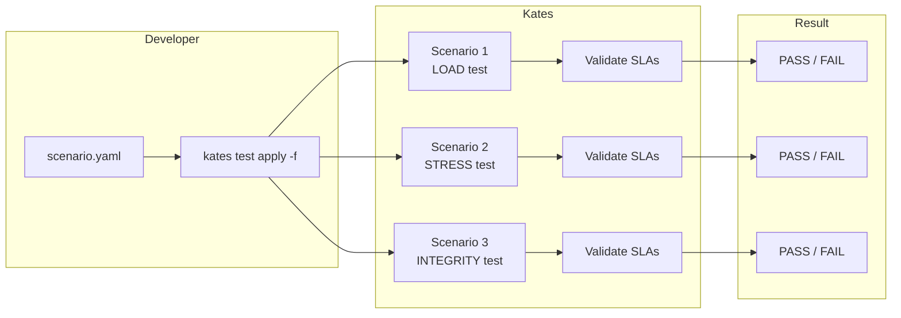
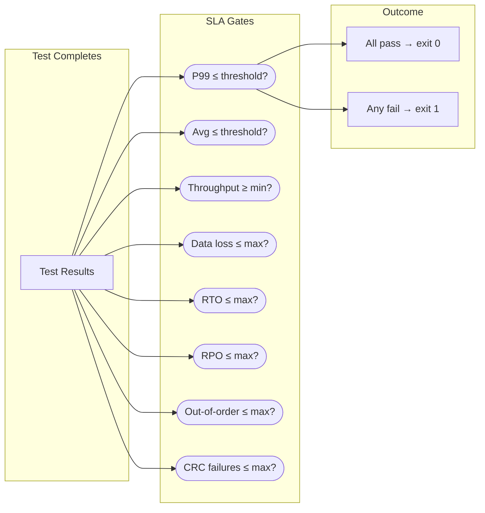

# Scenario Files & SLA Gates

Scenario files are the declarative way to define, execute, and validate Kates [test runs](appendix-a-glossary.md#gl-test-run). Rather than stringing together CLI flags, you describe one or more test scenarios in a YAML (or JSON) file and let Kates orchestrate everything — including automated pass/fail enforcement against [SLA](appendix-a-glossary.md#gl-sla) thresholds. Kates calls those thresholds SLAs, though they work like SLOs: targets you set, not agreements with anyone [@beyer2016site].

This chapter is for engineers graduating from ad-hoc `kates test create` runs to version-controlled, CI-gated test suites. After this chapter, you can:

- Describe a multi-scenario test suite in YAML, with [`spec`](appendix-a-glossary.md#gl-test-spec) parameters and `validate` SLA [gates](appendix-a-glossary.md#gl-gate)
- Check a file offline with `kates test lint`, then run it with `kates test apply -f` and read its pass/fail summary
- Wire the [exit code](appendix-a-glossary.md#gl-exit-code) into a CI/CD pipeline so performance regressions block the merge
- Spot the common scenario-file mistakes and predict how the CLI reacts to each

## Why Scenario Files?

CLI flags are convenient for ad-hoc testing, but production-grade performance validation requires:

- **Reproducibility** — the same file produces the same test every time
- **Version control** — scenario files live in Git alongside your application code
- **Multi-scenario orchestration** — run a load test, a stress test, and an integrity test in sequence with a single command
- **SLA enforcement** — define pass/fail criteria that block CI/CD pipelines on regressions



## File Format

A scenario file is a YAML (or JSON) document with a single top-level key: `scenarios`, which is a list of test definitions.

```yaml
scenarios:
  - name: "My First Test"
    type: LOAD
    spec:
      records: 100000
    validate:
      maxP99LatencyMs: 50
      minThroughputRecPerSec: 10000
```

### Top-Level Structure

| Field | Type | Required | Description |
|-------|------|:---:|-------------|
| `scenarios` | List | | One or more test scenario definitions; a file of one scenario can leave the list out, as below |

A file of one scenario can leave the list out and give that scenario's fields at its top level. `kates test apply` reads it as a list of one, and so do `kates scenario-diff` and the MCP server's `draft_scenario`. They read the top level only when the file's `scenarios` list is missing or empty and the top level has a `type`; beside a list of scenarios, top-level fields are ignored.

```yaml
name: "My First Test"
type: LOAD
spec:
  records: 100000
validate:
  maxP99LatencyMs: 50
```

### Scenario Fields

Each entry in `scenarios`, or the top level of a file of one scenario, takes these five fields. Only `type` is required; `spec` and `validate` carry the settings and the gates that the next two sections describe.

| Field | Type | Required | Description |
|-------|------|:---:|-------------|
| `name` | String | | Human-readable scenario name (displayed in output) |
| `type` | String | Yes | Test type: [`LOAD`](appendix-a-glossary.md#gl-test-type), `STRESS`, `SPIKE`, `ENDURANCE`, `VOLUME`, `CAPACITY`, `ROUND_TRIP`, `INTEGRITY`, `TUNE_REPLICATION`, `TUNE_ACKS`, `TUNE_BATCHING`, `TUNE_COMPRESSION`, `TUNE_PARTITIONS`, or `INTEGRATION_CDC`. Case-insensitive — the CLI upper-cases the value before submitting |
| `backend` | String | | [Benchmark backend](appendix-a-glossary.md#gl-benchmark-backend): `native` or `trogdor` (default: `native`) |
| `spec` | Object | | Test specification — see Spec Reference below |
| `validate` | Object | | SLA gates — see Validation Reference below |

## Spec Reference

The `spec` object controls all test parameters. Every field is optional. The [Kates API](appendix-a-glossary.md#gl-kates-api), the service in the cluster that runs your tests, fills in defaults per test type (configurable via its `kates.tests.<type>.*` properties), so a STRESS test defaults to larger batches and more producers than a ROUND_TRIP test. The defaults shown below are the stock values for a LOAD test — other types differ.

::: {.callout-important}
The Kates API merges `spec` with the test type's defaults, and every key below reaches the run. `targetThroughput` sets the producer rate in place of the type's default. `parallelProducers` counts only for STRESS and CAPACITY, and no test type reads `numConsumers`, so a LOAD scenario runs one producer and one consumer whatever they say.

The three `enable` keys take `true` or `false`. `kates test apply` refuses a file where one holds anything else, such as `yes`, `on` or nothing, naming the scenario and the key, before it starts any of the file's tests. The number keys take a number: `kates test apply` and `kates scenario-diff` refuse a file where one holds a quoted number (`"5000000"`), a unit (`10m`, `5M`) or nothing, naming the scenario and the key, before any test starts.

A key the scenario's type or benchmark backend cannot apply is refused: `kates test apply` gets a `400` naming it, and the scenario does not start. That is a rate other than -1 for SPIKE or CAPACITY, which run unthrottled; `consumerGroup` or a fetch setting for a type that takes no consumer settings (every type but LOAD, ENDURANCE and INTEGRITY); `enableCrc: true` for any type but INTEGRITY; [`enableIdempotence: true`](appendix-a-glossary.md#gl-idempotent-producer) or `enableTransactions: true` when [`acks`](appendix-a-glossary.md#gl-acks) is not `all` (SPIKE's default is `1`); `enableTransactions: true` with `enableIdempotence: false`, or on the `trogdor` benchmark backend. The [API Reference](11-api-reference.md#post-apitests) lists the rules; [Test Types Deep Dive](05-test-types.md) and [Data Integrity Verification](08-data-integrity.md) cover what the options do.
:::

### Producer Configuration

These keys configure the producer. `parallelProducers` counts only for STRESS and CAPACITY, and `targetThroughput` replaces the type's default rate.

| Field | Type | Default | Description |
|-------|------|---------|-------------|
| `records` | Integer | 1,000,000 | Number of records to produce |
| `parallelProducers` | Integer | 1 | Number of producers for STRESS and CAPACITY; other types run one |
| `recordSizeBytes` | Integer | 1024 | Payload size per record in bytes |
| `acks` | String | `all` | Producer acknowledgment mode: `0`, `1`, or `all` |
| `batchSize` | Integer | 65536 | Producer batch size in bytes |
| `lingerMs` | Integer | 5 | Milliseconds to wait before sending a batch |
| `compressionType` | String | `lz4` | Compression: `none`, `gzip`, `snappy`, `lz4`, `zstd` |
| `targetThroughput` | Integer | -1 | Producer rate in records/s, for each producer; -1 is unlimited. Replaces the type's default rate (5,000 for ENDURANCE, 10,000 for ROUND_TRIP) |
| `enableIdempotence` | Boolean | not set | The producer's `enable.idempotence`; not set, the producer is idempotent whenever `acks` is `all` |
| `enableTransactions` | Boolean | false | Transactional producers, committing every 100 records or every 10 seconds, whichever comes first; any consumer in the run then reads with `read_committed` |

### Consumer Configuration

Consumer settings apply only to LOAD, ENDURANCE and INTEGRITY. ROUND_TRIP starts a consumer too, but it reads without a group and with the Kafka client's fetch defaults, and no type reads `numConsumers`.

| Field | Type | Default | Description |
|-------|------|---------|-------------|
| `numConsumers` | Integer | 1 | Read by no test type |
| `consumerGroup` | String | auto | The consumer's group, for LOAD, ENDURANCE and INTEGRITY; not empty or blank. A group with committed [offsets](appendix-a-glossary.md#gl-offset) on the [topic](appendix-a-glossary.md#gl-topic) resumes from them, and a LOAD or ENDURANCE consumer commits as it reads, so use a group of the test's own, not one an application reads with. An INTEGRITY consumer joins it with `-integrity` appended (`<task id>-group-integrity` when not set) |
| `fetchMinBytes` | Integer | 1 | The consumer's `fetch.min.bytes`, for LOAD, ENDURANCE and INTEGRITY |
| `fetchMaxWaitMs` | Integer | 500 | The consumer's `fetch.max.wait.ms`, for LOAD, ENDURANCE and INTEGRITY |

### Topic Configuration

The first key names the topic a run writes to; the other three describe the layout Kates creates that topic with.

| Field | Type | Default | Description |
|-------|------|---------|-------------|
| `topic` | String | auto (`<type>-test`) | Target topic name |
| [`partitions`](appendix-a-glossary.md#gl-partition) | Integer | 3 | Number of topic partitions |
| [`replicationFactor`](appendix-a-glossary.md#gl-rf) | Integer | 3 | Topic replication factor |
| [`minInsyncReplicas`](appendix-a-glossary.md#gl-min-insync-replicas) | Integer | 2 | Minimum [in-sync replicas](appendix-a-glossary.md#gl-isr) |

### Test Execution

| Field | Type | Default | Description |
|-------|------|---------|-------------|
| `durationSeconds` | Integer | per type | Time-based duration cap — the run stops at `records` or the deadline, whichever comes first |

### Integrity Options

| Field | Type | Default | Description |
|-------|------|---------|-------------|
| `enableCrc` | Boolean | true | Whether an INTEGRITY run verifies a [CRC32](appendix-a-glossary.md#gl-crc32) checksum on each record; `false` turns the check off. `true` is refused for any other type |

## Validation Reference (SLA Gates)

The `validate` section defines pass/fail criteria that the CLI checks after each test completes. If any threshold is breached, the violation is listed in the summary table and the CLI exits with a non-zero status code — making it ideal for CI/CD gate enforcement.

Each threshold in `validate` is a gate. Kates has two other words for a result, and neither names a gate. A disruption plan's `sla` block earns an [SLA grade](appendix-a-glossary.md#gl-sla-grade), a letter from A to F, as [SLA Grading](07-chaos-practice.md#sla-grading) explains. An INTEGRITY run ends with a [verdict](appendix-a-glossary.md#gl-verdict), such as PASS or DATA_LOSS, as [Interpreting Integrity Results](08-data-integrity.md#interpreting-integrity-results) explains.

::: {.callout-warning}
SLA gates are only evaluated when you run `kates test apply` with `--wait`. Without it, scenarios are fire-and-forget: each one is submitted (status `SUBMITTED`), no gate is ever checked, and how the tests turn out never affects the exit status. A scenario that fails to submit still makes the CLI exit 1. With `--wait --no-sla`, the CLI waits for every run but checks no gate, so the exit code says only how the runs ended.
:::

### Gate Scope

By default, a scenario's gates judge the run as a whole, the way its report sums it up. The latency gates read the run's P99 and average from the rows that measured latency, leaving out a consumer's row as the report does: the P99 is the highest producer P99, and the average is weighted by records. `minThroughputRecPerSec` reads the producers' rates added up, since a STRESS or CAPACITY run starts its producers at once, so the shipped `stress-test` template's 100,000 rec/s is what its 16 producers send together. The integrity gates read every row that reports integrity data: the worst loss, RTO and RPO, and the out-of-order records and CRC failures added up.

Two switches bring back the older rule, where every task row of the run must meet every gate on its own, a consumer's row included:

| Where | Setting | Effect |
|-------|---------|--------|
| Command line | `--sla-scope task` | Every scenario in the file is judged task by task. `--sla-scope report` is the default |
| `validate` block | `perTask: true` | This scenario is judged task by task, whatever `--sla-scope` says. It is not a gate itself |
| Command line | `--no-sla` | No gate is checked. The summary says so, and the JSON summary carries `"sla": {"checked": false}` |

`--sla-scope` and `--no-sla` need `--wait`, and they don't go together: any of those mistakes, or a scope other than `report` or `task`, exits 2 before anything starts. The summary marks a scenario judged task by task with `(per task)`, and the JSON summary gives each graded scenario's `scope`.

The diagram below summarizes how a completed run's metrics flow through the `validate` block's gates to determine the CLI exit code:



### Performance Gates

These gates judge a run's speed. The CLI checks the first three; `maxErrorRate` is accepted but not evaluated, since a run reports no error count, and `kates test lint` warns about it. Each gate is checked against the run as a whole, as [Gate Scope](#gate-scope) explains, so a LOAD run's gates judge its producer, not its consumer, and a STRESS run's throughput gate judges its producers together. A latency gate needs at least one task that measured latency. When none did, as with a producer that failed before its first acknowledgment or a ROUND_TRIP run on the Trogdor backend, the gate fails as `p99 not measured` or `avg not measured`.

| Field | Type | Description |
|-------|------|-------------|
| `maxP99LatencyMs` | Float | Maximum acceptable [P99](appendix-a-glossary.md#gl-percentile) latency in milliseconds |
| `maxAvgLatencyMs` | Float | Maximum acceptable average latency in milliseconds |
| `minThroughputRecPerSec` | Float | Minimum acceptable [throughput](appendix-a-glossary.md#gl-throughput) in records per second |
| `maxErrorRate` | Float | Maximum acceptable error rate. Accepted in the file, but not currently evaluated by the CLI's gate check |

### Resilience Gates

These gates judge recovery, so they need a run that measured it. When a run reports no [RTO](appendix-a-glossary.md#gl-rto) or no [RPO](appendix-a-glossary.md#gl-rpo), the summary marks the gate *not evaluable*, and the exit code is unchanged. Only an INTEGRITY run reports RTO, and it reports RPO only when a resilience run marks the moment its fault goes in, so a scenario file's run never measures RPO.

| Field | Type | Description |
|-------|------|-------------|
| `maxRtoMs` | Float | Maximum Recovery Time Objective in milliseconds. If the run reports no RTO, the summary marks the gate *not evaluable* rather than passing it; the exit code is unchanged |
| `maxRpoMs` | Float | Maximum Recovery Point Objective in milliseconds. RPO is measured from a chaos start time; a run without one reports RPO as not measured, and the summary marks the gate *not evaluable* rather than passing it; the exit code is unchanged |

### Integrity Gates

These gates cap the loss, disorder and corruption an INTEGRITY run may report, and 0 is the strict setting for each. No other type reports them, so on any other run these gates never fail, and the summary still shows `✓ SLA Pass`. On an INTEGRITY run with a `validate` block, a gate the block leaves out is held at 0, and a negative value turns it off.

| Field | Type | Description |
|-------|------|-------------|
| `maxDataLossPercent` | Float | Maximum acceptable data loss percentage (0.0 = zero loss) |
| `maxOutOfOrder` | Integer | Maximum out-of-order messages (0 = strict ordering) |
| `maxCrcFailures` | Integer | Maximum CRC32 checksum failures (0 = no corruption) |

## Examples

Each example is a complete scenario file that you can run with `kates test apply -f`.

### Simple Load Test with Performance SLA

```yaml
scenarios:
  - name: "Baseline Load Test"
    type: LOAD
    spec:
      records: 100000
      recordSizeBytes: 1024
      acks: all
    validate:
      maxP99LatencyMs: 50
      minThroughputRecPerSec: 10000
```

### Multi-Phase Regression Suite

Run multiple test types in sequence and validate each independently:

```yaml
scenarios:
  - name: "Load Baseline"
    type: LOAD
    spec:
      records: 100000
    validate:
      maxP99LatencyMs: 50
      minThroughputRecPerSec: 10000

  - name: "Stress Ramp-Up"
    type: STRESS
    spec:
      records: 500000
      parallelProducers: 8
    validate:
      maxP99LatencyMs: 200
      minThroughputRecPerSec: 5000

  - name: "Data Integrity Check"
    type: INTEGRITY
    spec:
      records: 50000
      acks: all
    validate:
      maxDataLossPercent: 0.0
      maxOutOfOrder: 0
      maxCrcFailures: 0
```

### Round-Trip Latency Measurement

```yaml
scenarios:
  - name: "End-to-End Latency"
    type: ROUND_TRIP
    spec:
      records: 10000
    validate:
      maxP99LatencyMs: 25
      maxAvgLatencyMs: 10
```

### Tuning Comparison

Test different producer configurations side-by-side:

```yaml
scenarios:
  - name: "Default Batching"
    type: LOAD
    spec:
      records: 100000
    validate:
      maxP99LatencyMs: 50

  - name: "Aggressive Batching"
    type: LOAD
    spec:
      records: 100000
      batchSize: 262144
      lingerMs: 50
      compressionType: zstd
    validate:
      maxP99LatencyMs: 100
      minThroughputRecPerSec: 20000
```

## Running Scenario Files

One command runs a whole file, and one flag decides how. With `--wait`, `kates test apply` runs the scenarios one after another and checks each one's gates; without it, the command submits them all and checks nothing.

### Basic Execution

The two forms differ only in `--wait`:

```bash
# Submit all scenarios in the file (fire-and-forget — they run concurrently, with no SLA evaluation)
kates test apply -f scenarios.yaml

# Run and wait for each to complete; SLA gates are evaluated at the end
kates test apply -f scenarios.yaml --wait
```

Use `--wait` whenever the scenarios are meant to be compared, as in the [Tuning Comparison](#tuning-comparison) file. Without it, the scenarios run at the same time: scenarios of one type that set no `topic` share that type's default topic (`load-test` for LOAD), so each measures the load of the others, and the Kates API runs at most three tests at once (`kates.engine.max-concurrent-tests`), refusing any further scenario with `429 Too Many Requests`.

### How Execution Works

1. Kates checks the whole file as `kates test lint` does (see [Checking a File Before It Runs](#checking-a-file-before-it-runs)) and prints what it finds to stderr; a file with an error exits 2, and no scenario starts
2. Each scenario is submitted to the Kates API sequentially
3. If `--wait` is specified, Kates polls until each test completes before submitting the next
4. SLA gates are evaluated for each completed scenario — this only happens with `--wait`, and not with `--no-sla`; without `--wait`, every scenario is left as `SUBMITTED` and never validated
5. A summary table is printed showing each scenario's result

### Output

Running with `--wait`:

```text
  ▸ Baseline Load Test (LOAD)...
  ✓   Created: 3f8a2c1e-9b4…
  ✓ Baseline Load Test → DONE
  ▸ Stress Ramp-Up (STRESS)...
  ✓   Created: 7c5e0d2a-1f6…
  ✓ Stress Ramp-Up → DONE
  ▸ Data Integrity Check (INTEGRITY)...
  ✓   Created: b2d94e7f-8a3…
  ✓ Data Integrity Check → DONE

▸ Summary
  Scenario              ID             Status  Note
  ────────────────────  ─────────────  ──────  ─────────────────
  Baseline Load Test    3f8a2c1e-9b4…  DONE    ✓ SLA Pass
  Stress Ramp-Up        7c5e0d2a-1f6…  DONE    p99=210ms > 200ms
  Data Integrity Check  b2d94e7f-8a3…  DONE    ✓ SLA Pass

  ✖ One or more SLA gates violated
```

In this example, the stress test's P99 latency (210ms) exceeded the 200ms threshold. The CLI exits with code 1, which would fail a CI/CD pipeline.

## CI/CD Integration

Scenario files are designed for CI/CD pipelines. Combine with `--wait` to block the pipeline until all tests complete:

```bash
# In your CI pipeline script
kates test apply -f regression-suite.yaml --wait

# The exit code tells you the result:
# 0 = every scenario finished and no SLA gate was violated
# 1 = a scenario failed to submit, finished FAILED, was lost track of (ERROR), or violated an SLA gate
# 2 = the file has an error, or the flags don't go together; nothing was started
# 130 = interrupted
```

A CI job has no terminal, so `--wait` shows no spinner there: it prints a plain line to stderr each time a run's status changes, and the summary table to stdout. With `-o json` stdout carries only the summary as JSON: an `sla` object saying whether the gates were `checked` and at which `scope`, then each scenario's `runId`, `status` and, for a scenario with gates, its own `sla` object with its `scope`, `violations` and the gates that were `notEvaluable`. A scenario that failed to submit has no `runId`, so a script reads the run IDs with `jq -r '.scenarios[] | select(.runId) | .runId'`. The exit code is the same either way.

A failed run fails the pipeline whether or not its scenario has gates. A scenario that fails to submit or finishes `FAILED` shows as `FAILED` in the summary, one the CLI loses track of while waiting shows as `ERROR`, and any of them makes the command exit 1, just as a violated gate does. A run that finishes `FAILED` meets none of its gates: its first violation is `run FAILED`, with the first task error or `before any task ran`. Interrupting the command, with Ctrl-C or by cancelling the job, which sends SIGTERM, cancels the run it is waiting for, starts no further scenario, and exits 130. A scenario that finishes `DONE` passes unless one of its gates is violated, so a regression fails the pipeline only in a scenario that carries a `validate` block; without one, a run that completes but regresses exits 0.

For a CI test report, add `--output-junit <file>` (or `--junit <file>`) to a `--wait` run. The file holds one test suite for the scenario file and one test case per scenario, timed in seconds, and the suite takes the apply's wall-clock time. Violated gates are a failure of type `sla_violation`, and a run that ends `FAILED` is a failure of type `run_failed`. A scenario that could not be created, or whose run the CLI lost track of, is an error. The scenario that Ctrl-C stopped, and those never started after it, are skipped. With `--no-sla` no gate fails a test case, so only runs that ended `FAILED` do.

```bash
kates test apply -f regression-suite.yaml --wait --output-junit kates-apply.xml
```

## JSON Format

Scenario files also work in JSON:

```json
{
  "scenarios": [
    {
      "name": "Load Test",
      "type": "LOAD",
      "spec": {
        "records": 100000
      },
      "validate": {
        "maxP99LatencyMs": 50,
        "minThroughputRecPerSec": 10000
      }
    }
  ]
}
```

## Scaffolding Scenario Files

Rather than writing scenario YAML from scratch, start from the curated template library built into the CLI:

```bash
# List the built-in templates (bare `kates test scaffold` does the same)
kates test scaffold list

# Filter the list by test type
kates test scaffold list --type LOAD

# Preview a template
kates test scaffold show quick-load

# Export a template as an editable file in the current directory
kates test scaffold export quick-load

# Export with a custom filename or directory, or export everything
kates test scaffold export production-load -f load-scenario.yaml
kates test scaffold export --all --dir ./scenarios/
```

The library covers the common cases: `quick-load` (fast smoke test), `production-load` (1M records, strict SLA), `stress-test`, `endurance-soak`, `exactly-once`, `integrity-tx`, `spike-test`, and `ci-gate` (a fast 10k-record CI pipeline gate). Edit the exported file and run it with `kates test apply -f`.

## Checking a File Before It Runs

`kates test lint` checks scenario files without a Kates API or a cluster, as `kates compliance lint` checks a reference. It reads each file as `kates test apply` reads it and reports every finding as `file:line:col: severity: path: message [code]`, with the source line and a caret under it:

```bash
kates test lint regression-suite.yaml
kates test lint scenarios/*.yaml
kates test lint -o json scenarios/*.yaml
```

```text
s.yaml:4:3: error: spec.record: unknown field (did you mean "records"?) [unknown-field]
  4 |   record: 100000
    |   ^
```

An error is something `kates test apply` would refuse, or would run other than as written:

- a key it does not read, at the top level, in a scenario, in `spec` or in `validate`, named with the key it is closest to (`unknown-field`), or a key set twice (`duplicate-key`)
- a scenario without a `type` (`missing-type`), a type the Kates API has no test for (`unknown-type`), or a `backend` other than `native` or `trogdor`
- a `spec` value it could not send as written: a quoted number, a unit such as `10m`, `yes` for `true`, or a fraction such as `durationSeconds: 1.5`, which would run for 1 second (`wrong-value`)
- a gate whose value is not a number, or a fraction for `maxOutOfOrder` or `maxCrcFailures`, which would be read as a whole number (`wrong-type`, `wrong-value`)

A warning is a gate that checks nothing: `maxErrorRate`, which no run reports, or a `0` on a gate that only a value above 0 turns on. `-o json` lists the findings, each with its `file`, `line`, `col`, `severity`, `code`, `path` and `message`. The command exits 0 when no file has an error, 1 when one does, and 2 when a file cannot be read.

`kates test apply` runs the same checks over the whole file before the first scenario starts. It prints what it finds to stderr; on an error it exits 2 and starts none of the file's scenarios, so a typo in the third scenario stops the file before the first two run.

Both readers of a scenario file, the YAML one and the JSON one, drop a key they don't know. Without these checks, a gate named `maxP99Latency` would never be checked, and a `spec` key named `record` would leave the run at its type's default records, without a word. A `spec` key takes the scenario file's name, such as `records` or `durationSeconds`, not the Kates API's `numRecords` or `durationMs`, and lint names the right key for those.

## Common Mistakes

`kates test lint`, and `kates test apply` before it starts anything, catch most mistakes in a file. These are the most frequent ones and what actually happens when you make them.

### 1. Missing Required Field (`type`)

`type` is the only required field. A scenario without one is a `missing-type` error, and `kates test apply` exits 2 without starting any scenario. A file whose only scenario sits at its top level without a `type` reads as a file with no scenarios, which is an error too.

**Fix:** Add the `type` field to every scenario:

```yaml
scenarios:
  - name: "My Test"
    type: LOAD          # ← required
    spec:
      records: 100000
```

### 2. Invalid Test Type Name

Case is not the problem — the CLI upper-cases the type before submitting, so `load` and `Load` work fine. What fails is a name that isn't a real test type: lint reports it as `unknown-type`, listing the types there are, and no scenario starts.

**Fix:** Use one of the valid type names:

```yaml
scenarios:
  - name: "My Test"
    type: LOAD           # ✅ canonical
    # type: load         # ✅ also works — the CLI upper-cases it
    # type: LATENCY      # ❌ not a valid type — use ROUND_TRIP
```

### 3. SLA Threshold Format Error

SLA threshold values must be plain numbers, not strings with units — the field name already indicates the unit (e.g., `maxP99LatencyMs` implies milliseconds). A string value such as `50ms` is a `wrong-type` error at its line, with the message ``cannot unmarshal !!str `50ms` into float64``, and no scenario starts.

**Fix:** Remove the unit suffix and any quotes around the number:

```yaml
validate:
  maxP99LatencyMs: 50          # ✅ correct — plain number
  # maxP99LatencyMs: "50ms"    # ❌ wrong — string with unit
  # maxP99LatencyMs: "50"      # ❌ wrong — quoted string
  minThroughputRecPerSec: 10000  # ✅ correct
```

### 4. Records Count Too Low for Meaningful Results

Kates will not warn you about this — a LOAD test with `records: 100` runs happily and reports a "P99" that is really just your single slowest message. Low record counts produce unreliable metrics.

**Fix:** Use appropriate record counts per test type:

```yaml
scenarios:
  - name: "Proper Load Test"
    type: LOAD
    spec:
      records: 100000        # ✅ good — 100K for load tests
      # records: 100         # ❌ too low — unreliable P99

  - name: "Proper Integrity Test"
    type: INTEGRITY
    spec:
      records: 100000        # ✅ good — 100K for integrity tests
      # records: 1000        # ❌ too low — may miss intermittent issues
```

The table gives a recommended minimum for four of the types; the file above sits well above it for LOAD and INTEGRITY.

| Test Type | Recommended Minimum | Why |
|-----------|:-------------------:|-----|
| LOAD | 10,000 | Enough samples for stable percentile calculations |
| STRESS | 50,000 | Need sustained load to detect [saturation](appendix-a-glossary.md#gl-saturation-point) |
| INTEGRITY | 50,000 | Higher counts catch intermittent data loss |
| ROUND_TRIP | 5,000 | Latency measurement is per-message, so fewer needed |

### 5. Setting Both `records` and `durationSeconds`

Kates does not treat this as a conflict — no error is raised, both values are forwarded to the Kates API, and the run stops at whichever bound is hit first. That silent "whichever comes first" behavior is easy to misread when you look at results later, so keep the intent explicit.

**Fix:** Set only the termination condition you mean:

```yaml
scenarios:
  # Option A: count-based (stop after N records)
  - name: "Count-Based Test"
    type: LOAD
    spec:
      records: 100000
      # durationSeconds: 300   # ← remove this

  # Option B: time-based (stop after N seconds)
  - name: "Time-Based Test"
    type: ENDURANCE
    spec:
      durationSeconds: 300
      # records: 100000        # ← remove this
```

::: {.callout-tip}
**Try it**

Watch an SLA gate fail on purpose — the fastest way to trust a gate is to see it catch something:

```bash
# Export the built-in quick-load template into the current directory
kates test scaffold export quick-load

# Edit quick-load.yaml: change maxP99LatencyMs from 100 to 1

# Run with gates enabled, then check the exit code
kates test apply -f quick-load.yaml --wait
echo $?
```

No real cluster delivers a 1 ms P99, so the summary table marks the scenario `DONE` with a `p99=… > 1ms` violation note and `echo $?` prints 1 — exactly the signal that blocks a CI/CD pipeline.
:::

## Summary

- A scenario file is a `scenarios:` list in YAML or JSON, or the fields of one scenario at its top level; `type` is the only field a scenario must carry, and the Kates API fills in per-type defaults for everything else
- SLA gates in the `validate` block are evaluated only with `--wait` — without it, `kates test apply` is fire-and-forget, and how the runs turn out never affects its exit status; `--no-sla` waits but checks no gate
- Gates judge the run as a whole by default: the producers' latency, their throughput added up, a consumer's row left out; `--sla-scope task` or `perTask: true` judges every task row on its own
- `kates test apply` exits 1 when any scenario fails to submit, with or without `--wait`; with `--wait` it also exits 1 when a scenario finishes `FAILED`, is lost track of (`ERROR`), or violates a gate, and a run that completes without a `validate` block passes whatever its numbers
- `kates test lint` checks a file offline, with a line and column for each finding, and `kates test apply` runs the same checks first: a file with an error exits 2 and starts nothing
- `--output-junit` writes one JUnit test case per scenario for a CI report
- Start from a `kates test scaffold export` template instead of a blank file — edit a known-good scenario, then run it with `kates test apply -f`

Scenario files lock a winning configuration into Git; finding that configuration interactively is the job of [Lab — Interactive Performance Tuning](10b-lab.md).
