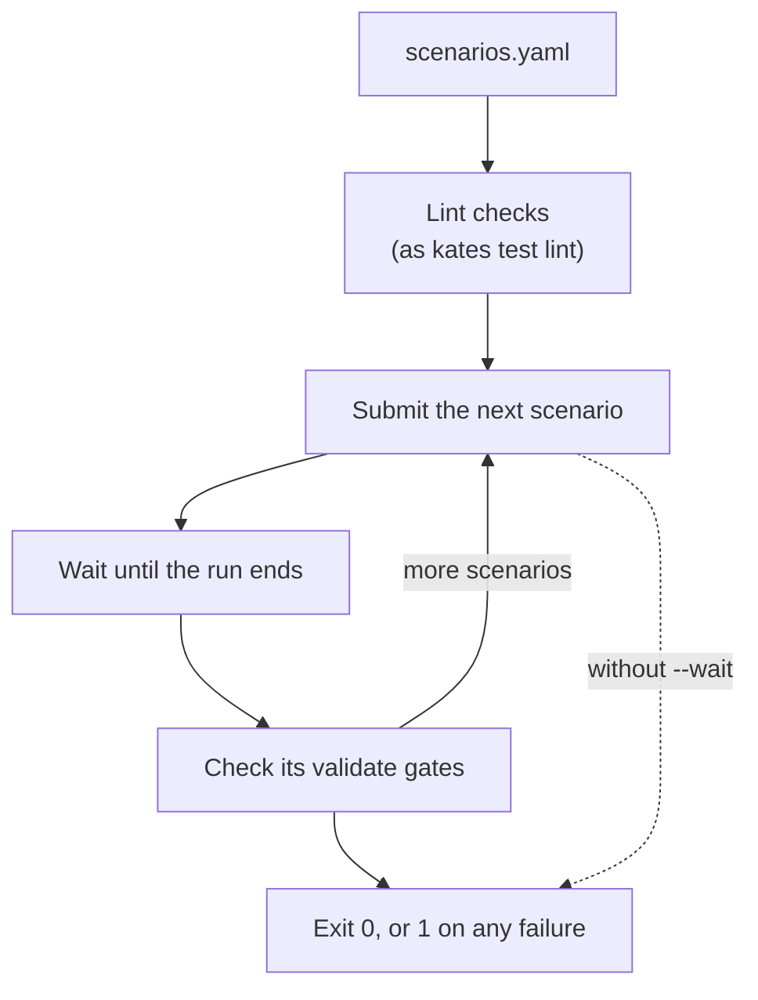
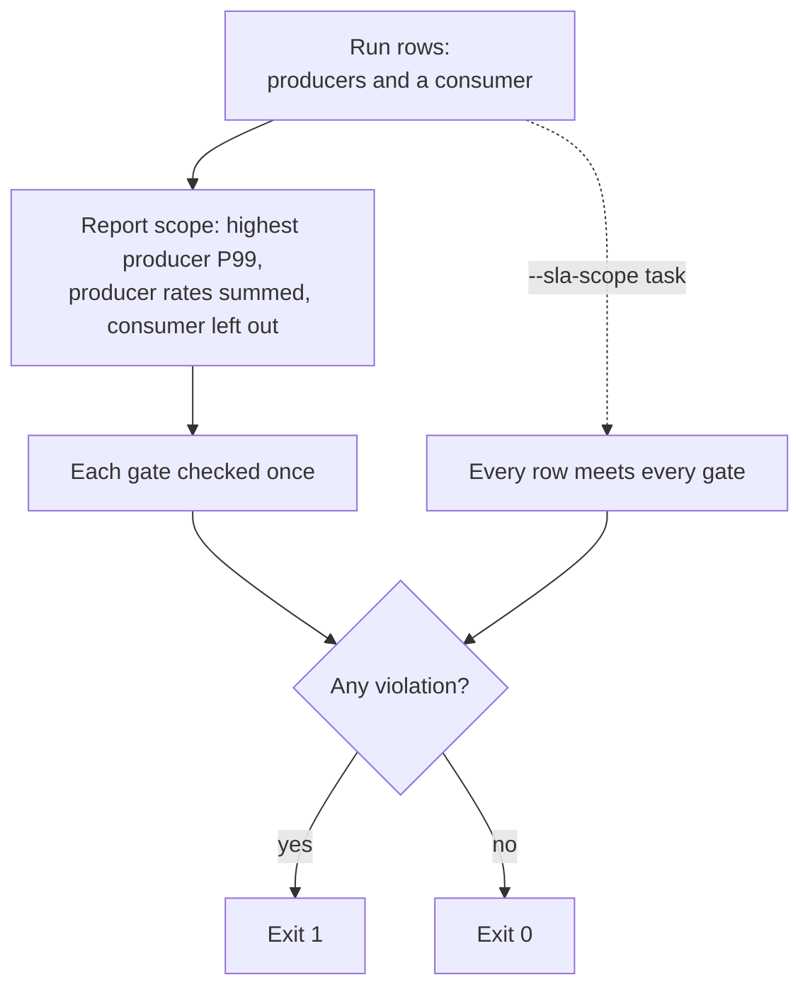

# Scenario Files & SLA Gates

The payments platform moves onto `krafter`, the Kafka cluster under test, only if its P99 target of 100 ms keeps holding on every build after the afternoon you measured it. A [scenario file](appendix-a-glossary.md#gl-scenario-file) turns that target into a gate a pipeline can fail. You describe one or more [test runs](appendix-a-glossary.md#gl-test-run) in YAML or JSON, and `kates test apply` runs them and checks each against its [SLA](appendix-a-glossary.md#gl-sla) thresholds. Kates calls those thresholds SLAs, though they work like [SLOs](appendix-a-glossary.md#gl-slo): targets you set, not agreements with anyone [@beyer2016site].

After this chapter, you can:

- Describe a multi-scenario test suite in YAML, with [`spec`](appendix-a-glossary.md#gl-test-spec) parameters and `validate` SLA [gates](appendix-a-glossary.md#gl-gate)
- Check a file offline with `kates test lint`, then run it with `kates test apply -f` and read its pass/fail summary
- Wire the [exit code](appendix-a-glossary.md#gl-exit-code) into a CI/CD pipeline so performance regressions block the merge
- Spot the scenario-file mistakes that lint can't see, and predict how the CLI reacts to each

## Why Scenario Files?

CLI flags suit an ad hoc run, but a test you rerun on every build needs four things flags lack: the same definition every time, a home in Git beside the code, several runs from one command, and pass/fail criteria a pipeline can act on. A scenario file gives all four, and the figure shows what `kates test apply --wait` does with one:



## File Format

A scenario file is a YAML document with a single top-level key, `scenarios`, which is a list of test definitions. The scenario below carries the payments latency target as its one gate:

```yaml
scenarios:
  - name: payments-load
    type: LOAD
    spec:
      topic: payments-load
      recordSizeBytes: 1024
      acks: all
      targetThroughput: 2000
    validate:
      maxP99LatencyMs: 100
```

A file named `.json` is read as JSON with the same keys; any other file is read as YAML.

A file of one scenario can leave the list out and give that scenario's fields at its top level. `kates test apply` reads it as a list of one, and so do `kates scenario-diff` and the MCP server's `draft_scenario`. They read the top level only when the file's `scenarios` list is missing or empty and the top level has a `type`; beside a list of scenarios, top-level fields are ignored.

```yaml
name: payments-load
type: LOAD
spec:
  topic: payments-load
validate:
  maxP99LatencyMs: 100
```

### Scenario Fields

Each entry in `scenarios`, or the top level of a file of one scenario, takes these five fields. Only `type` is required; `spec` and `validate` carry the settings and the gates that the next sections describe.

| Field | Type | Required | Description |
|-------|------|----------|-------------|
| `name` | String | No | Human-readable scenario name, shown in the output |
| `type` | String | Yes | One of the [test types](appendix-a-glossary.md#gl-test-type) [Test Types Deep Dive](05-test-types.md) lists; case-insensitive |
| `backend` | String | No | [Benchmark backend](appendix-a-glossary.md#gl-benchmark-backend): `native` or `trogdor` (default: `native`) |
| `spec` | Object | No | Test settings — see [Spec Reference](#spec-reference) |
| `validate` | Object | No | SLA gates — see [Validation Reference (SLA Gates)](#validation-reference-sla-gates) |

## Scaffolding Scenario Files

Start a scenario file from one of the templates built into the CLI:

```bash
# List the built-in templates (bare `kates test scaffold` does the same)
kates test scaffold list

# Filter the list by test type
kates test scaffold list --type LOAD

# Preview a template
kates test scaffold show quick-load

# Export a template as an editable file in the current directory
kates test scaffold export quick-load

# Export with a custom filename or directory, or export everything
kates test scaffold export production-load -f load-scenario.yaml
kates test scaffold export --all --dir ./scenarios/
```

The library covers the common cases: `quick-load` (a 50,000-record smoke test), `production-load` (1,000,000 records), `stress-test`, `endurance-soak`, `exactly-once`, `integrity-tx`, `spike-test`, and `ci-gate` (a 10,000-record pipeline gate). Edit the exported file and run it with `kates test apply -f`.

## Spec Reference

The `spec` object holds the run's settings, and every field is optional. The [Kates API](appendix-a-glossary.md#gl-kates-api), the service in the cluster that runs your tests, merges `spec` with the test type's defaults, which its `kates.tests.<type>.*` properties set, and every key below reaches the run. The defaults shown are LOAD's; [Defaults by Type](05-test-types.md#defaults-by-type) gives the others.

### Producer Configuration

These keys configure the producer. `parallelProducers` counts only for STRESS and CAPACITY, so a LOAD scenario runs one producer whatever it says.

| Field | Type | Default | Description |
|-------|------|---------|-------------|
| `records` | Integer | 1,000,000 | Number of records to produce |
| `parallelProducers` | Integer | 1 | Number of producers for STRESS and CAPACITY; other types run one |
| `recordSizeBytes` | Integer | 1024 | Payload size per record in bytes |
| `acks` | String | `all` | Producer acknowledgment mode: `0`, `1`, or `all` |
| `batchSize` | Integer | 65536 | Producer batch size in bytes |
| `lingerMs` | Integer | 5 | Milliseconds to wait before sending a batch |
| `compressionType` | String | `lz4` | Compression: `none`, `gzip`, `snappy`, `lz4`, `zstd` |
| `targetThroughput` | Integer | -1 | Producer rate in rec/s, for each producer; -1 is unlimited and replaces the type's default rate |
| `enableIdempotence` | Boolean | not set | The producer's `enable.idempotence`; not set, the producer is idempotent whenever `acks` is `all` |
| `enableTransactions` | Boolean | false | Transactional producers, committing every 100 records or every 10 seconds; any consumer in the run then reads with `read_committed` |

ENDURANCE's default rate is 5,000 rec/s and ROUND_TRIP's 10,000; the other types run unthrottled unless `targetThroughput` sets a rate.

### Consumer Configuration

Consumer settings apply only to LOAD, ENDURANCE and INTEGRITY. ROUND_TRIP starts a consumer too, but it reads without a group and with the Kafka client's fetch defaults, and no type reads `numConsumers`.

| Field | Type | Default | Description |
|-------|------|---------|-------------|
| `numConsumers` | Integer | 1 | Read by no test type |
| `consumerGroup` | String | auto | The consumer's [group](appendix-a-glossary.md#gl-consumer-group); default `<task id>-group`, and INTEGRITY appends `-integrity` |
| `fetchMinBytes` | Integer | 1 | The consumer's `fetch.min.bytes` |
| `fetchMaxWaitMs` | Integer | 500 | The consumer's `fetch.max.wait.ms` |

A group with committed [offsets](appendix-a-glossary.md#gl-offset) on the [topic](appendix-a-glossary.md#gl-topic) resumes from them, and a LOAD or ENDURANCE consumer commits as it reads. So give `consumerGroup` a group of the test's own, never one an application reads with; the value can't be empty or blank.

### Topic Configuration

The first key names the topic a run writes to; the other three describe the layout Kates creates that topic with.

| Field | Type | Default | Description |
|-------|------|---------|-------------|
| `topic` | String | auto (`<type>-test`) | Target topic name |
| [`partitions`](appendix-a-glossary.md#gl-partition) | Integer | 3 | Number of topic partitions |
| [`replicationFactor`](appendix-a-glossary.md#gl-rf) | Integer | 3 | Topic replication factor |
| [`minInsyncReplicas`](appendix-a-glossary.md#gl-min-insync-replicas) | Integer | 2 | Minimum [in-sync replicas](appendix-a-glossary.md#gl-isr) |

The Kates API applies the last three only when it creates the topic; a run that names an existing topic leaves it as it is.

### Run Settings

One key bounds the run in time and one turns on the CRC check:

| Field | Type | Default | Description |
|-------|------|---------|-------------|
| `durationSeconds` | Integer | 600 for LOAD | The run stops at `records` or after this many seconds, whichever comes first |
| `enableCrc` | Boolean | true | Whether an INTEGRITY run verifies a [CRC32](appendix-a-glossary.md#gl-crc32) checksum on each record; `true` is refused for any other type |

Setting both `records` and `durationSeconds` is how you put a time cap on a count: the Kates API takes both, and the run stops at whichever bound comes first. The default duration differs by type: 900 s for STRESS, 300 for SPIKE, 3,600 for ENDURANCE and 1,200 for CAPACITY.

### Limits

Two kinds of value are refused before a run starts. A value of the wrong form makes the CLI refuse the whole file, naming the scenario and the key. That is an `enable` key that holds anything but `true` or `false`, such as `yes`, `on` or nothing, or a number key that holds a quoted number (`"5000000"`), a unit (`10m`, `5M`) or nothing. A key the scenario's type or backend can't apply makes the Kates API refuse that scenario with a `400` naming it:

| Key | Refused when | Who refuses it |
|-----|--------------|----------------|
| `targetThroughput` other than -1 | The type is SPIKE or CAPACITY, which run unthrottled | The Kates API (`400`) |
| `consumerGroup`, `fetchMinBytes`, `fetchMaxWaitMs` | The type is not LOAD, ENDURANCE or INTEGRITY | The Kates API (`400`) |
| `enableCrc: true` | The type is not INTEGRITY | The Kates API (`400`) |
| [`enableIdempotence: true`](appendix-a-glossary.md#gl-idempotent-producer) or `enableTransactions: true` | [`acks`](appendix-a-glossary.md#gl-acks) is not `all` (SPIKE's default is `1`) | The Kates API (`400`) |
| `enableTransactions: true` | `enableIdempotence: false`, or the `trogdor` backend | The Kates API (`400`) |
| An `enable` key not `true` or `false`; a quoted or unit-suffixed number | Always | `kates test apply` and `kates test lint`, before any run (exit 2) |

The [API Reference](11-api-reference.md#post-apitests) lists the Kates API's rules; [Test Types Deep Dive](05-test-types.md) and [Data Integrity Verification](08-data-integrity.md) cover what the options do.

## Validation Reference (SLA Gates)

The `validate` section defines pass/fail criteria that the CLI checks after each run completes under `--wait`. A breached threshold is listed in the summary table and makes the CLI exit 1.

Each threshold in `validate` is a gate. Kates has two other words for a result, and neither names a gate. A disruption plan's `sla` block earns an [SLA grade](appendix-a-glossary.md#gl-sla-grade), a letter from A to F, as [SLA Grading](07-chaos-practice.md#sla-grading) explains. An INTEGRITY run ends with a [verdict](appendix-a-glossary.md#gl-verdict), such as PASS or DATA_LOSS, as [Interpreting Integrity Results](08-data-integrity.md#interpreting-integrity-results) explains.

### Gate Scope

By default, a scenario's gates judge the run as a whole, the way its report sums it up. The latency gates read the run's [P99](appendix-a-glossary.md#gl-percentile) and average from the rows that measured latency, leaving out a consumer's row as the report does: the P99 is the highest producer P99, and the average is weighted by records. `minThroughputRecPerSec` reads the producers' [throughput](appendix-a-glossary.md#gl-throughput) added up, since a STRESS or CAPACITY run starts its producers at once. So the shipped `stress-test` template's 100,000 rec/s is what its 16 producers send together. The integrity gates read every row that reports integrity data: the worst loss, [RTO](appendix-a-glossary.md#gl-rto) and [RPO](appendix-a-glossary.md#gl-rpo), and the out-of-order records and CRC failures added up.

The figure shows that default path, and the dotted alternative:



Two switches bring back the stricter rule, where every task row of the run must meet every gate on its own, a consumer's row included, and a third checks no gate:

| Where | Setting | Effect |
|-------|---------|--------|
| Command line | `--sla-scope task` | Every scenario in the file is judged task by task. `--sla-scope report` is the default |
| `validate` block | `perTask: true` | This scenario is judged task by task, whatever `--sla-scope` says. It is not a gate itself |
| Command line | `--no-sla` | No gate is checked. The summary says so, and the JSON summary carries `"sla": {"checked": false}` |

`--sla-scope` and `--no-sla` need `--wait`, and they don't go together: any of those mistakes, or a scope other than `report` or `task`, exits 2 before anything starts. The summary marks a scenario judged task by task with `(per task)`, and the JSON summary gives each graded scenario's `scope`.

::: {.callout-tip title="Try it: does the consumer's row change the verdict?"}
Run the `quick-load` template at the default scope, then task by task:

```bash
kates test scaffold export quick-load
kates test apply -f quick-load.yaml --wait
kates test apply -f quick-load.yaml --wait --sla-scope task
```

Compare the two summaries: in the second, the `(per task)` scenario's Note shows whether the consumer's row breaks a gate the run as a whole met.
:::

### Performance Gates

These gates judge a run's speed. The CLI checks the first three; `maxErrorRate` is accepted but not evaluated, since a run reports no error count, and `kates test lint` warns about it. Each gate is checked against the run as a whole, as [Gate Scope](#gate-scope) explains, so a LOAD run's gates judge its producer, not its consumer, and a STRESS run's throughput gate judges its producers together. A latency gate needs at least one task that measured latency. When none did, as with a producer that failed before its first acknowledgment or a ROUND_TRIP run on the [Trogdor](appendix-a-glossary.md#gl-trogdor) backend, the gate fails as `p99 not measured` or `avg not measured`.

| Field | Type | Description |
|-------|------|-------------|
| `maxP99LatencyMs` | Float | Maximum acceptable P99 latency in milliseconds |
| `maxAvgLatencyMs` | Float | Maximum acceptable average latency in milliseconds |
| `minThroughputRecPerSec` | Float | Minimum acceptable throughput in records per second |
| `maxErrorRate` | Float | Maximum acceptable error rate. Accepted in the file, but not evaluated by the CLI |

### Resilience Gates

These gates judge recovery, so they need a run that measured it. When a run reports no RTO or no RPO, the summary marks the gate *not evaluable*, and the exit code is unchanged. Only an INTEGRITY run reports RTO, and it reports RPO only when a resilience run marks the moment its fault goes in, so a scenario file's run never measures RPO.

| Field | Type | Description |
|-------|------|-------------|
| `maxRtoMs` | Float | Maximum recovery time in milliseconds; with no RTO measured, the gate is *not evaluable* |
| `maxRpoMs` | Float | Maximum RPO in milliseconds, measured from a fault's start; with none measured, the gate is *not evaluable* |

### Integrity Gates

These gates cap the loss, disorder and corruption an INTEGRITY run may report, and 0 is the strict setting for each. No other type reports them, so on any other run these gates never fail, and the summary still shows `✓ SLA Pass`. On an INTEGRITY run with a `validate` block, a gate the block leaves out is held at 0, and a negative value turns it off.

| Field | Type | Description |
|-------|------|-------------|
| `maxDataLossPercent` | Float | Maximum acceptable data loss percentage (0.0 = zero loss) |
| `maxOutOfOrder` | Integer | Maximum out-of-order records (0 = strict ordering) |
| `maxCrcFailures` | Integer | Maximum CRC32 checksum failures (0 = no corruption) |

### Choosing a Threshold

A gate is useful only when a real regression breaks it and noise doesn't. Set it from a baseline of three runs plus a margin, not from the number you hope to see:

1. Run the scenario three times, one after another, with `--wait --no-sla`, so nothing is gated yet.
2. Take the worst P99 and the lowest throughput of the three, and the spread between the runs.
3. Set `maxP99LatencyMs` above the worst P99, and `minThroughputRecPerSec` below the lowest throughput, each by more than that spread.
4. Once a run you accept is the type's baseline (`kates test baseline set <run-id>`), tighten the gates toward it as more runs come in.

[Telling a Regression from Noise](04-performance-theory.md#statistical-significance) explains the spread, and [The Percentile Solution](04-performance-theory.md#the-percentile-solution) why a P99 needs enough records behind it. The payments target already fixes the latency gate at 100 ms; the throughput floor sits below the offered 2,000, since a run's measured rate always lands under the rate it's given.

## Running Scenario Files

One command runs a whole file, and one flag decides how. With `--wait`, `kates test apply` runs the scenarios one after another and checks each one's gates; without it, the command submits them all and checks nothing.

### Submit or Wait

The two forms differ only in `--wait`:

```bash
# Submit every scenario; nothing waits and no gate is checked
kates test apply -f scenarios.yaml

# Run each scenario in turn and check its gates
kates test apply -f scenarios.yaml --wait
```

::: {.callout-warning title="Gates are checked only with --wait"}
Without `--wait`, each scenario is submitted (status `SUBMITTED`), no gate is checked, and how the runs turn out never affects the exit status. A scenario that fails to submit still makes the CLI exit 1. With `--wait --no-sla`, the CLI waits for every run but checks no gate, so the exit code says only how the runs ended.
:::

Use `--wait` whenever the scenarios are meant to be compared, as in the [Tuning Comparison](#tuning-comparison) file. Without it, the scenarios run at the same time, and scenarios of one type that set no `topic` share that type's default topic (`load-test` for LOAD), so each measures the load of the others. The Kates API also runs at most three tests at once (`kates.engine.max-concurrent-tests`) and refuses any further scenario with `429 Too Many Requests`.

### What apply Does, in Order

`kates test apply` works through a file in five steps:

1. It checks the whole file as `kates test lint` does, and prints what it finds to stderr; a file with an error starts no scenario.
2. It submits each scenario to the Kates API in turn.
3. Under `--wait`, it polls until each run completes before submitting the next.
4. It checks each completed scenario's gates, unless `--no-sla` is set.
5. It prints a summary table with each scenario's result.

### Reading the Summary

Below is an illustrative summary of a `--wait` run of two scenarios, in which the first violated its P99 gate; the IDs and the values are placeholders. Output:

```text
  ▸ payments-load (LOAD)...
  ✓   Created: <id-1>
  ✓ payments-load → DONE
  ▸ payments-integrity (INTEGRITY)...
  ✓   Created: <id-2>
  ✓ payments-integrity → DONE

▸ Summary
  Scenario            ID      Status  Note
  ──────────────────  ──────  ──────  ─────────────────
  payments-load       <id-1>  DONE    p99=…ms > 100ms
  payments-integrity  <id-2>  DONE    ✓ SLA Pass

  ✖ One or more SLA gates violated
```

Reading the block:

1. The progress lines, one per status change, go to stderr.
2. The Summary table goes to stdout.
3. The Note column holds a scenario's first violation, or `✓ SLA Pass` when it met every gate; this run exits 1.

### Exit Codes

The exit code is the pipeline's verdict, and the table says what each value means and whether anything ran:

| Exit code | Meaning | Anything started? |
|-----------|---------|-------------------|
| 0 | Every scenario finished and no gate was violated | Yes |
| 1 | A scenario failed to submit, finished `FAILED`, was lost track of (`ERROR`), or violated a gate | Yes |
| 2 | The file has an error, or the flags don't go together | No |
| 130 | Interrupted | The run being waited on is cancelled |

## Checking a File Before It Runs

`kates test lint` checks scenario files without a Kates API or a cluster, as `kates compliance lint` checks a reference. It reads each file as `kates test apply` reads it and reports every finding as `file:line:col: severity: path: message [code]`, with the source line and a caret under it:

```bash
kates test lint regression-suite.yaml
kates test lint scenarios/*.yaml
kates test lint -o json scenarios/*.yaml
```

Output, for a file whose `records` key is misspelled:

```text
s.yaml:4:3: error: spec.record: unknown field (did you mean "records"?) [unknown-field]
  4 |   record: 100000
    |   ^
```

An error is something `kates test apply` would refuse, or would run other than as written. Each row is one error code and an example of what it catches:

| Code | What it catches | Example |
|------|-----------------|---------|
| `unknown-field` | A key it doesn't read, named with the key it's closest to | `record: 100000` in `spec` |
| `duplicate-key` | A key set twice | Two `records` lines in one `spec` |
| `missing-type` | A scenario without a `type` | A scenario with only `name` and `spec` |
| `unknown-type` | A type the Kates API has no test for | `type: LATENCY`; use ROUND_TRIP |
| `unknown-backend` | A `backend` other than `native` or `trogdor` | `backend: kafka` |
| `wrong-type` | A value of the wrong kind, such as a gate that isn't a number | `maxP99LatencyMs: "50ms"` |
| `wrong-value` | A value it couldn't send as written | `durationSeconds: 1.5`, which would run for 1 second |
| `no-scenarios` | A file with no scenario in it | An empty file |

Case is not an error: the CLI upper-cases `type`, so `load` and `Load` both work. A gate's value is a plain number because the field name carries the unit: `maxP99LatencyMs` is milliseconds.

A warning is a gate that checks nothing: `maxErrorRate`, which no run reports (`gate-not-checked`), or a `0` on a gate that only a value above 0 turns on (`gate-off`). `-o json` lists the findings, each with its `file`, `line`, `col`, `severity`, `code`, `path` and `message`. The command exits 0 when no file has an error, 1 when one does, and 2 when a file can't be read.

`kates test apply` runs the same checks over the whole file before the first scenario starts. On an error it starts none of the file's scenarios, so a typo in the third scenario stops the file before the first two run.

Both readers of a scenario file, the YAML one and the JSON one, drop a key they don't know. Without these checks, a gate named `maxP99Latency` would never be checked, and a `spec` key named `record` would leave the run at its type's default records, without a word. A `spec` key takes the scenario file's name, such as `records` or `durationSeconds`, not the Kates API's `numRecords` or `durationMs`, and lint names the right key for those.

::: {.callout-tip title="Try it: what does lint say about a misspelled gate?"}
Write a one-scenario file whose gate is misspelled, then lint it:

```bash
printf 'type: LOAD\nvalidate:\n  maxP99Latency: 50\n' > typo.yaml
kates test lint typo.yaml
echo $?
```

Expect an `unknown-field` error on `validate.maxP99Latency` that names `maxP99LatencyMs`, and an exit code of 1.
:::

## CI/CD Integration

In a pipeline, run the file with `--wait` so the job blocks until every run completes and the exit code carries the verdict:

```bash
kates test apply -f regression-suite.yaml --wait
```

A CI job has no terminal, so `--wait` shows no spinner there: it prints a plain line to stderr each time a run's status changes, and the summary table to stdout. With `-o json`, stdout carries only the summary as JSON. Its top-level `sla` object says whether the gates were `checked` and at which `scope`. Then each scenario has its `runId`, `status` and, for a scenario with gates, its own `sla` object with its `scope`, `violations` and the gates that were `notEvaluable`. A scenario that failed to submit has no `runId`, so a script reads the run IDs with `jq -r '.scenarios[] | select(.runId) | .runId'`. The exit code is the same either way.

A failed run fails the pipeline whether or not its scenario has gates. A scenario that fails to submit or finishes `FAILED` shows as `FAILED` in the summary. One the CLI loses track of while waiting shows as `ERROR`, and any of them makes the command exit 1, as a violated gate does. A run that finishes `FAILED` meets none of its gates: its first violation is `run FAILED`, with the first task error or `before any task ran`. Interrupting the command, with Ctrl-C or by cancelling the job, which sends SIGTERM, cancels the run it is waiting for, starts no further scenario, and exits 130. A scenario that finishes `DONE` passes unless one of its gates is violated, so a regression fails the pipeline only in a scenario that carries a `validate` block.

For a CI test report, add `--output-junit <file>` to a `--wait` run. The file holds one test suite for the scenario file and one test case per scenario, timed in seconds, and the suite takes the apply's wall-clock time. Violated gates are a failure of type `sla_violation`, and a run that ends `FAILED` is a failure of type `run_failed`. A scenario that could not be created, or whose run the CLI lost track of, is an error. The scenario that Ctrl-C stopped, and those never started after it, are skipped. With `--no-sla` no gate fails a test case, so only runs that ended `FAILED` do.

```bash
kates test apply -f regression-suite.yaml --wait --output-junit kates-apply.xml
```

::: {.callout-tip title="Try it: what does a failed gate look like?"}
Export the `quick-load` template, set its `maxP99LatencyMs` from 100 to 1, and run it:

```bash
kates test scaffold export quick-load
kates test apply -f quick-load.yaml --wait
echo $?
```

Look for a `p99=…ms > 1ms` violation in the Note column and the exit code `echo $?` prints: the signal that blocks a pipeline.
:::

## Examples

Each example is a complete scenario file that you can run with `kates test apply -f`. They use the payments latency target where one applies, and leave out gates that have no baseline yet.

### Multi-Type Regression Suite

This file runs a LOAD scenario and an INTEGRITY scenario one after another under `--wait`, and checks each against its own gates:

```yaml
scenarios:
  - name: payments-load
    type: LOAD
    spec:
      topic: payments-load
      consumerGroup: payments-perf
      recordSizeBytes: 1024
      acks: all
      targetThroughput: 2000
    validate:
      maxP99LatencyMs: 100

  - name: payments-integrity
    type: INTEGRITY
    spec:
      topic: payments-integrity
      consumerGroup: payments-verify
      recordSizeBytes: 1024
      acks: all
    validate:
      maxDataLossPercent: 0.0
      maxOutOfOrder: 0
      maxCrcFailures: 0
```

### Round-Trip Latency Measurement

This file measures send-to-receipt latency at the payments rate, with no gate until a baseline gives you one:

```yaml
scenarios:
  - name: payments-round-trip
    type: ROUND_TRIP
    spec:
      topic: payments-load
      recordSizeBytes: 1024
      targetThroughput: 2000
```

### Tuning Comparison

This file compares two producer configurations, run one after another under `--wait`, with the same gate on each:

```yaml
scenarios:
  - name: default-batching
    type: LOAD
    spec:
      topic: payments-load
      targetThroughput: 2000
    validate:
      maxP99LatencyMs: 100

  - name: larger-batches
    type: LOAD
    spec:
      topic: payments-load
      targetThroughput: 2000
      batchSize: 262144
      lingerMs: 50
    validate:
      maxP99LatencyMs: 100
```

## Common Mistakes

`kates test lint`, and `kates test apply` before it starts anything, catch the mistakes in a file's form. These are the ones lint can't see, because the file is valid and the run does something other than you meant.

### Too Few Records for a Percentile

Kates doesn't warn you about this: a LOAD scenario with `records: 100` runs and reports a "P99" that is its single slowest record. P99 of N records rests on the slowest N/100 of them, so give a latency gate enough records behind it. The shipped templates are a reference point: `ci-gate` uses 10,000 records, `quick-load` 50,000 and `production-load` 1,000,000.

```yaml
scenarios:
  - name: payments-load
    type: LOAD
    spec:
      records: 120000      # 60 s at 2,000 rec/s: 1,200 records behind the P99
      targetThroughput: 2000
```

### Scenarios Sharing a Default Topic

Two scenarios of one type that set no `topic` both write to that type's default topic, `load-test` for LOAD. Under `--wait` they run one after another, so each reads only its own records; without `--wait` they run at the same time and measure each other's load. Name a topic per scenario, as the payments examples do.

### A Consumer Group an Application Uses

A LOAD or ENDURANCE consumer commits offsets as it reads. Pointed at a group an application reads with, the run moves that application's offsets. Give `consumerGroup` a name of the test's own, such as `payments-perf`.

### A Gate the Type Never Reports

A gate on a figure the run's type doesn't measure checks nothing. The integrity gates never fail on a non-INTEGRITY run, and the resilience gates are *not evaluable* on a run without a fault, so the summary can show `✓ SLA Pass` while the gate checked nothing. Put each gate on the type that reports its figure.

## Summary

- A scenario file is a list of scenarios; only the type is required, and the Kates API fills in the rest per type.
- Gates are checked only when the command waits for each run, and they judge the run as a whole unless you ask for task by task.
- The exit code is the pipeline's verdict: a failed submission, a failed run or a violated gate fails it; a file error starts nothing.
- Lint catches the silent mistakes, a misspelled key or a unit in a number, before any run starts.
- Set a gate from a baseline of repeated runs plus a margin, and start from a shipped template, not a blank page.

The gates in a payments scenario file assume you already know which batch size and linger the platform should run with. The Lab is where you find that out, one setting at a time, before you freeze it into the file: [Lab — Interactive Performance Tuning](10b-lab.md).
