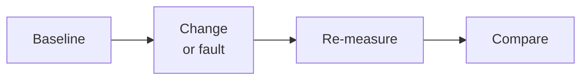

# Recipes & Patterns

You have run every kind of test on [`krafter`](appendix-a-glossary.md#gl-krafter), the Kafka cluster under test. What's left is the work no test type does on its own: proving an upgrade changed nothing, catching a regression the night it lands, finding the cluster's ceiling, and signing `krafter` off for the payments workload. Each recipe below chains commands you already know into one of those procedures.

Pick a recipe by the question you need answered. Some recipes disrupt the cluster on purpose, and Recipe 7 does with its optional chaos gate, so check the last column before you run one where other people depend on the cluster:

| Recipe | Question it answers | Disrupts the cluster |
|:--------------------|:------------------------------------------------|:------------------------------|
| [Recipe 1: Validate a Kafka Upgrade](#recipe-1-validate-a-kafka-upgrade) | Did the upgrade change performance? | The upgrade rolls every broker; the tests don't disrupt |
| [Recipe 2: Nightly Regression Suite](#recipe-2-nightly-regression-suite) | Is performance drifting from night to night? | No |
| [Recipe 3: Pre-Production Chaos Certification](#recipe-3-pre-production-chaos-certification) | Does the cluster keep working through broker loss, a partition and a zone outage? | Yes: it kills Kafka pods and cuts one broker off |
| [Recipe 4: Investigate a Latency Regression](#recipe-4-investigate-a-latency-regression) | Why did [P99](appendix-a-glossary.md#gl-percentile) latency rise between two runs? | No |
| [Recipe 5: Capacity Planning](#recipe-5-capacity-planning) | What throughput can the cluster sustain? | Yes: it drives the brokers to their limit |
| [Recipe 6: Producer Tuning](#recipe-6-producer-tuning) | Which producer settings suit your workload? | No |
| [Recipe 7: Gate a CI Pipeline on Kafka](#recipe-7-gate-a-ci-pipeline-on-kafka) | Does a change regress Kafka's performance, integrity or architecture? | Only its optional chaos gate |
| [Recipe 8: Sign Off krafter for Payments](#recipe-8-sign-off-krafter-for-payments) | Is `krafter` ready for the payments workload? | Yes: its plans kill a broker and a zone |

Every recipe runs the same loop, and only the middle step and the command that compares change from one to the next:



## Recipe 1: Validate a Kafka Upgrade {#recipe-1-validate-a-kafka-upgrade}

This recipe proves that a Kafka version upgrade didn't change performance, by running one [scenario file](appendix-a-glossary.md#gl-scenario-file) before and after the upgrade and diffing the two runs. The suite is the Part II file, `payments-scenarios.yaml`, so the diff is against a [baseline](appendix-a-glossary.md#gl-baseline) whose [gates](appendix-a-glossary.md#gl-gate) you already trust; [The Payments Question](part-performance-testing.md#the-payments-question) describes it. Any scenario file works, as long as both runs use the same one. You need the [Upgrade Playbook](18-upgrade-playbook.md) procedure and the access it asks for, and the time is two runs of the file plus the rolling upgrade.

### Step 1 — Capture the Baseline

Run the suite on the current version and note the run ID that `kates test apply` prints:

```bash
kates test apply -f payments-scenarios.yaml --wait
```

### Step 2 — Upgrade Kafka

Upgrade with the procedure in [Kafka Version Upgrade](18-upgrade-playbook.md#kafka-version-upgrade): a `helm upgrade` of the Kafka release from its current values (`helm get values`) that sets the new `kafkaVersion`. Leave `kafka.metadataVersion` where it is, so the upgrade stays reversible. Don't rebuild the values from the repository's files, which can rename the node pools, and don't use `kates deploy --kafka-version`, which leaves a running cluster alone. Confirm the cluster runs the new version before you re-test, or Step 4 compares two runs of the old one:

```bash
kubectl get kafka krafter -n kafka -o jsonpath='{.status.kafkaVersion}{"\n"}'
```

### Step 3 — Re-Run the Suite

Run the same file again on the new version, and note the new run ID:

```bash
kates test apply -f payments-scenarios.yaml --wait
```

### Step 4 — Diff the Runs {#step-4--diff-the-runs}

`kates report diff` sets the two runs' summaries side by side, baseline first:

```bash
kates report diff <baseline-id> <new-id>
```

Output, with illustrative numbers:

```text
╭──────────────────────────╮
│   Report Diff            │
│   a1b2c3d4 vs e5f6a7b8   │
╰──────────────────────────╯
  Metric           a1b2c3d4     e5f6a7b8     Delta
  ───────────────  ───────────  ───────────  ──────  ─
  Avg Throughput   18.4K rec/s  17.9K rec/s  -2.9%   ▼
  Peak Throughput  21.2K rec/s  20.9K rec/s  -1.2%   =
  Avg MB/s         18.00 MB/s   17.47 MB/s   -2.9%   ▼
  Avg Latency      4.10 ms      4.20 ms      +2.4%   ▼
  P50 Latency      3.20 ms      3.20 ms      +0.0%   =
  P95 Latency      8.90 ms      9.40 ms      +5.6%   ▼
  P99 Latency      12.40 ms     13.10 ms     +5.6%   ▼
  Max Latency      61.00 ms     88.00 ms     +44.3%  ▼
  Error Rate       0.0000%      0.0000%

  Baseline: a1b2c3d4 │ Comparison: e5f6a7b8
  ▲ = improved │ ▼ = regressed │ = ≈ no change
```

Reading the output:

1. `▼` marks a metric that got worse by 2% or more, `▲` one that got better, and `=` one that moved less than 2%. A metric that was 0 in the baseline, such as an error rate of 0, gets no delta.
2. The command applies no tolerance of its own. Read the `▼` rows, and decide against the thresholds you set in the scenario file's `validate` block.

::: {.callout-tip title="Test run not found"}
Note the run IDs from Step 1 before you start the upgrade. `kates test apply` and `kates test create` print them, and `kates test list` lists them again.
:::

### Verify the Upgrade

Both runs finished `DONE` within their gates, and the diff shows no `▼` row beyond what you accept. `kates test list` shows the two runs and their status.

### Roll Back

If the diff shows a regression you can't accept, roll the brokers back with [Kafka Version Rollback](18-upgrade-playbook.md#kafka-version-rollback), then run the suite once more to confirm the old numbers return. When the upgrade itself fails, [Common Upgrade Issues](18-upgrade-playbook.md#common-upgrade-issues) and the [Upgrades](appendix-b-troubleshooting.md#upgrades) entries in the Troubleshooting Index say where to look.

## Recipe 2: Nightly Regression Suite {#recipe-2-nightly-regression-suite}

This recipe catches a performance regression the night it lands: a schedule runs one LOAD test every night, and a weekly look at `kates trend` finds the run that moved. You need a running Kates API, where the scheduler runs, and the `kates` CLI pointed at it; the cost is one LOAD run of 100,000 records a night.

### Step 1 — Write the Request

`kates schedule create --request` takes the JSON the API itself receives, so the fields are the API's: `numRecords` and `recordSize`, not a scenario file's `records` and `recordSizeBytes`. Write the request:

```bash
cat > nightly-load.json << 'EOF'
{
  "type": "LOAD",
  "spec": {
    "numRecords": 100000,
    "recordSize": 1024,
    "acks": "all"
  }
}
EOF
```

### Step 2 — Create the Schedule

The cron expression runs in UTC, so `0 2 * * *` fires at 02:00 UTC every night; adjust it for your time zone:

```bash
kates schedule create \
  --name "Nightly Load Regression" \
  --cron "0 2 * * *" \
  --request nightly-load.json
```

### Step 3 — Read the Trend Each Week

Once a week, chart the last seven nights' P99 and throughput:

```bash
kates trend --type LOAD --metric p99LatencyMs --days 7
kates trend --type LOAD --metric avgThroughputRecPerSec --days 7
```

Output of the first command, with illustrative numbers:

```text
╭─────────────────────────────────────╮
│   Trend Analysis                    │
│   LOAD · p99LatencyMs · 7d window   │
╰─────────────────────────────────────╯
  Baseline                 11.20

 ▸ Trend Chart
  ▁▁▂▁█▁▁  →  (7 data points)

  Min                      9.80
  Max                      14.90
  Average                  10.86

 ▸ Data Points
  Run ID    Timestamp            Value
  ────────  ───────────────────  ─────  ─
  7c1e04a2  2026-10-24T02:00:04  10.20
  91d3b6f0  2026-10-25T02:00:04  9.80
  2a8f7e15  2026-10-26T02:00:04  10.60
  e40c9b37  2026-10-27T02:00:04  10.10
  5b62d1c8  2026-10-28T02:00:04  14.90  ▲
  c8f05a93  2026-10-29T02:00:04  10.40
  0d7e3f6b  2026-10-30T02:00:04  10.00

 ▸ ⚠ Regressions Detected
  Run ID    Value  Baseline  Deviation
  ────────  ─────  ────────  ─────────
  5b62d1c8  14.90  11.20     +33.0%
```

Reading the output:

1. `Baseline` is the mean of the window's five most recent runs; `--baseline` sets the count. The [sparkline](appendix-a-glossary.md#gl-sparkline) draws every run in the window, oldest first.
2. A run in the Regressions Detected table is more than 20% off the baseline in the bad direction, and `▲` or `▼` in the Data Points table marks any run more than 20% above or below it. The regression is the run to diff: `kates report diff <previous-run> <that-run>`, as in [Recipe 4: Investigate a Latency Regression](#recipe-4-investigate-a-latency-regression).

::: {.callout-tip title="Try it: does the schedule fire?"}
Create a second schedule with `--cron` set a few minutes ahead in UTC, and wait for it. `kates schedule list` then shows the run under Last Run, and `kates trend --type LOAD --metric p99LatencyMs --days 1` shows it as a data point. Delete the schedule with `kates schedule delete <id>` when you're done.
:::

### Verify the Schedule Fires

`kates schedule list` shows the schedule as `enabled`, and the morning after it fires, its Last Run column names the night's run. If nothing fires, check that the Kates API pod is running with `kubectl get pods -n kates -l app.kubernetes.io/name=kates`: the scheduler runs inside the Kates API, not as a separate pod. When runs fire but `kates trend` shows nothing, Common Issues (Additional), in the [Troubleshooting Index](appendix-b-troubleshooting.md), explains which runs a trend reads.

### Stop It

`kates schedule delete <id>` removes the schedule, with the ID that `kates schedule list` shows. The runs it already made stay, and so does their trend.

## Recipe 3: Pre-Production Chaos Certification {#recipe-3-pre-production-chaos-certification}

This recipe checks that a Kafka cluster meets its resilience targets before it takes production traffic. It runs a LOAD baseline and an INTEGRITY run, three [playbooks](appendix-a-glossary.md#gl-playbook), and a [resilience run](appendix-a-glossary.md#gl-resilience-run) that kills a broker during a 360 s LOAD test. You need a cluster nothing else depends on, with a Kafka pool pinned to zone `alpha` for `az-failure`, and a cluster-wide install with a chaos provider: a namespace-only install runs the `noop` provider, which injects nothing, unless `chaos.provider` names another.

::: {.callout-caution title="This recipe breaks the cluster"}
`leader-cascade` kills the brokers leading `__consumer_offsets` partitions 0 and 1, one after the other. `split-brain` cuts broker 0 off the network for 60 s, `az-failure` kills every Kafka pod in zone `alpha`, and Step 4 kills a broker during a LOAD test. Anything else using the cluster goes through the same failures, so run the recipe before the cluster takes production traffic.
:::

Certification is the production-like step of the chaos principles, [Run Experiments in Production or Production-Like](06-chaos-theory.md#3-run-experiments-in-production-or-production-like), and that's why the recipe stays out of production. Its playbooks climb to a zone outage, the top rung of [Minimize Blast Radius](06-chaos-theory.md#5-minimize-blast-radius). Once the cluster is live, repeat its experiments there one at a time, from the lowest rung up.

Run the stages in order, and stop at the first one that fails. Each stage assumes the ones before it passed:

| Stage | What it proves | It passes when |
|:-------------------|:--------------------------------------|:------------------------------------|
| LOAD run | The performance baseline | It finishes `DONE` |
| INTEGRITY run | No loss under `acks=all` | It finishes `DONE` within its integrity gates |
| `leader-cascade` | Leaders move and clients follow | The disruption ends `COMPLETED` |
| `split-brain` | The cluster tolerates a network partition | The disruption ends `COMPLETED` |
| `az-failure` | The cluster survives a zone outage | The disruption ends `COMPLETED` |
| Resilience run | Performance holds through a broker kill | Its `Status` is `COMPLETED` |

### Step 1 — Run the Baseline

A LOAD run of 200,000 records with `acks=all` sets the performance the later stages are judged against:

```bash
kates test create --type LOAD --records 200000 --acks all --wait
```

### Step 2 — Verify Integrity

The built-in `integrity-tx` template runs a transactional INTEGRITY test with zero-loss, ordering and CRC gates. Export it and run it:

```bash
kates test scaffold export integrity-tx
kates test apply -f integrity-tx.yaml --wait
```

### Step 3 — Run the Playbooks {#step-3--run-the-playbooks}

Each dry run previews the cluster as it is before its playbook runs, starts nothing, and exits 1 when the [safety guard](appendix-a-glossary.md#gl-safety-guard) would refuse the playbook. The `&&` runs the playbook only when its dry run passes:

```bash
kates disruption playbook run leader-cascade --dry-run \
  && kates disruption playbook run leader-cascade
kates disruption playbook run split-brain --dry-run \
  && kates disruption playbook run split-brain
kates disruption playbook run az-failure --dry-run \
  && kates disruption playbook run az-failure
```

A playbook run prints the disruption ID and the final status, and gets no [SLA](appendix-a-glossary.md#gl-sla) grade, because playbook YAML can't carry an `sla` block. Kates calls such targets an SLA: SLO-style thresholds, not an agreement. `kates disruption playbook list` shows the available playbooks and what each one does.

To fail a CI job with [exit code](appendix-a-glossary.md#gl-exit-code) 1 on a breached target, grade the playbook's [disruption plan](appendix-a-glossary.md#gl-disruption-plan) yourself:

1. Save the plan with `kates disruption playbook show <name> -o json > plan.json`.
2. Add an `sla` block to `plan.json`.
3. Run it with `kates disruption run --config plan.json --fail-on-sla-breach`.

### Step 4 — Run Load Through a Broker Kill

A resilience run starts one LOAD test and injects one [fault](appendix-a-glossary.md#gl-fault) into it after `steadyStateSec`. Write the request and run it:

```bash
cat > resilience.json << 'EOF'
{
  "testRequest": {
    "type": "LOAD",
    "spec": { "numRecords": 180000, "throughput": 500 }
  },
  "chaosSpec": {
    "experimentName": "kafka-broker-pod-kill",
    "targetNamespace": "kafka",
    "targetLabel": "strimzi.io/component-type=kafka,strimzi.io/broker-role=true",
    "chaosDurationSec": 30,
    "disruptionType": "POD_KILL"
  },
  "steadyStateSec": 30
}
EOF
kates resilience run -f resilience.json
```

The rate limit keeps the load running across the fault: 180,000 records at 500 records per second take 360 s. The fault goes in after `steadyStateSec` (30 s) and lasts `chaosDurationSec` (30 s). An unthrottled run can finish before the fault. If it has ended when `steadyStateSec` is up, Kates injects nothing and the report is `ERROR`. If it ends after that, before the fault goes in, both summaries describe a run the fault never touched.

The `spec` goes to the API as written, so it takes the API's field names: `throughput` sets the rate, and LOAD runs one producer and one consumer whatever `numProducers` says. The selector adds `strimzi.io/broker-role=true` because `strimzi.io/component-type=kafka` alone also matches the [KRaft](appendix-a-glossary.md#gl-kraft) controllers, and a random pick could then kill a controller instead of a broker. [Chaos Engineering in Practice](07-chaos-practice.md) covers the fields.

Output, with illustrative numbers:

```text
◉ Running resilience test...

━━━━━━━━━━━━━━━━━━━━━━━━━━━━━━━━━━━━━━━━━━
  Resilience Test Results
━━━━━━━━━━━━━━━━━━━━━━━━━━━━━━━━━━━━━━━━━━
  Status                   ● COMPLETED
  Test Run                 3f6c2a1e

 ▸ Chaos Outcome
  Experiment               kafka-broker-pod-kill
  Verdict                  ● PASS
  Duration                 47.318204000s
  Phase                    Completed
  Fail Step                N/A
  Probe Success            ████████████████████ 100%

 ▸ Probes and Recovery
  Recovery Time            8214 ms
  Baseline                 2/2 passed
  During the fault         4/5 passed
  After recovery           2/2 passed

  Phase             Probe             Failed  Output
  ────────────────  ────────────────  ──────  ──────
  During the fault  isr-health-check  1/5     61

 ▸ Impact Analysis (% change)
  Metric               Change
  ───────────────────  ────────  ─
  throughputRecPerSec  -2.1%
  avgLatencyMs         +184.6%   ▲
  p99LatencyMs         +3572.3%  ▲
  maxLatencyMs         +2410.8%  ▲
  errorRate            +0.0%

 ▸ Pre-Chaos Baseline
  Throughput (rec/s)       499.6
  P99 Latency (ms)         11.20
  Error Rate               0.0000%

 ▸ Post-Chaos Impact
  Throughput (rec/s)       489.1
  P99 Latency (ms)         411.30
  Error Rate               0.0000%

  Full details: kates test get 3f6c2a1e
```

`Status` is `COMPLETED` only when the chaos outcome's verdict is `Pass`. The Impact Analysis rows come in a different order from run to run. The command returns as soon as its recovery probes pass, usually while the LOAD run is still producing, so the post-chaos summary covers the run up to that moment. `Test Run` names that LOAD run, and the last line reads it with `kates test get`. With the rate held at 500 records per second, throughput barely moves, and the fault shows in the latency rows.

### Verify Each Stage

Check each stage against the table above. `kates test get <id>` shows the LOAD and INTEGRITY runs as `DONE`, and `kates disruption status <id>` shows each playbook's disruption as `COMPLETED`, with the IDs the playbook runs printed. A stage that fails ends the recipe there: [Chaos Engineering](appendix-b-troubleshooting.md#chaos-engineering) in the Troubleshooting Index lists the usual causes, a `Skipped` verdict from the `noop` provider among them.

### Clean Up

The runs leave their topics on the cluster. List them with `kates kafka topics`, and delete the ones you don't keep with `kates kafka delete-topic <name> --yes`.

## Recipe 4: Investigate a Latency Regression {#recipe-4-investigate-a-latency-regression}

This recipe works out why P99 latency rose between two runs. It starts no new runs, so it doesn't disrupt the cluster: it reads two finished runs, a good one and a bad one, and the cluster as it is now, so there is nothing to roll back. You need the IDs of both runs, and for Step 3 both must be among the Kates API's 50 most recent `native` runs since its pod last restarted.

### Step 1 — Find the Metric That Moved

`kates report diff` shows which metrics moved, as [Step 4 — Diff the Runs](#step-4--diff-the-runs) in Recipe 1 reads it:

```bash
kates report diff <good-id> <bad-id>
```

Look for the metric that regressed most: a throughput drop, a latency rise in the P99 and Max rows, or an error rate.

### Step 2 — Check Broker Share

A broker that leads more than its share of the topic's partitions can become a hotspot. `kates report brokers` shows each broker's share:

```bash
kates report brokers <bad-id>
```

It shows that share as projected throughput and skew: it splits the run's throughput by each broker's share of the topic's [partition leaders](appendix-a-glossary.md#gl-partition-leader), taken when the report was built rather than during the run. It doesn't measure each broker's bytes or request rate.

### Step 3 — Compare Heatmaps

A latency [heatmap](appendix-a-glossary.md#gl-heatmap) shows when in the run the slow records fell. Export one for each run:

```bash
kates report export <good-id> --format heatmap > good-heatmap.json
kates report export <bad-id> --format heatmap > bad-heatmap.json
```

Without a redirect, in a terminal, the export is written to `kates-heatmap-<id>.json` in the current directory. Heatmap rows live only in the Kates API's memory, for its 50 most recent `native` runs and until its pod restarts; [Observability Architecture](09-observability.md#observability-architecture) says what lasts how long.

Each pattern in the bad run's heatmap points at a different cause:

| Pattern | Diagnosis |
|---------|-----------|
| Vertical stripe in bad run | Point-in-time spike: a GC pause or a leader election |
| Two horizontal bands | Bimodal latency: some records take a slow path, others a fast one |
| Gradual upward drift | Saturation: the cluster can't keep up with the load |

### Step 4 — Check Cluster Health

`kates cluster check` reads the cluster as it is now, not as it was during the bad run, so run it while the regression reproduces:

```bash
kates cluster check -o json
```

Output, with illustrative numbers and the `kraftQuorum` object trimmed:

```text
{
  "clusterId": "lZ0T3AqiTtqzXWkGkDXG3g",
  "brokers": 3,
  "controllerId": 0,
  "topics": 24,
  "partitions": 96,
  "consumerGroups": 5,
  "partitionHealth": {
    "underReplicated": 3,
    "offline": 0,
    "problems": [
      {
        "topic": "kates-load-test",
        "partition": 4,
        "issue": "UNDER_REPLICATED",
        "isr": 2,
        "replicas": 3
      }
    ]
  },
  "status": "WARNING"
}
```

[Under-replicated](appendix-a-glossary.md#gl-under-replicated-partition) or offline partitions during the test mean the cluster was under stress: a follower fell behind, or a broker left.

::: {.callout-tip title="No pattern in the heatmap"}
If throughput dropped but the heatmap shows no pattern, look for long GC pauses with `kubectl logs <broker-pod> -n kafka | grep -i pause`. A long pause shows as a large trailing figure in milliseconds.
:::

### Next

Each diagnosis leads somewhere else. A hotspot broker needs its partitions moved, which [Cruise Control](15-kafka-deployment.md#cruise-control) does. Saturation means the load is past the cluster's ceiling, which [Recipe 5: Capacity Planning](#recipe-5-capacity-planning) finds. A GC pause points at the broker's JVM, whose heap and pause time the Strimzi Kafka board in [The Dashboard Set](09-observability.md#the-dashboard-set) shows. When none of the three fits, [Performance Issues](appendix-b-troubleshooting.md#performance-issues) in the Troubleshooting Index lists other causes.

## Recipe 5: Capacity Planning {#recipe-5-capacity-planning}

A CAPACITY run starts all its producers at once and reports one set of numbers, so a single run can't show where the cluster tops out. To find the ceiling, run CAPACITY tests with 1, 2, 4, 8 and 16 producers, compare them, and read where total throughput stops rising. You need a cluster nothing else depends on, `jq`, and your P99 target, and the series takes up to half an hour.

::: {.callout-caution title="The series saturates the cluster"}
Every CAPACITY producer runs unthrottled, so each run drives the brokers to their limit. Other clients compete with it for the brokers' network, disk and CPU while it runs, so run the series where nothing else depends on the cluster, and never on production.
:::

### Step 1 — Run the Series

The loop runs one CAPACITY test per producer count, one after another, deletes each run's topic when the run ends, and collects the run IDs:

```bash
# One CAPACITY run per producer count, each on its own topic
IDS=""
for N in 1 2 4 8 16; do
  ID=$(kates test create --type CAPACITY --producers "$N" --duration 300 \
    --topic "capacity-$N" --wait -o json | jq -r .id)
  kates kafka delete-topic "capacity-$N" --yes
  echo "producers=$N id=$ID"
  IDS="${IDS:+$IDS,}$ID"
done
```

`--wait` makes each `kates test create` return only when its run ends, so the runs never overlap. With `-o json` it prints the finished run, and `jq` picks out its `id`. Each producer stops once it has sent 10,000,000 records of 1 KB or its time runs out, whichever comes first. `--duration 300` gives it five minutes in place of the Kates API's default of 20.

Because each run writes to its own topic and the loop deletes it, only one run's records sit on the brokers' disks at a time. At the Kates API's defaults, a 16-producer run can send about 160 GB, and each of the topic's three replicas keeps a copy.

### Step 2 — Compare the Runs {#step-2--compare-the-runs}

`kates report compare` takes the IDs in the order the loop collected them, and prints every run's summary as JSON:

```bash
kates report compare "$IDS"
```

Output, with illustrative numbers and the last four runs trimmed:

```text
━━━━━━━━━━━━━━━━━━━━━━━━━━━━━━━━━━━━━━━━━━
  Comparison
━━━━━━━━━━━━━━━━━━━━━━━━━━━━━━━━━━━━━━━━━━
{
  "baselineRunId": "3f9c2a71",
  "deltas": {
    "avgLatencyMs": 2027.5862068965519,
    "maxLatencyMs": 3780.3312629399593,
    "p99LatencyMs": 3027.941176470588,
    "throughputRecPerSec": -75.50149998192792,
    "totalRecords": 485.61433000000005
  },
  "runs": [
    {
      "backend": "native",
      "runId": "3f9c2a71",
      "scenarioName": null,
      "summary": {
        "avgLatencyMs": 2.9,
        "avgThroughputMBPerSec": 48.6333984375,
        "avgThroughputRecPerSec": 49800.6,
        "durationMs": 0,
        "errorRate": 0,
        "maxLatencyMs": 48.3,
        "p50LatencyMs": 2.1,
        "p95LatencyMs": 4.8,
        "p999LatencyMs": 0,
        "p99LatencyMs": 6.8,
        "peakThroughputRecPerSec": 49800.6,
        "totalErrors": 0,
        "totalRecords": 10000000
      },
      "testType": "CAPACITY"
    },
    ...
  ]
}
```

Reading the output:

1. `runs` holds one entry per ID, in the order you passed them, and the four trimmed entries have the same fields. `baselineRunId` is the first, the 1-producer run.
2. `avgThroughputRecPerSec` is the mean of the producers' rates, not their sum. `peakThroughputRecPerSec` is the fastest producer's rate, and `totalRecords` counts every producer's records.
3. `deltas` compare only the baseline with the last run, the 16-producer one, in percent. The throughput delta is per producer: at -75.5%, each of 16 producers got about a quarter of a lone producer's rate.

### Step 3 — Find the Ceiling

Multiply each run's `avgThroughputRecPerSec` by its producer count to get the run's total, and set the total beside the run's `p99LatencyMs`. For the illustrative series, rounded:

| Producers | Mean per producer | Run total | P99 |
|:-:|--:|--:|--:|
| 1 | 49,800 rec/s | 49,800 rec/s | 6.8 ms |
| 2 | 47,650 rec/s | 95,300 rec/s | 7.9 ms |
| 4 | 42,550 rec/s | 170,200 rec/s | 11.6 ms |
| 8 | 25,050 rec/s | 200,400 rec/s | 38.4 ms |
| 16 | 12,200 rec/s | 195,200 rec/s | 212.7 ms |

The total stops rising between 8 and 16 producers, so this cluster's ceiling is about 200,000 records per second. The sustainable figure is the highest total whose P99 meets your target [@jain1991art]. With a 50 ms target, that's the 8-producer run's 200,400 records per second; with 20 ms, it's the 4-producer run's 170,200.

### Verify the Runs

A run that failed, or one the load generator limited, draws a curve that says nothing about Kafka. Before you trust the ceiling, check for both:

- `kates test list --type CAPACITY` shows every run of the series as `DONE`, and every summary in the comparison has `totalErrors` of 0.
- On the `native` backend, the producers run inside the Kates API pod. If the pod sits at its CPU limit during the larger runs, the curve has found the pod's ceiling, not Kafka's. The Application Health board in [Kates-Specific Dashboards](09-observability.md#kates-specific-dashboards) shows the pod's CPU.
- If every total is lower than you expect, check that no [quota](appendix-a-glossary.md#gl-quota) throttles the Kates client: `kubectl get kafkauser kates-backend -n kafka -o yaml` shows no `quotas` section.

### Stop an Interrupted Series

Stopping the loop with Ctrl-C leaves the current run going, because `--wait` only follows it. Find the run with `kates test list --type CAPACITY --status RUNNING` and stop it with `kates test delete <id>`. Then delete its topic with `kates kafka delete-topic capacity-<N> --yes`, where `<N>` is the run's producer count.

### Track the Ceiling Over Time

Rerun the series after any change that moves capacity, such as new broker hardware, a Kafka upgrade or a different partition count, and compare the two curves. `kates trend` charts one summary metric across the `DONE` CAPACITY runs of a window:

```bash
kates trend --type CAPACITY --metric avgThroughputRecPerSec --days 90
```

The trend plots every `DONE` CAPACITY run's per-producer mean, whatever its producer count, so a series shows up in it as a falling staircase and can flag its larger runs as regressions. It tracks the ceiling when you rerun one producer count at regular intervals, such as the count at the ceiling. To raise the ceiling on the producer side, continue with [Recipe 6: Producer Tuning](#recipe-6-producer-tuning).

## Recipe 6: Producer Tuning {#recipe-6-producer-tuning}

This recipe finds the producer settings that suit your workload, by running one LOAD scenario per setting and comparing the runs. It needs no extra prerequisites, doesn't disrupt the cluster and changes no setting, so there is nothing to roll back: the cost is four LOAD runs of 100,000 records each.

### Step 1 — Write the Suite

A LOAD run's producer defaults to 64 KiB batches, a 5 ms linger and `lz4`. Save the four scenarios as `tuning-suite.yaml`; they differ only in `batchSize`, `lingerMs` and `compressionType`:

```yaml
scenarios:
  - name: "Defaults"
    type: LOAD
    spec:
      records: 100000

  - name: "No Compression"
    type: LOAD
    spec:
      records: 100000
      compressionType: none

  - name: "Bigger Batches"
    type: LOAD
    spec:
      records: 100000
      batchSize: 262144
      lingerMs: 50

  - name: "Bigger Batches + zstd"
    type: LOAD
    spec:
      records: 100000
      batchSize: 262144
      lingerMs: 50
      compressionType: zstd
```

### Step 2 — Run It

Run the suite and wait for all four runs, noting the run ID of each scenario:

```bash
kates test apply -f tuning-suite.yaml --wait
```

### Step 3 — Compare the Settings

`kates report compare` takes the four run IDs and prints every run's summary as JSON, in the shape [Step 2 — Compare the Runs](#step-2--compare-the-runs) in Recipe 5 reads:

```bash
kates report compare <id1>,<id2>,<id3>,<id4>
```

Each entry's `scenarioName` names its scenario. Set the runs' `avgThroughputRecPerSec` and `p99LatencyMs` side by side, as in this table with illustrative numbers:

| Scenario | `avgThroughputRecPerSec` | `p99LatencyMs` |
|:----------------------|--:|--:|
| Defaults | 14,200 | 18.3 |
| No Compression | 12,900 | 21.4 |
| Bigger Batches | 22,800 | 52.1 |
| Bigger Batches + zstd | 24,100 | 55.0 |

Batching and linger trade latency for throughput: pick the fastest setting whose P99 still meets your target.

::: {.callout-tip title="All four runs look the same"}
If the four runs show nearly the same throughput, the producer configuration isn't the bottleneck. Check the network between the producers and the brokers with `kubectl exec <broker-pod> -n kafka -- cat /proc/net/dev`.
:::

### Verify the Winner

Rerun the scenario you picked on its own, a few times, and check that its numbers hold before you adopt the setting in your clients. If they vary widely from run to run, [Performance Issues](appendix-b-troubleshooting.md#performance-issues) in the Troubleshooting Index lists the usual causes.

## Recipe 7: Gate a CI Pipeline on Kafka {#recipe-7-gate-a-ci-pipeline-on-kafka}

A pipeline step can fail the build when Kafka regresses. Every install can run a performance gate, an integrity gate and a [compliance check](appendix-a-glossary.md#gl-compliance-check) against the architecture you wrote down. Where a cluster admin installed Kates cluster-wide with a chaos provider, a chaos SLA can gate it too. The runner needs a route to the Kates API, its [API key](appendix-a-glossary.md#gl-api-key) and the `kates` CLI. The gates below run a LOAD test of 100,000 records and an INTEGRITY test of 50,000, so a pipeline run takes a few minutes.

Which gates a pipeline can run depends on how Kates was installed. The cluster-wide install is the chart's default, or `kates deploy`; the namespace-only install is `rbac.scope=namespace`, which [Running Without Cluster Admin](12-deployment.md#running-without-cluster-admin) sets up for a team with only `edit` rights:

| Gate | Command | Cluster-wide install | Namespace-only install |
|:--------------------|:------------------------------------------|:--------------|:-------------------------------|
| Performance and integrity | `kates test apply -f <file> --wait` | Yes | Yes |
| Performance grade | `kates gate --min-grade <grade>` | Yes | Yes |
| Compliance | `kates compliance check -f <file>` | Yes | Yes, with zones read from EndpointSlices |
| Chaos SLA | `kates disruption run --fail-on-sla-breach` | Yes, with a chaos provider, such as the Litmus `kates deploy` installs | No: the chaos provider is `noop` |

### Step 1 — Reach the Kates API

The CLI talks to the Kates API over HTTP, on port 8080 of the release's Service, which is named `kates` for a release named `kates`. The chart's NetworkPolicy admits that port from pods in any namespace. Pick the route by where the runner runs:

| Runner | `KATES_URL` | It needs |
|:---------------------|:------------------------------------|:-----------------------------------------|
| A pod in the cluster, such as a self-hosted runner | `http://kates.<namespace>.svc:8080` | Nothing more |
| Outside, through an Ingress | `https://<host>` | `ingress.enabled=true`, a host in `ingress.hosts` and TLS in `ingress.tls` |
| Outside, with a kubeconfig | `http://localhost:8080` | `kubectl port-forward` to the Service, which the built-in `edit` role allows in the release namespace |

### Step 2 — Hand the Runner the API Key

The chart generates the key into the Secret `kates-api-key`, under the key `api-key`, in the release namespace. Read it once, with an account that may read Secrets there, as `edit` may, and store it as a CI secret:

```bash
kubectl get secret kates-api-key -n team -o jsonpath='{.data.api-key}' | base64 -d
```

To manage the key yourself, so that a reinstall keeps it, create the Secret and name it in `apiKey.existingSecret`. The CLI reads `KATES_URL` and `KATES_API_KEY` before any [CLI context](appendix-a-glossary.md#gl-cli-context), so the runner needs no configuration file. Keep the key in the environment. Passed on the command line with `--api-key`, it shows in the process list.

### Step 3 — Write the Gates

A scenario file in the repository holds the gates, so a change to a threshold goes through review like any other change. This one runs a LOAD test and an INTEGRITY test, one after the other:

```yaml
# ci/kafka-gates.yaml
scenarios:
  - name: Load gate
    type: LOAD
    spec:
      records: 100000
    validate:
      maxP99LatencyMs: 500
      minThroughputRecPerSec: 5000
  - name: Integrity gate
    type: INTEGRITY
    spec:
      records: 50000
      acks: all
    validate:
      maxDataLossPercent: 0
      maxOutOfOrder: 0
      maxCrcFailures: 0
```

A run that finishes `DONE` passes unless it breaks a gate. So the INTEGRITY scenario needs its three integrity gates to fail the pipeline on a lost, reordered or corrupted record. Each command below turns its result into an exit code the pipeline reads:

| Command | Exits 0 when | Exits non-zero when |
|:----------------------------------------------|:--------------------------------|:----------------------------------------------|
| `kates test apply -f ci/kafka-gates.yaml --wait` | Every run finishes `DONE` within its gates | 1: a run fails or breaks a gate. 130: the job is cancelled, which cancels the run |
| `kates gate --min-grade B --type LOAD` | Its own LOAD run grades B or better | 1: the grade is lower, the run fails, or it outlasts `--timeout` (180 s) |
| `kates compliance check -f ci/reference.yaml` | Every rule with severity `fail` holds | 1: a rule fails. 2: the check can't tell or can't run |
| `kates disruption run --config ci/plan.json --fail-on-sla-breach` | The plan doesn't breach its `sla`, or has none | 1: the plan's `sla` is breached |

The chaos gate fails only on a breached `sla` block: a plan without one, or one that ends `PARTIAL` or `FAILED`, exits 0. So give `ci/plan.json` an `sla` block, as [Step 3 — Run the Playbooks](#step-3--run-the-playbooks) in Recipe 3 shows.

On [`panda`](appendix-a-glossary.md#gl-panda), the lab's three-node Kind cluster, the LOAD run of this file broke its P99 gate, `p99=1484ms > 500ms`, while the INTEGRITY run met all three of its gates, so `kates test apply` exited 1. Set the thresholds from your own cluster's runs, not from these.

`ci/reference.yaml` is a `KafkaReference`, the file [Compliance Checks](compliance.md) teaches you to write.

For a CI system's test report, `kates test apply --output-junit <file>` writes one JUnit test case per scenario, and `kates compliance check` and `kates disruption run` take the same flag. `kates report export <id> --format junit` writes a single run's report as JUnit XML.

### Step 4 — Wire It Into GitHub Actions

This workflow runs the gates on every pull request and every night, from a GitHub-hosted runner that reaches the Kates API through a port-forward. It needs two repository secrets, `KUBECONFIG` for an account with `edit` in the release namespace and `KATES_API_KEY`. The repository variable `KATES_CHAOS` is set to `true` only where Kates runs cluster-wide with a chaos provider:

```yaml
name: Kafka gates
on:
  pull_request:
  schedule:
    - cron: "0 2 * * *"

jobs:
  kafka-gates:
    runs-on: ubuntu-latest
    env:
      KATES_VERSION: v1.33.0
      KATES_NAMESPACE: team
      KATES_URL: http://localhost:8080
      KATES_API_KEY: ${{ secrets.KATES_API_KEY }}
    steps:
      - uses: actions/checkout@v4

      - name: Install the kates CLI
        run: |
          base="https://github.com/bmscomp/kates/releases/download/${KATES_VERSION}"
          curl -fsSLO "${base}/kates-linux-amd64.tar.gz"
          curl -fsSL "${base}/checksums.txt" \
            | grep ' kates-linux-amd64.tar.gz$' | sha256sum -c -
          mkdir -p "${HOME}/.local/bin"
          tar -xzf kates-linux-amd64.tar.gz -C "${HOME}/.local/bin" kates
          echo "${HOME}/.local/bin" >> "${GITHUB_PATH}"

      - name: Reach the Kates API
        env:
          KUBECONFIG_DATA: ${{ secrets.KUBECONFIG }}
        run: |
          echo "${KUBECONFIG_DATA}" > "${RUNNER_TEMP}/kubeconfig"
          KUBECONFIG="${RUNNER_TEMP}/kubeconfig" kubectl port-forward \
            -n "${KATES_NAMESPACE}" svc/kates 8080:8080 \
            > "${RUNNER_TEMP}/port-forward.log" 2>&1 &
          for _ in $(seq 30); do
            curl -sf http://localhost:8080/api/health > /dev/null && exit 0
            sleep 1
          done
          cat "${RUNNER_TEMP}/port-forward.log"; exit 1

      - name: Performance and integrity
        run: exec kates test apply -f ci/kafka-gates.yaml --wait --output-junit gates.xml

      - name: Compliance
        run: kates compliance check -f ci/reference.yaml --output-junit compliance.xml

      - name: Chaos SLA (cluster-wide installs only)
        if: vars.KATES_CHAOS == 'true'
        run: |
          kates disruption run --config ci/plan.json \
            --fail-on-sla-breach --output-junit chaos.xml

      - uses: actions/upload-artifact@v4
        if: always()
        with:
          name: kafka-gates
          path: "*.xml"
```

Read the workflow from the top:

1. The CLI comes from a pinned release, and `sha256sum -c` checks it against the release's `checksums.txt` before it runs. `gh attestation verify kates-linux-amd64.tar.gz --repo bmscomp/kates` also checks where it was built.
2. The port-forward runs in the background and outlives its step, so the later steps reach the API on `localhost:8080`. A self-hosted runner inside the cluster skips this step and sets `KATES_URL` to the Service instead.
3. `exec` makes `kates test apply` the step's own process, so cancelling the job signals it directly and it cancels the run it waits for.
4. Each gate is its own step, so the job's page shows which one failed. The upload step runs even after a failure, so the reports still upload.

### Verify the Pipeline

Open a pull request to run the workflow once. The job's page shows one step per gate, and its `kafka-gates` artifact holds `gates.xml` and `compliance.xml`, plus `chaos.xml` where `KATES_CHAOS` is `true`. A failure in the Reach the Kates API step prints the port-forward's log. A gate that fails with `[401] Missing API key` or a refused connection is covered under [CLI Issues](appendix-b-troubleshooting.md#cli-issues) in the Troubleshooting Index.

### Remove the Gate

The workflow installs nothing on the cluster. To take the gate out, delete its workflow file and the two repository secrets. The runs it started stay in the Kates API, and their topics stay on the cluster.

### Limits

The recipe leans on the install's own limits:

- A namespace-only install runs no chaos, so its pipeline leaves `KATES_CHAOS` unset.
- Under a namespace-only install, some zone and monitoring rules are UNKNOWN and exit 2. [What the Namespace Scope Changes](compliance.md#what-the-namespace-scope-changes) says which, so give such a rule `severity: warn` in the reference.
- A Kates API too old to serve the compliance check answers it with a 404, and the CLI exits 2. The [Version & Compatibility Matrix](appendix-d-versions.md) gives the versions.
- Cancelling the job cancels a run `kates test apply` waits for, but not a disruption plan, which keeps running in the Kates API.
- On a cluster that enforces Kafka ACLs, the Kates API's Kafka user needs the grants that [Running Without Cluster Admin](12-deployment.md#running-without-cluster-admin) lists.

## Recipe 8: Sign Off krafter for Payments {#recipe-8-sign-off-krafter-for-payments}

This recipe answers the book's running question: is `krafter` ready for the payments workload? It runs the files the earlier Parts built and holds them to three checks. You need `payments-scenarios.yaml` from Part II, and from Part III the two disruption plans, `payments-broker-loss.json` and `payments-zone-loss.json`, and the two resilience files, `payments-integrity-broker.yaml` and `payments-integrity-zone.yaml`. [The Payments Question](part-chaos-integrity.md#the-payments-question) in Part III describes them. The plans and the resilience runs kill a broker and a zone, so run the recipe before `krafter` takes payments traffic.

### Step 1 — Run the Scenario File

The scenario file's gates hold the throughput and P99 targets:

```bash
kates test apply -f payments-scenarios.yaml --wait
```

### Step 2 — Run the Resilience Files

Each resilience file runs an INTEGRITY test with one fault injected. Run the broker file first:

```bash
kates resilience run -f payments-integrity-broker.yaml
```

The command returns after the fault, often while its INTEGRITY run is still producing, and names that run as `Test Run`. Read it with `kates test get <id>` once it's `DONE`. Then run `payments-integrity-zone.yaml` the same way: both files use the same topic and consumer group, so start the zone file only after the broker file's run is `DONE`.

### Step 3 — Run the Plans

A plan runs no workload of its own and reads the brokers' metrics from Prometheus, so submit the scenario file without `--wait` and run each plan while that LOAD run produces:

```bash
kates test apply -f payments-scenarios.yaml
kates disruption run --config payments-broker-loss.json --fail-on-sla-breach
```

Wait for that LOAD run to finish, then repeat both commands with `payments-zone-loss.json`.

### Verify the Three Checks

`krafter` is ready when all three checks hold:

1. `kates test apply -f payments-scenarios.yaml --wait` exits 0.
2. Both resilience runs report `Status` COMPLETED, and their INTEGRITY runs, once `DONE`, show `Lost` 0 and an RPO rather than "not measured".
3. Both plans report `Status` COMPLETED and `Grade` A, and exit 0 under `--fail-on-sla-breach`.

The third check reads the status and the grade as well as the exit code, because `--fail-on-sla-breach` exits 1 only on a violated constraint. A PARTIAL plan with no violation exits 0, and so does a grade of `-`, which means nothing was graded.

When a check fails, the recipe that isolates it comes next: [Recipe 4: Investigate a Latency Regression](#recipe-4-investigate-a-latency-regression) for a broken P99 gate, and [Chaos Engineering](appendix-b-troubleshooting.md#chaos-engineering) in the Troubleshooting Index for a plan or a resilience run that doesn't complete. If neither explains it, open an issue at <https://github.com/bmscomp/kates/issues> with the output of `kates doctor`.

## What the Recipes Share

Every recipe is the same loop: a baseline, a change or a fault, a re-measure, and a comparison the pipeline can read as an exit code. The sign-off recipe is that loop run once for one workload. When a recipe fails in a way its own section doesn't cover, the [Troubleshooting Index](appendix-b-troubleshooting.md) comes next.

Every command these recipes lean on has more flags and output formats than shown here. The [CLI Reference](10-cli-reference.md) documents them all.
