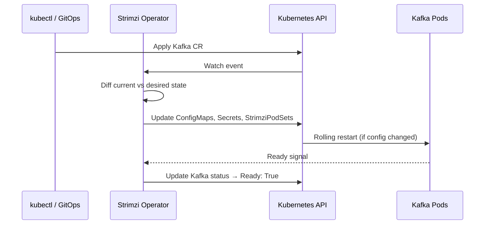
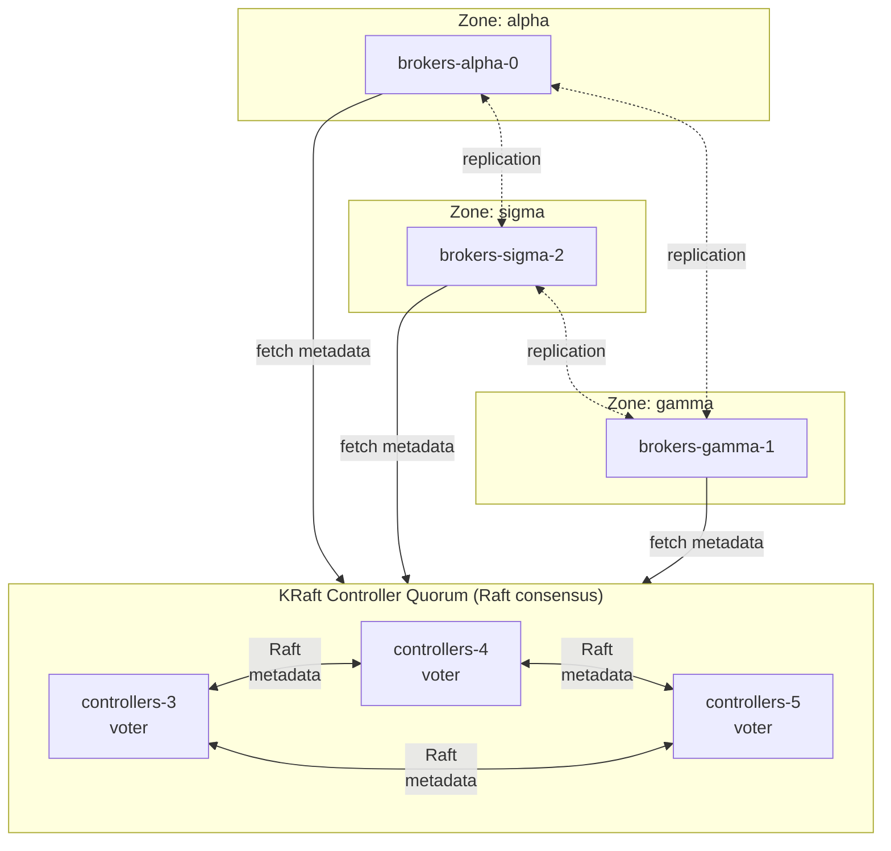
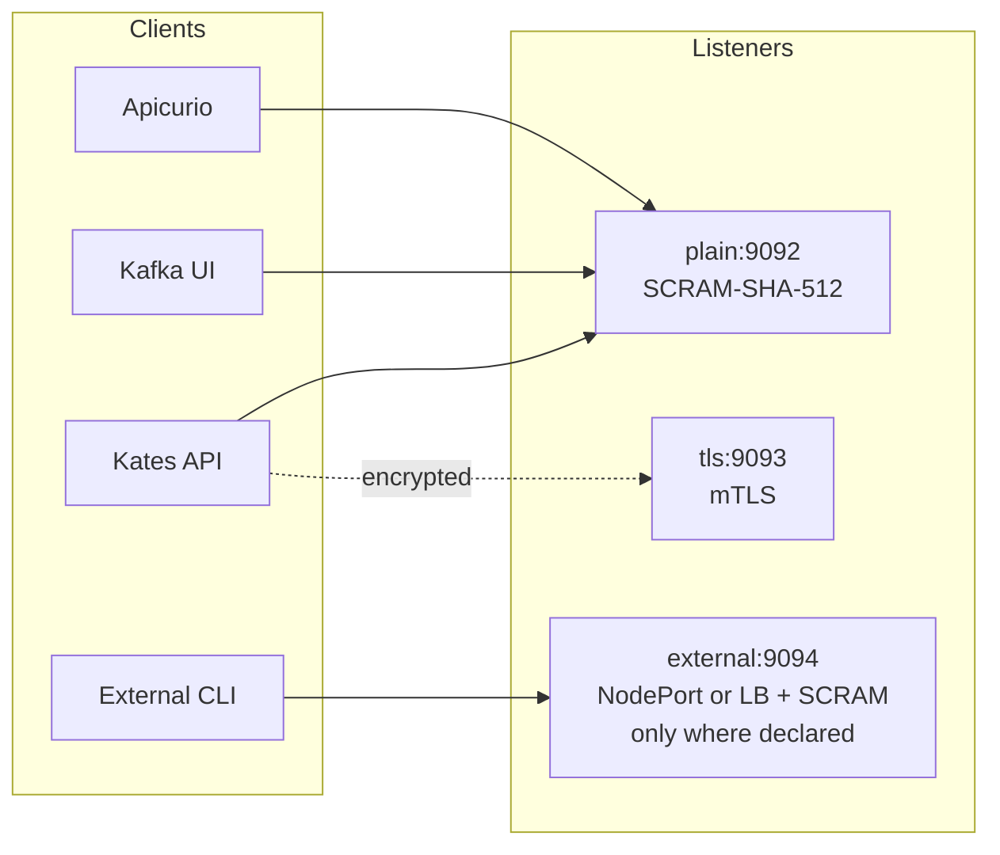
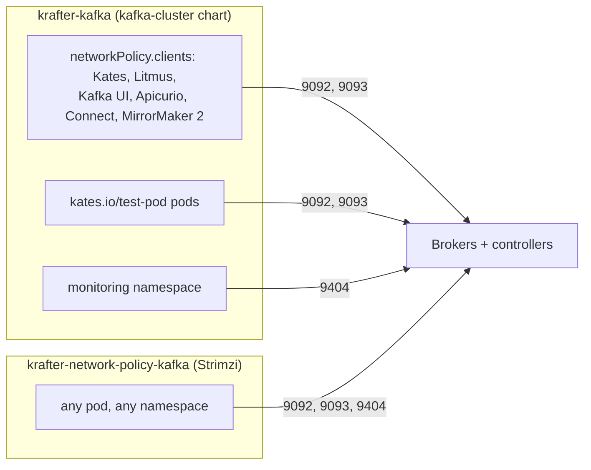

# Kafka Deployment Engineering

Three controllers, three brokers, one broker per zone, `min.insync.replicas: 2`, a fixed broker heap: every number in [`krafter`](appendix-a-glossary.md#gl-krafter)'s definition is a decision, and sooner or later a review asks you to defend each one. This chapter gives the reasons, and the failure you see when a number is wrong.

::: {.callout-note title="Scope"}
This chapter owns the why behind `krafter`: node pools, listener design, certificates, Cruise Control, alerting and backup. For the step-by-step install, see [Installing Kafka with the kafka-cluster Helm Chart](20-installation-guide.md); for deploying the Kates stack, see [Deployment Guide](12-deployment.md).
:::

After this chapter, you can:

- Explain why the cluster separates [KRaft](appendix-a-glossary.md#gl-kraft) controllers from brokers, and why three of each is the fault-tolerance floor
- Read a [`KafkaNodePool`](appendix-a-glossary.md#gl-kafkanodepool) spec and justify its storage, JVM, and [zone](appendix-a-glossary.md#gl-zone)-affinity choices
- Trace how [listeners](appendix-a-glossary.md#gl-listener), [`KafkaUser`](appendix-a-glossary.md#gl-kafkauser) credentials, and [NetworkPolicies](appendix-a-glossary.md#gl-networkpolicy) compose the cluster's security posture, and which ports the shipped policies leave open
- Diagnose the common Strimzi failure modes, from empty-egress NetworkPolicies to missing user Secrets

## Strimzi Operator

Kafka on Kubernetes is managed by the [Strimzi](appendix-a-glossary.md#gl-strimzi) Cluster Operator, installed into its own `strimzi-operator` namespace from the repository's wrapper chart, `charts/strimzi-operator`. The [Version & Compatibility Matrix](appendix-d-versions.md) gives the operator and chart versions. Both install scripts, `scripts/deploy-kafka.sh` and the `scripts/deploy-kafka-generic.sh` that `make kafka` runs, install the operator this way on every deploy:

```bash
helm dependency build charts/strimzi-operator
helm upgrade --install strimzi-operator charts/strimzi-operator \
  --namespace strimzi-operator \
  --reset-values \
  --timeout 10m --wait
```

The wrapper declares the upstream `strimzi-kafka-operator` chart as a subchart, which is why `helm dependency build` comes first. It adds what makes the operator a managed part of the platform. A CRD-upgrade hook owns the Strimzi CRDs across upgrades, and pinned defaults cover `watchAnyNamespace`, replicas, resources and reconciliation timeouts. A strict values schema nests every operator setting under `strimzi-kafka-operator:`. It also ships the optional Drain Cleaner and the operator's PodMonitor, alerts and dashboards. The install is unconditional on purpose: the hook keeps the CRDs current, and skipping the upgrade would freeze them at the version that first installed them. The full lifecycle — adoption, upgrade, rollback, namespace scope — is [Deploying the Strimzi Operator](deploying-strimzi-operator.md).

Strimzi watches for `Kafka`, `KafkaNodePool`, [`KafkaTopic`](appendix-a-glossary.md#gl-kafkatopic) and `KafkaUser` custom resources. It reconciles the desired state into [StrimziPodSets](appendix-a-glossary.md#gl-strimzipodset), which manage each Kafka node's pod on its own so the operator can roll one broker at a time, and into ConfigMaps, Secrets and Services.

### Reconciliation Loop

When you apply or update a `Kafka` custom resource, the Strimzi Cluster Operator diffs the desired spec against the live cluster state and orchestrates rolling updates until every pod reports ready:



What a change costs depends on the key:

| Change | What Strimzi does |
|--------------------------|--------------------------------------------------|
| A dynamic broker setting, such as `num.io.threads` or `log.retention.bytes` | Applies it to the running brokers, with no restart |
| A static setting, a listener, JVM options, the image or the Kafka version | Rolls the pods, one at a time |
| Storage | Grows a PVC where the StorageClass allows expansion, and never shrinks one |

The operator also re-checks the cluster every 120 seconds by default, whether or not a resource changed.

## Cluster Architecture

`krafter` keeps its metadata in a KRaft [quorum](appendix-a-glossary.md#gl-quorum) of three controllers, which needs a majority of two to commit a change, so it survives exactly one controller loss ([The KRaft Quorum](03-cluster.md#the-kraft-quorum)). Controllers and brokers run in separate pods, the node layout recommended for KRaft. What follows is the trade-off each number makes, and the alert that fires when it breaks.



### Why Dedicated Roles?

The two layouts differ on four counts:

| Aspect | Combined (controller and broker) | Dedicated (separate pools) |
|--------|-----------------------|-----------------------|
| Metadata isolation | Heavy broker I/O can delay an election | Controllers keep predictable latency |
| Scaling | Controllers and brokers scale together | Brokers scale without touching the quorum |
| Blast radius | One pod loss costs a voter and a replica | A broker loss leaves the quorum whole |
| Resource tuning | One memory and CPU profile for both | Controllers 1 GiB, brokers 4 GiB |

### Why 3 Controllers?

KRaft uses Raft consensus, which commits a metadata change once a majority of the voters has it [@ongaro2014search; @kip595]. Three voters need two, so they survive one failure. Two voters need both, which tolerates no failure and is worse than one. Five survive two failures, at the cost of two more pods to run. When the quorum has no active controller, `KafkaActiveControllerCount` fires, and no metadata change commits until a majority is back.

### Why 3 Brokers?

Three brokers, one per zone, is what four other settings need:

| Reason | Configuration |
|--------|--------------|
| Matches `default.replication.factor: 3` | Each partition has a replica on every broker |
| Satisfies [`min.insync.replicas`](appendix-a-glossary.md#gl-min-insync-replicas)`: 2` | Survives 1 broker failure while accepting writes |
| Enables rack awareness | Each broker pinned to a different zone (alpha, sigma, gamma) |
| Balanced partition leadership | Each broker leads a third of the partitions |

## KafkaNodePool Configuration

Each role is a `KafkaNodePool`, and the `kafka-cluster` chart renders one per entry in `nodePools.pools`. Its defaults are two pools, `controllers` and `brokers`, of three nodes each and with no zone.

### Controller Pool

The chart's `nodePools.roleDefaults.controller` gives each controller a small volume and heap:

```yaml
nodePools:
  roleDefaults:
    controller:
      replicas: 3
      storage:
        volumes:
          - id: 0
            size: 10Gi
      jvmOptions:
        -Xms: 512m
        -Xmx: 512m
        gcLoggingEnabled: true
      resources:
        requests: { memory: 1Gi, cpu: 500m }
        limits:   { memory: 1Gi, cpu: 1000m }
```

Controllers hold only the metadata log, so they need little disk or CPU.

### One Broker Pool per Zone

`roleDefaults.broker` sets the heap and resources every broker pool starts from, and `nodePools.defaults.storage` gives every pool a 100 GiB volume:

```yaml
nodePools:
  roleDefaults:
    broker:
      replicas: 3
      jvmOptions:
        -Xms: 2048m
        -Xmx: 2048m
        gcLoggingEnabled: true
      resources:
        requests: { memory: 4Gi, cpu: 1000m }
        limits:   { memory: 4Gi, cpu: 2000m }
```

A pool pins to one zone with its `zone` key, as in this list of pools:

```yaml
nodePools:
  pools:
    - name: controllers
      roles: [controller]
    - name: brokers-alpha
      roles: [broker]
      zone: alpha
      replicas: 1
```

`zone` renders a required nodeAffinity on `topology.kubernetes.io/zone` and a `zone` pod label. Four of the settings above are decisions rather than defaults:

| Setting | Value | Rationale |
|---------|-------|-----------|
| `jvmOptions -Xms/-Xmx` | 2048m | Fixed heap prevents dynamic resizing under load |
| `gcLoggingEnabled` | true | GC logs for diagnosing latency spikes |
| Memory requests = limits | 4Gi | Guaranteed QoS: the pod is the last evicted under memory pressure |
| `deleteClaim: false` | `false` | PVCs survive pod deletion, so the data is there for recovery |
| StorageClass per zone | `local-storage-*` on [`panda`](appendix-a-glossary.md#gl-panda) | Data locality: reads don't cross network boundaries |

### Where the Numbers Come From

Three sources set a pool's numbers, and the later one wins:

| Source | Sets | Applies when |
|--------|------------------------|----------------|
| The chart's `roleDefaults` and `defaults` | Three controllers and three brokers, 10 and 100 GiB volumes, 512m and 2048m heaps | Nothing else sets them |
| `kates detect --generate-values` | One broker pool per zone, sized from the nodes' allocatable CPU and memory | `kates deploy` and `scripts/deploy-kafka-generic.sh` run it first |
| The environment overlay and your `-f` files | Anything above, and listeners, policies and Cruise Control on or off | Always, last in the chain |

### Limits

The numbers on `panda` fit three Kind nodes on one machine, and they are not production numbers. The chart can't size a pool for your traffic. With `productionMode: true` the chart refuses to render some unsafe choices, such as `deleteClaim: true` ([Production](20-installation-guide.md#production)).

## Broker Settings and Why

The Kafka CR's `spec.kafka.config` section controls broker behavior, and the chart's values fill it.

### Replication & Durability

Five keys set how many copies of each record the cluster keeps:

```yaml
offsets.topic.replication.factor: 3
transaction.state.log.replication.factor: 3
transaction.state.log.min.isr: 2
default.replication.factor: 3
min.insync.replicas: 2
```

With RF=3 and `min.insync.replicas=2`, every `acks=all` write requires at least one follower acknowledgment [@wang2015building]. This is the primary contributor to producer latency but guarantees zero data loss under single-broker failure.

### Retention, Threads and Quotas

The other keys the chart sets, with the reason for each value:

| Setting | Value | Why |
|---------|-------|-----------|
| `log.retention.hours` | 24 | A test's records expire a day later, so repeated runs don't fill the volume |
| `log.retention.bytes` | 10 GiB | Caps each partition; whichever limit comes first deletes |
| `log.segment.bytes` | 1 GiB | Kafka's default; retention deletes whole segments |
| `log.cleanup.policy` | delete | No compaction unless a topic asks for it |
| `num.io.threads` | 8 | Kafka's default; the threads that run requests, four per CPU of a broker's limit |
| `num.network.threads` | 5 | The threads that read requests from the sockets; Kafka's default is 3 |
| `num.replica.fetchers` | 3 | Fetcher threads per source broker; Kafka's default is 1 |
| `quota.producer.default` | 50 MiB/s | Keeps one runaway producer from starving the others |
| `quota.consumer.default` | 100 MiB/s | The same for consumers; `KafkaUser` quotas override both per user |
| `group.share.enable` | true | Turns on share groups; rendered only when `kafkaVersion` is 4.2.0 or newer |

[Share groups](appendix-a-glossary.md#gl-share-group) give queue-style (competing consumer) semantics alongside traditional consumer groups [@kip932; @hohpe2003enterprise], which suits job distribution workloads. The chart renders every `group.share.*` and `share.*` key only for Kafka 4.2.0 or newer.

### KRaft Quorum Tuning

The chart's defaults set three of the quorum's timeouts:

```yaml
controller.quorum.election.timeout.ms: 5000
controller.quorum.fetch.timeout.ms: 10000
controller.quorum.election.backoff.max.ms: 5000
```

These control how quickly the Raft quorum detects a failed controller and elects a new leader. The 5s election timeout balances fast failover against false-positive elections during GC pauses.

## Listeners & Authentication

Clients reach the brokers through up to three listeners, and the diagram shows which client uses which:



`plain` authenticates with [SCRAM-SHA-512](appendix-a-glossary.md#gl-scram-sha-512) without TLS and `tls` with [mTLS](appendix-a-glossary.md#gl-mtls), so "plain" means no TLS, not no authentication ([Listeners](03-cluster.md#listeners)). The base values declare only `plain` and `tls`. `kafka.externalAccess.type` defaults to `none`, and of the chart's overlays only `values-prod.yaml` turns the preset on, as a NodePort. `kates deploy` and `scripts/deploy-kafka-generic.sh` declare `external` on every cluster but kind, in the generated `.build/values-detected.yaml`. It is a NodePort, or a LoadBalancer on EKS, GKE and AKS, whose broker load balancers usually get public addresses ([What the Shipped Policies Block](17-security.md#what-the-shipped-policies-block) explains). `kafka.externalAccess.allowedCidrs` does not limit who can reach 9094; [Closing the Listeners](17-security.md#closing-the-listeners) shows what does.

::: {.callout-tip title="Try it: which listeners does your cluster have?"}
Run `kubectl get kafka krafter -n kafka -o jsonpath='{.spec.kafka.listeners[*].name}'`, then `kubectl get svc -n kafka -l strimzi.io/cluster=krafter`. Does the list match what the values chain above declares for your cluster, and is there an `external` Service?
:::

### Authorization

The brokers use simple ACL authorization, with `kates-backend` as the one [super user](appendix-a-glossary.md#gl-super-user):

```yaml
authorization:
  type: simple
  superUsers:
    - kates-backend
```

## KafkaUser Management

Each client of `krafter` is a `KafkaUser`. The User Operator turns each one into a Secret of the same name, a SCRAM credential in Kafka and the [ACLs](appendix-a-glossary.md#gl-acl) the resource lists, and other services mount the Secret by name, as Kafka UI mounts `secret/kafka-ui`. [Default Users](20-installation-guide.md#default-users) lists the users the [platform profile](appendix-a-glossary.md#gl-platform-profile) creates, with their quotas and ACLs. Only `kates-backend` is a super user, because a test can name any topic and no fixed ACL list could cover them in advance.

## Topic Provisioning

Topics are `KafkaTopic` resources, managed by the Topic Operator, and [Default Topics](20-installation-guide.md#default-topics) lists the ones the platform profile creates. Two of their settings are decisions.

Their partition counts are the platform profile's settings, not a measure of traffic. Of the `kates-*` topics, the Kates API writes only `kates-probe-topic`, ten records each time a resilience run's `producer-throughput` probe runs, and a test produces to whatever topic its spec names ([The Cluster Under Test](03-cluster.md)).

Every topic is `cleanup.policy: delete` — none is compacted, and two of them would break if they were. Debezium writes its schema history without record keys, which a compacted topic refuses, and replays the whole history on restart. So `cdc-schema-history` keeps `retention.ms: -1` and `retention.bytes: -1`, the second overriding the brokers' 10 GiB `log.retention.bytes`. `kates-dlq` is a delete topic because compaction keeps only the latest failure per key and refuses records without one. It has no time limit, so an upgrade from a compacted `kates-dlq` deletes nothing by age; only the brokers' `log.retention.bytes` bounds it until you set a `retention.ms` to age failures out.

The one topic the Kates API writes itself, `kates-test-events`, has no `KafkaTopic`. The brokers run with `auto.create.topics.enable: false`, so the Kates API creates it through the Kafka Admin API, and `kubectl get kafkatopics` doesn't list it; `kates cluster topics describe kates-test-events` shows it.

## Certificate Management

Strimzi generates and renews two CAs: the [Cluster CA](appendix-a-glossary.md#gl-cluster-ca), which protects inter-broker and controller TLS, and the [Clients CA](appendix-a-glossary.md#gl-clients-ca), which signs client certificates for mTLS. The chart gives both five years' validity, renewal 180 days before expiry and the `replace-key` policy. That policy generates a new key pair at renewal, where `renew-certificate` would reuse the old one. [Certificate Management](17-security.md#certificate-management) in Security & Compliance explains rotation.

## Network Policies

With `networkPolicy.enabled` on, the chart renders a deny-all policy for the cluster's pods and one allow policy per component. It is on by default, and `values-staging.yaml` and `values-prod.yaml` keep it; `values-kind.yaml` and `values-dev.yaml` turn it off. So does the `.build/values-detected.yaml` that `kates deploy` writes for a cluster whose CNI it cannot identify, EKS, GKE and AKS excepted. The Strimzi Cluster Operator adds a policy of its own for the brokers, and the two sets add up:



Every policy the chart renders is named `<cluster>-…`, so two clusters can share a namespace without fighting over one object. Strimzi renders `krafter-entity-operator` and `krafter-kafka-exporter` itself; the chart's `-egress` policies add what default-deny would otherwise take away:

| Policy | What It Allows |
|--------|---------------|
| `krafter-default-deny` | Nothing, for every pod labeled `app.kubernetes.io/part-of: strimzi-krafter`: those pods get only what another policy allows |
| `krafter-allow-dns` | UDP/TCP port 53 for those same pods |
| `krafter-kafka` | Brokers and controllers: traffic between the cluster's pods, the Cluster Operator, Prometheus on 9404, and each `networkPolicy.clients` entry |
| `krafter-cruise-control` | Operator and Prometheus access to Cruise Control |
| `krafter-entity-operator-egress` | Entity Operator metrics ingress, and egress to the brokers and the Kubernetes API |
| `krafter-kafka-exporter-egress` | Exporter metrics ingress and egress to the brokers |
| `krafter-test-egress` | The Helm test pods' egress to the Kafka ports, DNS and the API server |

The `krafter-kafka` policy opens 9090–9093 between the cluster's own pods, and 9090, 9091, 8443, 9092 and 9093 to the Cluster Operator. Each `networkPolicy.clients` entry gets the listener ports it names, derived from `kafka.listeners`. Each chart renders the policies for its own pods: the operator's and the Drain Cleaner's are in `charts/strimzi-operator`, and kafka-ui, connect-cluster and mirror-maker2 render their own.

::: {.callout-important title="The client listeners are open as shipped"}
As the charts ship, every pod in the cluster can reach the Kafka client listeners: NetworkPolicies add up, and Strimzi's generated policy admits every pod to a listener without [`networkPolicyPeers`](appendix-a-glossary.md#gl-networkpolicypeers) ([How the Policies Combine](17-security.md#how-the-policies-combine)). `networkPolicy.clients` becomes the real allow list only once the listeners carry them. What the chart's policies add is a limit on the brokers' egress and a deny-all for the cluster's other pods.
:::

### The Operator's Own NetworkPolicy

In the [isolated topology](appendix-a-glossary.md#gl-isolated-topology), `kates deploy`'s default, the operator runs in its own `strimzi-operator` namespace, so its policy must reach into every namespace it watches. The wrapper chart renders it: `operatorPolicy.enabled`, on by default, produces one policy named after the release (`strimzi-operator`) in the operator's namespace. The policy's rules, with the reason each exists:

| Direction | Target | Ports | Purpose |
|-----------|--------|-------|---------|
| Ingress | All sources | `8080` TCP | Kubelet health probes + Prometheus metrics scraping |
| Egress | CoreDNS | `53` UDP/TCP | DNS resolution for service discovery |
| Egress | API Server | `443`, `6443` TCP | Kubernetes API communication (watch, patch, create) |
| Egress | Pods labeled `strimzi.io/kind` in every watched namespace | `9090`–`9093`, `8443` TCP | Control plane, replication, clients, and the Kafka agent the operator asks for broker state during a roll |
| Egress | The same pods | `8083` TCP | Connect and MirrorMaker 2 worker REST, through which connectors are created and polled |
| Egress | Own namespace's operator pods | All | Leader-election peers |

The watch scope decides which namespaces that egress reaches: every namespace under `watchAnyNamespace`, otherwise `watchNamespaces` plus the release namespace. The policy records the answer in its `kates.io/watch-scope` annotation, which is the quickest way to confirm what the running operator is allowed to reach.

Ingress on 8080 is open to every source on purpose. Kubelet health probes come from the node's host network, not from a pod with namespace labels. A namespace selector would block the liveness and readiness checks, and the kubelet would restart the operator.

### Two Upstream Keys That Look Alike

Two keys under `strimzi-kafka-operator:` sound alike and do different things:

| Key | Upstream default | Controls | Misuse and symptom |
|-----|:---:|----------------|----------------|
| `operatorNetworkPolicy.enabled` | `false` | `strimzi-cluster-operator-network-policy`, a policy for the operator pod built from the `ingress` and `egress` lists beside it | Enabled as shipped, its `egress: [{}]` allows every destination and undoes the scoped policy |
| `generateNetworkPolicy` | `true` | Whether the operator generates policies for its operands, such as `krafter-network-policy-kafka` | Never creates a policy for the operator pod, so turning it off doesn't fix a deny-all operator policy |

`charts/strimzi-operator/values-prod.yaml` enables the first, so an operator installed with that overlay has unrestricted egress. Add `--set strimzi-kafka-operator.operatorNetworkPolicy.enabled=false` after the overlay to leave the scoped policy in charge. The wrapper's schema rejects both keys at the top level rather than ignoring them.

::: {.callout-caution title="An empty egress list isolates the operator"}
Replace upstream's `egress: [{}]` with an empty list while `operatorPolicy` is off, and nothing grants the operator any egress. It can't reach the controllers' admin API on 9090, and the `Kafka` resource stays `NotReady`.
:::

## Operational Components

Four components run beside the brokers and controllers, and none of them carries client traffic. [Cruise Control](appendix-a-glossary.md#gl-cruise-control) rebalances partitions, [Kafka Exporter](appendix-a-glossary.md#gl-kafka-exporter) publishes [consumer lag](appendix-a-glossary.md#gl-consumer-lag), the Strimzi [Drain Cleaner](appendix-a-glossary.md#gl-drain-cleaner) handles node drains, and the [Entity Operator](appendix-a-glossary.md#gl-entity-operator) turns `KafkaTopic` and `KafkaUser` resources into topics and credentials.

### Cruise Control

Cruise Control moves partition replicas when a [`KafkaRebalance`](appendix-a-glossary.md#gl-kafkarebalance) asks it to. The chart enables it by default, but the Kind overlay and the values `kates deploy` generates turn it off ([Cruise Control & Rebalance](20-installation-guide.md#cruise-control--rebalance)). Where it runs, it needs each broker's capacity:

```yaml
cruiseControl:
  brokerCapacity:
    cpu: "2000m"
    inboundNetwork: 50MiB/s
    outboundNetwork: 50MiB/s
```

The `brokerCapacity` config tells Cruise Control the physical limits of each broker, enabling accurate rebalance proposals. Without it, Cruise Control can't distinguish between "broker is 80% utilized" and "broker has headroom." Disk capacity it reads from the brokers' volumes, so only CPU and network need declaring.

### Kafka Exporter

The Kafka Exporter exposes consumer lag metrics that the JMX exporter doesn't cover:

| Metric | What It Tracks |
|--------|---------------|
| `kafka_consumergroup_lag` | Per-partition consumer lag |
| `kafka_consumergroup_current_offset` | Current committed offset |
| `kafka_topic_partitions` | Partition count per topic |
| `kafka_topic_partition_current_offset` | Latest offset per partition |

These metrics feed the `KafkaConsumerGroupLag` and `KafkaConsumerGroupLagCritical` alerts.

### Strimzi Drain Cleaner

When a node is drained, the Drain Cleaner's admission webhook sees the eviction request for a Kafka pod, denies it, and annotates the pod `strimzi.io/manual-rolling-update=true`. The Cluster Operator then restarts that pod in its own rolling update, one broker at a time and only while every partition keeps `min.insync.replicas`. The pod comes back where its volume allows: on `panda` a local-path volume binds a broker to its node, so it waits until that node is uncordoned.

Without the Drain Cleaner, `kubectl drain` can evict broker pods simultaneously, violating ISR constraints and potentially causing data loss.

### Entity Operator

The Entity Operator runs two sub-operators in a single pod:

| Sub-Operator | Manages | Reconciliation |
|-------------|---------|---------------|
| Topic Operator | `KafkaTopic` CRs → Kafka topics | Every 60s |
| User Operator | `KafkaUser` CRs → SCRAM credentials + ACLs | On change |

## Prometheus Alerts

The `kafka-cluster` chart renders one PrometheusRule per cluster, grouped as availability, replication, kraft, performance, storage, consumers, cruise-control and slo. [PrometheusRule Alerts](20-installation-guide.md#prometheusrule-alerts) lists every alert with its threshold. The operator chart raises `StrimziOperatorDown`, `StrimziReconciliationsFailing` and the certificate-expiry alerts, because only it scrapes the operator. Each decision in this chapter has alerts that say it is failing:

| Decision | Alerts that fire when it fails |
|----------------------|-----------------------------------|
| Three controllers, a majority of two | `KafkaActiveControllerCount`, `KafkaRaftLeaderElections`, `KafkaRaftUnknownVoters` |
| Replication factor 3 with `min.insync.replicas: 2` | `KafkaUnderMinIsrPartitions`, `KafkaUnderReplicatedPartitions`, `KafkaISRShrinkRate` |
| Leaders only from the ISR | `KafkaUncleanLeaderElection` |
| Request threads sized for a 2-CPU broker | `KafkaRequestHandlerSaturated`, `KafkaRequestQueueSaturated`, `KafkaRequestLatencyHigh` |
| Persistent volumes per broker | `KafkaOfflineLogDirectory`, `KafkaLogFlushLatencyHigh`, `KafkaBrokerDiskUsageHigh`, `KafkaBrokerDiskUsageCritical` |
| Declared broker capacities for Cruise Control | `CruiseControlNoLoadModel`, `CruiseControlAnomalyDetected` |

## Backup & Recovery

Backup is opt-in. `backup.enabled: true` renders a [Velero](appendix-a-glossary.md#gl-velero) Schedule at 02:00 UTC with a 7-day TTL, and a one-shot Backup before each upgrade. Both cover the cluster's PVCs, PVs, ConfigMaps and Secrets, and its Strimzi resources: the `Kafka`, its node pools, topics, users and rebalances. The Strimzi resources are in the backup because a PVC without its `KafkaNodePool` restores nothing the operator can adopt. `backup.volumes` picks how volume data is kept: `fs-backup`, `snapshot` or `none`. [Velero Backup](20-installation-guide.md#velero-backup) covers the values and the restore.

## The Install Order

`make kafka` and `kates deploy` both install `krafter` as two Helm releases: the operator wrapper, `charts/strimzi-operator`, then the cluster, `charts/kafka-cluster`. The cluster's values chain starts with the generated `.build/values-detected.yaml`, then the platform profile, then the environment overlay; [Installation](20-installation-guide.md#installation) gives the steps. Three orderings the install depends on:

| Order | Why |
|-------|------------------------------|
| Operator before cluster | The cluster's resources need the operator's CRDs, which the wrapper's `crdUpgrade` hook owns |
| Dependency build before either upgrade | Neither chart renders with its `charts/` directory empty |
| Profile before overlay | The overlay must be able to change any of the profile's topics, users and client grants |

User Secrets appear only after the cluster is Ready, because the User Operator needs a running cluster, so `deploy-kafka-ui.sh` waits for the `kafka-ui` Secret before it deploys.

::: {.callout-tip title="Try it: are the brokers really in three zones?"}
With the install finished, confirm the quorum is healthy and the brokers spread across zones:

```bash
kubectl get kafka krafter -n kafka
kubectl get kafkanodepools -n kafka
kubectl get pods -n kafka -l strimzi.io/controller-role=true -o wide
kubectl get pods -n kafka -l strimzi.io/cluster=krafter -o wide -L zone
```

The Kafka CR should be Ready, every node pool at its replica count, and each broker pod should carry a different `zone` label. If anything is off, the symptoms below are the place to start.
:::

## Troubleshooting

Each entry names the symptom, then its cause and the fix.

### Strimzi Operator CrashLoopBackOff

**Symptom:** Operator pod crashes with `UnsupportedVersionException`

**Cause:** The operator's image map names a Kafka version its binary doesn't support, because the release was built from a chart other than the one published beside that binary.

**Fix:** Reconcile the wrapper chart from the published OCI chart, whose vendored subchart is published beside the operator binary and so matches it. `--reset-values` rebuilds the release from the chart's defaults and drops every value it was installed with, so the command passes back what the operator runs with. `helm get values` prints what the release carries now:

```bash
helm get values strimzi-operator -n strimzi-operator

helm pull oci://ghcr.io/bmscomp/charts/strimzi-operator --untar
helm upgrade --install strimzi-operator ./strimzi-operator \
  --namespace strimzi-operator --reset-values \
  -f strimzi-operator/values-<overlay>.yaml \
  --set strimzi-kafka-operator.kubernetesServiceDnsDomain=<domain> \
  --wait
```

- `<overlay>` is the overlay the operator was installed with: `prod` for a production operator, and for a `kates deploy` install `kind` on a kind cluster and `generic` elsewhere. `values-generic.yaml` sets no keys, so it also stands for `scripts/deploy-kafka.sh` and `scripts/deploy-kafka-generic.sh`, which pass no overlay.
- `<domain>` is the cluster's DNS domain: the `kubernetesServiceDnsDomain` that `helm get values` shows, or `cluster.local` when it shows none.
- An operator installed with `kates deploy --operator-scope namespace` also needs `--set strimzi-kafka-operator.watchAnyNamespace=false --set 'strimzi-kafka-operator.watchNamespaces={<namespace>,<namespace>}'`. Without them it comes back watching every namespace.
- Every other key that `helm get values` shows goes back as a `--set` after the overlay, unless the overlay or the flags above already set it, and except `strimziVersion`, which the next paragraph covers. Examples are `strimzi-kafka-operator.operatorNetworkPolicy.enabled=false`, and `strimzi-kafka-operator.defaultImageRegistry` and `crdUpgrade.url` on a restricted-egress cluster. Without its `crdUpgrade.url`, the upgrade hook fetches the public CRD bundle; where it cannot reach it, the upgrade aborts and leaves the release in `pending-upgrade`.

If `helm get values` shows a `strimziVersion`, `kates deploy` installed the operator from the chart of a version other than the repository's pin, and this command moves it to the pin. That is an operator version change, which rolls every Kafka cluster the operator manages: make it with the procedure in [Upgrading the Operator](deploying-strimzi-operator.md#upgrading-the-operator) instead.

`scripts/check-versions.sh` is the guard against this drifting again. It asserts that the chart `appVersion`, the dependency version, `strimziVersion` and `versions.env` all name the same Strimzi release, and that the default `kafkaVersion` is the newest in that operator's image map.

### Brokers Crash with ConfigException

**Symptom:** `Invalid value -1 for configuration local.retention.bytes`

**Cause:** Your values set `local.retention.bytes` (`log.local.retention.bytes` on the broker) to `-1`, unlimited, while `retention.bytes` is set, and Kafka refuses a local retention larger than the total. The chart itself sets only `log.local.retention.ms` for tiered storage.

**Fix:** With `tieredStorage.enabled`, remove the key or set `local.retention.bytes` to a byte count no larger than `retention.bytes`.

### Brokers Crash with RemoteLogManager

**Symptom:** Broker exits immediately after startup with `remote.log.storage.system.enable=true`

**Cause:** Tiered storage requires a remote storage manager plugin JAR that isn't bundled in the default Strimzi image

**Fix:** Either disable tiered storage or build a custom image with the S3 plugin

### Kafka UI CreateContainerConfigError

**Symptom:** `secret "kafka-ui" not found`

**Cause:** The Entity Operator's User Operator creates the `kafka-ui` Secret when it reconciles the `KafkaUser` CR, and the Entity Operator deploys only once the `Kafka` resource is Ready. If the Kafka CR hasn't reached `Ready`, for example because a NetworkPolicy blocks the operator, no user Secrets are created ([Troubleshooting Index](appendix-b-troubleshooting.md)).

**Fix:**

1. Ensure the Kafka CR reaches `Ready` before deploying Kafka UI
2. The `deploy-kafka-ui.sh` script includes a wait loop for the `kafka-ui` Secret (up to 180s) to handle this race condition
3. If the secret never appears, check Kafka CR status and operator logs:

```bash
kubectl get kafka krafter -n kafka -o jsonpath='{.status.conditions}'
kubectl get pods -n kafka -l strimzi.io/name=krafter-entity-operator
```

### Strimzi Operator Cannot Determine Active Controller

**Symptom:** Kafka CR stuck on `NotReady` with `UnforceableProblem: An error while trying to determine the active controller`

**Cause:** The Strimzi operator's `describeMetadataQuorum` admin API call to port 9090 times out. Most commonly caused by:

- An operator NetworkPolicy with empty egress — `strimzi-kafka-operator.operatorNetworkPolicy.enabled: true` with upstream's unrestricted `egress: [{}]` replaced by an empty list
- A watch scope that does not cover the Kafka namespace, which leaves the wrapper's own `strimzi-operator` policy with no egress rule for those pods (its `kates.io/watch-scope` annotation is the fastest way to see what it admits)
- Resource pressure on the active controller pod causing admin API timeouts

**Diagnosis:**

```bash
# The two policies that can select the operator pod
kubectl describe networkpolicy strimzi-operator -n strimzi-operator
kubectl get networkpolicy strimzi-cluster-operator-network-policy \
  -n strimzi-operator -o yaml
# Look for: "Allowing egress traffic: <none>"

# What the wrapper's policy believes the watch scope is
kubectl get networkpolicy strimzi-operator -n strimzi-operator \
  -o jsonpath='{.metadata.annotations.kates\.io/watch-scope}'

# Check operator logs
kubectl logs deployment/strimzi-cluster-operator -n strimzi-operator --tail=20
# Look for: "Error getting controller config: TimeoutException"
```

**Fix:** correct the values and reconcile the release — the policy is chart-managed, so deleting the object by hand only lasts until the next upgrade. Pass back the values the operator runs with, as in [Strimzi Operator CrashLoopBackOff](#strimzi-operator-crashloopbackoff), and its caveat holds here too. An operator whose values carry `strimziVersion` goes through the operator upgrade procedure instead, because reconciling it from the repository's chart moves it to the pin and rolls every Kafka cluster.

Where upstream's policy is the cause, turn it off after those values. `values-prod.yaml` is the only overlay that turns it on, so for a production operator:

```bash
helm get values strimzi-operator -n strimzi-operator

helm pull oci://ghcr.io/bmscomp/charts/strimzi-operator --untar
helm upgrade strimzi-operator ./strimzi-operator \
  -n strimzi-operator --reset-values \
  -f strimzi-operator/values-prod.yaml \
  --set strimzi-kafka-operator.kubernetesServiceDnsDomain=<domain> \
  --set strimzi-kafka-operator.operatorNetworkPolicy.enabled=false

# Restart the operator to clear stale backoff state
kubectl rollout restart deployment/strimzi-cluster-operator -n strimzi-operator
```

Add the scope flags for an operator that watches only some namespaces.

Where the watch scope is the cause, run the command from [Strimzi Operator CrashLoopBackOff](#strimzi-operator-crashloopbackoff) with the operator's own overlay and the scope flags, and list the Kafka namespace in `watchNamespaces`. `operatorNetworkPolicy.enabled=false` matters only with `values-prod.yaml`. The production command above is not for an operator that `kates deploy` installed: it would move that operator onto `values-prod.yaml`, with its drain cleaner, PodDisruptionBudget and `productionMode`.

::: {.callout-note title="Why --reset-values, not --reuse-values"}
`--reset-values` takes `strimziVersion`, and with it the CRD bundle the upgrade hook applies, from the chart you install rather than from the release. A release carried over from the old `oci://` install also stores flat upstream keys the wrapper's schema rejects. And it drops every value the release was installed with, which is why the command passes them back.
:::

### Cruise Control Goal Mismatch

**Symptom:** `ConfigException: unsupported goals in default.goals`

**Cause:** Cruise Control's `goals` list doesn't contain every goal in its `default.goals`, as happens when your values set `cruiseControl.config.goals` to a shorter list.

**Fix:** List every goal of `default.goals` in `cruiseControl.config.goals`, or remove the key and let Strimzi set both lists. The goals a rebalance optimizes for are a separate list, `rebalance.goals`; the chart's defaults are in `charts/kafka-cluster/values.yaml`.

For the symptom-by-symptom index across the whole book, see the [Troubleshooting Index](appendix-b-troubleshooting.md). Component versions for the whole platform are in the [Version & Compatibility Matrix](appendix-d-versions.md); Cruise Control ships in the Strimzi Kafka image, and the Strimzi API version is `v1`.

## Summary

- `krafter` separates controllers from brokers so metadata elections never wait on broker I/O, and three of each survive one loss.
- One broker pool per zone keeps acknowledged writes flowing when a zone goes.
- Fixed heaps, requests equal to limits and kept volumes trade memory for predictable latency and recoverable data.
- The chart's NetworkPolicies confine egress; the client listeners stay open to every pod until you name their peers.
- Cruise Control, the exporter and the Drain Cleaner each defend one decision, and the alerts tell you when it fails.

A Kafka cluster that can defend its design still needs a stack to test it: [Deployment Guide](12-deployment.md) chooses the namespace layout, sizes the Kates API and monitoring, and deploys them next to `krafter`.
