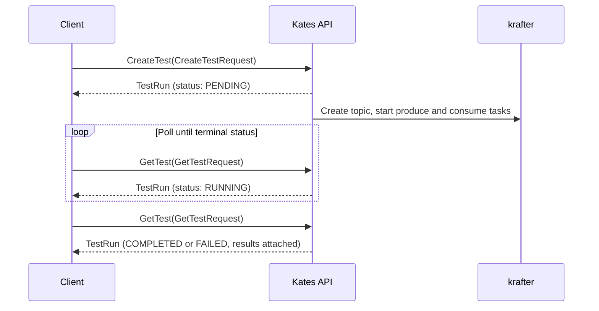

# gRPC API Reference

Kates serves a [gRPC](appendix-a-glossary.md#gl-grpc) API beside the REST API, for clients generated from a [protobuf](appendix-a-glossary.md#gl-protobuf) contract: CI jobs, other services, and Go, Java or Python code. The Kates API, the service in the cluster that runs your tests ([Architecture & Design](02-architecture.md)), serves both, so a [test run](appendix-a-glossary.md#gl-test-run) behaves the same whichever API starts it. The gRPC API covers fewer operations, and this reference notes each place where it differs from REST: fields it never populates, a filter and a request map it ignores, and a health check that needs the [API key](appendix-a-glossary.md#gl-api-key).

## How to Read an Entry {#introduction}

Each service has an H3 with a table of its RPCs, and each RPC an H4 entry. An entry gives the `grpcurl` call, using the `GRPC` array that [Schema From `kates.proto` or Reflection](#schema-from-katesproto-or-reflection) sets up, then the response, introduced by "Output:", then what to notice in it. It ends with the places the RPC differs from its REST counterpart. Responses are shortened and their numbers illustrative; field names and shapes are exact. Authentication, pagination, rate limits and error codes each have one section, which the entries link to.

## RPC Index

Each RPC links to its entry, and the REST column names the endpoint in the [REST API Reference](11-api-reference.md) that does the same work. Every RPC has a REST endpoint, not the reverse:

| RPC | Service | REST endpoint | What it does |
|:---------------------|:----------------|:-------------------------------|:------------------------|
| [CreateTest](#createtest) | `TestService` | `POST /api/tests` | Start a test run |
| [GetTest](#gettest) | `TestService` | `GET /api/tests/{id}` | Read one run and its results |
| [ListTests](#listtests) | `TestService` | `GET /api/tests` | Page through runs, by type |
| [CancelTest](#canceltest) | `TestService` | `POST /api/tests/{id}/cancel` | Stop a pending or running run |
| [DeleteTest](#deletetest) | `TestService` | `DELETE /api/tests/{id}` | Delete a run and its results |
| [GetClusterInfo](#getclusterinfo) | `ClusterService` | `GET /api/cluster/info` | Cluster ID and brokers |
| [GetClusterTopology](#getclustertopology) | `ClusterService` | `GET /api/cluster/topology` | Node pools and nodes |
| [ListTopics](#listtopics) | `ClusterService` | `GET /api/cluster/topics` | Page through topic names |
| [GetTopicDetail](#gettopicdetail) | `ClusterService` | `GET /api/cluster/topics/{name}` | One topic's partitions and configs |
| [ListConsumerGroups](#listconsumergroups) | `ClusterService` | `GET /api/cluster/groups` | Page through consumer groups |
| [Check](#check) | `HealthService` | `GET /api/health` | Kates API and Kafka status |

## Choosing gRPC or REST {#grpc-vs-rest}

Choose gRPC for a typed client generated from `kates.proto`. Choose the [REST API Reference](11-api-reference.md) for `curl`, browsers, webhooks and HTTP/1.1-only tools, and for every operation gRPC doesn't cover.

## Connection

Kates serves gRPC on the Kates API's HTTP port: `quarkus.grpc.server.use-separate-server=false` in `application.properties` routes gRPC (HTTP/2) traffic over the same port as REST, 8080. The separate-server port setting (`quarkus.grpc.server.port=9000`) is ignored in this mode. So the port-forward that carries the REST API carries gRPC too: with `make ports` running, both answer in plaintext on `localhost:30083`.

::: {.callout-warning title="The chart's port 9000 carries no gRPC"}
The Helm chart declares a `grpc` container and Service port 9000 (`charts/kates/values.yaml`), but nothing listens there. `kates ports` forwards it to `localhost:9090` all the same, and the chart's gRPC Ingress (`ingress.grpc.enabled`) routes to it, so calls through either never reach the server. Connect to the HTTP port instead: `localhost:30083` with `make ports`, `localhost:8080` with `kates ports`.
:::

### Authentication

The API key guards gRPC as it guards REST. A call must carry a key the Kates API knows, from `kates.api.key` or the keys file, and the key's principal must hold the scope the RPC needs. A missing or unknown key gets `UNAUTHENTICATED`, and a known key without the scope gets `PERMISSION_DENIED`, with the descriptions [Error Handling](#error-handling) lists. `HealthService/Check` is no exception, unlike the public REST `/api/health`. Each RPC needs the same scope as its REST counterpart, as [Scopes and Named Keys](11-api-reference.md#scopes-and-named-keys) describes:

| RPC | Scope |
|:--------------------------------------------|:----------|
| `CreateTest`, `CancelTest` | `test:run` |
| `DeleteTest` | `admin` |
| `GetTest`, `ListTests`, every `ClusterService` RPC, `HealthService/Check` | `read` |

Send the key as call metadata, as `authorization: Bearer <key>` or `x-api-key: <key>`. Read it from the chart's Secret:

```bash
export KATES_API_KEY="$(kubectl get secret kates-api-key -n kates \
  -o jsonpath='{.data.api-key}' | base64 -d)"
```

### Schema From `kates.proto` or Reflection {#schema-from-katesproto-or-reflection}

Server reflection is enabled only in the dev profile (`%dev.quarkus.grpc.server.enable-reflection-service=true`). The prod profile, which the Kates API runs when the chart installs it, keeps `quarkus.grpc.server.enable-reflection-service=false`, so `grpcurl` cannot ask a deployed Kates API for the schema. Give `grpcurl` the proto file from the repository instead. From the repository root, collect the flags every call in this chapter uses into one array:

```bash
GRPC=(-plaintext -import-path kates/src/main/proto \
  -proto kates.proto -H "x-api-key: $KATES_API_KEY")

grpcurl "${GRPC[@]}" localhost:30083 list
```

Output:

```text
kates.ClusterService
kates.HealthService
kates.TestService
```

With `-proto`, `list` and `describe` read the file rather than the server; the RPCs themselves go to `localhost:30083`. The `google/protobuf/empty.proto` import resolves from `grpcurl`'s built-in copy of the well-known types.

In the dev profile (`./mvnw quarkus:dev` in `kates/`), reflection is on and API security is off (`%dev.kates.api.security-enabled=false`). There `grpcurl -plaintext localhost:8080 list` finds the same three services, plus the reflection and health services Quarkus registers, with neither the proto file nor a key.

### Reading grpcurl Output

`grpcurl` prints responses as proto3 JSON, and three rules shape what you read:

1. A field at its zero value (`0`, `""`, `false`, an empty list) is left out, so a missing `id` or `page` means zero, not an error.
2. 64-bit integers, such as `numRecords` and `total`, come as strings.
3. Names are camelCase, `numRecords` for `num_records`. This reference uses the proto name in prose and the JSON name in output.

### Pagination

`ListTests`, `ListTopics` and `ListConsumerGroups` page the same way. The request takes `page` and `size`, and the response returns both as applied, beside `total`:

| Field | Rule |
|:----------|:----------------------------------------------|
| `page` (request) | Zero-based; a negative page reads as 0 |
| `size` (request) | 1 to 200; 0 or a negative size means 50, and a larger one reads as 200 |
| `total` (response) | Items across every page, an int64, so `grpcurl` prints it as a string |

A page past the end comes back with no items and the same `total`, so the last page is the one where `page` plus one, times `size`, reaches `total`.

### Rate Limits

The Kates API puts no rate limit on gRPC calls: there is no per-key or per-client quota, and no call is refused for coming too often. The one limit is on runs at once. `CreateTest` gets `RESOURCE_EXHAUSTED` while `kates.engine.max-concurrent-tests` runs are already running, and [Error Handling](#error-handling) says how to retry.

## Service Definitions

The protobuf contract is defined in [`kates.proto`](https://github.com/bmscomp/kates/blob/main/kates/src/main/proto/kates.proto).

### TestService

Use `TestService` to start performance test runs from your own code and follow them to the end; they are the same runs that `kates test list` and `GET /api/tests` show.

| RPC | Request | Response | Description |
|:--------------------|:--------------------|:--------------------|:------------------------|
| `CreateTest` | `CreateTestRequest` | `TestRun` | Start a new test execution |
| `GetTest` | `GetTestRequest` | `TestRun` | Retrieve a test by ID |
| `ListTests` | `ListTestsRequest` | `ListTestsResponse` | Paginated test listing |
| `CancelTest` | `CancelTestRequest` | `TestRun` | Cancel a pending or running test; it is stored and returned as `FAILED` |
| `DeleteTest` | `DeleteTestRequest` | `Empty` | Delete a test and its results, stopping it first if it is pending or running |

`CreateTest`, `CancelTest` and `DeleteTest` leave an audit row naming the key's principal, the run and the status the call ended with, as their REST counterparts do; the read RPCs leave none. [Audit Logging](17-security.md#audit-logging) describes the log.

A run goes through the Kates API in the background, so a client learns how it ended only by polling:



#### CreateTest

`CreateTestRequest` exposes only a subset of `TestSpec`: `type`, `num_records`, `record_size`, `partitions`, `replication_factor`, and `compression_type`. Every other spec field (acks, batching, producer/consumer counts, ...) falls back to the per-test-type defaults described under [TestSpec](#testspec). The request message also declares a `labels` map, which the server ignores: set labels through the REST API.

```bash
grpcurl "${GRPC[@]}" -d '{
  "type": "LOAD", "num_records": 100000, "record_size": 1024,
  "partitions": 3, "replication_factor": 3,
  "compression_type": "lz4"
}' localhost:30083 kates.TestService/CreateTest
```

Output:

```json
{
  "id": "3f8a2c1e",
  "testType": "LOAD",
  "status": "PENDING",
  "spec": {
    "numRecords": "100000", "recordSize": 1024, "throughput": "-1",
    "acks": "all", "batchSize": 65536, "lingerMs": 5,
    "compressionType": "lz4", "numProducers": 1, "numConsumers": 1,
    "durationMs": "600000", "replicationFactor": 3, "partitions": 3,
    "minInsyncReplicas": 2
  },
  "createdAt": "2026-02-15T20:00:00.412587Z",
  "backend": "native"
}
```

A test run ID is eight hex characters — the first block of a random UUID — so pass it exactly as returned; the same IDs appear in `kates test list` and the REST API. The response comes back as soon as the run is registered, before it starts, so `status` is always `PENDING` and `results` is empty.

The Kates API holds each field the request sets to the same limits as a `spec` sent to [POST /api/tests](11-api-reference.md#post-apitests), and refuses a request outside them with `INVALID_ARGUMENT` before it starts anything. The description names each field by its name in `kates.proto`, with the reason, and separates the fields with `; `. These are the values each field takes:

| Field | Accepted values |
|-------|-----------------|
| `num_records` | 1 to 1,000,000,000 |
| `record_size` | 1 to 104,857,600 bytes (100 MiB) |
| `partitions` | 1 to 10,000 |
| `replication_factor` | 1 to 10 |
| `compression_type` | `none`, `gzip`, `snappy`, `lz4` or `zstd` |

A field at its zero value, `0` or an empty string, counts as unset, because proto3 can't tell the two apart, and takes the type's default. A negative number is refused. A request for 20,000 partitions, for example:

```bash
grpcurl "${GRPC[@]}" -d '{"type": "LOAD", "partitions": 20000}' \
  localhost:30083 kates.TestService/CreateTest
```

Output:

```text
ERROR:
  Code: InvalidArgument
  Message: partitions: must be less than or equal to 10000
```

A request that `POST /api/tests` refuses for a run the Kates API couldn't honor, such as one longer than `kates.engine.max-duration-ms` allows, gets `INVALID_ARGUMENT` too, naming each field the same way. The RPC takes no duration, so a run is that long only through its type's default duration, and the description names `duration_ms`.

#### GetTest

```bash
grpcurl "${GRPC[@]}" -d '{"id": "3f8a2c1e"}' \
  localhost:30083 kates.TestService/GetTest
```

Output, with `spec` left out because it matches the CreateTest response:

```json
{
  "id": "3f8a2c1e",
  "testType": "LOAD",
  "status": "COMPLETED",
  "results": [
    {
      "taskId": "3f8a2c1e-produce-0",
      "testType": "LOAD",
      "status": "COMPLETED",
      "recordsSent": "100000",
      "throughputRecordsPerSec": 8412.7,
      "throughputMbPerSec": 8.2,
      "avgLatencyMs": 2.4,
      "p50LatencyMs": 1.9,
      "p95LatencyMs": 6.8,
      "p99LatencyMs": 12.3,
      "maxLatencyMs": 41.6,
      "startTime": "2026-02-15T20:00:01.108342Z",
      "endTime": "2026-02-15T20:00:13.527115Z",
      "phaseName": "produce"
    },
    {
      "taskId": "3f8a2c1e-consume-0",
      "testType": "LOAD",
      "status": "COMPLETED",
      "recordsSent": "100000",
      "throughputRecordsPerSec": 8391.2,
      "throughputMbPerSec": 8.2,
      "startTime": "2026-02-15T20:00:01.109020Z",
      "endTime": "2026-02-15T20:00:13.640388Z",
      "phaseName": "consume"
    }
  ],
  "createdAt": "2026-02-15T20:00:00.412587Z",
  "backend": "native"
}
```

A LOAD run has two tasks, a producer and a consumer, each with its own `TestResult`; `task_id` is the run ID plus the task's name, and on the consumer `records_sent` counts the records it consumed. The consumer measures no latency, so its five latency fields are always zero and `grpcurl` leaves them out; the run's latency lives on the produce task. Timing lives on each `TestResult` (`start_time` and `end_time`), and `TestRun` itself carries only `created_at`. A run created through REST with labels or from a scenario also returns `labels`, `scenarioName` and, for INTEGRATION_CDC, `cdcPhases`; a run created over gRPC has no labels, since `CreateTest` ignores its map.

#### ListTests

```bash
grpcurl "${GRPC[@]}" -d '{"type": "LOAD", "page": 0, "size": 10}' \
  localhost:30083 kates.TestService/ListTests
```

Output, each item cut to four of its `TestRun` fields:

```json
{
  "items": [
    {
      "id": "3f8a2c1e",
      "testType": "LOAD",
      "status": "COMPLETED",
      "createdAt": "2026-02-15T20:00:00.412587Z"
    },
    {
      "id": "9b2d4e7a",
      "testType": "LOAD",
      "status": "RUNNING",
      "createdAt": "2026-02-15T20:05:00.097316Z"
    }
  ],
  "size": 10,
  "total": "45"
}
```

`page` is absent because it is 0, as [Reading grpcurl Output](#reading-grpcurl-output) explains. Each request field has its own effect:

| Request field | Effect |
|:----------|:----------------------------------------------|
| `type` | Filters by `TestType` name, in any case; an unknown name gets `INVALID_ARGUMENT` |
| `status` | Ignored: `ListTests` filters by `type` only |
| `page`, `size` | As [Pagination](#pagination) describes |

#### CancelTest

Cancel a run that is `PENDING` or `RUNNING` in the store; any other gets `FAILED_PRECONDITION`.

```bash
grpcurl "${GRPC[@]}" -d '{"id": "3f8a2c1e"}' \
  localhost:30083 kates.TestService/CancelTest
```

Output, for a run cancelled while `RUNNING`, with `spec` left out and each result cut to three fields:

```json
{
  "id": "3f8a2c1e",
  "testType": "LOAD",
  "status": "FAILED",
  "results": [
    {
      "taskId": "3f8a2c1e-produce-0",
      "status": "FAILED",
      "error": "Cancelled by user"
    },
    {
      "taskId": "3f8a2c1e-consume-0",
      "status": "FAILED",
      "error": "Cancelled by user"
    }
  ],
  "createdAt": "2026-02-15T20:00:00.412587Z",
  "backend": "native"
}
```

The response is the `TestRun` with status `FAILED`, as the run is stored, and each task that hadn't finished is `FAILED` with the error `Cancelled by user`. A client polling `GetTest` for the end of a run stops at `COMPLETED` or `FAILED`; [TestStatus](#teststatus) says why no run reads `CANCELLED`.

#### DeleteTest

Delete a run and its results.

```bash
grpcurl "${GRPC[@]}" -d '{"id": "3f8a2c1e"}' \
  localhost:30083 kates.TestService/DeleteTest
```

Output:

```json
{}
```

The response is the empty message. `DeleteTest` deletes a run and its results as `DELETE /api/tests/{id}` does. A run that is still `PENDING` or `RUNNING` is stopped first: its tasks stop, and it gives back its place among the runs the Kates API allows at once. Webhooks then hear that the run ended `FAILED`, as they do for a cancelled run.

### ClusterService

Use `ClusterService` to read the Kafka cluster the Kates API is connected to, its brokers, node pools, topics and [consumer groups](appendix-a-glossary.md#gl-consumer-group), without changing anything.

| RPC | Request | Response | Description |
|:----------------------|:--------------------|:----------------------|:------------------------|
| `GetClusterInfo` | `Empty` | `ClusterInfo` | Cluster ID and broker list |
| `GetClusterTopology` | `Empty` | `ClusterTopology` | [KRaft](appendix-a-glossary.md#gl-kraft) topology: node pools and nodes |
| `ListTopics` | `ListTopicsRequest` | `ListTopicsResponse` | Paginated topic names |
| `GetTopicDetail` | `GetTopicRequest` | `TopicDetail` | Topic config, partitions, RF |
| `ListConsumerGroups` | `ListGroupsRequest` | `ListGroupsResponse` | Consumer groups with state |

Some fields that `kates.proto` declares are never set by the server, so a client always reads them at their zero value. The service layer returns those facts under other keys than the gRPC mapping reads, and REST carries them:

| Declared field | Reads as | Where REST carries it |
|:----------------------------------|:---------------|:------------------------------|
| `ClusterInfo.controller_id` | `0` | `/api/cluster/info` |
| `ClusterTopology.cluster_name`, `kafka_version`, `kraft_mode`, `controller_quorum_leader` | empty, `false`, `0` | `/api/cluster/topology` |
| `TopicInfo.partitions`, `replication_factor`, `internal`, in `ListTopics` items | `0`, `false` | `/api/cluster/topics/{name}`, or `GetTopicDetail` |

::: {.callout-note title="The controller REST reports is not the quorum leader"}
REST reports a controller as `controller` and as `controllerQuorumLeader`, and both come from Kafka's `DescribeCluster`, which a KRaft broker answers with an arbitrary live broker. `GET /api/cluster/check` reports the quorum leader as `kraftQuorum.leaderId`.
:::

#### GetClusterInfo

```bash
grpcurl "${GRPC[@]}" localhost:30083 kates.ClusterService/GetClusterInfo
```

Output:

```json
{
  "clusterId": "4L6g3nShT-eMCtK--X86sw",
  "brokers": [
    {
      "host": "krafter-brokers-alpha-0.krafter-kafka-brokers.kafka.svc",
      "port": 9092,
      "rack": "alpha"
    },
    {
      "id": 1,
      "host": "krafter-brokers-gamma-1.krafter-kafka-brokers.kafka.svc",
      "port": 9092,
      "rack": "gamma"
    },
    {
      "id": 2,
      "host": "krafter-brokers-sigma-2.krafter-kafka-brokers.kafka.svc",
      "port": 9092,
      "rack": "sigma"
    }
  ]
}
```

`ClusterInfo` carries the cluster ID and the broker list; the topic count comes from `ListTopics` (its `total` field) and per-topic partition counts from `GetTopicDetail`. There is no `controllerId` in the output because `controller_id` is never set, and broker 0's `id` is absent because it is 0. Hosts and racks are what the brokers advertise. The example shows [`krafter`](appendix-a-glossary.md#gl-krafter), the Kafka cluster under test, which `kates deploy` creates on [`panda`](appendix-a-glossary.md#gl-panda), the three-node Kind cluster: one broker pool per zone, each broker advertising its pod's DNS name under the `krafter-kafka-brokers` Service.

#### GetClusterTopology

```bash
grpcurl "${GRPC[@]}" localhost:30083 kates.ClusterService/GetClusterTopology
```

Only `nodePools` and `nodes` carry data: each pool's name, role, replica count, and storage, and each node's ID, host, port, rack, role, pool, readiness, and `is_quorum_leader`. That flag marks the node whose ID matches the controller `DescribeCluster` names, so it lands on an arbitrary broker, not on the KRaft quorum leader. The RPC reads Strimzi's `KafkaNodePool` resources and the broker pods through the Kubernetes API, so it fails when the Kates API runs outside Kubernetes.

#### ListTopics

```bash
grpcurl "${GRPC[@]}" -d '{"size": 100}' localhost:30083 kates.ClusterService/ListTopics
```

Output, cut to one item:

```json
{
  "items": [
    {
      "name": "kates-results"
    }
  ],
  "size": 100,
  "total": "12"
}
```

Each item carries only a topic `name`, sorted by name, and Kafka's internal topics are left out; call `GetTopicDetail` for a topic's partitions, replication factor, and configuration. The list pages as [Pagination](#pagination) describes.

#### GetTopicDetail

```bash
grpcurl "${GRPC[@]}" -d '{"name": "kates-results"}' \
  localhost:30083 kates.ClusterService/GetTopicDetail
```

Output, with the retention values the `kafka-cluster` chart sets by default:

```json
{
  "name": "kates-results",
  "partitions": 12,
  "replicationFactor": 3,
  "configs": {
    "cleanup.policy": "delete",
    "compression.type": "lz4",
    "max.message.bytes": "10485760",
    "message.timestamp.type": "CreateTime",
    "min.insync.replicas": "2",
    "retention.bytes": "10737418240",
    "retention.ms": "604800000",
    "segment.bytes": "1073741824"
  }
}
```

`partitions` is a count, not a per-partition breakdown: the proto `TopicDetail` message has no leader, replica or [ISR](appendix-a-glossary.md#gl-isr) detail. `configs` holds the eight keys above, each with the value in force, wherever it is set: on the topic, at broker level, or left at Kafka's default. `retention.bytes` and `max.message.bytes` above come from the `krafter` brokers (`log.retention.bytes`, `message.max.bytes`). The proto message has no field for where a value comes from; `GET /api/cluster/topics/{name}` reports it in `configSources`.

#### ListConsumerGroups

```bash
grpcurl "${GRPC[@]}" -d '{"size": 50}' \
  localhost:30083 kates.ClusterService/ListConsumerGroups
```

Output, with one item:

```json
{
  "items": [
    {
      "groupId": "kates-webhooks",
      "state": "Stable",
      "members": 1
    }
  ],
  "size": 50,
  "total": "1"
}
```

Each item carries the group ID, its state as Kafka reports it and its member count. Lag isn't here: `GET /api/cluster/groups/{id}` carries it. The list pages as [Pagination](#pagination) describes.

### HealthService

Use `HealthService` to check that the Kates API is up, which benchmark backend it uses by default, and whether it can reach Kafka.

| RPC | Request | Response | Description |
|-----|---------|----------|-------------|
| `Check` | `Empty` | `HealthResponse` | Benchmark backends and Kafka connectivity |

#### Check

Read the Kates API's status, its default benchmark backend and its Kafka connectivity.

```bash
grpcurl "${GRPC[@]}" localhost:30083 kates.HealthService/Check
```

Output:

```json
{
  "status": "UP",
  "engine": {
    "activeBackend": "native",
    "availableBackends": ["native", "trogdor"]
  },
  "kafka": {
    "status": "UP",
    "bootstrapServers": "krafter-kafka-bootstrap.kafka.svc.cluster.local:9092",
    "message": "Kafka cluster is reachable"
  }
}
```

Unlike the REST `/api/health`, this RPC needs a key with the `read` scope, as [Authentication](#authentication) says.

When Kafka is unreachable, `status` becomes `DEGRADED`, `kafka.status` becomes `DOWN`, and the message reads `Cannot connect to Kafka cluster`.

## Message Types

The messages below are the ones a client reads most; `kates.proto` is the full contract.

### Test Types

`TestType` mirrors the REST enum. `grpcurl` takes the name and generated clients the number, and `TEST_TYPE_UNSPECIFIED` is refused with `INVALID_ARGUMENT`:

```protobuf
enum TestType {
  TEST_TYPE_UNSPECIFIED = 0;
  LOAD = 1;       STRESS = 2;      SPIKE = 3;
  ENDURANCE = 4;  VOLUME = 5;      CAPACITY = 6;
  ROUND_TRIP = 7; INTEGRITY = 8;
  TUNE_REPLICATION = 9;  TUNE_ACKS = 10;
  TUNE_BATCHING = 11;    TUNE_COMPRESSION = 12;
  TUNE_PARTITIONS = 13;  INTEGRATION_CDC = 14;
}
```

### TestSpec

Proto3 fields carry no wire-level defaults: when a field is unset, the Kates API applies the test type's defaults, which the `kates.tests.<type>.*` properties override. The values below are the LOAD defaults; other test types differ, such as STRESS with more producers and ENDURANCE with a longer duration.

| Field | Type | LOAD default | Description |
|-------|------|---------|-------------|
| `num_records` | int64 | 1000000 | Records to produce |
| `record_size` | int32 | 1024 | Record size in bytes |
| `throughput` | int64 | -1 | Target rec/s (-1 = unlimited) |
| `acks` | string | "all" | Producer acknowledgment mode |
| `batch_size` | int32 | 65536 | Producer batch size bytes |
| `linger_ms` | int32 | 5 | Producer linger delay |
| `compression_type` | string | "lz4" | none, lz4, snappy, zstd, gzip |
| `num_producers` | int32 | 1 | Producer count for STRESS and CAPACITY, and for every type on the Trogdor backend; the native backend runs one for the others |
| `num_consumers` | int32 | 1 | Consumer count on the Trogdor backend; the native backend ignores it and runs one consumer for LOAD and ENDURANCE |
| `duration_ms` | int64 | 600000 | Duration for duration-based tests |
| `replication_factor` | int32 | 3 | Topic replication factor |
| `partitions` | int32 | 3 | Topic partition count |
| `min_insync_replicas` | int32 | 2 | Smallest ISR the topic accepts a write with |

A `TestRun` returned over gRPC carries this merged spec only. The request's own fields, which `GET /api/tests/{id}` returns as `requestedSpec`, have no proto field.

### TestRun

A `TestRun` is one run, as `CreateTest`, `GetTest`, `ListTests` and `CancelTest` return it:

| Field | Type | Description |
|-------|------|-------------|
| `id` | string | The run ID, eight hexadecimal characters |
| `test_type` | TestType | The run's test type |
| `status` | TestStatus | The run's status, as [TestStatus](#teststatus) maps it |
| `spec` | TestSpec | The merged spec the run used |
| `results` | repeated TestResult | One result per task |
| `created_at` | string | When the run was created; the run's only timestamp |
| `backend` | string | The benchmark backend, `native` or `trogdor` |
| `scenario_name` | string | The scenario the run came from, if any |
| `labels` | map | Labels set through REST |
| `cdc_phases` | map | An INTEGRATION_CDC run's phases |

### TestResult

Each task of a run reports one `TestResult`; the consumer task's latency fields stay zero:

| Field | Type | Description |
|-------|------|-------------|
| `task_id` | string | The run ID plus the task's name |
| `test_type` | TestType | The run's test type |
| `status` | TestStatus | The task's status |
| `records_sent` | int64 | Records produced, or consumed on a consumer task |
| `throughput_records_per_sec` | double | Achieved throughput |
| `throughput_mb_per_sec` | double | Achieved MB/s |
| `avg_latency_ms` | double | Mean latency |
| `p50_latency_ms` | double | P50 latency |
| `p95_latency_ms` | double | P95 latency |
| `p99_latency_ms` | double | P99 latency |
| `max_latency_ms` | double | Maximum latency |
| `start_time` | string | When the task started |
| `end_time` | string | When the task ended |
| `error` | string | The task's error, such as `Cancelled by user` |
| `phase_name` | string | Phase identifier |

### TestStatus

The store and the REST API name run statuses one way, and `TestStatus` another:

| Stored status (REST, CLI) | gRPC `TestStatus` |
|:----------------------|:----------------------|
| `PENDING` | `PENDING` |
| `RUNNING` | `RUNNING` |
| `STOPPING` | `RUNNING`: a task the Trogdor backend is stopping hasn't ended |
| `DONE` | `COMPLETED` |
| `FAILED`, cancelled runs included | `FAILED` |
| None | `CANCELLED`: declared, never returned |

`TestStatus` declares `CANCELLED`, but there is no cancelled status to store, so a cancelled run reads as `FAILED` from then on. Error descriptions name the stored status, so a refused cancel says `DONE` where `GetTest` said `COMPLETED`.

## Error Handling

Kates raises seven status codes of its own; the table gives each one's REST equivalent and when it is raised:

| gRPC Status | HTTP | When |
|------------------|:----:|----------------------------------------|
| `UNAUTHENTICATED` | 401 | Missing or unknown API key |
| `PERMISSION_DENIED` | 403 | The key's principal lacks the scope the RPC needs |
| `INVALID_ARGUMENT` | 400 | Missing or invalid fields |
| `NOT_FOUND` | 404 | The resource doesn't exist |
| `FAILED_PRECONDITION` | 409 | `CancelTest` on a run that is neither pending nor running |
| `RESOURCE_EXHAUSTED` | 429 | `CreateTest` while `kates.engine.max-concurrent-tests` runs are already running |
| `INTERNAL` | 500 | `CreateTest` could not start the run, for a reason other than its fields or a full engine |

These are the descriptions each one carries, `INTERNAL` aside, which passes on the underlying exception message verbatim:

```text
UNAUTHENTICATED      Missing or invalid API key. Provide it via
                     'authorization: Bearer <key>' or 'x-api-key: <key>' metadata.
PERMISSION_DENIED    The API key's principal ci-reader lacks the test:run scope
                     this method needs.
INVALID_ARGUMENT     Test type is required
                     Invalid test type: BENCHMARK
                     partitions: must be less than or equal to 10000
NOT_FOUND            Test not found: 0badc0de
FAILED_PRECONDITION  Test is not running (status: DONE)
RESOURCE_EXHAUSTED   Concurrency limit reached: 3 tests already running. Retry later
                     or increase kates.engine.max-concurrent-tests.
```

After `RESOURCE_EXHAUSTED`, send the same request again later: no run started, and the next attempt can succeed once a running test ends. REST's `429` also sends `Retry-After: 60`; the gRPC status carries no delay, so wait about a minute between attempts.

Any other exception inside an RPC — Kafka unreachable during `GetClusterInfo`, no Kubernetes API for `GetClusterTopology` — reaches the client as `UNKNOWN`, with the Java exception class and message as the description. Transport-level codes such as `UNAVAILABLE` come from the gRPC runtime itself, for example when the server can't be reached, not from Kates.

`grpcurl` prints every refused call in this shape:

```text
ERROR:
  Code: NotFound
  Message: Test not found: 0badc0de
```

## Client Code Generation

Generate typed clients from `kates.proto`, which is at `kates/src/main/proto/kates.proto` in the repository. You need `protoc`, and per language `protoc-gen-go` and `protoc-gen-go-grpc`, `protoc-gen-grpc-java`, or `pip install grpcio-tools`. Run these from the repository root; each writes into its own directory under `gen/`:

```bash
mkdir -p gen/go gen/java gen/py

# Go: kates.proto declares no go_package, so map it to an import path in your module
protoc -I kates/src/main/proto \
  --go_out=gen/go --go_opt=paths=source_relative \
  --go_opt=Mkates.proto=example.com/yourmodule/katespb \
  --go-grpc_out=gen/go --go-grpc_opt=paths=source_relative \
  --go-grpc_opt=Mkates.proto=example.com/yourmodule/katespb \
  kates.proto

# Java
protoc -I kates/src/main/proto \
  --java_out=gen/java --grpc-java_out=gen/java kates.proto

# Python
python -m grpc_tools.protoc -I kates/src/main/proto \
  --python_out=gen/py --grpc_python_out=gen/py kates.proto
```

Without the `M` mapping, `protoc-gen-go` and `protoc-gen-go-grpc` stop with `unable to determine Go import path for "kates.proto"`: the file sets only `java_package`, `java_multiple_files`, and `java_outer_classname`. Replace `example.com/yourmodule/katespb` with a package path inside your own Go module; the last element becomes the Go package name. `protoc` resolves the `google/protobuf/empty.proto` import from the include directory that ships with it.

Generated clients carry no credentials of their own: attach the API key as `x-api-key` metadata on every call, the way `grpcurl -H` does above. In Go, for example, that is `metadata.AppendToOutgoingContext(ctx, "x-api-key", key)`.

That ends the reference part. The appendices come next, starting with the [Glossary](appendix-a-glossary.md): look up ISR, KRaft or consumer lag there when one of these references uses a term without explaining it.
