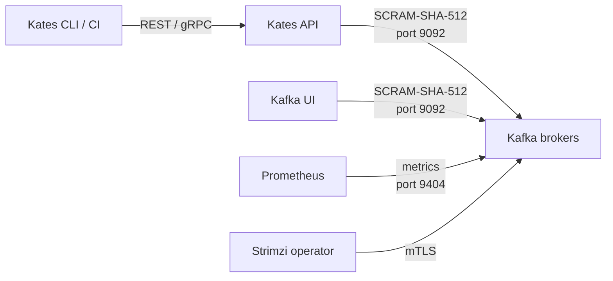
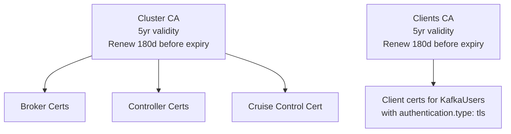
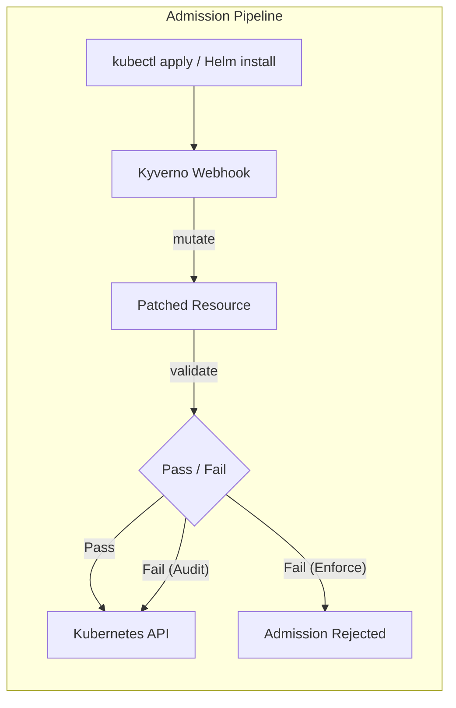

# Security & Compliance

Every client of `krafter`, the [Kafka cluster under test](appendix-a-glossary.md#gl-krafter), proves who it is on a [listener](appendix-a-glossary.md#gl-listener) before it reads a byte, and every operation it attempts is checked against an [ACL](appendix-a-glossary.md#gl-acl). Yet as the charts ship, any pod in the cluster can open a socket to the brokers and try a stolen password, and the service that runs your load tests holds a [super user](appendix-a-glossary.md#gl-super-user). Security here is layers, and this chapter takes them one at a time: what each layer stops, what it leaves open, and how you prove it on your own cluster. After this chapter, you can:

- Explain which listener each client authenticates on, and why the performance listener deliberately skips TLS
- Onboard a new service with a least-privilege [`KafkaUser`](appendix-a-glossary.md#gl-kafkauser) — scoped ACLs, prefix patterns, and [quotas](appendix-a-glossary.md#gl-quota)
- Test what the shipped [NetworkPolicies](appendix-a-glossary.md#gl-networkpolicy) block and what they leave open, and close the listener ports to pods you have not granted
- Rotate the `kates-backend` [SCRAM](appendix-a-glossary.md#gl-scram-sha-512) password without leaving the Kates API on the old one
- Grade your cluster's posture with `kates security audit` and act on the findings

## Threat Model

Before diving into configurations, it helps to know what you're defending against. Six things can go wrong, and the chapter takes them in this order:

| Attack surface | What goes wrong | What stops it | Section |
|----------------|-----------------|---------------|---------|
| The wire | A listener without TLS shows records to anyone who can capture the traffic | The `tls` or `external` listener | [Kafka Listeners](#kafka-listeners) |
| [Secrets](appendix-a-glossary.md#gl-secret) read from the Kubernetes API | Anyone who can read Secrets in `kafka` or `kates` reads every SCRAM password | RBAC on Secrets in both namespaces | [SCRAM-SHA-512](#scram-sha-512) |
| An authenticated user with no grant | The user tries topics and groups it has no business with | Deny-by-default ACLs, scoped by prefix | [Authorization](#authorization) |
| The Kates [API key](appendix-a-glossary.md#gl-api-key) | Its holder runs load and faults as a Kafka super user | Scoped keys, RBAC on the key's Secret, rotation | [Securing Kates](#securing-kates) |
| A stolen password used from any pod | As shipped, every pod reaches the client listeners | [`networkPolicyPeers`](appendix-a-glossary.md#gl-networkpolicypeers) on every listener | [Closing the Listeners](#closing-the-listeners) |
| A compromised pod on a node | A root or privileged container reaches the host | Restricted Pod Security on every pod | [Container Security](#container-security) |

The figure shows the hops those rows protect, with the protocol and port of each:



::: {.callout-note title="Why the performance listener skips TLS"}
The `plain` listener, port 9092, uses SCRAM authentication and no TLS on purpose, so a baseline measures Kafka rather than encryption. Production clients belong on an encrypted listener: `external` keeps SCRAM over TLS, while `tls` needs a certificate user per client.
:::

## Authentication

Authentication answers the question: *"Who are you?"* Every connection to Kafka must prove its identity before it can do anything.

### Kafka Listeners

Each listener enforces a specific authentication mechanism, and the choice of listener sets both the security properties and the performance cost of the connection:

| Listener | Port | Authentication | Use it for |
|----------|------|----------------|------------|
| `plain` | 9092 | SCRAM-SHA-512 over SASL_PLAINTEXT | Performance baselines, with no TLS cost: Kates, Kafka UI, Apicurio |
| `tls` | 9093 | [mTLS](appendix-a-glossary.md#gl-mtls), a client certificate, over SSL | Wire encryption between services |
| `external` | 9094 | SCRAM-SHA-512 over SASL_SSL | Access from outside the Kubernetes cluster, where the values chain declares it |

The chart's base values declare only `plain` and `tls`. `values-prod.yaml` and, outside kind, `kates deploy` add `external`, as [What the Shipped Policies Block](#what-the-shipped-policies-block) explains.

Moving a client to an encrypted listener takes more than a port. On `tls`, each client needs a `KafkaUser` with `authentication.type: tls` and a keystore with its certificate, besides a truststore with the [cluster CA](appendix-a-glossary.md#gl-cluster-ca). On `external`, the client keeps SCRAM and needs only the truststore. The `kates` chart carries both in `kafka.security.protocol` and `kafka.ssl`, beside `kafka.bootstrapServers`.

### SCRAM-SHA-512

SCRAM (Salted Challenge Response Authentication Mechanism) is a password-based authentication protocol that never sends the password over the wire [@rfc5802; @kip84]. Instead, the client and server exchange salted hashes in a challenge-response sequence, and the server stores only a salted hash, so a leaked credential store doesn't yield the password.

Strimzi generates SCRAM credentials automatically when you create a `KafkaUser` resource. The password is stored in a Kubernetes Secret with the same name as the user:

```bash
# View generated password
kubectl get secret kafka-ui -n kafka -o jsonpath='{.data.password}' | base64 -d
```

Kubernetes Secrets are base64-encoded, not encrypted. Anyone with RBAC permission to read Secrets in the `kafka` namespace can extract every SCRAM password, and the copy of the `kates-backend` password in the `kates` namespace is just as exposed. RBAC on Secrets in both namespaces is the wall around these credentials. A NetworkPolicy doesn't help here: Secrets are read from the Kubernetes API, not from the brokers.

The Kates API's own service account can't read these Secrets, and doesn't need to: the kubelet hands the Kates API pod its `kates-backend` password. The `kates` chart grants the account `get` on one Secret, `postgresql`, the password of the INTEGRATION_CDC test's database, and only in the namespaces its `rbac.cdcSecretNamespaces` lists.

### Cross-Namespace Credential Synchronization

Strimzi writes a `KafkaUser`'s Secret only into the Kafka cluster's namespace (`kafka`). Kates runs in `kates`, so it needs a copy of the `kates-backend` Secret there. `kates deploy` makes that copy each time it installs or reconciles the Kates API, and so do `make kates-secret` and `scripts/deploy-kates.sh`. Nothing keeps the copy in step between those runs: no controller or policy that ships with Kates watches the source Secret.

A synchronized copy would not be enough on its own anyway. The Kates API pod reads the password once, at startup, into the `KATES_KAFKA_SASL_PASSWORD` environment variable, and never reads the Secret again. Whatever keeps the copy current — the steps below, or a [Kyverno](appendix-a-glossary.md#gl-kyverno) clone rule or External Secrets that you add yourself — Kates uses a new password only after a restart.

With `kates deploy --topology single`, Kates and Kafka share one namespace, `kates-stack` unless you passed `--namespace`, and Kates reads the Strimzi Secret itself. There is no copy to refresh, but the restart is still needed: in the procedure below, skip step 3, run the `kubectl` commands of the other steps against that namespace, and pass it to `kates ports` with `--app-ns`.

### Password Rotation

Strimzi does not rotate SCRAM passwords on its own. You rotate one by deleting the user's Secret: the User Operator generates a new password, sets it on the brokers and writes a new Secret. The old password then stops authenticating.

For `kates-backend`, that is a short outage of Kates, which lasts until the restarted pod is Ready. Until then Kates can't open a new connection to Kafka. Connections it already holds keep working, because Kafka doesn't re-authenticate them, but every new one fails SASL authentication: the producers and consumers of a new test, or a reconnect after a broker restarts. Rotate when no test or chaos experiment is running, and run the steps back to back:

```bash
# 1. Delete the Secret; the User Operator generates a new password
kubectl delete secret kates-backend -n kafka

# 2. Wait for the new Secret. The KafkaUser is already Ready, so waiting on
#    its Ready condition returns at once and proves nothing.
for _ in $(seq 60); do
  kubectl get secret kates-backend -n kafka >/dev/null 2>&1 && break
  sleep 5
done

# 3. Copy the new password into the Kates namespace
PASSWORD=$(kubectl get secret kates-backend -n kafka \
  -o jsonpath='{.data.password}' | base64 -d)
test -n "$PASSWORD" && kubectl create secret generic kates-backend -n kates \
  --from-literal=password="$PASSWORD" --dry-run=client -o yaml | kubectl apply -f -

# 4. Restart Kates so it reads the new password
kubectl rollout restart deployment/kates -n kates
kubectl rollout status deployment/kates -n kates --timeout=300s

# 5. The restart ended any port-forward to the old pod: start the forwards again
kates ports

# 6. Check that Kates can authenticate to Kafka again
kates health
```

A port-forward to a Service is bound to the one pod it picked when it started. Neither `kates ports` nor `make ports` reconnects it when that pod goes away, so step 5 is what makes the API reachable again. `kates ports` also points the `ports` CLI context at the forward it starts and makes it the current context. Skip it if you reach the API through an Ingress or a NodePort.

A finished rollout does not prove the rotation worked. The readiness probe does not depend on Kafka (`kates.health.readiness.require-kafka` is `false`), so the new pod turns Ready even with a wrong password. `kates health` has the Kates API describe the cluster over its own SASL connection, and its **Kafka Cluster** block must show `UP` and "Kafka cluster is reachable". The command needs only the API URL of your CLI context, because `/api/health` is served without the API key.

::: {.callout-tip title="Try it: does Kates still authenticate after a rotation?"}
On `panda`, the [three-node Kind cluster](appendix-a-glossary.md#gl-panda), with no test running, rotate the `kates-backend` password with the six steps above. The **Kafka Cluster** block of `kates health` should show `UP`, and a short run such as `kates test create --type LOAD --records 1000 --wait` proves that new connections authenticate with the new password.
:::

### mTLS (Mutual TLS)

The TLS listener requires both server and client certificates [@rfc8446]. Strimzi issues client certificates through the [clients CA](appendix-a-glossary.md#gl-clients-ca) when a `KafkaUser` uses `authentication.type: tls`. Both sides verify a certificate, and the connection is encrypted.

## Authorization

Authentication tells Kafka who you are. Authorization tells Kafka what you're allowed to do. Without authorization, an authenticated user can read any topic, join any consumer group, and modify any configuration — a single compromised credential becomes a full breach.

### ACL Model

Kafka uses simple ACL authorization with principal-based access control. A `KafkaUser` authenticating with SCRAM-SHA-512 maps to the principal `User:<username>`. Only users with `authentication.type: tls` get certificate-based principals, whose name is the certificate's Distinguished Name (for example `User:CN=my-service`).

Every Kafka operation (produce, consume, describe, create, delete) is checked against the ACL list. If no matching rule is found, the operation is denied: a deny-by-default model [@saltzer1975protection], in which you grant every permission explicitly.

### User Permissions Matrix

The platform profile ships these users. Read the Resources column as the blast radius of each password:

| User | Access | Resources |
|------|--------|-----------|
| `kates-backend` | Super user | Everything, bypassing ACLs |
| `kafka-ui` | Read-only | All topics and groups, cluster `Describe` |
| `apicurio-registry` | `All` on its prefixes | `__apicurio*`, `kafkasql-*`, `registry-*` topics; `apicurio*` groups and transactional IDs; cluster `Create`, `IdempotentWrite`, `AlterConfigs`, `DescribeConfigs` |
| `litmus-chaos` | Full CRUD | All topics, `Delete` and `Alter` included; `litmus*` groups; cluster `Describe` |
| `kates-connect` | Scoped R/W | `kates-*`, `cdc*` topics; `kates-connect*`, `connect-*` groups; every transactional ID |
| `kates-mm2` | Broad R/W | All topics, `AlterConfigs` included; all groups; cluster `Create` and `DescribeConfigs` |

`kates-backend` is a super user because the Kates API creates and deletes test topics, reads every consumer group and describes the cluster during runs. MirrorMaker 2 reads every group because its checkpoint connector translates the offsets of every mirrored group, whose names it can't know in advance.

### Adding a New Service

When you onboard a new service to your Kafka cluster, follow the principle of least privilege [@saltzer1975protection] — grant only the permissions the service actually needs. Here's a template:

```yaml
apiVersion: kafka.strimzi.io/v1
kind: KafkaUser
metadata:
  name: my-service
  namespace: kafka
  labels:
    strimzi.io/cluster: krafter
spec:
  authentication:
    type: scram-sha-512
  quotas:
    producerByteRate: 10485760     # 10 MB/s
    consumerByteRate: 20971520     # 20 MB/s
    requestPercentage: 15          # 15% of one broker thread's time
  authorization:
    type: simple
    acls:
      - resource:
          type: topic
          name: "my-service"
          patternType: prefix
        operations: ["Read", "Write", "Create", "Describe"]
        host: "*"
      - resource:
          type: group
          name: "my-service"
          patternType: prefix
        operations: ["Read", "Describe"]
        host: "*"
```

`patternType: prefix` matches every topic or group whose name starts with `my-service`, such as `my-service-events` and `my-service-results`, so a new topic needs no new ACL.

An ACL is only half the grant. The other half is `networkPolicy.clients`, which turns a pod selector into an ingress rule on the listener ports of the chart's `krafter-kafka` policy:

```yaml
networkPolicy:
  clients:
    - name: my-service
      namespace: apps
      podSelector: { app.kubernetes.io/name: my-service }
      listeners: [plain, tls]
```

`listeners` holds listener *names* from `kafka.listeners`, not ports — the chart derives the ports. An empty `namespace` means the release namespace.

That rule is what lets the service in once the listeners are closed to everyone else. As the charts ship, they are not: Strimzi's own policy admits every pod to them, so the grant starts to matter only after you give the listeners `networkPolicyPeers`, as [How the Policies Combine](#how-the-policies-combine) shows.

There is no namespace-level shortcut: `networkPolicies.allowedClientNamespaces` generates no rule, and the chart warns when it sees it. Grant per client.

A user the chart should own goes in `users.items` alongside the grant, so one `helm upgrade` carries both; a user for a service outside this release can stay a hand-applied `KafkaUser` as above.

### Quotas as Security

Per-user quotas keep a misbehaving client from denying service to the others. Without quotas, a single runaway producer can saturate broker network bandwidth, disk I/O and request threads, and every other client on the cluster slows down. The platform profile sets these:

| User | Produce rate | Consume rate | Request share |
|------|:------------:|:------------:|:-------------:|
| `kafka-ui` | 1 MB/s | 50 MB/s | 10% |
| `apicurio-registry` | 10 MB/s | 20 MB/s | 15% |
| `kates-connect` | 50 MB/s | 50 MB/s | 25% |
| `kates-mm2` | 50 MB/s | 50 MB/s | 25% |
| `kates-backend`, `litmus-chaos` | None | None | None |

The last row carries no quota because the profile sets none. [How Quotas Work](19-multi-tenancy.md#how-quotas-work) explains what each limit measures.

### Granting Full Cluster Rights (Super-User)

A person administering the cluster sometimes needs full rights across it. You grant them explicitly, with `All` operations on the `cluster`, `topic`, and `group` resources. Do not use this for an automated tool: give a tool its own `KafkaUser` with scoped ACLs, as in [Adding a New Service](#adding-a-new-service).

Create a file named `kafka-admin-user.yaml` with the following content:

```yaml
apiVersion: kafka.strimzi.io/v1
kind: KafkaUser
metadata:
  name: admin-user
  namespace: kafka
  labels:
    strimzi.io/cluster: krafter
spec:
  authentication:
    type: scram-sha-512
  authorization:
    type: simple
    acls:
      - resource:
          type: cluster
        operations: ["All"]
      - resource:
          type: topic
          name: "*"
          patternType: literal
        operations: ["All"]
      - resource:
          type: group
          name: "*"
          patternType: literal
        operations: ["All"]
```

Apply this file to your cluster:

```bash
kubectl apply -f kafka-admin-user.yaml
```

Once the Strimzi Operator processes the resource, it generates a Kubernetes Secret in the `kafka` namespace with the credentials. You can retrieve the generated SCRAM password using:

```bash
kubectl get secret admin-user -n kafka -o jsonpath="{.data.password}" | base64 -d
```

::: {.callout-warning title="All on the cluster includes Alter"}
`All` on the `cluster` resource includes `Alter`, which manages ACLs, so this user can grant itself or anyone else any permission, and `All` on every topic lets it delete them. Its password sits in a Secret in the `kafka` namespace like any other. Create the user for the task at hand and delete it afterwards: `kubectl delete kafkauser admin-user -n kafka` removes its credentials and ACLs from the cluster.
:::

## Audit Logging

Kafka's authorizer can log every authorization decision — who accessed what, and when. The authorizer itself is already configured on `krafter`: Strimzi derives it from `spec.kafka.authorization` (`type: simple`), and it does not allow `authorizer.class.name` to be set directly in the `config` section — unsupported keys placed there are filtered out. What you control is the log level of `kafka.authorizer.logger`, which lives under `spec.kafka.logging` in the Kafka CR:

```yaml
spec:
  kafka:
    logging:
      type: inline
      loggers:
        rootLogger.level: INFO
        # Kafka 4.x brokers use Log4j2: declare the logger by name, then set its level
        logger.authorizer.name: kafka.authorizer.logger
        logger.authorizer.level: DEBUG
```

At the default `INFO` level the authorizer logs denied operations only. At `DEBUG`, every produce, consume, and admin operation generates an audit entry that includes the principal, the resource, the operation, and the decision (ALLOWED or DENIED), so the log answers who read or wrote a topic, and when.

::: {.callout-warning title="DEBUG is for investigations"}
Turn `DEBUG` on for an investigation, then set the logger back to `INFO`. The authorizer checks every request, so at `DEBUG` each broker writes a line for every authorized produce and fetch request, including those of `kates-backend`: super-user status skips the ACLs but not the log. Under a Kates load test that can be thousands of lines a second per broker, which costs broker CPU and log storage and skews the baseline you are measuring.
:::

## Certificate Management

Strimzi manages two independent CA hierarchies: the cluster CA for cluster-internal communication and the clients CA for client authentication. The figure shows what each one signs:



The Clients CA issues certificates only for `KafkaUser` resources with `authentication.type: tls`. The default managed users all authenticate with SCRAM-SHA-512, so they receive password Secrets rather than client certificates.

| Property | Value | Purpose |
|----------|-------|---------|
| Validity | 1825 days (5 years) | Long-lived for stability |
| Renewal window | 180 days before expiry | Ample time for rollout |
| Renewal policy | `replace-key` | New key pair on renewal (stronger than key reuse) |

The `replace-key` renewal policy means that on each renewal, Strimzi generates an entirely new private key rather than reusing the existing one. So a key compromised before the renewal is useless after it.

### Rotation Monitoring

Strimzi sets the `NotAfter` date on each certificate. Read it directly with:

```bash
kubectl get secret krafter-cluster-ca-cert -n kafka \
  -o jsonpath='{.data.ca\.crt}' | base64 -d | openssl x509 -noout -dates
```

For alerting, use the rules the `strimzi-operator` chart ships instead of writing your own. The Cluster Operator publishes `strimzi_certificate_expiration_timestamp_ms` for the cluster and clients CA certificates of every Kafka cluster it manages, and the chart's PrometheusRule, `strimzi-operator-operator-alerts` in the `strimzi-operator` namespace, alerts on it:

| Alert | Fires When the Certificate Expires In | Severity |
|-------|---------------------------------------|----------|
| `KafkaCertificateExpiringSoon` | Under 30 days, for 1h | warning |
| `KafkaCertificateExpiryCritical` | Under 7 days, for 30m | critical |

The thresholds are the chart's `alerts.thresholds.certificateWarningDays` and `alerts.thresholds.certificateCriticalDays`. Strimzi renews a CA 180 days before it expires, so either alert means a renewal did not happen: look at the operator's logs and at the cluster's `maintenanceTimeWindows`, outside which Strimzi does not renew.

The chart renders the rule, and the PodMonitor that scrapes the operator, only if the `monitoring.coreos.com` API exists when the release is installed or upgraded. `kates deploy` installs the operator before the monitoring stack, so after the first deploy on a fresh cluster neither object exists. Check:

```bash
kubectl get prometheusrule,podmonitor -n strimzi-operator
```

If nothing is listed, run `kates deploy` again with the flags you first used. It upgrades the operator release on every run, and this time the API is there. Each of those upgrades passes `--reset-values` and the kind or generic overlay, so on an operator you manage with Helm yourself it drops `values-prod.yaml` and every value you set. For that operator, upgrade the release yourself with its own values, as [Kafka Deployment Engineering](15-kafka-deployment.md#strimzi-operator-crashloopbackoff) shows, which renders both objects now that the API exists. Then pass `--with-strimzi=false` whenever you run `kates deploy`.

## Securing Kates

Everything above protects `krafter` from its clients, and the Kates API is the most powerful of them. It runs load and faults as `kates-backend`, a Kafka super user, and with `rbac.scope` at its default, `cluster`, its service account holds a ClusterRole. Whoever holds its API key can put that power to work, so the key gets the same care as a Kafka password.

### What the Key Unlocks

Every REST and gRPC call needs an API key, sent as `Authorization: Bearer <key>` or `X-API-Key`, except the REST `/api/health` endpoint and Quarkus's health endpoints under `/q/`. A request without a key is refused with 401, and one whose key lacks the scope the endpoint names with 403. Each key carries scopes:

| Scope | What it allows |
|-------|----------------|
| `read` | Every read, dry runs included |
| `read:sensitive` | Reads that expose data rather than state: records, Secrets, the ACL map |
| `test:run` | Start and cancel a test run |
| `chaos:run` | Run a disruption, playbook, template or resilience test |
| `chaos:propose`, `chaos:approve` | Propose a fault for a person to approve, and approve one |
| `abort` | Abort a running disruption |
| `admin` | Topics, webhooks, schedules, baselines, profiles and deletes |

`GET /api/whoami` names the principal and the scopes of the key you send.

### Where the Keys Live

The `kates` chart generates the default key at install: 32 random characters in the `kates-api-key` Secret, which later upgrades read back and keep. That key's principal is `legacy`, with every scope unless `kates.api.legacy-key.scopes` lowers them. Named keys come from the file `kates.api.keys-file` names, one entry per key with its principal's name, its type (`human` or `agent`), its scopes and an optional expiry. The file holds each key's SHA-256, never the key, and the Kates API reads it again every 30 seconds, so a key you add, disable or remove takes effect without a restart. An agent's key may carry only `read` and `read:sensitive`.

### Rotating the Chart's Key

The Kates API reads the chart's key once, at startup, from the `kates-api-key` Secret. To rotate it, delete the Secret, upgrade the `kates` release from its own values so the chart generates a new key, and restart the Deployment:

```bash
kubectl delete secret kates-api-key -n kates
helm get values kates -n kates -o yaml > kates-current.yaml
helm upgrade kates oci://ghcr.io/bmscomp/charts/kates --version <chart-version> \
  -n kates -f kates-current.yaml
kubectl rollout restart deployment/kates -n kates
kubectl rollout status deployment/kates -n kates --timeout=300s
kates ports
```

`kates ports` copies the new key into the `ports` CLI context, replacing one it copied there before. A key you set yourself with `kates ctx set` stays, so set the new one there with `--api-key`. [Config File Format](10-cli-reference.md#config-file-format) shows how the CLI tells the two apart.

### The Kates Audit Trail

Kates records every change made through the Kates API, over REST or gRPC, in its audit log: what was done, to what, and who did it. Who is the principal of the API key used (see `GET /api/whoami`), marked as a person, an agent, or `system:scheduler` for a schedule's firing. A refused or failed change leaves a row too, with how it ended; a request without a valid key leaves none. When a change started a test run or a disruption, its row's target is that run's or report's id, which is how to find who started it: runs and reports record no owner of their own. Inspect the trail with `kates audit`, filtering with `--type`, `--since` and `--actor`.

The audit log is a hash chain. Each row holds the hash of the row before it and a SHA-256 over that hash and its own fields, so a row that someone with database access changes, removes or adds breaks the chain at that row. `GET /api/audit/verify` (scope `read`) walks every row, oldest first, and answers what it found:

```json
{
  "intact": false, "chained": 4211, "unchained": 318,
  "headId": 4529, "headHash": "9c1e…", "brokenAt": 2077,
  "problem": "row 2077 does not match its hash: it was changed"
}
```

`unchained` counts the rows written before the Kates API chained its log; the chain starts after them. Removing the newest rows shows as a chain that ends before `headId`. The chain can't stop someone who can rewrite the whole table, hashes included, so keep a `headHash` and its `headId` outside Kates, in a ticket or a signed report. Later, `GET /api/audit` lists each chained row's `rowHash`: if row `headId` now holds another hash than the one you kept, the chain was rewritten, however intact it looks. The walk reads the whole table, so on a large log it takes a while.

### Limits

The chart's key carries every scope, and every person who holds it appears in the audit trail as the one principal `legacy`. Named keys are what tell people apart. Whatever a key's scopes, Kates runs the load and faults it starts as a Kafka super user. Anyone who can read Secrets in the `kates` namespace can read the chart's key.

## Network Policies

Network policies decide which pods can open a socket to the brokers at all, so that a compromised pod elsewhere in the cluster cannot even try a stolen password. Know what the shipped ones do before you rely on them: as the charts ship, the client listeners are open to every pod in the cluster.

### How the Policies Combine

Before you let a client near the brokers, you want to know which pods can open a socket to them. The answer depends on how Kubernetes combines NetworkPolicies.

Read NetworkPolicies as a union, not as a chain of filters. A policy selects pods and lists the traffic it allows. A pod that no policy selects for ingress accepts every connection. Once any policy selects it for ingress, it accepts only what one of those policies allows: the sum of all their rules. So a connection that any policy allows gets through, whatever the other policies say. A deny-all closes only the doors that no other policy opens.

Each end of a connection is judged on its own. The broker's policies decide whether the connection may come in, and the client's decide whether it may go out. A grant on the broker side does nothing for a client whose own namespace denies egress, such as a namespace that Kyverno's generated default-deny covers (see [Automatic NetworkPolicy Generation](#automatic-networkpolicy-generation)).

Two owners write policies that select the `krafter` brokers and controllers. Read the last column as the part that matters for your clients:

| Policy | Written by | Present | Admits to `plain` and `tls` |
|--------|------------|---------|-----------------------------|
| `krafter-kafka` | The `kafka-cluster` chart | Where the values chain renders the chart's policies; the next section lists which chains do | Each `networkPolicy.clients` entry, `kates.io/test-pod` pods in `kafka`, the cluster's own pods and the Cluster Operator |
| `krafter-network-policy-kafka` | The Strimzi Cluster Operator | In every profile: the operator chart leaves Strimzi's policy generation on | The listener's `networkPolicyPeers`, or every connection when the list is empty or missing |

Strimzi builds its rule for each listener from that listener's `networkPolicyPeers`. An empty or missing list admits every connection. No listener in the chart's values, its overlays or the values `kates deploy` generates sets the field, and the `kafka.externalAccess` preset has no place for it. So as shipped, Strimzi's policy opens `plain` (9092) and `tls` (9093) to every pod in the cluster, and an external listener to every source.

Nothing the chart adds can take that access away. `networkPolicy.clients` adds allows, and `krafter-default-deny` adds none. Until you close the listeners, listener authentication (SCRAM-SHA-512 on `plain`, mutual TLS on `tls`) and ACLs are what keep an arbitrary pod away from your data.

Give every listener a `networkPolicyPeers` list and Strimzi's rule shrinks to the peers you name. Where the chart's policies render, the pods that can connect are then the union of the two lists: the pods the chart admits plus your peers. One narrow peer is enough, and `networkPolicy.clients` becomes the allow list. Where the chart's policies don't render, your peers are the only pods that can connect. [Closing the Listeners](#closing-the-listeners) shows how, over the values your release already has.

You can watch the union at work with `make kafka-verify-policies`. Its last step probes `plain` from a pod with no grant. On the charts as shipped, the probe connects, and the step fails and names Strimzi's policy as the reason. [Verifying the Posture in One Command](#verifying-the-posture-in-one-command) explains how to read the result.

The model has limits. NetworkPolicies take effect only where the cluster's network plugin enforces them. `networkPolicyPeers` never closes the metrics port, 9404, which Strimzi opens to every pod while metrics are on. For an external listener, the chart's own rule admits every source unless `kafka.externalAccess.allowedCidrs` lists ranges. The chart applies those ranges only to the listener that `kafka.externalAccess.name` names, `external` by default.

### What the Shipped Policies Block

Whether `kafka-cluster` renders any policy depends on the values chain. `kates deploy` starts its chain with `.build/values-detected.yaml`, which it writes from what it detects on the cluster, layers `values-platform.yaml` over it, and adds `values-kind.yaml` on a kind cluster:

| Values Chain | kafka-cluster NetworkPolicies |
|--------------|-------------------------------|
| `values-kind.yaml`, `values-dev.yaml` | None: both set `networkPolicy.enabled: false` |
| `kates deploy` on a cluster whose CNI it cannot identify, EKS, GKE and AKS excepted | None: `values-detected.yaml` turns them off |
| `kates deploy` on any other cluster | Four of the six in [The Policies the Chart Renders](#the-policies-the-chart-renders), plus `krafter-test-egress` |
| The base values, `values-staging.yaml`, `values-prod.yaml` | The six in [The Policies the Chart Renders](#the-policies-the-chart-renders), plus `krafter-test-egress` |

On those other clusters the detected values turn off Cruise Control and the Kafka Exporter, and their two policies with them.

Where the chart's policies render, they add two things. First, egress from the brokers, controllers, Cruise Control, the [Entity Operator](appendix-a-glossary.md#gl-entity-operator) and the Kafka Exporter is limited to the cluster's own pods, DNS, and TCP 443 and 6443 to any address. Set `networkPolicy.apiServer.ipBlock` to pin those two ports to the Kubernetes API server. Second, a deny-all, `krafter-default-deny`, selects every pod of the cluster, so that Cruise Control, the Entity Operator and the Kafka Exporter accept only what a policy allows them.

The internal ports are closed to other workloads in every profile, and not by the chart. The Strimzi Cluster Operator generates a policy of its own for every Kafka cluster, `krafter-network-policy-kafka`, unless its `STRIMZI_NETWORK_POLICY_GENERATION` is off (it is on by default). That policy admits only the cluster's brokers and controllers and the Cluster Operator to 9090 (controller quorum and control plane), those and the cluster's other operands to 9091 (replication), and only the operator to 8443 (the Kafka agent). It recognizes the operator by the label `strimzi.io/kind: cluster-operator` in any namespace, unless the operator knows the labels of its own namespace: set `strimzi-kafka-operator.image.operatorNamespaceLabels` on the `strimzi-operator` release, for example to `kubernetes.io/metadata.name=strimzi-operator`, to hold those rules to that namespace.

Neither policy restricts the client listeners, for the reason [How the Policies Combine](#how-the-policies-combine) gives: no listener in the chart's values or in `values-detected.yaml` has `networkPolicyPeers`. Whatever the values chain, this is who can connect:

| Port | Who Can Connect |
|------|-----------------|
| 9092 (`plain`), 9093 (`tls`) | Every pod in the cluster |
| 9404 (metrics) | Every pod in the cluster: Strimzi opens the metrics port to all while `metrics.enabled` is on, as it is by default |
| 9094 (`external`), wherever the chain declares it | Every source. `kafka.externalAccess.allowedCidrs` narrows only the chart's rule |

Two things declare 9094: `kafka.externalAccess`, which `values-prod.yaml` sets to a NodePort, and `values-detected.yaml`, which adds an `external` listener on every cluster but kind, a NodePort or, on EKS, GKE and AKS, a LoadBalancer. `kates deploy` therefore exposes 9094 outside kind although the base values leave `kafka.externalAccess` off. On EKS, GKE and AKS the detected listener annotates the bootstrap Service only, so every broker's load balancer gets the provider's default, usually a public address. On EKS and GKE the bootstrap's is public too; only the AKS bootstrap is internal. A default `kates deploy` on those clouds can therefore put 9094 on the internet, with TLS and SCRAM-SHA-512 as its only guard. [Deployment Guide](12-deployment.md#cloud-deployment) replaces that listener with internal load balancers that admit only the ranges you list.

### Closing the Listeners

Give every listener in `kafka.listeners` a `networkPolicyPeers` list. One narrow peer is enough, for the reason [How the Policies Combine](#how-the-policies-combine) gives: the pods the chart already admits keep their access, so `networkPolicy.clients` stays the one place where you grant access.

Helm replaces lists instead of merging them, so restate every listener the release has, not only the base values' two. List them first:

```bash
kubectl get kafka krafter -n kafka -o jsonpath='{.spec.kafka.listeners[*].name}'
```

On kind that prints `plain tls`, which the file below restates. If it also prints `external`, keep that listener too, in the form shown for port 9094 further down.

The file also grants Kafka UI, which the platform profile misses on the default install: `kates deploy` puts Kafka UI in the `kafka` namespace (`--ui-ns` defaults to `kafka`), and the profile grants `app: kafka-ui` only in `kates` and `kafka-ui`. Kafka UI reaches the brokers through Strimzi's open rule and loses them once the peers land, unless the file grants it:

```yaml
# closed-listeners.yaml
kafka:
  listeners:
    - name: plain
      port: 9092
      type: internal
      tls: false
      authentication:
        type: scram-sha-512
      networkPolicyPeers:
        - podSelector:
            matchLabels:
              kates.io/test-pod: "true"
    - name: tls
      port: 9093
      type: internal
      tls: true
      authentication:
        type: tls
      networkPolicyPeers:
        - podSelector:
            matchLabels:
              kates.io/test-pod: "true"
networkPolicy:
  # The allow list the peers rely on; values-kind.yaml and values-dev.yaml turn it off
  enabled: true
  clients:
    # kates deploy sets this entry: keep it, with the namespace you gave --connect-ns
    - name: connect
      namespace: connect
    # Kafka UI where kates deploy installs it
    - name: kafka-ui-in-kafka
      namespace: kafka
      podSelector: { app: kafka-ui }
      listeners: [plain, tls]
```

A peer with only a `podSelector` selects pods in the Kafka namespace, which here are the Helm test pods the chart admits anyway. The chart passes the list to the `Kafka` resource unchanged, and Strimzi rewrites its policy on the next reconciliation.

The peers rely on the chart's policies: without them, Strimzi's policy is the only one, and the peers you name are the only pods that can connect. That is why the file sets `networkPolicy.enabled: true`. Where `kates deploy` could not identify the CNI, that is not enough. `values-detected.yaml` turns the policies off with the older key `networkPolicies.enabled: false`, and the chart applies that key over a `networkPolicy.enabled` left at its default. Add `networkPolicies: {enabled: true}` to the file as well.

Apply the file over the values the release already has:

```bash
helm upgrade krafter oci://ghcr.io/bmscomp/charts/kafka-cluster -n kafka \
  --reuse-values -f closed-listeners.yaml
kubectl get networkpolicy krafter-kafka -n kafka
```

The published chart carries its SeaweedFS subchart and the `kafka-common` library, so nothing is built first. `--reuse-values` keeps everything the release was installed with — for a `kates deploy` release, `values-detected.yaml`, the platform profile, the kind overlay, its `--set` flags and the version pins — and lays the file over it. Don't upgrade with the file alone: the release would lose the platform profile, and with it every `networkPolicy.clients` grant and the `kates-backend` super user. The peers admit only test pods, so Kates, Kafka UI and Connect would lose the brokers. `kates deploy` has no flag for a values file of yours, and a later run leaves the release alone, because it skips a Kafka cluster that is already installed. The `kubectl get` must find `krafter-kafka`. If it does not, the chart's policies are off and only the peers can connect: add the key from the previous paragraph and upgrade again.

::: {.callout-warning title="Who loses access when the peers land"}
Anything that reaches the brokers without a `networkPolicy.clients` entry loses access when the peers land: an ad-hoc debug pod, a client nobody declared. Compare the client list with what actually connects before you roll this out, and run the probe in [Testing Network Policies](#testing-network-policies) afterwards.
:::

`kafka.externalAccess.allowedCidrs` doesn't close port 9094. It narrows the chart's rule for the listener, but Strimzi's policy still admits every source to a listener without `networkPolicyPeers`, and the `externalAccess` preset can't carry them. To restrict 9094, declare the listener yourself in `kafka.listeners`, named `external`, with `ipBlock` peers. Set `kafka.externalAccess.type` to `none` so that the preset doesn't replace it; `allowedCidrs` still narrows the chart's rule for a listener of that name.

Add the listener to `closed-listeners.yaml` as a third entry of `kafka.listeners`, after `plain` and `tls`. Give it the type and `configuration` it has in `kubectl get kafka krafter -n kafka -o yaml`; on EKS, GKE and AKS, `kates deploy` declares a LoadBalancer with provider annotations:

```yaml
kafka:
  externalAccess:
    type: none
    allowedCidrs: ["203.0.113.0/24"]
  listeners:
    # plain and tls come first, as above
    - name: external
      port: 9094
      type: nodeport
      tls: true
      authentication:
        type: scram-sha-512
      configuration:
        externalTrafficPolicy: Local
      networkPolicyPeers:
        - ipBlock:
            cidr: 203.0.113.0/24
```

`externalTrafficPolicy: Local` keeps the client's address, where the infrastructure supports it, so the brokers see it. With the default, `Cluster`, a connection can arrive from a node's address instead, which your `ipBlock` does not cover.

Port 9404 serves read-only metrics, and no listener setting closes it. Two settings do, each at a price. `metrics.enabled: false`, with `alerts.enabled: false`, which the chart requires with it, stops Strimzi opening the port, and the brokers stop exporting the metrics Prometheus scrapes there. The operator's `strimzi-kafka-operator.generateNetworkPolicy: false` stops Strimzi generating policies at all, for every cluster that operator manages; the chart's policies are then the only ones on the brokers, which also makes `networkPolicy.clients` the allow list for the listeners. That lasts only until the next `kates deploy` or `make kafka`: both upgrade the operator release with `--reset-values`, which turns generation back on. On that cluster, run `kates deploy --with-strimzi=false`, as the [Upgrade Playbook](18-upgrade-playbook.md) advises for an operator you configure yourself. Turn generation off only where the chart's policies render: under `values-kind.yaml` or `values-dev.yaml`, the brokers would have no policy at all, internal ports included.

### The Policies the Chart Renders

Every policy is named for its cluster, so two clusters can share a namespace. The table lists what `kafka-cluster` renders with the platform profile and the base listeners, and the one Strimzi generates beside them. Read the Ingress From column against Strimzi's generated policy, which admits every pod until the listeners carry `networkPolicyPeers`:

| Policy | Target | Ingress From | Ports |
|--------|--------|-------------|-------|
| `krafter-default-deny` | Strimzi cluster pods (`app.kubernetes.io/part-of: strimzi-krafter`) | None | None |
| `krafter-allow-dns` | Strimzi cluster pods | — (egress only) | 53 UDP/TCP |
| `krafter-kafka` | Broker and controller pods | krafter pods, operator, and every `networkPolicy.clients` entry; monitoring for metrics | 9090, 9091, 8443, 9092, 9093, 9404 |
| `krafter-cruise-control` | Cruise Control pod | Operator, monitoring | 9090, 9404 |
| `krafter-entity-operator` | Entity Operator pod | monitoring | 8080, 8081 |
| `krafter-kafka-exporter` | Kafka Exporter pod | monitoring | 9404 |
| `krafter-network-policy-kafka`, from Strimzi | Broker and controller pods | Every pod on 9092, 9093 and 9404; the cluster and the operator on 9090, 9091 and 8443 | 9090, 9091, 8443, 9092, 9093, 9404 |

`krafter-default-deny` allows nothing, so for the pods it selects, whatever no other policy allows is dropped; it never outvotes an allow ([How the Policies Combine](#how-the-policies-combine)).

A seventh, `krafter-test-egress`, gives pods labeled `kates.io/test-pod=true` egress to the cluster's pods on 9090, 9091 and every listener port, DNS and the API server. It carries `helm.sh/resource-policy: keep` so a `helm test` against a reinstalled release still works.

Client ports come from the listeners, so an external listener, from the `kafka.externalAccess` preset or from `kafka.listeners`, adds its port (9094 by default) to the rules that need it. `externalAccess.allowedCidrs` restricts the chart's rule for the one named `external`. The chart renders no policy that selects another release's pods — the operator's own policy belongs to the `strimzi-operator` release (`operatorPolicy`, on by default), and Kafka UI, Connect and MirrorMaker 2 each carry their own.

Re-derive the list rather than trusting this table, since it follows the values chain you deploy with:

```bash
helm pull oci://ghcr.io/bmscomp/charts/kafka-cluster --untar

helm template krafter ./kafka-cluster -n kafka \
  -f kafka-cluster/values-platform.yaml \
  | grep -A2 'kind: NetworkPolicy' | grep 'name:'
```

On a running cluster, `kubectl get networkpolicy -n kafka` lists Strimzi's generated policies beside these.

### Testing Network Policies

Don't trust that your network policies work — test them, with a test that can fail. A probe such as `nc -z` from a throwaway pod fails for many reasons that have nothing to do with policy: the image does not pull, admission rejects the pod, the name does not resolve, the broker is down. Reading every failure as "blocked" proves nothing. A failed probe is evidence of a policy drop only when:

- the same probe, run from a pod the policies admit, connects, so the brokers, DNS and the probe itself work;
- the probing pod resolved the bootstrap name and its connection timed out. A policy drops packets, whereas a refusal means something answered;
- the probing pod's own namespace has no NetworkPolicy that could have dropped its egress.

`make kafka-verify-policies` runs that test (see [Verifying the Posture in One Command](#verifying-the-posture-in-one-command)). To run it by hand from the repository root, use the `kates-tester` image that the chart's Helm tests run:

```bash
IMAGE=$(awk '$1 == "kubectl:" {gsub(/"/, "", $2); print $2; exit}' \
  charts/kafka-cluster/values.yaml)
BOOT=krafter-kafka-bootstrap.kafka.svc
PROBE="getent hosts $BOOT >/dev/null || { echo 'no DNS'; exit; }
timeout 5 bash -c 'exec 3<>/dev/tcp/$BOOT/9092'; echo \"exit \$?\"

# Control: a pod the chart always admits. It must print "exit 0".
kubectl run np-control -n kafka --rm -i --restart=Never --image="$IMAGE" \
  --labels=kates.io/test-pod=true -- bash -c "$PROBE"

# The probe: a namespace with no grant, and no NetworkPolicy of its own
kubectl get networkpolicy -n default
kubectl run np-probe -n default --rm -i --restart=Never \
  --image="$IMAGE" -- bash -c "$PROBE"
```

`exit 0` from the probe means it reached the broker. `exit 124` is a timeout, and counts as blocked only if the control printed `exit 0` and `default` has no NetworkPolicy. Any other result proves nothing either way. On the charts as shipped, expect `exit 0` from both pods until you [close the listeners](#closing-the-listeners). If admission rejects the pods, use `make kafka-verify-policies`, whose probe pods carry a restricted security context and resource limits.

## Container Security

The Kates charts hold their pods to the Kubernetes Pod Security Standards (PSS) at the restricted level. With default values, every pod they render passes it, Helm test pods and jobs included, and every container carries CPU and memory requests and a memory limit. The pods the Strimzi operator creates from the charts' custom resources get the restricted settings too, from the operator and from the resources' templates. The exceptions are a handful of host-level agents and upstream subcharts that take no security context from values, which [Workloads That Cannot Pass](#workloads-that-cannot-pass) names with their switches.

### Security Contexts

Beyond the baseline level's bans on host namespaces, privileged containers and `hostPath` volumes, the restricted level asks four settings of every pod and container. The charts set those four, and some also make the root filesystem read-only, which the standard doesn't ask for. Each setting takes away one thing an attacker who gets into the container could use:

| Setting | Value | What it takes away |
|---------|-------|--------------------|
| `runAsNonRoot` | `true` | UID 0, even when the image's `USER` is root |
| `seccompProfile.type` | `RuntimeDefault` | System calls outside the container runtime's default allow list |
| `allowPrivilegeEscalation` | `false` | `setuid` and `setgid` binaries that raise privileges inside the container |
| `capabilities.drop` | `["ALL"]` | Every Linux capability: no raw sockets, no network admin, no mounts |
| `readOnlyRootFilesystem` | `true`, where a chart sets it | Writes outside mounted volumes, such as a dropped binary |

The `kafka-cluster` chart writes these into the pod template of every [`KafkaNodePool`](appendix-a-glossary.md#gl-kafkanodepool) it renders, with a fixed user ID and `fsGroup` besides. A pool's `podSecurityContext` and `containerSecurityContext` values merge over them:

```yaml
template:
  pod:
    securityContext:
      runAsNonRoot: true
      runAsUser: 1001
      fsGroup: 1001
      seccompProfile:
        type: RuntimeDefault
  kafkaContainer:
    securityContext:
      allowPrivilegeEscalation: false
      readOnlyRootFilesystem: true
      capabilities:
        drop: ["ALL"]
```

### What Each Chart Sets

Each chart puts the restricted settings, with requests and a memory limit, on the pods this table names. The last column gives the values that hold their settings, and each chart's README lists the defaults:

| Chart | Pods it renders | Values that hold the settings |
|-------|-----------------|-------------------------------|
| `kates` | The Kates API, PostgreSQL, the backup, cleanup and migration jobs, the Helm test pods | `securityContext` and `containerSecurityContext`; PostgreSQL's under `postgresql`, the init container's under `initContainers.waitForPostgres` |
| `kafka-cluster` | The Helm test pods; through Strimzi, every Kafka component | Each component's `template` and each pool's contexts; `tests.resources`, `tests.jvmResources` |
| `connect-cluster`, `mirror-maker2` | The test pods and the secret-sync and pre-flight jobs; through Strimzi, the workers | `podSecurityContext`; `connectContainer` for the worker container; `tests.resources` |
| `strimzi-operator` | The operator, the CRD-upgrade job, the Drain Cleaner, the Helm test pods | `strimzi-kafka-operator.extraEnvs` for the pods the operator creates; `tests.resources` |
| `kates-chaos` | The experiment installer job, the Game Day job, the Helm test pods | `podSecurityContext`, `securityContext` and `resources` under `experiments.installer`, `gameday` and `tests` |
| `monitoring` | The kube-prometheus-stack pods but node-exporter, the Prometheus and Alertmanager pods its operator creates, the Helm test pod | Each component's keys under `kube-prometheus-stack`; `test.*` |
| `velero` | The Velero server, the upgrade-crds and cleanup-crds jobs, the Helm test pod | `podSecurityContext`, `containerSecurityContext`, `kubectl.containerSecurityContext`, `tests.*` |
| `apicurio-registry`, `headlamp`, `kafka-ui`, `legacy-kafka` | The application, its UI, brokers or jobs, and the Helm test pod | Each chart's pod and container contexts; `tests.*` (`test.*` in `headlamp`, `testResources` in `legacy-kafka`) |
| `kates-platform` | Its Helm test pod; each subchart's pods as that chart's row says | `test.resources`, beside fixed security contexts; each subchart's keys under its name, such as `kates.securityContext` |

A key the table names merges over the chart's defaults, so setting one field of a security context keeps the others.

### The Strimzi Restricted Provider

Strimzi, not Helm, creates the pods of a Kafka cluster, a Connect cluster and a MirrorMaker 2, so their security contexts come from the operator's pod security provider. The `strimzi-operator` chart turns on Strimzi's restricted provider with one environment variable:

```yaml
strimzi-kafka-operator:
  extraEnvs:
    - name: STRIMZI_POD_SECURITY_PROVIDER_CLASS
      value: restricted
```

The operator then gives every pod it creates the restricted settings. Helm replaces a list whole, so keep this entry when you add environment variables of your own.

An operator you share with other teams may run Strimzi's default baseline provider instead. So the `kafka-cluster`, `connect-cluster` and `mirror-maker2` charts write the restricted settings into their custom resources' templates as well, and their pods pass on either provider. The templates cover every component's pod and containers, and the init container that rack awareness adds. In `kafka-cluster`, `kafka.template`, `entityOperator.template`, `cruiseControl.template`, `kafkaExporter.template` and each pool's `template` merge over them.

### Chaos Stress Containers

A `CPU_STRESS` or `IO_STRESS` fault on the `kubernetes` chaos provider adds an ephemeral container to the target pod (see [The `kubernetes` Provider](07-chaos-practice.md#direct-kubernetes-api)). The container joins the target, usually a broker, so the target namespace's admission rules apply to it, not the Kates API's. It runs as the user and group the target pod sets, at pod level or else on one of its containers, as OpenShift does, which that namespace already admits. Where neither sets a user other than 0, the container runs as user 65534 (nobody), and where neither sets a group, as group 65534. It has no privilege escalation, every capability dropped and the `RuntimeDefault` seccomp profile, so it passes restricted.

Its image is pinned, too. The `kates` chart's `chaos.stressImage`, `docker.io/polinux/stress:1.0.4` by default, reaches the Kates API as `KATES_CHAOS_STRESS_IMAGE`, with `global.imageRegistry` put in front of it.

### Workloads That Cannot Pass

A few workloads can't pass restricted, or carry no requests and limits, with the values the charts ship. They read the host, or they come from an upstream template that takes no security context or resources from values. Each is off by default or has a switch, which the paragraphs after the table give:

| Chart | Workload | Why it fails | Default |
|-------|----------|--------------|---------|
| `kates-chaos` | Deployment `litmus`, the [LitmusChaos](appendix-a-glossary.md#gl-litmuschaos) operator, and `litmus-monitor`, its exporter | The litmus-core subchart sets no security context and reads none from values | On; the exporter with `litmus-core.exporter.enabled` |
| `monitoring` | DaemonSet `monitoring-prometheus-node-exporter` | Host network and PID namespace, `hostPath` mounts of `/proc`, `/sys` and `/`, a host port | On |
| `velero` | DaemonSet `node-agent` | `hostPath` mounts of the kubelet's directories; root with default capabilities; no `allowPrivilegeEscalation: false` | Off: `deployNodeAgent=false` |
| `velero` | Job `velero-label-namespace` | Upstream's template sets no security context and no resources, and no value reaches them | Off: `namespace.labels` is `{}` |
| `connect-cluster` | The operator's build pod, in `build` mode | Strimzi's Kaniko build runs as root | Off: `image` mode |
| `kafka-cluster` | SeaweedFS's master, volume and filer, and the `<release>-bucket-hook` Job | `hostPath` data and log volumes, root, no requests or limits; the hook takes no resources, labels or pull secrets | Off: `seaweedfs.enabled: false` |

The two Litmus pods pass the baseline level. Kyverno can exempt them through a [`PolicyException`](appendix-a-glossary.md#gl-policyexception), which `kyvernoPolicy.exceptions` renders (see [Policy Exceptions](#policy-exceptions)). It can also patch them to restricted at admission: the chart's own `kyvernoPolicy`, enabled with `mutate: true` as `values-generic.yaml` sets it, gives them a non-root user, the `RuntimeDefault` seccomp profile, no privilege escalation and no capabilities. Or set `litmus-core.enabled=false` and bring your own Litmus. Pod Security Admission, the controller built into Kubernetes that reads a namespace's `pod-security.kubernetes.io/enforce` label, has no exception for a single workload. So a namespace labeled `restricted` refuses them unless those mutate rules patched them first.

`kates deploy` sets `kube-prometheus-stack.nodeExporter.enabled=false` itself when the monitoring namespace enforces baseline or restricted; set it yourself elsewhere, and the node panels and alerts go with it. The [Velero](appendix-a-glossary.md#gl-velero) node agent is what file-system backups and the data mover need, so keep `deployNodeAgent=false` or run it in a namespace that enforces `privileged`. The `kafka-cluster` chart's `backup.volumes: fs-backup` needs a `velero` namespace that admits it. Keep Velero's `namespace.labels` empty and label the namespace yourself. Velero's plugins are `initContainers` you write in its values, and restricted refuses the Velero pod unless each has `allowPrivilegeEscalation: false`, `capabilities.drop: ["ALL"]`, and CPU and memory requests with a memory limit. `config/velero/velero-values.yaml`, the file `make velero` installs with, and its offline twin `velero-values-offline.yaml` give the AWS plugin all three; give a plugin you add the same.

Two more settings trade restricted away. A Connect `build` needs an operator without the restricted provider's `extraEnvs` entry, besides a namespace that admits a root pod; `image`, the default, or `plugins` avoids it. SeaweedFS, which the `kafka-cluster` chart's `values-prod.yaml` turns on, keeps its data in `hostPath` directories, as [SeaweedFS](20-installation-guide.md#seaweedfs) describes. In a namespace that enforces restricted, point tiered storage and Velero at an object store outside it instead, or install SeaweedFS from the start with the subchart's own security contexts, resources and claim-backed storage.

### Pod Labels

A cluster that requires a label on every pod, such as a team or a cost center, sets it through each chart's `podLabels` value. The value reaches every pod the chart renders, Helm test pods and jobs included, and the pod templates of the Strimzi resources. The chart's own labels win a clash, so no selector changes, except in `velero`'s server Deployment, where the vendored chart puts `podLabels` after its own labels, so a key that clashes with one of them breaks the Deployment. The pods in this table take their labels from a key of their own instead:

| Chart | Pods | Their key |
|-------|------|-----------|
| `kates-chaos` | The chaos operator and exporter | `litmus-core.customLabels`, which labels every other resource the subchart renders too |
| `kafka-cluster` | SeaweedFS's master, volume and filer; its bucket hook takes no labels from any value | `seaweedfs.podLabels` |
| `monitoring` | Every pod but the Helm test | Each component's `podLabels` under `kube-prometheus-stack`; `podMetadata.labels` for Prometheus and Alertmanager; `commonLabels` for the admission jobs |
| `strimzi-operator` | The operator | `strimzi-kafka-operator.labels` |
| `velero` | The server and Helm test; the CRD jobs; the node agent | `podLabels`; `kubectl.labels`; `nodeAgent.podLabels` |
| `kates-platform` | Every subchart's pods; the umbrella's `podLabels` reaches only its Helm test pod | Each subchart's own keys, such as `kates.podLabels` and `kafka-cluster.podLabels` |

That `commonLabels` key is `kube-prometheus-stack.commonLabels`, and it labels every resource that kube-prometheus-stack's own templates render, not only the admission-create and admission-patch jobs.

### Registries and Pull Secrets

On a cluster that pulls through a mirror, each chart can put a registry in front of the images it names and attach pull secrets to every pod it renders. The keys differ where a chart wraps an upstream one:

| Chart | Mirror registry | Pull secrets |
|-------|-----------------|--------------|
| `kates`, `connect-cluster`, `mirror-maker2`, `headlamp`, `kafka-ui` | `global.imageRegistry`, in front of every image the chart names; in `kates`, `chaos.stressImage` too | `imagePullSecrets`; `kates` also reads `global.imagePullSecrets` |
| `legacy-kafka` | `global.imageRegistry` for the official Kafka image; `legacyImageRegistry` for the built one | `imagePullSecrets` |
| `kafka-cluster` | `tests.imageRegistry` for the test images; `seaweedfs.image.registry`, with a trailing slash | `global.imagePullSecrets`; plain names when SeaweedFS is on |
| `kates-platform` | `global.imageRegistry`, in front of the Helm test's image; each subchart as its own row says | `global.imagePullSecrets` for the `kates` and `kafka-cluster` subcharts; `imagePullSecrets` for the Helm test pod |
| `kates-chaos` | `global.imageRegistry`, except the litmus-core images, which you set under `litmus-core.operator`, `.runner` and `.exporter` | `global.imagePullSecrets`, which litmus-core's pods don't read |
| `monitoring` | `global.imageRegistry`, the wrapped stack's images included | `global.imagePullSecrets` |
| `strimzi-operator` | `strimzi-kafka-operator.defaultImageRegistry`; write the mirror into `testImages.kubectl` and `drainCleaner.image` | `strimzi-kafka-operator.image.imagePullSecrets` |
| `apicurio-registry` | `image.registry`, the Helm test's image included | `imagePullSecrets` |
| `velero` | None: set `image.repository`, `kubectl.image.repository` and `tests.image.repository` | `image.imagePullSecrets` |

`kates` takes pull secrets as names or `{name: …}` in both keys, and so does `kafka-cluster`, except that with SeaweedFS on it takes plain names such as `[regcred]`, which reach SeaweedFS's master, volume and filer but not its bucket hook. The Strimzi pods of `kafka-cluster`, `connect-cluster` and `mirror-maker2` run the operator's images, so `strimzi-kafka-operator.defaultImageRegistry` mirrors them. In `kafka-cluster`, `global.imageRegistry` is the registry of the Strimzi client image the tests use when `testImages.kafka` is empty.

### Checking the Charts Against the Policies

`scripts/check-chart-policies.sh` holds every chart to four sample cluster policies, kept in `.github/kyverno/policies/`: PSS restricted, CPU and memory requests with a memory limit, an image tag or digest that isn't `latest`, and a `team` label on every pod. It renders each chart with its defaults, and once more for each set of values that turns its optional workloads on, SeaweedFS and Velero's namespace-label job aside. Every render sets `team=ci` through the chart's `podLabels` and the other label keys [Pod Labels](#pod-labels) lists, so the label policy proves those keys reach every pod. The Kyverno CLI applies all four policies to each render, together with the exceptions in `.github/kyverno/exceptions/`. Those cover node-exporter, the Velero node agent and the Litmus pods from [Workloads That Cannot Pass](#workloads-that-cannot-pass), one control at a time.

The script needs `helm`, the Kyverno CLI and the Helm repositories the charts depend on. Run it from the repository root, with no argument for every chart or with the charts to check:

```bash
helm repo add seaweedfs https://seaweedfs.github.io/seaweedfs/helm
helm repo add litmuschaos https://litmuschaos.github.io/litmus-helm/
helm repo add prometheus-community https://prometheus-community.github.io/helm-charts
helm repo update

# Every chart
scripts/check-chart-policies.sh
# Only the charts you name
scripts/check-chart-policies.sh kates kates-chaos
```

It prints one `PASS` or `FAIL` line per chart, with the failing resources and rules under it, and exits 1 on any failure. The exceptions in `.github/kyverno/exceptions/` are a template for your own cluster's: each names the workload, the policy and the controls it lifts, and says why.

## Kyverno Policy Integration & Admission Control {#kyverno-policy-integration--admission-control}

Kyverno is an admission controller: through an [admission webhook](appendix-a-glossary.md#gl-admission-webhook) it sees every create and update before the API server stores it, patches the resource, then accepts or rejects it. The figure shows that order:



### Cluster Policies

The kates chart ships four Kyverno policies: three [`ClusterPolicy`](appendix-a-glossary.md#gl-clusterpolicy) resources and, for image signatures, an `ImageValidatingPolicy` (a `ClusterPolicy` when you verify with your own key). It renders them only when `kyvernoPolicy.enabled=true` in the Helm values and the Kyverno API exists, and the last two need a switch of their own besides. The kafka-cluster and kates-chaos charts ship additional policies of their own:

| Policy | Category | Severity | Description |
|--------|----------|----------|-------------|
| `kates-pod-security-standards` | Pod Security | High | Mutates and validates restricted PSS: non-root, drop ALL capabilities, seccomp, read-only rootfs, no privilege escalation |
| `kates-workload-standards` | Best Practices | Medium | Requires standard labels, health probes, and pinned image tags on workloads |
| `kates-image-verification` | Supply Chain | Critical | Verifies the Kates release's keyless [Cosign](appendix-a-glossary.md#gl-cosign) signatures, as an `ImageValidatingPolicy` (Kyverno 1.17 or newer), or your own key's with a `publicKey`. Off by default: needs `kyvernoPolicy.cosign.enabled` |
| `kates-generate-network-policies` | Network Security | Medium | Generates default-deny NetworkPolicies in namespaces created after it. Off by default: needs `kyvernoPolicy.networkPolicyGeneration.enabled`, which `kates kyverno apply --with-netpol` sets |

These policies are cluster-scoped, so with `rbac.scope=namespace` the chart renders none of the four, nor the exceptions of `kyvernoPolicy.policyExceptions`, which live in other namespaces. An account with edit rights in the release namespace alone could create neither. `kyvernoPolicy.exceptions` still renders under that scope, because its `PolicyException` lives in the release namespace (see [Policy Exceptions](#policy-exceptions)).

### Patch, Then Validate

The `kates-pod-security-standards` policy combines mutation, which patches a pod as it is admitted, with validation, which enforces. Mutation fixes the common omissions so a chart or a developer needn't remember every setting, and validation catches whatever mutation couldn't fix.

Kyverno applies the five mutation rules first, each only where the pod or container doesn't set the field already, through the `+(key)` conditional anchor. They set the five settings of the table in [Security Contexts](#security-contexts), and `mutate-run-as-non-root` also sets `runAsUser: 100` and `fsGroup: 1000`. A pod that sets `runAsUser: 5000` itself keeps it.

Validation then rejects what mutation couldn't fix:

| Rule | Enforcement |
|------|-------------|
| `validate-non-root` | Rejects pods without `runAsNonRoot: true` |
| `validate-drop-capabilities` | Rejects containers that don't drop ALL capabilities |
| `validate-seccomp-profile` | Requires `RuntimeDefault` or `Localhost` seccomp profile |
| `validate-no-privilege-escalation` | Rejects `allowPrivilegeEscalation: true` |
| `validate-readonly-rootfs` | Rejects writable root filesystems |
| `require-resource-limits` | Requires `memory` limits and `cpu` requests |

### Cosign Image Verification

The `kates-image-verification` policy verifies container image signatures before admission. An image someone pushed to the registry is admitted only if it carries a valid Cosign signature from the expected signer.

The release signs the Kates and Connect images keyless, on every `v*` tag: the certificate names the workflow that signed the image, and no key exists. Enabling the check verifies that identity:

```yaml
kyvernoPolicy:
  enabled: true
  action: Enforce
  cosign:
    enabled: true
```

By default `kyvernoPolicy.cosign.imagePatterns` lists `ghcr.io/bmscomp/*` and `docker.io/bmscomp/*`. `kyvernoPolicy.cosign.keyless` names the signer: `subjectRegExp` matches the `publish-docker.yml` and `publish-connect.yml` workflows on a `v*` tag, and `issuer` is GitHub's OIDC issuer, `https://token.actions.githubusercontent.com`.

The check needs Kyverno 1.17 or newer. cosign 3 stores Sigstore bundle signatures, and a `ClusterPolicy` can't verify them on GHCR: its Cosign attestor looks for the legacy `.sig` tag, and its `SigstoreBundle` type misses GHCR's referrer tag ([kyverno/kyverno#16664](https://github.com/kyverno/kyverno/issues/16664)). So the check is an `ImageValidatingPolicy` (`policies.kyverno.io/v1`), which reads them from Kyverno 1.17 on. On an older Kyverno the chart refuses to render rather than leave the check out. `kates deploy --with-kyverno` and `kates kyverno apply --with-cosign` install a Kyverno that meets it when none is present. They leave an installed Kyverno as it is, so upgrade an older one first.

Every container, init container and ephemeral container whose image matches `imagePatterns` must be signed by that identity. Other images, such as PostgreSQL, are left alone; allow only the registries you trust with `restrictRegistries`. `*` and `?` are the only wildcards, matched against the image as the pod names it, so `bmscomp/kates` doesn't match `docker.io/bmscomp/*`. On Kyverno 1.19 the policy also pins each verified image to its digest; Kyverno 1.17 verifies without pinning. The tester image, `kates-tester`, isn't signed, so don't run it in a namespace the check covers.

Check an image yourself, with the same identity:

```bash
id='^https://github\.com/bmscomp/kates/'
id+='\.github/workflows/publish-docker\.yml@refs/tags/v.+$'
cosign verify ghcr.io/bmscomp/kates:<version> \
  --certificate-identity-regexp "$id" \
  --certificate-oidc-issuer https://token.actions.githubusercontent.com
```

`kates deploy` applies the same kind of check to the charts it pulls. Each one must carry a signature from `publish-charts.yml`, and a SLSA build provenance from the same workflow, before deploy uses it; a chart that fails either stops the run. [Where the charts come from](10-cli-reference.md#deploy) has the rules, including what happens without cosign.

To verify images you sign yourself, for example in a mirror, set `publicKey`. The chart then renders a `ClusterPolicy` for that key instead. Like any `ClusterPolicy` check, it reads the legacy `.sig` format only: sign with cosign 2, or with cosign 3 and `--new-bundle-format=false`.

```yaml
kyvernoPolicy:
  cosign:
    enabled: true
    publicKey: |
      -----BEGIN PUBLIC KEY-----
      MFkwEwYHKoZIzj0CAQYIKoZIzj0DAQcDQgAE...
      -----END PUBLIC KEY-----
    imagePatterns:
      - "registry.example.com/kates/*"
```

### Automatic NetworkPolicy Generation

The `kates-generate-network-policies` policy is off by default: it renders only when both `kyvernoPolicy.enabled` and `kyvernoPolicy.networkPolicyGeneration.enabled` are true, which `kates kyverno apply --with-netpol` sets. Once it is on, Kyverno generates three NetworkPolicies in every namespace created afterwards:

| Policy | What it does |
|--------|--------------|
| `default-deny-ingress` | Blocks every inbound connection |
| `default-deny-egress` | Blocks every outbound connection |
| `allow-dns-egress` | Allows UDP and TCP 53 to any namespace |

These policies are synchronized (`synchronize: true`): Kyverno recreates one that someone deletes, by accident or not.

### Namespace Exclusions

Certain system and infrastructure namespaces are excluded from automatic NetworkPolicy generation to prevent breaking core platform services:

| Excluded Namespace | Reason |
|--------------------|--------|
| `kube-system` | Core Kubernetes components |
| `kube-public` | Public cluster metadata |
| `kube-node-lease` | Node heartbeat Lease objects |
| `kyverno` | Kyverno's own namespace |
| `strimzi-operator` | Strimzi Operator requires API server and Kafka namespace egress |
| `monitoring` | Prometheus must scrape metrics across all namespaces |
| `kafka` | Managed by dedicated kafka-cluster chart NetworkPolicies |
| `cert-manager` | Requires webhook ingress and ACME provider egress |
| `litmus` | Chaos runner pods need cross-namespace API access |
| `kates-detect-*` | Temporary CLI prober namespaces for latency and storage benchmarks |

### Policy Exceptions

A `PolicyException` (Kyverno `v2` API) exempts named resources from named rules without turning the whole policy off. The charts render two kinds, from two values.

The first, `kyvernoPolicy.exceptions` on the `kates` and `kates-chaos` charts, exempts some of the release's own workloads from rules of any Kyverno policy, the cluster's own included. In `kates` those are every pod whose name label is `kates` or `kates-postgresql`: the API, PostgreSQL, the backup, cleanup and migration jobs and the Helm test pods. In `kates-chaos` they are the Litmus operator and exporter. The value is a list of `{policyName, ruleNames}` entries and needs no `kyvernoPolicy.enabled`. No other chart has it: to exempt another chart's pod, write a `PolicyException` of your own, like those in `.github/kyverno/exceptions/`. A cluster that enforces restricted through a policy named `pss-restricted` admits the Litmus operator with these values on the `kates-chaos` release:

```yaml
kyvernoPolicy:
  exceptions:
    - policyName: pss-restricted   # your cluster's PSS policy
      ruleNames: [restricted]      # the rule to exempt from
```

For the `chaos` release that `kates deploy` installs in `litmus`, the chart renders one `PolicyException` in the release namespace, here with its labels left out:

```yaml
apiVersion: kyverno.io/v2
kind: PolicyException
metadata:
  name: chaos-kates-chaos-exceptions
  namespace: litmus
spec:
  exceptions:
    - policyName: "pss-restricted"
      ruleNames:
        - "restricted"
        - "autogen-restricted"
        - "autogen-cronjob-restricted"
  match:
    any:
      - resources:
          kinds: [Pod, Deployment, ReplicaSet, StatefulSet, Job, CronJob]
          namespaces: ["litmus"]
          selector:
            matchLabels:
              app.kubernetes.io/instance: "chaos"
            matchExpressions:
              - key: app.kubernetes.io/name
                operator: In
                values: ["litmus"]
```

Reading the render:

1. Each rule comes with the `autogen-` and `autogen-cronjob-` rules Kyverno generates from it for controllers and CronJobs, so the Deployment is exempt as well as its pods.
2. The selector matches the release's Litmus operator and exporter, which carry the release and litmus-core's name, `litmus`. The chart's own jobs and test pods pass on their own and stay under the policy, and so do the Litmus runner and experiment pods, which carry no `app.kubernetes.io/instance` label. In the `kates` chart the selector matches every pod whose `app.kubernetes.io/name` is `kates` or `kates-postgresql` instead, its jobs and Helm test pods included.
3. A namespaced `Policy` is named `<namespace>/<name>` in `policyName`.

Kyverno must accept exceptions from the release namespace. Kyverno's chart turns exceptions off by default (`features.policyExceptions.enabled`), and an empty `features.policyExceptions.namespace` accepts none: set it to the release namespace, or `*` for any. When `kates deploy --with-kyverno` or `kates kyverno apply` installs Kyverno, they set both, with the app namespace. A Kyverno already installed is left as it is.

The `PolicyException` is a Helm pre-install and pre-upgrade hook, so it exists before the workloads it exempts: Helm applies custom resources after Deployments, and an Enforce policy would refuse the Deployment first. Helm does not track hooks, so `helm uninstall`, or emptying `kyvernoPolicy.exceptions`, leaves it in the namespace: delete it with `kubectl delete policyexception`.

The second kind relaxes the `kates` chart's own `kates-pod-security-standards` policy for whole namespaces, such as development ones. It comes from `kyvernoPolicy.policyExceptions`, needs `kyvernoPolicy.enabled` and `policyExceptions.enabled`, and renders nothing under `rbac.scope=namespace`. These values exempt the `litmus` namespace from two of the policy's rules:

```yaml
kyvernoPolicy:
  enabled: true
  policyExceptions:
    enabled: true
    namespaces: [litmus]
    exemptPolicies: [kates-pod-security-standards]
    exemptRules: [validate-readonly-rootfs, validate-drop-capabilities]
```

The chart renders one `PolicyException` per namespace and policy, in that namespace, again shown without its labels and annotations:

```yaml
apiVersion: kyverno.io/v2
kind: PolicyException
metadata:
  name: litmus-kates-pod-security-standards-exception
  namespace: litmus
spec:
  exceptions:
    - policyName: kates-pod-security-standards
      ruleNames:
        - validate-readonly-rootfs
        - validate-drop-capabilities
  match:
    any:
      - resources:
          namespaces: [litmus]
          kinds: [Pod, Deployment, StatefulSet, ReplicaSet]
```

### Enforce vs Audit Modes

All Kyverno policies support two operational modes, controlled by the `kyvernoPolicy.action` Helm value:

| Mode | Behavior | Use Case |
|------|----------|----------|
| `Audit` (default) | Violations are logged in `PolicyReport` CRDs but pods are not blocked | Initial rollout, observability, compliance auditing |
| `Enforce` | Non-compliant pods are rejected at admission | Production hardening, strict compliance |

::: {.callout-tip title="Start in Audit"}
Start with `Audit` mode. Review the `PolicyReport` violations with `kates kyverno violations` to see what would break, then switch to `Enforce` once you've resolved all legitimate violations. Switching a running cluster straight to `Enforce` rejects every pod that fails a rule on its next restart.
:::

Switch modes at runtime using the Kates CLI (see below) or by patching the Helm values.

### Kates CLI: `kyverno` Subcommands

The Kates CLI provides native Kyverno management through the `kates kyverno` command group:

```bash
# Show all ClusterPolicies with mode, readiness, and rule counts
kates kyverno status

# Show policy violations grouped by namespace and pod
kates kyverno violations
kates kyverno violations --namespace kafka

# Switch a policy to Enforce mode (blocks non-compliant pods)
kates kyverno enforce kates-pod-security-standards

# Switch a policy back to Audit mode (log-only)
kates kyverno audit kates-pod-security-standards
```

The table adds the commands' short aliases, where they have any, and what each one reads or changes:

| Command | Aliases | Description |
|---------|---------|-------------|
| `kates kyverno status` | `st`, `list` | Lists all ClusterPolicies with mode, ready state, validate/mutate rule counts, and violation summary |
| `kates kyverno violations` | `viol`, `fails` | Pretty-prints `PolicyReport` violations grouped by namespace and pod, with `--namespace` filter |
| `kates kyverno enforce <policy>` | — | Patches a ClusterPolicy's `validationFailureAction` to `Enforce`; the image check follows `kyvernoPolicy.action` on the next `helm upgrade` |
| `kates kyverno audit <policy>` | — | Patches a ClusterPolicy's `validationFailureAction` to `Audit`; the image check follows `kyvernoPolicy.action` on the next `helm upgrade` |

[Kyverno (Optional)](20-installation-guide.md#kyverno-optional), in Installing Kafka with the kafka-cluster Helm Chart, installs Kyverno; [Kyverno Upgrade](18-upgrade-playbook.md#kyverno-upgrade), in the Upgrade Playbook, upgrades it; and [Deployment Issues](appendix-b-troubleshooting.md#deployment-issues), in the Troubleshooting Index, lists its failure modes.

## Security Checklist

Use this checklist when auditing your deployment. Each row is one control, the command that proves it and the section that explains it:

| Control | Verify with | Section |
|---------|-------------|---------|
| Every listener authenticates | `kubectl get kafka krafter -n kafka -o jsonpath='{.spec.kafka.listeners[*].authentication.type}'` | [Kafka Listeners](#kafka-listeners) |
| Only `kates-backend` is a super user | `kubectl get kafka krafter -n kafka -o jsonpath='{.spec.kafka.authorization.superUsers}'` | [User Permissions Matrix](#user-permissions-matrix) |
| Each service has its own user with prefix ACLs | `kates security acl-map` | [Adding a New Service](#adding-a-new-service) |
| Every service user has quotas | `kubectl get kafkauser <user> -n kafka -o jsonpath='{.spec.quotas}'` | [Quotas as Security](#quotas-as-security) |
| A pod with no grant times out on the listeners | `make kafka-verify-policies` | [Closing the Listeners](#closing-the-listeners) |
| Every pod passes restricted, or is exempt by name | `kates kyverno violations` | [Container Security](#container-security) |
| The certificate-expiry alerts are loaded | `kubectl get prometheusrule -n strimzi-operator` | [Rotation Monitoring](#rotation-monitoring) |
| The authorizer logs denials at `INFO`, with `DEBUG` off | `kubectl get kafka krafter -n kafka -o jsonpath='{.spec.kafka.logging}'` | [Audit Logging](#audit-logging) |
| The API key's Secret is readable only by those who need it | `kubectl auth can-i get secret/kates-api-key -n kates --as <user>` | [Securing Kates](#securing-kates) |

### Verifying the Posture in One Command

To automate the verification of Kyverno policies, Strimzi operator health, and NetworkPolicy connectivity, use the built-in `make` target:

```bash
make kafka-verify-policies
```

The target runs `scripts/verify-kafka-policies.sh`, which exits 0 when every check passes, 1 when one fails, and 2 when none failed but the network probe reached no verdict. `make` prints the script's status as `Error 1` or `Error 2`, and itself exits 2 for either. The script takes these steps, of which the first reports Kyverno rejections without counting them as a failure:

1. Scan the `kafka` namespace events for any Kyverno rejections.
2. Find the Strimzi Cluster Operator in whichever namespaces it runs, and verify that each of them has an operator pod that is `Running` and Ready. An Evicted pod not yet garbage-collected, or a new pod still `Pending` during a rollout, does not fail the check.
3. Check the Kafka cluster CR status to ensure it successfully reached the `Ready` state.
4. Run the probe from [Testing Network Policies](#testing-network-policies) against the `plain` listener: first a control pod labeled `kates.io/test-pod=true` in the `kafka` namespace, then a pod with no grant in `default`. It reports blocked only for a timeout after a successful lookup, with the control connected and no NetworkPolicy in `default`. A connection is a failure; any other result is inconclusive.

Set `PROBE_NAMESPACE` to probe from another namespace, for example `make kafka-verify-policies PROBE_NAMESPACE=apps`; `KAFKA_NAMESPACE` and `KAFKA_CLUSTER` select another cluster. On the charts as shipped, step 4 fails, because the listeners are open to every pod until you [close them](#closing-the-listeners).

For deployment-level security details (Drain Cleaner, backup encryption), see [Kafka Deployment Engineering](15-kafka-deployment.md).

::: {.callout-tip title="Try it: what grade does the cluster get?"}
Run `kates security audit`, which gives the cluster a [security grade](appendix-a-glossary.md#gl-security-grade) from CIS-mapped checks. Expect a report by category, with a remediation for every check that isn't a PASS. On a fresh deployment the Policy Enforcement check warns until you switch policies from `Audit` to `Enforce`.
:::

## Summary

- Every listener authenticates its clients, but only the TLS and external listeners encrypt; the performance listener skips TLS on purpose.
- Authorization denies by default, so each service gets its own user with prefix-scoped ACLs and quotas, and only Kates is a super user.
- A SCRAM password is a Secret that RBAC protects; rotating one means rotate, copy and restart, because Kates reads it once.
- As shipped, every pod can reach the client listeners; naming peers on each listener turns the chart's client list into the allow list.
- The platform grades its own posture, and a probe with a control tells a dropped connection from a broken test.

One service with one user and one prefix is the unit this chapter secured. [Multi-Tenancy](19-multi-tenancy.md) repeats that unit for every team on the same cluster, and shows why no tenant's prefix may begin another's.
