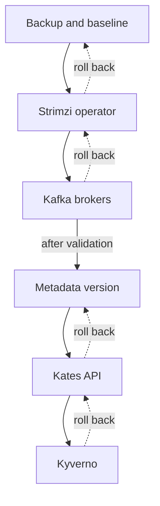

# Upgrade Playbook

You own the upgrade window for `krafter`, the [Kafka cluster under test](appendix-a-glossary.md#gl-krafter), and before anything moves the payments team asks one question: if the new brokers misbehave, can you go back? This playbook answers it component by component, with a backup and a recorded [baseline](appendix-a-glossary.md#gl-baseline) before each move and a rollback step after it. You need a kubeconfig with cluster-admin rights, `helm` 3, `velero` and the `kates` CLI on your path, and access to the published charts at `oci://ghcr.io/bmscomp/charts`. Budget time by what rolls: an operator or Kafka upgrade takes as long as a rolling restart of every broker, while the Kates API rolls within its upgrade's eight-minute Helm timeout.

## Upgrade Strategy

The components move in a fixed order. The [Strimzi operator](appendix-a-glossary.md#gl-operator) goes first, because its window must contain the Kafka version that follows. Kafka goes next, in two steps: the brokers, then the metadata version once they pass validation. The Kates API and [Kyverno](appendix-a-glossary.md#gl-kyverno) don't depend on the Kafka version and move after it. The figure shows that order and the rollback from each move:



After any upgrade, run `make gameday`, the automated pipeline of a [Game Day](appendix-a-glossary.md#gl-game-day), against the upgraded stack.

### What Each Rollback Undoes

Each component rolls back by a different mechanism, and each leaves something behind. The table says which mechanism, and what the rollback can't undo:

| Component | Rollback | What it can't undo |
|-----------|----------|--------------------|
| Kafka version | `helm upgrade` with the previous `kafkaVersion`, then a rolling restart | Nothing, while the metadata version stays pinned |
| KRaft metadata version | A safe downgrade only | A raise across a metadata format change |
| Strimzi operator | `helm rollback` | A CRD stored-version change already applied to the objects |
| Kates API | `helm rollback` | Database migrations the new version ran at start |
| Kyverno | `helm rollback` | A policy someone switched to `Enforce` since |

The metadata row is the one that ends a rollback, and [Two Versions, Two Steps](#two-versions-two-steps) explains why.

## Two Versions, Two Steps

A Kafka cluster runs two versions at once. The Kafka version is the software the brokers run, and the [metadata version](appendix-a-glossary.md#gl-metadata-version) is the format of the [KRaft](appendix-a-glossary.md#gl-kraft) metadata log they write. An operator release runs a window of Kafka versions, and a cluster's metadata version can never be newer than its Kafka version. So a Kafka upgrade is two steps, the brokers and then the metadata, and an operator upgrade must keep every running cluster inside the new window.

At first install, `kates deploy` pins `kafka.metadataVersion` to the newest minor line below the Kafka version that the operator's window holds, or to the Kafka version's own line when the window has none below it. A later upgrade keeps that pin until you raise it. Four moves follow from the model:

| Move | Allowed when | What refuses it |
|------|--------------|-----------------|
| Raise Kafka | The new version is inside the running operator's window | Strimzi, which marks the `Kafka` resource NotReady |
| Raise the metadata version | The new brokers have passed validation | Nothing: it is your decision |
| Lower Kafka | The older version still supports the pinned metadata version | Strimzi |
| Upgrade the operator | Every running cluster is inside the new window | `kates deploy`, which names the cluster outside it |

### Where the Versions Are Pinned

The versions this release pins, and the operator and Kafka pair it ships, are in the [Version & Compatibility Matrix](appendix-d-versions.md). `kates versions` prints the running operator's window, and `kates versions kafka --strimzi-version <v>` prints another release's.

### Limits

Raising the metadata version can be one-way. A rollback needs an older Kafka that supports the cluster's metadata version, so hold `kafka.metadataVersion` at the level the cluster runs until the new version passes validation. Lowering it again is a safe downgrade, which Kafka allows only when no level in between changed the metadata format. Strimzi attempts it, and reports a warning in the `Kafka` resource's status when Kafka refuses. KIP-778 [@kip778] also describes an unsafe downgrade that drops metadata, but Kafka doesn't implement it and Strimzi never attempts it, so a raise across a metadata change is one-way.

::: {.callout-tip title="Try it: which Kafka versions can krafter move to without touching the operator?"}
Run `kates versions`, then `kubectl get kafka krafter -n kafka -o jsonpath='{.status.kafkaVersion} {.status.kafkaMetadataVersion}'`. The newest version in the window is the furthest the brokers can go without an operator upgrade, and the metadata version you read is the one a rollback must keep.
:::

## Before and After Every Upgrade

The same checks bracket every move, so they live here once and each component's steps link to them. The re-test is the running example: `payments-scenarios.yaml`, whose gates encode the 2,000 records per second and the P99 of 100 ms, and `payments-integrity-broker.yaml`, whose INTEGRITY run checks that a broker failure loses no acknowledged record.

### Pre-Upgrade Checks

An upgrade starts only when every row holds:

| Check | Confirm with | Expect |
|-------|--------------|--------|
| A fresh backup | `kubectl get backup <name> -n velero -o jsonpath='{.status.phase}'` | `Completed` |
| A LOAD baseline | `kates test apply -f payments-scenarios.yaml --wait` | Exit 0, every gate passed |
| An integrity verdict | `kates test get <id>` on the resilience run's `Test Run` | `DONE`, `Lost` 0, `Verdict` PASS |
| Every broker running | `kubectl get pods -n kafka -l strimzi.io/cluster=krafter` | Every pod `Running` |
| `krafter` ready | `kubectl wait kafka/krafter -n kafka --for=condition=Ready` | Condition met |
| No partition short of a replica | `kafka_server_replicamanager_underreplicatedpartitions` in Prometheus | 0 on every broker |
| The release notes read | The component's release page | No breaking change you haven't planned for |

The `kafka-cluster` chart owns the backup objects. Setting `backup.enabled=true` renders a daily [Velero](appendix-a-glossary.md#gl-velero) `Schedule` named `<cluster>-daily-backup` and, with `backup.preUpgrade` (on by default), a one-shot `Backup` named `<cluster>-pre-upgrade-r<revision>` as a `pre-upgrade` Helm hook, so a chart-driven upgrade snapshots itself. Take an ad-hoc backup as well, then record the baseline and the verdict:

```bash
# Confirm the schedule exists (it comes from backup.enabled in the values)
kubectl get schedule krafter-daily-backup -n velero

# Take an ad-hoc pre-upgrade backup as well, and confirm it completed
velero backup create kafka-pre-upgrade --include-namespaces kafka --wait
kubectl get backup kafka-pre-upgrade -n velero -o jsonpath='{.status.phase}'

# The LOAD baseline: its gates are the pass criterion
kates test apply -f payments-scenarios.yaml --wait
kates test baseline set <pre-id>

# The loss check: read the Test Run it prints with kates test get once DONE
kates resilience run -f payments-integrity-broker.yaml
```

Keep `<pre-id>`, the LOAD run's ID: the post-upgrade comparison needs it.

### Post-Upgrade Checks

An upgrade is done when all of these hold, in this order: the pre-upgrade rows for the brokers, `krafter` and the replicas, then the re-test, then `make gameday`. The re-test runs the same files, and the scenario file's gates decide it, not a percentage you choose afterwards:

```bash
kates test apply -f payments-scenarios.yaml --wait
kates report diff <pre-id> <post-id>
kates report regression <post-id>
kates resilience run -f payments-integrity-broker.yaml
```

Read the `produce` row of `kates report diff` for the throughput and P99 against the 2,000 records per second and the 100 ms targets. `kates report regression` compares the new run with the LOAD baseline you set. [Consumer lag](appendix-a-glossary.md#gl-consumer-lag) alerts should not be firing. `kates report compare` puts more than two runs side by side when you want the trend across upgrades.

## Strimzi Operator Upgrade

The operator is the `strimzi-operator` release of the wrapper chart (`charts/strimzi-operator`) in its own `strimzi-operator` namespace, and it moves before Kafka. Run the [Pre-Upgrade Checks](#pre-upgrade-checks) first.

### Step 1 — Save the Strimzi CRDs

Read the [Strimzi releases](https://github.com/strimzi/strimzi-kafka-operator/releases) page for breaking changes, then save the [CRDs](appendix-a-glossary.md#gl-crd). Helm doesn't manage them, so neither `helm rollback` nor the Velero backup restores them, and this file is the only way back:

```bash
# Every Strimzi CRD, strimzipodsets.core.strimzi.io included
kubectl get crd -l strimzi.io/crd-install=true -o yaml \
  > strimzi-crds-<current-version>.yaml
```

### Step 2 — Upgrade the Operator

A production operator upgrade pauses reconciliation first, so that nothing rolls before you have checked the new operator. Annotate every `Kafka`, `KafkaConnect`, `KafkaMirrorMaker2` and `KafkaBridge` with `strimzi.io/pause-reconciliation=true`, upgrade the release from the values it runs with, and verify the operator in isolation. Then unpause the Kafka clusters, wait for each to report `Ready`, and unpause the rest. [Upgrading the Operator](deploying-strimzi-operator.md#upgrading-the-operator), in Deploying the Strimzi Operator, gives the commands and the reasoning behind each gate.

::: {.callout-warning title="The CLI pauses nothing"}
Once you confirm, the new operator reconciles everything it watches as soon as it starts, so every Kafka cluster rolls at once, and so does every Kafka Connect and MirrorMaker 2 cluster on the operator's default image. Every `kates deploy` run, with `--strimzi-version` or without it, upgrades the operator release with `--reset-values` and the Kind or generic overlay, so an operator installed with `values-prod.yaml` loses the drain cleaner, upstream's operator NetworkPolicy and both PodDisruptionBudgets. On a production cluster, run `kates deploy --with-strimzi=false`, which leaves the operator release alone.
:::

On a development or test cluster, the CLI drives the upgrade so the wrapper's values, schema and CRD hook apply, and so the checks run first:

```bash
# What would change, and whether it is allowed
kates deploy --strimzi-version <new-version> --dry-run
# Fetches and reads the chart, then upgrades
kates deploy --strimzi-version <new-version>
```

Before anything is installed, the CLI refuses three moves:

| The CLI refuses | When |
|-----------------|------|
| A downgrade | The requested operator is older than the installed one |
| A window that drops a running cluster | A Kafka cluster the operator runs is outside the new window; the error names it |
| Crossing Strimzi 1.0 | Strimzi resources still exist in a CRD whose stored version isn't `v1` |

Otherwise it asks once and lists the clusters that will roll. An empty pre-v1 CRD doesn't block the move: the CLI replaces it on its own. `kates versions strimzi` lists the versions that exist (`--resolve` pulls each chart to show its Kafka window). Upgrading around the CLI with a raw `helm upgrade` of the upstream chart bypasses the wrapper and its CRD hook, and the CRDs then freeze at the version first installed.

### Step 3 — Move the Drain Cleaner With the Operator

The [Drain Cleaner](appendix-a-glossary.md#gl-drain-cleaner) is part of the `strimzi-operator` release (`charts/strimzi-operator/templates/drain-cleaner.yaml`) when `drainCleaner.enabled` is true, which its prod values set. The `drainCleaner.image` value pins its image. To upgrade it, bump the image tag and upgrade the operator release from the values it runs with, which carry the overlay it was installed with and the DNS domain the deploy scripts inject:

```bash
helm get values strimzi-operator -n strimzi-operator -o yaml > operator-current.yaml

helm upgrade strimzi-operator oci://ghcr.io/bmscomp/charts/strimzi-operator \
  -n strimzi-operator \
  -f operator-current.yaml \
  --set drainCleaner.image=quay.io/strimzi/drain-cleaner:<version>

kubectl get pods -n strimzi-operator -l app=strimzi-drain-cleaner
```

If `operator-current.yaml` sets `strimziVersion`, the release runs an operator other than the repository's pin, and upgrading it from `oci://ghcr.io/bmscomp/charts/strimzi-operator` changes the operator as well. Stop, and upgrade the operator first.

### Step 4 — Verify the Operator

The operator pod should be running, and its log free of errors:

```bash
kubectl get pods -n strimzi-operator
kubectl logs deployment/strimzi-cluster-operator -n strimzi-operator --tail=20
```

### Check the Stored API Versions

The `kafka-cluster` chart renders `kafka.strimzi.io/v1`, so a chart-managed cluster needs nothing after a Strimzi release that stops serving an older API version. If you keep hand-written Strimzi manifests, change their `apiVersion` and re-apply them. The CRD's status shows what the cluster still stores:

```bash
kubectl get crd kafkas.kafka.strimzi.io -o jsonpath='{.status.storedVersions}'
```

### Step 5 — Roll Back the Operator

The operator release rolls back by Helm revision. A Helm rollback doesn't revert the CRDs, so re-apply the manifest Step 1 saved. It can't undo a stored-version change already applied to the objects:

```bash
helm history strimzi-operator -n strimzi-operator
helm rollback strimzi-operator <previous-revision> -n strimzi-operator
kubectl apply -f strimzi-crds-<current-version>.yaml

# Every Kafka resource reconciled again
kubectl get kafka,kafkatopic,kafkauser -n kafka
```

Next, upgrade Kafka.

## Kafka Version Upgrade

The Kafka version is a chart value, not a hand-edited CR: `kafkaVersion` renders `spec.kafka.version`, and `kafka.metadataVersion` renders `spec.kafka.metadataVersion`. The upgrade raises the first and pins the second, as [Two Versions, Two Steps](#two-versions-two-steps) explains.

### Step 1 — Run the Pre-Upgrade Checks

Run every row of the [Pre-Upgrade Checks](#pre-upgrade-checks) and keep `<pre-id>`. Record the Kafka version the cluster runs, too:

```bash
kubectl get kafka krafter -n kafka -o jsonpath='{.spec.kafka.version}{"\n"}'
```

### Step 2 — Upgrade the Brokers

Start from the values the release runs with, change the version, and pin the metadata version the cluster runs now. The release is `krafter` when `kates deploy` installed it and `kafka-cluster` when `make kafka` did (`helm list -n kafka` shows which), while the Kafka cluster is `krafter` either way. The second command prints the metadata version a rollback must keep:

```bash
# The Helm release: krafter from kates deploy, kafka-cluster from make kafka
RELEASE=krafter

# Every value the release was installed with — its files and its --set flags
helm get values "${RELEASE}" -n kafka -o yaml > krafter-current.yaml

# The metadata version the cluster runs now
kubectl get kafka krafter -n kafka -o jsonpath='{.status.kafkaMetadataVersion}{"\n"}'

# The running operator's Kafka window, which must contain <new-version>
kates versions

helm upgrade "${RELEASE}" oci://ghcr.io/bmscomp/charts/kafka-cluster -n kafka \
  -f krafter-current.yaml \
  --set-string kafkaVersion=<new-version> \
  --set-string kafka.metadataVersion=<current-metadata-version>
```

`krafter-current.yaml` carries `kafka.metadataVersion` only when the install set it, which `kates deploy` and the Kind overlay do. Otherwise the default of the chart you upgrade from applies, and that can raise it in the same step, so always pass it.

Rebuild nothing from the repository's files. `kates deploy` and `scripts/deploy-kafka-generic.sh` install the release with `.build/values-detected.yaml` first, and the node pools, their zones and storage classes come from it. `kates deploy` also adds `--set` flags no file records, the metadata version among them. If you do keep the values in files, re-run the exact chain the install used, generated file included, and set the new version last.

::: {.callout-caution title="Keep the values chain the install used"}
A chain without `.build/values-detected.yaml` renders other pool names. A pool's name is its identity: each renamed pool is a new pool with new, empty volumes, while the old pools drop out of the release but keep running with the data. `kates deploy --kafka-version` applies at first install only, and on a running cluster it prints `Kafka Cluster already deployed. Skipping.` and changes nothing.
:::

### Step 3 — Watch the Rolling Restart

Strimzi restarts the brokers one at a time and honors each [PodDisruptionBudget](appendix-a-glossary.md#gl-pdb). Watch the pods turn over and wait for the `Kafka` resource to report `Ready`:

```bash
kubectl get pods -n kafka -w
kubectl wait kafka/krafter -n kafka --for=condition=Ready --timeout=30m

# The operator runs in its own namespace
kubectl logs deployment/strimzi-cluster-operator -n strimzi-operator -f
```

### Step 4 — Verify the Brokers

Run the [Post-Upgrade Checks](#post-upgrade-checks). The command below prints the Kafka version and the metadata version as Strimzi reports them; the second value should still be the one Step 2 pinned:

```bash
kubectl get kafka krafter -n kafka \
  -o jsonpath='{.status.kafkaVersion} {.status.kafkaMetadataVersion}{"\n"}'
```

### Step 5 — Raise the Metadata Version

Only once the brokers pass validation, and only when you can give up the rollback, raise the metadata version to the new version's line. This is the one move in the playbook with no step back:

```bash
helm get values "${RELEASE}" -n kafka -o yaml > krafter-current.yaml

helm upgrade "${RELEASE}" oci://ghcr.io/bmscomp/charts/kafka-cluster -n kafka \
  -f krafter-current.yaml \
  --set-string kafka.metadataVersion=<new-major.minor>
```

### Step 6 — Roll Back the Brokers {#kafka-version-rollback}

Before Step 5, a rollback is the same `helm upgrade` with the previous `kafkaVersion`, and Strimzi rolls the brokers back one at a time. The previous version must still be inside the running operator's window (`kates versions` prints it) and must support the `kafka.metadataVersion` in `krafter-current.yaml`, which the upgrade pinned:

```bash
helm get values "${RELEASE}" -n kafka -o yaml > krafter-current.yaml

helm upgrade "${RELEASE}" oci://ghcr.io/bmscomp/charts/kafka-cluster -n kafka \
  -f krafter-current.yaml \
  --set-string kafkaVersion=<previous-version>

kubectl wait kafka/krafter -n kafka --for=condition=Ready --timeout=30m
```

Confirm the brokers serve the old version with the Step 4 command, then run the integrity check again: `kates resilience run -f payments-integrity-broker.yaml`, and `kates test get <id>` on its `Test Run` once it's `DONE`.

Next, upgrade the Kates API.

## Kates API Upgrade

The `kates` chart installs the Kates API, the service in the cluster that runs your tests ([Architecture & Design](02-architecture.md)). The chart pins its image: `values.yaml` sets `image.tag` to the release's version, the chart's `appVersion`. The generic, corporate and production overlays leave it alone, and only `values-native.yaml` pins the native tag. Building or pulling a newer image changes nothing the Deployment runs, and `kubectl rollout restart` only restarts the pinned tag.

### Step 1 — Find the Chart for the New Version

A chart version and the Kates API version it ships differ, so read the pair from the chart itself. The [Version & Compatibility Matrix](appendix-d-versions.md) lists the pair for this release:

```bash
helm show chart oci://ghcr.io/bmscomp/charts/kates --version <chart-version> \
  | grep appVersion
```

### Step 2 — Upgrade the Release

An upgrade is a `helm upgrade` of the `kates` release that sets the new tag. It runs from the values the release runs with and from the published chart of the version you are moving to, so the chart's templates and the image agree:

```bash
# Every value the release was installed with — its files and its --set flags
helm get values kates -n kates -o yaml > kates-current.yaml

helm upgrade kates oci://ghcr.io/bmscomp/charts/kates \
  --version <chart-version> -n kates \
  -f kates-current.yaml \
  --set-string image.tag=<new-version> \
  --timeout 8m --wait
```

The native image is published as `<new-version>-native`, the tag `values-native.yaml` pins; set that instead on a release that runs it.

This step and its rollback apply to a Kates API that `kates deploy` or the chart installed. `make kates-deploy` applies the raw manifests in `kates/k8s/` and creates no [Helm release](appendix-a-glossary.md#gl-helm-release), so `helm get values kates` fails with `release: not found`. There, set the new image in `kates/k8s/deployment.yaml`, apply it again with `kubectl apply -f kates/k8s/deployment.yaml`, and verify as below.

### Step 3 — Verify the Image

Verify that the new pods rolled out, run the new image, and answer. No `kates` command reports the Kates API's version, so the Deployment's image is the evidence:

```bash
kubectl rollout status deployment/kates -n kates --timeout=300s
kubectl get deployment kates -n kates \
  -o jsonpath='{.spec.template.spec.containers[0].image}'
kates health
```

::: {.callout-tip title="Try it: what does the Kates API actually run?"}
Run the image command above, then `kates version`. The first names the Kates API's image, and the second reports only the CLI you typed it into, so the two can differ without anything being wrong.
:::

### Upgrade a Kind Cluster's Local Image

On a Kind cluster, `kates deploy` runs a local native image pinned with `pullPolicy: Never` instead of a published tag. It is `kates:native-local`, built from your working tree, or else the `kates:native` that `make kates-native` pulled from the registry or built. Neither tag changes from one build to the next. There, check out the new version, build `kates:native-local` from it, and roll the Deployment onto that tag with an annotation that carries the image ID; a release that ran `kates:native` moves to it. Without the annotation the rendered Deployment is identical and nothing restarts:

```bash
make kates-image-native-local

IMAGE_ID=$(docker image inspect --format '{{.Id}}' kates:native-local)
helm upgrade kates charts/kates -n kates \
  -f kates-current.yaml \
  --set-string image.tag=native-local \
  --set-string podAnnotations.kates-image-id="${IMAGE_ID}" \
  --timeout 8m --wait
```

`make kates-image-native-local` builds the image and loads it onto the Kind node but deploys nothing; the `helm upgrade` rolls it out. The Deployment's image reads `kates:native-local` whichever build it runs, so the image ID is the evidence here. Once the rollout finishes, the annotation on the Deployment's pod template matches the image you built:

```bash
kubectl rollout status deployment/kates -n kates --timeout=300s

# The two IDs match
kubectl get deployment kates -n kates \
  -o jsonpath='{.spec.template.metadata.annotations.kates-image-id}{"\n"}'
docker image inspect --format '{{.Id}}' kates:native-local

kates health
```

### Step 4 — Roll Back the Kates API

The upgrade was a Helm revision, so the rollback is one too. `kubectl rollout undo` would revert the pods while the release still records the new tag, and the next `helm upgrade` from `helm get values` would bring it straight back. The rollback restores the old image but not the database: migrations the new version ran at start stay applied. Afterwards, check the image as in Step 3 and that scheduled tests still fire:

```bash
helm history kates -n kates
helm rollback kates <previous-revision> -n kates --wait

kates health
kates schedule list
```

Next, upgrade the monitoring stack.

## Monitoring Stack Upgrade

The `monitoring` release lives in the `kafka` namespace when `make monitoring` installed it, and in `monitoring` (the `--monitoring-ns` default) when `kates deploy` did. Upgrade it from the values it runs with, rather than with `--reuse-values`, which applies the release's values over the *old* chart's defaults and so ignores every default the new chart changes. Then check the release and its pods, and roll back by revision if either is wrong:

```bash
MON_NS=kafka   # or monitoring, for a release kates deploy installed

helm get values monitoring -n "${MON_NS}" -o yaml > monitoring-current.yaml

helm upgrade monitoring oci://ghcr.io/bmscomp/charts/kates-monitoring \
  --namespace "${MON_NS}" \
  -f monitoring-current.yaml

# Verify: the release is deployed and its pods, Grafana's among them, are Ready
helm status monitoring -n "${MON_NS}"
kubectl get pods -n "${MON_NS}"

# Roll back, if needed
helm history monitoring -n "${MON_NS}"
helm rollback monitoring <previous-revision> -n "${MON_NS}"
```

Next, upgrade Kyverno.

## Kyverno Upgrade

Kyverno's admission webhooks sit in the Kubernetes API server's request path, so a broken controller blocks admissions or lets them through unchecked. `kates deploy --with-kyverno` installs it as the `kyverno` release in the `kyverno` namespace, from the `kyverno/kyverno` chart of `https://kyverno.github.io/kyverno/` at the version the CLI pins. A later `kates deploy` leaves an existing release alone, so the upgrade is yours.

### Step 1 — Check the PolicyExceptions

Read the [Kyverno releases](https://github.com/kyverno/kyverno/releases) page for breaking changes, especially policy API deprecations. Each Kyverno release serves a set of [PolicyException](appendix-a-glossary.md#gl-policyexception) API versions and drops alpha and beta ones, so list the version each exception uses:

```bash
kubectl get policyexceptions -A \
  -o custom-columns=NS:.metadata.namespace,NAME:.metadata.name,API:.apiVersion
```

::: {.callout-important title="PolicyException API versions move"}
Make sure every exception uses an API version the new release still serves, such as `kyverno.io/v2`, before you upgrade. Alpha and beta versions are the ones a release drops.
:::

### Step 2 — Upgrade the Kyverno Release

The release's values carry the `--set` flags `kates deploy` installed it with, among them one replica per controller and the PolicyException settings, so upgrade from them. The chart installs and upgrades its CRDs itself. Pin `--version` to the chart release you are moving to; without it Helm takes the newest chart in the repository:

```bash
helm repo update kyverno

# The release's own values, applied over the new chart's defaults
helm get values kyverno -n kyverno -o yaml > kyverno-current.yaml

helm upgrade kyverno kyverno/kyverno \
  -n kyverno \
  --version <chart-version> \
  -f kyverno-current.yaml
```

### Step 3 — Verify the Policies

The controller pods should be running, every ClusterPolicy ready, and no new violation reported:

```bash
kubectl get pods -n kyverno
kates kyverno status
kates kyverno violations
```

### Step 4 — Roll Back Kyverno

Kyverno rolls back by Helm revision. A policy someone switched to `Enforce` since the upgrade stays in that mode:

```bash
helm history kyverno -n kyverno
helm rollback kyverno <previous-revision> -n kyverno
kates kyverno status
```

### Switching Between Enforce and Audit Modes

An upgrade is a natural moment to tighten a policy, and the safe order is the same every time. Deploy a policy change in `Audit` mode first, read its PolicyReports with `kates kyverno violations`, and switch policies to `Enforce` one at a time with `kates kyverno enforce <policy-name>`:

```bash
# Check current violations before switching to Enforce
kates kyverno violations --namespace kafka

# Switch to Enforce only when clean
kates kyverno enforce kates-pod-security-standards
```

## Common Upgrade Issues

Find the behavior you see in the Symptom column. The first row is what you get when you ask for a Kafka version the running operator can't run, which is why the operator goes first:

| Symptom | Fix |
|---------|-----|
| `Kafka` resource NotReady after setting `kafkaVersion` | Check the version against `kates versions`; upgrade the operator first, as in [Strimzi Operator Upgrade](#strimzi-operator-upgrade) |
| Brokers stuck in CrashLoopBackOff | Read `kubectl logs -n kafka <broker-pod> --previous`, then roll back as in [Step 6 — Roll Back the Brokers](#kafka-version-rollback) |
| Topics not reconciling after an operator upgrade | Check the stored versions as in [Check the Stored API Versions](#check-the-stored-api-versions) |
| The rollout moves one broker at a time | Expected: `kubectl get pdb -n kafka` shows the budget Strimzi honors |

The brokers now move forward and back on your schedule, but the payments data still has to get into them. [Kafka Connect & CDC Pipelines](21-kafka-connect.md) deploys Connect as its own release beside `krafter` and builds the Debezium pipeline that feeds it.
