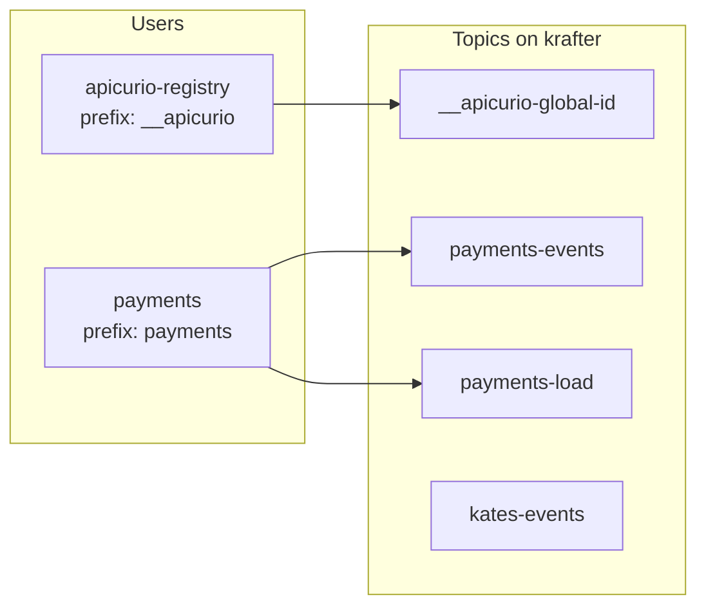
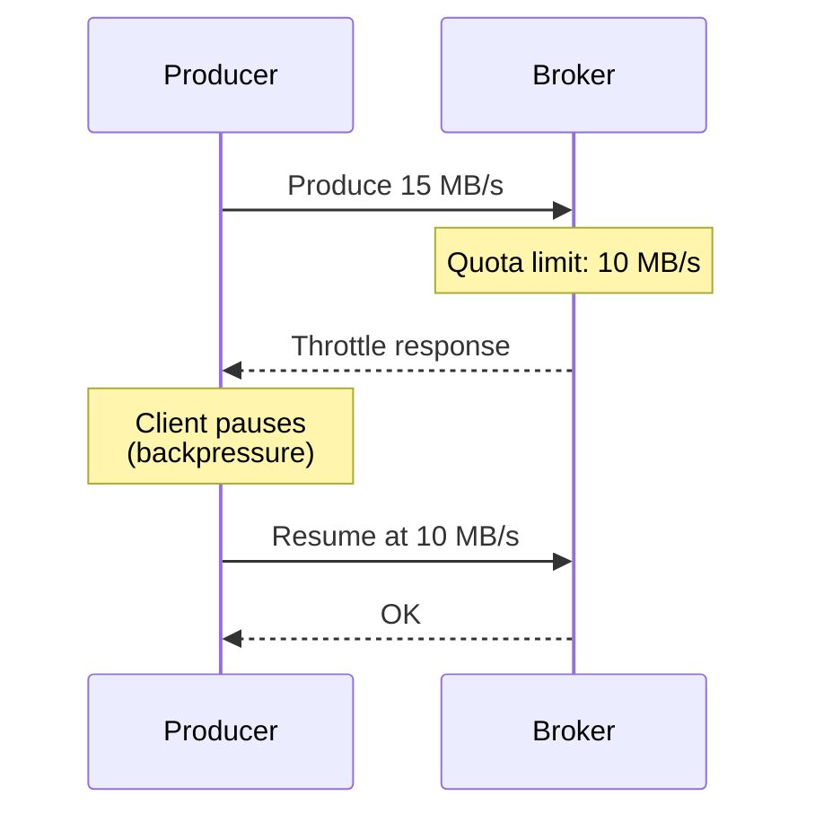

# Multi-Tenancy

As the platform profile ships it, `krafter`, the [Kafka cluster under test](appendix-a-glossary.md#gl-krafter), already carries several tenants — the Kates API, Kafka UI, the schema registry and Kafka Connect among them — each with its own user and topic prefix. Before the payments platform joins them, you have to say what keeps its producer out of their topics, its traffic inside its share of the brokers, and its credentials inside its own namespace. You also have to say how you take it off again without touching a neighbor. Kafka gives you three tools for that — prefixed ACLs, per-user quotas and NetworkPolicy — and the `kafka-cluster` chart lets you declare all three in one block of values.

After this chapter, you can:

- Onboard a tenant declaratively — prefix-scoped topics, a dedicated [`KafkaUser`](appendix-a-glossary.md#gl-kafkauser) with scoped [ACLs](appendix-a-glossary.md#gl-acl), and a [NetworkPolicy](appendix-a-glossary.md#gl-networkpolicy) entry
- Size per-user quotas and partition counts against a tenant's throughput profile
- Track per-tenant bandwidth and [consumer lag](appendix-a-glossary.md#gl-consumer-lag) with topic-prefix PromQL queries
- Decommission a tenant cleanly without touching its neighbors

## Multi-Tenancy Model

In this book a tenant is one service with one `KafkaUser` and one topic prefix. `krafter` separates its tenants by prefix-scoped tenancy: every tenant's topics and consumer groups start with its name, and its user's ACLs grant that prefix and nothing else. The figure shows what a prefixed ACL reaches:



Six things separate one tenant from another, and each has one mechanism and one enforcer:

| Dimension | Mechanism | Enforcement |
|-----------|-----------|-------------|
| Data | Prefix-scoped ACLs | Kafka ACL evaluator |
| Bandwidth | Per-user produce and consume quotas | Broker throttling |
| Broker thread time | `requestPercentage` quota | Broker network and I/O threads |
| Network | Kubernetes NetworkPolicies, once the listeners carry [`networkPolicyPeers`](appendix-a-glossary.md#gl-networkpolicypeers) | CNI plugin |
| Storage | Topic-level retention | Broker log retention |
| Credentials | Per-user SCRAM Secrets | Strimzi User Operator |

The network row is the one with a condition: until the listeners carry `networkPolicyPeers`, a tenant's entry admits its pods but keeps no other pod out.

One rule holds the model together: no tenant's name may begin another's. A `pay` tenant's `patternType: prefix` ACL on `pay` also matches every `payments-*` topic, so check a new name against `kubectl get kafkausers -n kafka` before you add it. The platform profile breaks the rule once, on purpose: `kates-connect` holds a `kates-` prefix grant beside its own `kates-connect-` one, so the Connect user reads and writes the Kates API's topics.

::: {.callout-tip title="Try it: which tenants can reach the Kates API's topics?"}
Run `kates security acl-map` and read the users listed under each `kates-` topic. `kates-connect` should appear under every one of them through its `kates-` prefix, beside any user whose ACL names the literal `*`.
:::

## Topic Naming Convention

The service name at the front of every topic is what the rest of this chapter keys on. Step 2's ACLs grant topics and consumer groups by that prefix, and the monitoring queries select a tenant's topics and groups by it. A service's topic names follow this shape:

```text
<service-name>-<domain>[-<qualifier>]
```

The patterns below cover the usual kinds of topic:

| Pattern | Example | Purpose |
|---------|---------|---------|
| `<svc>-events` | `payments-events` | Domain event stream |
| `<svc>-commands` | `orders-commands` | Command/request queue |
| `<svc>-dlq` | `orders-dlq` | Dead letter queue |
| `<svc>-internal-<x>` | `cache-internal-sync` | Internal coordination |
| `__<svc>-<x>` | `__apicurio-global-id` | Framework-internal topics |

Four rules keep the prefix usable as an ACL and a metric selector:

- Lowercase, hyphen-separated
- Always prefix with the service name
- Use the `__` prefix for framework and infrastructure topics
- [Dead letter queues](appendix-a-glossary.md#gl-dead-letter-queue) use the `-dlq` suffix, `delete` cleanup and a bounded retention — never `compact`, which keeps only the latest failure per key and refuses records without one

## Onboarding a New Service

Topics, users and network access are all `kafka-cluster` chart values, so one tenant is one block of values and one `helm upgrade`. The examples below go in a `tenants.yaml` that holds every tenant, layered after the values the release already runs with. The worked tenant is `payments`: you run the payments platform, and before it moves onto `krafter` it needs its own topics, user and network grant. Its `payments` prefix also covers `payments-load` and `payments-integrity`, the topics the book's Kates runs create, so the team that owns the real topics owns the test topics too.

### Step 1 — Define Topics

`topics.items` is keyed by topic name, and `topics.defaults` fills in what you leave out. `replicas` defaults to the rendered broker count capped at 3, and `min.insync.replicas` to `replicas - 1` bounded to 1–2, so neither needs restating per topic:

```yaml
topics:
  items:
    payments-events:
      partitions: 6
      config:
        retention.ms: "604800000"       # 7 days
        cleanup.policy: delete
        compression.type: lz4
    payments-dlq:
      partitions: 3
      config:
        retention.ms: "604800000"       # 7 days to inspect and replay
        cleanup.policy: delete
```

### Step 2 — Create the User and Its ACLs

`users.items` is keyed by principal name, and each entry is the `KafkaUser` spec. The quotas below are the schema registry's, and [How Quotas Work](#how-quotas-work) explains what each one limits:

```yaml
users:
  items:
    payments:
      authentication:
        type: scram-sha-512
      quotas:
        producerByteRate: 10485760      # 10 MB/s
        consumerByteRate: 20971520      # 20 MB/s
        requestPercentage: 15           # 15% of one broker thread's time
      authorization:
        type: simple
        acls:
          - resource:
              type: topic
              name: "payments"
              patternType: prefix
            operations: ["Read", "Write", "Create", "Describe"]
            host: "*"
          - resource:
              type: group
              name: "payments"
              patternType: prefix
            operations: ["Read", "Describe"]
            host: "*"
```

`Create` lets the service make topics under its prefix itself, with the brokers' defaults rather than `topics.defaults`. Leave it out for a tenant whose topics you declare in Step 1, and grant it to one that creates its own, like a schema registry or Connect.

### Step 3 — Allow Network Access

`networkPolicy.clients` names the tenant's pods and the listeners they may reach, and the chart turns the listener names into ports from `kafka.listeners`. Leave `listeners` out and the entry covers every internal listener; name one that `kafka.listeners` doesn't have and the render fails with the list of names it does have.

A later values file replaces `clients` rather than merging it. Copy every entry `helm get values` shows into `tenants.yaml` before adding yours; an entry you leave out is gone at the next upgrade. A `kates deploy` install has at least the `connect` entry:

```bash
# krafter from kates deploy; kafka-cluster for a release make kafka installed.
# Read the networkPolicy.clients list in the output.
helm get values krafter -n kafka -o yaml
```

The tenant's entry then goes after the release's own:

```yaml
networkPolicy:
  clients:
    # ...every entry the release already lists, unchanged
    - name: payments
      namespace: payments
      podSelector: { app.kubernetes.io/name: payments }
      listeners: [plain]
```

The grant lands in the chart's `krafter-kafka` policy, which `values-kind.yaml`, `values-dev.yaml` and a `kates deploy` on a cluster whose CNI it can't identify (EKS, GKE and AKS excepted) don't render. Where it renders, it admits the tenant's pods but keeps no one else out until the listeners carry `networkPolicyPeers` ([How the Policies Combine](17-security.md#how-the-policies-combine)). Add it anyway: it becomes the allow list the day they do. There is no namespace-wide grant, and an entry without `podSelector` fails the render, so a tenant whose values predate `networkPolicy.clients` has no grant of its own until it appears here.

### Step 4 — Apply and Verify

Start from the values the release runs with — every file and `--set` flag it was installed with — then render to see exactly what the tenant block adds, and upgrade. The release is `krafter` when `kates deploy` installed it and `kafka-cluster` when `make kafka` did — `helm list -n kafka` shows which — while the Kafka cluster is `krafter` either way:

```bash
# The Helm release: krafter from kates deploy, kafka-cluster from make kafka
RELEASE=krafter

helm get values "${RELEASE}" -n kafka -o yaml > krafter-current.yaml

helm template "${RELEASE}" oci://ghcr.io/bmscomp/charts/kafka-cluster -n kafka \
  -f krafter-current.yaml -f tenants.yaml |
  grep -E 'kind: (KafkaTopic|KafkaUser|NetworkPolicy)' -A2 | grep 'name:'

helm upgrade "${RELEASE}" oci://ghcr.io/bmscomp/charts/kafka-cluster -n kafka \
  -f krafter-current.yaml \
  -f tenants.yaml
```

::: {.callout-caution title="Upgrade from the release's own values, never from the repository's files"}
Don't rebuild the chain from the repository's files (`values-platform.yaml`, then an environment overlay). A release that `kates deploy` or `scripts/deploy-kafka-generic.sh` installed takes its node pools from `.build/values-detected.yaml`, which such a chain leaves out, so the pools it renders carry other names. A pool's name is its identity: each renamed pool is a new pool with new, empty volumes, and the old pools drop out of the release but keep running with the data.
:::

Then wait for the User Operator and confirm what the upgrade created:

```bash
# Wait for the User Operator to reconcile the credentials
kubectl wait kafkauser/payments --for=condition=Ready -n kafka --timeout=60s

# Check the Secret was generated
kubectl get secret payments -n kafka

# Check topics exist — the chart labels every topic for the cluster, not the
# tenant, so select by the cluster and read the name prefix
kubectl get kafkatopic -n kafka -l strimzi.io/cluster=krafter
```

### Step 5 — Configure the Service

The upgrade has created the tenant's [Secret](appendix-a-glossary.md#gl-secret), `payments`, but Strimzi writes it only into the Kafka cluster's namespace, `kafka` ([Cross-Namespace Credential Synchronization](17-security.md#cross-namespace-credential-synchronization)). A pod can read a Secret only from its own namespace, so a service that runs in `payments` needs a copy there. The Secret holds the password under `password`, and a ready-made `sasl.jaas.config` line beside it:

```bash
# Copy the tenant's password into the namespace its pods run in
PASSWORD=$(kubectl get secret payments -n kafka \
  -o jsonpath='{.data.password}' | base64 -d)
test -n "$PASSWORD" && kubectl create secret generic payments \
  -n payments --from-literal=password="$PASSWORD" \
  --dry-run=client -o yaml | kubectl apply -f -
```

Nothing keeps the copy in step. When the tenant's password changes, copy it again and restart the service's pods, which read it only when they start; [Password Rotation](17-security.md#password-rotation) walks through the same sequence for Kates.

The service's deployment then reads the copy. Step 3 granted the `plain` listener, which takes [SCRAM](appendix-a-glossary.md#gl-scram-sha-512) over a connection without TLS, so the client needs `security.protocol` set to `SASL_PLAINTEXT` as well as the SCRAM mechanism. The variable names below are an example; your application has to read them and hand them to its Kafka client:

```yaml
env:
  - name: KAFKA_BOOTSTRAP_SERVERS
    value: krafter-kafka-bootstrap.kafka:9092
  - name: KAFKA_SECURITY_PROTOCOL
    value: SASL_PLAINTEXT
  - name: KAFKA_SASL_USERNAME
    value: payments
  - name: KAFKA_SASL_PASSWORD
    valueFrom:
      secretKeyRef:
        name: payments         # the copy in the payments namespace
        key: password
  - name: KAFKA_SASL_MECHANISM
    value: SCRAM-SHA-512
```

Step 2 grants consumer groups by prefix too, so every consumer's `group.id` must start with `payments`, as in `payments-billing`. The brokers refuse a consumer whose group falls outside the prefix.

## How Quotas Work

A quota is the second wall between tenants: the ACLs decide what a tenant may touch, and the quota decides how much of the brokers it may use doing so. Strimzi's `quotas` block on a `KafkaUser` sets three of them, all bound to that user's principal:

| Field | What it limits |
|-------|----------------|
| `producerByteRate` | Bytes per second the user may produce |
| `consumerByteRate` | Bytes per second the user may fetch |
| `requestPercentage` | Share of a broker's network and I/O thread time the user's requests may take |

Each broker measures a user's rate over a short sliding window of samples. When a request takes the user past its limit, the broker still serves it but delays its response by the time that brings the rate back under the limit [@kip13]:



The broker never answers a throttled client with an error. The Kafka client waits out the delay, so a tenant over its quota sees higher latency, and its client reports the wait in `produce-throttle-time-avg` and `fetch-throttle-time-avg`.

### Limits

Quotas are enforced per broker. A 10 MB/s `producerByteRate` caps what the user sends to each broker, so the ceiling across `krafter` is that value times the brokers leading the tenant's partitions. `requestPercentage` is a share of one broker thread, where 100 equals one network or I/O thread's whole time.

::: {.callout-tip title="Try it: is a 10 MB/s quota a limit for the cluster or for each broker?"}
Run `kafka-producer-perf-test` as `payments` against `payments-events` with `--record-size 1024 --print-metrics`, once at `--throughput 15000` and once at `--throughput 45000`, from a pod the Step 3 grant admits. Compare `produce-throttle-time-avg` in the two runs' metrics. If the first run stays at zero, its 15 MB/s spread over enough partition leaders that no broker saw more than 10 MB/s.
:::

### Sizing a Tenant's Quotas

The `kafka-cluster` chart's platform profile already sizes its own tenants, and they make a usable scale. Pick the row whose traffic looks most like the new tenant's:

| User | Produce | Consume | Request share | Traffic |
|------|:-------:|:-------:|:-------------:|---------|
| `kafka-ui` | 1 MB/s | 50 MB/s | 10% | A read-mostly UI |
| `apicurio-registry` | 10 MB/s | 20 MB/s | 15% | A service |
| `kates-connect`, `kates-mm2` | 50 MB/s | 50 MB/s | 25% | A pipeline or a mirror |
| `kates-backend`, `litmus-chaos` | None | None | None | Load and faults |

The last row carries no `quotas` block at all. A quota on `kates-backend`, which generates the load you measure, would cap the test rather than the tenant.

A tenant's [partition](appendix-a-glossary.md#gl-partition) count follows the same profile. Its consumers can't outnumber its partitions usefully, since one partition feeds one consumer in a group. Its produce quota adds up across brokers only when its partition leaders spread over all of them, so give a tenant at least as many partitions as `krafter` has brokers. [The Cluster Under Test](03-cluster.md) explains what each partition costs the brokers.

## Monitoring a Tenant

Kafka's per-user quota and throttle-time MBeans aren't mapped by the JMX exporter rules the chart vendors (Strimzi's own rule set), so there are no per-user Prometheus metrics in this setup. You watch a tenant indirectly instead, by its topic prefix and its consumer groups.

### Consumer Lag by Group

The [Kafka Exporter](appendix-a-glossary.md#gl-kafka-exporter) reports lag per consumer group, so the tenant's groups are the ones that start with its prefix:

```promql
# Consumer lag by group (tenant)
kafka_consumergroup_lag{consumergroup=~"payments.*"}
```

### Bandwidth by Topic Prefix

Bandwidth is the sum of the tenant's topics' bytes-in rates, and dividing by the user's `producerByteRate` gives the fraction of the quota in use. The divisor below is the 10 MB/s of Step 2:

```promql
# Produce bandwidth per tenant topic (bytes per second)
sum by (topic) (
  rate(kafka_server_brokertopicmetrics_bytesin_total{topic=~"payments.*"}[5m])
)

# Fraction of the tenant's 10 MB/s produce quota in use
sum(rate(kafka_server_brokertopicmetrics_bytesin_total{topic=~"payments.*"}[5m]))
  / (10 * 1024 * 1024)
```

The fraction sums every broker, so a value under 1 doesn't prove that no broker throttled the tenant. A per-tenant Grafana board is the same queries with `topic=~"payments.*"` as a dashboard variable.

### Request Handler Saturation

The `requestPercentage` quota is enforced per user inside the broker, but only the pool-wide utilization is exported. The exported percentage is the meter's mean since the broker started, which hides a saturation that began an hour ago. So the chart's own alert rates the meter's count of idle nanoseconds over five minutes and divides by `1e9` to get a fraction:

```promql
# Broker request handler idle fraction (shared across all tenants)
avg by (namespace, strimzi_io_cluster, kubernetes_pod_name) (
  rate(kafka_server_kafkarequesthandlerpool_requesthandleravgidlepercent_count_total{
    namespace="kafka", strimzi_io_cluster="krafter", strimzi_io_name="krafter-kafka"
  }[5m])
) / 1e9
```

### Throttling

Broker-side throttle-time metrics aren't exported by the current JMX rules. Quota throttling surfaces on the client instead: a throttled tenant sees higher produce and fetch latency without errors, and its client's `produce-throttle-time-avg` and `fetch-throttle-time-avg` rise above zero, as [How Quotas Work](#how-quotas-work) explains.

### Alert Rules

The `kafka-cluster` chart renders the cluster's alerts as a [`PrometheusRule`](appendix-a-glossary.md#gl-prometheusrule) named `<cluster>-alerts`, scoped to that cluster by namespace and `strimzi_io_cluster`, so two clusters in one namespace never alert on each other's series. Three of them catch tenant-level problems, at the chart's default thresholds:

| Alert | Fires when | For | Severity |
|-------|------------|-----|----------|
| `KafkaConsumerGroupLag` | A group's lag is over 1,000,000 records | 15 m | warning |
| `KafkaConsumerGroupLagCritical` | A group's lag is over 10,000,000 records | 5 m | critical |
| `KafkaRequestHandlerSaturated` | A broker's handlers are idle under 30% of the time | 10 m | warning |

The live rules, with any thresholds your values changed, are in the cluster:

```bash
kubectl get prometheusrule krafter-alerts -n kafka -o yaml
```

`kates cluster alerts --group kafka-cluster.krafter.consumers` lists only the critical lag rule. The command shows a fixed set of alert names, and `KafkaConsumerGroupLag` isn't among them.

## Decommissioning a Tenant

Decommissioning is two moves, not one. Turning the tenant's entries off and upgrading stops the chart managing those objects. `keepOnDelete` is on by default, so the chart annotates every [`KafkaTopic`](appendix-a-glossary.md#gl-kafkatopic) and `KafkaUser` with `helm.sh/resource-policy: keep`: Helm leaves them behind on purpose, and the credentials stay valid until you delete them.

Deleting the tenant's block from `tenants.yaml` isn't enough: `krafter-current.yaml` still carries it from the upgrade that added it, and Helm merges the two. Set `enabled: false` on each entry instead:

```yaml
topics:
  items:
    payments-events: { enabled: false }
    payments-dlq: { enabled: false }
users:
  items:
    payments: { enabled: false }
networkPolicy:
  clients:
    # ...every other client, unchanged
    - name: payments
      enabled: false
```

Upgrade exactly as in Step 4, from `helm get values`, with the tenant turned off. Then remove what Helm kept:

```bash
# 1. Delete the user (revokes credentials and ACLs)
kubectl delete kafkauser payments -n kafka

# 2. Remove the credential copy from the tenant's namespace
kubectl delete secret payments -n payments

# 3. Delete the topics: this deletes their records, so check that the
#    tenant's groups show zero lag and nothing still reads them
kubectl delete kafkatopic payments-events payments-dlq -n kafka

# 4. Verify cleanup: no output from the first, 0 from the second
kubectl get kafkauser,kafkatopic -n kafka | grep payments
kubectl get networkpolicy krafter-kafka -n kafka -o yaml | grep -c payments
```

## Summary

- A tenant is one service with one user, one topic prefix and one network grant, and no prefix may begin another's.
- One block of chart values carries the whole tenant, and one upgrade from the release's own values applies it.
- Quotas are per broker and throttle rather than refuse, so a tenant over its limit shows up as latency.
- No per-user metric is exported, so you watch a tenant by its topic prefix and its consumer groups.
- Turning a tenant off stops the chart managing it; the user, topics and credential copy you delete by hand.

Every tenant on `krafter` now has its own user, prefix and grant, and the next thing that can break all of them at once is an upgrade of the cluster underneath. The [Upgrade Playbook](18-upgrade-playbook.md) moves the Strimzi operator, Kafka, the Kates API and Kyverno forward with a backup and a recorded baseline before each move, and says where the point of no return is.
