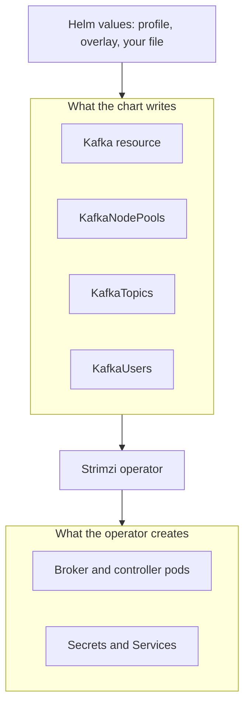
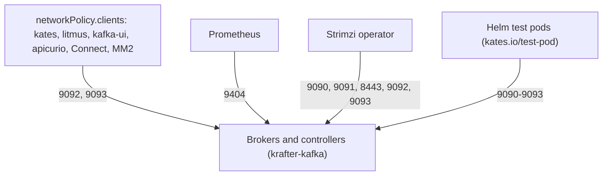
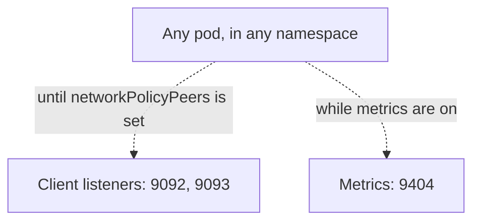
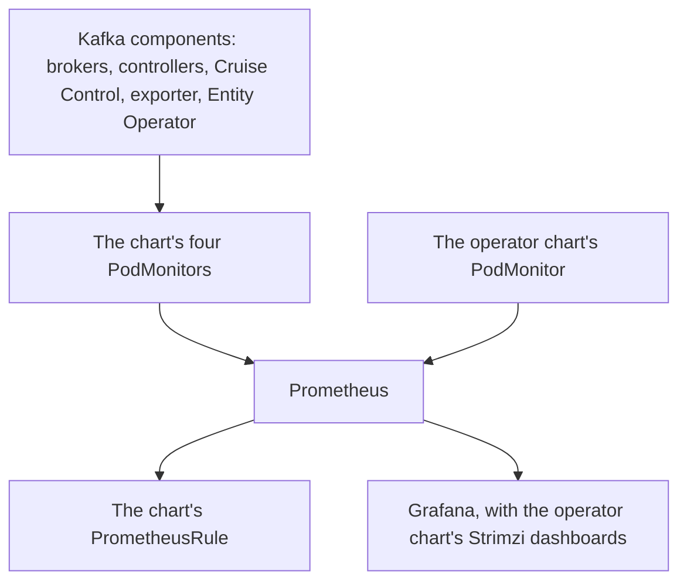

# Installing Kafka with the kafka-cluster Helm Chart

A Kafka cluster on Kubernetes is a set of [Strimzi](appendix-a-glossary.md#gl-strimzi) custom resources, and the `kafka-cluster` chart writes them for you: [KRaft](appendix-a-glossary.md#gl-kraft) controllers, broker pools spread across zones, [SCRAM-SHA-512](appendix-a-glossary.md#gl-scram-sha-512) users, managed topics, alerts and network policies. In this chapter you install [`krafter`](appendix-a-glossary.md#gl-krafter), the book's Kafka cluster under test, first with `kates deploy` and then with Helm alone, and verify it before any test runs against it. You need `kubectl`, Helm and a Kubernetes cluster, as [Prerequisites](#prerequisites) lists. [Kafka Deployment Engineering](15-kafka-deployment.md) explains the design behind the chart, and [Deployment Guide](12-deployment.md) installs the Kates stack itself.

After this chapter, you can:

- Deploy the cluster with `kates deploy` or direct Helm commands, layering the right environment overlay
- Verify health from the `Kafka` resource, node pools, topics, and user Secrets
- Connect clients from inside the cluster and through the external listener
- Customize topics, users, listeners, and broker pools in `values.yaml`

## What the Chart Creates

Before you run `helm install`, know what the chart creates and what turns it into running pods.

### What Gets Deployed

The chart writes custom resources, and the Strimzi operator, not Helm, creates the pods, Secrets and Services they describe:



Beside those four kinds, the chart renders the PodMonitors, the [PrometheusRule](appendix-a-glossary.md#gl-prometheusrule) of alerts, the NetworkPolicies and, when you turn them on, Cruise Control's rebalance templates and the Velero backup schedule. [Template File Reference](#template-file-reference) lists every one.

### How Strimzi Works

The chart doesn't create Kafka pods directly. It creates custom resources that describe your desired state, and the Strimzi operator watches them and does the rest. You apply a `Kafka` resource that says how many brokers you want and how they listen; the operator creates the pods, ConfigMaps, Secrets and Services. When you change the resource, for example by raising a pool's replicas, the operator detects the change and performs a rolling update. So you never edit pods directly: you edit the Helm values, run `helm upgrade`, and the operator reconciles. [How the Operator Works](deploying-strimzi-operator.md#how-the-operator-works) explains the loop.

### KRaft Mode (No ZooKeeper)

The chart deploys Kafka in KRaft mode, where Kafka manages its own metadata with a built-in Raft consensus protocol and there is no ZooKeeper. There is no separate ensemble to run, monitor or upgrade, and the controllers are node pools of the same cluster, managed by the same operator as the brokers.

## Prerequisites

You need the tools below, a cluster with room for the default layout and a namespace for the chart; the monitoring stack and Kyverno are optional.

### Tools

You need `kubectl` to talk to your Kubernetes cluster; every command in this chapter uses it to inspect or change cluster state, and it should stay within one minor version of the cluster. You need Helm, which renders the chart's templates from `values.yaml` and applies them. Docker is needed only for a local Kind or k3d cluster, where it runs the Kubernetes nodes as containers, and Kind only for a local cluster such as `panda`, the book's three-node Kind cluster. Use Kind 0.33 or newer: older releases don't publish the node image `config/cluster.yaml` asks for.

Check each tool answers:

```bash
kubectl version --client -o yaml | grep gitVersion
helm version --short
docker version --format '{{.Server.Version}}'
kind version  # only if using Kind
```

If any command fails, install the missing tool before continuing.

### Kubernetes Cluster

The cluster needs room for three brokers, three controllers and their helpers. The default layout's needs are:

| Requirement | Minimum | Recommended | Why |
|-------------|:-------:|:-----------:|-----|
| Nodes | 1 | 3+ (one per zone) | With three nodes, each broker runs on a different node, so a single node failure loses only one broker |
| CPU | 6 cores total | 12+ cores | Three brokers at 1 CPU each, three controllers at 0.5 CPU each, plus operator, exporter and Cruise Control |
| Memory | 16 GB total | 24+ GB | Brokers need 4 GB each for heap and page cache; controllers need 1 GB |
| Storage | 150 GB | 300+ GB | Each broker stores 50 GB of log data by default. Kafka is I/O-heavy, so use SSDs where you can |
| StorageClass | 1 | 1 per zone | PersistentVolumeClaims need a StorageClass to provision disks; for zone-aware deployments, each zone gets its own |

::: {.callout-note title="Cloud clusters already have a StorageClass"}
Managed Kubernetes services usually come with StorageClasses, for example `gp3` on AWS or `standard-rwo` on GKE. For a local Kind cluster, create them yourself, as [Step 1 — Storage Classes (Local/Kind Only)](#step-1--storage-classes-localkind-only) does.
:::

### Namespaces

The chart deploys everything into a single namespace (default: `kafka`). Create it before installing:

```bash
kubectl create namespace kafka --dry-run=client -o yaml | kubectl apply -f -
```

The `--dry-run=client | apply` pattern is idempotent: it creates the namespace if it doesn't exist and does nothing if it does, so it is safe to run more than once.

### Monitoring Stack (Optional but Recommended)

For metrics, dashboards and alerts, install the monitoring wrapper chart first. It is `kates-monitoring` (versions in the [Version & Compatibility Matrix](appendix-d-versions.md)), and it wraps kube-prometheus-stack with the Kates dashboards and scrape configuration:

```bash
helm pull oci://ghcr.io/bmscomp/charts/kates-monitoring --untar
helm upgrade --install monitoring ./kates-monitoring \
  -f kates-monitoring/values-generic.yaml \
  --namespace monitoring --create-namespace
```

The kafka-cluster chart then creates the `PodMonitor` and `PrometheusRule` resources the Prometheus operator discovers. Its NetworkPolicies admit Prometheus from the namespace in `networkPolicy.monitoring.namespace`, `monitoring` by default, so the command above works as it stands. If you install the monitoring release into `kafka`, as `make monitoring` does, add `--set networkPolicy.monitoring.namespace=kafka` to the kafka-cluster install, or the Kafka Exporter and [Entity Operator](appendix-a-glossary.md#gl-entity-operator) scrapes are dropped wherever the chart's policies render. The Kafka boards are the Strimzi operator's, rendered by the `strimzi-operator` chart; [Observability & Monitoring](09-observability.md) is the tour.

### Kyverno (Optional)

For admission-control policy enforcement, install [Kyverno](appendix-a-glossary.md#gl-kyverno) before deploying the kafka-cluster chart:

```bash
helm repo add kyverno https://kyverno.github.io/kyverno/
helm repo update
helm install kyverno kyverno/kyverno -n kyverno --create-namespace
```

Check that its controllers run:

```bash
kubectl get pods -n kyverno
```

You should see the admission, background, cleanup and reports controller pods in `Running` state.

With `kyvernoPolicy.enabled=true`, the kafka-cluster chart renders one `ClusterPolicy`, `kafka-pod-security-<namespace>-<cluster>`, which mutates and validates workloads to the restricted Pod Security Standard; [Kyverno Pod Security Policies](#kyverno-pod-security-policies) shows its values. The `kates` chart ships policies of its own, which [Kyverno Policy Integration & Admission Control](17-security.md#kyverno-policy-integration--admission-control) describes. The charts' own pods pass the restricted standard with default values, apart from a few host-level and upstream workloads: [Container Security](17-security.md#container-security) lists those workloads' switches, and [Policy Exceptions](17-security.md#policy-exceptions) shows how `kyvernoPolicy.exceptions` exempts the Litmus operator from your cluster's own policy. Start with `kyvernoPolicy.action: Audit`, the default, to see violations without blocking anything, and switch to `Enforce` once every workload complies.

## Installation

Use this procedure on a cluster that runs no `kafka-cluster` release yet; to change one that runs, go to [Upgrading](#upgrading). Steps 1 and 2 create cluster-scoped objects, StorageClasses and the operator's CRDs and ClusterRoles, so they need cluster-admin. So does `kates deploy` in its full profile, which installs the operator and, on Kind, the StorageClasses; an account without cluster-admin uses [Deploying Without Cluster Admin](12-deployment.md#deploying-without-cluster-admin) instead. The chart itself needs rights to create every namespaced resource it renders in `kafka`, among them Strimzi resources, a Role, a RoleBinding and NetworkPolicies, which the `helm template` count in [Step 5 — Install the Chart](#step-5--install-the-chart) lists. It also creates a Velero `Schedule` and `Backup` in `backup.veleroNamespace` (default `velero`) when `backup.enabled` is set, and a cluster-scoped `ClusterPolicy` when `kyvernoPolicy.enabled` is set. Check the result with [Verification](#verification), and start from [Troubleshooting](#troubleshooting) when a step fails. A failed first install has no earlier revision to roll back to: remove it as [Full Removal (Including Data)](#full-removal-including-data) does and install again.

The `helm` commands in this book install the published charts, which every release pushes to `oci://ghcr.io/bmscomp/charts` under their `Chart.yaml` names (`monitoring` is published as `kates-monitoring`), so they need no checkout of the repository. They name no `--version`, so Helm takes the latest release. Add `--version` to take another, as a version (`1.0.19`) or a range (`'^1'`); the [Version & Compatibility Matrix](appendix-d-versions.md) lists the chart versions this edition describes. An upgrade moves a release to the latest chart in the same way, so to change only its values, pass the version it runs, which `helm list` shows under `CHART`. A command that layers a chart's own `values-*.yaml` overlays first unpacks the chart with `helm pull … --untar`, which refuses a directory that already exists: remove an older copy first, or keep it when it is the version you want.

### Choosing the Operator Scope and Versions

The CLI decides three things before it installs anything, and each has a flag:

| Choice | Flag | Default | Where the answer comes from |
|:---|:---|:---|:---|
| Operator scope | `--operator-scope cluster\|namespace` | `cluster`: one Strimzi operator watching every namespace | `kates operators list` shows what is installed |
| Operator version | `--strimzi-version` | the repository pin (`charts/strimzi-operator` `appVersion`); `latest` for the newest published | `kates versions strimzi`, the Strimzi Helm index |
| Kafka version | `--kafka-version` | the newest the selected operator supports | `kates versions kafka --strimzi-version …`, read from that operator's chart |

Under cluster scope, only the Kafka versions in the one operator's window can run under Strimzi; asking for another is refused with the window and the ways out (the `legacy-kafka` provider through `kates migrate`, or namespace scope). Under namespace scope, the primary's operator watches only the primary's namespaces, and an older Kafka line can later run beside it under an operator of its own. `kates deploy --dry-run` prints the whole resolution (operator, window, Kafka version, metadata version, what the installed operator allows) and installs nothing. The Kafka and metadata versions apply when the Kafka release is first installed: a later run skips a release that is already deployed, and [Upgrading Kafka Version](#upgrading-kafka-version) upgrades it.

```bash
# What this cluster can run today
kates versions
kates deploy --strimzi-version 1.0.1 --kafka-version 4.2.0
kates deploy --operator-scope namespace
```

### Step 1 — Storage Classes (Local/Kind Only) {#step-1--storage-classes-localkind-only}

If you're deploying to Kind or a local cluster without dynamic provisioning, create a StorageClass per zone. Cloud clusters (EKS, GKE, AKS) can skip this step.

```bash
for ZONE in alpha sigma gamma; do
  kubectl apply -f - <<EOF
apiVersion: storage.k8s.io/v1
kind: StorageClass
metadata:
  name: local-storage-${ZONE}
provisioner: rancher.io/local-path
reclaimPolicy: Retain
volumeBindingMode: WaitForFirstConsumer
EOF
done
```

The loop creates three StorageClasses, one per zone. Their `WaitForFirstConsumer` binding mode binds a PVC only after its pod is scheduled, so the volume lands where the pod's node affinity put it.

### Step 2 — Install the Strimzi Operator {#step-2--install-the-strimzi-operator}

The kafka-cluster chart creates Strimzi custom resources but does not bundle the Strimzi operator, which must already run in the cluster. `kates deploy` (see [Step 5 — Install the Chart](#step-5--install-the-chart)) installs it for you. To install it by hand, use the wrapper chart, `strimzi-operator` (its chart and Strimzi versions are in the [Version & Compatibility Matrix](appendix-d-versions.md)):

```bash
helm upgrade --install strimzi-operator oci://ghcr.io/bmscomp/charts/strimzi-operator \
  --namespace strimzi-operator --create-namespace \
  --reset-values \
  --timeout 10m --wait
kubectl wait --for=condition=Established crd kafkas.kafka.strimzi.io --timeout=60s
```

The wrapper chart keeps the CRDs current with a pre-upgrade hook and carries the operator's alerts and dashboards; [Deploying the Strimzi Operator](deploying-strimzi-operator.md) explains why, and how to apply its overlays, adopt an existing install and upgrade it.

### Step 3 — Build the Chart Dependencies {#step-3--build-the-chart-dependencies}

The chart has two Helm dependencies, and Helm refuses to render it until both archives sit in `charts/`, even the conditional one:

| Dependency | Repository | Condition |
|---|---|---|
| `kafka-common` | `file://../kafka-common` | always: the library chart holding the shared names, rails, Kafka client authentication, `KafkaUser`, NetworkPolicy and monitoring fragments |
| `seaweedfs` | `https://seaweedfs.github.io/seaweedfs/helm` | `seaweedfs.enabled` |

The published chart carries both archives, resolved from its `Chart.lock`, so an install, upgrade or `helm template` of `oci://ghcr.io/bmscomp/charts/kafka-cluster` builds nothing first and needs no SeaweedFS repository. Both deploy scripts install from a checkout instead, and run `helm dependency build` unconditionally, because it is idempotent and an empty or stale `charts/` directory fails the render outright. A `Chart.lock` left by a 0.4 checkout lacks the `kafka-common` dependency and `build` refuses it, which is why the scripts fall back to `helm dependency update`.

connect-cluster and mirror-maker2 depend on the same library chart, and their published charts carry it too; [Step 7 — Install Kafka Connect (Optional)](#step-7--install-kafka-connect-optional) installs Connect.

### Step 4 — Review and Customize Values {#step-4--review-and-customize-values}

The chart ships its defaults in `values.yaml`; review the key settings before installing. The cluster's identity is three keys, which the [Version & Compatibility Matrix](appendix-d-versions.md) lists with the values this edition ships:

```yaml
# Kafka resource name, strimzi.io/cluster label, prefix of every resource
clusterName: krafter
kafkaVersion: "4.3.1"       # Apache Kafka version the brokers and controllers run
strimziVersion: "1.2.0"     # the Strimzi line this chart is aligned with
```

Three things about those keys are easy to get wrong:

- `clusterName` is the identity of every namespaced resource the chart creates, which is what lets two Kafka clusters share a namespace. Changing it does not rename a running cluster: it creates a second one.
- `kafkaVersion` defaults to the newest version in the operator's window, and it must stay at or above the chart's `kates.io/kafka-floor` annotation (`4.2.0`, because the default `kafka.config` turns on share groups).
- `strimziVersion` does not install or select an operator. It is the Strimzi line the chart is aligned with, used for the Helm-test client image tag. The operator version is the `strimzi-operator` chart's `appVersion`, and the authoritative table for both is the [Version & Compatibility Matrix](appendix-d-versions.md).

The node pools are one per zone. The shipped `values.yaml` renders one controller pool and one broker pool of three each, spread across zones and hosts. `kates detect --generate-values` writes zone-pinned [KafkaNodePool](appendix-a-glossary.md#gl-kafkanodepool) pools for your cluster; to define them yourself:

```yaml
nodePools:
  pools:
    - name: controllers
      roles: [controller]
    - name: brokers-alpha
      roles: [broker]
      zone: alpha              # Node label: topology.kubernetes.io/zone=alpha
      replicas: 1
      storage:
        volumes: [{ id: 0, size: 50Gi, class: local-storage-alpha }]
    - name: brokers-sigma
      roles: [broker]
      zone: sigma
      replicas: 1
      storage:
        volumes: [{ id: 0, size: 50Gi, class: local-storage-sigma }]
    - name: brokers-gamma
      roles: [broker]
      zone: gamma
      replicas: 1
      storage:
        volumes: [{ id: 0, size: 50Gi, class: local-storage-gamma }]
```

Each pool is pinned to a zone through `nodeAffinity`, so when a zone goes down only one broker is lost. The cluster keeps serving reads and writes, because the remaining two brokers still meet the topics' [`min.insync.replicas`](appendix-a-glossary.md#gl-min-insync-replicas) of 2. For a single-node test cluster, `values-dev.yaml` runs one controller and one broker with replication factor 1. A pool's name is its identity: renaming it replaces the pool and its brokers.

The platform's topics and users are the chart's `platform` profile (`profiles/platform.yaml`): the Kates topics, users, super user and client NetworkPolicy grants. `values-platform.yaml` selects this [platform profile](appendix-a-glossary.md#gl-platform-profile), and it belongs on every install and upgrade of the cluster that hosts Kates; `kates deploy` and both deploy scripts add it. A cluster that does not host Kates omits it and gets a generic Kafka cluster.

The profile is not an environment overlay, and the two take different positions in the `-f` chain: the profile first, the [values overlay](appendix-a-glossary.md#gl-values-overlay) second. Helm merges later `-f` files over earlier ones, so that order lets `values-prod.yaml`, or a file of your own, change anything the profile brought, such as a topic's partition count or a user's quota, instead of the profile silently winning.

### Step 5 — Install the Chart {#step-5--install-the-chart}

The Kates CLI is the shorter path. `kates deploy` installs the Strimzi operator, detects the values, selects the environment overlay and waits for readiness:

```bash
# Detect your cluster topology and deploy
kates deploy --topology isolated

# High availability (multi-AZ) is enabled by default; disable it for small clusters
kates deploy --topology isolated --ha=false

# Deploy Kafka + Kafka Connect in one shot
kates deploy --topology isolated --with-kafka-connect
```

On the way, the CLI:

- Installs the charts its release published to `oci://ghcr.io/bmscomp/charts`, so a CLI from Homebrew needs no checkout; a CLI built from source installs the checkout it runs in, and `--checkout <dir>` picks a checkout for any build
- Detects your cluster zones (via `kates detect`)
- Selects the Kind overlay when running on Kind clusters
- Installs the Strimzi operator with readiness wait
- Provisions Kafka users and topics after the cluster is Ready
- Shows a progress UI with per-component status

Direct Helm commands give a CI pipeline finer control. With the Strimzi operator installed (see [Step 2 — Install the Strimzi Operator](#step-2--install-the-strimzi-operator)), pull the chart and install it as a [Helm release](appendix-a-glossary.md#gl-helm-release) with the full values chain: the platform profile first, one environment overlay second. The production overlay needs the [Production Prerequisites](#production-prerequisites) in place first:

```bash
helm pull oci://ghcr.io/bmscomp/charts/kafka-cluster --untar
helm upgrade --install kafka-cluster ./kafka-cluster \
  --namespace kafka --create-namespace \
  -f kafka-cluster/values-platform.yaml \
  -f kafka-cluster/values-prod.yaml \
  --timeout 600s \
  --wait
```

Three parts of that command earn their place:

- `helm pull --untar` unpacks the published chart into `./kafka-cluster`, with the overlay files the `-f` flags read. It carries the `kafka-common` library and the SeaweedFS subchart, so nothing is built first (see [Step 3 — Build the Chart Dependencies](#step-3--build-the-chart-dependencies)).
- `-f kafka-cluster/values-platform.yaml` selects the platform profile. Drop it only for a Kafka cluster that does not host Kates.
- The environment overlay comes after the profile. Swap `values-prod.yaml` for `values-staging.yaml`, `values-dev.yaml`, or `values-dev.yaml` followed by `values-kind.yaml` on Kind, which is the exact chain `ENV=kind scripts/deploy-kafka.sh` passes.

The `--wait` flag tells Helm to block until all deployments are ready. Kafka is not ready when Helm returns, though: the operator still has to form the KRaft quorum, which is what [Check Kafka CR Status](#check-kafka-cr-status) checks. The Strimzi CRDs belong to the `strimzi-operator` chart, which applies them with its `crdUpgrade` hook.

To see what an install would create before you run it, render the chain from the chart you pulled and count the kinds:

```bash
helm template kafka-cluster ./kafka-cluster \
  -f kafka-cluster/values-platform.yaml -f kafka-cluster/values-dev.yaml \
  | grep '^kind:' | sort | uniq -c
```

::: {.callout-tip title="Try it: what will Helm create before you install?"}
Count the `KafkaNodePool` and `KafkaTopic` lines, and match them with the pools the dev overlay names and the topics of [Default Topics](#default-topics). Then render again with `values-prod.yaml` in place of `values-dev.yaml`, and compare which kinds appear.
:::

### Step 6 — Watch the Deployment

After `helm install` or `helm upgrade` starts, open a second terminal and watch the pods come up:

```bash
kubectl get pods -n kafka -w
```

If you deployed with `kates deploy`, the CLI already shows per-component progress in its own UI. The pods appear in this order:

| Order | Pod | What It Does |
|:-----:|-----|-------------|
| 1 | `strimzi-cluster-operator-*` | The Strimzi operator, which must be running before anything else |
| 2 | `krafter-controllers-3/4/5` | KRaft controller quorum: the elected leader manages metadata |
| 3 | `krafter-brokers-alpha-0` | First broker, which starts accepting connections |
| 4 | `krafter-brokers-sigma-2` | Second broker |
| 5 | `krafter-brokers-gamma-1` | Third broker |
| 6 | `krafter-entity-operator-*` | Topic Operator and User Operator in one pod |
| 7 | `krafter-cruise-control-*` | Partition rebalancer |
| 8 | `krafter-kafka-exporter-*` | Prometheus metrics exporter |

The first deployment takes 3–8 minutes: the operator generates TLS certificates, configures the KRaft quorum, and waits for each broker to join the cluster in turn.

### Step 7 — Install Kafka Connect (Optional) {#step-7--install-kafka-connect-optional}

Kafka Connect is a separate Helm release from a separate chart, `charts/connect-cluster` (versions in the [Version & Compatibility Matrix](appendix-d-versions.md)). Keeping it separate is deliberate: Connect upgrades never roll the brokers, and more than one Connect group can share a Kafka cluster. It needs the same Strimzi operator (see [Step 2 — Install the Strimzi Operator](#step-2--install-the-strimzi-operator)) and a Kafka cluster that is already `Ready` (see [Check Kafka CR Status](#check-kafka-cr-status)).

Pull the chart, which carries the same `kafka-common` library as kafka-cluster, then install it with one environment overlay. There is no profile layer here; that concept belongs to kafka-cluster:

```bash
helm pull oci://ghcr.io/bmscomp/charts/connect-cluster --untar
helm upgrade --install connect-cluster ./connect-cluster \
  --namespace connect --create-namespace \
  -f connect-cluster/values-prod.yaml \
  --timeout 600s
kubectl wait kafkaconnect/connect-cluster -n connect --for=condition=Ready --timeout=300s
helm test connect-cluster -n connect
```

The chart's `kafka.namespace` defaults to the release's own namespace, not `kafka`, so a Connect release outside the Kafka namespace has to name it with `--set kafka.namespace=kafka`, as `values-prod.yaml` already does. mirror-maker2 has no `kafka` block: its equivalent is `target.namespace`, which defaults to `kafka`.

For the chart's resources, its 2.0 values and its tests, see [Kafka Connect & CDC Pipelines](21-kafka-connect.md); for day-2 operations, [Operating Kafka Connect](operating-kafka-connect.md). Upgrading a release from chart 1.x is a key-by-key job, mapped in [Upgrading connect-cluster 1.3 → 2.0](../connect-cluster-2.0-upgrade.md), and every alert the chart raises carries a `runbook_url` into the [Kafka Connect Runbook](../connect-cluster-runbook.md).

### Roll Back a Failed Upgrade

A values change that leaves the cluster worse than before goes back the way it came, as a Helm operation. List the release's revisions and roll back to the last good one:

```bash
helm history kafka-cluster -n kafka
helm rollback kafka-cluster <revision> -n kafka
```

Helm re-applies that revision's custom resources, and the operator rolls the brokers to match them, as it does for any change. A `KafkaTopic`, `KafkaUser` or `KafkaNodePool` that the failed revision added stays, because the chart marks them `helm.sh/resource-policy: keep`; delete it yourself if you mean it gone. A first install has no earlier revision to return to: remove it as [Full Removal (Including Data)](#full-removal-including-data) does. A Kafka version upgrade has a rollback of its own, with a KRaft metadata caveat, in [Upgrade Playbook](18-upgrade-playbook.md#kafka-version-rollback).

## Verification

Once all pods show `Running` and `1/1 Ready`, verify the cluster in layers: the `Kafka` resource, the pools and topics, the user Secrets, then the Helm tests.

### Check Kafka CR Status

The `Ready` condition of the `Kafka` resource is the operator's own verdict on the cluster:

```bash
kubectl get kafka krafter -n kafka -o jsonpath='{.status.conditions[?(@.type=="Ready")]}'
```

Output:

```text
{"lastTransitionTime":"...","status":"True","type":"Ready"}
```

If `status` is `True`, the cluster is fully operational.

### Verify All Node Pools

Each pool reports `Ready` once its pods run and have joined the cluster:

```bash
READY='READY:.status.conditions[?(@.type=="Ready")].status'
POOLS="NAME:.metadata.name,REPLICAS:.spec.replicas,ROLES:.spec.roles[*],${READY}"
kubectl get kafkanodepools -n kafka -l strimzi.io/cluster=krafter \
  -o custom-columns="${POOLS}"
```

Output:

```text
NAME              REPLICAS   ROLES        READY
brokers-alpha     1          broker       True
brokers-gamma     1          broker       True
brokers-sigma     1          broker       True
controllers       3          controller   True
```

### Verify Topics

The Topic Operator marks each [KafkaTopic](appendix-a-glossary.md#gl-kafkatopic) `Ready` once the topic exists with the declared partitions and replicas. With `READY` set as above, list them with their counts:

```bash
kubectl get kafkatopics -n kafka -l strimzi.io/cluster=krafter \
  -o custom-columns="TOPIC:.metadata.name,PARTITIONS:.spec.partitions,${READY}"
```

Every row should show `True`; with the platform profile, the list holds the topics of [Default Topics](#default-topics).

### Verify Users and Secrets

The User Operator writes a Secret for each [KafkaUser](appendix-a-glossary.md#gl-kafkauser) it reconciles, under the user's name:

```bash
kubectl get kafkausers -n kafka -l strimzi.io/cluster=krafter
kubectl get secrets -n kafka | grep -E 'kates-backend|kafka-ui|apicurio'
```

Each `KafkaUser` should have a Secret of the same name, holding its generated SCRAM password.

### Run Helm Tests

The chart includes [Helm tests](appendix-a-glossary.md#gl-helm-test) that verify connectivity, authentication and authorization. Run them through the CLI, or with Helm directly in a CI pipeline:

```bash
kates test helm
helm test kafka-cluster -n kafka --timeout 5m
```

The suite runs a profiler and then up to eleven tiers in hook-weight order, from connectivity through to tiered storage; [Helm Test Suite (Profiler Plus 11 Tiers)](#helm-test-suite-profiler-plus-11-tiers) has the full tier table. Raise the timeout to `--timeout 15m` when tiered storage is enabled, because tier 11 waits for a local-retention sweep.

When a check fails, find its symptom under [Troubleshooting](#troubleshooting) before you change anything.

## Connecting to Your Cluster

Clients reach the brokers through a bootstrap Service per [listener](appendix-a-glossary.md#gl-listener), and which one depends on where the client runs.

### From Inside the Cluster

Pods inside the cluster connect through the internal bootstrap address. As the charts ship, every pod can reach it (see [Why Network Policies Matter](#why-network-policies-matter)):

```text
krafter-kafka-bootstrap.kafka.svc:9092  (plain + SCRAM)
krafter-kafka-bootstrap.kafka.svc:9093  (TLS + mTLS)
```

For example, from a debug pod running the Strimzi Kafka image whose tag the [Version & Compatibility Matrix](appendix-d-versions.md) gives:

```bash
# Get the SCRAM password first (you'll paste it into the client config below):
kubectl get secret kates-backend -n kafka -o jsonpath='{.data.password}' | base64 -d

kubectl run kafka-debug -it --rm \
  --image=quay.io/strimzi/kafka:<operator-version>-kafka-<kafka-version> \
  -n kafka -- /bin/bash

# Inside the pod: create the client config with the SCRAM credentials
cat > /tmp/client.properties <<'EOF'
security.protocol=SASL_PLAINTEXT
sasl.mechanism=SCRAM-SHA-512
sasl.jaas.config=org.apache.kafka.common.security.scram.ScramLoginModule required \
  username="kates-backend" password="<password>";
EOF

bin/kafka-topics.sh --bootstrap-server krafter-kafka-bootstrap:9092 --list \
  --command-config /tmp/client.properties
```

### From Outside the Cluster

External clients use the `external` listener on port 9094, where the values chain declares one. Two things declare it. The `kafka.externalAccess` preset is off in the base values and the dev, staging and Kind overlays, and `values-prod.yaml` turns it on as a TLS NodePort. `kates deploy` and `scripts/deploy-kafka-generic.sh` start their chain with the `.build/values-detected.yaml` they generate, which declares `external` on every cluster but kind: a NodePort, or a LoadBalancer on EKS, GKE and AKS, with the exposure [Customizing Listeners](#customizing-listeners) describes. List the listeners a running cluster has:

```bash
kubectl get kafka krafter -n kafka -o jsonpath='{.spec.kafka.listeners[*].name}'
```

If `external` is among them, the cluster's status carries the address to bootstrap from: node addresses and the port Kubernetes assigned for a NodePort, the load balancer's address for a LoadBalancer:

```bash
# The external listener's bootstrap address
BOOTSTRAP=$(kubectl get kafka krafter -n kafka \
  -o jsonpath='{.status.listeners[?(@.name=="external")].bootstrapServers}')

# Extract the cluster CA certificate
kubectl get secret krafter-cluster-ca-cert -n kafka \
  -o jsonpath='{.data.ca\.crt}' | base64 -d > /tmp/ca.crt

# Get the SCRAM password
PASSWORD=$(kubectl get secret kates-backend -n kafka \
  -o jsonpath='{.data.password}' | base64 -d)

# Connect with kafkacat/kcat
kcat -b ${BOOTSTRAP} -X security.protocol=SASL_SSL \
  -X sasl.mechanism=SCRAM-SHA-512 \
  -X sasl.username=kates-backend \
  -X sasl.password=${PASSWORD} \
  -X ssl.ca.location=/tmp/ca.crt \
  -L
```

## Environment Overlays

The chart ships overlays for different environments. Layer them with `-f` on top of the base values, after the platform profile (see [Step 4 — Review and Customize Values](#step-4--review-and-customize-values)).

### Development

The development overlay is a laptop cluster, installed like this:

```bash
helm pull oci://ghcr.io/bmscomp/charts/kafka-cluster --untar
helm upgrade --install kafka-cluster ./kafka-cluster \
  -f kafka-cluster/values-platform.yaml \
  -f kafka-cluster/values-dev.yaml \
  --namespace kafka
```

It runs one controller and one broker (`controllers-dev`, `brokers-dev`) at 512Mi and 1Gi of memory respectively, with replication factor 1 throughout and no zone spreading or anti-affinity. Cruise Control, the Kafka Exporter, network policies, alerts, PodMonitors, tiered storage and backup are all off. There is no durability here.

On Kind, add `values-kind.yaml` after it, which is the chain `ENV=kind scripts/deploy-kafka.sh` passes:

```bash
helm pull oci://ghcr.io/bmscomp/charts/kafka-cluster --untar
helm upgrade --install kafka-cluster ./kafka-cluster \
  -f kafka-cluster/values-platform.yaml \
  -f kafka-cluster/values-dev.yaml \
  -f kafka-cluster/values-kind.yaml \
  --namespace kafka
```

### Staging

The staging overlay turns the Velero backup on too, so it needs Velero with its CRDs and node agent in the `velero` namespace and a `BackupStorageLocation` named `default` there (the Velero rows of [Production Prerequisites](#production-prerequisites)). Its Kyverno policy is in `Enforce` (the warning in [Production Prerequisites](#production-prerequisites)).

```bash
helm pull oci://ghcr.io/bmscomp/charts/kafka-cluster --untar
helm upgrade --install kafka-cluster ./kafka-cluster \
  -f kafka-cluster/values-platform.yaml \
  -f kafka-cluster/values-staging.yaml \
  --namespace kafka
```

The overlay runs three controllers and three broker pools of one broker each (`kates detect` supplies the zone pins; the overlay itself only spreads by topology), with 4Gi brokers on 100Gi volumes. Network policies and alerts are on, Kyverno is in `Enforce`, and a daily Velero backup with a 7-day TTL goes to the storage location `default`. It also renders a 50Gi PVC, `krafter-backup-storage`, which nothing mounts: Velero writes to the storage location, not to it.

### Production

The production overlay needs Velero, a storage location and the other prerequisites below before it installs.

#### Production Prerequisites

`values-prod.yaml` asks for more than the Strimzi operator. Put these in place first; without them the install fails, or succeeds with backups that never run:

| Prerequisite | What asks for it | Without it |
|---|---|---|
| Velero with its CRDs, running in the `velero` namespace | `backup.enabled`: a `velero.io/v1` `Schedule` in `backup.veleroNamespace`, and a pre-upgrade `Backup` hook | The install fails with `no matches for kind "Schedule" in version "velero.io/v1"` |
| A `BackupStorageLocation` named `seaweedfs` in `velero`, with a bucket that exists and credentials the store accepts | `backup.storageLocation: seaweedfs` | The install succeeds and every backup ends `FailedValidation` |
| Velero's node agent, in a `velero` namespace that admits privileged pods | `backup.volumes: fs-backup` | The backups keep the objects but not the volume data |
| A Secret `kafka-seaweedfs-credentials` in `kafka`, with keys `AWS_ACCESS_KEY_ID` and `AWS_SECRET_ACCESS_KEY` | `seaweedfs.s3.existingSecret` | Nothing reads it while tiered storage is off; with tiered storage on, the brokers cannot start |
| amd64 nodes, or the subchart's pin to them cleared | The SeaweedFS subchart's `nodeSelector: kubernetes.io/arch: amd64` | The SeaweedFS pods stay `Pending`, and the install's `--wait` times out |
| [Kyverno (Optional)](#kyverno-optional) | `kyvernoPolicy.enabled` with `action: Enforce` | No error: the `ClusterPolicy` isn't rendered, and the release notes report it `not rendered` |
| The Prometheus operator's CRDs | The PodMonitors and the `PrometheusRule` | The same: both are skipped, and the release notes say so |
| cert-manager | The strimzi-operator chart's `values-prod.yaml`, for the drain cleaner's certificate | That operator install fails on the kinds `Issuer` and `Certificate` |

The chart doesn't check for the Velero API before it renders the `Schedule`. Velero's node agent can't pass the restricted Pod Security Standard ([Workloads That Cannot Pass](17-security.md#workloads-that-cannot-pass)). The SeaweedFS image is multi-arch, so setting `seaweedfs.master.nodeSelector`, `seaweedfs.volume.nodeSelector` and `seaweedfs.filer.nodeSelector` to `""` lets its pods run on arm64 too. The Prometheus operator's CRDs come with [Monitoring Stack (Optional but Recommended)](#monitoring-stack-optional-but-recommended). kafka-cluster itself doesn't use cert-manager; `make cert-manager` installs it.

Nothing in the repository creates the storage location for you, and `make velero` doesn't match what the overlay expects. It installs [Velero](appendix-a-glossary.md#gl-velero) into the `kafka` namespace, with a location called `default` on a SeaweedFS of its own, and no node agent. The SeaweedFS the overlay deploys creates no bucket, keeps its data in `hostPath` directories on whichever nodes its pods land on, and, with authentication on, does not accept the keys in `kafka-seaweedfs-credentials`. [SeaweedFS](#seaweedfs) explains all three before you point a storage location at it.

The published chart carries the SeaweedFS subchart (see [Step 3 — Build the Chart Dependencies](#step-3--build-the-chart-dependencies)), so the machine that installs needs a route to `ghcr.io`, and none to `https://seaweedfs.github.io/seaweedfs/helm`.

::: {.callout-warning title="Enforce refuses the SeaweedFS pods"}
With Kyverno installed, the `Enforce` policy of `values-prod.yaml` refuses the SeaweedFS pods that overlay turns on: master, volume and filer, and the bucket hook of [SeaweedFS](#seaweedfs), which set no security context. Their StatefulSets never get a pod, and the `--wait` of [Step 5 — Install the Chart](#step-5--install-the-chart) times out. Set `seaweedfs.enabled: false` and point Velero at an object store outside the namespace, or layer a file with `kyvernoPolicy.action: Audit` after the overlay.
:::

Every other pod of `values-prod.yaml` and `values-staging.yaml` passes their `Enforce` policy: the Helm test pods, and the Entity Operator, Cruise Control and Kafka Exporter, which carry the restricted settings in their custom resources' templates. [Container Security](17-security.md#container-security) lists what the chart sets.

#### The Production Install

With the prerequisites in place, install with the production overlay:

```bash
helm pull oci://ghcr.io/bmscomp/charts/kafka-cluster --untar
helm upgrade --install kafka-cluster ./kafka-cluster \
  -f kafka-cluster/values-platform.yaml \
  -f kafka-cluster/values-prod.yaml \
  --namespace kafka
```

The overlay sets [`productionMode`](appendix-a-glossary.md#gl-productionmode) to `true`, so the rails refuse unsafe settings. It runs three controllers and three broker pools of three brokers each, nine brokers at 8Gi on 200Gi volumes, with a TLS NodePort external listener and Strimzi quotas that stop producers before a volume fills. Network policies are on, Kyverno is in `Enforce`, SeaweedFS is the object store, and a daily Velero backup keeps 14 days. [Tiered storage](appendix-a-glossary.md#gl-tiered-storage) stays off until an image with a remote storage manager plugin exists, which is why the backup still covers broker volumes.

## Common Customizations

Each change below goes into a values file of your own, applied as in [Upgrading Chart Values](#upgrading-chart-values).

### Change the Cluster Name

The cluster name is one key:

```yaml
clusterName: my-kafka-cluster
```

This changes the name of the `Kafka` resource, every pod prefix and every Service name: the bootstrap Service becomes `my-kafka-cluster-kafka-bootstrap`, for example.

### Add a New Topic

Topics live under `topics.items`, a map keyed by topic name:

```yaml
topics:
  items:
    my-new-topic:
      partitions: 12
      replicas: 3
      config:
        retention.ms: "604800000"   # 7 days
        min.insync.replicas: "2"
        cleanup.policy: delete
```

Because it is a map, your entries merge by name with the platform profile's topics and with those of any earlier values file, so you list only the topics you add or change. Save it in a file of your own (`my-values.yaml` in [Upgrading Chart Values](#upgrading-chart-values)) and pass that file last in the upgrade; the Topic Operator then creates the topic. `kates deploy` takes no values file, so it cannot apply this change.

### Add a New User with ACLs

Users live under `users.items`, keyed by the principal name:

```yaml
users:
  items:
    my-service:
      authentication:
        type: scram-sha-512
      quotas:
        producerByteRate: 10485760    # 10 MB/s
        consumerByteRate: 20971520    # 20 MB/s
      authorization:
        type: simple
        acls:
          - resource:
              type: topic
              name: "my-new-topic"
              patternType: literal
            operations: ["Read", "Write", "Describe"]
            host: "*"
          - resource:
              type: group
              name: "my-service-"
              patternType: prefix
            operations: ["Read", "Describe"]
            host: "*"
```

Put it in the same file of your own and upgrade as in [Upgrading Chart Values](#upgrading-chart-values). Strimzi then creates a Kubernetes Secret named `my-service` containing the generated password.

`topics` and `users` are maps, not lists. A values file that writes `topics:` or `users:` as a list of `- name:` entries fails the chart's schema check, and Helm applies nothing. The 0.4 form, a list one level down under `topics.items` or `users.items`, still renders in 1.x and is named in the release notes' `DEPRECATED` list; write new values as maps.

### Scale Brokers

This example is for a release built on the pools of [Step 4 — Review and Customize Values](#step-4--review-and-customize-values). A release that `kates deploy` or `make kafka` installed carries the 0.4 `controllerPools` and `brokerPools` from `values-detected.yaml`, which the chart refuses beside `nodePools.pools`, so scale that one as [The Cluster Under Test](03-cluster.md#testing-with-more-brokers) describes.

`nodePools.pools` is a list, and Helm replaces a list instead of merging it. The file that adds a pool therefore repeats every pool the cluster already runs, under the same names; `kubectl get kafkanodepools -n kafka -l strimzi.io/cluster=krafter` lists them. With the zone pools from [Step 4 — Review and Customize Values](#step-4--review-and-customize-values), a fourth broker in a new zone is those four pools, unchanged, followed by the new one:

```yaml
nodePools:
  pools:
    # ... controllers, brokers-alpha, brokers-sigma and brokers-gamma
    # from Step 4, unchanged ...
    - name: brokers-delta
      roles: [broker]
      zone: delta
      replicas: 1
      storage:
        volumes: [{ id: 0, size: 50Gi, class: local-storage-delta }]
```

::: {.callout-warning title="A pool left out is kept but unmanaged"}
A pool left out of the list is not deleted, because every `KafkaNodePool` carries `helm.sh/resource-policy: keep`, but the release stops managing it, and the chart's checks (replication factors against the broker count, the controller quorum) see only the pools it renders. Render the chain with `helm template` and compare the `KafkaNodePool` names with the running ones before you upgrade.
:::

After upgrading, the new broker joins, and [Cruise Control](appendix-a-glossary.md#gl-cruise-control)'s auto-rebalance moves partitions onto it using the chart's `krafter-add-brokers-template`. For a full rebalance, set `rebalance.full.enabled: true` and approve the proposal that the [KafkaRebalance](appendix-a-glossary.md#gl-kafkarebalance) resource holds:

```bash
kubectl annotate kafkarebalance krafter-full-rebalance \
  strimzi.io/rebalance=approve -n kafka
```

### Disable Optional Components

Each optional component has its own switch:

```yaml
cruiseControl:
  enabled: false

kafkaExporter:
  enabled: false

networkPolicy:
  enabled: false

alerts:
  enabled: false
```

`productionMode`, on in `values-prod.yaml`, refuses `networkPolicy.enabled: false`, so drop that block when the file is layered over the production overlay.

## What the Chart Renders {#chart-architecture-deep-dive}

The rest of this chapter is reference: every resource the chart renders, and the values that shape each. The operator-wide pieces (the CRD hook, the drain cleaner, the operator's scrape and alerts, and the Kafka dashboards) are one release per Kubernetes cluster, so they belong to the `strimzi-operator` chart; everything below is per Kafka cluster.

### Template File Reference

Every template file in the chart and what it produces:

| Template File | Resources Created | Controlled By |
|---------------|-------------------|---------------|
| `kafka.yaml` | `Kafka` resource (listeners, config, quotas, tiered storage, CA, Entity Operator, Cruise Control, exporter) | Always |
| `nodepools.yaml` | One `KafkaNodePool` per pool | `nodePools.pools[]` (or the 0.4 `controllerPools`/`brokerPools`) |
| `topics.yaml` | `KafkaTopic` per item | `topics.items`, the `platform` profile |
| `users.yaml` | `KafkaUser` per item, plus `<cluster>-helm-test` | `users.items`, the `platform` profile, `tests.user.create` |
| `rebalance.yaml` | `KafkaRebalance` templates for add/remove-brokers, optional full rebalance | `rebalance.*` (with Cruise Control) |
| `networkpolicies.yaml` | Up to six `NetworkPolicy` objects; see [The Policies the Chart Renders](#the-policies-the-chart-renders) | `networkPolicy.*` |
| `prometheusrule.yaml` | `PrometheusRule`: 22 alerts (24 with tiered storage and the SLO) and recording rules | `alerts.*` |
| `podmonitors.yaml` | `PodMonitor` × 4 (brokers/controllers, Cruise Control, exporter, Entity Operator) | `monitoring.podMonitor.enabled` |
| `metrics-configmap.yaml` | `ConfigMap` × 2 (Strimzi's exporter rules for Kafka and for Cruise Control) | `metrics.*` |
| `rbac.yaml` | `ServiceAccount`, `Role`, `RoleBinding` | `rbac.create` |
| `seaweedfs.yaml` | credentials `Secret`, `<cluster>-object-store` `ConfigMap` (plus the SeaweedFS subchart) | `seaweedfs.enabled` |
| `backup.yaml` | Velero `Schedule`, pre-upgrade `Backup`, optional `PVC` | `backup.enabled` |
| `external-secrets.yaml` | `SecretStore`, `PushSecret`, `ExternalSecret` | `externalSecrets.enabled` |
| `kyverno-policy.yaml` | Kyverno `ClusterPolicy` (restricted PSS), optional `PolicyException`s | `kyvernoPolicy.enabled` |
| `tests/test-*.yaml` | Up to 12 test `Pod`s (the profiler plus tiers 1–11) and the test pods' `NetworkPolicy` | Hook weights 0–11; see [Helm Test Suite (Profiler Plus 11 Tiers)](#helm-test-suite-profiler-plus-11-tiers) |
| `_helpers.tpl`, `_resolve.tpl`, `_rails.tpl` | Helpers, the resolved values (profile, 0.4 translation) and the rails | N/A |
| `NOTES.txt` | Post-install summary and `DEPRECATED` list | N/A |

Many resources are opt-in through boolean flags in `values.yaml`, so how many a release holds depends on its values chain.

## Kafka Listeners & Authentication

Kafka listeners define how clients connect to the cluster. Each listener has its own port, protocol and authentication method, and a misconfigured listener is the usual cause of a client that cannot connect.

### Default Listener Configuration

The base values configure two internal listeners. A third, `external`, comes from one of two places. One is the `kafka.externalAccess` preset, off in the base values and a TLS NodePort in `values-prod.yaml`; the other is the `.build/values-detected.yaml` that `kates deploy` and `scripts/deploy-kafka-generic.sh` generate, which declares it on every cluster but kind as a NodePort, or a LoadBalancer on EKS, GKE and AKS. `kubectl get kafka krafter -n kafka -o jsonpath='{.spec.kafka.listeners[*].name}'` lists the listeners a running cluster has. The three, and where clients reach them:

| Listener | Port | Authentication | TLS | Address | Use Case |
|----------|:----:|---------------|:---:|---------|----------|
| `plain` | 9092 | SCRAM-SHA-512 | No | `krafter-kafka-bootstrap.kafka.svc:9092` | Internal services, with no TLS overhead |
| `tls` | 9093 | mTLS (certificate) | Yes | `krafter-kafka-bootstrap.kafka.svc:9093` | Internal clients that need encryption and certificate authentication |
| `external` | 9094 | SCRAM-SHA-512 | Yes | `<node-ip>:<nodeport>`, or the load balancer's address | Clients outside the Kubernetes cluster, where the preset or the generated values declare it |

Each listener serves a different kind of client. Internal services use `plain` on 9092, with SCRAM authentication and no TLS encryption. Keep it to a network you trust: as the charts ship, every pod in the cluster can reach this port, because Strimzi's generated NetworkPolicy admits all sources to a listener without `networkPolicyPeers` (see [Why Network Policies Matter](#why-network-policies-matter)). Clients that need encryption and certificate authentication use `tls` on 9093, with mutual TLS. External tools, such as dashboards and development laptops, use `external` on 9094, whose TLS encrypts traffic on networks you don't control. Every source that reaches that port can try to connect, so keep it off the internet unless you mean it to be there (see [Customizing Listeners](#customizing-listeners)). [From Outside the Cluster](#from-outside-the-cluster) reads the external address from the cluster's status.

### Listener Configuration in values.yaml

The listeners are a list under `kafka.listeners`, and the external one is a preset beside it:

```yaml
kafka:
  listeners:
    - name: plain
      port: 9092
      type: internal          # ClusterIP service, internal only
      tls: false
      authentication:
        type: scram-sha-512   # Username/password via SCRAM
    - name: tls
      port: 9093
      type: internal
      tls: true               # TLS termination at the broker
      authentication:
        type: tls             # Client certificate (mTLS)

  # The external listener preset, appended to `listeners`
  externalAccess:
    type: none                # none | nodeport | loadbalancer | ingress
    name: external
    port: 9094
    tls: true
    authentication:
      type: scram-sha-512
    configuration: {}         # passed to the listener's `configuration`
    # Narrows the chart's NetworkPolicy rule only: see Why Network Policies Matter
    allowedCidrs: []
```

`values-prod.yaml` sets `externalAccess.type: nodeport`. The chart appends the listener, replacing any listener in `kafka.listeners` with the same name or port, such as the `external` one the generated values declare. It gives the listener an ingress rule in the broker NetworkPolicy, and under `productionMode` refuses a NodePort without TLS.

### Customizing Listeners

To expose the cluster through a LoadBalancer on a cloud cluster, change the preset's type rather than the listener list. Keep the load balancers internal, reachable only from inside the VPC, and admit only the ranges your clients run in. On EKS, with the AWS Load Balancer Controller installed:

```yaml
# my-values.yaml
kafka:
  externalAccess:
    # Replaces the external listener values-prod.yaml or kates deploy declares
    type: loadbalancer
    tls: true
    configuration:
      # Who may connect, on the bootstrap and every broker
      loadBalancerSourceRanges:
        - 10.0.0.0/16
      bootstrap:
        annotations:
          service.beta.kubernetes.io/aws-load-balancer-type: "external"
          service.beta.kubernetes.io/aws-load-balancer-nlb-target-type: "ip"
          service.beta.kubernetes.io/aws-load-balancer-scheme: "internal"
      # Every per-broker Service, whatever its node ID
      perBrokerAnnotationsTemplate:
        service.beta.kubernetes.io/aws-load-balancer-type: "external"
        service.beta.kubernetes.io/aws-load-balancer-nlb-target-type: "ip"
        service.beta.kubernetes.io/aws-load-balancer-scheme: "internal"
```

The chart passes `configuration` to the Strimzi listener unchanged. Strimzi creates one LoadBalancer Service for the bootstrap and one per broker, and each needs the provider's annotations: `bootstrap.annotations` covers the first, `perBrokerAnnotationsTemplate` every broker, and `loadBalancerSourceRanges` applies to all of them. `perBrokerAnnotationsTemplate` needs Strimzi 1.1.0 or newer; on 1.0.x, annotate the brokers one by one under `configuration.brokers`, a `broker` node ID and its `annotations` per entry.

On EKS, `aws-load-balancer-type: external` hands each Service to the AWS Load Balancer Controller (without it the Services stay pending), `nlb-target-type: ip` sends traffic straight to the pod, and `scheme: internal` keeps the NLB inside the VPC. `10.0.0.0/16` stands for your VPC range; add the peered or on-premises ranges your clients run in. Each provider takes its own internal annotation, on the bootstrap and in `perBrokerAnnotationsTemplate` alike:

| Provider | Internal load balancer annotations |
|----------|------------------------------------------|
| EKS | `service.beta.kubernetes.io/aws-load-balancer-type: "external"`, `…-nlb-target-type: "ip"` and `…-scheme: "internal"` |
| GKE | `networking.gke.io/load-balancer-type: "Internal"` |
| AKS | `service.beta.kubernetes.io/azure-load-balancer-internal: "true"` and `service.beta.kubernetes.io/azure-deny-all-except-load-balancer-source-ranges: "true"` |

Without the second AKS annotation, the Network Security Group still admits the whole VNet. The Kafka overlays of [Deployment Guide](12-deployment.md#cloud-deployment) show each in full. A LoadBalancer Service without provider annotations usually gets a public address.

Open the load balancers to the internet only on purpose: set `aws-load-balancer-scheme: internet-facing` and list the public ranges of the clients that need it in `loadBalancerSourceRanges`, since on a public load balancer empty ranges mean `0.0.0.0/0`. `kafka.externalAccess.allowedCidrs` doesn't replace them. It narrows only the chart's rule for the port, and Strimzi's policy still admits every source until the listener carries `networkPolicyPeers`, which the preset can't set ([Security & Compliance](17-security.md#how-the-policies-combine)). Behind a load balancer, a NetworkPolicy also often sees a node's or the load balancer's address in place of the client's.

Writing the external listener into `kafka.listeners` instead replaces the whole list, because Helm does not merge lists, so `plain` and `tls` disappear. With the platform profile, the render then stops at its first client rule: `networkPolicy.clients "kates" names listener "plain", which kafka.listeners does not have`.

::: {.callout-important title="kates deploy publishes port 9094 on EKS, GKE and AKS"}
There, `.build/values-detected.yaml` declares `external` as a LoadBalancer with no `loadBalancerSourceRanges` and one annotation on the bootstrap Service only: `aws-load-balancer-type: nlb` on EKS, `cloud.google.com/l4-rbs: enabled` on GKE, `azure-load-balancer-internal: "true"` on AKS. Every broker's load balancer, and on EKS and GKE the bootstrap's, usually gets a public address. TLS and SCRAM-SHA-512 still guard the port, but anyone who reaches it can probe the TLS stack and try passwords. `scripts/deploy-kafka-generic.sh` generates the same listener, unless an overlay in its chain sets `kafka.externalAccess`.
:::

`my-values.yaml`, with your provider's annotations, fixes that on such a release too: the preset replaces a listener of the same name, so an upgrade over the values the release runs with, as in [Upgrading Chart Values](#upgrading-chart-values), makes `external` internal. It replaces the listener, though, not its load balancers: Strimzi changes the annotations of the Services that exist. On EKS the in-tree provider then leaves those Services to the AWS Load Balancer Controller and keeps the public load balancers it created, still forwarding to the brokers, while the controller creates internal ones beside them. On GKE and AKS the upgrade would switch live load balancers from public to internal in place. So take the listener away first, and add the file's once its load balancers have been deleted:

```bash
# Every value the release was installed with: its files and its --set flags
helm get values krafter -n kafka -o yaml > krafter-current.yaml
```

In `krafter-current.yaml`, delete the entry of `kafka.listeners` whose `name` is `external`. It is the last entry, and Helm writes each entry's keys in alphabetical order, so it runs from its `- authentication:` line to its `type: loadbalancer` line; leave `plain` and `tls` as they are. Upgrade from the edited file alone and list the cluster's Services:

```bash
helm upgrade krafter oci://ghcr.io/bmscomp/charts/kafka-cluster -n kafka \
  -f krafter-current.yaml

kubectl get svc -n kafka -l strimzi.io/cluster=krafter
```

The brokers roll to drop the listener, and Strimzi deletes its Services. Wait until the list shows no Service of type `LoadBalancer`, and check in the provider's console or CLI that their load balancers have been deleted too. Then upgrade with your file last:

```bash
helm upgrade krafter oci://ghcr.io/bmscomp/charts/kafka-cluster -n kafka \
  -f krafter-current.yaml \
  -f my-values.yaml

kubectl get kafka krafter -n kafka \
  -o jsonpath='{.status.listeners[?(@.name=="external")].bootstrapServers}'
```

The brokers roll again, and Strimzi creates the listener's Services afresh, with your annotations from the start. External clients get a new bootstrap address, which the `kubectl get kafka` prints once the brokers are ready. For a release `scripts/deploy-kafka-generic.sh` installed, write `kafka-cluster` for `krafter` in the `helm` commands.

To add an internal listener, write the whole list, `plain` and `tls` included. This one adds SCRAM over TLS on 9095:

```yaml
kafka:
  listeners:
    - name: plain
      port: 9092
      type: internal
      tls: false
      authentication:
        type: scram-sha-512
    - name: tls
      port: 9093
      type: internal
      tls: true
      authentication:
        type: tls
    - name: scramtls
      port: 9095
      type: internal
      tls: true
      authentication:
        type: scram-sha-512
```

The chart's policy admits a client to a new listener once a `networkPolicy.clients` entry names it (see [Granting Clients Access](#granting-clients-access)); Strimzi's generated policy admits every pod to it until the listener carries `networkPolicyPeers` (see [Why Network Policies Matter](#why-network-policies-matter)). Listener names are at most 11 lowercase letters and digits, and ports start at 9092, except 9404 and 9999, which Strimzi keeps for metrics and JMX. Adding or removing a listener makes the operator roll every broker, so plan listener changes for a maintenance window.

The Strimzi `v1` API accepts three listener authentication types: `tls`, `scram-sha-512` and `custom`. It has no `oauth` type, and the API server rejects a `Kafka` resource that names one. OAuth 2.0, like any other SASL mechanism, goes through `type: custom` with `sasl: true` and the mechanism's broker settings under `listenerConfig`, as Strimzi's documentation for your operator version describes.

## Topics & Users Reference

The tables below list every topic and user the chart creates by default. You rarely need to create them by hand: the Entity Operator's Topic Operator and User Operator watch for `KafkaTopic` and `KafkaUser` resources and reconcile them.

### Default Topics

With the platform profile, the chart creates nine topics. Of the `kates-*` ones, the Kates API writes only `kates-probe-topic`; the last column says what uses each topic.

| Topic | Partitions | Replicas | Retention | Compression | Cleanup | Purpose |
|-------|:----------:|:--------:|:---------:|:-----------:|:-------:|---------|
| `kates-events` | 6 | 3 | 2 days | — | delete | Created by the platform profile; the Kates API doesn't use it |
| `kates-results` | 12 | 3 | 7 days | lz4 | delete | Read by the Kates API only through a share-group consumer you start |
| `kates-metrics` | 6 | 3 | 1 day | lz4 | delete | Created by the platform profile; the Kates API doesn't use it |
| `kates-audit` | 3 | 3 | 30 days | — | delete | Created by the platform profile; the Kates API doesn't use it |
| `kates-dlq` | 3 | 3 | unlimited | — | delete | Polled every 30 seconds by the Kates API, which logs what arrives |
| `kates-probe-topic` | 3 | 3 | 1 hour | — | delete | Written by the Kates API's built-in `producer-throughput` probe during resilience runs; nothing reads it |
| `cdc-schema-history` | 1 | 3 | forever, no size limit | — | delete | Debezium schema history for CDC connectors |
| `cdc-heartbeat` | 1 | 3 | 1 day | — | delete | CDC liveness heartbeats (detects stalled connectors) |
| `test-sink-topic` | 3 | 3 | 1 day | — | delete | Sink target for Kafka Connect sink connector validation |

The partition counts are the profile's settings and say nothing about traffic: a test produces to whatever topic its spec names, not to these. Three replicas, with `min.insync.replicas: 2` across all topics, keep the data through the loss of any single broker, and lz4 on the high-volume topics cuts storage and network I/O for little CPU.

Every topic uses delete cleanup, and none is compacted. Debezium writes its schema history without record keys, which a compacted topic refuses, and replays all of it on restart, so `cdc-schema-history` keeps `retention.ms: -1` and `retention.bytes: -1`, the settings Debezium checks for. `kates-dlq` is a delete topic because compaction keeps only the latest failure per key and refuses records without one. It has no time limit because it keeps the retention it had as a compacted topic, so an upgrade from that topic deletes nothing by age; only the brokers' 10 GiB `log.retention.bytes` bounds each partition. Set a `retention.ms` under `topics.items.kates-dlq.config` to age failures out.

::: {.callout-caution title="An existing kates-dlq keeps its records"}
An existing `kates-dlq` that was created compacted takes `cleanup.policy: delete` on the next upgrade and keeps its records: `retention.ms` stays unlimited, so nothing is deleted by age. Under delete, the brokers' `log.retention.bytes`, 10 GiB per partition in the chart's values, applies to it as well, so only a partition already over that size loses its oldest segments.
:::

The chart doesn't create `kates-test-events`, the one topic the Kates API writes itself. The topic carries each run's lifecycle events from the Kates API's outbox to its webhook consumer, so no webhook fires without it. `krafter` doesn't create a topic on first use (`auto.create.topics.enable: false`), so the Kates API creates this one through the Kafka Admin API. It checks when it starts and every minute after, and gives the topic one partition, three replicas (fewer on a smaller cluster), `cleanup.policy: delete` and 7 days' retention. A `kates-test-events` that already exists keeps its settings.

The same applies when the Kates API tests a Kafka cluster you run yourself, as long as its Kafka principal may create topics; on `krafter`, `kates-backend` is a super user, so no ACL applies to it. If your principal may not, create `kates-test-events` yourself with the settings above. On a cluster with ACLs, grant the principal Read and Write on the topic, and Read on the consumer group `kates-webhooks`. Every replica of the Kates API reads the topic in that one group and resumes from the offsets it committed, so an event published while no replica was reading still reaches the webhooks. To use another group name, set `MP_MESSAGING_INCOMING_TEST_EVENTS_IN_GROUP_ID` through `extraEnv`. Until the topic exists, the Kates API logs `The outbox topic kates-test-events is missing and could not be created`, and each lifecycle event ends in the `outbox_dead_letters` table. To stop the Kates API from checking for the topic and creating it, set `KATES_OUTBOX_TOPIC_CHECK_INTERVAL` to `off` through the `kates` chart's `extraEnv`.

To list all topics with the Kates CLI:

```bash
kates kafka topics
```

### Default Users

With the platform profile, the chart creates six users with different permission levels, plus `<cluster>-helm-test` for the Helm tests when `tests.user.create` is on:

| User | Auth Type | Quotas | ACL Summary | Purpose |
|------|:---------:|--------|-------------|---------|
| `kates-backend` | SCRAM-SHA-512 | None (superUser) | Full access (superUser bypass) | Primary application service account |
| `kafka-ui` | SCRAM-SHA-512 | 1 MB/s produce, 50 MB/s consume, 10% request | Read-only: all topics, all groups, cluster Describe | Kafka UI dashboard (read-only monitoring) |
| `apicurio-registry` | SCRAM-SHA-512 | 10 MB/s produce, 20 MB/s consume, 15% request | Read/Write/Create: `__apicurio*` topics; Read: `apicurio*` groups | Apicurio Schema Registry |
| `litmus-chaos` | SCRAM-SHA-512 | None | Full topic CRUD: all topics; Read: `litmus*` groups; Describe cluster | Chaos engineering test agent |
| `kates-connect` | SCRAM-SHA-512 | 50 MB/s produce, 50 MB/s consume, 25% request | Read/Write/Create: `kates-connect-*`, `kates-*`, `cdc*` topics; transactional IDs; Read: `kates-connect*`, `connect-*` groups | Kafka Connect worker identity |
| `kates-mm2` | SCRAM-SHA-512 | 50 MB/s produce, 50 MB/s consume, 25% request | Read/Write/Create/Alter: all topics; Read: all groups; cluster Describe and Create | MirrorMaker 2 worker identity |

Quotas stop a single user from monopolizing cluster resources. `kafka-ui` is limited to 1 MB/s produce, for example, because a monitoring dashboard should never produce significant data. The `requestPercentage` quota limits the share of broker request handler threads the user can consume.

To list all users:

```bash
kubectl get kafkausers -n kafka -l strimzi.io/cluster=krafter
```

### User Secrets

Each `KafkaUser` produces a Kubernetes `Secret` with the same name, holding two keys:

| Key | Content |
|-----|---------|
| `password` | Generated SCRAM password (base64-encoded) |
| `sasl.jaas.config` | Complete JAAS configuration string, ready to use |

Read a password out of its Secret:

```bash
kubectl get secret kates-backend -n kafka -o jsonpath='{.data.password}' | base64 -d
```

The Secrets appear only after the Kafka cluster reaches `Ready`. If one is missing, check that the Entity Operator pod is running, as [User Secrets Not Appearing](#user-secrets-not-appearing) does.

## Network Policies

Network policies decide which pods can reach the brokers at all, a layer below SCRAM and ACLs. As the charts ship, they close the brokers' internal ports but leave the client listeners open to every pod in the cluster; [Why Network Policies Matter](#why-network-policies-matter) shows why, and where to go to close them.

### Why Network Policies Matter

In a shared Kubernetes cluster, Kafka holds sensitive business data, and its administrative APIs on port 9090 can change cluster state. An unauthorized producer or consumer can corrupt a data pipeline.

Two sets of policies select the brokers: the chart's, and `krafter-network-policy-kafka`, which the Strimzi Cluster Operator generates for every Kafka cluster. As the charts ship, every pod in the cluster can reach the Kafka client listeners. NetworkPolicies add up, and the policy Strimzi generates admits every pod to a listener without `networkPolicyPeers`, whatever `networkPolicy.clients` says ([Security & Compliance](17-security.md#how-the-policies-combine)). Whatever the values chain, this is who can connect:

| Port | Who Can Connect |
|------|-----------------|
| 9090, 9091, 8443 | Only the cluster's own pods and pods labelled as the Cluster Operator: Strimzi's policy closes them in every profile |
| 9092 (`plain`), 9093 (`tls`) | Every pod in the cluster |
| 9404 (metrics) | Every pod in the cluster, while `metrics.enabled` is on, as it is by default |
| 9094 (`external`), wherever a listener declares it | Every source. `kafka.externalAccess.allowedCidrs` narrows only the chart's rule |

Port 9094 is declared by `values-prod.yaml` and, on every cluster but kind, by the values `kates deploy` generates (see [Default Listener Configuration](#default-listener-configuration)).

Strimzi's policy recognizes the Cluster Operator by the label `strimzi.io/kind: cluster-operator`, in any namespace, unless the operator knows the labels of its own namespace. Set `strimzi-kafka-operator.image.operatorNamespaceLabels` on the `strimzi-operator` release, for example to `kubernetes.io/metadata.name=strimzi-operator`, to hold those rules to that namespace.

Where they render, the chart's policies add two things. One is a limit on the egress of the brokers, controllers, Cruise Control, the Entity Operator and the Kafka Exporter; the other is a deny-all, `krafter-default-deny`, under which Cruise Control, the Entity Operator and the Kafka Exporter accept only what a policy allows them. They do not render under `values-dev.yaml` or `values-kind.yaml`, nor where `kates deploy` could not identify the cluster's CNI, except on EKS, GKE and AKS. Giving every listener `networkPolicyPeers` closes the client listeners and, wherever the chart's policies render, makes `networkPolicy.clients` the allow list; [Security & Compliance](17-security.md#closing-the-listeners) shows how, over the values the release already has.

### Who May Reach the Brokers

Two figures show the two sets of policies. The chart's rules admit named sources, each on its own ports:



The cluster's own pods also reach each other on 9090–9093, and Prometheus and the operator reach Cruise Control, the Entity Operator and the exporter on the ports [The Policies the Chart Renders](#the-policies-the-chart-renders) lists. Strimzi's generated policy, drawn with dotted edges, admits every pod whatever the chart's rules say:



### The Policies the Chart Renders

Every policy is named `<clusterName>-…`, which is what lets two Kafka clusters share a namespace without fighting over one object. With `clusterName: krafter` and `networkPolicy.enabled: true`, the chart renders these:

| Policy | Target Pods | Rendered when |
|--------|-------------|---------------|
| `krafter-default-deny` | `app.kubernetes.io/part-of: strimzi-krafter` | `networkPolicy.defaultDeny.enabled` |
| `krafter-allow-dns` | the same selector | `networkPolicy.dns.enabled` |
| `krafter-kafka` | `strimzi.io/name: krafter-kafka`: brokers and controllers, which share this label in KRaft | always |
| `krafter-cruise-control` | `strimzi.io/name: krafter-cruise-control` | `cruiseControl.enabled` |
| `krafter-entity-operator-egress` | `strimzi.io/name: krafter-entity-operator` | always |
| `krafter-kafka-exporter-egress` | `strimzi.io/name: krafter-kafka-exporter` | `kafkaExporter.enabled` |
| `krafter-test-egress` | `kates.io/test-pod: true` | `networkPolicy.enabled`; kept on uninstall (`helm.sh/resource-policy: keep`) |

`krafter-default-deny` allows nothing: it is the baseline deny-all for ingress and egress, and `krafter-allow-dns` opens DNS egress (53, UDP and TCP) to any namespace. `krafter-kafka` admits the cluster's own pods on 9090–9093, the Cluster Operator on 9090, 9091, 8443, 9092 and 9093, each `networkPolicy.clients` entry on the ports of the listeners it names, Helm test pods on the listener ports, and Prometheus on 9404. Where an external listener is configured, it also admits any source on that listener's port, 9094 under `values-prod.yaml` or in a `kates deploy` release outside kind. Its egress is the cluster's own pods on any port, plus the API server.

`krafter-cruise-control` admits the Cluster Operator on 9090 and Prometheus on 9404, `krafter-entity-operator-egress` admits Prometheus on 8080 and 8081, and `krafter-kafka-exporter-egress` admits Prometheus on 9404; all three allow egress to the cluster's pods and the API server. `krafter-test-egress` gives the test pods egress to the cluster's pods on 9090–9093 and on every configured listener port, plus DNS and the API server, because the Helm tests run `kubectl`. It is kept on uninstall, so a later `helm test` of a reinstalled release still works. Under `compatibility.legacyResourceNames`, the policies keep their 0.4 names: `default-deny`, `allow-dns`, `kafka-brokers`, `cruise-control` and `kafka-exporter`.

There is no separate controller policy: in KRaft every node-pool pod carries `strimzi.io/name: <cluster>-kafka`, so `krafter-kafka` covers both roles. Strimzi's `krafter-network-policy-kafka` sits beside these in every profile, including those where the chart renders none, and `krafter-default-deny` never outvotes an allow ([Security & Compliance](17-security.md#how-the-policies-combine)).

The chart renders no policy that selects other releases' pods. The Cluster Operator's and the drain cleaner's belong to `charts/strimzi-operator` (see [Step 2 — Install the Strimzi Operator](#step-2--install-the-strimzi-operator)), and kafka-ui, connect-cluster and mirror-maker2 each render their own. The chart's rule for those releases' traffic to the brokers is a `networkPolicy.clients` entry, below; this chart writes no policy into their namespace.

### Granting Clients Access

Which workloads the chart's own `krafter-kafka` policy admits to which listener is one list, `networkPolicy.clients`. Each entry names the listeners it needs by name, and the chart derives the ports from `kafka.listeners`, so a listener that moves ports does not leave a stale number behind. The list becomes the allow list for the listeners only once they carry `networkPolicyPeers` (see [Why Network Policies Matter](#why-network-policies-matter)); until then Strimzi's policy admits every pod to them, entry or none:

```yaml
networkPolicy:
  clients:
    - name: my-app
      namespace: apps              # empty means the release namespace
      podSelector:
        app.kubernetes.io/name: my-app
      listeners: [tls]             # renders ingress on 9093
```

The platform profile already grants `kates`, `litmus`, `kafka-ui` (in both the `kates` and `kafka-ui` namespaces), `apicurio-registry`, Connect and MirrorMaker 2, each on `[plain, tls]`. The chart merges your entries with the profile's by name: an entry named like one of those changes that grant in place, keeping the fields you leave out, and any other name is appended. Keep `plain` in the grant of a client that authenticates with SCRAM, as every user the profile creates does, `kates-backend` included. The `tls` listener accepts only client certificates, so such a client narrowed to `[tls]` loses the brokers once the listeners are closed.

Between values files, though, `networkPolicy.clients` is a list, and Helm replaces a list whole. Your file's list replaces the one the release has, so restate the entries `helm get values` shows under it (a `kates deploy` release has one, `connect`) and add yours. To grant `my-app` on a release that is already installed, put this in your own file and upgrade as in [Upgrading Chart Values](#upgrading-chart-values):

```yaml
# my-values.yaml
networkPolicy:
  clients:
    # kates deploy sets this entry: keep it, with the namespace you gave --connect-ns
    - name: connect
      namespace: connect
    - name: my-app
      namespace: apps
      podSelector:
        app.kubernetes.io/name: my-app
      listeners: [tls]
```

The chart appends a rule for `my-app` on 9093, and every grant the profile brought is untouched. On the `tls` listener, `my-app` authenticates with the certificate of a `KafkaUser` whose `authentication.type` is `tls`.

The chart's policy always admits pods labelled `kates.io/test-pod: true` in the release namespace. That is how the Helm tests and the CLI's client pods keep the brokers without an entry of their own once the listeners are closed.

A client entry needs a `podSelector`: the chart refuses to render without one, because an empty selector would admit every pod of that namespace. Name the workload you mean, or the render fails.

Output:

```text
Error: execution error at (kafka-cluster/templates/...): kafka-cluster:
networkPolicy.clients "my-app" needs a podSelector (an empty one would
admit every pod of namespace apps).
```

To see what a running cluster admits, list the policies in its namespace and read the ingress rules of the chart's broker policy and of Strimzi's:

```bash
kubectl get networkpolicy -n kafka
kubectl describe networkpolicy krafter-kafka -n kafka
kubectl describe networkpolicy krafter-network-policy-kafka -n kafka
```

::: {.callout-tip title="Try it: which pods may reach port 9092 right now?"}
Read both policies' rules for 9092 against [The Policies the Chart Renders](#the-policies-the-chart-renders). A rule in Strimzi's policy that names the port with no `from` admits every pod, whatever the chart's rule lists. On a dev or Kind install, only Strimzi's policy exists.
:::

### Disabling Network Policies

For development or Kind clusters where NetworkPolicy enforcement isn't needed, one key turns the chart's policies off:

```yaml
networkPolicy:
  enabled: false
```

Both `values-dev.yaml` and `values-kind.yaml` already set this, which is why a dev or Kind install renders none of the chart's policies. Strimzi's generated policy stays, so the internal ports remain closed to other workloads, and the listeners are open to every pod, as in every other profile. Keep the policies on in production: `productionMode` refuses to render without them.

The 0.4 spelling of this block, `networkPolicies`, still translates in 1.x, with a `DEPRECATED` line in the release notes for each key; [Upgrading kafka-cluster 0.4 → 1.0 (and strimzi-operator 0.2 → 0.3)](../kafka-cluster-1.0-upgrade.md) maps every key to its 1.0 name.

## Observability Stack

The chart ships the scrape targets and the alert rules for the Prometheus and Grafana stack. This section explains what is monitored, why each alert fires, and where the dashboards come from.

### How Metrics Reach Grafana

Prometheus scrapes the cluster's four component PodMonitors alongside the operator's PodMonitor, evaluates the chart's alert and recording rules, and feeds the Strimzi dashboards in Grafana:



### PrometheusRule Alerts

The chart creates one `PrometheusRule`, `<cluster>-alerts`, rendered where the `monitoring.coreos.com/v1` API exists. Every expression is scoped to the cluster (`namespace`, `strimzi_io_cluster`), every series it reads is one the vendored exporter rules produce, and every rule links its section of `docs/kafka-cluster-runbook.md`. Thresholds are in `alerts.thresholds`.

| Group | Alert | Severity | Fires when |
|-------|-------|:--------:|------------|
| availability | `KafkaOfflinePartitions` | critical | partitions have no leader for 2m |
| | `KafkaActiveControllerCount` | critical | the quorum does not have exactly one active controller for 3m |
| | `KafkaUnderMinIsrPartitions` | critical | partitions refuse `acks=all` writes for 2m |
| | `KafkaOfflineLogDirectory` | critical | a broker lost a log directory |
| | `KafkaUncleanLeaderElection` | critical | an out-of-sync replica became leader |
| | `KafkaNodesMissing` | warning | fewer nodes scraped than the pools declare, for 10m |
| | `KafkaFencedBrokers` | warning | brokers fenced for 5m |
| replication | `KafkaUnderReplicatedPartitions` | warning | followers out of sync for 5m |
| | `KafkaISRShrinkRate` | warning | ISRs keep shrinking for 10m |
| kraft | `KafkaRaftLeaderElections` | warning | more than 3 quorum elections in 15m |
| | `KafkaRaftUnknownVoters` | warning | a node cannot reach every voter for 10m |
| | `KafkaBrokerMetadataLag` | warning | a broker applies metadata more than 60 s late |
| performance | `KafkaRequestLatencyHigh` | warning | P99 produce/fetch above 1000 ms for 10m |
| | `KafkaRequestHandlerSaturated` | warning | handlers idle under 30% for 10m |
| | `KafkaRequestQueueSaturated` | warning | more than 100 requests queued for 10m |
| | `KafkaLogFlushLatencyHigh` | warning | P99 flush above 500 ms for 10m |
| storage | `KafkaBrokerDiskUsageHigh` | warning | a volume under 20% free for 10m |
| | `KafkaBrokerDiskUsageCritical` | critical | a volume under 10% free for 5m |
| | `KafkaTieredStorageCopyErrors` | warning | segments fail to offload (tiered storage only) |
| consumers | `KafkaConsumerGroupLag` | warning | a group 1 M messages behind for 15m |
| | `KafkaConsumerGroupLagCritical` | critical | a group 10 M messages behind for 5m |
| cruise-control | `CruiseControlAnomalyDetected` | warning | goal violations or disk failures |
| | `CruiseControlNoLoadModel` | warning | no valid metric window for 1h |
| slo | `KafkaAvailabilitySLOBurning` | critical | with `alerts.slo.enabled`: server-side request errors burn the budget |

`StrimziOperatorDown`, `StrimziReconciliationsFailing` and the certificate-expiry alerts come from the `strimzi-operator` chart, which scrapes the operator where it runs.

### Grafana Dashboards

The chart ships no dashboards. The operator's own (Kafka, KRaft, Cruise Control, Kafka Exporter, Connect, MirrorMaker 2 and the operators) are ConfigMaps rendered by the `strimzi-operator` chart (`strimzi-kafka-operator.dashboards.enabled`, on by default) with the `grafana_dashboard: "1"` label. They read exactly the series this chart's exporter rules produce.

### PodMonitors

The four PodMonitors select each component by its Strimzi labels and scrape its named port:

| PodMonitor | Selects | Endpoint |
|------------|---------|----------|
| `<cluster>-kafka` | `strimzi.io/cluster`, `strimzi.io/name: <cluster>-kafka` | `tcp-prometheus` |
| `<cluster>-cruise-control` | `strimzi.io/name: <cluster>-cruise-control` | `tcp-prometheus` |
| `<cluster>-kafka-exporter` | `strimzi.io/name: <cluster>-kafka-exporter` | `tcp-prometheus` |
| `<cluster>-entity-operator` | `strimzi.io/name: <cluster>-entity-operator` | `healthcheck-to`, `healthcheck-uo` |

Each carries Strimzi's relabelings (`strimzi_io_*` pod labels, `namespace`, `kubernetes_pod_name`, `node_name`, `node_ip`), which the dashboards and alerts select on.

### JMX Metrics ConfigMaps

`<cluster>-kafka-metrics` holds Strimzi's own JMX exporter rules for the brokers and controllers, vendored unchanged in `files/metrics/`, and `<cluster>-cruise-control-metrics` holds Cruise Control's. `metrics.type: strimziMetricsReporter` replaces the exporter for the brokers.

## Optional Features {#advanced-features}

The features below go beyond a basic Kafka deployment, and `values.yaml` switches each one on or off separately.

### CRD Upgrade Hook and Drain Cleaner

Both belong to the operator release, as [Deploying the Strimzi Operator](deploying-strimzi-operator.md) explains: the CRDs belong to the newest operator on the cluster, and one drain-cleaner webhook serves every Kafka cluster. The operator chart's `crdUpgrade` hook keeps the CRDs current. Its `drainCleaner.*` values deploy the Strimzi Drain Cleaner, a ValidatingWebhookConfiguration that turns node-drain evictions of Kafka pods into rolling restarts the operator controls, with leadership moved first and in-sync replicas kept:

```yaml
# charts/strimzi-operator values
drainCleaner:
  enabled: true
  replicas: 2              # one replica leaves drains unprotected while it restarts
  tls:
    certManager:
      enabled: true        # the API server must trust the webhook
```

kafka-cluster refuses `drainCleaner.enabled=true` with a pointer to the operator chart. Enable the drain cleaner wherever nodes are drained regularly: EKS managed node groups, GKE node auto-upgrades, or spot and preemptible instances.

### Profiles

The platform's topics, users, super user and client NetworkPolicy grants are the chart's `platform` profile (`profiles/platform.yaml`), selected with `values-platform.yaml`. A cluster that does not host Kates omits it and gets a generic cluster. Items you set by name are merged over the profile's.

### Tiered Storage

Local broker disks are expensive and finite. Tiered storage moves cold log segments to object storage and keeps recent ones on local disk, as KIP-405 defines [@kip405]. In the chart, local retention is one day (`tieredStorage.localRetentionMs`, rendered as `log.local.retention.ms`), remote retention follows the topic's `retention.ms`, and the store is any S3-compatible one: the SeaweedFS subchart, AWS S3 or another.

Layered over `values-prod.yaml`, which already runs SeaweedFS, the chart's side of turning it on is the file below. The store's side has to be ready first, and [SeaweedFS](#seaweedfs) covers both parts of it: the `kafka-tiered-storage` bucket, which nothing creates for you, and an S3 gateway that accepts the keys in `kafka-seaweedfs-credentials`. With the authentication `values-prod.yaml` turns on, the gateway accepts only keys it generated itself. Without both, no segment leaves local disk, and tier 11 of `helm test` fails.

```yaml
tieredStorage:
  enabled: true
  # A Kafka image that carries the plugin
  image: registry.example.com/kafka-tiered:1.2.0-kafka-4.3.1
  remoteStorageManager:
    className: io.aiven.kafka.tieredstorage.RemoteStorageManager
    classPath: /opt/kafka/plugins/tiered-storage/*
    config:                      # prefixed with rsm.config. by Strimzi
      storage.backend.class: io.aiven.kafka.tieredstorage.storage.s3.S3Storage
      chunk.size: "4194304"
  credentials:
    # Empty with seaweedfs.enabled: the SeaweedFS credentials Secret
    existingSecret: ""
  localRetentionMs: 86400000     # 1 day on local disk
  topicDefault: true             # remote.storage.enable=true on every chart-managed topic
```

The chart renders `spec.kafka.tieredStorage` (`type: custom`) with that class, path and config, sets `spec.kafka.image`, and hands the credentials to the brokers as `AWS_ACCESS_KEY_ID` and `AWS_SECRET_ACCESS_KEY`. With `seaweedfs.enabled` it fills in `storage.s3.endpoint.url`, the bucket, the region and path-style access; anything you set under `config` wins. `helm test` then adds tier 11, which proves segments leave local disk and are read back (see [Helm Test Suite (Profiler Plus 11 Tiers)](#helm-test-suite-profiler-plus-11-tiers)).

::: {.callout-important title="No plugin image ships with Strimzi"}
Strimzi's Kafka image carries no remote storage manager plugin, and this repository does not build one, which is why `values-prod.yaml` keeps tiered storage off. The chart refuses `tieredStorage.enabled` without `image`, with the stock `quay.io/strimzi/kafka` image, without `className` and `classPath`, or without credentials.
:::

The 0.4 keys `tieredStorage.s3.*` and `tieredStorage.retention.*` still translate, with a `DEPRECATED` line in the release notes.

### SeaweedFS

Not every environment has a cloud object store. SeaweedFS, deployed as a Helm subchart, is a self-hosted S3-compatible store that plays two roles here: the tiered storage backend, where Kafka's remote storage manager writes cold segments, and a backup target, where a `BackupStorageLocation` can point Velero (see [Velero Backup](#velero-backup)).

```yaml
seaweedfs:
  enabled: false                    # values-prod.yaml turns it on
  s3:
    # Secret with AWS_ACCESS_KEY_ID and AWS_SECRET_ACCESS_KEY (recommended)
    existingSecret: ""
    accessKeyId: "kates-kafka"      # rendered into a Secret only without existingSecret
    # Placeholder: refused with enableAuth or productionMode
    secretAccessKey: "change-me-in-prod"
    region: "us-east-1"
  buckets:
    tieredStorage: "kafka-tiered-storage"
    velero: "velero-backups"
  master:
    replicas: 1                     # 3 in values-prod.yaml
  volume:
    replicas: 1                     # 3 in values-prod.yaml
    storage: 100Gi                  # read by neither chart (see the caution below)
  filer:
    replicas: 1                     # 2 in values-prod.yaml
    s3:
      enabled: true
      port: 8333
      enableAuth: false             # true in values-prod.yaml
```

The chart publishes the S3 endpoint, the region, both bucket names and the credentials Secret's name in the `krafter-object-store` ConfigMap. It creates neither bucket. The SeaweedFS subchart creates only the buckets listed in its own `seaweedfs.filer.s3.createBuckets`, from a post-install hook, so on the release's first install only.

With `filer.s3.enableAuth: true`, as in `values-prod.yaml`, the SeaweedFS S3 gateway accepts only the identities in the subchart's `seaweedfs-s3-secret`, whose keys it generates at random on install. It does not accept the keys in `seaweedfs.s3.existingSecret`, which is what the brokers and the object-store ConfigMap use, and the chart does not connect the two. Give the gateway identities that include those keys with `seaweedfs.filer.s3.existingConfigSecret` (a Secret whose `seaweedfs_s3_config` key holds SeaweedFS's identities JSON), or hand the keys from `seaweedfs-s3-secret` to whatever writes to the store. With both buckets and those identities, the file layered over `values-prod.yaml` looks like this:

```yaml
seaweedfs:
  filer:
    s3:
      createBuckets:                                 # created by the post-install hook
        - name: kafka-tiered-storage
        - name: velero-backups
      # Identities that include the brokers' keys
      existingConfigSecret: seaweedfs-s3-identities
```

The hook's Job takes no resources, pod labels or pull secrets from any value, so a policy that requires resources or labels refuses it, and a mirror that needs a pull secret leaves it unable to pull. On such a cluster, leave `createBuckets` unset and create the buckets another way.

With the values this chart ships, SeaweedFS fails Pod Security restricted: its master, volume and filer mount `hostPath` directories for their data and logs and run as root with no requests or limits, as upstream ships them. The subchart's own keys can make them pass: `podSecurityContext` and `containerSecurityContext` with `enabled: true`, `resources`, `data.type: persistentVolumeClaim` (`dataDirs` for the volume server) and `logs.type: emptyDir` under each of `seaweedfs.master`, `seaweedfs.volume` and `seaweedfs.filer`. Choose them before the first install, because Kubernetes refuses to give an existing StatefulSet claim templates. Otherwise, in a namespace that enforces restricted, keep `seaweedfs.enabled: false` and point tiered storage and Velero at an object store outside the namespace ([Workloads That Cannot Pass](17-security.md#workloads-that-cannot-pass)).

::: {.callout-caution title="SeaweedFS keeps its data on the node"}
The SeaweedFS subchart keeps its data in `hostPath` directories, under `/ssd` for the master and volume servers and `/storage` for the filer, on whichever node each pod runs, and nothing reads `seaweedfs.volume.storage`. A pod rescheduled onto another node starts empty there, and a lost node takes its share of the offloaded segments and backups with it. For data you intend to keep, put the data directories on PersistentVolumeClaims with the values below.
:::

These values give each component a claim. Kubernetes doesn't let an existing StatefulSet gain a claim template, so choose before the first install:

```yaml
seaweedfs:
  master:
    data:
      type: persistentVolumeClaim
      size: 10Gi
  volume:
    dataDirs:
      - name: data1
        type: persistentVolumeClaim
        size: 500Gi
        maxVolumes: 0
  filer:
    data:
      type: persistentVolumeClaim
      size: 20Gi
```

### Velero Backup

Replicated data still needs the cluster's definition backed up: the custom resources, Secrets and ConfigMaps that make up your Kafka cluster. Without them, you recreate every topic, user and ACL by hand after a disaster. The daily `Schedule`, `krafter-daily-backup` in the Velero namespace, covers:

- This cluster's Strimzi resources (`Kafka`, `KafkaNodePool`, `KafkaTopic`, `KafkaUser`, `KafkaRebalance`)
- The Secrets, ConfigMaps, PVCs and PVs labelled `strimzi.io/cluster=krafter` (SCRAM passwords, CA certificates)
- Volume data, as `backup.volumes` says: `fs-backup` (the default) copies every volume, controllers and brokers, file by file with Velero's node agent; `snapshot` takes CSI snapshots; `none` keeps the objects only

While tiered storage is active, broker-only pools drop out of the volume backup, because their closed segments are already in object storage; controller volumes, which hold the KRaft metadata log, are always in. `productionMode` refuses `volumes: none` without tiered storage, since nothing but replication would then protect broker data.

```yaml
backup:
  enabled: true
  schedule: "0 2 * * *"         # daily at 02:00
  ttl: 336h0m0s                 # 14 days, as in values-prod.yaml
  veleroNamespace: velero       # the Schedule and Backups are created here
  # A BackupStorageLocation that must exist: see Production Prerequisites
  storageLocation: seaweedfs
  volumes: fs-backup            # fs-backup | snapshot | none
  preUpgrade: true              # a Backup before every helm upgrade, kept 30 days
```

::: {.callout-note title="Snapshots are crash-consistent"}
`volumes: snapshot` takes crash-consistent CSI snapshots of broker volumes: a segment captured mid-write can be truncated on restore, and the restored broker then re-fetches it from its replicas. The section "Why NetBackup is Incompatible with Kafka" in the chart's README (`charts/kafka-cluster/README.md`) gives the full rationale.
:::

The 0.4 keys `snapshotVolumes` and `defaultVolumesToFsBackup` are read as `volumes` and named in the release notes' `DEPRECATED` list.

### External Secrets Operator

Strimzi generates SCRAM passwords as Kubernetes Secrets, but your application might need those passwords in AWS Secrets Manager, HashiCorp Vault, or another namespace. The External Secrets Operator (ESO) copies them across, in one of three modes:

| Mode | Direction | Use Case |
|------|-----------|----------|
| Push | Kubernetes → external vault | User passwords out to a vault |
| Pull | External vault → Kubernetes | S3 keys in from a vault |
| Sync | Kubernetes → Kubernetes | A user Secret into another namespace |

A push of `kates-backend`'s password to Vault looks like this:

```yaml
externalSecrets:
  enabled: true
  secretStore:
    create: true
    provider:
      vault:
        server: "https://vault.example.com"
        path: "secret"
        auth:
          kubernetes:
            mountPath: "kubernetes"
            role: "kafka"
  push:
    - sourceSecret: kates-backend
      refreshInterval: 1h
      data:
        - secretKey: password
          remoteKey: kafka/kates-backend
          property: password
```

### Kyverno Pod Security Policies

The chart enforces the restricted Pod Security Standard with one Kyverno `ClusterPolicy`:

| Policy | Validates / Mutates | Key Rules |
|--------|:-------------------:|-----------|
| `kafka-pod-security-<namespace>-<cluster>` | Both | Non-root, drop ALL capabilities, seccomp RuntimeDefault, no privilege escalation, no host namespaces |

The `kates` chart (`charts/kates`), which installs the Kates API, ships its own policies, which [Kyverno Policy Integration & Admission Control](17-security.md#kyverno-policy-integration--admission-control) describes. The chart's policy takes these values:

```yaml
kyvernoPolicy:
  enabled: false          # Enable when Kyverno is installed
  action: Audit           # Start with Audit, switch to Enforce after testing
  mutate: false           # Auto-inject security contexts
  excludeStrimziPods: true  # Don't mutate Strimzi-managed pods (operator handles them)
```

`values-staging.yaml` and `values-prod.yaml` set `action: Enforce`, which every pod those overlays render passes, except the SeaweedFS pods `values-prod.yaml` turns on; [Production Prerequisites](#production-prerequisites) says what to do about them. Before you switch a cluster to `Enforce`, run `kubectl get policyreport -A` under `Audit` to see which pods would be blocked. A cluster that requires a label on every pod sets it through `podLabels`, which reaches every pod the chart renders, the Strimzi components' pod templates included ([Pod Labels](17-security.md#pod-labels)). SeaweedFS's master, volume and filer take theirs from `seaweedfs.podLabels`, and its bucket hook takes none.

### Cruise Control & Rebalance {#cruise-control--rebalance}

Adding or removing brokers doesn't redistribute partitions by itself. Cruise Control monitors broker load and generates partition assignment plans, and the chart renders three `KafkaRebalance` resources for it:

| Name | Mode | Trigger |
|------|------|---------|
| `krafter-add-brokers-template` | template (no mode) | Automatic: when brokers are added, the operator runs an `add-brokers` rebalance with these settings (`cruiseControl.autoRebalance`) |
| `krafter-remove-brokers-template` | template (no mode) | Automatic: before brokers are removed, the same for `remove-brokers` |
| `krafter-full-rebalance` | `full` | Manual: rendered only with `rebalance.full.enabled`; Cruise Control computes a proposal you approve |

Cruise Control weighs eight optimization goals, in priority order:

1. `RackAwareGoal`: spread replicas across failure domains
2. `ReplicaCapacityGoal`: don't exceed broker replica limits
3. `DiskCapacityGoal`: keep disk usage balanced
4. `NetworkInboundCapacityGoal`: balance inbound network load
5. `NetworkOutboundCapacityGoal`: balance outbound network load
6. `CpuCapacityGoal`: balance CPU utilization
7. `TopicReplicaDistributionGoal`: spread topic replicas evenly
8. `LeaderBytesInDistributionGoal`: balance leader write load

With `rebalance.full.enabled: true`, a manual rebalance is a proposal you wait for and approve:

```bash
# Check the proposal status: wait for ProposalReady
kubectl get kafkarebalance krafter-full-rebalance -n kafka \
  -o jsonpath='{.status.conditions}'

# Approve the proposal: Cruise Control starts moving partitions
kubectl annotate kafkarebalance krafter-full-rebalance \
  strimzi.io/rebalance=approve -n kafka

# Ask for a fresh proposal later
kubectl annotate kafkarebalance krafter-full-rebalance \
  strimzi.io/rebalance=refresh -n kafka --overwrite
```

### Certificate Authority

Kafka uses TLS between brokers and for client connections. The chart configures Strimzi to generate and manage two certificate authorities:

| CA | Purpose | Validity | Renewal Window |
|----|---------|:--------:|:--------------:|
| Cluster CA | Signs broker and controller certificates | 5 years (1825 days) | 180 days before expiry |
| Clients CA | Signs client certificates (mTLS users) | 5 years (1825 days) | 180 days before expiry |

```yaml
kafka:
  clusterCa:
    generateCertificateAuthority: true
    validityDays: 1825
    renewalDays: 180
    certificateExpirationPolicy: replace-key

  clientsCa:
    generateCertificateAuthority: true
    validityDays: 1825
    renewalDays: 180
    certificateExpirationPolicy: replace-key
```

`replace-key` means Strimzi generates a new CA key pair on renewal. It is more secure than `renew-certificate`, which reuses the existing key, but causes a rolling restart as every pod receives new certificates.

::: {.callout-note title="Certificate alerts come from the operator chart"}
The strimzi-operator chart raises `KafkaCertificateExpiringSoon` 30 days before expiry and `KafkaCertificateExpiryCritical` at 7 days ([Deploying the Strimzi Operator](deploying-strimzi-operator.md)). With a 180-day renewal window, either alert means automatic renewal is stuck.
:::

### Helm Test Suite (Profiler Plus 11 Tiers)

The chart's test suite runs through `kates test helm` or `helm test kafka-cluster -n kafka` ([Run Helm Tests](#run-helm-tests)). It is a profiler at hook weight 0 followed by eleven tiers at weights 1 through 11, run in that order from basic connectivity to tiered storage. Tiers 5, 8 and 11 render only when the feature they cover is configured, so a given release runs between nine and twelve test pods:

| Tier | Pod Name | Validates | Rendered when |
|:----:|----------|-----------|---------------|
| 0 | `*-test-profiler` | No assertions: prints node pools, pod placement, PVCs and listeners, as context for a failing tier | always |
| 1 | `*-test-connectivity` | Kafka resource `Ready`, broker pods running, bootstrap DNS, a TCP probe of each listener | always |
| 2 | `*-test-produce-consume` | Produces and consumes through an ephemeral `KafkaTopic` with SCRAM-SHA-512 | always |
| 3 | `*-test-authorization` | Every `KafkaUser` `Ready`, its SCRAM Secret present, the authorization type | always |
| 4 | `*-test-kraft-quorum` | Controller pool replicas, controller pods running, `kafkaMetadataState` is `KRaft` | always |
| 5 | `*-test-topics` | All `KafkaTopic` resources `Ready`; the first topic's counts match | topics are declared (`topics.items` or the `platform` profile) |
| 6 | `*-test-listeners` | Each listener's `bootstrapServers`, the cluster CA Secret and its expiry, the listener count | always |
| 7 | `*-test-nodepools` | Broker pool replicas, the broker pod count, how many nodes they landed on | always |
| 8 | `*-test-cruise-control` | Cruise Control pod running, the `KafkaRebalance` CRD, `spec.cruiseControl` present | `cruiseControl.enabled` |
| 9 | `*-test-metrics` | The metrics ConfigMap, the exporter pod and the PodMonitors, each where deployed | always |
| 10 | `*-test-performance` | 50,000 one-KiB records to a temporary topic, reported as a throughput baseline | always |
| 11 | `*-test-tiered-storage` | Segments leave local disk and offset 0 is read back from object storage | `tieredStorage.enabled` |

Each tier's hook weight is its number. Tier 2 discovers a listener (plain, then TLS) and builds `client.properties`, with a JKS truststore where TLS is in play, and creates its topic at the cluster's own replication factor. Tier 9 gates each of its three checks on its own value (`metrics.enabled` with the exporter rules, `kafkaExporter.enabled`, `monitoring.podMonitor.enabled`), so a check for something the release does not deploy is skipped and doesn't fail. Tier 11 produces a few MiB with one-MiB segments and one-second local retention, waits for the broker's earliest local offset to move past 0, then reads offset 0 back, which only object storage can serve.

A `NetworkPolicy`, `<cluster>-test-egress`, sits beside the tiers. It is not a test hook: it is an ordinary resource carrying `helm.sh/resource-policy: keep`, so the test pods have egress to the brokers, DNS and the API server before the first hook runs, and still do after a reinstall.

::: {.callout-warning title="Tier 11 needs a 15-minute timeout"}
Tier 11 waits for a local-retention sweep, which the broker performs every `log.retention.check.interval.ms`, five minutes by default. With `tieredStorage.enabled`, run `helm test kafka-cluster -n kafka --timeout 15m`, or the suite times out on a healthy cluster.
:::

To run a single tier, filter the test pods by name:

```bash
# Run only tier 2 (produce/consume)
helm test kafka-cluster -n kafka --filter name=krafter-test-produce-consume
```

If tier 2 fails but tier 1 passes, the cause is usually authentication: check that the user Secret exists and holds a SCRAM password, and that `kubectl get kafkausers -n kafka` reports the users `Ready`.

## Upgrading

Every change to a running cluster is a Helm upgrade over the values its release already has. You need the same rights in `kafka` as the install, and a release that reports `deployed` in `helm list -n kafka`. A failed upgrade goes back as [Roll Back a Failed Upgrade](#roll-back-a-failed-upgrade) describes, and [Troubleshooting](#troubleshooting) covers the errors Helm prints.

### Upgrading Chart Values

When changing configuration (topics, users, resources), upgrade the release starting from the values it runs with, and put your own file last:

```bash
# Every value the release was installed with: its files and its --set flags
helm get values kafka-cluster -n kafka -o yaml > kafka-cluster-current.yaml

helm upgrade kafka-cluster oci://ghcr.io/bmscomp/charts/kafka-cluster \
  --namespace kafka \
  -f kafka-cluster-current.yaml \
  -f my-values.yaml \
  --timeout 600s
```

`kafka-cluster` is the release that the Helm install of [Step 5 — Install the Chart](#step-5--install-the-chart) and [Environment Overlays](#environment-overlays) and both deploy scripts create. `kates deploy` names its release after the cluster: for a cluster it installed, write `krafter` for `kafka-cluster` in the `helm get values` and the `helm upgrade`. `kates deploy` itself is not an upgrade path for the Kafka cluster. Once the release is deployed, a later run prints `Kafka Cluster already deployed. Skipping.` and leaves it as it is, whatever flags you pass, and it takes no values file of yours.

Helm merges `-f` files left to right within one command, but an upgrade that supplies any values at all *replaces* the previous release's set rather than adding to it. `helm get values` hands that set back (the platform profile, the environment overlay, your earlier files and every `--set` flag), so none of it disappears on an upgrade that sets one unrelated value.

::: {.callout-caution title="Never rebuild the values chain from files"}
`kates deploy` and `scripts/deploy-kafka-generic.sh` install the release with `.build/values-detected.yaml` first, which supplies the node pools, their zones and storage classes, and `kates deploy` adds `--set` flags no file records. A chain without them renders other pool names. A pool's name is its identity, so each renamed pool is a new pool with new, empty volumes, while the old pools drop out of the release but keep running with the data. If you do keep the values in files, re-run the exact chain the install used, generated file included, with your file last.
:::

A release installed from the repository's files alone, as in [Step 5 — Install the Chart](#step-5--install-the-chart) and [Environment Overlays](#environment-overlays), records no `kafkaVersion`, and only `values-kind.yaml` sets a `kafka.metadataVersion`. The chart you upgrade with supplies what is missing, so once a newer chart is published a configuration change can upgrade Kafka as well. Unless you mean it to, put the versions the cluster runs in your file as `kafkaVersion` and `kafka.metadataVersion`; this prints them:

```bash
kubectl get kafka krafter -n kafka \
  -o jsonpath='{.spec.kafka.version} {.status.kafkaMetadataVersion}{"\n"}'
```

The operator applies the change with a rolling restart, one broker at a time, and the cluster stays available throughout. Verify it as after an install: the `Ready` condition of [Check Kafka CR Status](#check-kafka-cr-status), then `helm test kafka-cluster -n kafka`.

### Upgrading Kafka Version

The Kafka version is a chart value, not a hand-edited resource: `kafkaVersion` renders `spec.kafka.version`, and `kafka.metadataVersion` renders `spec.kafka.metadataVersion`. Start from the values the release runs with, as in [Upgrading Chart Values](#upgrading-chart-values), set the new version, and pin the metadata version the cluster runs now:

```bash
# Every value the release was installed with: its files and its --set flags
helm get values kafka-cluster -n kafka -o yaml > kafka-cluster-current.yaml

# The metadata version the cluster runs now
kubectl get kafka krafter -n kafka -o jsonpath='{.status.kafkaMetadataVersion}{"\n"}'

# The running operator's Kafka window, which must contain <new-version>
kates versions

helm upgrade kafka-cluster oci://ghcr.io/bmscomp/charts/kafka-cluster \
  --namespace kafka \
  -f kafka-cluster-current.yaml \
  --set-string kafkaVersion=<new-version> \
  --set-string kafka.metadataVersion=<current-metadata-version> \
  --timeout 600s
```

For a cluster `kates deploy` installed, write `krafter` for `kafka-cluster`, as in [Upgrading Chart Values](#upgrading-chart-values). `kafka.metadataVersion` stays at the version the cluster runs, which is what keeps a rollback possible; [Upgrade Playbook](18-upgrade-playbook.md#kafka-version-rollback) has the rollback and its KRaft metadata caveat. `kates deploy --kafka-version` does not upgrade a running cluster: it skips a Kafka release that is already deployed, whatever version you pass.

Monitor the rolling update:

```bash
kubectl get pods -n kafka -w
```

The operator upgrades brokers one at a time, waiting for the ISR to heal before moving to the next broker. Test a Kafka version upgrade in a staging environment first: some versions change log format or protocol versions, which can affect client compatibility.

When the roll ends, read the versions back from the resource's status. The first should be `<new-version>` and the second the metadata version you pinned:

```bash
kubectl get kafka krafter -n kafka \
  -o jsonpath='{.status.kafkaVersion} {.status.kafkaMetadataVersion}{"\n"}'
```

Then check the `Ready` condition as in [Check Kafka CR Status](#check-kafka-cr-status). A cluster that stays `NotReady` after `kafkaVersion` changed usually asked for a version outside the operator's window, as [Kafka CR Stuck on `NotReady`](#kafka-cr-stuck-on-notready) explains.

## Uninstalling

Removing the release does not remove the cluster, by design; removing the data is a separate, explicit teardown.

### Remove the Helm Release

One command removes the release:

```bash
helm uninstall kafka-cluster -n kafka
```

::: {.callout-note title="Uninstall keeps the cluster"}
The chart sets `helm.sh/resource-policy: keep` on the `Kafka`, `KafkaNodePool`, `KafkaTopic` and `KafkaUser` resources, so `helm uninstall` deletes neither your data nor those resources. The policy is there so that an uninstall can't lose data by accident.
:::

### Full Removal (Including Data)

Use this only to destroy the cluster and its data: Helm can't roll it back, because it deletes the release and the claims on the broker volumes. You need rights to delete the Strimzi resources, the PVCs and the `kafka` namespace. Delete what the release kept, in this order. The topics and users go first, while the Entity Operator still runs to clear their finalizers:

```bash
# Remove the Helm release (skips protected resources)
helm uninstall kafka-cluster -n kafka

# Delete the topics and users while the Entity Operator still runs
kubectl delete kafkatopics,kafkausers -l strimzi.io/cluster=krafter -n kafka

# Delete the Kafka resource: the operator tears down all pods
kubectl delete kafka krafter -n kafka

# Delete node pools
kubectl delete kafkanodepools --all -n kafka

# Delete PVCs (THIS DELETES ALL DATA)
kubectl delete pvc -l strimzi.io/cluster=krafter -n kafka

# Delete the namespace
kubectl delete namespace kafka
```

The removal is done when `kubectl get namespace kafka` reports `NotFound`. The StorageClasses of [Step 1 — Storage Classes (Local/Kind Only)](#step-1--storage-classes-localkind-only) set `reclaimPolicy: Retain`, so their PersistentVolumes outlive the claims as `Released`. `kubectl get pv` lists them; delete them yourself to free the disk. The classes `kates deploy` creates on Kind set `Delete`, so their volumes go with the claims.

## Troubleshooting

Four symptoms cover most failed installs and upgrades. Each entry names what you see, why, and the fix.

### Pods Stuck in `Pending`

**Symptom:** broker or controller pods stay `Pending` in `kubectl get pods -n kafka`.

**Cause:** no nodes match the `nodeAffinity` rules, or no StorageClass can provision PVCs. The pod's events say which:

```bash
kubectl describe pod <pod-name> -n kafka | grep -A5 Events
```

Look for `FailedScheduling`: its message names the constraint that failed.

**Fix:** ensure your nodes have the label `topology.kubernetes.io/zone` set to `alpha`, `sigma`, or `gamma`, or change `nodePools.pools[].zone` to match your zone labels.

### Kafka CR Stuck on `NotReady`

**Symptom:** the `Ready` condition of [Check Kafka CR Status](#check-kafka-cr-status) never turns `True`. The resource's conditions name what the operator is waiting for:

```bash
kubectl get kafka krafter -n kafka -o jsonpath='{.status.conditions}' \
  | python3 -m json.tool
```

**Cause:** the usual causes are four. The operator may not reach the controllers' admin API on port 9090. The Strimzi CRDs may be missing. The cluster may lack resources. Or, after an upgrade, `kafkaVersion` asks for a version outside the running operator's window.

**Fix:** for port 9090, check the NetworkPolicies; [Kafka Deployment Engineering](15-kafka-deployment.md#strimzi-operator-cannot-determine-active-controller) diagnoses this case step by step. `kubectl get crd kafkas.kafka.strimzi.io` shows whether the CRDs exist, and [Step 2 — Install the Strimzi Operator](#step-2--install-the-strimzi-operator) installs them. The pod events from `kubectl describe pod` show missing resources. For the version window, `kates versions` lists the Kafka versions each installed operator supports, and [Strimzi Operator Upgrade](18-upgrade-playbook.md#strimzi-operator-upgrade) moves the operator first.

### Helm Upgrade Fails With "another operation in progress"

**Symptom:** Helm reports `another operation (install/upgrade/rollback) is in progress`.

**Cause:** a previous upgrade or install was interrupted, and the release is still marked as in progress.

**Fix:** roll back first, then retry the upgrade:

```bash
helm rollback kafka-cluster -n kafka
```

### User Secrets Not Appearing

**Symptom:** `kubectl get secrets -n kafka` shows no Secret for a `KafkaUser`.

**Cause:** Secrets are created by the User Operator, which is part of the Entity Operator. The Entity Operator starts only after the `Kafka` resource reaches `Ready`, so until the cluster is ready no Secret appears.

**Fix:** check that the Entity Operator runs, and read its User Operator log:

```bash
# Check if the entity operator is running
kubectl get pods -n kafka -l strimzi.io/name=krafter-entity-operator

# Check entity operator logs
kubectl logs -n kafka -l strimzi.io/name=krafter-entity-operator \
  -c user-operator --tail=20
```

The same dependency chain, and the race it creates for consumers of those Secrets, is diagnosed in [Kafka Deployment Engineering](15-kafka-deployment.md#kafka-ui-createcontainerconfigerror).

### When None of These Matches

A symptom not listed here is often in the [Troubleshooting Index](appendix-b-troubleshooting.md#deployment-issues), under Deployment Issues and Upgrades. The operator's log says what it is doing with the resources: `kubectl logs deployment/strimzi-cluster-operator -n strimzi-operator --tail=50`. If the chart renders something wrong or refuses valid values, open an issue at <https://github.com/bmscomp/kates/issues> with the command you ran and its output.

## Quick Reference

The commands and values this chapter used, in one place.

### Everyday Commands

The Kates CLI covers the common reads; `kubectl` and `helm` cover the rest:

```bash
# ── Kates CLI (preferred) ────────────────────────────────────────
# List all topics with partition, replication, and ISR health
kates kafka topics

# List brokers with ID, host, port, rack, and controller status
kates kafka brokers

# Run the Helm test suite (profiler plus up to eleven tiers)
kates test helm

# Deploy the stack. A Kafka release that already exists is skipped:
# upgrade it as in Upgrading Chart Values
kates deploy --topology isolated

# ── kubectl / helm (for CI or debugging) ─────────────────────────
# Raw Kafka resource status
kubectl get kafka krafter -n kafka

# All Kafka pods
kubectl get pods -n kafka -l strimzi.io/cluster=krafter

# Broker logs (last 50 lines)
kubectl logs krafter-brokers-alpha-0 -n kafka --tail=50

# Topic list via kubectl
kubectl get kafkatopics -n kafka

# User list and secrets via kubectl
kubectl get kafkausers -n kafka
kubectl get secrets -n kafka -l strimzi.io/kind=KafkaUser

# Trigger a partition rebalance (with rebalance.full.enabled)
kubectl annotate kafkarebalance krafter-full-rebalance \
  strimzi.io/rebalance=approve -n kafka

# Run chart tests via Helm
helm test kafka-cluster -n kafka
```

### Helm Values Reference

The values this chapter set, with their defaults:

| Value | Default | Description |
|-------|---------|-------------|
| `clusterName` | `krafter` | Name of the Kafka cluster and prefix of its resources |
| `kafkaVersion` | see the [Version & Compatibility Matrix](appendix-d-versions.md) | Apache Kafka version |
| `profile` | `""` | `platform` adds the Kates topics, users and client grants (`values-platform.yaml`) |
| `nodePools.pools` | one controller pool, one broker pool | Node pools (`kates detect --generate-values` writes them) |
| `nodePools.roleDefaults.broker.resources.requests.memory` | `4Gi` | Broker memory request |
| `kafka.config` | *see values.yaml* | Kafka broker configuration |
| `kafka.externalAccess.type` | `none` | `nodeport`, `loadbalancer` or `ingress` |
| `topics.items`, `users.items` | none (nine topics and six users with the profile) | Managed topics and users, by name |
| `networkPolicy.enabled` | `true` | The chart's policies: a deny-all for the cluster's pods, egress limits, and `networkPolicy.clients` (see [Why Network Policies Matter](#why-network-policies-matter)) |
| `alerts.enabled` | `true` | PrometheusRule alerts (where the API exists) |
| `monitoring.podMonitor.enabled` | `true` | PodMonitors (where the API exists) |
| `cruiseControl.enabled` | `true` | Deploy Cruise Control |
| `kafkaExporter.enabled` | `true` | Deploy Kafka Exporter |
| `tieredStorage.enabled` | `false` | Tiered storage (needs an image with a storage plugin) |
| `seaweedfs.enabled` | `false` | Deploy SeaweedFS S3-compatible store |
| `backup.enabled` | `false` | Velero backup schedule (`backup.volumes`: fs-backup, snapshot, none) |
| `externalSecrets.enabled` | `false` | External Secrets Operator integration |
| `kyvernoPolicy.enabled` | `false` | Kyverno pod security policy |
| `rebalance.enabled` | `true` | Rebalance templates for Cruise Control's auto-rebalance |
| `productionMode` | `false` | Refuse unsafe production settings |

## Summary

- The chart writes Strimzi resources; the operator, not Helm, creates and rolls the pods.
- You change a cluster by upgrading over the values its release already has, with your file last.
- One broker pool per zone keeps writes flowing when a zone is lost.
- Verify in layers: the Kafka resource, the pools and topics, the user Secrets, then the Helm tests.
- Uninstalling the release keeps the cluster and its data until you delete them yourself.

`krafter` now runs, but every choice this chapter made for you, from three controllers and a pool per zone to 50 GiB volumes and replace-key certificates, is one you may have to defend in a design review. [Kafka Deployment Engineering](15-kafka-deployment.md) gives the reasons behind each.
