# Kafka Connect & CDC Pipelines

A row changes in PostgreSQL. A search index, a cache and a warehouse have to know, and nobody wants a second write path in the application to tell them. Kafka Connect is the piece of the platform that turns that row change into a record on `krafter`, the Kafka cluster under test. [Debezium](appendix-a-glossary.md#gl-debezium) is the connector that reads it from the database's write-ahead log without touching the application. That technique is [Change Data Capture](appendix-a-glossary.md#gl-cdc) (CDC), and the `connect-cluster` Helm chart runs it on Kubernetes through the Strimzi operator.

::: {.callout-note title="Scope"}
Kafka Connect concepts and building CDC pipelines: architecture, the `KafkaConnect` resource, connectors, Debezium, transforms, schema management and delivery semantics. Day-2 concerns (scaling, tuning, security rotation, upgrades, disaster recovery, troubleshooting) live in [Operating Kafka Connect](operating-kafka-connect.md).
:::

By the end of this chapter you can:

- Deploy Connect as its own Helm release with `kates deploy --topology isolated --with-kafka-connect` and explain why it lives apart from the broker chart
- Build a PostgreSQL CDC pipeline with Debezium — [replication slot](appendix-a-glossary.md#gl-replication-slot), snapshot mode, and the internal topics that hold Connect's state
- Chain [Single Message Transforms](appendix-a-glossary.md#gl-smt) to unwrap the Debezium envelope, route topics, and mask fields without a separate stream processing layer
- Choose delivery semantics deliberately — [exactly-once](appendix-a-glossary.md#gl-exactly-once-semantics) for source connectors, a [Dead Letter Queue](appendix-a-glossary.md#gl-dead-letter-queue) for tolerant sinks

## Architecture Overview

Kafka Connect runs as a distributed cluster of [worker](appendix-a-glossary.md#gl-connect-worker) processes that execute [connectors](appendix-a-glossary.md#gl-connector). Each connector is a plugin that moves data between Kafka and an external system (database, object store, search index). Kates deploys Connect as a separate Helm chart, decoupled from the Kafka broker chart, so you scale and upgrade it on its own.

The figure shows the one fact the rest of the chapter builds on: the workers hold no state of their own. Look at where the arrows from each worker go:

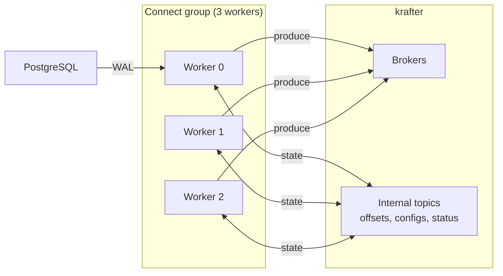

### Why a Separate Chart?

The table compares running Connect inside the broker chart with running it as its own release:

| Aspect | Embedded in kafka-cluster | Standalone connect-cluster |
|--------|:---:|:---:|
| Upgrade independence | Poor: broker upgrade = Connect restart | Good: upgrade Connect without touching brokers |
| Scaling | Poor: tied to broker chart values | Good: independent replica count |
| Failure blast radius | Poor: bad connector config blocks broker chart | Good: Connect failures isolated |
| CI/CD pipeline | Poor: single chart = single pipeline | Good: separate lint/test/package/push |
| Environment overlays | Poor: shared values file | Good: dedicated `values-generic.yaml`, `values-prod.yaml` |

Every row comes down to one point: a change to Connect never rolls a broker, and a bad connector never blocks a broker upgrade.

## How Connect Divides the Work

A connector is a plugin plus its configuration, and it doesn't move records itself. It splits its work into [tasks](appendix-a-glossary.md#gl-connect-task), up to its `tasksMax`, and the tasks do the copying. A JDBC sink reading a topic of six partitions can run up to six tasks, each taking a share of the partitions. A connector that reads one ordered stream, like Debezium's PostgreSQL connector reading one replication slot, hands Connect a single task whatever `tasksMax` says.

Workers that share a `groupId` form one Connect group. They join the group through the Kafka group coordinator, as consumers do, and one of them, the leader, assigns connectors and tasks to the members. Any worker can run any task, because a task's configuration and position live in Kafka, not on the worker that last ran it.

When a worker joins or leaves, the group rebalances. Under incremental cooperative rebalancing, KIP-415 [@kip415], only the tasks that have to move stop; the rest keep running. A worker that leaves gets a grace period, `scheduled.rebalance.max.delay.ms`, before its tasks are handed to the others, so that a restarting pod can take its own tasks back. [Operating Kafka Connect](operating-kafka-connect.md) covers what that delay costs when a zone fails.

A moved task resumes from the last offset its connector committed. Records it processed after that commit are processed again, so a [rebalance](appendix-a-glossary.md#gl-rebalance) can deliver records twice unless the connector runs with exactly-once support, which [Exactly-Once Semantics](#exactly-once-semantics) explains.

`kates kafka connect tasks <name>` shows the result for one connector: each task's ID, its state and the worker running it. Run it before and after you restart a worker, and the Worker ID column shows the reassignment.

### Internal Topics

The group keeps everything this section describes in three compacted Kafka topics:

| Topic | Content | Retention |
|-------|---------|-----------|
| `<groupId>-offsets` | Source connector position / offset tracking | Compacted (forever) |
| `<groupId>-configs` | Connector and task configuration snapshots | Compacted (forever) |
| `<groupId>-status` | Connector and task status updates | Compacted (forever) |

Connect workers create these topics on first startup. `internalTopics.prefix` (default: `groupId`) names them, and `internalTopics.offsetsName`, `configsName` and `statusName` override single names. The chart sets all three replication factors from `config.replicationFactor` (3; the dev overlay uses 1), and refuses a value above `kafka.brokerCount` when you set it.

::: {.callout-important title="Never delete the offsets topic"}
If the offsets topic is deleted, every source connector loses its position and re-snapshots its entire database on restart.
:::

## Helm Chart Structure

The `connect-cluster` chart produces the Strimzi `KafkaConnect` and [`KafkaConnector`](appendix-a-glossary.md#gl-kafkaconnector) resources (plus an optional chart-managed `KafkaUser`). The worker spec, client authentication, `KafkaUser`, secret sync, PodMonitor and NetworkPolicy fragments come from the `kafka-common` library chart, which it shares with `mirror-maker2`. These are the files you set values in:

| File | What you set there |
|------|--------------------|
| `values.yaml` | The defaults every other file overrides |
| `values-kind.yaml` | What `kates deploy` adds on Kind |
| `values-generic.yaml` | What `kates deploy` adds on clusters other than Kind |
| `values-dev.yaml` | One small worker, replication factor 1 |
| `values-prod.yaml` | `productionMode`: TLS listener, chart-managed certificate user, SLO alert |
| `values.schema.json` | The input validation every values file passes |
| `README.md` | Every value and every render-time rail |

### Deploying with the Kates CLI

Deploy Kafka Connect with the Kates CLI. It detects the environment, picks the overlay and provisions the credentials:

```bash
# Deploy the full stack including Kafka Connect
# (--ha defaults to true, so this gives you 3 workers)
kates deploy --topology isolated --with-kafka-connect

# Single-worker deployment (resource-constrained clusters)
kates deploy --topology isolated --with-kafka-connect --ha=false
```

The CLI deploys the `connect-cluster` chart as a separate Helm release (into the `connect` namespace by default under the isolated topology). On Kind clusters it applies the Kind overlay, and it provisions the PostgreSQL credentials secret.

#### Installing with Helm Directly

Use Helm directly in a CI pipeline, or when you want to set the values yourself:

```bash
# Basic deployment (same namespace as Kafka)
helm upgrade --install connect-cluster oci://ghcr.io/bmscomp/charts/connect-cluster \
  --namespace kafka

# Connect in its own namespace
helm upgrade --install connect-cluster oci://ghcr.io/bmscomp/charts/connect-cluster \
  --namespace connect --create-namespace \
  --set kafka.namespace=kafka

# With environment overlay
helm pull oci://ghcr.io/bmscomp/charts/connect-cluster --untar
helm upgrade --install connect-cluster ./connect-cluster \
  --namespace connect --create-namespace \
  -f connect-cluster/values-prod.yaml
```

`kafka.namespace` defaults to the release's own namespace, so a release outside the Kafka namespace has to name it. `values-prod.yaml` sets it to `kafka`, turns on `productionMode`, and dials the TLS listener (9093) with `kafka.authentication.type: tls` and a chart-managed `KafkaUser` (`kafkaUser.create: true`).

::: {.callout-note title="Upgrading a 1.x release"}
A release installed from chart 1.x upgrades in place: 1.x keys still render in 2.x and appear as `DEPRECATED` lines in the release notes. The key-by-key table and the changes that need attention (secret access, including the Secrets a 1.x release could read and 2.x cannot, Kafka egress ports, alert names) are in [Upgrading connect-cluster 1.3 → 2.0](../connect-cluster-2.0-upgrade.md).
:::

## The KafkaConnect Custom Resource

The chart generates a `KafkaConnect` CR that the Strimzi operator reconciles into a Deployment of Connect worker pods:

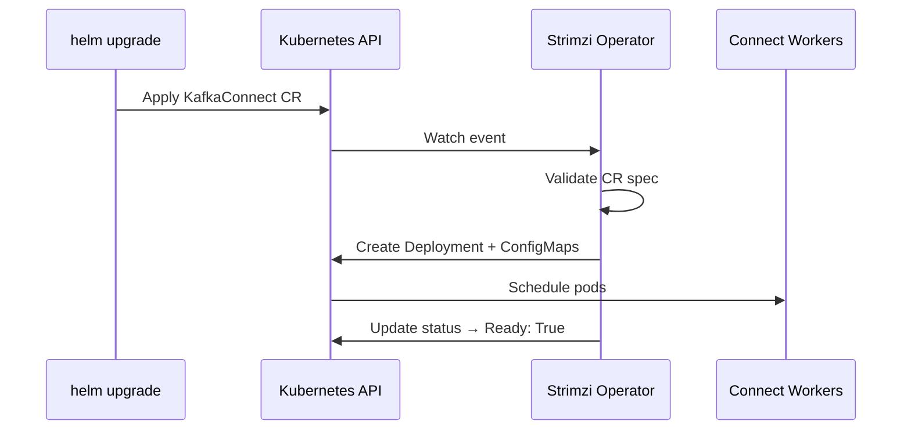

### Key Configuration

The Default column is the chart's own value. A `kates deploy` install sets `replicas`, `version`, `kafka.bootstrapServers` and `kafka.namespace` on the command line, so `helm get values connect-cluster -n connect` shows what a running release overrides:

| Setting | Default | Purpose |
|---------|---------|---------|
| `groupId` | `kates-connect-cluster` | All workers sharing this ID form a single cluster |
| `replicas` | 3 (the CLI sets 1 with `--ha=false`; the dev overlay uses 1) | Number of worker pods |
| `image` | `ghcr.io/bmscomp/connect:3.6.2-kafka-4.3.1` | Pre-built image with Debezium, Aiven and Apicurio plugins; the chart refuses `:latest` and untagged images |
| `kafka.bootstrapServers` | `""` — computed as `<clusterName>-kafka-bootstrap.<kafka.namespace>.svc.<clusterDomain>:9092` (9093 when `kafka.tls.enabled`, or `kafka.listenerPort`) | Connection to Kafka |
| `kafka.namespace` | `""` — the release's namespace | Where the Kafka cluster, its `KafkaUser` and the test topics live |
| `version` | 4.3.1 | Kafka version the workers run; `Chart.yaml` `appVersion` tracks it |
| `productionMode` | `false` | Refuses plaintext connector passwords, `rbac.allSecrets`, and an unencrypted or unauthenticated Kafka connection |

### Authentication

By default Connect authenticates to Kafka with SCRAM-SHA-512 on the plaintext listener (9092). The chart renders this into the `KafkaConnect` spec:

```yaml
bootstrapServers: "krafter-kafka-bootstrap.kafka.svc.cluster.local:9092"
authentication:
  type: scram-sha-512
  username: "kates-connect"
  passwordSecret:
    secretName: "kates-connect"
    password: password
```

`kafka.authentication.type` picks the mechanism: `scram-sha-512`, `scram-sha-256` or `plain` (a username and `passwordSecret`), `tls` (a client certificate), `custom` (the SASL and config of `kafka.authentication.custom`, the v1 API's home of OAuth), or `""` for none. `kafka.tls.enabled` moves the workers to 9093 and trusts `<clusterName>-cluster-ca-cert`. The `krafter` Kafka cluster's TLS listener authenticates clients by certificate, so the chart refuses TLS together with SCRAM or PLAIN on that port. `values-prod.yaml` uses mutual TLS instead:

```yaml
bootstrapServers: "krafter-kafka-bootstrap.kafka.svc.cluster.local:9093"
tls:
  trustedCertificates:
    - secretName: "krafter-cluster-ca-cert"
      certificate: ca.crt
authentication:
  type: tls
  certificateAndKey:
    secretName: "kates-connect"
    certificate: user.crt
    key: user.key
```

The `kates-connect` KafkaUser can be managed by the chart itself: setting `kafkaUser.create: true` provisions a `scram-sha-512` or `tls` `KafkaUser` in the Kafka namespace. With `kafkaUser.authorization.mode: auto` (the default), the chart derives least-privilege ACLs from its values:

- the three internal topics, the worker group, the `connect-*` groups of sink connectors, `kafkaUser.groupGrants`, and the data-topic prefixes in `kafkaUser.topicGrants`
- the dead letter queues of the declared connectors
- with `exactlyOnce.enabled`, the transactional IDs `connect-cluster-<groupId>` (the leader) and `<groupId>-*` (the source tasks)
- cluster `Describe` and `DescribeConfigs`

`kafkaUser.authorization.mode: custom` takes `kafkaUser.acls` verbatim. When Connect runs in a different namespace than Kafka, `secretSync` copies the user's Secret — and, with TLS, the cluster CA — into the Connect namespace with a post-install/upgrade Job. `secretSync.watch` adds a CronJob that follows certificate and password rotation, and `secretSync.method: reflector` annotates the user's Secret for kubernetes-reflector instead. This requires the Strimzi User Operator; the ACLs take effect when the Kafka cluster has authorization enabled.

The `krafter` cluster's platform profile also provisions `kates-connect`, so to let this chart own that user, adopt the existing object. Recreating it would give the user new credentials. The release notes print the `kubectl annotate` and `kubectl label` commands when the user belongs to another release.

## Connector Lifecycle

A connector either reads from an external system into Kafka, as a source, or from Kafka into an external system, as a sink. Both kinds move through the same states.

### Sources and Sinks

A source connector produces to a topic and a sink connector consumes from one. Follow one record through both, and notice that each connector records its progress somewhere:

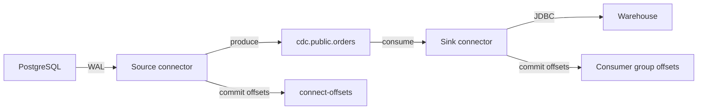

A source connector commits its source position, such as a WAL location, to the group's offsets topic. A sink connector is a consumer, so it commits ordinary consumer offsets under a `connect-<connector>` consumer group.

### Connector States

You choose three of these states through a connector's `state` value: `running`, `paused` and `stopped`. The framework sets the fourth, FAILED, when the connector hits an error it can't recover from:

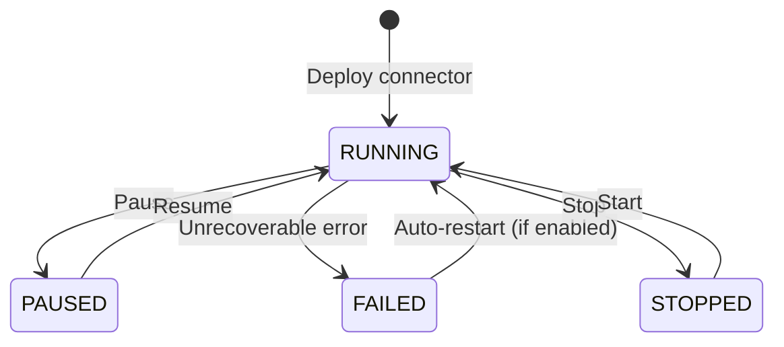

The table adds what each state does to the connector's offsets and tasks, and when you'd choose it:

| State | Offset Tracking | Tasks Active | Use Case |
|-------|:-:|:-:|----------|
| `running` | Advancing | Yes | Normal operation |
| `paused` | Preserved | No | Maintenance window, schema migration |
| `stopped` | Preserved | No | Long-term pause, cost savings |
| `failed` | Preserved | No | Error — awaiting auto-restart or manual fix |

::: {.callout-tip title="Try it: What happens to a connector's offsets when you pause and resume it?"}
On the CDC pipeline from [Replicate a Row End to End](#replicate-a-row-end-to-end), run `kates kafka connect pause debezium-postgres-source-working-example`, insert a row, and check `kates kafka connect tasks` for the connector. Then `resume` it and look for the row in the replica table. If it arrives, the pause kept the offsets and the connector picked up the insert on resume.
:::

### Auto-Restart

The chart configures automatic restart for failed connectors through `connectorDefaults`, which is merged under every connector:

```yaml
connectorDefaults:
  autoRestart:
    enabled: true
    maxRestarts: 10
```

When a connector fails, Strimzi restarts it up to `maxRestarts` times with exponential backoff. A connector's own `autoRestart` overrides the default, and `connectorDefaults.config` adds settings every connector shares.

### Commands You'll Use {#cli-reference}

The `kates kafka connect` command group operates the cluster and its connectors. Day to day you need six of its commands: `status` for the `KafkaConnect` resource, `connectors` to list the `KafkaConnector` resources, `tasks <name>` for one connector's tasks, and `pause`, `resume` and `restart` to move a connector between states. Every command takes `-n <namespace>`; without it the CLI tries `$KATES_CONNECT_NS`, then the namespace of the cluster's `KafkaConnect`, then `$KATES_KAFKA_NS`, then `kafka`. Every command also takes `-o json`. The full list is in the [CLI Reference](10-cli-reference.md).

## Change Data Capture with Debezium

Change Data Capture reads a database's own log of changes instead of polling its tables. Debezium does that for PostgreSQL through logical replication, and the image the chart ships carries it.

### The Connect Image

The pre-built Connect image bundles the plugins below. Its tag names the Debezium line, then the Kafka line, and the current pin is in the [Version & Compatibility Matrix](appendix-d-versions.md):

| Plugin | Use Case |
|--------|----------|
| Debezium PostgreSQL | WAL-based CDC from PostgreSQL |
| Debezium MySQL | Binlog-based CDC from MySQL |
| Debezium MongoDB | Change stream CDC from MongoDB |
| Debezium SQL Server | Change Tracking CDC from SQL Server |
| Debezium Scripting | SMT for filtering and routing with Groovy JSR-223 |
| Apicurio Registry Converter | Schema Registry integration (Avro, JSON Schema, Protobuf) |
| Debezium JDBC Sink | Upsert sink for SQL databases |
| Aiven JDBC | Generic JDBC source (table polling) and sink |
| Aiven S3 Sink | Archive topics to Amazon S3 (JSON, Avro, Parquet, CSV) |
| Aiven S3 Source | Replay S3 objects back into Kafka topics |

### Extending the Image with Additional Plugins

The pre-built image covers the connectors in the table above. For any other plugin (Elasticsearch Sink or Snowflake Sink, for example), the chart offers three ways to get it onto the workers:

| Way | How | When |
|-----|-----|------|
| `image` | A Connect image with the plugins inside | Recommended — bake them in (`make connect-build`) or layer your own image |
| `build` | The operator builds and pushes an image (`spec.build`) | A registry the operator can push to, and a namespace and operator that allow its root build pod ([Workloads That Cannot Pass](17-security.md#workloads-that-cannot-pass)) |
| `plugins` | OCI images mounted as volumes at start-up (`spec.plugins`) | No custom image, and every node has the Kubernetes ImageVolume feature |

The last two add plugins without you rebuilding the Docker image:

#### Building an Image with Strimzi `spec.build`

Strimzi can download plugins from Maven Central and build a new image automatically during operator reconciliation. Enable this in `values.yaml`:

```yaml
build:
  output:
    type: docker
    image: "ghcr.io/bmscomp/connect:custom"
    pushSecret: my-registry-credentials
  plugins:
    - name: camel-s3-sink
      artifacts:
        - type: maven
          group: org.apache.camel.kafkaconnector
          artifact: camel-aws-s3-sink-kafka-connector
          version: "4.8.3"
```

#### Mounting Plugin Images

`plugins` renders `spec.plugins`: each artifact is an OCI image that Kubernetes mounts into the workers as a volume. The feature gate is invisible to the chart, so `plugins` renders only once you set `imageVolumes.acknowledged: true`, and only on Kubernetes 1.31 or later (ImageVolume is alpha in 1.31 and beta from 1.33). `expect` adds the plugin's connector classes to the Helm test's list, so a plugin that fails to load fails `helm test`:

```yaml
imageVolumes:
  acknowledged: true

plugins:
  - name: camel-s3-sink
    artifacts:
      - type: image
        reference: registry.example.com/plugins/camel-aws-s3-sink:4.8.3
    expect:
      - org.apache.camel.kafkaconnector.awss3sink.CamelAwss3sinkSinkConnector
```

#### Running the Plugin Loader Script

For environments where neither route is possible, the repo ships `scripts/connect-plugin-loader.sh`, which downloads plugin JARs from Maven Central and extracts them into a `/plugins` directory:

```bash
EXTRA_PLUGINS="org.apache.camel.kafkaconnector:camel-aws-s3-sink-kafka-connector:4.8.3" \
  ./scripts/connect-plugin-loader.sh
```

The script is written to run as an init container that populates a shared volume on the worker's `plugin.path`, but the chart does not wire this up for you. `templateExtra` (deep-merged into `spec.template`) and `connectContainer` can add a volume and its mount, but Strimzi's pod template cannot add an init container of your own, so using the script this way means running it outside the `KafkaConnect` resource. In most cases, prefer the image or one of the routes above.

### PostgreSQL CDC Pipeline

The default Kates CDC pipeline captures changes from a PostgreSQL database:

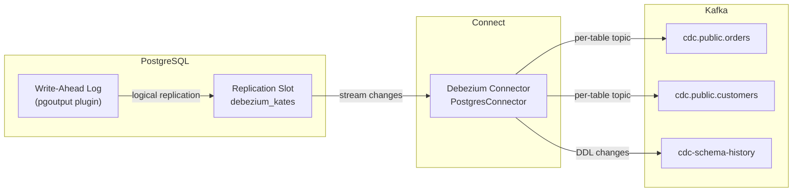

#### Connector Configuration

`connectors` is a map keyed by connector name, so an overlay can change one connector, or drop it with `enabled: false`, without restating the others.

```yaml
connectors:
  debezium-postgres-source:
    class: io.debezium.connector.postgresql.PostgresConnector
    tasksMax: 1
    state: running                 # running | paused | stopped
    config:
      database.hostname: postgresql.database.svc
      database.port: "5432"
      database.user: debezium
      database.password: "${secrets:connect/connect-pg-credentials:password}"
      database.dbname: orders
      topic.prefix: cdc
      schema.include.list: public
      plugin.name: pgoutput
      slot.name: debezium_kates
      heartbeat.interval.ms: "10000"
      snapshot.mode: initial
      decimal.handling.mode: double
      tombstones.on.delete: "true"
```

Beside `class`, `tasksMax`, `state` and `config`, a connector takes `autoRestart`, `deadLetterQueue` (see [Dead Letter Queue (DLQ)](#dead-letter-queue-dlq)), `enabled`, and three keys passed through to the `KafkaConnector`: `version` (a plugin version range, Kafka 4.1+), `listOffsets` and `alterOffsets`.

#### Why Each Setting Is There

Each setting in the example is there for a reason the table gives; two of them, the slot name and the heartbeat, are the ones that cost you when they are wrong:

| Setting | Rationale |
|---------|-----------|
| `plugin.name: pgoutput` | Native PostgreSQL logical decoding plugin (no extra extensions needed) |
| `slot.name: debezium_kates` | Named replication slot — survives connector restarts |
| `snapshot.mode: initial` | Takes a full snapshot on first run, then switches to streaming |
| `heartbeat.interval.ms: 10000` | Prevents WAL retention from growing unbounded on idle tables |
| `tombstones.on.delete: true` | Produces a null-value record, a [tombstone](appendix-a-glossary.md#gl-tombstone), after a delete — enables downstream compaction |
| `decimal.handling.mode: double` | Avoids Avro precision issues with `NUMERIC` columns |

A Debezium PostgreSQL connector runs exactly one task: it streams one replication slot, and the connector hands Connect a single task configuration whatever `tasksMax` says. Set `tasksMax: 1` so the value says what happens; the chart doesn't check it.

### Replicate a Row End to End

The chart ships the working-example CDC pipeline as `testConnectors`. `helm test` creates those connectors and their topic, checks that each one reaches RUNNING with all its tasks, and deletes them again once the suite succeeds. To keep the pipeline running, apply the same manifests yourself, as below. You need the stack running and the demo tables created in the `orders` database, a one-time preparation in [Tutorial 9: Kafka Connect Working Examples (CDC + JDBC)](../tutorials/09-kafka-connect-working-examples.md):

```bash
# Validate the release — the suite checks the workers, the REST API and the
# plugins, then runs the working-example connectors transiently
helm test connect-cluster -n connect

# Deploy the CDC topic (in the kafka namespace, on the krafter cluster) and the
# working-example connectors persistently. kafka.namespace defaults to the
# release namespace, so name it as kates deploy does.
helm template connect-cluster oci://ghcr.io/bmscomp/charts/connect-cluster -n connect \
  --set kafka.namespace=kafka \
  -s templates/tests/test-02-topics.yaml \
  -s templates/tests/test-02-connectors.yaml | kubectl apply -f -

# Wait for the Debezium source and the JDBC sink to come up
kubectl wait -n connect --for=condition=Ready --timeout=300s \
  kafkaconnector/debezium-postgres-source-working-example
kubectl wait -n connect --for=condition=Ready --timeout=300s \
  kafkaconnector/jdbc-sink-from-cdc-working-example

# Insert a row into the watched table ...
kubectl exec -n database postgresql-0 -- /bin/bash -lc \
  "PGPASSWORD=debezium psql -h 127.0.0.1 -U debezium -d orders -c \
  \"INSERT INTO public.demo_orders (id, customer_name, amount) \
  VALUES (1001, 'alice', 42.50) ON CONFLICT (id) DO UPDATE \
  SET customer_name = EXCLUDED.customer_name, amount = EXCLUDED.amount;\""

# ... and read it back from the replica table
kubectl exec -n database postgresql-0 -- /bin/bash -lc \
  "PGPASSWORD=debezium psql -h 127.0.0.1 -U debezium -d orders -c \
  \"SELECT id, customer_name, amount FROM public.demo_orders_replica WHERE id = 1001;\""
```

Debezium captures the insert from the WAL and produces it to `cdc.public.demo_orders`, and the JDBC sink upserts it into `demo_orders_replica`. The applied objects keep their Helm test annotations, so a later `helm test` replaces them and removes them again when it passes. When you're done, the tutorial's cleanup section removes the connectors and the CDC topic.

::: {.callout-tip title="Try it: Does a row written to PostgreSQL reach the replica table through krafter?"}
Run the commands above. Look for one row with id 1001 in the SELECT's output. It proves the whole path: from the WAL through the source connector and `cdc.public.demo_orders` to the sink.
:::

### External Configuration (Secrets)

The chart enables three Kafka config providers on every worker: `file` and `dir` (Kafka's `FileConfigProvider` and `DirectoryConfigProvider`), and `secrets`, the one connectors use here:

```yaml
config.providers: file,dir,secrets
config.providers.secrets.class: io.strimzi.kafka.KubernetesSecretConfigProvider
```

Connectors reference Kubernetes Secrets directly with the `${secrets:<namespace>/<secret-name>:<key>}` syntax, and no volume mount is needed. The workers resolve those references as the `<release>-connect` ServiceAccount that Strimzi creates. The chart's `rbac-secrets.yaml` reads every connector and test connector config in the values and grants that account `get` on exactly the Secrets they reference, with one Role per namespace. A reference without a namespace fails the render.

Connectors applied outside the chart — by hand, or the CDC connectors `kates deploy` applies next to the release — need their Secrets listed in `rbac.secretNames`, as a bare name (this namespace) or `namespace/name`. The kind and generic overlays list `connect-pg-credentials` and `kates-connect`, which `kates deploy`'s connectors read. For example:

```yaml
rbac:
  secretNames:
    - connect-pg-credentials      # this namespace
    - vault-sync/api-token        # another namespace
```

## Single Message Transforms (SMTs)

An SMT changes one record at a time inside the connector task, so you need no separate stream-processing layer.

### Transform Pipeline

Single Message Transforms run in sequence inside the connector task, before the record is written to Kafka (for a source) or handed to the sink. The figure follows the chain from the example below, and the record changes shape at each step:

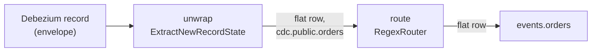

Each transform receives the output of the previous one.

### Common Transforms

The Class column says where each transform comes from: `org.apache.kafka.connect.transforms` ships with Kafka Connect, and `io.debezium.transforms` with Debezium. For a Debezium source, `ExtractNewRecordState` is the one to start with, as the example below shows:

| Transform | Class | Use Case |
|-----------|-------|---------|
| Route records by field | `io.debezium.transforms.ByLogicalTableRouter` | Route to per-tenant topics |
| Flatten nested structs | `org.apache.kafka.connect.transforms.Flatten$Value` | Flatten JSON for downstream consumers |
| Add timestamp | `org.apache.kafka.connect.transforms.InsertField$Value` | Inject processing timestamp |
| Filter by field | `io.debezium.transforms.Filter` | Drop heartbeat or schema-change records |
| Mask sensitive fields | `org.apache.kafka.connect.transforms.MaskField$Value` | Zero-out PII before it reaches Kafka |
| Extract new record state | `io.debezium.transforms.ExtractNewRecordState` | Unwrap Debezium envelope to plain record |
| Set topic name | `org.apache.kafka.connect.transforms.RegexRouter` | Rewrite topic names with regex |

### Example: Unwrap the Envelope, Then Rename the Topic

This connector chains two transforms, which run in the order `transforms` lists them: `unwrap` first, then `route`:

```yaml
connectors:
  cdc-orders:
    class: io.debezium.connector.postgresql.PostgresConnector
    config:
      database.hostname: postgresql.database.svc   # plus the rest of the database config
      database.dbname: orders
      topic.prefix: cdc
      transforms: unwrap,route
      transforms.unwrap.type: io.debezium.transforms.ExtractNewRecordState
      transforms.unwrap.drop.tombstones: "false"
      transforms.unwrap.delete.handling.mode: rewrite
      transforms.unwrap.add.fields: "op,source.ts_ms"
      transforms.route.type: org.apache.kafka.connect.transforms.RegexRouter
      transforms.route.regex: "cdc\\.public\\.(.*)"
      transforms.route.replacement: "events.$1"
```

This chain:

1. Unwraps the Debezium envelope (`{before, after, source, op}`) into a flat record
2. Adds `op` and `source.ts_ms` to the record as the fields `__op` and `__source_ts_ms`
3. Renames `cdc.public.orders` to `events.orders`

## Schema Registry Integration

When Apicurio Registry is deployed alongside Kafka, Connect can serialize records using Avro, JSON Schema, or Protobuf instead of plain JSON, and the registry can check each schema change against a compatibility rule.

### Data Flow with Schema Registry

When a source connector emits a record, the Apicurio converter registers or looks up the schema in Apicurio Registry and writes the compact schema identifier alongside the serialized payload:

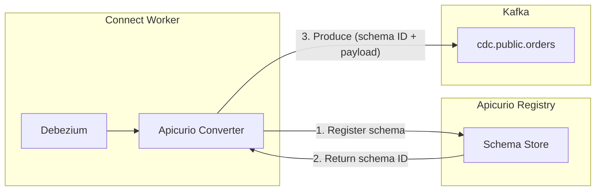

### Pointing the Converters at Apicurio

To enable Apicurio Avro serialization:

```yaml
schemaRegistry:
  enabled: true
  serviceName: apicurio-apicurio-registry
  namespace: ""                  # empty = the Kafka namespace
  port: 80                       # the registry's Service port
  path: /apis/registry/v3        # Apicurio Registry 3's core API
  targetPort: 8080               # the port the registry pods listen on

config:
  keyConverter: io.apicurio.registry.utils.converter.AvroConverter
  valueConverter: io.apicurio.registry.utils.converter.AvroConverter

extraConfig:
  key.converter.apicurio.registry.auto-register: "true"
  value.converter.apicurio.registry.auto-register: "true"
```

Connect configures a converter only with the worker properties under its own `key.converter.` or `value.converter.` prefix, and Apicurio's converters read `apicurio.registry.url`. So the chart builds the registry URL from the service name, namespace, port, path and cluster domain, and renders it once for each Apicurio converter in `config`. With the values above, `<registry-url>` is `http://apicurio-apicurio-registry.<namespace>.svc.<clusterDomain>:80/apis/registry/v3`:

```text
key.converter.apicurio.registry.url: <registry-url>
value.converter.apicurio.registry.url: <registry-url>
```

Three details make the difference between a converter that reaches the registry and one that does not.

The converters call the core API, `/apis/registry/v3` (or `/apis/registry/v2`). `/apis/ccompat/v7` is the Confluent-compatible API, which they do not speak.

Registration is off by default: Apicurio's serializer registers a schema only with `apicurio.registry.auto-register: true`. For a CDC pipeline, whose schemas come from the database, turn it on as in the `extraConfig` above, or register every schema before the connector produces.

The egress rule admits the pod's port: NetworkPolicy matches the destination pod's port after the Service has translated it, so the workers' egress rule admits `targetPort` — 8080 for Apicurio Registry — as well as `port`.

A connector that sets its own `value.converter` (or `key.converter`) is configured from its own `config` only, so it needs its own `value.converter.apicurio.registry.url` there. An `extraConfig` entry named like one the chart renders wins over it.

A values file that sets `schemaRegistry.path: /apis/ccompat/v7` beside an Apicurio converter is refused at render time, with the fix named: remove the key, or set it to `/apis/registry/v3`. The Confluent-compatible path belongs to clients that speak the Confluent API, such as Kafka UI.

### Schema Evolution

When a compatibility rule is set, the registry checks each new version of a schema against it and refuses a version that breaks it. The table lists the four basic modes:

| Compatibility Mode | What's Allowed | Use Case |
|-------------------|---------------|----------|
| BACKWARD | New schema can read data written by old | Default — consumers upgrade first |
| FORWARD | Old schema can read data written by new | Producers upgrade first |
| FULL | Both backward and forward compatible | Strictest — safest for mission-critical data |
| NONE | Any change allowed | Development only |

::: {.callout-warning title="Changing converters means a new topic prefix"}
Changing the converter from `JsonConverter` to `AvroConverter` on an existing connector requires reprocessing all data. The existing JSON records in Kafka are not automatically re-serialized. Plan a migration window with a new topic prefix.
:::

## Exactly-Once Semantics

With exactly-once source (EOS) delivery, Kafka Connect writes each source record to Kafka exactly once, even if a worker crashes mid-batch [@kip618].

### How EOS Works

The diagram follows one batch through a worker with EOS on. Watch where the offsets go: into the same transaction as the records.

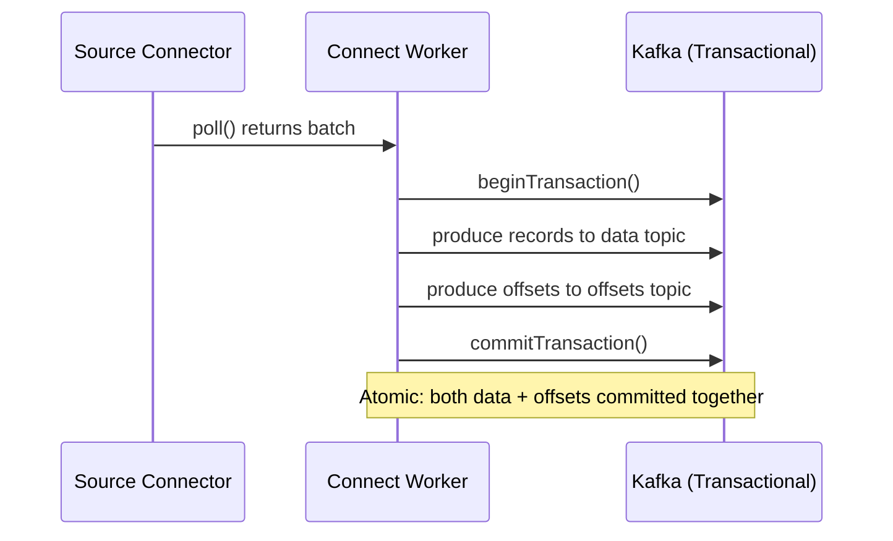

Without EOS, Connect commits offsets and data separately, so a crash between the two steps causes duplicates on restart. With EOS enabled, the worker wraps both into a single Kafka transaction.

### Turning EOS On for the Group

The chart enables EOS by default. It is a group-wide switch, set under `exactlyOnce`, because every worker in the group must agree and a chart-managed `KafkaUser` needs the matching transactional-ID grants:

```yaml
exactlyOnce:
  enabled: true

extraConfig:
  producer.acks: "all"
  producer.enable.idempotence: "true"
```

The block renders three worker settings. Only the first comes from the `exactlyOnce` switch; the other two are the chart's default `extraConfig`:

| Setting | Value | Purpose |
|---------|-------|---------|
| `exactly.once.source.support` | `enabled` (from `exactlyOnce.enabled`) | Wraps source records + offsets in a single transaction |
| `producer.acks` | `all` | Wait for all ISR replicas to acknowledge |
| `producer.enable.idempotence` | `true` | Deduplicates retried produce requests at the broker |

The chart refuses `exactly.once.source.support` in `extraConfig`; set `exactlyOnce.enabled` instead.

::: {.callout-important title="What EOS needs from the brokers"}
EOS requires a `min.insync.replicas` of at least 2 on the data topics and `acks=all` on the Connect producer. The `krafter` cluster satisfies both by default.
:::

### When to Disable EOS

`exactlyOnce.enabled` is on by default and applies to the whole group, so turning it off takes exactly-once away from every source connector on the workers. Weigh that against the cases below:

| Scenario | Recommendation |
|----------|---------------|
| Sink-only connectors | Not applicable — EOS is for source connectors only |
| A source connector near the brokers' write capacity | Transactions add a commit per batch; measure the connector's rate with EOS on and off before you decide |
| Non-critical data (metrics, logs) | Disable (`exactlyOnce.enabled: false`) for better throughput; at-least-once is acceptable |

Turning EOS off for one of these cases turns it off for every source connector in the group, so make the decision for the whole group.

## Dead Letter Queue (DLQ)

When a sink connector encounters a record it cannot process (malformed data, schema mismatch, downstream failure), it can route the record to a Dead Letter Queue instead of failing the entire task [@kip298; @hohpe2003enterprise].

### DLQ Flow

Records that pass deserialization and sink delivery land in the target database, while poison records are diverted with full exception headers to the connector's dead-letter topic:

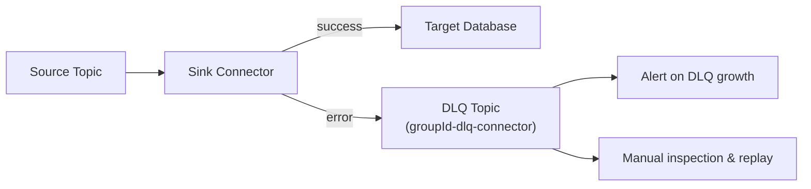

### Declaring a Sink's Dead Letter Queue

A sink connector's `deadLetterQueue` block sets the error handling for you and, with `createTopic` (the default), renders the queue's `KafkaTopic` in the Kafka namespace. A chart-managed `KafkaUser` is granted the queue:

```yaml
connectors:
  jdbc-sink-warehouse:
    class: io.aiven.connect.jdbc.JdbcSinkConnector
    deadLetterQueue:
      enabled: true            # errors.tolerance=all, the queue topic, context headers
      topic: ""                # empty = <groupId>-dlq-<connector>
      replicationFactor: 3     # empty = config.replicationFactor
      createTopic: true        # a KafkaTopic in the Kafka namespace
    config:
      topics: cdc.public.orders
      connection.url: jdbc:postgresql://warehouse.database.svc:5432/warehouse
      errors.log.include.messages: "true"
```

The connector's config then carries:

| Setting | Value | Purpose |
|---------|-------|---------|
| `errors.tolerance` | `all` | Keep processing on an error; `none` fails the task |
| `errors.deadletterqueue.topic.name` | `<groupId>-dlq-<connector>` (`deadLetterQueue.topic`) | DLQ topic name |
| `errors.deadletterqueue.topic.replication.factor` | `deadLetterQueue.replicationFactor` | DLQ topic replication factor |
| `errors.deadletterqueue.context.headers.enable` | `true` (`deadLetterQueue.contextHeaders`) | Include error context (exception, stack trace) in record headers |
| `errors.log.enable` | `true` | Log errors to Connect worker logs |
| `errors.log.include.messages` | `true`, from `config` above (the chart doesn't set it) | Include the problematic record in the log (leave it off for sensitive data) |

`KafkaConnectDeadLetterWrites` fires while records are dead-lettered and `KafkaConnectDeadLetterFailures` when the queue refuses them; see [Kafka Connect Runbook](../connect-cluster-runbook.md).

::: {.callout-caution title="A tolerant sink without a DLQ drops records"}
Setting `errors.tolerance: all` without a DLQ silently drops bad records. Always configure a DLQ topic when using tolerant error handling. Connect ignores a DLQ on a source connector, so the chart refuses `deadLetterQueue` there.
:::

## CDC Patterns

The three patterns below are what CDC is for in practice: publishing events without a dual write to the database and to Kafka, keeping several views of the same data in step, and copying data between databases.

### Pattern 1: Transactional Outbox

The Outbox pattern avoids dual-write problems by writing events to an `outbox` table in the same database transaction as the business data [@richardson2018microservices; @kleppmann2017designing]. Debezium captures the outbox table and routes events to Kafka.

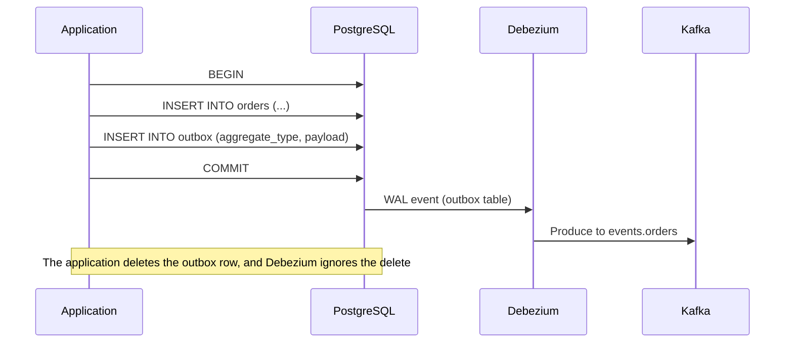

The connector's `config` names the outbox table and routes by `aggregate_type`:

```yaml
config:
  table.include.list: public.outbox
  transforms: outbox
  transforms.outbox.type: io.debezium.transforms.outbox.EventRouter
  transforms.outbox.table.fields.additional.placement: "type:header:eventType"
  transforms.outbox.route.by.field: aggregate_type
  transforms.outbox.route.topic.regex: "(.*)"
  transforms.outbox.route.topic.replacement: "events.$1"
```

Delete the outbox row in the same transaction, or right after it: the table stays small and the `EventRouter` ignores the delete event.

### Pattern 2: One Topic, Several Views

One CDC topic holds every change to a table, and each sink connector can read it into a different store:

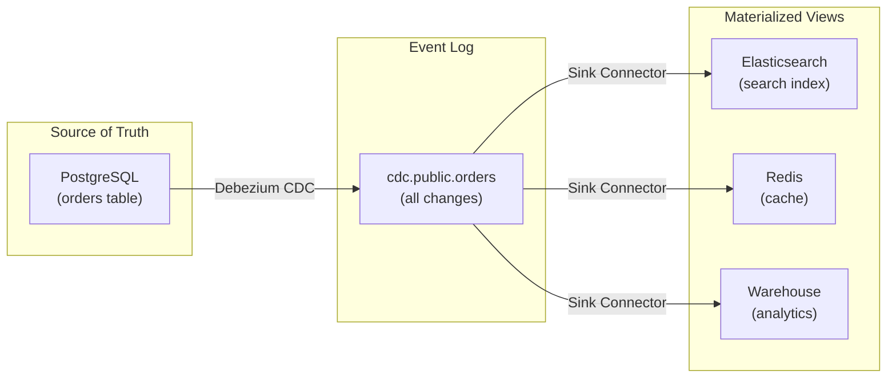

Each view is rebuildable on its own: reset the sink connector's consumer group to the start of `cdc.public.orders` (or delete and recreate the connector) and it replays every change. That works only while the topic still holds the history, so give a CDC topic used this way compaction or long retention. This is CDC feeding views, not event sourcing: the database stays the source of truth [@kleppmann2017designing].

### Pattern 3: Cross-Database Sync

A Debezium source and a JDBC sink, chained through one topic such as `cdc.public.users`, copy a table from one database to another, PostgreSQL to MySQL for example. This is useful for:

- Migrating between database engines
- Feeding analytics databases
- Maintaining read replicas across cloud regions

The copy is eventually consistent: the sink always lags the source by the time a record takes through Kafka, and `kafka_consumergroup_lag` for the sink's consumer group measures it.

## Pre-Deploy Validation

The chart validates connector configurations while Helm renders it (`_resolve.tpl` and `_validate.tpl`), before anything reaches the Kubernetes API or the Strimzi operator. A mistake fails `helm template`, `helm install` or `helm upgrade` itself, naming the connector and the setting. There is no hook Pod to wait for or read logs from.

### The Checks, by Connector Class

Every check is an error:

| Check | Connector Type |
|-------|---------------|
| Name is a DNS-1123 subdomain, declared once | All |
| `class` present | All |
| `state` is `running`, `paused` or `stopped` | All |
| `tasksMax` is a whole number of at least 1 | All |
| Every `${secrets:…}` reference names a namespace | All |
| `version` only when the workers run Kafka 4.1+ | All |
| `topics` or `topics.regex` present | Sinks |
| `deadLetterQueue` only on a sink | All |
| No plaintext `*password` value | All, under `productionMode` |
| `database.hostname`, `database.dbname`, `topic.prefix` | Debezium PostgreSQL |
| `database.hostname`, `database.server.id`, `topic.prefix` | Debezium MySQL |
| `mongodb.connection.string`, `topic.prefix` | Debezium MongoDB |
| `database.hostname`, `database.names`, `topic.prefix` | Debezium SQL Server |
| `connection.url` | Debezium JDBC sink, Aiven JDBC sink |
| `connection.url`, `mode` | Aiven JDBC source |
| `aws.s3.bucket.name` | Aiven S3 sink |
| `file` | FileStream sink |
| `source.cluster.alias`, `target.cluster.alias` | MirrorHeartbeat |

A class outside this table counts as a sink when its name contains `Sink`; `type: sink` or `type: source` on the connector overrides that. The same pass checks the rest of the values too — floating image tags, TLS with SCRAM on the mutual-TLS port, `exactly.once.source.support` in `extraConfig`, a replication factor above `kafka.brokerCount` — and the chart README lists every rail. Render your values before an upgrade; a PostgreSQL connector without `topic.prefix`, for example, fails like this:

```bash
helm template connect-cluster oci://ghcr.io/bmscomp/charts/connect-cluster \
  -n connect -f my-values.yaml > /dev/null
```

Output:

```text
Error: execution error at (connect-cluster/templates/…): connect-cluster:
connectors.orders-cdc (io.debezium.connector.postgresql.PostgresConnector)
needs config.topic.prefix
```

The output is one line, wrapped here at the spaces.

## Environment Overlays

The Kates CLI applies `values-kind.yaml` on Kind clusters and `values-generic.yaml` on other clusters. Both turn tracing off and list the Secrets the CLI's own connectors read in `rbac.secretNames`. On every cluster `kates deploy` also sets `replicas` from `--ha`, `kafka.namespace`, `kafka.bootstrapServers` and `schemaRegistry.enabled`, and it sets the database egress rule itself, to its `--db-ns` namespace (`database` by default). With the JSON converters both overlays keep, `schemaRegistry.enabled` opens egress to the registry and renders no converter URL — only an Apicurio converter gets one (see [Schema Registry Integration](#schema-registry-integration)). A `kates deploy` install also leaves a worker-level `schema.registry.url` in `extraConfig`; no converter in the chart's defaults reads it. On both overlays, the PodMonitor and alerts render only where the `monitoring.coreos.com/v1` API exists (the CLI also turns them off when the Prometheus CRDs are missing). `values-dev.yaml` and `values-prod.yaml` are for direct Helm use. Cells marked *(base)* are inherited from `values.yaml`; the overlay does not set them:

| Setting | Kind | Generic | Dev | Prod |
|---------|:----:|:----:|:---:|:----:|
| Replicas | 3 *(base)* | 3 *(base)* | 1 | 3 |
| JVM Heap | 1024m *(base)* | 1024m *(base)* | 512m | 2048m |
| Memory request/limit | 2Gi/4Gi *(base)* | 2Gi/4Gi *(base)* | 1Gi/2Gi | 4Gi/6Gi |
| Internal topic replication factor | 3 *(base)* | 3 *(base)* | 1 | 3 *(base)* |
| Topology spread | Zone-aware, `ScheduleAnyway` *(base)* | Zone-aware, `ScheduleAnyway` *(base)* | Disabled | Zone-aware, `DoNotSchedule` |
| Pod anti-affinity | Per-hostname *(base)* | Per-hostname *(base)* | Disabled | Per-hostname |
| Kafka connection | SCRAM, 9092 *(base)* | SCRAM, 9092 *(base)* | SCRAM, 9092 *(base)* | Mutual TLS, 9093, chart-managed `KafkaUser` |
| `productionMode` | Off *(base)* | Off *(base)* | Off *(base)* | On |
| Alerts | On *(base)* | On *(base)* | Off | On, plus the task-availability SLO |
| Tracing | Off | Off | OpenTelemetry, no endpoint *(base)* | OpenTelemetry, no endpoint *(base)* |
| Schema Registry | Egress only (JSON converters) | Off *(base)* — the CLI sets it on | Off *(base)* | Off *(base)* |
| Database egress | `--db-ns` (`database` by default), set by the CLI | `--db-ns`, set by the CLI | — | `database` (PostgreSQL, MySQL, MongoDB) |
| Test connectors | Demo pipeline *(base)* | Demo pipeline *(base)* | Demo pipeline *(base)* | None |

Every overlay keeps the base PodMonitor and takes its dashboard from `charts/monitoring`; only the production overlay creates a priority class, `kates-streaming`.

## Summary

- Connect is its own Helm release, so you scale, upgrade and break it without touching the brokers.
- A connector's state lives in three compacted topics on `krafter`; delete the offsets topic and every source re-snapshots.
- A Debezium PostgreSQL connector streams the write-ahead log through one replication slot, so it runs one task and needs heartbeats on idle tables.
- Single Message Transforms reshape records inside the task; unwrapping the Debezium envelope is the first one to add.
- Exactly-once source support commits records and offsets together; a tolerant sink needs a dead letter queue or it drops bad records silently.

That pipeline now has to survive production. [Operating Kafka Connect](operating-kafka-connect.md) covers the day-2 half: scaling, tuning, credential rotation, upgrades, disaster recovery, and troubleshooting.
