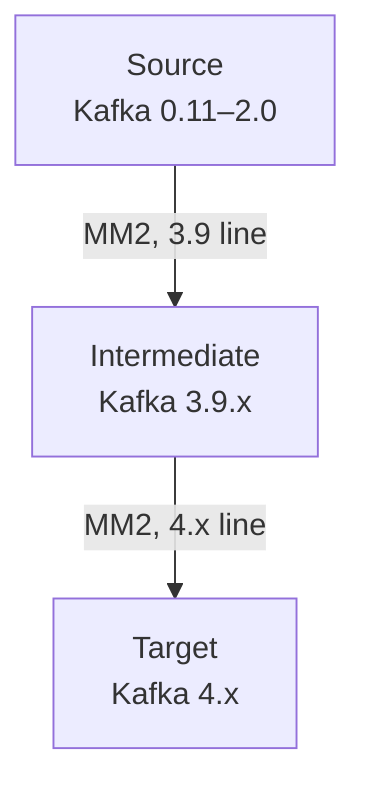

# Migrating a Legacy Kafka Source

The mirror itself barely notices an old source. [MirrorMaker 2](appendix-a-glossary.md#gl-mirrormaker-2) is a [Kafka Connect](appendix-a-glossary.md#gl-kafka-connect) application speaking the ordinary client protocol to both ends, and it neither knows nor cares whether the source stores its metadata in ZooKeeper or [KRaft](appendix-a-glossary.md#gl-kraft). What the source's era changes is everything *around* the mirror. It decides which commands you can run against the source, which authorizer holds its [ACLs](appendix-a-glossary.md#gl-acl), which TLS defaults its brokers were built with, and whether a 4.x client can talk to it at all.

Most of what follows is not discoverable from a failing pod, so read it before you plan the migration. [Cross-Cluster Replication and Migration](22-mirror-maker2-migration.md) covered the mirror; this is the half the source's age changes.

## The Cliff, and Where It Is

Kafka 4.0 removed the client protocol API versions that predate Kafka 2.1 (KIP-896 [@kip896]). The MirrorMaker 2 workers are 4.x clients, so KIP-896's own compatibility note lands on them directly:

> users should ensure their brokers are running at least Apache Kafka 2.1 before upgrading their Java clients to Apache Kafka 4.0 [@kip896]

KIP-1124 [@kip1124] states the consequence without hedging: 2.1 is the oldest version compatible with 4.0, and 4.0 clients require a broker of 2.1 or newer.

Nothing restores them. There is no compatibility flag, no `inter.broker.protocol.version` you can lower on the client side, nothing to negotiate. Below the floor the broker answers `UNSUPPORTED_VERSION` and the [connector](appendix-a-glossary.md#gl-connector) fails. The `KafkaMirrorMaker2` resource keeps reporting `Ready`, because the operator's readiness covers the workers and says nothing about whether replication is happening.

::: {.callout-important title="The floor is on the source broker's protocol, not its data"}
The floor is on the source broker, and it is a floor on the *protocol*, not on the data. A 2.1 broker holding records written years earlier in an ancient message format is fine — see [Message Formats: The Half That Surprises People](#message-formats-the-half-that-surprises-people). A 2.0 broker holding yesterday's records is not.
:::

The chart refuses this case at render time, before anything deploys:

```yaml
compatibility:
  enforce: true
  minSourceVersion: "2.1.0"
  requireDeclaredVersion: true
mirrors:
  - source:
      alias: legacy
      bootstrapServers: legacy-legacy-kafka-bootstrap.kafka-legacy-2x.svc:9092
      kafkaVersion: "2.8.2"
```

`requireDeclaredVersion` is the line to add when you write your own values: the chart's default is `false`, and the `values-migrate-*` presets and `kates migrate` turn it on. A source that does not say what it is cannot be checked, and "we think it's a 2.x" is the sentence that precedes a failed cutover.

::: {.callout-tip title="Try it: Does the chart refuse a 2.0 source before anything deploys?"}
Pull the `mirror-maker2` chart, copy its `values-migrate-2x.yaml`, set `kafkaVersion` to `2.0.1`, and render it with `helm template`; no cluster is needed. Read the error, then delete the `kafkaVersion` line and render again. The second error is `requireDeclaredVersion` refusing a source that says nothing.
:::

## What MirrorMaker 2 Itself Requires

Less than the cliff suggests, and the surprises are on the target side. The table gives the minimum for each end:

| Side | Minimum | Why |
|:-------|:--------|:--------------------------------------------------------------|
| Source | 2.1 | The KIP-896 floor; there is no MirrorMaker-specific minimum |
| Target | 2.3 | `MirrorSourceConnector` uses the `incrementalAlterConfigs` API, and the escape hatch that avoided it was removed in 4.0 |

The source's 2.1 comes from the general client baseline applied to Connect, which the [Kafka upgrade notes](https://kafka.apache.org/documentation/#upgrade) call out by name. The checkpoint connector reads consumer positions through the ordinary admin API — it lists [consumer groups](appendix-a-glossary.md#gl-consumer-group) and fetches their offsets — and never reads the source's `__consumer_offsets` topic directly. With the charts this book deploys, the target is always well past 2.3.

One setting deserves its own note, because its version story is the opposite of what it looks like. `offset-syncs.topic.location` decides which cluster holds the `mm2-offset-syncs` topic, and moving it to the target is what lets you mirror a source you may only read (KIP-716 [@kip716]). It arrived in Kafka 3.0, but it is a MirrorMaker-side setting, so what matters is the version of MirrorMaker, not of the source. A 2.x source does not prevent it. Since these workers run on the 4.x line, a read-only 2.x source is fully supported:

```yaml
mirrors:
  - source:
      alias: legacy
      kafkaVersion: "2.8.2"
    readOnlySource: true
```

Two operational details come from the KIP. The setting must be applied to both the source and checkpoint connectors. Changing it on a running mirror means stopping the connectors and clearing the offset-syncs topic, so it is not a value to flip while replication is live.

## Below the Floor: Two Hops

If the source is older than 2.1, one mirror cannot reach it. The supported shape is two migrations with an intermediate cluster in the middle:



KIP-1124 names 3.9.x as the recommended bridge and calls a direct upgrade from 0.11–2.0 "not officially supported and untested" [@kip1124]. 0.11 is the lowest version with a supported path at all. Below that, the migration is an application-level replay.

::: {.callout-warning title="A 3.9-line mirror against a pre-2.1 source is an inference, not a documented path"}
Running a 3.9-line MirrorMaker 2 against a pre-2.1 source is an inference from the bridge-release guidance, not something Apache documents directly. Rehearse it against a copy of the real cluster before committing to it, and measure — do not assume — that the checkpoint connector translates offsets correctly.
:::

Two hops means two cutovers, two sets of consumer repointing, and a period where the intermediate cluster is the system of record. Budget for it as two migrations, because that is what it is.

## What the Source's Era Actually Changes

Three things change with the source's major version, and none of them is replication. The table reads down a column for the era you have; the Java row matters only when you run the source's own tools, which need the JDK their release was built for:

| Concern | 2.x source | 3.x source | 4.x source |
|:-------------------|:-----------------------|:-----------------------|:-----------------|
| Metadata store | ZooKeeper | ZooKeeper or KRaft | KRaft only |
| Offset reading, from its own distribution | `GetOffsetShell` through `kafka-run-class.sh` | `kafka-get-offsets.sh` (3.0+) | `kafka-get-offsets.sh` |
| ACL administration | ZooKeeper or `--bootstrap-server` | Both; `--bootstrap-server` preferred | `--bootstrap-server` only |
| Authorizer class | `SimpleAclAuthorizer`, then `AclAuthorizer` from 2.4 | `AclAuthorizer` | `StandardAuthorizer` |
| Config changes from a 4.x toolbox | Only if the source is 2.3 or newer | Yes | Yes |
| Runs under Strimzi | No | No | Yes, within the operator's window |
| Java for its own tools | 8 or 11 | 8, 11 or 17 | 17 or 21 |

Each row is a place where a runbook written for the target does the wrong thing against the source.

### ZooKeeper Is the Source's Business, Not the Mirror's

Kafka 4.0 is the first release with no ZooKeeper at all, and it has no `zookeeper.*` broker settings. KRaft was declared production-ready in 3.3 and ZooKeeper mode was deprecated in 3.5 (KIP-833 [@kip833]), which is why the 3.x releases are called bridge releases.

None of this reaches MirrorMaker 2. The mirror talks to the source over the client protocol and never asks how the source stores its metadata. What the removal does change is the target, which must already be KRaft with a [metadata version](appendix-a-glossary.md#gl-metadata-version) of at least 3.3.x before it can be 4.x at all. So a ZooKeeper cluster has to be migrated to KRaft *before* it can be upgraded, not as part of the same step. The source's administration stays in its own era: you keep a 2.x-era toolbox for the old cluster, because a 4.x one cannot do the job, as [The Tools You Reach for Are Not the Tools You Have](#the-tools-you-reach-for-are-not-the-tools-you-have) shows.

### The Tools You Reach for Are Not the Tools You Have

A 4.x distribution is missing things a 2.x runbook assumes, and the failure is a bare "command not found" that explains nothing.

`kafka-get-offsets.sh` arrived in 3.0 (KIP-635 [@kip635]). Which form you use depends on the distribution you are typing into, not on the broker you are pointing at. A modern client reads any broker above the 2.1 floor. In the commands below, `SRC` is the source's bootstrap address, `legacy-legacy-kafka-bootstrap.kafka-legacy-2x.svc:9092` for the chart above:

```bash
SRC=legacy-legacy-kafka-bootstrap.kafka-legacy-2x.svc:9092

# From a 3.0-or-newer distribution, against any source above the floor
kafka-get-offsets.sh --bootstrap-server "$SRC" --topic orders

# From the source's own pre-3.0 distribution: the same tool, no launcher,
# and --broker-list rather than --bootstrap-server
kafka-run-class.sh kafka.tools.GetOffsetShell --broker-list "$SRC" --topic orders
```

The second form has its own cliff. `GetOffsetShell` moved to `org.apache.kafka.tools` in 3.7.0 ([KAFKA-14581](https://issues.apache.org/jira/browse/KAFKA-14581)) and, unlike the tools discussed below, was given no forwarder under the old name and no release note. So the old invocation works on 3.6.2 and every 2.x, and raises `ClassNotFoundException` from 3.7 onward. With stderr discarded, that error reads as "no offsets".

`kafka-acls.sh` lost `--authorizer`, `--authorizer-properties` and `--zk-tls-config-file` in 4.0. The classic 2.x incantation cannot be typed into a 4.x distribution at all:

```bash
# 2.x era — impossible from a 4.x toolbox
kafka-acls.sh --authorizer-properties zookeeper.connect=zk:2181 --list

# From anywhere — requires an authorizer configured on the source brokers
kafka-acls.sh --bootstrap-server "$SRC" --list
```

`kafka-configs.sh` from 4.0 uses the `incrementalAlterConfigs` API and fails outright against brokers older than 2.3. If the source is 2.1 or 2.2 — inside the mirroring floor but below this one — its configuration has to be changed from its own era's tooling.

Three more that bite:

- `kafka-run-class.sh` invocations of the old class names break, but not all at the same release. Six tools — `JmxTool`, `ClusterTool`, `EndToEndLatency`, `StateChangeLogMerger`, `StreamsResetter` and `kafka.admin.FeatureCommand` — kept a deprecated forwarder under the old name and lose it in 4.0.
- `--bootstrap-server` accepts only comma-separated values in 4.0. Space-separated lists were tolerated before and now raise an exception.
- Kafka 4.0 ships no MirrorMaker 1 binary. If the legacy estate mirrors with `kafka-mirror-maker.sh`, that path ends here, and [Strimzi](appendix-a-glossary.md#gl-strimzi) provides no automatic conversion of a MirrorMaker 1 deployment into a MirrorMaker 2 one.

::: {.callout-tip title="One toolbox pod per era"}
Keep an old toolbox pod alongside the new one and label them by era. The alternative — one pod whose tools half-work against one of the two clusters — produces the most confusing class of migration bug, where a command succeeds and reports something that is not true of the cluster you meant.
:::

### Security Defaults Moved Under You

If the source has not been touched in years, its brokers were configured when the defaults were different, and a 4.x client applies today's defaults. Hostname verification became the default in 2.0 [@kip294], TLSv1 and TLSv1.1 were disabled in 2.5 [@kip553], and TLSv1.3 is negotiated where both ends support it since 2.6 [@kip573]. The table gives each default that moved and what it breaks on a source nobody has touched:

| Default that moved | Since | What fails on an untouched source |
|:----------------------------------|:------|:------------------------------------------------|
| `ssl.endpoint.identification.algorithm` is `https`, not empty | 2.0 | The handshake, when the broker certificates have no matching SANs |
| TLSv1 and TLSv1.1 disabled | 2.5 | A listener pinned to TLSv1, until it is moved |
| `JndiLoginModule` disabled | 3.4 | A JAAS configuration copied from the old cluster |
| Empty OAUTHBEARER allow-list (`org.apache.kafka.sasl.oauthbearer.allowed.urls`) | 4.0 | Any OAUTHBEARER token endpoint not listed |

Hostname verification is a real security improvement, so don't work around it. Find the gap in a pre-flight probe, before it stalls a connector. A JAAS configuration copied from the old cluster, likewise, can fail for reasons that have nothing to do with credentials being wrong.

The chart's pre-flight probe exists for this: it performs a real handshake against the real source with the real client, before anything is deployed, and reports what it found. It is off by default and on in the migration presets.

### Message Formats: The Half That Surprises People

Message formats v0 and v1 were deprecated in 3.0 and removed in 4.0 (KIP-724 [@kip724]), and 4.0 has no `log.message.format.version` setting. What that means in practice is more precise than "old formats are unsupported".

Reading old records still works. KIP-724 keeps v0 and v1 records readable when they are already on disk — a broker returns them as they are, without scanning every batch to convert it. A 4.x MirrorMaker 2 can drain a source whose oldest segments predate the current format.

Writing is always v2. The target has no setting that would produce anything else, so everything the mirror writes lands in the modern format.

Your own old consumers are the problem. A client that speaks Fetch v3 or lower cannot read the 4.x target, and there is no configuration that restores it. The mirror moves the data faithfully to a cluster your application cannot read.

::: {.callout-caution title="Inventory your clients before the cutover"}
Kafka 3.7 added the `DeprecatedRequestsPerSec` metric and a `requestApiVersionDeprecated` field in the request log so that this question has an answer: if the metric is zero on a 3.7+ cluster, nothing is speaking a removed protocol version. On a 2.x source that metric does not exist, and the inventory is manual.
:::

## The Legacy Cluster Has to Live Somewhere

Strimzi cannot run a 2.x or 3.x Kafka. Current operator releases dropped 3.x entirely, and the supported window is 4.x only. The [Version & Compatibility Matrix](appendix-d-versions.md) names the operator and Kafka release this book is built against, and `kates migrate pairs` reads the operator's actual window from the cluster. There is no operator setting that widens it.

So a legacy source is necessarily *outside* the operator. The `legacy-kafka` chart runs one as plain StatefulSets, which is how a 2.x or 3.x cluster can exist beside a Strimzi-managed target on the same Kubernetes cluster:

```bash
# A 2.8.2 source, its own namespace, no operator involved.
helm pull oci://ghcr.io/bmscomp/charts/legacy-kafka --untar
helm install legacy ./legacy-kafka -n kafka-legacy-2x --create-namespace \
  -f legacy-kafka/values-kafka-2x.yaml

# Or let the CLI pick the era, build the image the version needs, create the
# namespace and topics, and run the chart's own test
kates migrate source deploy --version 2.8.2
```

A 4.x source is different: it can run under Strimzi, though possibly not under the *same* Strimzi. If the source is on a Kafka line the current operator has dropped, it needs its own namespace-scoped operator beside the primary's. [Kafka Deployment Engineering](15-kafka-deployment.md) covers the operator scope rules and what they cost.

## The Sequence

The full cutover mechanics are in the [MirrorMaker 2 Runbook — Cutover, Rollback, Troubleshooting](../mirror-maker2-runbook.md). What is specific to an old source is where the version questions land in the order:

1. Establish the source's version from the source — not from the runbook, not from the ticket. `kafka-broker-api-versions.sh --bootstrap-server "$SRC"` lists, from the wire, the version range of each API the brokers serve; the newest versions narrow it to a release line, not an exact release. The broker's startup log (`Kafka version: …`) and the `Version` attribute of the `kafka.server:type=app-info` MBean name the release itself.
2. Decide one hop or two. At or above 2.1, one mirror. Below it, the intermediate cluster from [Below the Floor: Two Hops](#below-the-floor-two-hops).
3. Inventory the clients, using `DeprecatedRequestsPerSec` if the source is 3.7 or newer, and by hand if it is not. This is the step that determines whether the cutover is a repointing or a client upgrade program.
4. Stand up the source (`legacy-kafka` for 2.x and 3.x) and the target.
5. Run the pre-flight probe — a real handshake with the real client, which is where the TLS and SASL default changes surface.
6. Start the mirror with `identity` replication (see [Three Uses, Three Different Configurations](22-mirror-maker2-migration.md#three-uses-three-different-configurations)), so topic names are preserved and consumers can repoint without being rewritten, and with `sync.group.offsets.enabled` so they resume from their committed positions. The chart's own default policy is `default` (prefixed names); the `values-migrate-*` presets and `kates migrate` set `identity`, so set `replicationPolicy.mode: identity` yourself when you write values from scratch.
7. Verify replication and [offset translation](appendix-a-glossary.md#gl-offset-translation) before anything moves.
8. Cut over, then retire the mirror.

The `kates migrate` family runs steps 4 through 8 as one lab:

```bash
kates migrate pairs             # which source-to-target pairs are possible here
kates migrate run --from 2.8.2  # up, verify, rehearse the cutover, tear down
```

`run` removes the lab at the end; pass `--keep` to leave the source and the mirror in place for inspection. Steps 1 through 3 are yours. No tool can tell you which of your applications still speaks a protocol version that Kafka removed.

::: {.callout-tip title="Try it: Which migrations can your cluster stand up today?"}
Run `kates migrate pairs` against `panda`, the book's three-node Kind cluster. Compare its list with the operator and Kafka release in the [Version & Compatibility Matrix](appendix-d-versions.md). A pair missing from the list is one this cluster cannot rehearse.
:::

## What Goes Wrong

Match the symptom in the left column; every cause here is a version question that the sections above explain, and the right column names the fix:

| Symptom | Cause | What to do |
|:--------------------|:-------------------------|:-------------------------|
| Connector fails with `UNSUPPORTED_VERSION`; the resource still says `Ready` | The source is below the 2.1 protocol floor, or a listener is not what the config says | Read the version from the wire with `kafka-broker-api-versions.sh`; below 2.1, plan two hops |
| TLS handshake fails against a source that "has always worked" | Hostname verification became the default in 2.0; the broker certificates have no matching SANs | Reissue the broker certificates with SANs, or move the mirror's listener |
| `kafka-configs.sh` fails against the source | The 4.x tool requires a broker of 2.3 or newer | Use the source's own era of tooling |
| `command not found` for a documented tool | `kafka-get-offsets.sh` is 3.0+ | Before 3.0, use `kafka-run-class.sh kafka.tools.GetOffsetShell` |
| Consumers repoint after cutover and find nothing | The mirror ran under `default` policy, so topics landed as `<alias>.<topic>` | Redeploy the mirror with `replicationPolicy.mode: identity` |
| Consumers repoint and restart from the beginning | `sync.group.offsets.enabled` was off, so the data moved and the positions did not | Turn `sync.group.offsets.enabled` on and let the checkpoints catch up before repointing |
| Applications cannot read the new cluster at all | They are pre-2.1 clients; the mirror did its job, but the clients were never inventoried | Upgrade the clients; there is no broker-side setting |

The [Troubleshooting Index](appendix-b-troubleshooting.md) covers the symptoms that are not version-specific.

## Summary

- A 4.x MirrorMaker 2 reads only from a source broker running Kafka 2.1 or newer; below that you migrate twice, through an intermediate cluster.
- The mirror never notices ZooKeeper, authorizers or message formats; your runbooks, toolboxes and TLS defaults do.
- Keep one toolbox per era, because a modern distribution lacks the old tools and the old one lacks the new flags.
- Inventory your clients before the cutover: the mirror can move data to a cluster your oldest consumers cannot read.
- The chart refuses an undeclared or too-old source at render time, and the pre-flight probe proves the handshake before anything deploys.

## Where to Go Next

The material that exercises this chapter, and the references it builds on:

- [Tutorial 11: Migrating Kafka 2.x to 4.x with MirrorMaker 2](../tutorials/11-migrating-kafka-2x-to-4x.md) and [Tutorial 12: Migrating Kafka 3.x to 4.x with MirrorMaker 2](../tutorials/12-migrating-kafka-3x-to-4x.md) — the two migration paths, step by step.
- [MirrorMaker 2 Runbook — Cutover, Rollback, Troubleshooting](../mirror-maker2-runbook.md) — the cutover checklist and the failure table.
- [Upgrade Playbook](18-upgrade-playbook.md) — upgrading a cluster in place, which is the other way to move versions and the right one when both ends can be the same cluster.
- [Version & Compatibility Matrix](appendix-d-versions.md) — the operator and Kafka versions this release is built against.

That is the end of moving data between clusters. The last chapter of this part, [Recipes & Patterns](14-recipes.md), goes back to Kates itself and combines its commands into end-to-end procedures — validating an upgrade, catching a regression overnight, certifying a cluster's resilience.
