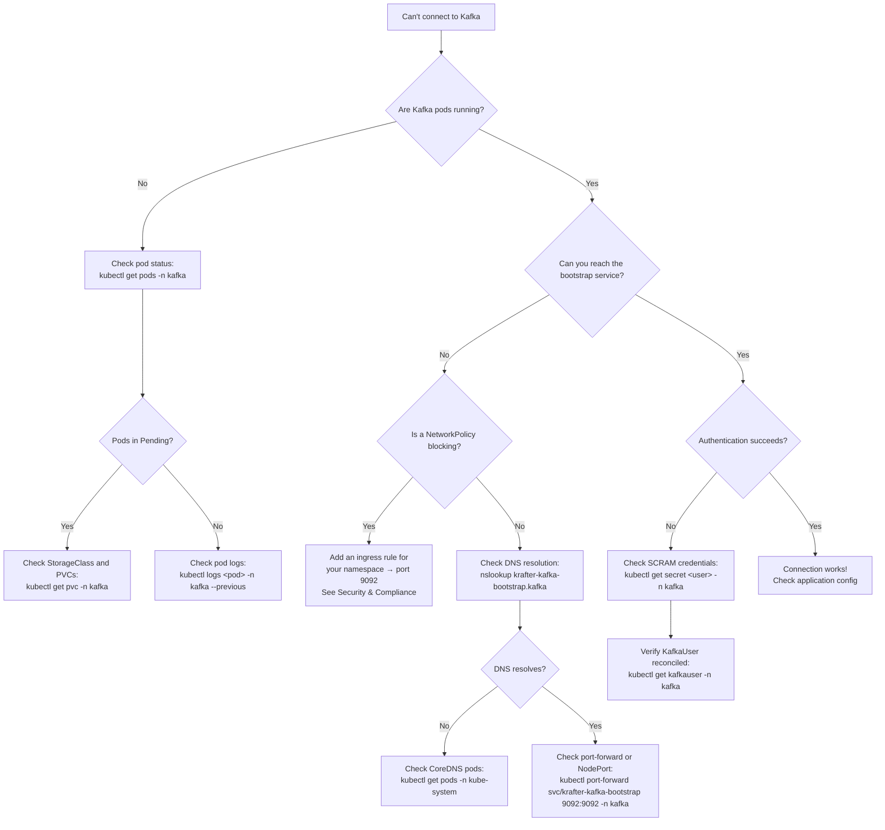

# Troubleshooting Index

Find your symptom in the tables, then follow its chapter link for the diagnosis and the fix. When no row matches, the runbooks after the tables take you from a first snapshot of the cluster to an issue report.

## How to Read an Entry

Each symptom section opens with a sentence on when to look there, then a table: the symptom as you see it, with literal error strings in backticks; its likely cause; and the chapter section that diagnoses and fixes it. [Kates Commands and Results](#kates-commands-and-results) gives the fix itself in its third column, since each is a command or two.

[Quick Diagnostic Commands](#quick-diagnostic-commands), the [Connectivity Debugging Flowchart](#connectivity-debugging-flowchart) and [Kafka Tools Inside a Broker Pod](#kafka-tools-inside-a-broker-pod) are runbooks. Each says when to use it and the access it needs, then gives numbered steps, how to verify the result, how to roll back and where to go when it fails. [When to Escalate](#when-to-escalate) says which layer a symptom points at, and how to open an issue.

## Kafka Cluster

The cluster exists but isn't healthy: the Strimzi operator, the brokers, the controller quorum or Cruise Control crash, stall, report an error or raise an alert.

| Symptom | Likely Cause | Chapter |
|---------|-------------|---------|
| Strimzi operator `CrashLoopBackOff` with `UnsupportedVersionException` | The operator's image map names a Kafka version its binary doesn't support: the release came from a chart not published beside that binary | [Kafka Deployment Engineering](15-kafka-deployment.md#strimzi-operator-crashloopbackoff) |
| Brokers crash with `ConfigException: Invalid value -1 for local.retention.bytes` | Values set `local.retention.bytes` (`log.local.retention.bytes`) to `-1` while `retention.bytes` is set; Kafka refuses a local retention larger than the total | [Kafka Deployment Engineering](15-kafka-deployment.md#brokers-crash-with-configexception) |
| Brokers crash immediately with `remote.log.storage.system.enable=true` | Tiered storage enabled without remote storage manager plugin JAR | [Kafka Deployment Engineering](15-kafka-deployment.md#brokers-crash-with-remotelogmanager) |
| `KafkaActiveControllerCount != 1` alert | Controller quorum lost or election in progress | [Kafka Deployment Engineering](15-kafka-deployment.md#prometheus-alerts) |
| Under-replicated partitions for extended period | Broker disk I/O saturated, network issues, or follower falling behind | [The Cluster Under Test](03-cluster.md#failure-tolerance-matrix) |
| Cruise Control `unsupported goals` error | Goals list doesn't match Strimzi's default goals | [Kafka Deployment Engineering](15-kafka-deployment.md#cruise-control-goal-mismatch) |
| Kafka CR stuck on `NotReady` (often with `UnforceableProblem`) | Strimzi CRDs missing, insufficient resources, or operator egress blocked by `operatorNetworkPolicy` / isolated topology NetworkPolicy missing DNS/API server egress — can't reach controllers | [Installing Kafka with the kafka-cluster Helm Chart](20-installation-guide.md#kafka-cr-stuck-on-notready), [Kafka Deployment Engineering](15-kafka-deployment.md#strimzi-operator-cannot-determine-active-controller) |

## Kafka Connectivity

A client — Kates, Kafka UI or your own — can't reach the cluster or authenticate to it, or its credentials never arrive.

| Symptom | Likely Cause | Chapter |
|---------|-------------|---------|
| Kafka UI `CreateContainerConfigError` — secret not found | `KafkaUser` not applied before UI deployment | [Kafka Deployment Engineering](15-kafka-deployment.md#kafka-ui-createcontainerconfigerror) |
| Kates can't connect to Kafka | Wrong bootstrap address or NetworkPolicy blocking | [Deployment Guide](12-deployment.md#kates-cant-connect-to-kafka) |
| SCRAM authentication failure | Password rotated or KafkaUser not reconciled | [Security & Compliance](17-security.md#scram-sha-512) |
| Connection timeout from new namespace | The client namespace's own egress policy, such as Kyverno's generated default-deny; after the listeners carry `networkPolicyPeers`, a missing `networkPolicy.clients` entry | [Security & Compliance](17-security.md) |
| `KafkaUser` secrets never created | Entity Operator (User Operator) only starts after the Kafka CR reaches `Ready` | [Installing Kafka with the kafka-cluster Helm Chart](20-installation-guide.md#user-secrets-not-appearing) |

## Kafka Connect

A Kafka Connect release misbehaves: its workers restart or keep rebalancing, a connector fails or is refused at render time, or the PostgreSQL database a Debezium connector reads grows on disk.

| Symptom | Likely Cause | Chapter |
|---------|-------------|---------|
| `KafkaConnector` status `FAILED` with `DebeziumException` | Wrong database credentials, replication slot still held, `wal_level` not `logical`, or `schema.include.list` matching no tables | [Operating Kafka Connect](operating-kafka-connect.md#connector-stuck-in-failed-state) |
| Connect cluster stuck in `REBALANCING` — `KafkaConnectRebalanceTooLong` alert fires | Workers crashing mid-rebalance, NetworkPolicy blocking inter-worker traffic on port 8083, or OOM kills during task assignment | [Operating Kafka Connect](operating-kafka-connect.md#rebalancing-takes-too-long) |
| Connect worker pods restart with `OOMKilled` | Container memory limit under 2× the JVM heap — off-heap memory pushes usage over the limit | [Operating Kafka Connect](operating-kafka-connect.md#connect-workers-oomkilled) |
| PostgreSQL disk usage grows while a connector is down or paused | Replication slot retains WAL segments until the connector drains them | [Operating Kafka Connect](operating-kafka-connect.md#replication-slot-wal-retention-growing) |
| `helm upgrade` of the Connect chart fails with `connect-cluster: connectors.<name> …` | A connector in the values misses a class, a required config key or `topics`, or breaks a production rule — checked at render time | [Operating Kafka Connect](operating-kafka-connect.md#connector-validation-blocks-deployment) |
| `KafkaConnector` `FAILED` with `Forbidden` or `secrets "…" is forbidden` | Chart 2.0 grants the workers `get` on only the Secrets its own connector configs reference — a connector applied outside the chart needs its Secret in `rbac.secretNames` | [Operating Kafka Connect](operating-kafka-connect.md#connector-fails-with-forbidden-reading-a-secret) |

## Performance Issues

Tests complete but the numbers look wrong — latency that regresses, splits in two or looks too good, results that vary between identical runs — or a broker raises a request-handler or log-flush alert.

| Symptom | Likely Cause | Chapter |
|---------|-------------|---------|
| P99 latency regression between test runs | Partition hotspot, GC pauses, or ISR changes | [Recipes & Patterns — Recipe 4](14-recipes.md#recipe-4-investigate-a-latency-regression) |
| Bimodal latency distribution in heatmap | Some requests hitting page cache, others going to disk | [Performance Theory](04-performance-theory.md#heatmaps-seeing-the-full-picture) |
| Artificially low latency measurements | Coordinated omission — tool slows down with the system | [Performance Theory](04-performance-theory.md#coordinated-omission) |
| Stress test results vary wildly between identical runs | JVM warm-up (JIT), GC pauses, small sample size — increase records to 500K+, use ZGC, discard first 2–3 warm-up iterations | [Performance Theory](04-performance-theory.md#the-long-tail-problem), [Deployment Guide](12-deployment.md#jvm-tuning) |
| `KafkaRequestHandlerSaturated` alert | Request handlers over 70% busy — add threads or brokers | [Kafka Deployment Engineering](15-kafka-deployment.md#prometheus-alerts) |
| `KafkaLogFlushLatencyHigh` alert | Disk I/O saturated — check storage class and disk utilization | [Kafka Deployment Engineering](15-kafka-deployment.md#prometheus-alerts) |

## Deployment Issues

Pods, images or Helm releases fail while you install the stack or roll it out.

| Symptom | Likely Cause | Chapter |
|---------|-------------|---------|
| Images won't load into Kind | Registry unreachable or platform mismatch (arm64/amd64) | [Deployment Guide](12-deployment.md#images-wont-load) |
| Kafka pods stuck in `Pending` | StorageClass can't provision PVCs, or no node matches the zone `nodeAffinity` rules | [Deployment Guide](12-deployment.md#kafka-pods-not-starting), [Installing Kafka with the kafka-cluster Helm Chart](20-installation-guide.md#pods-stuck-in-pending) |
| `helm upgrade` fails with `another operation in progress` | A previous install or upgrade was interrupted — roll back the release, then retry | [Installing Kafka with the kafka-cluster Helm Chart](20-installation-guide.md#helm-upgrade-fails-with-another-operation-in-progress) |
| PDB blocks rolling restart | Only 1 pod can be unavailable — intentional safety behavior | [Upgrade Playbook](18-upgrade-playbook.md#common-upgrade-issues) |
| Entity Operator never starts | Kafka CR hasn't reached `Ready` — check operator logs for `UnforceableProblem` | [Kafka Deployment Engineering](15-kafka-deployment.md#strimzi-operator-cannot-determine-active-controller) |
| PostgreSQL pod `CrashLoopBackOff` with `could not create lock file` | `readOnlyRootFilesystem: true` mutated by Kyverno — mount `emptyDir` at `/var/run/postgresql` and `/tmp` | [Deployment Guide](12-deployment.md#read-only-filesystem-compliance) |
| Pod admission rejected with Kyverno policy violation | Pod doesn't meet PSS standards — run `kates kyverno violations`, then fix the values, or exempt it with a `PolicyException` (`kyvernoPolicy.exceptions` in `kates` and `kates-chaos`) | [Security & Compliance](17-security.md#workloads-that-cannot-pass) |

## CLI Issues

The `kates` CLI itself fails, or can't reach or authenticate to the Kates API.

| Symptom | Likely Cause | Chapter |
|---------|-------------|---------|
| `kates health` killed immediately (exit 137) on macOS | macOS blocks unsigned binary — `com.apple.provenance` xattr | [Deployment Guide](12-deployment.md#cli-binary-killed-on-macos) |
| CLI connection timeout / connection refused | Kates API not running or port-forward died | [Deployment Guide](12-deployment.md#kates-cant-connect-to-kafka) |
| `[401] Missing API key` or `[403] Invalid API key`, while `kates health` works | The CLI context carries no API key or a stale one, or a stale `KATES_API_KEY` is exported, which the CLI prefers to the context's key — only `/api/health` is public | [Deployment Guide](12-deployment.md#cli-configuration) |

## Chaos Engineering

A LitmusChaos experiment or a Kates disruption fails to start, has no effect or leaves a cluster that doesn't recover, or the **Kates — Chaos** board shows no data.

| Symptom | Likely Cause | Chapter |
|---------|-------------|---------|
| Litmus experiments fail to start | Chaos operator pod not running or RBAC insufficient | [Deployment Guide](12-deployment.md#litmus-experiments-fail) |
| Disruption doesn't take effect | Target pod selector doesn't match, or NetworkPolicy blocks | [Chaos Engineering in Practice](07-chaos-practice.md) |
| Every step's `Verdict` in `kates disruption status` is `Skipped` | The Kates API fell back to the `noop` chaos provider, which injects nothing | [Chaos Engineering in Practice](07-chaos-practice.md) |
| A `DISK_FILL` or `NETWORK_LATENCY` step fails | The `kates-chaos` chart installs no `disk-fill` or `pod-network-latency` experiment for the default `litmus-crd` chaos provider | [Chaos Engineering in Practice](07-chaos-practice.md) |
| Cluster doesn't recover after chaos | ISR too small, `min.insync.replicas` violated | [Chaos Engineering Theory](06-chaos-theory.md) |
| **Kates — Chaos** board: `$namespace` picker empty, *Chaos engines running* reads *No data* | No `ChaosEngine` has been created yet, or kube-state-metrics lacks the custom-resource configuration for it (`charts/monitoring` before 1.6.0, or another stack) | [Observability & Monitoring](09-observability.md#kates-specific-dashboards) |

## Upgrades

Something that worked before an operator or Kafka upgrade fails or slows down after it.

| Symptom | Likely Cause | Chapter |
|---------|-------------|---------|
| `Kafka` resource NotReady after setting `kafkaVersion` | Kafka version outside the running operator's window | [Upgrade Playbook](18-upgrade-playbook.md#two-versions-two-steps) |
| Topics not reconciling after CRD API change | CRDs still using deprecated `v1beta2` | [Upgrade Playbook](18-upgrade-playbook.md#strimzi-operator-upgrade) |
| Performance regression after Kafka upgrade | New version defaults changed — compare baseline tests | [Upgrade Playbook](18-upgrade-playbook.md#post-upgrade-checks) |

## Kates Commands and Results

The stack is up and the Kates API answers, but a command or a test result isn't what you expect.

| Symptom | Likely Cause | Fix |
|---------|-------------|-----|
| `kates cluster topology` fails with "The Kates API's service account may not list pods in" the Kafka namespace | The Kates API may not read the Kafka namespace: a cluster-scoped install is missing its `ClusterRoleBinding`, or an admin-less one (`rbac.scope=namespace`) went in without the chart's Kafka-reader Role, because the installer lacked its reads | Cluster scope: verify RBAC with `kubectl get clusterrolebinding kates`, and if it's missing, redeploy with `helm upgrade --install kates oci://ghcr.io/bmscomp/charts/kates -n kates`. Admin-less: an account that holds those reads in the Kafka namespace applies the Role, with the command `kates deploy` printed |
| `kates cluster topology` warns "Kubernetes refused some reads" and some sections are empty | The Kates API may read only part of the cluster. An admin-less install's Role grants what a compliance check reads, and nodes are cluster-scoped, so topics, users, Connect, services and the node list stay unread | Expected in admin-less mode. Each line names the refused read; to see that section, grant the read with a Role in the Kafka namespace |
| Test results show 0 records consumed even though producers succeeded | Consumer group hasn't started consuming, or topic has no committed offsets for the group | Check consumer lag: `kates kafka group <group-name>`. If lag equals total records, the consumer never started — check the Kates API's logs for consumer errors |
| `kates trend` shows no data even after running tests | A trend reads only the type's `DONE` runs created within `--days`; `FAILED` runs and runs still in flight are left out | Check the runs' status with `kates test list --type <TYPE>`, and widen `--days` for older runs |

## Quick Diagnostic Commands

Use this first, when something is wrong and you don't yet know which layer. It takes a snapshot of the Strimzi resources and pods, the operator and broker logs, the Kafka conditions, partition health through the Kates API, and Kyverno's policies and violations. It assumes the chart defaults: cluster `krafter` in namespace `kafka`, and the operator in `strimzi-operator`. You need `kubectl` read access (get, logs) in both namespaces, and a [CLI context](appendix-a-glossary.md#gl-cli-context) that reaches the Kates API with its API key. Every step only reads, so there's nothing to roll back.

1. List the Strimzi resources.

   ```bash
   kubectl get kafka,kafkanodepool,kafkatopic,kafkauser -n kafka
   ```

   The `Kafka` resource's `READY` column should read `True`.

2. List the pods and the nodes they run on.

   ```bash
   kubectl get pods -n kafka -o wide
   ```

   A pod that isn't `Running`, or whose restart count climbs, is the one whose logs steps 3 and 4 read.

3. Read the last 50 lines of the Strimzi operator's log. The operator is its own release, in its own namespace.

   ```bash
   kubectl logs deployment/strimzi-cluster-operator -n strimzi-operator --tail=50
   ```

4. Read the log of a broker's last crash.

   ```bash
   kubectl logs <broker-pod> -n kafka --previous --tail=30
   ```

5. Print the `Kafka` resource's status conditions.

   ```bash
   kubectl get kafka krafter -n kafka \
     -o jsonpath='{range .status.conditions[*]}{.type}: {.status} - {.message}{"\n"}{end}'
   ```

   Each line prints a condition's type, status and message; a healthy cluster shows `Ready: True`.

6. Check for under-replicated and offline partitions, through the Kates API.

   ```bash
   kates cluster check
   ```

7. Show Kyverno's policy status, then its violations, in every namespace or in one.

   ```bash
   kates kyverno status
   kates kyverno violations
   kates kyverno violations --namespace kafka
   ```

The snapshot is complete when every command has answered. Match what it shows against the tables above; a cluster that looks healthy while a client still can't connect goes on to the [Connectivity Debugging Flowchart](#connectivity-debugging-flowchart). When `kates cluster check` or the Kyverno commands can't reach the Kates API, see [CLI Issues](#cli-issues).

## Connectivity Debugging Flowchart

Use this when a client can't connect to `krafter`, the Kafka cluster under test: `kates health` reports the Kafka Cluster status `DOWN`, or your own client times out. The commands assume the chart defaults: cluster name `krafter` in namespace `kafka` (set in `charts/kafka-cluster/values.yaml`); adjust them if your deployment overrides these values. You need `kubectl` read access in `kafka` and `kube-system`, Secrets in `kafka` included for the authentication check.

The decision tree shows the order of the checks, and the steps after it give each check's command:



1. Check that the Kafka pods are running.

   ```bash
   kubectl get pods -n kafka
   ```

   When every pod is `Running` and ready, go to step 4. A pod in `Pending` goes to step 2, and one that restarts goes to step 3.

2. For a `Pending` pod, check its storage claims.

   ```bash
   kubectl get pvc -n kafka
   ```

   A claim that stays `Pending` means the StorageClass can't provision it: see [Kafka Pods Not Starting](12-deployment.md#kafka-pods-not-starting).

3. For a restarting pod, read the log of its last crash.

   ```bash
   kubectl logs <pod> -n kafka --previous
   ```

   Look the error up in [Kafka Cluster](#kafka-cluster) above.

4. When the client can't reach the bootstrap service, check whether a NetworkPolicy blocks its namespace.

   ```bash
   kubectl get networkpolicy -n kafka
   ```

   When one blocks it, add an ingress rule from your namespace to port 9092, as [Network Policies](17-security.md#network-policies) in Security & Compliance explains. When none does, go on to step 5.

5. Check that the bootstrap service's name resolves, from a pod in the client's namespace.

   ```bash
   nslookup krafter-kafka-bootstrap.kafka
   ```

   When it doesn't resolve, check that the CoreDNS pods are running with `kubectl get pods -n kube-system`. When it resolves, go on to step 6.

6. Check the port-forward or NodePort the client connects through. A forward from your machine looks like this:

   ```bash
   kubectl port-forward svc/krafter-kafka-bootstrap 9092:9092 -n kafka
   ```

7. When the client reaches the service but authentication fails, check its SCRAM credentials and that its `KafkaUser` is reconciled.

   ```bash
   kubectl get secret <user> -n kafka
   kubectl get kafkauser -n kafka
   ```

   A missing Secret means the User Operator hasn't reconciled the `KafkaUser`: see [User Secrets Not Appearing](20-installation-guide.md#user-secrets-not-appearing).

The fix worked when the client connects, or when `kates health` shows the Kafka Cluster status `UP`. The checks only read; the port-forward from step 6 stops with Ctrl+C. When every check passes and the client still fails, check its own configuration, then [When to Escalate](#when-to-escalate).

## Kafka Tools Inside a Broker Pod

Use this when a question needs Kafka's own tools, such as `kafka-topics.sh` or `kafka-consumer-groups.sh`, rather than `kates cluster check` or `kates kafka groups`. The tools under `/opt/kafka/bin` need credentials. Both internal listeners authenticate (SCRAM-SHA-512 on 9092, mutual TLS on 9093), and the brokers enforce ACLs. Without credentials `kafka-topics.sh` retries until it times out, prints an `Error while executing topic command` line to standard output and exits 1, so a filter after it shows nothing and a broken command reads like a healthy cluster.

The platform profile makes the `kates-backend` KafkaUser a super user, so it can describe every topic, its configuration and every consumer group. You need `kubectl` access in `kafka` to read that user's Secret and to exec into a broker pod.

1. Pick a broker pod.

   ```bash
   BROKER=$(kubectl get pods -n kafka -o name \
     -l strimzi.io/cluster=krafter,strimzi.io/broker-role=true | head -1)
   ```

2. Read the `kates-backend` user's JAAS configuration from its Secret.

   ```bash
   JAAS=$(kubectl get secret kates-backend -n kafka \
     -o jsonpath='{.data.sasl\.jaas\.config}' | base64 -d)
   ```

3. Write a client configuration into the pod. It goes to the pod's memory-backed `/tmp`, so it's gone when the pod restarts.

   ```bash
   kubectl exec -i -n kafka "${BROKER}" -- sh -c 'cat > /tmp/client.properties' <<EOF
   security.protocol=SASL_PLAINTEXT
   sasl.mechanism=SCRAM-SHA-512
   sasl.jaas.config=${JAAS}
   EOF
   ```

4. Prove the credentials work by listing the topics.

   ```bash
   kubectl exec -n kafka "${BROKER}" -- /opt/kafka/bin/kafka-topics.sh \
     --bootstrap-server localhost:9092 --command-config /tmp/client.properties --list
   ```

   The list includes `__consumer_offsets`. A timeout followed by `Error while executing topic command` means the configuration is wrong: repeat steps 2 and 3.

5. Run the tool you need with the same two flags: here the under-replicated partitions, where no output means none, and the consumer lag.

   ```bash
   kubectl exec -n kafka "${BROKER}" -- /opt/kafka/bin/kafka-topics.sh \
     --bootstrap-server localhost:9092 --command-config /tmp/client.properties \
     --describe --under-replicated-partitions
   kubectl exec -n kafka "${BROKER}" -- /opt/kafka/bin/kafka-consumer-groups.sh \
     --bootstrap-server localhost:9092 --command-config /tmp/client.properties \
     --all-groups --describe
   ```

6. Remove the client configuration, which carries a super user's password.

   ```bash
   kubectl exec -n kafka "${BROKER}" -- rm /tmp/client.properties
   ```

Step 4's topic list verifies the setup, and step 6 rolls it back; nothing else changes. When step 4 still fails, check that the Secret exists with `kubectl get secret kates-backend -n kafka`, then see [When to Escalate](#when-to-escalate). `kates kafka groups` and `kates kafka group <group-name>` answer the lag question through the Kates API without a broker pod.

## When to Escalate

Not every problem is a Kates problem. This table maps each symptom pattern to the layer to check first:

| Symptom Pattern | Likely Layer | What to Check |
|-----------------|-------------|---------------|
| `kates health` shows all components UP, but tests fail | **Kafka** | Check broker logs, partition health, ISR state |
| CLI commands return "connection refused" or timeout | **Kates API** | Check the Kates API pod's status, port-forward, service endpoints |
| Pods stuck in `Pending`, `CrashLoopBackOff`, or `ImagePullBackOff` | **Kubernetes** | Check node resources, StorageClass, image registry access |
| Kyverno rejecting pod creation | **Kyverno policies** | Run `kates kyverno violations` to identify which rule is failing |
| Latency numbers are unreasonably high for all tests | **Infrastructure** | Check node CPU/memory pressure, disk I/O, network bandwidth |
| Everything works locally but fails in CI | **CI environment** | Check resource limits, network access, Docker-in-Docker configuration |

When the layer is Kates itself, or no runbook here settles it, open an issue at [github.com/bmscomp/kates/issues](https://github.com/bmscomp/kates/issues). Include the step that failed and its error, the output of `kates doctor`, which runs its diagnostic checks and prints one summary of the system's health, and the Kates API's logs:

```bash
kates doctor
kubectl logs -n kates -l app=kates --tail=200
```
