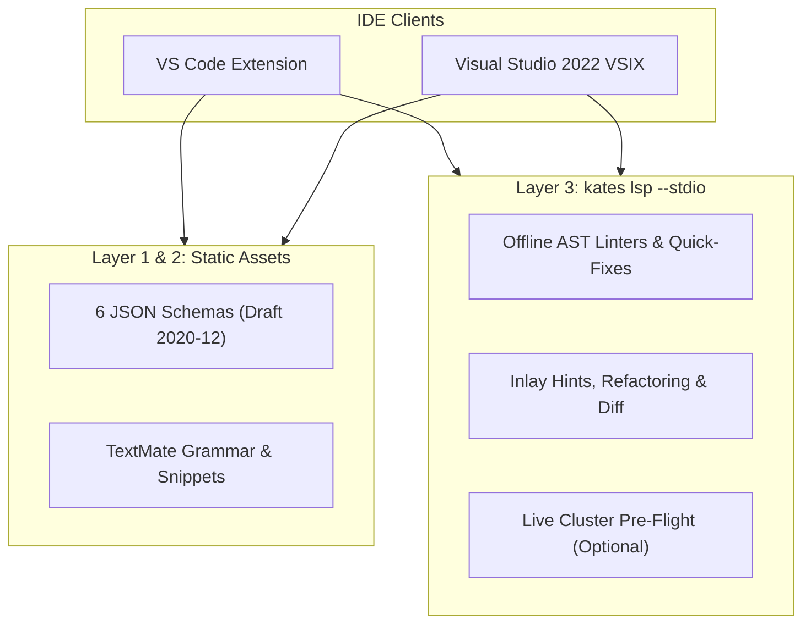

# IDE Extensions & Language Server

Every YAML dialect that [Kates](appendix-a-glossary.md#gl-kates) reads has an embedded JSON Schema, an offline CLI linter, and first-class support in the [Language Server (`kates lsp`)](appendix-a-glossary.md#gl-lsp). You use those dialects across [scenario files](appendix-a-glossary.md#gl-scenario-file) (`kates test apply`), phased test requests (`POST /api/tests`), flow pipelines (`kates flow run`), [resilience runs](appendix-a-glossary.md#gl-resilience-run) (`kates resilience run`), [disruption plans](appendix-a-glossary.md#gl-disruption-plan) (`kates disruption run`), and [`KafkaReference`](appendix-a-glossary.md#gl-kafkareference) manifests (`kates compliance check`). In every case, the editor and the CLI enforce the exact same rules before a single request reaches the [Kates API](appendix-a-glossary.md#gl-kates-api).

## How to Read an Entry

The sections move from the shared validation architecture to the specifics of each tool. The first section maps every Kates YAML file to its dialect, JSON Schema, comment directive, and CLI linter. The second section lists the structural and cross-field diagnostic codes that `kates lsp` and the offline linters report. The third section covers the Language Server protocol features: context-aware completion, hover documentation, inlay hints, code actions, refactorings, symbol navigation, and custom JSON-RPC requests. The final two sections cover installing and using the Visual Studio Code extension (`editors/vscode-kates`) and the Visual Studio 2022 extension (`editors/visualstudio-kates`).

## Architecture and Dialect Detection

Editor support combines three layers so that validation works both with and without the `kates` binary installed on the workstation. The diagram below shows how the JSON Schema layer, TextMate grammar layer, and `kates lsp --stdio` process fit together inside Visual Studio Code and Visual Studio 2022.



Every Kates YAML schema sets `additionalProperties: false` on every object level, so any unknown or misspelled attribute is flagged immediately in both layers. The table below lists the six dialects, the embedded schema file in `cli/schemas/`, the directive comment that pins a file's dialect, and the offline CLI linter command.

| Dialect | Schema file | Directive comment | Offline CLI linter |
|:-------------|:------------------------------------|:-------------------------------|:--------------------------|
| `scenario` | `scenario.v1.schema.json` | `# kates-schema: scenario` | `kates test lint` |
| `test-request` | `test-request.v1.schema.json` | `# kates-schema: test-request` | `kates test lint` |
| `flow` | `flow.v1.schema.json` | `# kates-schema: flow` | `kates flow lint` |
| `resilience` | `resilience.v1.schema.json` | `# kates-schema: resilience` | `kates resilience lint` |
| `disruption` | `disruption.v1.schema.json` | `# kates-schema: disruption` | `kates disruption lint` |
| `compliance` | `kafkareference.v1alpha1.schema.json` | `# kates-schema: compliance` | `kates compliance lint` |

When a YAML file is opened, `kates lsp` resolves its dialect in three steps and stops at the first match:

1. Explicit header comment in the first ten lines, either `# kates-schema: <dialect>` or `# yaml-language-server: $schema=.../<schema>.json`.
2. File path pattern matching against the workspace path, such as `**/scenarios/*.yaml`, `**/flows/*.yaml`, `**/playbooks/*.yaml`, `**/resilience-*.yaml`, or `**/conformity/*.yaml`.
3. Top-level YAML key inspection: `apiVersion: conformity.kates.io/v1alpha1` and `kind: KafkaReference` select `compliance`; `testRequest` and `chaosSpec` select `resilience`; `steps` with `faultSpec` selects `disruption`; `steps` with `action` selects `flow`; `scenario.phases` selects `test-request`; and `scenarios` or `type` with `spec` selects `scenario`.

## Offline Linters and Cross-Field Diagnostics

While JSON Schema validates shape, types, enums, and numeric bounds, the AST linters built into the CLI and `kates lsp` check rules that depend on multiple fields at once or preserve YAML node positions for character-accurate diagnostics. Every linter prints findings in the same format and exits with the same [exit code](appendix-a-glossary.md#gl-exit-code) contract (`0` when no errors are found, `1` on validation errors, and `2` when a file cannot be read):

```bash
kates test lint scenarios/regression-suite.yaml
kates flow lint flows/release-qual.yaml
kates resilience lint resilience-pod-kill.yaml
kates disruption lint playbooks/broker-failure.yaml
kates compliance lint conformity/prod-3az.yaml
```

### Scenario and Phased Test Request Diagnostics

`kates test lint` validates both `scenario` files (`kates test apply -f`) and `test-request` files (`POST /api/tests`, including phased `scenario.phases` workloads). The table below lists the diagnostic codes it emits.

| Code | Severity | Condition and fix |
|:-----------------------|:---------|:-------------------------------------------------------------------|
| `unknown-field` | Error | Unknown key in top level, `spec`, `validate`, `phases`, or `sla`; suggests the closest valid field name |
| `duplicate-key` | Error | Same mapping key appears more than once in the same block |
| `missing-type` | Error | Scenario has no `type` field |
| `unknown-type` | Error | `type` is not one of the fourteen [`TestType`](appendix-a-glossary.md#gl-test-type) values |
| `wrong-type` | Error | Value has the wrong YAML scalar or collection type |
| `wrong-value` | Error | Invalid enum value, quoted number, unit suffix on a numeric field, or out-of-range number |
| `incompatible-field` | Error | `enableCrc: true` outside `INTEGRITY`, consumer fields on producer-only types, or `enableTransactions: true` on `trogdor` |
| `invalid-acks` | Error | [`enableIdempotence: true`](appendix-a-glossary.md#gl-idempotent-producer) or `enableTransactions: true` when [`acks`](appendix-a-glossary.md#gl-acks) is not `all` |
| `missing-idempotence` | Error | `enableTransactions: true` combined with `enableIdempotence: false` |
| `min-isr-exceeds-rf` | Error | [`minInsyncReplicas`](appendix-a-glossary.md#gl-min-insync-replicas) is greater than [`replicationFactor`](appendix-a-glossary.md#gl-rf) |
| `ignored-field` | Warning | `parallelProducers > 1` on a type other than `STRESS` or `CAPACITY`, or `numConsumers` set |
| `low-records` | Warning | `records < 1000` alongside `maxP99LatencyMs` or `maxP999LatencyMs` [gates](appendix-a-glossary.md#gl-gate) |
| `dual-termination` | Warning | Both `records` and `durationSeconds` set on the same scenario |
| `missing-phases` | Error | Phased `scenario` block has an empty or missing `phases` list |
| `invalid-phase-type` | Error | Phase `type` or `phaseType` is not `WARMUP`, `RAMP`, `STEADY`, `SPIKE`, or `COOLDOWN` |
| `invalid-ramp` | Error | `rampSteps < 2` on a `RAMP` phase, or `rampSteps` set on a non-`RAMP` phase |

### Resilience and Disruption Diagnostics

`kates resilience lint` and `kates disruption lint` validate [fault](appendix-a-glossary.md#gl-fault) specifications, health probes, label selectors, and [safety guard](appendix-a-glossary.md#gl-safety-guard) parameters offline. In addition, `kates disruption run --config` accepts both YAML and JSON plan files and runs `lintDisruptionFile` before submitting the plan to the Kates API. The table below lists the chaos diagnostic codes.

| Code | Severity | Condition and fix |
|:------------------------------|:---------|:-------------------------------------------------------------------|
| `missing-field` | Error | Required field missing (`testRequest`, `chaosSpec`, `experimentName`, `name`, `faultSpec`, or probe `name`/`command`/`expectedOutput`) |
| `no-steps` | Error | Disruption plan `steps` list is missing or empty |
| `fault-requires-duration` | Error | `disruptionType` is set on `chaosSpec` or `faultSpec` without a positive `chaosDurationSec` |
| `zero-chaos-duration` | Warning | `chaosDurationSec` is `0` on `ROLLING_RESTART` or `SCALE_DOWN` |
| `unused-field` | Warning | `targetTopic` or `targetPartition` set on a resilience fault (only `kates disruption run` resolves partition leaders) |
| `invalid-label-selector` | Error | `targetLabel` or `envOverrides.NODE_LABEL` is not a valid Kubernetes label selector |
| `invalid-env-override` | Error | `envOverrides` key is not in the allow-list (`TARGET_NODE`, `NODE_LABEL`) |
| `invalid-kafka-probe-command` | Error | `kafkaProbe` command is not `under-replicated-partitions`, `unavailable-partitions`, `produce <topic>`, or `consumer-lag [<group>]` |
| `cmdprobe-in-faultspec` | Error | `cmdProbe` used inside `faultSpec.probes`, which only permits `kafkaProbe` or `k8sProbe` |
| `invalid-probe` | Error | Numeric comparator (`==`, `!=`, `<=`, `>=`, `<`, `>`) used with a non-numeric `expectedOutput` |
| `scaledown-without-rollback` | Warning | `SCALE_DOWN` step combined with `autoRollback: false` leaves the broker scaled down after the plan completes |

## Language Server Capabilities (`kates lsp`)

Editors launch `kates lsp --stdio` as a background child process and communicate with it over standard LSP 3.17 JSON-RPC 2.0 frames. Because the server embeds all six JSON Schemas and shares the Go linter packages with the CLI, it requires no external runtime or network access for offline validation.

### Context-Aware Completion and Hover Documentation

Pressing `Ctrl+Space` triggers completion tailored to the cursor's YAML path and dialect:

- Mapping key completion suggests valid child properties from the active dialect's JSON Schema, filtered against keys already present in the current YAML mapping, with type and default badges in the detail column.
- Value completion suggests `TestType` enums, `DisruptionType` enums, `litmus-crd` experiment names, compression codecs (`none`, `gzip`, `snappy`, `lz4`, `zstd`), `acks` values (`"all"`, `"1"`, `"0"`), Strimzi label selectors (`strimzi.io/cluster=krafter,strimzi.io/broker-role=true`), `kafkaProbe` commands, and compliance `waivers[].rule` IDs collected from the rules declared earlier in the same `KafkaReference` file.
- When an active [CLI context](appendix-a-glossary.md#gl-cli-context) reaches a running Kates API, value completion on `topic`, `targetTopic`, `consumerGroup`, and `topics.exclude` also offers live [topic](appendix-a-glossary.md#gl-topic) and [consumer group](appendix-a-glossary.md#gl-consumer-group) names from the cluster, cached with a 15-second TTL.
- Hovering over any field name, `TestType` value, or `DisruptionType` value shows a Markdown card with the field's schema description, constraints, per-type defaults (`TestTypeDefaults`), or chaos blast radius and required Kubernetes RBAC permissions.

### Inlay Hints

When inlay hints are enabled, `kates lsp` renders inline ghost-text annotations beside key lines without modifying the file:

- On a scenario's `type:` line, it shows the default producer count, throughput, `acks`, batch size, and `lingerMs` that the Kates API applies when `spec` omits them.
- On `records:` or `numRecords:`, it computes the estimated payload footprint (`records * recordSizeBytes`) in MiB or GiB so you can compare the run against broker disk capacity.
- On `targetThroughput:` or `throughput:`, it shows the aggregate cluster producer rate (`parallelProducers * targetThroughput`) in records per second and MiB/s.
- On `chaosDurationSec:`, it summarizes the fault timeline (`steadyState + delay + chaosDuration + maxRecoveryWait`) and the expected duration of the accompanying load test.
- On `spec:` in a `KafkaReference` file, it displays the count of active compliance rules and waivers declared in the document.

### Code Actions and Automated Refactorings

When the cursor sits on a diagnostic or a convertible block, the IDE lightbulb menu (`Ctrl+.` or `Cmd+.`) offers quick-fixes and structural refactorings:

- Misspelled keys (`unknown-field`) and invalid enum values (`unknown-type`, `wrong-value`) offer a one-click replacement using the Levenshtein suggestion from the linter.
- In `KafkaReference` files, `unquoted-version` wraps numeric versions such as `1.29` in quotes (`"1.29"`), `duplicate-value` formats the document canonically via `compliance.Format`, and clicking on any rule under `spec` offers **Add compliance waiver for `<rule-id>`**, which appends a pre-populated waiver entry under `spec.waivers`.
- In chaos files, `fault-requires-duration` inserts `chaosDurationSec: 30` with the matching indentation.
- In scenario and flow files, **Convert spec keys (`records` ↔ `numRecords`)** translates between CLI scenario field names (`records`, `parallelProducers`, `recordSizeBytes`, `targetThroughput`, `durationSeconds`) and REST wire `TestSpec` field names (`numRecords`, `numProducers`, `recordSize`, `throughput`, `durationMs`).
- In single-scenario files, **Convert Scenario to Resilience Chaos Test (`resilience.v1`)** scaffolds a complete `ResilienceTestRequest` wrapping the scenario's workload together with a `POD_KILL` `chaosSpec` and a `kafkaProbe` checking `under-replicated-partitions`.

### Navigation, Symbols, Folding, and Custom Requests

The Language Server also provides structural navigation and custom workspace operations:

- Document symbols (`textDocument/documentSymbol`) populate the IDE Outline tree and breadcrumbs with scenarios, phases, flow steps, disruption steps, probes, and compliance rule sections.
- Go to Definition (`F12`), Find All References (`Shift+F12`), and Rename Symbol (`F2`) link `waivers[].rule` strings to their rule definitions under `spec` in `KafkaReference` files, and link topic and consumer group names across multi-step scenarios, flows, and disruption plans.
- Semantic tokens (`textDocument/semanticTokens/full`) highlight `TestType` and `DisruptionType` enums, Strimzi label selectors, quantities (`500Gi`), versions, and rule IDs distinctly from ordinary YAML strings.
- Four custom JSON-RPC requests (`kates/detectDialect`, `kates/listTemplates`, `kates/scenarioDiff`, and `kates/clusterPreflight`) back the IDE template wizard, side-by-side scenario workload diff view, and live cluster [pre-flight](appendix-a-glossary.md#gl-safety-guard) blast-radius preview.

## VS Code Extension (`vscode-kates`)

The Visual Studio Code extension lives in `editors/vscode-kates` and bundles static schema associations (`yamlValidation`), a TextMate grammar (`syntaxes/kates-yaml.tmLanguage.json`), and seven YAML snippets (`snippets/kates-yaml.json`). It also registers a native VS Code Test Explorer controller and a `LanguageClient` connected to `kates lsp --stdio`.

### Installation and Configuration

Build, check, and package the extensions from the repository root with `make`, or compile the VS Code extension directly in `editors/vscode-kates`:

```bash
make editors-sync
make editors-check
make editors-package
```

The extension exposes four settings under `kates.*`, shown in the table below.

| Setting | Default | Purpose |
|:---------------------------|:--------|:--------------------------------------------------------------|
| `kates.executablePath` | `kates` | Path to the `kates` CLI binary used for `kates lsp` and runs |
| `kates.enableCodeLens` | `true` | Show Run, Dry-Run, Check Compliance, and Lint CodeLens links |
| `kates.enableInlayHints` | `true` | Show inline ghost-text hints for defaults, footprint, and RTO |
| `kates.enableTestExplorer` | `true` | Register Kates YAML files in the VS Code Testing sidebar |

### Commands, CodeLens, and Snippets

Opening any Kates YAML file shows its detected dialect in the right-hand status bar (`Kates: scenario`, `Kates: disruption`, and so on) and places clickable CodeLens actions above the root document and each scenario. The table below lists the Command Palette commands (`Ctrl+Shift+P` or `Cmd+Shift+P`).

| Command | Action |
|:-------------------------------|:-------------------------------------------------------------------|
| `kates.newFromTemplate` | Open the quick-pick wizard to scaffold a YAML file from 8 presets |
| `kates.switchDialect` | Insert or update the `# kates-schema: <dialect>` header directive |
| `kates.lintFile` | Run the offline CLI linter for the active file's dialect |
| `kates.clusterPreflight` | Run live cluster pre-flight and dry-run blast-radius preview |
| `kates.diffScenarios` | Compare effective workload footprint and gates between two files |
| `kates.runScenario` | Run the active scenario file (`kates test apply -f --wait`) |
| `kates.runFlow` | Run the active flow pipeline (`kates flow run -f --wait`) |
| `kates.runResilience` | Run the active resilience file (`kates resilience run -f`) |
| `kates.dryRunDisruption` | Dry-run the active disruption plan (`kates disruption run --dry-run`) |
| `kates.runDisruption` | Execute the active disruption plan (`kates disruption run --config`) |
| `kates.checkCompliance` | Check the cluster against the active `KafkaReference` file |
| `kates.formatCompliance` | Format the active `KafkaReference` file canonically in place |

In any empty or existing YAML file, typing `kates-` offers seven snippets (`kates-scenario`, `kates-scenario-integrity`, `kates-multiphase`, `kates-flow`, `kates-resilience`, `kates-disruption`, and `kates-compliance`) with tab-stop choices for enums and default values.

## Visual Studio 2022 Extension (`Kates.VisualStudio`)

The Visual Studio 2022 extension in `editors/visualstudio-kates` packages the same six JSON Schemas, TextMate grammar, and `kates lsp --stdio` language client into a `.vsix` installer targeting Visual Studio 2022 (`17.0` and newer) on `amd64` and `arm64`.

### Components and Build

The project (`Kates.VisualStudio.csproj`) registers four integration points with Visual Studio:

- `catalog.json` and `pkgdef/kates.pkgdef` register the six schemas in the Visual Studio SchemaStore catalog so file path patterns receive schema validation automatically.
- `Grammars/kates-yaml.tmLanguage.json` provides TextMate token coloring for Kates keywords, enums, quantities, and label selectors.
- `KatesLanguageClient.cs` implements `ILanguageClient` to spawn `kates lsp --stdio` whenever a `.yaml` or `.yml` document opens, surfacing diagnostics in the Visual Studio Error List window, IntelliSense completions, Quick Info hover cards, and Lightbulb Suggested Actions.
- `Commands/RunKatesCommand.cs` adds **Kates: Lint Current YAML File** and **Kates: Run / Dry-Run Current YAML File** to the Visual Studio **Tools** menu, streaming CLI output to a dedicated **Kates** pane in the Output window.

## JetBrains, Neovim, and Helix Setup

Because `kates lsp --stdio` speaks standard LSP 3.17 over standard input and output, any editor with an LSP client or JSON Schema support can attach to it directly using the configurations in `editors/`.

### JetBrains IDEs (IntelliJ IDEA, GoLand, WebStorm)

Copy `editors/jetbrains-kates/jsonSchemas.xml` into your project's `.idea/` directory to bind all six JSON Schemas to Kates YAML file patterns automatically:

```bash
mkdir -p .idea
cp editors/jetbrains-kates/jsonSchemas.xml .idea/jsonSchemas.xml
```

To enable `kates lsp --stdio` in JetBrains IDEs, install the **LSP4IJ** plugin and register a new Language Server with the command `kates lsp --stdio` mapped to `*.yaml;*.yml`.

### Neovim (`nvim-lspconfig` and Native LSP)

Load `editors/neovim-kates/kates_lsp.lua` from your `init.lua` to start `kates lsp --stdio` on YAML buffers, enable inline ghost-text inlay hints, and register `:KatesPreflight` and `:KatesDetectDialect`:

```bash
nvim -c "lua dofile('editors/neovim-kates/kates_lsp.lua').setup()" scenarios/load.yaml
```

### Helix (`languages.toml`)

Copy `editors/helix-kates/languages.toml` into your workspace's `.helix/languages.toml` (or `~/.config/helix/languages.toml`) to run `kates-lsp` alongside `yaml-language-server`:

```bash
mkdir -p .helix
cp editors/helix-kates/languages.toml .helix/languages.toml
```
