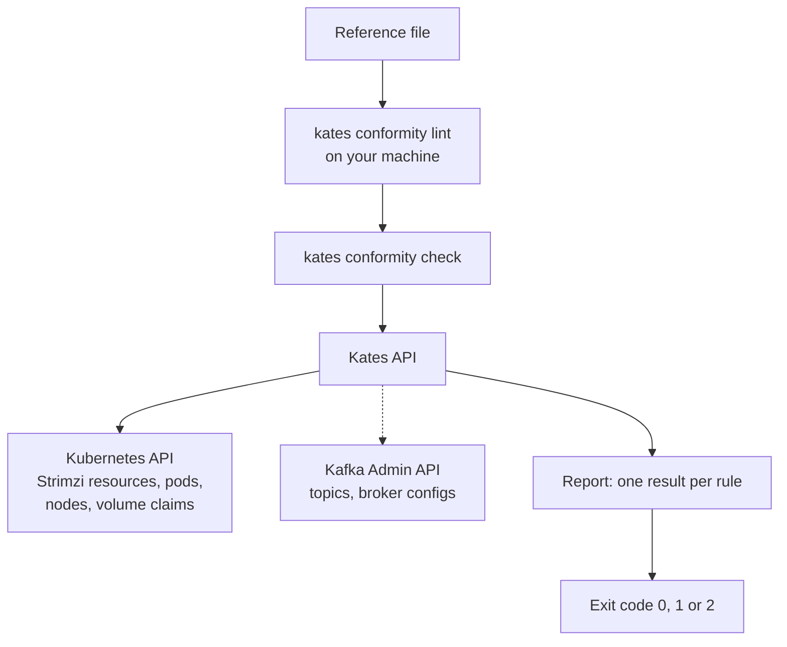

# Conformity Checks

You decided how [`krafter`](appendix-a-glossary.md#gl-krafter), the Kafka cluster under test, should be built: three brokers and three controllers, one of each per [zone](appendix-a-glossary.md#gl-zone), durable defaults for every topic, and authentication on every listener. That decision lives in a design review and a values file. The cluster that serves traffic today is whatever the last upgrade, scale-out and hand edit left behind, and nothing tells you when the two drift apart. A [conformity check](appendix-a-glossary.md#gl-conformity-check) closes that gap: you write the architecture down as a file, and Kates holds the live cluster to it, rule by rule, without changing anything.

In this chapter you'll:

- write a reference file and check `krafter` against it;
- read a report and decide whether to fix the cluster, fix the file or record the gap;
- run the check in a pipeline, where its exit code fails the build.

## Your First Reference

The smallest useful reference says three things about the brokers: there are at least three, they run in at least three zones, and no node runs more than one. This is `minimal.yaml` from `cli/examples/conformity`, shown without the comment line that points editors at the JSON Schema:

```yaml
apiVersion: conformity.kates.io/v1alpha1
kind: KafkaReference
metadata:
  name: minimal
spec:
  brokers:
    count: {min: 3}
    zones: {min: 3}
    perNode: {max: 1}
```

The file has the shape of a Kubernetes object, but it never goes into the cluster: it stays in your repository, and the check reads it. `apiVersion` names the version of the language, so the format can change later without an old file being misread. `kind` says the document is a [`KafkaReference`](appendix-a-glossary.md#gl-kafkareference), and `metadata.name` is the name the report shows. `spec` holds the rules. Each value under `spec` is one rule, and its path is its name: `brokers.count`, `brokers.zones` and `brokers.perNode`.

Check the file on your own machine first. `kates conformity lint` needs no cluster and no Kates API: it reads the file the way the Kates API will, so a typo never reaches a cluster.

```bash
kates conformity lint minimal.yaml
```

Output:

```text
1 file: no problems
```

Then ask the [Kates API](appendix-a-glossary.md#gl-kates-api) to check `krafter` against the file:

```bash
kates conformity check -f minimal.yaml
```

Output on [`panda`](appendix-a-glossary.md#gl-panda), the lab's three-node Kind cluster, with the banner trimmed:

```text
✓ PASS: 0 fail, 0 warn, 0 waived, 3 pass, 0 unknown
  3 passing rules not shown; -o json lists them
```

Read it from the top:

1. The first line is the check's overall result, followed by how many rules ended in each status. PASS means every rule that can fail the check holds.
2. The table above that line lists only the rules that need your attention, so this check prints none. `-o json` prints every rule with what it observed: three brokers, one in each of the zones `alpha`, `gamma` and `sigma`, and one broker per node.
3. The command exits 0, which is what a pipeline reads.

The trimmed banner names the reference and the cluster, with the cluster's Kafka cluster id, and says whether the `Kafka` resource is Ready. When it isn't, the banner warns that results may change while the cluster settles.

## Why Conformity

An architecture is a set of promises a cluster keeps for its clients, and three places hold it: the design, the configuration that should produce it, and the running cluster. Only the running cluster serves traffic, and it changes without consulting the other two. A node pool is scaled down to save money. A pool is added with both the broker and controller roles. Kubernetes reschedules a broker onto a node that already runs one, because the pods only prefer to stay apart. New nodes join without a zone label. A chart upgrade changes a default. Someone creates a topic with two replicas while the broker default is three.

None of these breaks the cluster on the day it happens, so every health check stays green. The cost arrives later, when a zone fails and the cluster turns out to be less redundant than the design promised.

Kates already asks several questions about a cluster, and a conformity check is the one that compares it with something you wrote down:

| Command | The question it answers |
|:----------------|:-------------------------------------------------------------|
| `kates cluster check` | Is the cluster healthy right now: brokers up, partitions in sync, a controller elected? |
| `kates detect` | What runs on this Kubernetes cluster, and what does Kates recommend for it? |
| `kates security audit` | How secure is the cluster, as a security grade? |
| `kates test apply --wait` | Is the cluster fast enough, against a scenario's gates? |
| `kates conformity check` | Is the cluster still built the way you declared, rule by rule? |

The first four judge the cluster against what is healthy, safe or fast in general. Only the conformity check judges it against your own design, so it's the one that notices a cluster that works but has drifted from what you meant to build.

### How a Check Runs

A check has two halves, one on your machine and one in the Kates API, and neither writes anything to the cluster:



`kates conformity check` lints the file again before it sends anything, and stops on an error. The Kates API then reads what the rules need: the [Strimzi](appendix-a-glossary.md#gl-strimzi) `Kafka` and [`KafkaNodePool`](appendix-a-glossary.md#gl-kafkanodepool) resources, the Kafka pods and the nodes they run on, their [PersistentVolumeClaims](appendix-a-glossary.md#gl-persistentvolumeclaim) and the Kubernetes version. It talks to the Kafka Admin API only when a rule needs a broker's or a topic's own answer, which the dotted edge shows. The API key needs only the `read` scope. Nothing is stored: the report goes back to the CLI, and your pipeline's log keeps it.

### Statuses and the Overall Result

Every rule ends in one of five statuses, and the status decides whether the rule can fail the check:

| Status | When | Can it fail the check? |
|:---------|:----------------------------------------------------|:--------------------|
| PASS | The rule holds | No |
| FAIL | The rule doesn't hold, and its severity is `fail`, the default | Yes |
| WARN | The rule doesn't hold, and its severity is `warn` | No |
| UNKNOWN | Kates couldn't read what the rule needs, such as a broker that doesn't answer | Yes, when its severity is `fail` |
| WAIVED | The rule doesn't hold, but a waiver in the file covers it today | No |

A rule Kates can't read is UNKNOWN, never FAIL, so a report never claims a gap it didn't see.

The overall result, the report's `verdict` field, is FAIL when any rule is FAIL. Otherwise it is UNKNOWN when any rule with severity `fail` is UNKNOWN, and PASS in every other case. `kates conformity check` turns it into its [exit code](appendix-a-glossary.md#gl-exit-code):

| Exit code | Meaning |
|:-----|:--------------------------------------------------------------------|
| 0 | PASS: every rule with severity `fail` holds or is waived |
| 1 | FAIL: at least one rule with severity `fail` doesn't hold |
| 2 | The check couldn't tell or couldn't run: an UNKNOWN rule, an invalid file, another cluster's file, or an unreachable API |

A FAIL beats an UNKNOWN, so a run with both exits 1: a definite gap is the more useful signal, and the UNKNOWN still shows in the report.

## Writing Constraints

Every rule is a constraint on one value, written either bare or as a map. The bare form means exactly that value, and the map form says how to compare:

| Written | Means |
|:------------------------------------------|:-------------------------------------------------|
| `count: 3` | Exactly 3 |
| `{min: 3}`, `{max: 1}`, `{min: 3, max: 5}` | At least, at most, or between, both ends included |
| `{oneOf: [jbod, persistent-claim]}` | Any one of the listed values |
| `{equals: required, severity: warn}` | Exactly that value; the map form exists to carry a severity |

`equals` and `oneOf` stand alone, while `min` and `max` combine. A severity of `fail` is the default, so you write `severity` only to make a rule a warning.

The language knows what kind of value each field holds, and compares it that way. Counts are whole numbers. CPU, memory and storage are Kubernetes quantities, so `8Gi` is more than `8000Mi` and `500m` is less than `1`. Versions compare part by part, so `4.10` is newer than `4.9`. That last rule is why a version must be quoted: unquoted, YAML reads `4.10` as the number 4.1. Lint catches the mistake, together with a misspelled field, in a file whose `spec` reads:

```yaml
spec:
  versions:
    kafka: {min: 4.10}

  brokers:
    cuont: 3
```

Output, with each long finding wrapped onto two lines:

```text
payments-typos.yaml:7:18: error: spec.versions.kafka.min: expected text, not the
  number 4.10: unquoted, YAML reads it as a number, so quote it ("4.10") [type]
  7 |     kafka: {min: 4.10}
    |                  ^
payments-typos.yaml:10:5: error: spec.brokers.cuont: unknown field
  (did you mean "count"?) [unknown-field]
  10 |     cuont: 3
     |     ^
2 errors, 0 warnings in 1 file
```

Each finding names the file, line and column, the path in the file, what is wrong and a code in brackets, with the source line and a caret under it. Lint exits 1 when it finds an error, and `kates conformity check` refuses the same file with exit 2 without calling the Kates API.

### Sizing the Brokers

Sizes are where a reference meets a budget. Suppose you require 16Gi of memory per broker, along with the versions, the controllers and the storage the payments workload needs:

```yaml
apiVersion: conformity.kates.io/v1alpha1
kind: KafkaReference
metadata:
  name: payments-sizing
spec:
  versions:
    kubernetes: {min: "1.32.0"}
    strimzi: {min: "1.2.0"}
    kafka: {min: "4.2.0"}

  controllers:
    count: 3
    dedicated: true

  brokers:
    count: {min: 3}
    requests:
      memory: {min: 16Gi}
    storage:
      type: {oneOf: [jbod, persistent-claim]}
      size: {min: 100Gi}
```

`controllers.count: 3` is exact on purpose: a KRaft [quorum](appendix-a-glossary.md#gl-quorum) of three tolerates one failed [controller](appendix-a-glossary.md#gl-controller), and a fourth would tolerate no more. `dedicated: true` requires that no node pool combines the broker and controller roles. The check finds one gap on `panda`:

```bash
kates conformity check -f payments-sizing.yaml
```

Output on `panda`, with the banner and the empty Detail column trimmed:

```text
  Status  Rule                     Expected  Observed
  ✖ FAIL  brokers.requests.memory  min 16Gi  11Gi (krafter-brokers-alpha-0, …)

✖ FAIL: 1 fail, 0 warn, 0 waived, 8 pass, 0 unknown
  8 passing rules not shown; -o json lists them
```

Read the failing row like this:

1. Expected is the constraint as you wrote it.
2. Observed is what Kates found, followed by the subjects that fall short. Here every broker pod requests 11Gi for its `kafka` container, and the report lists all three pods, trimmed here after the first.
3. The command exits 1.

A failure is a question rather than a verdict: either the cluster is short of what you need, or the file asks for more than you need. If the payments load runs of Part II met their targets on these brokers, the file asks too much. Change the rule to `memory: {min: 8Gi}`, and the same check on `panda` passes all nine rules.

Storage size has a detail of its own. `brokers.storage.size` adds up the capacity of each broker's bound claims, which is what the broker has, not what its node pool asks for. On `panda` each broker pool's spec asks for 122Gi while each broker's claim holds 200Gi, so the rule observes 200Gi.

## Placing Pods Across Zones and Nodes

Placement rules are the ones a working cluster breaks most quietly. Each one reads the pods of a role, brokers or controllers, and the nodes they run on:

| Field | What it reads |
|:--------------|:------------------------------------------------------------------|
| `zones` | How many distinct zones host the role's pods, by the nodes' zone label |
| `skew` | Most pods in one zone minus fewest pods in another |
| `perNode` | The most pods of the role on any one node |
| `antiAffinity` | Whether each pod's anti-affinity rule on the node hostname is `required`, `preferred` or `none` |
| `dedicated` | For controllers only: whether any node pool also has the broker role |

The zone label is `topology.kubernetes.io/zone` unless `spec.zoneLabel` names another one. A pod that isn't scheduled, or runs on a node without the label, fails `zones` and `skew` by name, because its zone can't be shown.

This file holds both roles to one pod per zone and per node, and asks Kubernetes to keep the brokers apart:

```yaml
apiVersion: conformity.kates.io/v1alpha1
kind: KafkaReference
metadata:
  name: payments-placement
spec:
  controllers:
    count: 3
    zones: {min: 3}
    perNode: {max: 1}

  brokers:
    count: {min: 3}
    zones: {min: 3}
    skew: {max: 1}
    perNode: {max: 1}
    antiAffinity: required
```

Output on `panda`, trimmed the same way:

```text
  Status  Rule                  Expected  Observed
  ✖ FAIL  brokers.antiAffinity  required  preferred (krafter-brokers-alpha-0, …)

✖ FAIL: 1 fail, 0 warn, 0 waived, 7 pass, 0 unknown
  7 passing rules not shown; -o json lists them
```

The two rules answer different questions. `brokers.perNode` passes, because today each node runs one broker. `brokers.antiAffinity` fails, because `krafter`'s broker pods only prefer to stay apart, so Kubernetes is allowed to place two on one node when it has nowhere else to put them. Whether to require more is your decision. If you want the gap in front of you without failing the check, write the rule as `antiAffinity: {equals: required, severity: warn}`; the complete reference later in this chapter does exactly that.

### What Lint Catches Before the Cluster Does

Some combinations of rules can never pass, whatever the cluster looks like, and lint reports them before you run a check. This file has two problems:

```yaml
spec:
  controllers:
    count: 4

  brokers:
    count: 2
    zones: {min: 3}
```

Output, with the long findings wrapped:

```text
payments-quorum.yaml:7:12: warning: spec.controllers.count: is 4: a KRaft quorum
  of an even size tolerates no more failed controllers than one controller fewer,
  and every commit waits on one more. Use an odd count. [controller-quorum-even]
payments-quorum.yaml:11:12: error: spec.brokers.zones: allows at least 3, but
  spec.brokers.count allows 2: each zone that counts hosts a pod, and with any
  pod every pod must run in a zone, so no cluster can meet both. [zones-unreachable]
1 error, 1 warning in 1 file
```

The source lines and carets are trimmed. The error stops a check, because two brokers can't run in three zones. The warning doesn't: an even quorum works, it just buys nothing over one controller fewer. Lint runs these cross-rule checks only on a file with no other errors. They cover placement, quorum and durability, such as a replication factor above the broker count or a `min.insync.replicas` that `acks=all` writes can never meet. The [conformity lint](10-cli-reference.md#conformity-lint) entry lists every code.

## Kafka Settings and Monitoring

The pods can be placed perfectly and the cluster can still lose data, so the next rules read Kafka's own settings. The payments workload writes with [`acks=all`](appendix-a-glossary.md#gl-acks), a [replication factor](appendix-a-glossary.md#gl-replication-factor) of 3 and a [`min.insync.replicas`](appendix-a-glossary.md#gl-min-insync-replicas) of 2. The payments topics get those values when Kates creates them, but every other topic takes the brokers' defaults, so the defaults should agree, and no broker may elect an out-of-sync leader:

```yaml
apiVersion: conformity.kates.io/v1alpha1
kind: KafkaReference
metadata:
  name: payments-kafka
spec:
  kafka:
    rackAwareness: true
    authorization: simple
    listeners:
      require:
        - name: tls
          port: 9093
          tls: true
          auth: tls
      every:
        auth: {oneOf: [tls, scram-sha-512]}
    config:
      default.replication.factor: {min: 3}
      min.insync.replicas: {min: 2}
      unclean.leader.election.enable: false

  monitoring:
    metrics: jmxPrometheusExporter
    kafkaExporter: true
```

Each rule in this section reads one thing:

- `rackAwareness` requires that the `Kafka` resource sets its [rack](appendix-a-glossary.md#gl-rack) from the zone label, and that every broker runs on a labelled node, so Kafka spreads each partition's replicas across zones.
- `authorization` is the `Kafka` resource's authorization type, and `simple` means Kafka's own ACLs.
- `listeners.require` names [listeners](appendix-a-glossary.md#gl-listener) that must exist, each with the properties you list: its type, port, TLS and authentication. Each one is a rule of its own, such as `kafka.listeners.require[tls]`.
- `listeners.every` holds every listener to a type, TLS or authentication. Here every listener must use [mTLS](appendix-a-glossary.md#gl-mtls) or [SCRAM-SHA-512](appendix-a-glossary.md#gl-scram-sha-512).
- `config` holds broker settings by name. A name with a dot becomes a rule id in brackets, such as `kafka.config[min.insync.replicas]`.
- `monitoring` reads the metrics type and whether [Kafka Exporter](appendix-a-glossary.md#gl-kafka-exporter) runs. A third rule, `podMonitor`, requires a Prometheus Operator PodMonitor that selects every broker pod.

The check finds one gap on `panda`:

```text
  Status  Rule                      Expected  Observed
  ✖ FAIL  monitoring.kafkaExporter  true      false

✖ FAIL: 1 fail, 0 warn, 0 waived, 8 pass, 0 unknown
  8 passing rules not shown; -o json lists them
```

Every Kafka rule passes. Kafka Exporter is off on `panda`, because both the `kafka-cluster` chart's Kind overlay and the values `kates deploy` generates turn it off, and this gap is the subject of [When the Cluster Falls Short](#when-the-cluster-falls-short).

### Where Broker Settings Come From

By default the `config` and `rackAwareness` rules read the `Kafka` resource, which is fast and needs no connection to Kafka. A setting that the resource leaves to Kafka's own default then fails as "not set in the Kafka CR", because the resource doesn't hold it. Set `kafka.source: brokers` to ask every broker instead:

| `kafka.source` | `config` reads | Needs |
|:---------|:------------------------------------------------|:-------------------------|
| `cr`, the default | What the `Kafka` resource's `spec.kafka.config` sets | The Kubernetes API only |
| `brokers` | The value each broker uses, its default included, one subject per broker | The Kates API's connection to Kafka |

With `brokers`, a broker that doesn't answer makes the rule UNKNOWN rather than hiding a gap. Lint refuses a sensitive setting, such as a password, under `kafka.source: brokers`, because Kafka never returns its value.

### Every Topic, Not Only the Defaults

A broker default applies only to a topic created without a value of its own, so `default.replication.factor: {min: 3}` passes even when someone created a topic with two replicas. The `topics` section reads each [topic](appendix-a-glossary.md#gl-topic) instead:

```yaml
spec:
  topics:
    replicationFactor: {min: 3}
    minInsyncReplicas: {min: 2}
    exclude: [kates-]
```

A topic's replication factor is its smallest replica set across its partitions, and its `min.insync.replicas` is the value Kafka applies to it, its own or the broker default. Kafka's internal topics are included. `exclude` takes name prefixes, not patterns: `kates-` skips every topic whose name starts with it. These rules always read through the Kates API's connection to Kafka, whatever `kafka.source` says, and the report names each topic that falls short.

## When the Cluster Falls Short

A failing rule leaves you three moves: change the cluster, change the reference, or record the gap. Changing the cluster is a pull request to its values; changing the reference is a pull request to the file. Recording the gap comes in two forms, and they mean different things:

| Use | When | What every check shows |
|:----------|:------------------------------------------------|:-------------------------------------------|
| A [waiver](appendix-a-glossary.md#gl-waiver) | The gap is known, owned and temporary | WAIVED with its reason, owner and end date; the check can pass until that date |
| `severity: warn` | The rule is advice you keep, not a requirement | WARN on every check; it never fails one |

A waiver goes in `spec.waivers`, and all four of its fields are required: the `rule` it covers, a `reason`, who it is `by`, and the date it lasts `until`. That date is inclusive and read in UTC. A waiver must name a rule the file declares, and each rule takes at most one waiver. The report keeps the rule's real status and observed value next to the waiver, so the gap stays visible while it is waived.

The waiver's date decides what happens to the rule:

| Situation | What the check does |
|:----------------------------------------|:------------------------------------------------------------|
| Before the date, and the rule fails | Shows WAIVED, and the rule doesn't fail the check |
| Before the date, and the rule passes | Shows PASS, with a note that the waiver can go |
| After the date | Counts the rule again, as if the waiver weren't there |

Lint warns about a waiver whose date has passed, so the expiry shows in review before it fails a pipeline. Output, wrapped, without the source line:

```text
payments-expired.yaml:58:14: warning: spec.waivers[0].until: the waiver expired on
  2026-09-30, so monitoring.kafkaExporter counts again: renew the date or remove
  the waiver [waiver-expired]
```

### The Complete Reference for `krafter`

Put the pieces together and you have the architecture the payments workload needs from `krafter`, with the two gaps `panda` showed: the anti-affinity requirement becomes a warning, and the missing Kafka Exporter gets a waiver. The file ships as `cli/examples/conformity/payments-krafter.yaml`:

```yaml
apiVersion: conformity.kates.io/v1alpha1
kind: KafkaReference
metadata:
  name: payments-krafter
  description: What the payments workload needs from krafter, the Kafka cluster under test
spec:
  target:
    namespace: kafka
    name: krafter

  versions:
    kubernetes: {min: "1.32.0"}
    strimzi: {min: "1.2.0"}
    kafka: {min: "4.2.0"}

  controllers:
    count: 3
    zones: {min: 3}
    perNode: {max: 1}
    dedicated: true

  brokers:
    count: {min: 3}
    requests:
      memory: {min: 8Gi}
    storage:
      type: {oneOf: [jbod, persistent-claim]}
      size: {min: 100Gi}
    zones: {min: 3}
    skew: {max: 1}
    perNode: {max: 1}
    antiAffinity: {equals: required, severity: warn}

  kafka:
    rackAwareness: true
    authorization: simple
    listeners:
      require:
        - name: tls
          port: 9093
          tls: true
          auth: tls
      every:
        auth: {oneOf: [tls, scram-sha-512]}
    config:
      default.replication.factor: {min: 3}
      min.insync.replicas: {min: 2}
      unclean.leader.election.enable: false

  monitoring:
    metrics: jmxPrometheusExporter
    kafkaExporter: true

  waivers:
    - rule: monitoring.kafkaExporter
      reason: The Kind overlay turns Kafka Exporter off; enable it before payments traffic
      by: platform-team
      until: 2027-03-31
```

`target` pins the file to `krafter` in the `kafka` namespace. One Kates API checks one Kafka cluster, and a file written for another one is refused with exit 2 before any rule runs. To also catch a cluster rebuilt under the same name, add `target.clusterId`, which must match the `Kafka` resource's cluster id.

Output on `panda`, with the banner, the Detail column and the pod list trimmed:

```text
  Status    Rule                      Expected  Observed
  ▲ WARN    brokers.antiAffinity      required  preferred (krafter-brokers-alpha-0, …)
  ○ WAIVED  monitoring.kafkaExporter  true      false

✓ PASS: 0 fail, 1 warn, 1 waived, 22 pass, 0 unknown
  22 passing rules not shown; -o json lists them
```

Read it from the top:

1. The warning row keeps the anti-affinity gap on every report without failing the check.
2. The waived row still shows Expected `true` and Observed `false`. Its trimmed Detail cell reads `FAIL, waived until 2027-03-31 by platform-team`, followed by the reason.
3. The summary counts 24 rules, and the check exits 0.

## Running It in a Pipeline

A reference earns its keep when every change to the cluster, or to the file, is checked against it. Three commands cover a pipeline, cheapest first:

```bash
kates conformity fmt --check platform/*.yaml
kates conformity lint platform/*.yaml
kates conformity check -f platform/payments-krafter.yaml \
  --output-junit conformity.xml
```

`kates conformity fmt` writes a reference in one canonical form: keys in the schema's order, each constraint in its shortest form, and no exact duplicates, with comments kept. `--check` only lists the files that aren't formatted and exits 1, so a reviewer reads a diff of meaning rather than of layout. `lint` needs no cluster, so it can run on every pull request to the files. `check` needs the Kates API, a key with the `read` scope and a [CLI context](appendix-a-glossary.md#gl-cli-context) that reaches it, so it runs where the pipeline can reach the cluster.

`--output-junit` writes the report as JUnit XML, which most CI systems show as a test report, with one test suite per section of the file. A FAIL becomes a failure, an UNKNOWN rule with severity `fail` becomes an error, and a WAIVED rule is skipped. A WARN passes, with its finding in the test's output. This is the waived rule from the complete reference:

```xml
<testcase name="monitoring.kafkaExporter" classname="conformity.monitoring" time="0.000">
  <skipped message="FAIL, waived until 2027-03-31 by platform-team: …"></skipped>
</testcase>
```

The table is still printed when you ask for JUnit, and `-o json` prints the whole report for a script. This picks out every rule that didn't pass:

```bash
kates conformity check -f payments-krafter.yaml -o json \
  | jq -r '.results[] | select(.status != "PASS") | "\(.status) \(.rule)"'
```

Output on `panda`:

```text
WARN brokers.antiAffinity
WAIVED monitoring.kafkaExporter
```

`kates conformity` belongs to the `topology` [command profile](10-cli-reference.md#command-profiles). A context whose profiles leave it out refuses all three subcommands, `lint` and `fmt` included, so a pipeline's context needs that profile or none. The [Conformity](10-cli-reference.md#conformity) entries in the CLI Reference list every flag, and [POST /api/conformity/check](11-api-reference.md#post-apiconformitycheck) documents the report's JSON for callers that skip the CLI.

## The Language at a Glance

A reference holds two kinds of field. Settings say which cluster to check and how to read it; they aren't rules, and a waiver can't name one. Every other field is a rule, named by its path under `spec`.

### Settings

The settings all have defaults, so a reference needs none of them:

| Field | Default | What it sets |
|:----------------------|:----------------------------|:-------------------------------------------------|
| `target.namespace`, `target.name` | The cluster the Kates API checks | Which `Kafka` resource the file is for |
| `target.clusterId` | None | The Kafka cluster id the `Kafka` resource must report |
| `zoneLabel` | `topology.kubernetes.io/zone` | The node label that names a zone |
| `kafka.source` | `cr` | Whether `config` and `rackAwareness` read the `Kafka` resource or every broker |
| `topics.exclude` | None | Topic name prefixes the topic rules skip, at most 50 |

### Rules

The rules fall into six sections. `controllers` and `brokers` take the same fields, except that only `controllers` takes `dedicated`:

| Section | Fields | Reads |
|:------------|:--------------------------------------------------|:------------------------------------|
| `versions` | `kubernetes`, `strimzi`, `kafka`, each a quoted version | The Kubernetes API and the `Kafka` resource's status |
| `controllers`, `brokers` | `count`, `requests.cpu`, `requests.memory`, `limits.cpu`, `limits.memory` | The role's pods and their `kafka` container |
| `controllers`, `brokers` | `storage.type`, `storage.size`, `storage.class` | The node pools and the pods' bound volume claims |
| `controllers`, `brokers` | `zones`, `skew`, `perNode`, `antiAffinity`; `dedicated` for controllers | The role's pods, their nodes and the node pools |
| `kafka` | `rackAwareness`, `authorization`, `listeners.require`, `listeners.every`, `config` | The `Kafka` resource, or the brokers for `config` |
| `topics` | `replicationFactor`, `minInsyncReplicas` | Every topic, through the Kafka Admin API |
| `monitoring` | `metrics`, `kafkaExporter`, `podMonitor` | The `Kafka` resource and the cluster's PodMonitors |

A rule id is the field's path under `spec`, without the `spec.` prefix, such as `brokers.storage.size`. A broker setting with a dot in its name goes in brackets, as in `kafka.config[min.insync.replicas]`, and a required listener goes by its name, as in `kafka.listeners.require[tls]`. A waiver names a rule by exactly that id, and so does the report.

Lint refuses anything it doesn't understand: an unknown field, a value of the wrong kind, an empty section, a `min` above its `max`, or a waiver for a rule the file doesn't declare. The Kates API reads the file as strictly, and answers a request that skips the CLI with a 400 that names the field. A reference is one YAML document, and the Kates API takes at most 256 KiB of it. The JSON Schema in `cli/examples/conformity` gives an editor the same checks, with completion, through the comment line every shipped example starts with.

### Limits

The check reports what it can read, and some things are deliberately outside it:

- `count` counts the role's pods, Ready or not, so a rolling restart doesn't fail it; whether Kafka sees every broker is a question for `kates cluster check`.
- `storage.size` reads the capacity of the bound claims, so a pool's requested size and the observed size can differ.
- With `kafka.source: cr`, a broker setting the `Kafka` resource doesn't set fails, even when Kafka's default meets the rule.
- The topic rules and `kafka.source: brokers` need the Kates API's connection to Kafka, and are UNKNOWN without it.
- One Kates API checks one Kafka cluster, and Strimzi is the only platform the language knows.
- The check doesn't cover [PodDisruptionBudgets](appendix-a-glossary.md#gl-poddisruptionbudget), Kafka users and ACLs, Kafka Connect, MirrorMaker 2 or Cruise Control; `kates security audit` covers users and ACLs.
- The check never changes the cluster and keeps no history; the pipeline's logs and JUnit files are the record.

## Summary

- A reference file states the architecture you require, and each value in it is a rule named by its path.
- A check reads the cluster, changes nothing, and reports every rule as passing, failing, warning, waived or unknown.
- Lint catches typos and impossible combinations on your machine, before any cluster is involved.
- A failed rule means fixing the cluster, fixing the file, or recording the gap with an owner and an end date.
- The exit code makes the check a pipeline step that fails when the cluster drifts from its design.

The reference checks that every listener authenticates its clients, but not who those clients are or what they may do once connected. [Security & Compliance](17-security.md) covers authentication, authorization, network policies and certificates.
