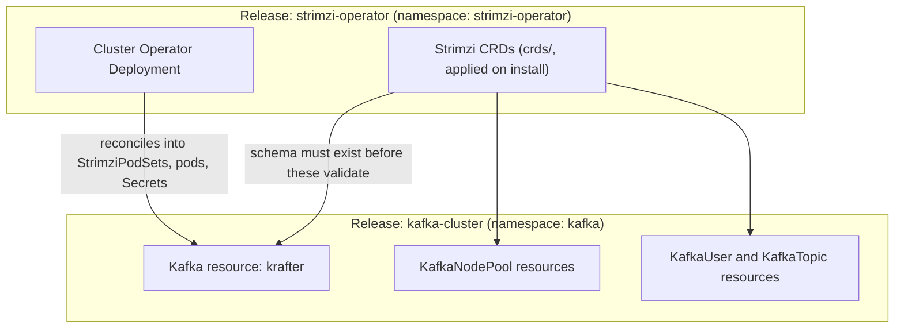
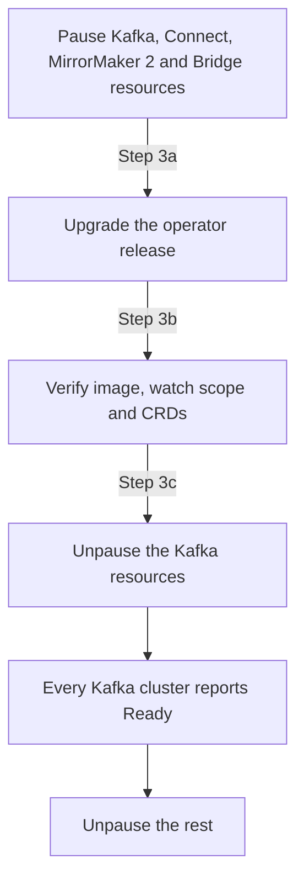

# Deploying the Strimzi Operator

Every Kafka cluster in this repository is a [custom resource](appendix-a-glossary.md#gl-custom-resource), and a custom resource is inert without two things: the [CRD](appendix-a-glossary.md#gl-crd) that defines its schema, and an [operator](appendix-a-glossary.md#gl-operator) that [reconciles](appendix-a-glossary.md#gl-reconciliation) it into pods. The `strimzi-operator` chart owns both. It is the first thing installed on a new cluster and the last thing to touch casually on a running one. The operator's version decides which Kafka versions exist at all, and its CRDs are the only reason your `Kafka` resources are still in etcd.

This chapter installs, adopts, upgrades and rolls back that release. [Kafka Deployment Engineering](15-kafka-deployment.md) explains the cluster it manages (node pools, listeners, certificates), and [Installing Kafka with the kafka-cluster Helm Chart](20-installation-guide.md) installs that cluster.

After this chapter, you can:

- Install the operator from the chart and prove the watch scope, the CRDs, and the operand images took effect
- Explain why the operator is a separate [Helm release](appendix-a-glossary.md#gl-helm-release) from `kafka-cluster`, and why its CRDs live in `crds/` rather than `templates/`
- Adopt an operator installed from the upstream chart without recreating a single resource, and defer the data-plane roll that adoption triggers
- Recognize the two operations that would delete every Kafka custom resource in the cluster

## How the Operator Works

The [Strimzi](appendix-a-glossary.md#gl-strimzi) Cluster Operator is one Deployment, `strimzi-cluster-operator`, that watches custom resources and turns each into the Kubernetes objects it describes. It handles `Kafka`, [`KafkaNodePool`](appendix-a-glossary.md#gl-kafkanodepool), `KafkaConnect`, `KafkaConnector`, `KafkaMirrorMaker2`, `KafkaBridge` and `KafkaRebalance` itself. `KafkaTopic` and `KafkaUser` belong to the Topic and User Operators, which run in the [Entity Operator](appendix-a-glossary.md#gl-entity-operator) pod that the Cluster Operator deploys for each Kafka cluster that asks for one.

Each pass over a resource is a reconciliation. The operator reads the resource's spec, compares it with what runs, and creates or changes whatever differs: Services, the Secrets that hold certificates, the ConfigMaps of broker configuration, and one [StrimziPodSet](appendix-a-glossary.md#gl-strimzipodset) per node pool. For a Kafka cluster the chain is `Kafka` → `KafkaNodePool` → `StrimziPodSet` → pods, so the operator itself, not a StatefulSet controller, creates and restarts every broker and controller pod. When a pass ends, it writes the outcome into the resource's status as conditions such as `Ready`.

A reconciliation starts whenever a watched resource changes, and again for every resource on a timer, `fullReconciliationIntervalMs`: 120000 ms in this chart's values, 60000 ms in `values-prod.yaml`. A change the operator can apply only by restarting pods, such as a new image or a changed listener, becomes a rolling restart that it sequences itself. [Step 3c](#step-3c--unpause-and-let-the-operator-sequence-the-roll) lists the checks it makes before each restart.

While the operator is down, nothing reconciles. The brokers and controllers keep serving, and the kubelet still restarts a crashed container in place. A deleted pod, though, stays gone until the operator returns and recreates it from its StrimziPodSet. Changes to any watched resource wait, and so do certificate renewals. The annotation `strimzi.io/pause-reconciliation` produces the same state for one resource on purpose, which is how the adoption procedure in this chapter defers a roll.

Two facts follow from this model and shape the rest of the chapter. The operator maps each Kafka version it supports to an operand image tagged with the operator's own version, in its `STRIMZI_KAFKA_IMAGES` variable, so a new operator means new images and a roll. And the operator can reconcile only what its CRDs let the API server store, so the CRDs must be current before the operator starts.

## What the Chart Deploys

`charts/strimzi-operator` is a thin wrapper. It declares the upstream `strimzi-kafka-operator` chart as a subchart dependency and vendors none of its templates. It adds what the upstream chart does not provide: a CRD-upgrade hook, a strict values schema, [Helm tests](appendix-a-glossary.md#gl-helm-test), the operator's NetworkPolicy, its PodMonitor and alerts (operator down, failing reconciliations, certificate expiry), and the Strimzi Drain Cleaner. It also turns on the operator's own Grafana dashboards, and pins the platform's operator defaults as values.

The release is small, and most of it is cluster-scoped:

| Scope | Resources |
|-------|-----------|
| Cluster-scoped | `ClusterRole`: `strimzi-cluster-operator-namespaced`, `-global`, `-leader-election`, `-watched`, `strimzi-kafka-broker`, `strimzi-entity-operator`, `strimzi-kafka-client` · `ClusterRoleBinding`: `strimzi-cluster-operator-namespaced`, `strimzi-cluster-operator`, `-watched`, `-kafka-broker-delegation`, `-entity-operator-delegation`, `-kafka-client-delegation` |
| Namespaced | `ServiceAccount`, `ConfigMap`, and `Deployment` named `strimzi-cluster-operator`, plus the `RoleBinding` `strimzi-cluster-operator-leader-election` |
| Namespaced, added by this chart | `NetworkPolicy` `strimzi-operator`, the nine dashboard `ConfigMap`s (`strimzi-kafka`, `strimzi-kraft`, `strimzi-cruise-control`, `strimzi-kafka-exporter`, `strimzi-kafka-connect`, `strimzi-kafka-mirror-maker-2`, `strimzi-kafka-bridge`, `strimzi-kafka-oauth`, `strimzi-operators`), and, where the `monitoring.coreos.com/v1` API exists, the `PodMonitor` and `PrometheusRule`. The drain cleaner adds its own set when enabled. |

Thirteen of the operator's own seventeen resources are cluster-scoped, and every name in the first two rows is hardcoded upstream: none of them derive from the Helm release name. The dashboard ConfigMap names are fixed too. That makes this chart a cluster singleton: two releases cannot coexist, because their resources would share the same names. There is no parallel install-then-cutover, and no blue-green. Every procedure in this chapter follows from that constraint. The one exception is the deliberately reduced shape in `values-namespace-scope.yaml`, which claims none of the fixed names; [A Namespace-Scoped Operator](#a-namespace-scoped-operator) installs it.

## Why a Separate Release

The operator is not a subchart of `kafka-cluster`, and it never becomes one. The reason is a chicken-and-egg problem in Helm's own validation order:



Helm validates a manifest against the API server before it creates anything. A `Kafka` resource whose CRD does not yet exist is rejected outright, and Helm cannot reliably install a CRD and a resource that depends on it in the same pass, because CRD establishment is asynchronous. Splitting them into two releases makes the ordering explicit and enforceable: the operator release completes, its CRDs reach `Established`, and only then does the cluster release have a schema to validate against.

The split has a second benefit that matters more day to day. The operator is cluster-wide (it watches every namespace), while `kafka-cluster` is a per-cluster, per-namespace artifact. Folding a singleton into a chart you might install twice is how you get two operators fighting over the same `StrimziPodSet` writes.

## The CRD Lifecycle Gap

This is the mechanical fact that shapes the chart. The upstream chart ships its CRDs in `crds/`, not `templates/`. There are ten of them: `kafkas`, `kafkaconnects`, `kafkatopics`, `kafkausers`, `kafkanodepools`, `kafkabridges`, `kafkaconnectors`, `kafkamirrormaker2s`, and `kafkarebalances` in the `kafka.strimzi.io` group, plus `strimzipodsets` in `core.strimzi.io`. Helm treats that directory unlike anything else, and `helm upgrade --help` states the behavior plainly:

> `--skip-crds`: if set, no CRDs will be installed when an upgrade is performed with install flag enabled. By default, CRDs are installed if not already present, when an upgrade is performed with install flag enabled

Read that carefully: *installed if not already present*. There is no update path. The consequences:

| Helm operation | What happens to `crds/` |
|----------------|-------------------------|
| `helm install` | Applied, once |
| `helm upgrade` | Never updated: already present, so skipped |
| `helm uninstall` | Never deleted: Helm does not track them |
| `helm get manifest` | They do not appear: Helm does not know they exist |

Left alone, the CRDs freeze at whatever version was first installed while the operator moves on. That failure is silent in the worst way: the API server accepts a `Kafka` resource carrying fields the frozen schema does not know about, then prunes them. No error, no event, no rejection: the field vanishes between `kubectl apply` and etcd.

The chart closes the gap with a `pre-install`/`pre-upgrade` hook Job in `charts/strimzi-operator/templates/crd-upgrade.yaml`. It runs before the operator Deployment is patched, so the schema is current before the controller that depends on it starts. The Job fetches the pinned CRD bundle and validates it three ways before mutating anything. The download must succeed (`curl -f`, so an HTTP error stops the Job before a 404 body reaches the disk). The bundle must define each of the ten CRDs the charts render resources for; an upstream bundle may ship more. And a `kubectl apply --server-side --dry-run=server` must pass. Only then does it apply for real, with `--force-conflicts`: Helm 4 applies server-side by default, so its field manager co-owns these CRDs and would otherwise conflict.

The hook needs egress to the CRD bundle URL on every install and every upgrade. Because it is a `pre-upgrade` gate, an unreachable URL aborts the upgrade and leaves the release in `pending-upgrade`. On restricted-egress clusters, mirror the bundle and point `crdUpgrade.url` at it; `charts/strimzi-operator/values-prod.yaml` documents the pattern. `kates deploy` doesn't use this hook: it applies the CRDs from the chart it downloaded, as [Upgrading the Operator](#upgrading-the-operator) explains.

### Why the CRDs Stay in `crds/`

Moving them into `templates/` would look tidier and would be a serious mistake, for two independent reasons.

The first is adoption: the CRDs on a running cluster carry no Helm ownership metadata, so templating them makes the first upgrade fail with an ownership error.

The second is the one that matters:

::: {.callout-caution title="Templated CRDs would let helm uninstall delete every Kafka cluster"}
Templating the CRDs would hand `helm uninstall` the power to delete every Kafka custom resource in the cluster. Deleting a Strimzi CRD deletes every resource of that kind cluster-wide, and garbage collection cascades along `CRD → Kafka / KafkaNodePool → StrimziPodSet → Pods`. Helm cannot do this today because it does not know the CRDs exist, so they stay in the subchart's `crds/` and nothing in this chart templates them.
:::

## Deploying the Operator

This section installs the operator on a cluster that has none. If one is already running, go to [Upgrading the Operator](#upgrading-the-operator) instead, or to [Adopting an Operator Installed from the Upstream Chart](#migrating-from-the-ad-hoc-install) if it came from `oci://quay.io/strimzi-helm/strimzi-kafka-operator`. When the install finishes, the operator Deployment is running and the ten Strimzi CRDs are `Established`.

### Prerequisites

You need cluster-admin on the target cluster, because the chart creates ClusterRoles and its hook applies CRDs. You need Helm and `kubectl`; the schema errors this chapter quotes are Helm 4's, and [The Values That Matter](#the-values-that-matter) gives Helm 3's wording. Helm pulls the published chart from `ghcr.io`, and the CRD hook fetches its bundle from `github.com`, so both must be reachable from where each runs. The cluster must run no other Strimzi operator, because of the singleton rule in [What the Chart Deploys](#what-the-chart-deploys).

The published chart carries its subchart, so nothing is fetched before a template, install or upgrade. Working from a checkout instead, run `helm dependency build charts/strimzi-operator` first. The [Version & Compatibility Matrix](appendix-d-versions.md) lists the operator, chart and Kafka versions this edition describes.

### Fresh Install

On a cluster with no Strimzi operator, the install is one command:

```bash
helm upgrade --install strimzi-operator oci://ghcr.io/bmscomp/charts/strimzi-operator \
  --namespace strimzi-operator --create-namespace \
  --timeout 5m --wait
```

That is the whole install. No `--set` flags: the defaults already reproduce what the platform runs. Without `--version` Helm takes the latest published chart, whose `Chart.yaml` pins the Strimzi version. The repository's deploy scripts run this same command on every run, because the CRD hook is a `pre-upgrade` gate, and skipping the upgrade when the operator already exists is what freezes the CRDs.

On a scratch Kind cluster, install from the pulled chart with the Kind overlay instead, which fits a laptop:

```bash
helm pull oci://ghcr.io/bmscomp/charts/strimzi-operator --untar
helm upgrade --install strimzi-operator ./strimzi-operator \
  --namespace strimzi-operator --create-namespace \
  -f strimzi-operator/values-kind.yaml \
  --timeout 5m --wait
```

Whichever way you installed, verify it by reading three facts back, without deploying a single Kafka broker:

```bash
SCOPE='{.spec.template.spec.containers[0].env[?(@.name=="STRIMZI_NAMESPACE")].value}'
IMAGES='{.spec.template.spec.containers[0].env[?(@.name=="STRIMZI_KAFKA_IMAGES")].value}'
EST='{range .items[*]}{.metadata.name}: '
EST+='{.status.conditions[?(@.type=="Established")].status}{"\n"}{end}'

# 1. The watch scope
kubectl get deploy strimzi-cluster-operator -n strimzi-operator -o jsonpath="${SCOPE}"

# 2. The CRDs the hook applied, and whether each is Established
kubectl get crd -l strimzi.io/crd-install=true -o jsonpath="${EST}"

# 3. The Kafka versions this operator can run, and their images
kubectl get deploy strimzi-cluster-operator -n strimzi-operator -o jsonpath="${IMAGES}"

# All of the above, as an assertion
helm test strimzi-operator -n strimzi-operator
```

::: {.callout-tip title="Try it: does the install match what the chart claims?"}
The watch scope should print `*`, all ten CRDs should report `True`, and the image map should show each supported Kafka version pointing at an operand image tagged with the operator's own version. That coupling is what makes every operator upgrade a data-plane roll. The hook's own log isn't part of the check: Helm deletes a hook Job once it succeeds, so the CRDs are the evidence that it ran.
:::

A fresh install that fails has no Kafka resource to protect yet. Once `kubectl get kafka,kafkaconnect,kafkamirrormaker2,kafkabridge -A` lists none, roll it back with steps 3 and 4 of [Decommissioning](#decommissioning), then install again. When the install or `helm test` fails, find the error under [Troubleshooting](#troubleshooting).

### Environment Overlays

Five overlays ship with the chart. All of them are overrides only. They layer on top of the defaults and restate none of them, and one of them overrides nothing at all.

| Overlay | What it changes | When to use it |
|---------|-----------------|----------------|
| `values-kind.yaml` | Lowers operator memory to 384Mi to fit a laptop; PDB off | Local `panda` Kind cluster |
| `values-dev.yaml` | `logLevel: DEBUG`, lower memory request | Debugging operand reconciliation |
| `values-prod.yaml` | Hardening, PDB, a 60 s reconciliation loop, the drain cleaner on two replicas with cert-manager, upstream's operator NetworkPolicy, `productionMode` | Production; read the file's header first |
| `values-generic.yaml` | Nothing: it sets no keys, and records two facts a generic cluster gets wrong | Clusters whose topology isn't known ahead of time (EKS, GKE, AKS, on-premises) |
| `values-namespace-scope.yaml` | An additional operator: watches only its namespace, shares the primary's CRDs and global roles; dashboards and drain cleaner off | A second operator in the Kafka namespace it watches, never the primary |

The operator NetworkPolicy that `values-prod.yaml` turns on is not hardening. Its `egress: [{}]` admits every destination, and since policies add up, it lifts the egress limits of the chart's own `strimzi-operator` policy. Add `--set strimzi-kafka-operator.operatorNetworkPolicy.enabled=false` after the overlay to keep those limits.

`values-generic.yaml` is the odd one out: it declares no values, so rendering with it produces byte-identical output to rendering without it. It exists as documentation of two settings that fail silently. The DNS domain must be injected by the caller, because upstream emits `KUBERNETES_SERVICE_DNS_DOMAIN` only when the value differs from `cluster.local`, and hardcoding it in an overlay would defeat the detection `scripts/deploy-kafka-generic.sh` does; that script passes `--set strimzi-kafka-operator.kubernetesServiceDnsDomain="${CLUSTER_DOMAIN}"` instead. And registry redirection is `defaultImageRegistry`, not `global.imageRegistry`.

Apply an overlay from the pulled chart, so its values files are on disk:

```bash
helm pull oci://ghcr.io/bmscomp/charts/strimzi-operator --untar
helm upgrade --install strimzi-operator ./strimzi-operator \
  --namespace strimzi-operator --create-namespace \
  -f strimzi-operator/values-prod.yaml \
  --timeout 5m --wait
```

`values-prod.yaml` is an uplift, and applying it is a real behavior change. It adds upstream's operator NetworkPolicy and a PodDisruptionBudget, brings up the drain cleaner with its cert-manager Issuer and Certificate, tightens the reconciliation interval, and gives the operator a read-only root filesystem. Roll it out in a window, not as a default.

### A Namespace-Scoped Operator

`values-namespace-scope.yaml` is the shape of every operator on the cluster except the primary: one per Kafka namespace, installed in that namespace under the release name `strimzi-operator`, watching only it. It turns the CRD hook off and reuses the primary's ClusterRoles, because the CRDs and the fixed-name roles belong to the newest operator on the cluster, which must be the primary's. Install it from the pulled chart:

```bash
helm pull oci://ghcr.io/bmscomp/charts/strimzi-operator --untar
helm upgrade --install strimzi-operator ./strimzi-operator \
  --namespace <kafka-namespace> --create-namespace \
  -f strimzi-operator/values-namespace-scope.yaml \
  --timeout 5m --wait
```

The primary must not watch that namespace as well, or two operators reconcile the same resources. `kates deploy --operator-scope namespace` switches the primary to an explicit `watchNamespaces` list for this reason. On a primary you installed by hand, set `strimzi-kafka-operator.watchAnyNamespace=false` and list its namespaces, as [Upgrading the Operator](#upgrading-the-operator) shows.

### The Values That Matter

Every operator setting nests under the `strimzi-kafka-operator:` key, because that is the subchart's name. A top-level `watchAnyNamespace: true` is not an override: Helm silently ignores it. The schema rejects it deliberately so the mistake is loud:

```bash
helm template strimzi-operator oci://ghcr.io/bmscomp/charts/strimzi-operator \
  -n strimzi-operator \
  --set watchAnyNamespace=true
```

Output:

```text
Error: values don't meet the specifications of the schema(s) in the following chart(s):
strimzi-operator:
- at '': additional properties 'watchAnyNamespace' not allowed
```

That is Helm 4's wording. Helm 3 uses a different JSON Schema library and reports the same rejection as `(root): Additional property watchAnyNamespace is not allowed`, so match on the property name, which both versions print.

The keys you are most likely to set:

| Key | Default | Why it matters |
|-----|---------|------------------------|
| `strimzi-kafka-operator.watchAnyNamespace` | `true` | Sets `STRIMZI_NAMESPACE="*"`. Off, every Kafka cluster outside the operator's own namespace goes unmanaged |
| `strimzi-kafka-operator.kubernetesServiceDnsDomain` | `cluster.local` | Emitted only when it differs from the default; on a custom domain, inject the detected value or the operator breaks |
| `strimzi-kafka-operator.defaultImageRegistry` | unset | Registry redirection. The chart declares no `global`, so `--set global.*` fails |
| `crdUpgrade.enabled` | `true` | Off, the CRDs freeze. Turn it off only when another applier owns them |
| `crdUpgrade.url` | derived from `strimziVersion` | Point it at a mirror on an air-gapped cluster |
| `drainCleaner.enabled` | `false` | The Drain Cleaner webhook, once per Kubernetes cluster; the render fails without a certificate the API server trusts |
| `productionMode` | `false` | Refuses settings unsafe in production, such as a single drain-cleaner replica. `values-prod.yaml` sets it |

The rest of the values need less attention. `strimzi-kafka-operator.leaderElection.enable` (`true`) is spelled `enable`, not `enabled`, and the schema rejects the misspelling. `strimzi-kafka-operator.resources` pins memory only and lets CPU inherit upstream's defaults. `strimzi-kafka-operator.extraEnvs` sets `STRIMZI_POD_SECURITY_PROVIDER_CLASS=restricted`, so every pod the operator creates gets the restricted Pod Security settings; Helm replaces a list whole, so keep this entry beside your own ([The Strimzi Restricted Provider](17-security.md#the-strimzi-restricted-provider)). Upstream ignores `global.imageRegistry` entirely, and this chart's own images, `testImages.kubectl` and `drainCleaner.image`, take your mirror as written.

The drain cleaner takes its certificate from cert-manager (`drainCleaner.tls.certManager.enabled`) or from `tls.secretName` plus `tls.caBundle`, because an uncallable webhook with `failurePolicy: Ignore` protects nothing. A single replica is unsafe, since an eviction arriving while the one webhook pod restarts bypasses drain protection entirely. `podLabels` labels the pods this chart renders itself (the CRD-upgrade Job, the Drain Cleaner and the Helm tests), while the operator's pod takes `strimzi-kafka-operator.labels`. `operatorPolicy.enabled` (`true`) renders the operator's NetworkPolicy; while a `kafka-cluster` 0.4 release still owns that object, the chart skips it and NOTES name the owner. `monitoring.podMonitor.enabled` and `alerts.enabled` render where the `monitoring.coreos.com/v1` API exists. `strimzi-kafka-operator.dashboards.enabled` renders ConfigMaps with fixed names, so enable it on one operator release only. `globalBindings.enabled` matters only for an additional operator, which without it loses rack awareness and volume-expansion checks.

## Adopting an Operator Installed from the Upstream Chart {#migrating-from-the-ad-hoc-install}

If Strimzi already runs from `oci://quay.io/strimzi-helm/strimzi-kafka-operator`, installed under the release name `strimzi-operator` in the `strimzi-operator` namespace, this chart adopts that release in place. The release name, the namespace and every resource name are the same in both charts, so Helm patches fields in place. Nothing is recreated, and nothing is deleted.

You need cluster-admin, as for a fresh install. Step 0's replication gate also execs into a broker pod and reads the `kates-backend` Secret in `kafka`. Steps 0 to 2 change nothing, so a failed gate or dry run ends the procedure there. Step 3a only pauses reconciliation, and the unpause loop of Step 3c releases it. From Step 3b on, [Rollback](#rollback) returns the release, and [Troubleshooting](#troubleshooting) lists the errors each step can print.

### Step 0 — Pre-Flight

All of these are blocking. Run the whole procedure in one shell, because later steps reuse the variables earlier ones set.

```bash
# Record the current state: this is your rollback reference
helm list -n strimzi-operator
helm get values strimzi-operator -n strimzi-operator > /tmp/pre-migration-values.yaml

# Back up the CRDs. Helm does not manage them, so neither `helm rollback` nor
# `helm uninstall` can restore them: this file is the only way back.
kubectl get crd -l strimzi.io/crd-install=true -o yaml > /tmp/pre-migration-crds.yaml
```

The CRD backup is the one artifact you cannot reconstruct after the fact. The label selects every Strimzi CRD, including `strimzipodsets.core.strimzi.io`, which lives outside the `kafka.strimzi.io` group and is easy to miss when selecting by name.

The first gate is the version gate. The operator's supported Kafka range moves with every release, and a Kafka version that the target operator has never heard of leaves its cluster orphaned. Every `Kafka` resource's version must appear in the target's image map:

```bash
# What every cluster runs today
kubectl get kafka -A \
  -o custom-columns=NS:.metadata.namespace,NAME:.metadata.name,VERSION:.spec.kafka.version

# What the target operator supports: read it out of the rendered Deployment
helm template strimzi-operator oci://ghcr.io/bmscomp/charts/strimzi-operator \
  -n strimzi-operator \
  | grep -A5 STRIMZI_KAFKA_IMAGES
```

Every version on the left must appear on the right. If one does not, stop and upgrade that cluster's Kafka version first.

The second gate is roll survivability. Adoption rolls every broker (Step 3 explains why), so the cluster must survive losing one at a time. Read the replication settings from inside the cluster, not from `KafkaTopic` resources: a cluster with no `KafkaTopic` resources still has topics, and it is the real topics that must survive.

Both internal listeners authenticate (SCRAM-SHA-512 on 9092, mutual TLS on 9093) and the brokers enforce ACLs, so the Kafka tools need credentials. Without them `kafka-topics.sh` retries until it times out, prints an `Error while executing topic command` line to standard output and exits 1. A `grep` for bad topics after it then prints nothing, which reads as a pass. Run the tools inside a broker pod, where the listener is local, with a client configuration built from the `kates-backend` KafkaUser's Secret. The platform profile makes `kates-backend` a super user, so it can describe every topic and its configuration; on a cluster without the profile, use a KafkaUser allowed `Describe` and `DescribeConfigs` on every topic:

```bash
BROKER=$(kubectl get pods -n kafka -o name \
  -l strimzi.io/cluster=krafter,strimzi.io/broker-role=true | head -1)
JAAS=$(kubectl get secret kates-backend -n kafka \
  -o jsonpath='{.data.sasl\.jaas\.config}' | base64 -d)

# Written to the pod's memory-backed /tmp, so it is gone when the pod restarts
kubectl exec -i -n kafka "${BROKER}" -- sh -c 'cat > /tmp/client.properties' <<EOF
security.protocol=SASL_PLAINTEXT
sasl.mechanism=SCRAM-SHA-512
sasl.jaas.config=${JAAS}
EOF
```

Describe every topic, and check that the command succeeded before you read the result. An empty result is a failure, not a pass:

```bash
if kubectl exec -n kafka "${BROKER}" -- /opt/kafka/bin/kafka-topics.sh \
     --bootstrap-server localhost:9092 --command-config /tmp/client.properties \
     --describe > /tmp/topics.txt && grep -q '^Topic:' /tmp/topics.txt; then
  echo "OK: described $(grep -c '^Topic:' /tmp/topics.txt) topics"
else
  echo "GATE FAILED: could not describe the topics" >&2
  cat /tmp/topics.txt
fi

# Topics with a replication factor of 1: expect no output
grep -E '^Topic:.*[[:space:]]ReplicationFactor: 1[[:space:]]' /tmp/topics.txt

# Partitions already short of a replica, then partitions at min.insync.replicas:
# expect no output from either
kubectl exec -n kafka "${BROKER}" -- /opt/kafka/bin/kafka-topics.sh \
  --bootstrap-server localhost:9092 --command-config /tmp/client.properties \
  --describe --under-replicated-partitions
kubectl exec -n kafka "${BROKER}" -- /opt/kafka/bin/kafka-topics.sh \
  --bootstrap-server localhost:9092 --command-config /tmp/client.properties \
  --describe --at-min-isr-partitions
```

The first check must print `OK`; only then does silence from the other three mean something. Any topic with a replication factor of 1 goes offline the moment its broker restarts, and an under-replicated partition has already lost a replica. A partition at `min.insync.replicas` rejects `acks=all` writes as soon as one more replica leaves, so the roller refuses to restart its broker. Confirm too that every broker pool has more than one replica or a replication factor that spans pools. `kates cluster check` counts under-replicated and offline partitions, but it reports no replication factors and exits 0 whatever it finds, so it does not replace this gate.

Run the gate against every Kafka cluster the operator watches, because all of them roll. [`krafter`](appendix-a-glossary.md#gl-krafter), the book's Kafka cluster under test, is one; `kubectl get kafka -A` lists the rest. For each other cluster, substitute its namespace and its name in the `strimzi.io/cluster` label. Use a KafkaUser of that cluster allowed `Describe` and `DescribeConfigs` on every topic, with the security settings its listener expects, since `kates-backend` exists only where the platform profile created it.

The third gate is the condition gate. Read each condition by name, on every Kafka cluster:

```bash
COND='{range .items[*]}{.metadata.namespace}/{.metadata.name}{"\n"}'
COND+='{range .status.conditions[*]}  {.type}={.status} {.reason}{"\n"}{end}{end}'
kubectl get kafka -A -o jsonpath="${COND}"
```

`Ready=True` under every cluster is the bar. A `Warning=True` with reason `KafkaMetadataVersion` may also be present: it means the `metadataVersion` in the resource trails the running Kafka version and an earlier upgrade never finished. That is pre-existing debt. This adoption neither causes it nor fixes it, and it does not clear on its own. Record it, decide separately whether to complete that metadata upgrade, and do not treat it as a blocker for the operator work.

Finally, record the baseline watch scope (`*` for an operator that watches every namespace; Step 2 shows how to read it) and take a maintenance window.

### Step 1 — Verify Adoptability Without Mutating

A server-side dry run shows whether this chart can take over the release without changing it. Pass `--reset-values`: with no values supplied, a bare `helm upgrade` is `--reuse-values`, so Helm carries forward the flat upstream keys the release stored, and this chart's schema rejects them. After the first adoption the stored config is clean, and later bare upgrades pass.

`--reset-values` drops every other value the release carries as well, so the command passes back what the operator must keep. `<domain>` is the cluster's DNS domain: the `kubernetesServiceDnsDomain` value in the Step 0 record, `/tmp/pre-migration-values.yaml`, or `cluster.local` when the record has none. On a later upgrade of an operator that runs with more, such as an overlay like `values-prod.yaml` or a namespace scope, add those flags too; [Upgrading the Operator](#upgrading-the-operator) lists them.

```bash
helm upgrade strimzi-operator oci://ghcr.io/bmscomp/charts/strimzi-operator \
  --namespace strimzi-operator \
  --reset-values \
  --set strimzi-kafka-operator.kubernetesServiceDnsDomain=<domain> \
  --dry-run=server
```

Expect a clean render with no ownership error and no schema error. Confirm that `helm list -n strimzi-operator` still shows the old revision: a server dry run does not mutate the release.

Omit `--reset-values` and the upgrade fails on the stored keys instead.

Output:

```text
Error: UPGRADE FAILED: values don't meet the specifications of the schema(s) in …
strimzi-operator:
- at '': additional properties 'kubernetesServiceDnsDomain', 'leaderElection', …
```

The list names every key the release stored at the top level, such as `replicas`, `resources`, `watchAnyNamespace` and `operationTimeoutMs`. The upstream chart takes each of them at the top level, and this chart takes them under `strimzi-kafka-operator:`; Helm would silently ignore them where they are, so the schema refuses them.

### Step 2 — Diff the Operator Environment

Compare what runs against what the chart renders, before committing. Two variables decide whether this adoption is safe, and they are expected to behave in opposite ways. Set the two jsonpath expressions that read them once:

```bash
SCOPE='{.spec.template.spec.containers[0].env[?(@.name=="STRIMZI_NAMESPACE")].value}'
IMAGES='{.spec.template.spec.containers[0].env[?(@.name=="STRIMZI_KAFKA_IMAGES")].value}'
```

The watch scope must not change; expect `*` from both sides:

```bash
# Live
kubectl get deploy strimzi-cluster-operator -n strimzi-operator -o jsonpath="${SCOPE}"

# Rendered
helm template strimzi-operator oci://ghcr.io/bmscomp/charts/strimzi-operator \
  -n strimzi-operator \
  | grep -A1 'name: STRIMZI_NAMESPACE'
```

The operand image map is expected to change. This is the version bump itself, and the reason Step 3 has three parts:

```bash
# Live
kubectl get deploy strimzi-cluster-operator -n strimzi-operator -o jsonpath="${IMAGES}"

# Rendered
helm template strimzi-operator oci://ghcr.io/bmscomp/charts/strimzi-operator \
  -n strimzi-operator \
  | grep -A4 'name: STRIMZI_KAFKA_IMAGES'
```

Every Kafka version on the live side must still be present on the rendered side: that is the version gate from Step 0, restated against the actual artifact. The image each version maps to changes, because the operand tag embeds the operator version.

### Step 3 — Adopt, in Three Movements

Adoption happens in three movements: pause reconciliation, upgrade the control plane, then unpause. Beyond the brokers and controllers, any operand rolls wherever the new operator renders its pods differently.

::: {.callout-caution title="Adoption rolls every broker and controller"}
The operator's image map reads `<kafka-version>=quay.io/strimzi/kafka:<operator-version>-kafka-<kafka-version>`, so after the bump the same Kafka version resolves to a different image, and every broker, controller and Connect or MirrorMaker 2 worker on the default image restarts. Strimzi does not support pinning `.spec.kafka.image` to dodge it. The roll can only be deferred, which is what the three movements do, so take a maintenance window.
:::

The figure shows the order the movements release the roll in:



#### Step 3a — Pause Reconciliation {#step-3a--pause-reconciliation}

Annotate every resource the new operator would roll, so it adopts them without touching them. By default the operator watches every namespace (`watchAnyNamespace: true`, so `STRIMZI_NAMESPACE` is `*`), and the new one reconciles everything it finds the moment it starts. For an operator installed with `kates deploy --operator-scope namespace`, which watches only some namespaces, the pause below is wider than it needs to be, and Step 3c releases the same list.

Pausing `krafter` alone leaves every other Kafka cluster, Kafka Connect cluster, MirrorMaker 2 and Kafka Bridge free to roll during Step 3b, the one step meant to be cheap to roll back. The kinds that run pods and honor the pause annotation are `Kafka`, `KafkaConnect`, `KafkaMirrorMaker2` and `KafkaBridge`. Pause all of them, in every namespace, but leave out any that someone paused before you, and keep the list, so Step 3c releases exactly what this step paused:

```bash
KINDS=kafka,kafkaconnect,kafkamirrormaker2,kafkabridge
ROWS='{range .items[*]}{.kind} {.metadata.namespace} {.metadata.name} '
ROWS+='{.metadata.annotations.strimzi\.io/pause-reconciliation}{"\n"}{end}'

# Everything the operator will reconcile, minus what is already paused
kubectl get "${KINDS}" -A -o jsonpath="${ROWS}" \
  | awk '$4 != "true" {print tolower($1), $2, $3}' > /tmp/paused-by-upgrade.txt
cat /tmp/paused-by-upgrade.txt

while read -r kind ns name; do
  kubectl annotate "${kind}" "${name}" -n "${ns}" \
    strimzi.io/pause-reconciliation=true --overwrite
done < /tmp/paused-by-upgrade.txt

# Confirm the pause took effect BEFORE upgrading anything
COLS='KIND:.kind,NAMESPACE:.metadata.namespace,NAME:.metadata.name'
PAUSED=',PAUSED:.status.conditions[?(@.type=="ReconciliationPaused")].status'
kubectl get "${KINDS}" -A -o custom-columns="${COLS}${PAUSED}"
```

Every row must report `True` in `PAUSED`. Do not proceed otherwise.

Do not try to pause node pools. Strimzi runs no assembly operator for `KafkaNodePool`: the pause annotation is honored on the `Kafka` resource and on the other top-level resources that have their own operator, and nowhere else. An annotation on a pool is one nothing reads, and the pool reports no `ReconciliationPaused` condition, so a gate that waits for one never passes. Pausing the parent is enough, because pools are reconciled as part of the `Kafka` resource.

Listing the pools is still worthwhile. It sizes the roll you are deferring, and names the pods that restart in Step 3c:

```bash
kubectl get kafkanodepool -A
```

#### Step 3b — Upgrade the Control Plane Only {#step-3b--upgrade-the-control-plane-only}

This is the real checkpoint, and the only place where rollback is cheap. Pass back the same values as in Step 1: the DNS domain, and on a later upgrade the overlay and scope the operator runs with.

```bash
helm upgrade strimzi-operator oci://ghcr.io/bmscomp/charts/strimzi-operator \
  --namespace strimzi-operator \
  --reset-values \
  --set strimzi-kafka-operator.kubernetesServiceDnsDomain=<domain> \
  --timeout 10m --wait
```

The `pre-upgrade` hook applies the target CRDs before the Deployment is patched. Verify in isolation, while the data plane has not moved yet:

```bash
# Operator image is the new version
kubectl get deploy strimzi-cluster-operator -n strimzi-operator \
  -o jsonpath='{.spec.template.spec.containers[0].image}'

# The canary: it must match the scope Step 0 recorded ("*" for an operator that
# watches every namespace); if it does not, STOP and roll back
kubectl get deploy strimzi-cluster-operator -n strimzi-operator -o jsonpath="${SCOPE}"

# All ten CRDs Established
kubectl get crd -l strimzi.io/crd-install=true

# Leader election acquired, no errors
kubectl logs deployment/strimzi-cluster-operator -n strimzi-operator --tail=50 \
  | grep -iE 'error|leader'
```

#### Step 3c — Unpause and Let the Operator Sequence the Roll {#step-3c--unpause-and-let-the-operator-sequence-the-roll}

Pausing deferred the roll; this is where it happens. Unpausing a `Kafka` resource releases its whole data plane at once. There is no per-pool staging: the pause lives on the parent, so lifting it resumes reconciliation for every pool together. Release the Kafka clusters first, and their clients only once the brokers have converged:

```bash
# 1. The Kafka clusters this procedure paused: their roll starts immediately
awk '$1 == "kafka"' /tmp/paused-by-upgrade.txt | while read -r kind ns name; do
  kubectl annotate "${kind}" "${name}" -n "${ns}" strimzi.io/pause-reconciliation-
done

kubectl get pods -n kafka -w
```

You do not sequence this roll: the operator does, and its guarantees are stronger than manual staging would be. Strimzi's roller restarts one node at a time and refuses to restart a node when doing so would break the cluster. It applies a different gate to each kind of node:

| Node | Gate before it restarts |
|------|---------------------------------|
| Controller | A KRaft quorum check: a controller is not restarted if the quorum could not tolerate losing it |
| Broker | An availability check: whether `acks=all` producers to topics with `min.insync.replicas` keep writing without it |
| Active controller | The same quorum check; it restarts last, after every other node has been verified |

This is why Step 0's replication gate is the real safety mechanism: the roller can only honor what your replication factors permit. On a topic with `min.insync.replicas` equal to its replication factor, there is no safe moment to roll, and the operator stalls rather than breaking the topic.

Watch every Kafka cluster converge. Each must report `Ready` `True` before you go on:

```bash
READY=',READY:.status.conditions[?(@.type=="Ready")].status'
kubectl get kafka -A \
  -o custom-columns="NAMESPACE:.metadata.namespace,NAME:.metadata.name${READY}"
```

Then release everything else this procedure paused. The Connect, MirrorMaker 2 and Bridge resources roll now, against brokers that are already done. Confirm that nothing is left paused but what was paused before Step 3a:

```bash
# 2. The rest of the list
awk '$1 != "kafka"' /tmp/paused-by-upgrade.txt | while read -r kind ns name; do
  kubectl annotate "${kind}" "${name}" -n "${ns}" strimzi.io/pause-reconciliation-
done

kubectl get "${KINDS}" -A -o custom-columns="${COLS}${PAUSED}${READY}"
```

Then run the chart's tests:

```bash
helm test strimzi-operator -n strimzi-operator
```

Point every pipeline that installed the operator from the upstream chart at this chart in the same change, so its next run does not reinstall the old one. A stray `helm install strimzi ...` under a different release name produces a colliding second operator, which nothing detects and nothing cleans up.

## Upgrading the Operator

`kates deploy --strimzi-version <v>` is the CLI's way to change the operator. It fetches that version's chart and reads its Kafka window and CRD API. It then compares the target with the installed operator:

| Installed operator | What `kates deploy` does |
|--------------------|----------------------------------|
| Same version as the target | Converges the release |
| Older than the target | Upgrades it, after a confirmation that lists the Kafka clusters that will roll |
| Newer than the pin, with no `--strimzi-version` | Keeps it and uses its Kafka window, with a note |
| Newer than a version you named with `--strimzi-version` | Refuses: Strimzi does not support downgrading the operator |

It then installs the wrapper chart with the hook turned off (`crdUpgrade.enabled=false`) and `--skip-crds`. The CLI applies the CRDs itself, read out of the same operator chart it installs, and waits for them to be Established. The CRDs and the operator therefore come from one chart, and the hook Job needs no egress on this path. `--operator-scope namespace` installs the operator watching only the primary's namespaces instead of every namespace.

::: {.callout-warning title="kates deploy re-applies the operator with its own overlay"}
Every `kates deploy` run, with or without `--strimzi-version`, re-applies the operator release with `--reset-values` and the Kind or generic overlay. An operator installed with `values-prod.yaml` therefore loses that overlay's drain cleaner, operator NetworkPolicy and PodDisruptionBudgets. The CLI checks the version window but runs none of the other gates and pauses nothing, so everything the upgrade changes rolls as soon as you confirm. Upgrade a production operator by hand with the procedure above, and run `kates deploy --with-strimzi=false` on that cluster, which leaves the operator release alone.
:::

The repository's deploy scripts re-apply the operator the same way, with no overlay at all.

The chart pins one Strimzi version in two places: the subchart version in `Chart.yaml`, and `strimziVersion`, which builds the CRD bundle URL. A published chart always has them in agreement. If you fork the chart, keep them equal: otherwise the hook applies one version's CRDs under another version's operator, and nothing warns you.

From there the procedure is Step 0 through Step 3 above. Every operator upgrade rolls the data plane for the same reason adoption does, so every operator upgrade needs the pause-and-sequence treatment and a window.

`--reset-values` in Step 1 and Step 3b is deliberate: it takes `strimziVersion`, and with it the CRD bundle, from the chart you install rather than from the release. It also drops everything the release was installed with, so both commands pass back what the operator runs with. `helm get values strimzi-operator -n strimzi-operator` shows what the release carries now; compare it with the flags before you run either command:

- The DNS domain, which both commands already carry: `--set strimzi-kafka-operator.kubernetesServiceDnsDomain=<domain>`.
- The overlay the operator runs with: in production, `helm pull oci://ghcr.io/bmscomp/charts/strimzi-operator --untar`, then upgrade `./strimzi-operator` with `-f strimzi-operator/values-prod.yaml`; `kates deploy` installs with `values-kind.yaml` or `values-generic.yaml`.
- The scope of an operator installed with `kates deploy --operator-scope namespace`: `--set strimzi-kafka-operator.watchAnyNamespace=false --set 'strimzi-kafka-operator.watchNamespaces={<namespace>,<namespace>}'`. Without them the operator comes back watching every namespace.

The [Upgrade Strategy](18-upgrade-playbook.md#upgrade-strategy) still holds: upgrade the operator before Kafka, and run `make gameday` afterwards.

## Rollback

Because names are identical across chart versions, a rollback is a plain field patch. In the shell of the procedure above, `SCOPE` is still set:

```bash
helm history strimzi-operator -n strimzi-operator
helm rollback strimzi-operator <revision> -n strimzi-operator

# Re-verify the canary
kubectl get deploy strimzi-cluster-operator -n strimzi-operator -o jsonpath="${SCOPE}"
```

::: {.callout-caution title="Never uninstall to migrate or roll back"}
`helm uninstall strimzi-operator` leaves the CRDs behind, and those CRDs are all that keeps every `Kafka`, `KafkaNodePool`, `KafkaTopic` and `KafkaUser` resource alive while no operator runs. Deleting them by hand to clean up cascades through `CRD → Kafka / KafkaNodePool → StrimziPodSet → Pods` and destroys every cluster the operator manages, in every namespace. So never run `kubectl delete crd` on anything matching `*.strimzi.io` on a live cluster, nor an uninstall-then-reinstall cycle: `helm upgrade` and `helm rollback` are both in-place patches.
:::

Two caveats decide whether a rollback is cheap or expensive.

### The CRDs Stay at the Target Schema

The hook applied the target schema, and rolling the release back leaves it in place: Helm never owned the CRDs, so `helm rollback` cannot touch them. For an additive schema change this is harmless, because the older operator ignores fields it does not know. When it is not additive, restore the Step 0 backup by hand:

```bash
kubectl apply --server-side --force-conflicts -f /tmp/pre-migration-crds.yaml
```

Restoring an older schema over resources that already use newer fields drops those fields. Roll the operator back first, so nothing is writing the fields you are about to remove.

### The Data Plane Rolls Again

Rolling back at [Step 3b](#step-3b--upgrade-the-control-plane-only), while everything [Step 3a](#step-3a--pause-reconciliation) paused is still paused, is free. Rolling back after [Step 3c](#step-3c--unpause-and-let-the-operator-sequence-the-roll) means every broker restarts a second time.

## Decommissioning

Retiring Strimzi from a cluster is the one time the CRDs go, and the order is what keeps the retirement from destroying something you meant to keep. It needs cluster-admin, and nothing rolls it back: a CRD backup such as Step 0's restores schemas, not the resources deleted with them. Remove the workloads while the operator still runs, so it can clear what it created, then the operator, then the CRDs:

1. Uninstall each Kafka cluster's release and delete the resources its chart keeps; [Full Removal (Including Data)](20-installation-guide.md#full-removal-including-data) has the commands. Delete a cluster's `KafkaTopic` and `KafkaUser` resources before its `Kafka` resource, while the Entity Operator still runs to clear their finalizers.
2. Delete every remaining `KafkaConnect`, `KafkaMirrorMaker2`, `KafkaBridge` and `Kafka` resource, and wait until `kubectl get kafka,kafkaconnect,kafkamirrormaker2,kafkabridge -A` lists none and none of their pods remain.
3. Uninstall the operator: `helm uninstall strimzi-operator -n strimzi-operator`.
4. Only then, if nothing else on the cluster uses them, delete the Strimzi CRDs.

The last step lists the CRDs before it deletes them, so you can check that nothing unexpected is selected:

```bash
kubectl get crd -l strimzi.io/crd-install=true
kubectl delete crd -l strimzi.io/crd-install=true
```

The retirement is done when `kubectl get crd -l strimzi.io/crd-install=true` lists none. A persistent volume claim whose storage sets `deleteClaim: false` survives all of this. Delete those claims yourself when you mean to destroy the data.

## Troubleshooting

Each heading below names the error text Helm prints, or the state you find the release or its clusters in, so search for what you see.

### Subchart Missing: `missing in charts/ directory`

**Symptom:** every `helm` command against a checkout of the chart fails immediately, before touching the cluster, with `found in Chart.yaml, but missing in charts/ directory: strimzi-kafka-operator`.

**Cause:** the subchart has not been fetched. `helm lint` only warns about a missing dependency and still reports `0 chart(s) failed`, so a green lint does not mean a deployable chart, and CI can be green while deploys fail.

**Fix:** `helm dependency build charts/strimzi-operator`. Add it to any script or workflow that renders the chart from a checkout.

### Top-Level Keys Rejected: `additional properties … not allowed`

**Symptom:** `helm upgrade` fails schema validation with `at '': additional properties 'watchAnyNamespace', 'replicas', ... not allowed`, on keys you did not pass.

**Cause:** you passed no values, so Helm reused the flat upstream keys the release stored. A bare `helm upgrade` is `--reuse-values`.

**Fix:** pass `--reset-values` once (or `-f <overlay>`). Afterwards the stored config is clean.

### `leaderElection`: `additional properties 'enabled' not allowed`

**Symptom:** a `--set strimzi-kafka-operator.leaderElection.enabled=false` is rejected with `at '/strimzi-kafka-operator/leaderElection': additional properties 'enabled' not allowed`.

**Cause:** the upstream key is `enable`, not `enabled`. Helm silently ignores a misspelt key, which would leave leader election on behind your back, so the schema refuses it.

**Fix:** use `leaderElection.enable`.

### Adoption Fails: `invalid ownership metadata`

**Symptom:** adoption fails with a message like the one below (trimmed):

```text
invalid ownership metadata; label validation error: missing key
"app.kubernetes.io/managed-by": must be set to "Helm"; annotation validation error:
missing key "meta.helm.sh/release-name"
```

or, when a resource belongs to a different release:

```text
annotation validation error: key "meta.helm.sh/release-name" must equal "X": …
```

**Cause:** a resource the chart wants to own exists but was not created by this Helm release, usually a leftover from a hand-run `kubectl apply` or a differently named release.

**Fix:** label and annotate the offending resource, then retry:

```bash
kubectl label <kind>/<name> app.kubernetes.io/managed-by=Helm --overwrite
kubectl annotate <kind>/<name> meta.helm.sh/release-name=strimzi-operator --overwrite
kubectl annotate <kind>/<name> meta.helm.sh/release-namespace=strimzi-operator --overwrite
```

### CRD Hook Job Fails and the Release Is Stuck in `pending-upgrade`

**Symptom:** the upgrade aborts; `helm list` shows `pending-upgrade`.

**Cause:** the hook is a `pre-upgrade` gate, so a failed fetch blocks the upgrade by design. Read the Job's log, which diagnoses itself by printing the resolved URL and the HTTP status:

```bash
kubectl logs -n strimzi-operator -l app=crd-upgrade --tail=30
```

A `✗ Download FAILED` line means no egress to the bundle URL. A `✗ No CustomResourceDefinition in the downloaded file.` line means something answered that was not the bundle, usually a proxy interstitial returning HTTP 200 with HTML. A `✗ N required CRD(s) missing from the bundle` line means the file is not a Strimzi CRD bundle, or comes from a Strimzi release that ships without a CRD this platform renders.

**Fix:** restore egress, or mirror the bundle and set `crdUpgrade.url`. Then `helm rollback` to clear the pending state and retry.

### Kafka Clusters Stop Reconciling After an Upgrade

**Symptom:** the operator is `Running`, but resources in other namespaces are never picked up.

**Cause:** the watch scope collapsed: `STRIMZI_NAMESPACE` is the operator's own namespace instead of `*`. With this chart the default supplies `*`, so something explicitly overrode it, or a typo landed inside the `strimzi-kafka-operator:` block, which keeps `additionalProperties: true` because upstream exposes dozens of keys that drift each release.

**Fix:** check the scope, then `helm get values` to find the override:

```bash
SCOPE='{.spec.template.spec.containers[0].env[?(@.name=="STRIMZI_NAMESPACE")].value}'
kubectl get deploy strimzi-cluster-operator -n strimzi-operator -o jsonpath="${SCOPE}"
helm get values strimzi-operator -n strimzi-operator
```

`helm test strimzi-operator -n strimzi-operator` asserts this automatically; it is the reason the watch-scope test exists.

When none of these entries matches, read the operator's log, `kubectl logs deployment/strimzi-cluster-operator -n strimzi-operator --tail=50`, and the conditions of the resource that stopped. The [Troubleshooting Index](appendix-b-troubleshooting.md#upgrades) lists more symptoms across the whole book. If the chart or its hook misbehaves, open an issue at <https://github.com/bmscomp/kates/issues> with the command you ran and its output.

## Summary

- The operator is its own Helm release because its CRDs must exist before any Kafka resource can validate.
- Helm applies CRDs once and never updates them; the chart's hook keeps the schema current on every upgrade.
- The CRDs stay out of Helm's hands on purpose: that is what stops an uninstall from deleting every cluster.
- Adoption and every upgrade roll the data plane: pause, upgrade the control plane, verify, then unpause.
- Pre-flight gates on versions, replication and conditions decide whether the roll is safe; the operator sequences it.

The operator now has a schema to validate against and a watch scope you have read back. The next chapter puts a cluster under it: [Installing Kafka with the kafka-cluster Helm Chart](20-installation-guide.md) installs `krafter` with the chart whose resources this operator reconciles.
