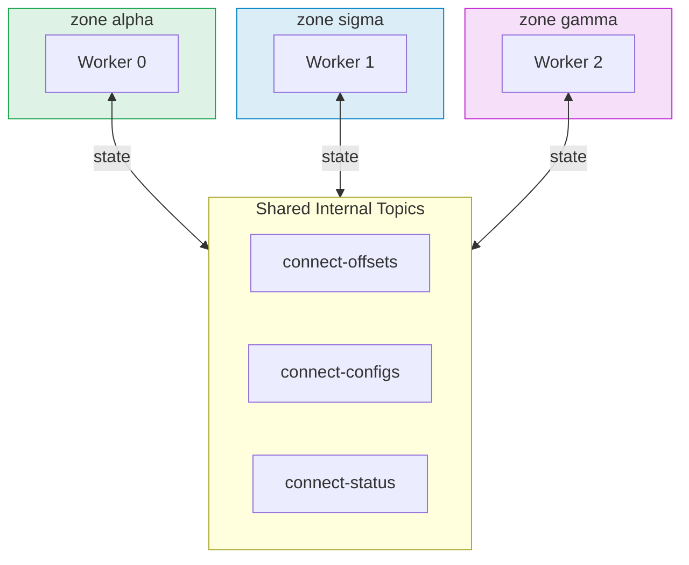
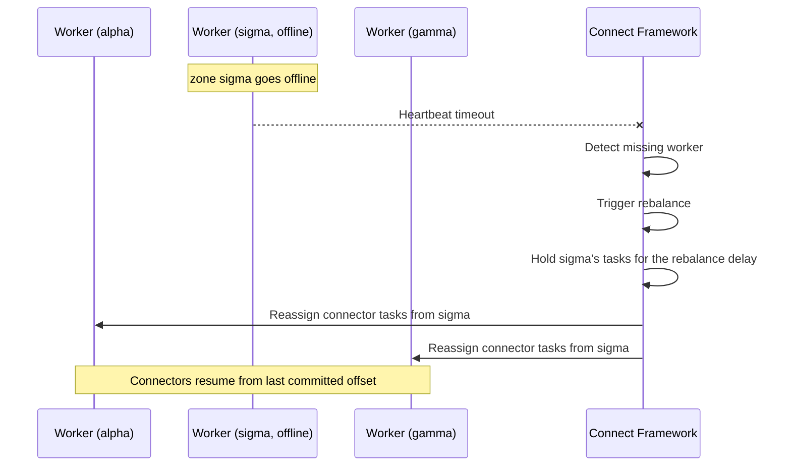
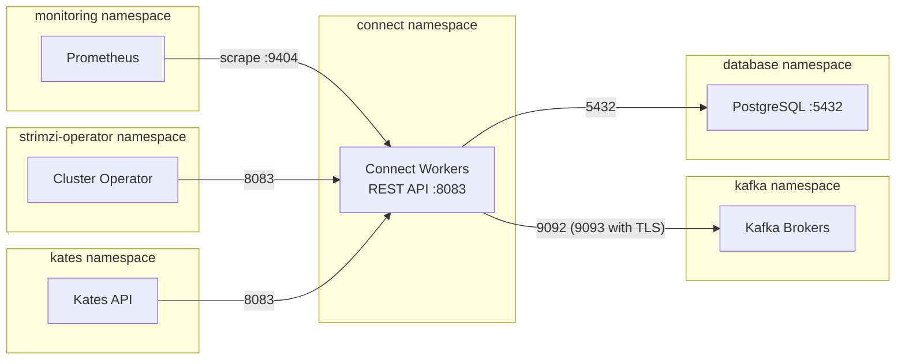
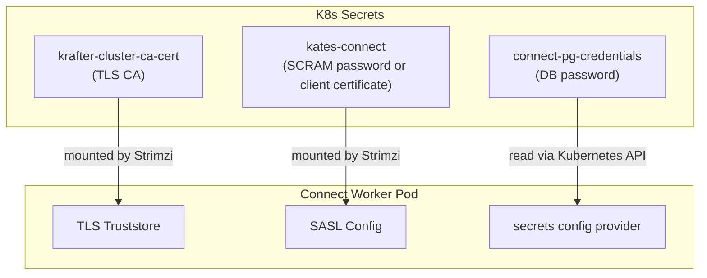

# Operating Kafka Connect

Building a Connect pipeline is half the job; keeping it healthy in production is the other half. The pipeline from the last chapter is running; now a zone goes dark, a password expires, a [Debezium](appendix-a-glossary.md#gl-debezium) release lands, and someone deletes a topic. Each of those is a section here, all for the `connect-cluster` chart. The resource itself, Debezium and pipeline design are in [Kafka Connect & CDC Pipelines](21-kafka-connect.md).

After this chapter, you can:

- Place and size Connect workers so a [zone](appendix-a-glossary.md#gl-zone) failure costs a rebalance delay, not an outage
- Tune producer, consumer, and connector batching when throughput stalls
- Rotate database credentials without restarting a worker, and roll out image upgrades one worker at a time
- Trace a FAILED [connector](appendix-a-glossary.md#gl-connector) from alert to root cause with the CLI, the REST API, and worker logs

## Spreading Workers Across Zones {#multi-az-deployment-strategy}

The `connect-cluster` chart runs one stretched group: a single `KafkaConnect` resource whose [workers](appendix-a-glossary.md#gl-connect-worker) span all three zones. The figure shows the three workers, one per zone, and what they share:



All workers share the group id `kates-connect-cluster` and the three internal topics, so any worker can take any [task](appendix-a-glossary.md#gl-connect-task). Topology spread constraints place them one per zone and pod anti-affinity one per node.

### When a Zone Fails

When an entire zone goes offline, its worker stops sending heartbeats, and the group waits before it moves the worker's tasks:



Whatever the event, the framework moves the tasks, and the offsets survive because they live in a Kafka topic:

| Event | Behavior |
|-------|----------|
| Worker pod dies | Its connectors and tasks stay unassigned for up to `scheduled.rebalance.max.delay.ms` (5 minutes by default), then move to the restarted or surviving workers |
| Entire zone offline | Framework reassigns all tasks from dead workers, after the same delay |
| Zone recovers | Workers rejoin, framework rebalances to restore even distribution |
| Offset continuity | Preserved — offsets stored in shared Kafka topic |

Cross-zone data transfer costs apply when a connector in zone alpha reads from a database in zone sigma. That's the price of a single group that fails over on its own, with no second cluster to promote.

### What a Rebalance Costs

A departed worker's connectors and tasks don't move at once. Under incremental cooperative rebalancing, KIP-415 [@kip415], the group leader waits up to `scheduled.rebalance.max.delay.ms` for the worker to return before it hands its work to others, and a restarted pod gets that work back only when the wait ends. The Kafka default is 5 minutes, and the `connect-cluster` chart doesn't change it, so a crashed worker's [CDC](appendix-a-glossary.md#gl-cdc) stream can pause for that long. Set it under `extraConfig` to trade faster failover for more task movement while pods restart.

When a [rebalance](appendix-a-glossary.md#gl-rebalance) moves a task, the task resumes from its last committed offset, so records processed after that commit can be delivered twice. A source connector with exactly-once support commits records and offsets together and doesn't repeat them; [Exactly-Once Semantics](21-kafka-connect.md#exactly-once-semantics) explains it. Every other connector's consumers have to tolerate the duplicates.

Three places hold a connector's state, and only one of them is yours to edit. The [`KafkaConnector`](appendix-a-glossary.md#gl-kafkaconnector) resource is the source of truth: Strimzi reconciles each connector from it. The internal topics `connect-configs`, `connect-offsets` and `connect-status` hold the group's own copy, its positions and its status. A change made through the REST API outside the resource is overwritten at the next reconciliation, so change the resource, or the chart values that render it.

::: {.callout-tip title="Try it: How long does a killed worker's task stay unassigned?"}
Run `kubectl delete pod -n connect connect-cluster-connect-1`, then `kates kafka connect tasks debezium-postgres-source` every thirty seconds. Note how long the task stays unassigned before it shows RUNNING again, and on which worker.
:::

### Scheduling Configuration

Three values place the workers and tell each one its zone: `topologySpreadConstraints` spreads them across zones, `podAntiAffinity` prefers a separate node for each, and `rack` reads each worker's zone from its node's label. The chart enables all three by default. The base values spread with `whenUnsatisfiable: ScheduleAnyway`, so a one-node Kind cluster still schedules every worker; the dev overlay turns spreading and anti-affinity off, and the production overlay tightens spreading to `DoNotSchedule`:

```yaml
# values-prod.yaml
topologySpreadConstraints:
  whenUnsatisfiable: DoNotSchedule
```

## Capacity Planning

Capacity comes down to how much memory each worker needs, how the connectors' tasks spread across the workers, and what bounds each connector's rate.

### Worker Sizing

Each Connect worker consumes memory in proportion to the number of tasks it runs and the batch sizes configured. The JVM heap is only part of it: direct buffers, thread stacks, JMX and the garbage collector live off-heap, so give the container at least twice the heap. The chart's `values.yaml` does that: each worker gets a 1 GiB heap (`jvmOptions.-Xmx: 1024m`) inside a 2 GiB memory request and a 4 GiB limit, and three workers.

### Task Distribution

Connectors are divided into tasks, and the group spreads the tasks across the workers. How many tasks a connector should have depends on what it reads:

| Connector | `tasksMax` | Why | Lands on |
|-----------|:----------:|-----|----------|
| Debezium PostgreSQL source | 1 | One [replication slot](appendix-a-glossary.md#gl-replication-slot), one ordered stream | One worker |
| JDBC sink | Partitions of its topics | Each task takes a share of the partitions | One task per worker, spread by the group |
| MirrorMaker 2 source | Source partitions | Each task replicates a share of them | Wherever the group puts them |

Two to five tasks per worker keeps a CPU busy without starving the tasks.

What bounds each connector's rate differs too: a Debezium source by the WAL volume its single task reads, a JDBC sink by its batch size and the partitions it has, and a MirrorMaker 2 source mostly by the network. Measure your own rate from the Throughput row of the Grafana board, described under [Grafana Dashboard](#grafana-dashboard).

### Autoscaling

`autoscaling.enabled` renders a HorizontalPodAutoscaler for the `KafkaConnect` resource, off by default, with `minReplicas: 3`, `maxReplicas: 10` and `targetCPUUtilizationPercentage: 80`. Every scale event is a rebalance that pauses the moved tasks for the delay in [What a Rebalance Costs](#what-a-rebalance-costs), and a group runs at most the sum of its connectors' `tasksMax`, so workers beyond that idle. Set `minReplicas` to the zone count and keep the CPU target high.

## Performance Tuning

When a pipeline falls behind, three layers of batching are worth checking: the producer Connect writes to Kafka with, the consumer a sink connector reads with, and the connector's own settings. Each table gives the default and the value to try.

### Producer Tuning

Connect's internal producer sends records to Kafka. These settings control batching and throughput:

| Setting | Default | Tuned | Effect |
|---------|---------|-------|--------|
| `producer.batch.size` | 16384 | 65536 | Larger batches = fewer requests, higher throughput |
| `producer.linger.ms` | 0 | 10 | Wait up to 10ms to fill batch |
| `producer.buffer.memory` | 33554432 | 67108864 | 64MB producer buffer |
| `producer.compression.type` | none | lz4 | Compress records — reduces network and storage |
| `producer.max.request.size` | 1048576 | 10485760 | 10MB max request — needed for large CDC events |

### Consumer Tuning for Sink Connectors

Each sink task reads through a consumer built from the workers' `consumer.*` settings. The first two settings make each fetch and each poll larger; the third is already set by the chart's default `extraConfig`:

| Setting | Default | Tuned | Effect |
|---------|---------|-------|--------|
| `consumer.fetch.min.bytes` | 1 | 65536 | Wait for 64KB before returning fetch |
| `consumer.max.poll.records` | 500 | 2000 | More records per poll = higher throughput |
| `consumer.auto.offset.reset` | `latest` | `earliest` | Chart default — don't miss records |

### Connector-Level Tuning

These settings belong to a connector rather than to the workers, so they go in that connector's own `config`. The Type column says which connector reads each one:

| Setting | Type | Default | Recommended | Notes |
|---------|------|---------|-------------|-------|
| `poll.interval.ms` | Debezium | 500 | 100–500 | Lower = less latency, more CPU |
| `max.batch.size` | Debezium | 2048 | 4096–8192 | Records per batch from the WAL |
| `max.queue.size` | Debezium | 8192 | 16384 | Internal queue between reader and producer |
| `snapshot.fetch.size` | Debezium | 2048 | 10000 | Rows per SELECT during snapshot |
| `batch.size` | JDBC Sink | 3000 | 5000–10000 | Rows per INSERT batch |

::: {.callout-tip title="Is the producer the bottleneck?"}
Compare `rate(kafka_connect_source_task_metrics_source_record_poll_total[5m])` with `rate(kafka_connect_source_task_metrics_source_record_write_total[5m])` in Grafana. If the poll rate is far above the write rate, the producer is the bottleneck: increase `producer.batch.size` and enable compression.
:::

## Observability

Two things tell you how the workers are doing: the Prometheus alerts the chart renders, each linked to its runbook entry, and the Grafana board you read when one fires.

### Prometheus Alerts

The chart's `alerts.yaml` renders a `PrometheusRule` where the `monitoring.coreos.com/v1` API exists. Every rule is scoped to the release's own workers and carries a `runbook_url` into the [Kafka Connect Runbook](../connect-cluster-runbook.md), which says how to confirm and act on each alert. Thresholds are configurable under `alerts.thresholds`, and each row ends with the alert's severity:

| Alert | What fires it |
|-------|---------------|
| `KafkaConnectWorkerDown` | Fewer workers scraped than the release runs, for 3min; critical |
| `KafkaConnectConnectorFailed` | A connector is FAILED for 2min; critical |
| `KafkaConnectTaskFailed` | A connector has FAILED tasks for 2min; critical |
| `KafkaConnectDeadLetterFailures` | A [dead letter queue](appendix-a-glossary.md#gl-dead-letter-queue) refuses records for 2min; critical |
| `KafkaConnectTaskAvailabilitySLOBurning` | Opt-in (`alerts.slo.enabled`): task availability burns its error budget (`alerts.slo.target`, `burnRate`); critical |
| `KafkaConnectTasksNotRunning` | Tasks neither running nor paused for 5min; warning |
| `KafkaConnectErrorsLogged` | Record errors above `errorRatePerSecond` for 5min; warning |
| `KafkaConnectDeadLetterWrites` | Records are dead-lettered for 5min; warning |
| `KafkaConnectOffsetCommitFailures` | Offset commits fail for 10min; warning |
| `KafkaConnectSinkLag` | A declared sink's group lags beyond `sinkLagRecords` for 10min (Kafka Exporter's `kafka_consumergroup_lag`); warning |
| `KafkaConnectSourceIdle` | Opt-in (`alerts.sourceIdle.enabled`): a running source polls 0 records for `sourceIdleMinutes` (default 15min); warning |
| `KafkaConnectRebalanceStorm` | Completed-rebalance rate above `rebalanceRatePerSecond` for 5min; warning |
| `KafkaConnectRebalanceTooLong` | A rebalance has been in progress for 5min; warning |
| `KafkaConnectWorkerHeapHigh` | JVM heap usage above `heapUsagePercent` (default 85%) for 5min; warning |

The same rule also records `connect:tasks_running:ratio`, `connect:records_processed:rate5m` and `connect:errors:rate5m` (plus `connect:task_unavailability:ratio_avg*` with the SLO). The alerts read the JMX exporter's metric names, so the chart refuses `alerts.enabled` without metrics, and with `metrics.type: strimziMetricsReporter` unless `alerts.allowReporterMetrics` is set.

### Grafana Dashboard

The board ships with `charts/monitoring`, with every other board (`dashboards.enabled` there), as one file for every install. It is scoped by two template variables, `$namespace` and `$cluster`, where `$cluster` is the `KafkaConnect` resource's name, the release fullname, so one copy serves every Connect group in a Grafana and the dropdown picks one.

Thirty-five panels: a stat row on top, then one row per concern, in the order an incident asks them.

| Row | Panels | Example metric |
|-----|--------|----------------|
| Top (stats) | Workers up, connectors, failed connectors, failed tasks, tasks running, record errors | `kafka_connect_connector_task_status{status="failed"}` |
| Connectors and tasks | Connector status, task status, tasks per worker, task running and paused ratio, sink partitions assigned | `kafka_connect_connector_metrics` |
| Throughput | Source records polled / written / in flight, sink records read / put, sink lag | `rate(kafka_connect_source_task_metrics_source_record_poll_total[5m])` |
| Errors and dead letter queue | Errors logged, record failures and skips, dead letter queue writes and failures | `rate(kafka_connect_task_error_metrics_total_errors_logged[5m])` |
| Offset commits | Commit time, commit failures, sink commit rate | `kafka_connect_connector_task_metrics_offset_commit_failure_percentage` |
| Workers | Rebalances, rebalance time, rebalance in progress, time since last rebalance, startup failures, heap used, heap used / max | `rate(kafka_connect_worker_rebalance_metrics_completed_rebalances_total[5m])` |
| Client path (collapsed) | The embedded producer and consumer: records sent, errors and retries, request latency, consumer lag | `kafka_producer_*`, `kafka_consumer_*` |

Four panels close gaps the rest of the board leaves open. The task running and paused ratio says how much of the window each task spent running, since a task that keeps restarting reports RUNNING on every status panel. Sink partitions assigned should equal the partition count of the subscribed topics; less is a task holding nothing, which every throughput panel shows as a quiet day. Rebalance in progress pinned at 1 is a group that cannot converge, and time since last rebalance resets at each one, so its drops are the storm the rate panel only averages.

The metrics come from the chart's exporter rules, and `metrics.existingConfigMap` points the workers at rules of your own instead; those rules must still produce the series the board reads.

## Network Policies

The chart's `networkpolicy.yaml` ships a default-deny posture: a deny-all Ingress+Egress policy for the Connect pods (`networkPolicy.defaultDeny.enabled`, on by default) and one policy in which every allowed flow is an explicit, individually configurable rule:

| Flow | Setting |
|------|---------|
| Ingress: metrics scrape (9404) | `networkPolicy.monitoring` (namespace `monitoring`) |
| Ingress: REST API (8083) | `networkPolicy.restApi.clients` (default: the Kates API pods in `kates`), the Cluster Operator in `networkPolicy.strimziOperatorNamespace` (default `strimzi-operator`), and the other workers; `networkPolicy.restApi.allowAll` opens it to any source |
| Egress: DNS, Kubernetes API | `networkPolicy.dns`, `networkPolicy.apiServer` (the secrets config provider reads Secrets through the API) |
| Egress: Kafka | The Kafka namespace's `strimzi.io/cluster` pods, on the ports the bootstrap dials (9092, or 9093 with TLS) |
| Egress: Schema Registry, OTLP | `schemaRegistry.enabled` (the registry pods' `schemaRegistry.targetPort`, 8080, and the Service `port`), `tracing.endpoint` |
| Egress: databases | `networkPolicy.egress.databases` |
| Anything else | `networkPolicy.extraIngress`, `networkPolicy.extraEgress` |

`networkPolicy.kafka.ports` pins the Kafka port list and refuses a bootstrap port outside it. For the default `kates deploy` layout — workers in `connect`, brokers in `kafka` — the [NetworkPolicy](appendix-a-glossary.md#gl-networkpolicy) flows look like this; DNS, the API server and the registry are left out:



The chart renders one egress rule per entry under `networkPolicy.egress.databases`:

```yaml
networkPolicy:
  egress:
    databases:
      - namespace: database
        port: 5432
        podSelector:
          app.kubernetes.io/name: postgresql
```

Each entry generates a `NetworkPolicy` egress rule allowing Connect workers to reach the specified pods in the specified namespace, and a matching ingress policy in the database namespace (`allow-<release>-ingress-<port>`) unless the entry sets `createIngressPolicy: false`.

::: {.callout-warning title="The Kafka egress ports and the operator namespace are explicit"}
A bootstrap that reaches Kafka on a port other than 9092 or 9093 needs `networkPolicy.kafka.ports`, and an operator outside `strimzi-operator` needs `networkPolicy.strimziOperatorNamespace`; otherwise the workers cannot reach the brokers, or the operator cannot manage the connectors. [`krafter`](appendix-a-glossary.md#gl-krafter), the Kafka cluster under test, admits Connect through its own `networkPolicy.clients`.
:::

## REST API & Connector Operations

The Kates CLI wraps the common REST calls:

```bash
# List all connectors
kates kafka connect connectors

# Describe a connector (full YAML)
kates kafka connect connector debezium-postgres-source

# Show connector config only
kates kafka connect config debezium-postgres-source

# Show task-level status
kates kafka connect tasks debezium-postgres-source

# Pause / resume / restart
kates kafka connect pause debezium-postgres-source
kates kafka connect resume debezium-postgres-source
kates kafka connect restart debezium-postgres-source

# Restart a specific task
kates kafka connect restart-task debezium-postgres-source 0

# Scale workers
kates kafka connect scale 5

# Tail logs (with follow)
kates kafka connect logs -f

# JSON output for scripting
kates kafka connect connectors -o json | jq -r '.items[].metadata.name'
```

### Direct REST API Access

The Connect REST API (port 8083) is also exposed via a `ClusterIP` Service (`<release>-rest-api`) for direct access:

```bash
# Port-forward for local access
kubectl port-forward -n connect svc/connect-cluster-rest-api 8083:8083

# List connectors via REST
curl -s http://localhost:8083/connectors | jq .

# Or call it from inside a worker, as the Helm test does
kubectl -n connect exec connect-cluster-connect-0 -- \
  curl -s 'http://localhost:8083/connectors?expand=status' | jq .
```

In-cluster clients reach the Service only if the NetworkPolicy admits them: add them to `networkPolicy.restApi.clients` (see [Network Policies](#network-policies)).

For external access, enable the Ingress, and admit the ingress controller's pods in `networkPolicy.restApi.clients`:

```yaml
restApi:
  ingress:
    enabled: true
    className: nginx
    hosts:
      - host: connect.example.com
        paths:
          - path: /
            pathType: Prefix
```

::: {.callout-tip title="Try it: Does the CLI agree with the REST API?"}
Run the block below and compare the two views. A connector that the CLI shows Ready but the REST API shows FAILED has a stale `KafkaConnector` status; the REST view is the worker's own.
:::

The CLI reads the `KafkaConnector` resources, whose status Strimzi reconciles from the REST API:

```bash
kubectl port-forward -n connect svc/connect-cluster-rest-api 8083:8083 &

# Worker version and the Kafka cluster it belongs to
curl -s http://localhost:8083/ | jq .

# Connector- and task-level state in one call
curl -s "http://localhost:8083/connectors?expand=status" | jq .

# The same connectors as the CLI sees them
kates kafka connect connectors

# Stop the port-forward
kill %1
```

### Verifying a Release with `helm test`

The chart includes Helm tests, run in order: a connectivity pod, then example `KafkaTopic` and `KafkaConnector` resources (defined under `testTopics` / `testConnectors` in values), then a pod that waits for those connectors. The example resources are created during `helm test` and deleted when the test succeeds:

```bash
# Run the CDC integration test via Kates CLI
kates kafka connect test

# Or run the Helm chart test directly
helm test connect-cluster --namespace connect --timeout 180s --logs
```

The `kates kafka connect test` command starts an INTEGRATION_CDC run on the Kates API, a full end-to-end CDC integration test. The CLI shows the run's eight phases as they complete: database setup, topic creation, source and sink deployment, connector readiness, Kafka verification, sink verification and cleanup.

The run reads the demo database's password from its Secret, `postgresql` in `database`. The Kates API may read that Secret only in the namespaces the `kates` chart's `rbac.cdcSecretNamespaces` lists, which `kates deploy --with-kafka-connect` sets to the database's namespace. Without that grant, the run fails at DB setup with a `Forbidden` error.

The connectivity test pod (`test-01-connect.yaml`) checks the credentials Secret, the `KafkaConnect` `Ready` condition, and the running workers. It then calls the REST API on port 8083 from inside a worker, which the NetworkPolicy admits — the root endpoint, and `/connector-plugins` against `tests.expectedPlugins` plus each `plugins[].expect` — and finally checks each declared connector's state and tasks. The last pod (`test-03-test-connectors.yaml`) waits for every test connector to reach RUNNING with all its tasks running. The test topics are created in the Kafka namespace, and `values-prod.yaml` turns the test connectors off because they need the platform's demo PostgreSQL.

Because the hook resources are removed the moment the suite succeeds, nothing persists after `helm test` returns. To keep the example topic and connectors running — as the working-examples tutorial does — render the same templates and apply them directly (they keep their hook annotations, so a later `helm test` removes them again):

```bash
helm template connect-cluster oci://ghcr.io/bmscomp/charts/connect-cluster -n connect \
  --set kafka.namespace=kafka \
  -s templates/tests/test-02-topics.yaml \
  -s templates/tests/test-02-connectors.yaml | kubectl apply -f -
```

## Security & Credential Rotation

A worker holds three credentials: the cluster CA it trusts, its own Kafka user's password or certificate, and the database password its connectors log in with. This section shows where each one comes from and how to rotate it.

### Credential Architecture

[Strimzi](appendix-a-glossary.md#gl-strimzi) mounts the CA and the Kafka user's [Secret](appendix-a-glossary.md#gl-secret) into the worker pods. The database Secret is never mounted: the secrets config provider reads it through the Kubernetes API.



The workers may read `connect-pg-credentials` only because the chart grants `get` on the Secrets its connectors reference ([External Configuration (Secrets)](21-kafka-connect.md#external-configuration-secrets)). When Kafka lives in another namespace, the chart's secret-sync Job copies `kates-connect` (for a chart-managed `KafkaUser`) and, with TLS, the cluster CA into the Connect namespace on every install and upgrade.

### Rotation Procedures

Of the credentials a worker holds, only the database password lives outside Kubernetes, so it is the one rotation Strimzi takes no part in. The three Kafka credentials rotate through Strimzi and roll the workers one at a time:

| Credential | Rotation Method | Downtime |
|-----------|----------------|:--------:|
| Kafka TLS CA | Strimzi auto-rotates 180 days before expiry; across namespaces, `secretSync.watch` re-copies it (otherwise the next `helm upgrade` does) | Zero — rolling restart |
| SCRAM password | Update `KafkaUser` CR → Strimzi updates Secret; across namespaces, `secretSync.watch` or the next `helm upgrade` re-copies it | Zero — rolling restart |
| Client certificate (`values-prod.yaml`) | The User Operator renews it; `secretSync.watch` (on in the prod overlay) re-copies it | Zero — rolling restart |
| Database password | Change it in PostgreSQL, update the Kubernetes Secret, then restart the tasks of the connectors that read it | Seconds — task restart only |
| Connect REST API (if exposed) | Ingress-level auth (OAuth2 proxy, mTLS) | N/A |

For the database password, what matters is when the tasks restart. A connector's tasks hold its database connections, and each task reads the Secret, through the secrets config provider, when it starts. Restarting only the connector, as `kates kafka connect restart` does, leaves its running tasks on the old password. So change the password in PostgreSQL first, then the Secret, and only then restart the tasks of every connector that reads it. The commands below rotate the demo database that `kates deploy` installs in the `database` namespace; for your own database, run the same `ALTER ROLE` your usual way:

```bash
# 1. Change the password in PostgreSQL. A role may change its own password,
#    so this logs in as debezium with the password it has now
kubectl exec -n database postgresql-0 -- /bin/bash -lc \
  "PGPASSWORD=OLD_PASSWORD psql \
  -h 127.0.0.1 -U debezium -d orders \
  -c \"ALTER ROLE debezium PASSWORD 'NEW_PASSWORD';\""

# 2. Update the Secret the connectors read
kubectl create secret generic connect-pg-credentials \
  -n connect \
  --from-literal=username=debezium \
  --from-literal=password=NEW_PASSWORD \
  --dry-run=client -o yaml | kubectl apply -f -

# 3. Restart the tasks of every connector that reads the Secret, so each
#    task reads it again. kates deploy creates these two, with one task each
kates kafka connect restart-task debezium-postgres-source 0
kates kafka connect restart-task jdbc-sink-connector 0
```

A connector with more tasks needs each of them restarted; `kates kafka connect tasks <connector>` lists their ids. Between steps 1 and 2 the database and the Secret disagree, so a task that restarts in that window for another reason, such as a rebalance that moves it to another worker, fails authentication; step 3 brings it back. Nothing restarts the workers along the way: `kates kafka connect restart-task` restarts a task through its connector's `KafkaConnector` resource, and a change to this Secret rolls no pods.

Every `kates deploy --with-kafka-connect` run writes `connect-pg-credentials` again with the demo password, `debezium`. Once you have rotated the demo database, repeat steps 2 and 3 after each such run.

::: {.callout-tip title="Try it: Does a running task notice a changed Secret?"}
Set `connect-pg-credentials` to a wrong password with step 2 alone, leaving PostgreSQL as it is, then insert a row as [Replicate a Row End to End](21-kafka-connect.md#replicate-a-row-end-to-end) does and check whether it replicates. Then run step 3 and watch `kates kafka connect tasks jdbc-sink-connector`. Put the right password back and restart the task again when you're done.
:::

## Upgrade Procedures

Two things get upgraded here: the image the workers run, when Debezium or Kafka moves, and the chart itself. Both go through `helm upgrade` from the values the release runs with, and both can be rolled back.

### Upgrading the Connect Image

When a new Debezium or Kafka version is released:

```bash
# 1. Bump ARG DEBEZIUM_VERSION in Dockerfile.connect (e.g. 3.7.0.Final),
#    then build and push — the image tag is derived from that ARG
make connect-build connect-push

# 2. Upgrade the release from the values it runs with.
helm get values connect-cluster -n connect -o yaml > connect-current.yaml
helm upgrade connect-cluster oci://ghcr.io/bmscomp/charts/connect-cluster \
  --namespace connect -f connect-current.yaml \
  --set image=ghcr.io/bmscomp/connect:3.7.0
```

`connect-current.yaml` holds everything the release was installed with — for a `kates deploy` install, the bootstrap address, the Kafka namespace, the schema registry URL, the database egress and the replica count all arrive as `--set` flags that no file records. `--reuse-values` keeps them too, but over the *old* chart's defaults, so a default the new chart changes never applies. `kates deploy --with-kafka-connect` is not an upgrade path: it skips a Connect release that is already deployed and has worker pods.

`make connect-push` publishes the Debezium-only tag (`connect:3.7.0`). The chart's own pin is the fully qualified `<debezium>-kafka-<kafka>` tag, and it lives in two places: `image` in `values.yaml` and the `kates.io/connect-image` annotation in `Chart.yaml`. `kates deploy` runs whatever `values.yaml` pins. A `v*` release tag runs `.github/workflows/publish-connect.yml`, which publishes the qualified tag and moves both pins together, and `scripts/check-versions.sh` fails when the pins disagree with each other, with `Dockerfile.connect`, or with the Kafka pin. `Chart.yaml` `appVersion` is the Kafka version the workers run (the `version` value), not the Debezium version. The chart refuses `:latest` and untagged images.

Strimzi performs a rolling restart, one worker at a time. Each restarted worker's connectors and tasks can wait up to the rebalance delay described under [What a Rebalance Costs](#what-a-rebalance-costs) before they run again. Workers that leave while one delay runs get their work back when that same delay ends, so a rollout quicker than the delay can leave most of the group's tasks paused at once.

### Upgrading the Chart from 1.x

Chart 2.0 reads 1.x values: each moved key is translated, and `helm upgrade` prints a `DEPRECATED` line in the release notes for each one still in use. Start from the values the 1.x release runs with, then check the render and the list before you upgrade:

```bash
helm get values connect-cluster -n connect -o yaml > connect-current.yaml
helm template connect-cluster oci://ghcr.io/bmscomp/charts/connect-cluster -n connect \
  -f connect-current.yaml > /dev/null
helm upgrade connect-cluster oci://ghcr.io/bmscomp/charts/connect-cluster -n connect \
  -f connect-current.yaml --dry-run | sed -n '/^NOTES/,$p'
helm upgrade connect-cluster oci://ghcr.io/bmscomp/charts/connect-cluster -n connect \
  -f connect-current.yaml
```

The upgrade rolls the workers once. Afterwards, check that every connector still runs. The table lists what 2.0 changes from 1.x and what to check for each:

| 1.x | 2.x | What to check |
|-----|-----|---------------|
| Workers read every Secret in the Connect and Kafka namespaces | `get` only on referenced Secrets and `rbac.secretNames` | A connector failing with `Forbidden` needs its Secret listed |
| Kafka egress on 9092 and 9093 | The ports the bootstrap dials, or `networkPolicy.kafka.ports` | A bootstrap on another port |
| Cluster Operator looked for in the Kafka namespace | `networkPolicy.strimziOperatorNamespace`, default `strimzi-operator` | An operator elsewhere |
| `databaseEgress` | `networkPolicy.egress.databases` | The `DEPRECATED` line in the release notes |
| Metrics ConfigMap key `kafka-metrics-config.yml` | `metrics-config.yml` | Nothing; the workers roll once |
| `KafkaConnectTaskCountMismatch` | `KafkaConnectTasksNotRunning` | Alertmanager routes and silences |
| `KafkaConnectHighErrorRate` | `KafkaConnectErrorsLogged` | Alertmanager routes and silences |
| `KafkaConnectSourceLag` | `KafkaConnectSourceIdle`, off by default | Alertmanager routes and silences |

The key-by-key table is in [Upgrading connect-cluster 1.3 → 2.0](../connect-cluster-2.0-upgrade.md).

### Upgrade Checklist

The checklist takes an image upgrade through dev or staging before production, and says how to verify each step:

| Step | Action | Verify |
|:----:|--------|--------|
| 1 | Read Debezium migration guide | Breaking changes documented |
| 2 | Build new image on CI | `make connect-build` passes |
| 3 | Deploy to dev/staging | The `helm upgrade` above, from the release's current values; every worker rolls onto the new image |
| 4 | Run integration test | `kates kafka connect test` passes ([Verifying a Release with `helm test`](#verifying-a-release-with-helm-test)) |
| 5 | Verify connector status | `kates kafka connect connectors` — all RUNNING, no DLQ growth |
| 6 | Deploy to production | The same `helm upgrade` on the production cluster, from its own current values |
| 7 | Monitor for 24h | No alerts, no lag increase |

### Rolling Back

Either return to the previous Helm revision, or pin the previous image and upgrade to it from the values the release runs with:

```bash
# Rollback to previous Helm release
helm rollback connect-cluster -n connect

# Or pin to previous image
helm get values connect-cluster -n connect -o yaml > connect-current.yaml
helm upgrade connect-cluster oci://ghcr.io/bmscomp/charts/connect-cluster \
  --namespace connect -f connect-current.yaml \
  --set image=ghcr.io/bmscomp/connect:3.6.2-kafka-4.3.1
```

Rolling a 2.0 release back to a 1.3 revision restores the 1.x manifests: the workers roll back onto the `kafka-metrics-config.yml` key, and the 1.x namespace-wide Secret access returns.

::: {.callout-warning title="Roll back before the offset format changes"}
If the new Debezium version changed the internal offset format, rolling back may cause connectors to fail with deserialization errors. Always test in staging first.
:::

## Disaster Recovery

Connect keeps its state in Kafka, so what you can recover depends on what survives there. The scenarios below cover losing the internal topics and losing the whole Connect deployment.

### Recovering After the Offsets Topic Is Deleted

If the `connect-offsets` topic is accidentally deleted, every source connector loses its position. On restart each falls back to its `snapshot.mode`: `initial` takes a full snapshot (hours on a large database); `schema_only` skips to new changes and leaves a gap.

Recover in three steps:

```bash
# 1. Scale down Connect workers
kates kafka connect scale 0

# 2. Scale back up — workers recreate internal topics on startup
kates kafka connect scale 3

# 3. Monitor snapshot progress
kates kafka connect logs -f
```

### Rebuilding a Lost Connect Cluster

If the entire Connect deployment is destroyed, redeploy it:

```bash
kates deploy --with-kafka-connect
```

Then:

1. The connectors defined in the values are recreated.
2. If the offsets topic still exists in Kafka, the connectors resume from their last position.
3. If the offsets topic is also lost, they re-snapshot.

### Backup Strategy

Each component of a Connect deployment has its own backup method:

| Component | Backup Method | RPO |
|-----------|-------------|:---:|
| Connector configs | Version-controlled in `values.yaml` | 0 |
| Connector offsets | Kafka topic with replication factor 3 | 0 (unless all brokers fail) |
| Database credentials | Kubernetes Secret backup (Velero) | Daily |
| Connect image | OCI registry + Dockerfile in Git | 0 |

## Troubleshooting

Each entry starts from what you see — a connector's state, an alert, a pod's exit reason, a PostgreSQL disk that keeps growing, or a failed `helm upgrade` — and gives the cause and the fix. Most FAILED connectors trace back to credentials, an occupied replication slot or `wal_level`, so start with `kates kafka connect connectors` and the worker logs.

### Connector Stuck in FAILED State

**Symptom:** `KafkaConnector` status shows `FAILED` with `io.debezium.DebeziumException`

**Cause:** Find it in the connector's status and the worker logs:

```bash
# Check connector status
kates kafka connect connectors
kates kafka connect connector debezium-postgres-source

# Check Connect worker logs
kates kafka connect logs
```

**Fix:** Match the error to its cause and fix:

| Error | Cause | Fix |
|-------|-------|-----|
| `PSQLException: FATAL: password authentication failed` | Wrong credentials in the Secret | Update the `connect-pg-credentials` Secret |
| `replication slot "debezium_kates" is active` | Previous connector instance still holding the slot | Restart the connector or drop the slot manually |
| `could not access file "pgoutput"` | PostgreSQL `wal_level` is not `logical` | Set `wal_level = logical` in PostgreSQL config |
| `No matching table(s) in schema "public"` | `schema.include.list` doesn't match any tables | Verify the schema and table names exist |

### Rebalancing Takes Too Long

**Symptom:** Connect cluster stuck in `REBALANCING` state for minutes (the `KafkaConnectRebalanceTooLong` alert fires after 5 minutes)

**Cause:** A large number of connectors/tasks being reassigned, or workers repeatedly leaving and rejoining the group. (The chart also sets `group.initial.rebalance.delay.ms: 3000`, which adds a fixed 3-second wait before the *first* assignment when the group forms — that delay is intentional and not the problem here.)

**Fix:** If rebalancing takes more than 5 minutes, check for:

- Workers crashing during rebalance (check pod events)
- Network policies blocking inter-worker communication on port 8083
- Insufficient memory causing OOM kills during task assignment

### Connect Workers OOMKilled

**Symptom:** Pods restarting with `OOMKilled` exit reason

**Cause:** JVM heap (`-Xmx`) + off-heap memory exceeds the container memory limit

**Fix:** Ensure `resources.limits.memory` is at least 2× the `-Xmx` value to account for off-heap memory (direct buffers, thread stacks, JMX):

```yaml
jvmOptions:
  -Xmx: 1024m          # 1Gi heap
resources:
  limits:
    memory: 2Gi         # 2× heap = headroom for off-heap
```

### Replication Slot WAL Retention Growing

**Symptom:** PostgreSQL disk usage growing rapidly, `pg_replication_slots` shows large `wal_status`

**Cause:** The Debezium connector is down or paused, but the replication slot retains WAL segments

**Fix:**

1. Resume or restart the connector to drain the slot.
2. If the connector is permanently removed, drop the slot:

    ```sql
    SELECT pg_drop_replication_slot('debezium_kates');
    ```

3. Enable the heartbeat to prevent WAL retention on idle tables:

    ```yaml
    heartbeat.interval.ms: "10000"
    ```

### Connector Validation Blocks Deployment

**Symptom:** `helm upgrade` (or `helm template`) fails at once with `Error: execution error at (connect-cluster/templates/…): connect-cluster: …`

**Cause:** The chart checks connector configs and the rest of the values while it renders — a missing required key, a sink without `topics`, a `${secrets:…}` reference without a namespace, a plaintext password under `productionMode`, and so on. Nothing is applied.

**Fix:** The message names the connector and the setting. Output:

```text
connect-cluster: connectors.orders-cdc (…PostgresConnector)
needs config.topic.prefix
```

Fix the connector configs in `values.yaml`, render them again (`helm template connect-cluster oci://ghcr.io/bmscomp/charts/connect-cluster -n connect -f values.yaml > /dev/null`), and re-run `helm upgrade`. [Pre-Deploy Validation](21-kafka-connect.md#pre-deploy-validation) lists the checks.

### Connector Fails with `Forbidden` Reading a Secret

**Symptom:** A connector is `FAILED` and its trace reads `Forbidden` or `secrets "…" is forbidden`

**Cause:** The workers resolve `${secrets:<namespace>/<name>:<key>}` as the `<release>-connect` ServiceAccount, and the chart grants `get` only on the Secrets its own connector configs reference. A connector applied outside the chart — by hand, or by `kates deploy` — reads a Secret the chart doesn't know about.

**Fix:** List the Secret in `rbac.secretNames` (`name` for this namespace, `namespace/name` for another) and upgrade, then restart the connector. Check the grant:

```bash
kubectl auth can-i get secret/connect-pg-credentials -n connect \
  --as=system:serviceaccount:connect:connect-cluster-connect
```

For the symptom-by-symptom index across the whole book, see the [Troubleshooting Index](appendix-b-troubleshooting.md).

Component versions for the Connect stack are tracked centrally in the [Version & Compatibility Matrix](appendix-d-versions.md).

## Summary

- One stretched group spans the three zones; when a zone dies its tasks wait out the rebalance delay, then resume elsewhere from their committed offsets.
- Give each worker's container twice its JVM heap, and aim for two to five tasks per worker.
- The three internal topics are the only state, so a lost Connect deployment is a reinstall.
- Rotate a database password in PostgreSQL, then in the Secret, then restart the tasks that read it.
- Upgrades roll one worker at a time, and an offset-format change makes rollback unsafe.

MirrorMaker 2 runs on the same machinery you have just learned to operate — workers, tasks, rebalances and internal topics — with one difference: it talks to two Kafka clusters instead of one. [Cross-Cluster Replication and Migration](22-mirror-maker2-migration.md) starts from there.
