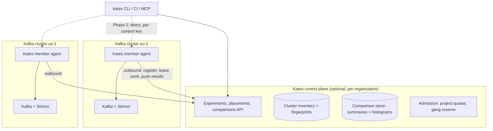

# Multi-cluster, multi-tenant testing and cross-cluster comparison: plan

| | |
| --- | --- |
| **Status** | Revision 2, proposal for review, 2026-10-16 |
| **Audience** | The maintainer and contributors |
| **Baseline** | `main` at `02e0df2` (v1.25.1 prepared) |
| **Related** | `plans/mcp-server.md` (principals, `allowedClusterIds`, audit actor) |
| **Changes from revision 1** | §0 lists the review findings and where each is addressed |

Labels used throughout:

- **exists today**: on `main` at `02e0df2`.
- **proposed here**: new in this plan.
- **prior art**: how an established platform solves the same problem, with what Kates takes from it.

---

## 0. Review of revision 1

Revision 1 answered "run the same test on several clusters and compare". Measured against how mature platform-engineering systems handle fleets and tenants, it had nine gaps. They are listed by severity, each with the section that now addresses it.

| # | Severity | Finding | Fix |
| --- | --- | --- | --- |
| R1 | High | **No tenancy model.** "Multi-cluster" and "multi-tenant" were conflated. Nothing said who owns a cluster, who may test it, how two teams share one Kates, or how load from one team's test is kept off another's topics. | §5 tenancy model |
| R2 | High | **The coordinator was a laptop.** `kates fleet chaos` in the CLI sequences faults across clusters from a process that can be closed mid-run, leaving cluster B half-tested and nobody watching rollback. That is acceptable for read-only comparison, but not for chaos. | §10 durability, chaos coordination moves server-side (Phase 4) |
| R3 | High | **Percentiles cannot be compared as stored.** A task row keeps five numbers, not its histogram (`util/MetricUtils.java:40-60`). For multi-producer runs the run P99 is the *highest* row P99, an upper bound. Two clusters with different producer counts get bounds of different tightness, and repetitions cannot be merged. | §7.3 persist HdrHistograms |
| R4 | High | **Sequential runs were confounded with time.** Running all of A and then all of B means time-of-day load, a noisy neighbour or a GC storm lands on one cluster only. | §7.2 randomized interleaving |
| R5 | Medium | **Cluster identity was a CLI alias.** Aliases are local, mutable and collide. Comparisons stored against them break when someone renames a context. | §6 stable identity |
| R6 | Medium | **Fleets were static lists.** Every mature fleet system selects clusters by label (placement). Static lists rot. | §6.3 placement |
| R7 | Medium | **Option C made the aggregator a credential hub.** Pulling from members needs the aggregator to hold a key for every member, which recreates the risk Option B was rejected for. | §4 outbound-only agent model |
| R8 | Medium | **No admission across members.** Each instance has 3 slots (`kates.engine.max-concurrent-tests=3`). A parallel fleet run that gets a slot on A but queues on B is no longer a parallel comparison. | §5.4 gang admission |
| R9 | Low | **Statistics were under-specified.** Bootstrap CIs alone, with no correction for comparing many metrics across many clusters, will produce false "slower" verdicts. | §7.4 |

---

## 1. Summary

**Goal.** Let several teams run performance and chaos experiments across a fleet of Kafka clusters. Each team works only on the clusters it owns or is granted. The result is one report per experiment that says which cluster did better, by how much, with what confidence, and whether the clusters were comparable at all.

**Recommendation.**

1. **Hub-and-agent, outbound-only.** Each Kafka cluster keeps its own Kates API. That API is the **member agent**: it runs tests and faults locally with its in-cluster credentials, and it **dials out** to an optional **Kates control plane** to receive work and report results. The control plane never holds Kafka credentials or kubeconfigs. Open Cluster Management, Karmada pull mode, Rancher Fleet, the Argo CD agent and LitmusChaos all converged on this shape.
2. **Tenancy is a first-class dimension, not a column.** The hierarchy is Organization, Project (team), ClusterSet and Cluster. Every run, fault, baseline and comparison belongs to a project. API scopes are granted per project and per cluster set. The existing `allowedClusterIds` becomes a cluster-set binding.
3. **Comparison is an experiment design problem.** The plan uses a stable cluster identity and fingerprint, a scenario digest, randomized interleaving, merged histograms, nonparametric tests with multiple-comparison control, and an A/A calibration that must pass before any "B is slower" verdict ships.
4. **Ship in an order that earns trust.** Phase 0 fixes the comparison math and enforces scopes. Phase 1 adds identity and histograms. Phase 2 is CLI-coordinated performance comparison, read-only toward safety. Chaos across clusters waits for the durable control plane in Phase 4.

---

## 2. Vocabulary

Kates terms are mapped to the systems readers already know, so that no new names are needed where established ones exist.

| Kates term (proposed) | Meaning | Closest prior art |
| --- | --- | --- |
| **Organization** | Top-level tenant boundary: one company or one business unit | Backstage domain, Litmus ChaosCenter account |
| **Project** | A team's space: owns runs, baselines, scenarios, keys and quotas | Litmus project, Argo CD AppProject, Capsule Tenant, Kueue LocalQueue owner |
| **Cluster** | One Kafka cluster with one Kates member agent | OCM ManagedCluster, Karmada Cluster, SIG-Multicluster ClusterProfile |
| **ClusterSet** | A labelled group of clusters, bound to projects | OCM ManagedClusterSet plus ManagedClusterSetBinding |
| **Placement** | A label selector that resolves a set to concrete clusters at run time | OCM Placement, Karmada PropagationPolicy, ApplicationSet cluster generator |
| **Experiment** | One scenario or fault plan, applied to a placement, with a design (repeats, order, baseline) | Kayenta canary config, AWS FIS experiment template |
| **Member run** | One execution of the experiment on one cluster (one Kates run or disruption report) | Karmada Work, OCM ManifestWork status |
| **Comparison** | The analysed result of an experiment across its member runs | Kayenta canary judgement |

---

## 3. Prior art: how leading platforms do it

### 3.1 Comparison

| System | Domain | Topology | Tenancy | What Kates takes | What Kates does not take |
| --- | --- | --- | --- | --- | --- |
| **Open Cluster Management** | K8s fleet | Hub, with a klusterlet agent pulling ManifestWork | ManagedClusterSet bound to namespaces | Outbound-only agent; cluster sets bound to tenants; Placement with label and claim selectors; per-cluster status rolled up | The full ManifestWork model; Kates ships experiments, not arbitrary manifests |
| **Karmada** | K8s fleet | Push or pull per cluster | Namespaces on the control plane | Push and pull as a per-cluster choice; aggregated status on a binding object | API-server-compatible control plane, too heavy for Kates |
| **Argo CD ApplicationSet and agent** | GitOps | Generators fan one template out to clusters; the agent mode pulls | AppProject restricts source, destination and cluster | Declarative fan-out (`Experiment` as YAML in Git); project-scoped destinations | |
| **Rancher Fleet** | GitOps | Agent pulls bundles | Workspaces | ClusterGroup selectors; rollout partitions with `maxUnavailable` (waves) | |
| **Kueue and MultiKueue** | Batch admission | Manager dispatches workloads to worker clusters | ClusterQueue, LocalQueue, cohorts, fair sharing | Quota per project; **all-or-nothing (gang) admission**; dispatch to the cluster that admits | Kueue itself; Kates admission is a slot count, not a resource model |
| **SIG-Multicluster About API and ClusterProfile** | K8s standards | Inventory | n/a | Stable cluster id (`cluster.clusterset.k8s.io` ClusterProperty); ClusterProfile as the inventory shape | |
| **Capsule, HNC, vCluster** | K8s multi-tenancy | In-cluster | Tenant over namespaces, hierarchy, or virtual control plane | Isolation tiers (soft, namespace-backed, cluster-per-tenant) | |
| **LitmusChaos ChaosCenter** | Chaos | Control plane with chaos infrastructure agents in each cluster | Projects, members, roles, environments | Projects and environments; resilience score; hub with outbound agents. Kates already drives Litmus CRDs (`kates.chaos.provider=litmus-crd`). | Duplicating ChaosCenter's UI. Kates should be able to coexist with it. |
| **AWS FIS** | Chaos | Orchestrator account, target accounts through IAM roles (multi-account experiments) | Account boundary | **Stop conditions** wired to alarms; experiment templates; per-target-account configuration | |
| **Gremlin, Steadybit** | Chaos SaaS | Agents dial out | Teams, environments | Blast-radius limits scoped by team and environment; reliability scorecards | |
| **Kayenta (Spinnaker)** | Canary analysis | Library | n/a | **Mann-Whitney U per metric**, pass/marginal/fail classification, weighted score | Its metric-store plumbing |
| **OpenMessaging Benchmark** | Messaging benchmarks | Driver plus workload files | n/a | A portable workload format; histogram-based latency reporting | Its harness; Kates has its own backends |
| **Backstage, Port, Cortex** | Developer portals | Catalog | Ownership in the catalog | Ownership comes from the catalog; resilience and performance **scorecards** per cluster | Building a portal |

### 3.2 Lessons

1. **Agents dial out.** Every system that crosses network and security boundaries at scale ended up with outbound agents (OCM, Fleet, Argo CD agent, Litmus, Gremlin, Steadybit). Inbound access from a hub to every cluster fails in the first enterprise with private clusters or a strict firewall.
2. **Tenancy binds to cluster *sets*, not clusters.** OCM, Argo CD and Litmus all grant a tenant a selector or a set, never a hand-maintained list of cluster names.
3. **Placement is late-bound.** A label selector resolves when the experiment starts, so new clusters join without editing every experiment.
4. **Status is per member and aggregated.** Each member reports conditions; the parent object rolls them up. Partial results are normal and must be visible.
5. **Admission is all-or-nothing when timing matters.** Kueue's gang admission exists because a half-started job is worse than a queued one.
6. **Chaos needs stop conditions outside the experiment.** AWS FIS stops on an alarm the experiment does not control, and Kates should too.
7. **Judgement is statistical and per metric.** Kayenta classifies every metric separately and then scores them. A single "impact score" hides the cause.

---

## 4. Architecture

### 4.1 Options

| Option | Description | Verdict |
| --- | --- | --- |
| **A. CLI federation** | The CLI fans out with each context's own key | Good for Phase 2 performance comparison. Not durable, so not used for chaos. |
| **B. Credential hub** | One Kates holds bootstrap, SASL and kubeconfig for every cluster | Rejected. One compromise exposes the fleet, and every table and service would need tenancy retrofitted. |
| **C1. Pulling aggregator** (rev. 1) | Aggregator calls members with stored keys | Rejected. It is a credential hub for reads (R7). |
| **C2. Hub and outbound agent** (recommended) | Members register with and poll the control plane, then push results | Target. The control plane holds no cluster credentials. A member can be taken out of the fleet by revoking one registration. |

### 4.2 Shape of C2



- **The member is the existing Kates API.** It gains a `kates.fleet.*` configuration block: control plane URL, a registration credential, labels, and the projects it accepts. With the block unset, Kates behaves exactly as today. The control plane is optional, never required.
- **Work is leased, not pushed.** Members long-poll for work addressed to their cluster id and accept or refuse it against local guards. A refusal carries a reason (`refused: safety-guard`, `refused: provider`, `refused: quota`) and becomes a member condition.
- **Results are pushed** at the end of each member run: the summary, the histograms (§7.3), the fingerprint and the audit reference. Push reuses the delivery code the webhook service already has (retries, DLQ, processed-event dedup in `webhook/`).
- **Only summaries leave the cluster.** No payloads, topic data or credentials do. This keeps data residency simple.
- **Deployment.** The control plane is the same image in a `controlPlane` mode (one chart value), with its own database. This avoids a second codebase.

---

## 5. Tenancy model

### 5.1 Hierarchy and ownership

```
Organization
 └─ Project (team)            owns: runs, faults, baselines, scenarios, keys, quotas
     └─ ClusterSetBinding ──► ClusterSet (label selector) ──► Cluster(s)
```

- Ownership of a cluster comes from its labels (`kates.io/owner-project`) or from an external catalog. A Backstage `Resource` entity is the natural source and can be synced in Phase 5.
- A cluster can be in several sets. Tenants get access through bindings, never by cluster name.

### 5.2 Authorization

- **Scopes** (`read`, `read:sensitive`, `test:run`, `chaos:run`, `admin`) exist today and are evaluated per **(project, cluster set)**. A key is issued to a principal in a project.
- `KatesPrincipal.allowedClusterIds` is carried today but enforced nowhere. Phase 0 enforces it on the member, against the member's own cluster id. Phase 3 generalizes it to cluster-set bindings on the control plane.
- **Environment class** is a required cluster label (`kates.io/env: dev|staging|prod`). Policy keys off it: for example, `chaos:run` on `prod` needs a second approver and a change window (§9.4).
- **Audit.** Each member audit row (V26 added `actor` and `principal_type`) also records `on_behalf_of` (the human or agent who started the experiment), `experiment_id` and the W3C `traceparent`. One query then shows who touched which clusters.

### 5.3 Isolation tiers

These follow the multi-tenancy ladder used by Capsule, vCluster and cloud providers. A cluster declares its tier, and the controls apply automatically.

| Tier | When | Controls |
| --- | --- | --- |
| **Shared cluster, soft isolation** | Several teams' apps on one Kafka cluster | Load goes to project-prefixed topics only (`kates-<project>-*`); Kafka ACLs on the load principal; Kafka **client quotas** on the load generator's `client.id`/user so a test cannot starve production; chaos limited to faults that target the project's own resources or is disabled |
| **Shared cluster, dedicated nodes** | A team has its own broker node pool | Additionally, faults limited to the project's node pool (Strimzi `KafkaNodePool` labels) |
| **Dedicated cluster** | Cluster per team or per environment | Full catalog, still under guards and stop conditions |

**Noisy-neighbour rule.** On a shared cluster a load test is itself the noisy neighbour. A performance run on the soft tier must declare a throughput ceiling, enforced by the quota. Its comparison verdicts are marked `shared-tier`, because other tenants' traffic is uncontrolled.

### 5.4 Quotas, admission and fairness

- **Per-project quota** on each member: concurrent runs, concurrent faults, and run-minutes per day. The existing global `max-concurrent-tests` becomes the member's total. Projects borrow idle capacity, as Kueue cohorts do.
- **Gang admission for parallel experiments.** The control plane reserves a slot on every selected member, with a TTL, before any member starts. If any reservation fails, all are released and the experiment queues. This fixes R8.
- **Fair ordering** across projects (weighted round-robin) so one team's nightly fleet run does not block another's CI gate.
- **Cost attribution.** Run-minutes, bytes produced and cross-zone traffic are estimated per project and shown before start (`kates fleet plan`).

### 5.5 Data isolation

- `project_id` on every tenant-owned table (runs, results, disruption reports, baselines, schedules, webhooks, audit), indexed and filtered in the repository layer, with a test that fails on any query path that does not filter.
- Baselines become per (project, cluster, test type), not per test type.
- Single-tenant installs get one implicit `default` project, so nothing changes for them.

---

## 6. Cluster inventory and identity

### 6.1 Stable identity

A cluster is identified by a **cluster UID** derived from facts that do not change with a rename:

- the Kafka `cluster.id` (from `describeCluster()`, already read at `KafkaAdminService.java:109`);
- the Kubernetes cluster id: the `cluster.clusterset.k8s.io` ClusterProperty when present (SIG-Multicluster About API), otherwise the `kube-system` namespace UID.

The display name and CLI alias are mutable labels on top of the UID. A Kafka `cluster.id` that changes under the same Kubernetes id means the cluster was rebuilt. The inventory records that as a new generation, so old comparisons stay attached to the old one.

### 6.2 Inventory record and fingerprint

The inventory follows the shape of the SIG-Multicluster **ClusterProfile**: identity, labels, properties and status. Properties are the fingerprint:

- Kafka version, metadata mode, broker and controller count, node pools;
- broker CPU and memory requests and limits, storage class, volume size and type;
- default replication factor and `min.insync.replicas`, listener security;
- Strimzi version; Kubernetes version; cloud, region and zone spread;
- Kates member version and enabled backends and chaos providers (capabilities).

Members refresh their record on start and on change. A run snapshots the record it ran under, so later drift does not rewrite history.

### 6.3 Placement

Experiments target a **placement**, not a list:

```yaml
placement:
  clusterSets: [payments-staging]
  selector: { matchLabels: { kates.io/env: staging }, matchExpressions: [{ key: region, operator: In, values: [eu-west-1, us-east-1] }] }
  requireCapabilities: [chaos:litmus-crd, backend:trogdor]
  maxClusters: 4
  baseline: { matchLabels: { kates.io/role: reference } }
```

The placement resolves at start, and the resolved list is frozen into the experiment's status. Clusters missing a required capability are listed as `excluded: capability`, not silently dropped.

---

## 7. Making a comparison fair

### 7.1 Same test, provably

- **Scenario digest**: a hash of the normalized spec after defaults are applied, plus the Kates member version. Mismatched digests refuse the comparison unless `allowSpecDrift: true`, and the drift is printed.
- **Fingerprint diff** above every result, with the verdict `like-for-like`, `differs: <fields> (declared)` for fields named in `vary:`, `differs: <fields> (undeclared)`, or `not comparable`.

### 7.2 Experimental design

| Control | Rule |
| --- | --- |
| **Order** | Sequential mode runs repetitions in a **randomized, interleaved** order (for example A B B A A B), with the seed recorded. Never all-A-then-all-B. |
| **Parallel mode** | Only with gang admission (§5.4), and starts aligned to the same second. Recorded as `parallel` because the clusters may share network or hosts. |
| **Independence** | Every repetition gets a fresh topic (same partitions, replicas and configs), so page cache and compaction state do not carry over. |
| **Warm-up and steady state** | The warm-up is discarded. A run is only measured once throughput has a coefficient of variation under a threshold across a sliding window. Runs that never stabilize are marked `unstable`. |
| **Load source** | The load generator's location is part of the fingerprint: in-cluster, same region, or remote. The default is in-cluster, which measures the cluster rather than the WAN. |
| **Open-loop load** | Latency comparisons use constant-rate (open-loop) producers, so coordinated omission does not hide a slow cluster. Closed-loop runs are labelled. |
| **Host saturation** | Node CPU, disk and network saturation from `PrometheusMetricsCapture` marks a run `host-bound` when the host, not Kafka, was the limit. |

### 7.3 Histograms, not five numbers (R3)

- **Persist each task's latency HdrHistogram**, compressed in the standard HdrHistogram encoding, usually a few KB. The HdrHistogram dependency already exists (`kates/pom.xml:220`).
- Run, repetition and cross-cluster percentiles are then **merged** histograms, which gives exact percentiles instead of the current upper bound. The existing max-of-rows rule stays as the fallback for old runs and is labelled `p99 (upper bound)`.
- Histograms are what members push to the control plane (§4.2), so the control plane can recompute any percentile without raw data.

### 7.4 Statistics

For each metric and each candidate cluster against the baseline cluster:

1. **Effect.** The Hodges-Lehmann median difference, with a bootstrap 95% interval, reported in units and in percent.
2. **Test.** A Mann-Whitney U test across repetitions (nonparametric, the Kayenta approach), with a minimum of 3 repetitions and 5 recommended.
3. **Multiplicity.** Holm-Bonferroni across all (metric × cluster) tests in the experiment.
4. **Classification per metric** (Kayenta style):
   - `better` or `worse`: significant and beyond the minimum effect (default 5%, configurable per metric).
   - `equivalent`: the interval lies inside ±minimum effect.
   - `inconclusive`: anything else.

   `equivalent` is a positive finding; `inconclusive` means more repetitions are needed.
5. **Score.** A weighted per-cluster score from the metric classes, shown with the per-metric table and never on its own.

**Calibration gate.** An A/A experiment, the same cluster against itself, must classify ≥ 95% of metrics as `equivalent` or `inconclusive` over 20 trials before Phase 2 ships. The same check runs nightly in CI.

### 7.5 Normalization

Throughput is shown absolute and per broker, per vCPU and per GB/s of provisioned disk throughput. This answers "which configuration is more efficient", not only "which is bigger". A ranking by an absolute metric is only shown when the broker count is like-for-like or declared in `vary:`.

---

## 8. Performance comparison

- **Metrics:** throughput (records/s and MB/s); p50, p95, p99 and p99.9 from merged histograms; error rate; end-of-run consumer lag and time to drain; broker skew (`BrokerMetrics`); SLA verdict per cluster (`SlaGrader`).
- **N-way against a baseline.** This replaces first-vs-last (`ReportResource.computeDeltas`), which today ignores the middle runs of a 3-way compare.
- **Workload portability.** Import and export OpenMessaging Benchmark workload files, so a Kates comparison can be reproduced in OMB and the reverse.
- **Outputs:** terminal, JSON (CI and MCP), HTML and Markdown (the existing generators), and JUnit for CI gates.

---

## 9. Chaos comparison

### 9.1 Steady-state hypothesis first

Each chaos experiment declares a steady-state hypothesis from its probes and SLA, in the style of the Principles of Chaos Engineering. Every member verifies it **before** injecting. A member that is not in steady state is `skipped: not-steady`, because comparing recovery from an already degraded state is meaningless.

### 9.2 Equivalent faults

- Targets are relative to the cluster: one broker, the leader of a named partition set, a third of the brokers, or one zone. Pod names are never used.
- A preflight checks the provider (`litmus-crd`, `kubernetes`, hybrid) and RBAC on each member and reports `excluded: provider` where they are missing.
- The injection offset, duration and blast radius are part of the digest.

### 9.3 Metrics

Time to detect, time to recover (probes and ISR), peak under-replicated partitions and ISR shrink depth, producer error rate and latency inflation during the fault, data loss and RPO (integrity result), peak consumer lag and time to drain, and the impact score and SLA grade (`DisruptionImpactScorer`, `SlaGrader`). Ranking puts **data loss first, then recovery time**; the score is a summary only.

### 9.4 Guardrails

| Guardrail | Rule | Prior art |
| --- | --- | --- |
| **Waves, not parallel** | Chaos runs in waves over the placement: a canary cluster first, then `maxConcurrent` (default 1). The next wave starts only if the last wave's members all recovered. | Rancher Fleet partitions, Argo Rollouts |
| **External stop conditions** | Each experiment names Prometheus alerts (for example `KafkaUnderReplicatedPartitions` on any cluster in the set, or a business SLO burn rate). If one fires anywhere, every member rolls back and the experiment stops. | AWS FIS stop conditions |
| **Local guards stay sovereign** | Each member's `DisruptionSafetyGuard`, concurrency lease and auto-rollback keep the final word. The control plane cannot override a refusal. | OCM klusterlet autonomy |
| **Policy as code** | Rules like "no chaos on `env=prod` outside the change window", "no zone fault on a set with fewer than 3 zones" or "agents may not run chaos" are evaluated on the control plane before leasing, and again on the member. | Kyverno and OPA admission, Steadybit blast-radius limits |
| **Approvals** | `prod` chaos needs a second principal's approval with a TTL. The approval is recorded in the audit log. | Litmus and Gremlin team roles |
| **Dry run** | Calls each member's existing dry-run path and prints the resolved plan, waves and stop conditions. | |

---

## 10. Durability and failure semantics (R2)

- **The control plane owns experiment state.** The CLI submits and watches; closing the laptop changes nothing.
- **Phase 2 (CLI-only) is resumable.** The experiment id is a label on every member run (`kates.io/experiment`), and `kates fleet resume <id>` rebuilds state from the members. Chaos is not offered in CLI-only mode.
- **Idempotency.** Each lease carries an idempotency key, and members dedupe redelivered work, using the processed-event pattern from `webhook/`.
- **Member loss.** A member that stops heart-beating mid-run is marked `lost`. Its own guards still roll back locally, because they do not depend on the control plane. Results it pushes later are accepted and marked `late`.
- **Control-plane loss.** Members finish and roll back what they were running and retry the push with backoff. Nothing new starts without a lease.
- **Version skew.** The control plane supports members at its own minor version and one before it, as Kubernetes does. The results schema is versioned (`kates.io/v1alpha1`). Members outside the window are `excluded: version`.

---

## 11. API and data model

### 11.1 Declarative resources (GitOps-friendly)

Experiments are YAML. They can live in Git and be applied by CI, as an ApplicationSet is:

```yaml
apiVersion: kates.io/v1alpha1
kind: Experiment
metadata: { name: broker-sizing-q4, project: payments }
spec:
  type: performance            # or chaos
  scenario: { ref: scenarios/load-1kb.yaml }
  placement: { clusterSets: [payments-staging], baseline: { matchLabels: { kates.io/role: reference } } }
  design: { repeats: 5, order: interleaved, mode: sequential, warmup: 60s, minEffect: { default: 5%, p99LatencyMs: 10% } }
  vary: [brokers]
  stopConditions: [{ alert: KafkaUnderReplicatedPartitions }]
status:
  phase: Running
  members:
    - cluster: 7f3c...  # cluster UID
      conditions: [{ type: Admitted, status: "True" }, { type: Running, status: "True" }]
```

Status follows Kubernetes conditions (`Admitted`, `Running`, `Succeeded`, `Failed`, `Skipped`, `Excluded`, `Refused`, `Lost`), each with a reason.

### 11.2 Schema

- **V27 (member):** `project_id`, `cluster_uid`, `cluster_fingerprint` (JSON), `scenario_digest`, `experiment_id`, `on_behalf_of` on runs, disruption reports and audit events; `task_histograms` (task id, encoded histogram); per-project quota table.
- **Control plane schema** (separate database): `organizations`, `projects`, `cluster_sets`, `cluster_set_bindings`, `clusters` (inventory and generations), `experiments`, `experiment_members`, `member_results` (summary plus histograms), `approvals`.
- Existing rows get the `default` project and NULL cluster fields; current endpoints behave as before.

### 11.3 Endpoints (control plane)

| Endpoint | Scope |
| --- | --- |
| `POST /api/experiments`, `GET /api/experiments/{id}` | `test:run` or `chaos:run` on every resolved cluster set; `read` |
| `GET /api/experiments/{id}/comparison` | `read` |
| `POST /api/experiments/{id}/approve` | `admin` in the project, a different principal than the creator |
| `GET /api/clusters`, `GET /api/clustersets` | `read`, filtered to the principal's bindings |
| Member protocol: `POST /api/members/register`, `GET /api/members/{uid}/leases`, `POST /api/members/{uid}/results` | Member credential only |

On members, `GET /api/reports/compare` is fixed to N-way against a baseline and gains `clusterUid` (Phase 0).

---

## 12. Security

- **Outbound only.** Members need egress to the control plane, and nothing needs ingress to members. This fits private clusters and the CLI's existing proxy support.
- **Member credentials.** mTLS with short-lived certificates (SPIFFE/SPIRE where present, otherwise a bootstrap token exchanged for a rotating certificate, as the OCM klusterlet bootstrap does). Static API keys are not used for member identity.
- **Least privilege.** The control plane can only ask; members decide. A compromised control plane can submit experiments that members' local policy and guards still refuse, but it cannot read Kafka or Kubernetes.
- **Data minimization.** Summaries, histograms and fingerprints only. Fingerprints exclude hostnames and listener addresses unless the project opts in.
- **Audit chain.** `traceparent` from the CLI or CI flows through the control plane into each member run. OpenTelemetry is already a dependency, so one trace shows an experiment end to end.

---

## 13. Observability and integrations

- **Metrics, not dashboards.** Members already export `kates_benchmark_*` through Micrometer. Add `cluster_uid`, `project` and `experiment` labels, and let the organization's global metrics layer (Thanos, Mimir, or Prometheus federation) do cross-cluster panels. A comparison Grafana dashboard ships as JSON in `dashboards/`.
- **Developer portal.** Phase 5 adds a Backstage plugin or catalog annotations, plus per-cluster **scorecards**: last comparison verdict, resilience score trend, days since last chaos test.
- **MCP.** Read-only tools `list_experiments`, `compare_clusters` and `explain_comparison` over the control plane. The verdict always comes from §7.4, never from the model, consistent with `plans/mcp-server.md`.
- **LitmusChaos coexistence.** When a member uses `litmus-crd`, the experiment can be exported as a Litmus workflow. Teams standardized on ChaosCenter then keep their UI, and Kates adds comparison.

---

## 14. CLI

```
kates fleet plan   -f experiment.yaml              # resolve placement, show waves, cost and time estimate
kates fleet apply  -f experiment.yaml [--watch]    # submit (control plane) or run (Phase 2, direct)
kates fleet status <id>                            # member conditions
kates fleet resume <id>                            # Phase 2 only: rebuild from member labels
kates fleet compare <id> [-o json|html|markdown|junit]
kates fleet approve <id>
kates cluster list --selector env=staging          # inventory, filtered to your bindings
```

- Phase 2 shortcut: `kates fleet apply --contexts a,b -f scenario.yaml` builds an implicit experiment from contexts, for users without a control plane.
- Exit codes follow the gate model: non-zero if any member fails its SLA or any metric is `worse` beyond the threshold. Thresholds decide pass or fail, never a model.

---

## 15. Roadmap

| Phase | Scope | Exit check |
| --- | --- | --- |
| **0. Correctness and enforcement** | N-way deltas against a baseline; `clusterUid` on compare entries; enforce `allowedClusterIds` on the member, REST and gRPC | A 3-run compare reports every run's delta. A key limited to another cluster id gets 403. |
| **1. Identity, fingerprint, histograms** | Cluster UID and generations; fingerprint snapshot per run; scenario digest; persist and merge HdrHistograms (V27) | A multi-producer run's merged P99 matches a reference computed from raw samples within histogram precision. Renaming a context does not change comparisons. |
| **2. Fleet performance, CLI-coordinated** | `kates fleet plan/apply/status/resume/compare` over contexts; interleaved design; fresh topic per repetition; §7.4 statistics; normalization | **A/A gate passes** (≥ 95% over 20 trials). A cluster with throttled broker CPU is classified `worse` on throughput and p99. |
| **3. Tenancy on the member** | Projects, `project_id` everywhere, per-project quotas and fairness, topic prefixes, Kafka client quotas for load, project-scoped baselines | Two projects on one member cannot see each other's runs. A project at quota queues, and the other still starts. A load test cannot exceed its quota on a shared-tier cluster. |
| **4. Control plane and fleet chaos** | `controlPlane` mode; outbound member protocol; inventory; placement; gang admission; waves; stop conditions; policy; approvals; durable state | Closing the CLI mid-experiment changes nothing. A stop-condition alert on cluster B rolls back A and B. A `prod` fault waits for a second approver. A member refusing is visible as `Refused` with a reason. |
| **5. Ecosystem** | Backstage scorecards; MCP tools; Litmus export; OMB import and export; MirrorMaker2 cross-cluster tests (replication lag under source faults, failover and failback time) | A broker fault on the source shows target replication lag and recovery in one report. |

Phases 0-2 deliver trustworthy performance comparison with no new server component. Phase 3 can run in parallel with Phase 2. Phase 4 is the line after which multi-cluster chaos is allowed.

---

## 16. Testing and evaluation

- **Statistics:** property tests for Mann-Whitney U, Hodges-Lehmann and Holm against reference implementations; small-sample and tie cases; histogram merge against raw samples.
- **A/A and known-delta:** run nightly on two kind clusters (the CLI already deploys kind). The known delta comes from CPU limits or `tc` latency on one cluster.
- **Tenancy:** a test that fails on any repository query without a project filter; cross-project access tests over REST, gRPC and the member protocol.
- **Chaos safety:** stop condition fan-out; wave halting; refusal propagation; member loss mid-fault, where local rollback must still run; a control plane that cannot override a member guard.
- **Protocol:** lease redelivery dedup; late results; version-skew exclusion; registration revocation.
- **Chaos game day:** before Phase 4 is released, run the control plane itself through faults (kill it mid-wave, partition a member, expire certificates).

---

## 17. Risks and decisions

**Risks.**

- **False confidence.** A wrong "B is slower" costs more than no comparison. Mitigated by the A/A gate, fingerprints, digests, `inconclusive` as a valid answer, and the `shared-tier`, `unstable` and `host-bound` labels.
- **Scope creep toward a platform.** The control plane can become a fleet manager. The boundary: Kates orchestrates experiments and compares results. It never deploys workloads, manages clusters, or replaces ChaosCenter, Backstage or a metrics store.
- **Tenancy retrofit.** Adding `project_id` everywhere touches every repository. This is mitigated by the implicit `default` project and the query-filter test.
- **Cost.** Repeats × clusters × duration adds up. `kates fleet plan` shows the estimate, and quotas cap it.

**Decisions for the maintainer.**

1. Adopt **C2 (hub and outbound agent)** as the target, with **A** as the Phase 2 stepping stone.
2. Is the control plane the same image in a mode (proposed), or a separate service?
3. The default load source: in-cluster (proposed) or remote.
4. The defaults for repeats (5), minimum effect (5%) and the A/A threshold (95%).
5. Whether **prod chaos** is ever allowed through the fleet, and if so with which approvals and windows.
6. Is the catalog of record for cluster ownership Kates labels (proposed for now) or an external catalog (Backstage) from day one?
7. Should Phase 0's `allowedClusterIds` enforcement ship alone, since it changes behaviour for existing keys that carry the field?

---

## 18. Sources

- Open Cluster Management: concepts (ManagedCluster, ManagedClusterSet, Placement, ManifestWork, klusterlet). https://open-cluster-management.io/docs/concepts/
- Karmada: push and pull cluster modes, propagation policy, aggregated status. https://karmada.io/docs/
- Argo CD ApplicationSet generators and AppProject. https://argo-cd.readthedocs.io/
- Rancher Fleet: cluster groups, rollout partitions. https://fleet.rancher.io/
- Kueue and MultiKueue. https://kueue.sigs.k8s.io/docs/concepts/multikueue/
- KEP-2149 ClusterId (About API) and KEP-4322 ClusterProfile (cluster inventory). https://github.com/kubernetes/enhancements/tree/master/keps/sig-multicluster
- Capsule. https://projectcapsule.dev/ and vCluster. https://www.vcluster.com/docs
- Kubernetes multi-tenancy concepts. https://kubernetes.io/docs/concepts/security/multi-tenancy/
- LitmusChaos ChaosCenter: projects, environments, chaos infrastructure, resilience score. https://docs.litmuschaos.io/
- AWS Fault Injection Service: stop conditions and multi-account experiments. https://docs.aws.amazon.com/fis/latest/userguide/
- Kayenta canary analysis (Mann-Whitney judge). https://github.com/spinnaker/kayenta
- OpenMessaging Benchmark. https://openmessaging.cloud/docs/benchmarks/
- HdrHistogram. https://hdrhistogram.github.io/HdrHistogram/
- Principles of Chaos Engineering. https://principlesofchaos.org/
